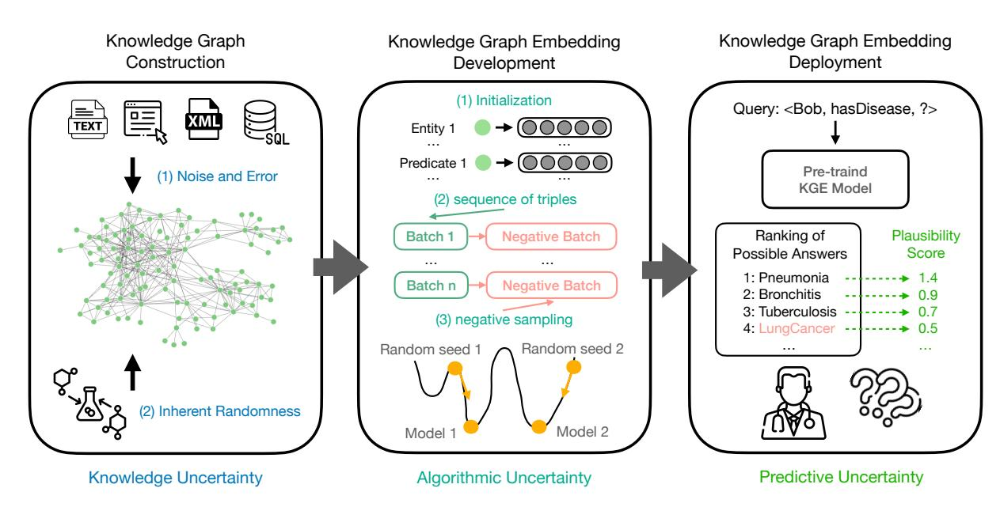

# Thesis Proposal: Uncertainty in Knowledge Graph Embeddings

Yuqicheng Zhu

Bosch Center for Artificial Intelligence, Germany University of Stuttgart, Germany Yuqicheng.Zhu@de.bosch.com

# Abstract

Knowledge Graph Embedding (KGE) methods are widely used to map entities and relations from knowledge graphs (KGs) into continuous vector spaces, enabling non-classical reasoning over knowledge structures. Despite their effectiveness, the uncertainty of KGE methods has not been extensively studied in the literature. This gap poses significant challenges, particularly when deploying KGE models in highstakes domains like medicine, where reliability and risk assessment are critical. This dissertation seeks to investigate various types of uncertainty in KGE methods and explore strategies to quantify, mitigate, and reason under uncertainty effectively. The outcomes of this research will contribute to enhancing the reliability of KGE methods, providing greater confidence in their use beyond benchmark datasets, and supporting their application in real-world, high-stakes domains.

# 1 Introduction

Knowledge graphs (KGs) encode factual knowledge about real-world entities and their relationships, represented as triples <*head entity*, *predicate*, *tail entity*>. These structures provide semantically rich information, playing a crucial role in advancing intelligent systems [\(Lenat and Feigenbaum,](#page-5-0) [2000\)](#page-5-0). Ontologies and logic rules, as standard knowledge representation formalisms, are commonly used to reason about the semantics in KGs [\(Hogan et al.,](#page-5-1) [2021\)](#page-5-1). However, management and updating of rules can be cumbersome and the inherently symbolic nature of such systems complicates their integration with machine learning tasks.

Knowledge graph embedding (KGE) methods map entities and predicates into numerical vectors (a.k.a embeddings), providing non-classical reasoning capability by exploiting similarities and analogies over knowledge structure [\(Wang et al.,](#page-6-0) [2017;](#page-6-0) [Zhu et al.,](#page-6-1) [2024a\)](#page-6-1). While KGE methods have

demonstrated effectiveness in various downstream tasks, including triple classification [\(Socher et al.,](#page-6-2) [2013\)](#page-6-2), link prediction [\(Bordes et al.,](#page-5-2) [2013;](#page-5-2) [Nickel](#page-6-3) [et al.,](#page-6-3) [2011\)](#page-6-3) and recommendation [\(Liu et al.,](#page-5-3) [2019\)](#page-5-3), the uncertainty of KGE methods remains largely under-explored.

Handling uncertainty in KGE methods is critical because KGE models often encounter significant uncertainty in their predictions (*predictive uncertainty*) [\(Zhu et al.,](#page-6-1) [2024a](#page-6-1)[,b\)](#page-6-4). This predictive uncertainty can stem from several procedures throughout the KGE pipeline shown in Figure [1.](#page-1-0) During KG construction, noise and errors may arise from inconsistent or ambiguous data aggregated from multiple sources [\(Zhou et al.,](#page-6-5) [2022\)](#page-6-5), or from inaccurate automated knowledge extraction processes [\(Zhou](#page-6-6) [et al.,](#page-6-6) [2021\)](#page-6-6). Additionally, some knowledge is inherently uncertain, such as molecular interactions, which are random process by nature [\(Szklarczyk](#page-6-7) [et al.,](#page-6-7) [2016\)](#page-6-7). This uncertainty, associated with KGs before training the KGE model, is referred to as *knowledge uncertainty*. Furthermore, *algorithmic uncertainty* can emerge during model development, caused by randomness and variability in the KGE training process.

Understanding and dealing with these types of uncertainty is especially critical in high-stakes domains such as medicine, where reliable predictions and robust risk assessment are imperative. Despite the relevance, research on uncertainty in KGE methods remains limited. For instance, studies by [He et al.](#page-5-4) [\(2015\)](#page-5-4); [Xiao et al.](#page-6-8) [\(2015\)](#page-6-8); [Wang et al.](#page-6-9) [\(2022\)](#page-6-9) model algorithmic uncertainty and predictive uncertainty using probabilistic embeddings. While these approaches have improved overall accuracy, the quality of the modeled uncertainty has not been systematically studied. Moreover, these methods often demand additional parameters, incur high computational costs due to the need for calculating distance between probability distribution, and are challenging to adapt to other KGE methods

Image generated by Flourish: https://flourish.studio/, logo generate by Flaticon: https://www.flaticon.com/ Figure 1: This figure illustrates the three key stages in the KGE pipeline and their associated uncertainties: (1) *Knowledge Uncertainty* arises during knowledge graph construction due to noise, errors, and inherent randomness in the knowledge sources; (2) *Algorithmic Uncertainty* is introduced during KGE development through randomized initialization, batch sampling, and negative sampling, leading to variations in the resulting models; and (3) *Predictive Uncertainty*, which occurs in the deployment of a pre-trained KGE model, refers to the model's confidence in its predictions for a given query.

without substantial modifications.

To address these gaps, this dissertation plans to systematically explore various types of uncertainty in KGE methods and aim to propose modelagnostic and easy-to-implement approaches to deal with uncertainty. The remainder of this dissertation proposal is structured as follows: Section 2 provides an overview of KGE methods and related work relevant to this research. Section 3 details the research questions and the proposed methodologies to address them. Section 4 concludes the proposal and outlines the anticipated contributions.

# 2 Background

# 2.1 Knowledge Graph Embedding

A KG G is a labelled directed graph, which can be viewed as a set of triples T ⊆ E × R × E, where E is the set of entities, and R is the set of predicates. An entity represents a real-world object. Often the labels of entities and predicates are chosen to be URIs or IRIs (Internationalised Resource Identifiers). The elements in G are called triples and denoted as ⟨h, r, t⟩, where h ∈ E is the subject, r ∈ R is the predicate, and t ∈ E is the object.

A KGE model Mθ : E × R × E → R assigns a score to each triple, measuring the plausibility that the triple holds. Concretely, there are three key components of a KGE model: *embedding mapping*, *score function* and *embedding training* [\(Cao et al.,](#page-5-5) [2022\)](#page-5-5).

Embedding Mapping. In the embedding mapping process, entities and predicates are mapped into vector representations. For example, TransE [\(Bordes et al.,](#page-5-2) [2013\)](#page-5-2) map them into Euclidean space, while others map them into alternative mathematical spaces, such as complex space [\(Sun et al.,](#page-6-10) [2019\)](#page-6-10) or hyperbolic space [\(Balazevic et al.,](#page-5-6) [2019;](#page-5-6) [Xiong et al.,](#page-6-11) [2022\)](#page-6-11). Let h, r and t denote the vector representation of entities and predicates in a triple.

Score Function. The score function, denoted as s(h, r, t), then calculates a plausibility score for the triple based on the vector representations. For example, the translation-based scoring function s(h, r, t) = −||h + r − t||1/2 is widely used to measure the plausibility that a triple is positive [\(Bordes et al.,](#page-5-2) [2013\)](#page-5-2). More scoring functions are summarized in Table [1.](#page-2-0)

Embedding Training. The parameters θ are learned to let Mθ assign higher plausibility scores to positive triples (real facts) while assigning lower plausibility scores to negative triples (false facts). Training begins with random initialization of θ and then minimizes a loss function, such as *marginbased ranking loss* [\(Bordes et al.,](#page-5-2) [2013\)](#page-5-2) or *crossentropy loss* [\(Nickel et al.,](#page-6-3) [2011;](#page-6-3) [Dettmers et al.,](#page-5-7)

|          |            |         |         |       | Score Function s ( ⟨ h , r , t ⟩ )  |
|----------|------------|---------|---------|-------|-------------------------------------|
| TransE   | (Bordes    | et      | al.,    | 2013) | −   h + r − t    1 / 2              |
| RotatE   | (Sun       | et al., | 2019)   |       | −   h ◦ r − t    p                  |
| RESCAL   | (Nickel    | et      | al.,    | 2011) | h                                   |
|          |            |         |         |       | T M r t                             |
| DistMult | (Yang      | et      | al.,    | 2015) | h                                   |
|          |            |         |         |       | T diag ( r ) t                      |
| ComplEx  | (Trouillon |         | et al., | 2016) | Re ( h                              |
|          |            |         |         |       | T diag ( r ) t )                    |
| ConvE    | (Dettmers  | et      | al.,    | 2018) | f ( vec ( f ([ h ; r ] ∗ ω )) W ) t |

Table 1: The score function of KGE models, where ◦ denotes Hadamard product. · refers to conjugate for complex vectors in ComplEx, and 2D reshaping for real vectors in ConvE. ∗ is operator for 2D convolution. ω is the filters and W is the parameters for 2D convolutional layer.

[2018\)](#page-5-7). Since ground truth negative triples are typically unavailable in KGs, they are generated by corrupting positive triples during training. A common approach involves replacing the head or tail entity in an observed triple with a random entity sampled from E.

#### 2.2 Downstream Tasks and Evaluation

The quality of learned embeddings is commonly assessed through two primary tasks: *triple classification* and *link prediction* [\(Bordes et al.,](#page-5-2) [2013\)](#page-5-2), with their performance measured using specific evaluation metrics.

Triple Classification. The goal of triple classification is to determine whether a given triple is true or false. The model uses the learned embeddings to compute plausibility scores and classify triples accordingly. Performance is evaluated using standard binary classification metrics, such as accuracy, precision, recall, and F1 score.

Link Prediction. Link prediction is essentially a ranking task aimed at answering a given query, such as ⟨h, r, ?⟩ or ⟨?, r, t⟩. The model ranks potential triples ⟨h, r, e⟩ or ⟨e, r, t⟩, where e ∈ E, based on their plausibility scores. Positive triples are expected to rank higher than negative ones. Rankingbased metrics are used to evaluate performance:

- Mean Rank (MR): The average rank of the true entity in the model's predictions.
- Mean Reciprocal Rank (MRR): The average reciprocal rank of the true entity.
- Hits@K: The proportion of test triples where the true entity is ranked within the top-K predictions.

Beyond these tasks, KG embeddings are used to answer more complex queries [\(He et al.,](#page-5-8) [2023,](#page-5-8) [2024a,](#page-5-9)[b\)](#page-5-10).

#### 2.3 Related Work

Several works embed entities and relations from deterministic KGs as probabilistic distributions rather than single numerical vectors to model uncertainty in the embeddings [\(He et al.,](#page-5-4) [2015;](#page-5-4) [Xiao et al.,](#page-6-8) [2015;](#page-6-8) [Wang et al.,](#page-6-9) [2022\)](#page-6-9). These methods typically learn distribution parameters by minimizing the KL-divergence between the probability distribution of the difference between head and tail entities and that of the relation, adhering to the translational paradigm of KGE models. While this line of work captures both algorithmic and predictive uncertainty through prior and posterior distributions in the vector representations, the evaluation primarily focuses on accuracy, leaving the quality of the uncertainty modeling largely unexplored. To the best of our knowledge, [Loconte et al.](#page-5-11) [\(2023\)](#page-5-11) is the only study that evaluates uncertainty quality using calibration diagrams and empirical calibration error, as detailed in [Loconte et al.](#page-5-11) [\(2023,](#page-5-11) Appendix F.5.3).

Other approaches represent knowledge uncertainty by associating facts or axioms with a confidence score or probability [\(Chen et al.,](#page-5-12) [2019,](#page-5-12) [2021b,](#page-5-13)[a;](#page-5-14) [Zhu et al.,](#page-7-0) [2023,](#page-7-0) [2024c\)](#page-6-14). These methods aim to learn embeddings that incorporate both KG structure and input data uncertainty. For instance, UKGE [\(Chen et al.,](#page-5-12) [2019\)](#page-5-12) extends DistMult [\(Yang](#page-6-15) [et al.,](#page-6-15) [2014\)](#page-6-15) by predicting confidence scores for facts. It computes the plausibility of triples as the product of embedding vectors and maps this plausibility to a confidence score in the range [0, 1]. To enrich the training data, UKGE employs probabilistic soft logic to infer confidence scores for a subset of unseen triples. Subsequent work enhances these methods through improved negative sampling strategies via semi-supervised learning [\(Chen et al.,](#page-5-13) [2021b\)](#page-5-13) and by increasing the robustness and expressiveness of UKGE using entity representations as boxes and affine transformations for relations [\(Chen et al.,](#page-5-14) [2021a\)](#page-5-14).

Explicit studies on predictive uncertainty in triple classification have also been conducted. Research by [Tabacof and Costabello](#page-6-16) [\(2020\)](#page-6-16) and [Safavi et al.](#page-6-17) [\(2020a\)](#page-6-17) applies off-the-shelf calibration techniques, such as Platt scaling and isotonic regression, to KGE models. These techniques convert uncalibrated plausibility scores into probabilities by minimizing the negative log-likelihood on a validation set. However, these approaches are sensitive to the quality of the validation set and lack formal guarantees for the generated probabilities.

### 3 Research Questions

The primary objective of this dissertation is to systematically investigate various types of uncertainty in KGE methods and to develop model-agnostic approaches for effectively managing them. Specifically, this work focuses on the following research questions:

RQ1: For the reducible component of predictive uncertainty caused by algorithmic uncertainty, how can we effectively reduce it?

RQ2: For the irreducible component of predictive uncertainty, how can we reliably quantify it with statistical guarantees?

RQ3: When knowledge uncertainty is explicitly present in the input KGs, how can KGE methods effectively and efficiently reason under such uncertainty?

In this section, I will elaborate on each research question, introduce sub-research questions, outline tentative solutions, and describe the preliminary results or the expected contributions for each.

### 3.1 Reducing Uncertainty

The training process for KGE models, described in Section 2.1, introduces randomness through various sources, such as randomized embedding initialization, randomized sequences of training triples, and randomized negative sampling. Due to the non-convex nature of the training process, identical configurations (including the training KG, KGE algorithm, and hyperparameters) can result in different KGE models that converge to different local minima.

Among the possible KGE models trained under the same configuration, some may achieve similar accuracy on the training KG but differ significantly in their vector representations of entities and predicates, capturing distinct patterns. This phenomenon, known as model multiplicity in machine learning [\(Breiman,](#page-5-15) [2001;](#page-5-15) [Marx et al.,](#page-6-18) [2020;](#page-6-18) [Black et al.,](#page-5-16) [2022b](#page-5-16)[,a\)](#page-5-17), poses a significant obstacle to reliably training models that behave as expected during deployment [\(D'Amour et al.,](#page-5-18) [2022\)](#page-5-18). An extreme example involves two models with both 50% accuracy but mutually contradictory predictions on the validation set, which creates challenges

for model selection. Randomly selecting models based on accuracy alone fails to justify decisionmaking, especially in high-stakes domains such as loan approval or medical diagnosis [\(Black et al.,](#page-5-16) [2022b\)](#page-5-16).

Model multiplicity is a specific form of algorithmic uncertainty that contributes to predictive uncertainty by producing conflicting predictions under identical training configurations. To better understand and address model multiplicity in KGE methods, this research investigates the following sub-questions:

- RQ1.1: How can model multiplicity in KGE methods be formally defined?
- RQ1.2: How can model multiplicity in KGE methods be measured?
- RQ1.3: What are the key factors influencing model multiplicity in KGE methods?
- RQ1.4: How can model multiplicity in KGE methods be alleviated to reduce predictive uncertainty?

Although model multiplicity is known to be ubiquitous in gradient-based optimization [\(D'Amour](#page-5-18) [et al.,](#page-5-18) [2022\)](#page-5-18), we explore strategies to mitigate the predictive uncertainty it induces. A promising approach involves ensembling models trained with different random seeds. Such ensembles, inspired by voting methods from social choice theory [\(Brandt et al.,](#page-5-19) [2016\)](#page-5-19), can combine predictions to reduce the impact of single model's error, thereby effectively reducing predictive uncertainty [\(Black](#page-5-17) [et al.,](#page-5-17) [2022a;](#page-5-17) [Potyka et al.,](#page-6-19) [2024\)](#page-6-19).

Our preliminary results in [\(Zhu et al.,](#page-6-1) [2024a\)](#page-6-1) contribute in the following aspects:

- Development of suitable evaluation metrics to quantify and analyze model multiplicity in the context of KGE methods.
- Theoretical insights into model multiplicity in KGE methods.
- Design of a novel ensemble-based strategy to effectively reduce predictive uncertainty caused by model multiplicity.

# 3.2 Quantifying Uncertainty

Once a KGE model is deployed, the reliability of its predictions becomes a critical concern. Current KGE models generate plausibility scores for triples, which are used to differentiate positive triples from negative ones. However, these scores lack probabilistic interpretation and do not reflect the true likelihood of a triple being correct [\(Tabacof and](#page-6-20) [Costabello,](#page-6-20) [2019;](#page-6-20) [Safavi et al.,](#page-6-21) [2020b\)](#page-6-21).

Previous studies [\(Tabacof and Costabello,](#page-6-20) [2019;](#page-6-20) [Safavi et al.,](#page-6-21) [2020b\)](#page-6-21) have attempted to calibrate these plausibility scores using techniques that convert them into probabilities. However, this calibration relies on high-quality negative triples in the validation set, which are often unavailable. Furthermore, the calibration process, which minimizes negative log-likelihood on the validation set, is sensitive to the distribution of validation triples and offers no theoretical guarantees for the calibrated probabilities. Consequently, practitioners lack a reliable framework to assess when predictions can be trusted.

To address this issue, the following subquestions are explored:

- RQ2.1: Can the uncertainty of KGE methods be quantified without relying on ground-truth negative triples?
- RQ2.2: Is it possible to provide statistical guarantees for the quantified uncertainty?

Conformal prediction [\(Vovk et al.,](#page-6-22) [2005\)](#page-6-22), a general framework for generating prediction sets that include the ground truth with predefined probabilistic guarantees, is a good candidate to provide statistically rigorous uncertainty estimates.

In [Zhu et al.](#page-6-4) [\(2024b\)](#page-6-4), we first assess whether the assumptions of conformal prediction, particularly the exchangeability of triples between the training and test sets, are satisfied in the context of KGE. We then establish theoretical guarantees for the coverage probability and empirically verify them through comprehensive evaluations.

The contributions of this work include:

- Development of a novel uncertainty quantification methods with statistical guarantees.
- An efficient implementation of the approach.

# 3.3 Reasoning under Uncertainty

Most existing KGE methods assume deterministic KGs as input, where every fact is treated as unequivocally true. However, real-world knowledge is often uncertain due to noise, acquisition errors, or the uncertain nature of knowledge itself. Reasoning under such knowledge uncertainty remains an under-explored area.

Recent studies [\(Chen et al.,](#page-5-12) [2019,](#page-5-12) [2021b,](#page-5-13)[a\)](#page-5-14) have extended KGE methods to uncertain KGs by modifying the loss function and incorporating probabilistic reasoning techniques such as probabilistic soft logic [\(Chen et al.,](#page-5-12) [2019\)](#page-5-12) and semi-supervised learning [\(Chen et al.,](#page-5-13) [2021b\)](#page-5-13). However, these approaches produce only point estimates for predictions, failing to capture the inherent variance associated with uncertainty.

Given the complexity of modeling deterministic KGs, reasoning under knowledge uncertainty presents additional challenges in capturing the uncertainty associated with triples. This motivates the following research questions:

- RQ3.1: What is the variance in predictions made by existing uncertain KGE methods when the training process is repeated?
- RQ3.2: How can prediction intervals be estimated to reliably reflect the uncertainty of predictions instead of relying solely on point estimates?

Conformal prediction, also commonly used for regression task to provide prediction intervals with guarantees [\(Vovk et al.,](#page-6-22) [2005;](#page-6-22) [Lei et al.,](#page-5-20) [2018\)](#page-5-20), is planed to be applied to develop an approach for reasoning under knowledge uncertainty with reliable uncertainty estimates. The expected contributions are as follows:

- Systematical analysis of the variance of point estimates produced by existing uncertain KGE methods.
- Development of a novel uncertain KGE approach with reliable uncertainty estimates.

# 4 Conclusion

In summary, this research seeks to address the critical yet underexplored challenge of uncertainty in KGE methods. By investigating knowledge, algorithmic, and predictive uncertainty, the dissertation aims to enhance the reliability of KGE methods, particularly in high-stakes applications. The anticipated contributions include novel methodologies and theoretical insights for reducing, quantifying and reasoning under uncertainty. These advancements will not only bridge significant gaps in current research but also support the deployment of more reliable KGE systems in real-world scenarios.

- 5 Acknowledgements The authors thank the International Max Planck Research School for Intelligent Systems (IMPRS-IS) for supporting Yuqicheng Zhu. The work was partially supported by EU Projects Graph Massivizer (GA 101093202), enRichMyData (GA 101070284) and SMARTY (GA 101140087). References Ivana Balazevic, Carl Allen, and Timothy Hospedales. 2019. Multi-relational poincaré graph embeddings. *Advances in Neural Information Processing Systems*,
- 32. Emily Black, Klas Leino, and Matt Fredrikson. 2022a. Selective ensembles for consistent predictions. In *ICLR*. OpenReview.net. Emily Black, Manish Raghavan, and Solon Barocas. 2022b. Model multiplicity: Opportunities, concerns, and solutions. In *Proceedings of the 2022 ACM Conference on Fairness, Accountability, and Transparency*, pages 850–863. Antoine Bordes, Nicolas Usunier, Alberto Garcia-Duran, Jason Weston, and Oksana Yakhnenko. 2013. Translating embeddings for modeling multirelational data. *Advances in neural information processing systems*, 26. Felix Brandt, Vincent Conitzer, Ulle Endriss, Jérôme Lang, and Ariel D. Procaccia, editors. 2016. *[Hand](https://doi.org/10.1017/CBO9781107446984)[book of Computational Social Choice](https://doi.org/10.1017/CBO9781107446984)*. Cambridge University Press. Leo Breiman. 2001. Statistical modeling: The two cultures (with comments and a rejoinder by the author). *Statistical science*, 16(3):199–231. Jiahang Cao, Jinyuan Fang, Zaiqiao Meng, and Shangsong Liang. 2022. Knowledge graph embedding: A survey from the perspective of representation spaces. *arXiv preprint arXiv:2211.03536*. Xuelu Chen, Michael Boratko, Muhao Chen, Shib Sankar Dasgupta, Xiang Lorraine Li, and Andrew McCallum. 2021a. Probabilistic box embeddings for uncertain knowledge graph reasoning. *arXiv preprint arXiv:2104.04597*. Xuelu Chen, Muhao Chen, Weijia Shi, Yizhou Sun, and Carlo Zaniolo. 2019. Embedding uncertain knowledge graphs. In *Proceedings of the AAAI conference on artificial intelligence*, volume 33, pages 3363– 3370. Zhu-Mu Chen, Mi-Yen Yeh, and Tei-Wei Kuo. 2021b. Passleaf: a pool-based semi-supervised learning framework for uncertain knowledge graph embedding. In *Proceedings of the AAAI Conference on Artificial Intelligence*, volume 35, pages 4019–4026. Alexander D'Amour, Katherine Heller, Dan Moldovan, Ben Adlam, Babak Alipanahi, Alex Beutel, Christina Chen, Jonathan Deaton, Jacob Eisenstein, Matthew D Hoffman, et al. 2022. Underspecification presents challenges for credibility in modern machine learning. *Journal of Machine Learning Research*, 23(226):1–
  - 61. Tim Dettmers, Pasquale Minervini, Pontus Stenetorp, and Sebastian Riedel. 2018. Convolutional 2d knowledge graph embeddings. In *Proceedings of the AAAI conference on artificial intelligence*, volume 32. Shizhu He, Kang Liu, Guoliang Ji, and Jun Zhao. 2015. Learning to represent knowledge graphs with gaussian embedding. In *Proceedings of the 24th ACM international on conference on information and knowledge management*, pages 623–632. Yunjie He, Daniel Hernandez, Mojtaba Nayyeri, Bo Xiong, Yuqicheng Zhu, Evgeny Kharlamov, and Steffen Staab. 2024a. Generating sroi− ontologies via knowledge graph query embedding learning. *arXiv preprint arXiv:2407.09212*. Yunjie He, Mojtaba Nayyeri, Bo Xiong, Yuqicheng Zhu, Evgeny Kharlamov, and Steffen Staab. 2023. Can pattern learning enhance complex logical query answering? In *ISWC (Poster/Demos/Industry)*. Yunjie He, Bo Xiong, Daniel Hernández, Yuqicheng Zhu, Evgeny Kharlamov, and Steffen Staab. 2024b. Dage: Dag query answering via relational combinator with logical constraints. *arXiv preprint arXiv:2410.22105*. Aidan Hogan, Eva Blomqvist, Michael Cochez, Claudia d'Amato, Gerard De Melo, Claudio Gutierrez, Sabrina Kirrane, José Emilio Labra Gayo, Roberto Navigli, Sebastian Neumaier, et al. 2021. Knowledge graphs. *ACM Computing Surveys (Csur)*, 54(4):1–
  - 37. Jing Lei, Max G'Sell, Alessandro Rinaldo, Ryan J Tibshirani, and Larry Wasserman. 2018. Distributionfree predictive inference for regression. *Journal of the American Statistical Association*, 113(523):1094– 1111. Douglas Lenat and E Feigenbaum. 2000. On the thresholds of knowledge. *Artificial Intelligence: Critical Concepts*, 2:298. Chan Liu, Lun Li, Xiaolu Yao, and Lin Tang. 2019. A survey of recommendation algorithms based on knowledge graph embedding. In *2019 IEEE International Conference on Computer Science and Educational Informatization (CSEI)*, pages 168–171. IEEE. Lorenzo Loconte, Nicola Di Mauro, Robert Peharz, and Antonio Vergari. 2023. How to turn your knowledge graph embeddings into generative models via probabilistic circuits. *arXiv preprint arXiv:2305.15944*.

Charles T. Marx, Flávio P. Calmon, and Berk Ustun. 2020. Predictive multiplicity in classification. In *ICML*, volume 119 of *Proceedings of Machine Learning Research*, pages 6765–6774. PMLR. Maximilian Nickel, Volker Tresp, and Hans-Peter Kriegel. 2011. A three-way model for collective learning on multi-relational data. In *ICML*, pages 809–816. Omnipress. Nico Potyka, Yuqicheng Zhu, Yunjie He, Evgeny Kharlamov, and Steffen Staab. 2024. Robust knowledge extraction from large language models using social choice theory. In *Proceedings of the 23rd International Conference on Autonomous Agents and Multiagent Systems*, AAMAS '24, page 1593–1601, Richland, SC. International Foundation for Autonomous Agents and Multiagent Systems. Tara Safavi, Danai Koutra, and Edgar Meij. 2020a. Evaluating the calibration of knowledge graph embeddings for trustworthy link prediction. In *EMNLP (1)*, pages 8308–8321. Association for Computational Linguistics. Tara Safavi, Danai Koutra, and Edgar Meij. 2020b. Evaluating the calibration of knowledge graph embeddings for trustworthy link prediction. *arXiv preprint arXiv:2004.01168*. Richard Socher, Danqi Chen, Christopher D Manning, and Andrew Ng. 2013. Reasoning with neural tensor networks for knowledge base completion. *Advances in neural information processing systems*, 26. Zhiqing Sun, Zhi-Hong Deng, Jian-Yun Nie, and Jian Tang. 2019. Rotate: Knowledge graph embedding by relational rotation in complex space. In *ICLR (Poster)*. OpenReview.net. Damian Szklarczyk, John H Morris, Helen Cook, Michael Kuhn, Stefan Wyder, Milan Simonovic, Alberto Santos, Nadezhda T Doncheva, Alexander Roth, Peer Bork, et al. 2016. The string database in 2017: quality-controlled protein–protein association networks, made broadly accessible. *Nucleic acids research*, page gkw937. Pedro Tabacof and Luca Costabello. 2019. Probability calibration for knowledge graph embedding models. *arXiv preprint arXiv:1912.10000*. Pedro Tabacof and Luca Costabello. 2020. Probability calibration for knowledge graph embedding models. In *ICLR*. OpenReview.net. Théo Trouillon, Johannes Welbl, Sebastian Riedel, Éric Gaussier, and Guillaume Bouchard. 2016. Complex embeddings for simple link prediction. In *International conference on machine learning*, pages 2071– 2080. PMLR. Vladimir Vovk, Alexander Gammerman, and Glenn Shafer. 2005. *Algorithmic learning in a random world*, volume 29. Springer. Feiyang Wang, Zhongbao Zhang, Li Sun, Junda Ye, and Yang Yan. 2022. Dirie: knowledge graph embedding with dirichlet distribution. In *Proceedings of the ACM Web Conference 2022*, pages 3082–3091. Quan Wang, Zhendong Mao, Bin Wang, and Li Guo. 2017. Knowledge graph embedding: A survey of approaches and applications. *IEEE transactions on knowledge and data engineering*, 29(12):2724–2743. Han Xiao, Minlie Huang, Yu Hao, and Xiaoyan Zhu. 2015. Transg: A generative mixture model for knowledge graph embedding. *arXiv preprint arXiv:1509.05488*. Bo Xiong, Shichao Zhu, Mojtaba Nayyeri, Chengjin Xu, Shirui Pan, Chuan Zhou, and Steffen Staab. 2022. Ultrahyperbolic knowledge graph embeddings. In *Proceedings of the 28th ACM SIGKDD Conference on Knowledge Discovery and Data Mining*, pages 2130–2139. Bishan Yang, Wen-tau Yih, Xiaodong He, Jianfeng Gao, and Li Deng. 2014. Embedding entities and relations for learning and inference in knowledge bases. *arXiv preprint arXiv:1412.6575*. Bishan Yang, Wen-tau Yih, Xiaodong He, Jianfeng Gao, and Li Deng. 2015. Embedding entities and relations for learning and inference in knowledge bases. In *ICLR (Poster)*. Dongzhuoran Zhou, Baifan Zhou, Jieying Chen, Gong Cheng, Egor Kostylev, and Evgeny Kharlamov. 2021. Towards ontology reshaping for kg generation with user-in-the-loop: applied to bosch welding. In *Proceedings of the 10th International Joint Conference on Knowledge Graphs*, pages 145–150. Dongzhuoran Zhou, Baifan Zhou, Zhuoxun Zheng, Ahmet Soylu, Gong Cheng, Ernesto Jimenez-Ruiz, Egor V Kostylev, and Evgeny Kharlamov. 2022. Ontology reshaping for knowledge graph construction: applied on bosch welding case. In *International Semantic Web Conference*, pages 770–790. Springer. Yuqicheng Zhu, Nico Potyka, Mojtaba Nayyeri, Bo Xiong, Yunjie He, Evgeny Kharlamov, and Steffen Staab. 2024a. Predictive multiplicity of knowledge graph embeddings in link prediction. In *Findings of the Association for Computational Linguistics: EMNLP 2024*, pages 334–354. Yuqicheng Zhu, Nico Potyka, Jiarong Pan, Bo Xiong, Yunjie He, Evgeny Kharlamov, and Steffen Staab. 2024b. Conformalized answer set prediction for knowledge graph embedding. *arXiv preprint arXiv:2408.08248*. Yuqicheng Zhu, Nico Potyka, Bo Xiong, Trung-Kien Tran, Mojtaba Nayyeri, Evgeny Kharlamov, and Steffen Staab. 2024c. Approximating probabilistic inference in statistical el with knowledge graph embeddings. *arXiv preprint arXiv:2407.11821*.

Yuqicheng Zhu, Nico Potyka, Bo Xiong, Trung-Kien Tran, Mojtaba Nayyeri, Steffen Staab, and Evgeny Kharlamov. 2023. Towards statistical reasoning with ontology embeddings. In *ISWC (Poster/Demos/Industry)*.