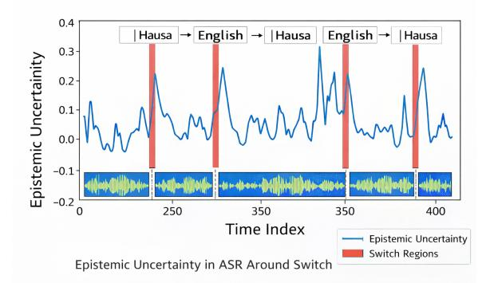

# Thesis Proposal:Self-Adaptive and Epistemic Uncertainty-Guided ASR of Dense Intra-Sentential Code-Switched Speech for African Low-Resource Languages

Umar Baba Umar Sulaimon Adebayo Bashir

Abdulmalik Danlami Mohammed Amina Gogo Tafida

Federal University of Technology Minna, Nigeria

{umar.umar, bashirsulaimon, drmalik,aminatafida}@futminna.edu.ng

## Abstract

Automatic Speech Recognition (ASR) has achieved strong performance for high-resource languages, but dense intra-sentential codeswitched speech in African low-resource settings remains underexplored. Existing multilingual and pretrained ASR systems improve general recognition accuracy, yet they remain weak at switch regions, are sensitive to language imbalance during adaptation, and are typically evaluated with metrics that obscure switching-specific errors. This thesis proposes a self-adaptive and epistemic uncertaintyguided framework for African low-resource code-switched ASR, using Hausa–English (Engausa) and Hausa–Yorùbá as case studies. The work investigates three linked questions: (1) how to design a linguistically informed codeswitched corpus with explicit switch-region annotation and labeled/unlabeled partitions for adaptive learning, (2) whether epistemic uncertainty is systematically elevated around switch regions and can guide pseudo-label selection in semi-supervised training, and (3) whether switch-aware adaptation with auxiliary language identification and boundary supervision can reduce recognition errors without increasing catastrophic forgetting. The long-term goal is to develop scalable and data-efficient ASR systems that model code-switching as a structured linguistic phenomenon rather than as noise in multilingual African speech.

# 1 Introduction

Automatic Speech Recognition (ASR) has become a foundational component of modern Natural Language Processing, enabling machines to transcribe and interpret spoken language at scale. Advances in deep learning, self-supervised pretraining, and multilingual transfer have substantially improved ASR performance for high-resource languages, supporting applications such as voice assistants, meeting transcription, and captioning systems [\(Radford](#page-8-0)

Figure 1: Example of dense intra-sentential codeswitching in Hausa–English speech. The utterance contains multiple language alternations within a single sentence, reflecting natural bilingual communication patterns.

[et al.,](#page-8-0) [2022;](#page-8-0) [Pratap et al.,](#page-8-1) [2024\)](#page-8-1). Large multilingual models such as Whisper [\(Radford et al.,](#page-8-0) [2022\)](#page-8-0) and Massively Multilingual Speech (MMS) [\(Pratap](#page-8-1) [et al.,](#page-8-1) [2024\)](#page-8-1) demonstrate strong cross-lingual transfer across hundreds of languages.

However, real-world speech environments are not uniformly monolingual. In multilingual communities, speakers frequently alternate between languages within a conversation or even within a single utterance, a phenomenon known as codeswitching [\(Poplack,](#page-8-2) [1980;](#page-8-2) [Myers-Scotton,](#page-8-3) [1997\)](#page-8-3). Dense intra-sentential code-switching is particularly difficult for ASR because it introduces abrupt phonological, lexical, and syntactic transitions within the same sentence. These transitions increase acoustic ambiguity, disrupt language continuity, and often concentrate recognition errors around switch regions.

To illustrate dense intra-sentential codeswitching in African multilingual contexts, consider the example in Figure [1,](#page-0-0) where a speaker alternates between Hausa and English multiple times within a single utterance.

This challenge is especially relevant in African multilingual contexts. In Nigeria, indigenous languages coexist with English in education, media, commerce, governance, and daily communication, making bilingual and multilingual speech highly common. In such environments, speakers may alternate between English and local languages for emphasis, technical vocabulary, topic shift, social identity, and communicative efficiency. Yet code-switched ASR research has focused disproportionately on high-resource or relatively well-studied pairs such as Mandarin–English and Arabic–English [\(Lyu et al.,](#page-8-4) [2010;](#page-8-4) [Ali and Al](#page-7-0)[darmaki,](#page-7-0) [2024\)](#page-7-0). These lines of work are important, but they do not resolve the specific combination of sparse bilingual resources, language imbalance, and low-resource adaptation that characterizes African code-switched ASR.

A close reading of existing literature suggests that the problem is broader than simple data scarcity. First, many available corpora are predominantly monolingual or weakly annotated for switching. Second, current multilingual ASR systems generally treat switching as an implicit byproduct of multilingual training rather than as a supervised modeling target. Third, adaptive and semisupervised learning methods remain vulnerable to pseudo-label noise, dominant-language bias, and catastrophic forgetting. Finally, standard evaluation metrics such as Word Error Rate (WER) frequently conceal the specific errors that matter most in code-switched speech, particularly boundaryregion failures and language imbalance.

This thesis addresses these problems through a unified research program focused on dense intra-sentential African code-switched ASR, using Hausa–English (Engausa) and Hausa–Yorùbá as case studies. The work is guided by three research questions:

- RQ1: How can a linguistically informed African code-switched speech corpus be designed to capture switch regions, distinguish borrowings from genuine switch events, and support both supervised and semi-supervised ASR training?
- RQ2: Is epistemic uncertainty systematically higher in code-switch regions than in monolingual regions, and can boundary-aware uncertainty improve pseudo-label selection in semi-supervised code-switched ASR?
- RQ3: Can switch-aware adaptation that combines auxiliary language identification, boundary-region supervision, and uncertaintyguided weighting improve dense intrasentential code-switched ASR while reducing catastrophic forgetting across languages?

Together, these questions define a framework for treating code-switching not as noise, but as a structured linguistic phenomenon that requires explicit corpus design, adaptive learning, and switch-aware evaluation.

### 2 Background

#### 2.1 Code-Switched Automatic Speech Recognition

Code-switching refers to the alternation between two or more languages within discourse or within a single utterance [\(Poplack,](#page-8-2) [1980\)](#page-8-2). In multilingual speech communities, intra-sentential switching is especially challenging for ASR because it introduces localized acoustic and lexical discontinuities. Traditional monolingual ASR systems assume relatively stable acoustic distributions and lexicons within an utterance, whereas code-switched ASR must handle transcription and implicit language differentiation around language transitions.

Early code-switched ASR systems often used pipeline strategies that combined language identification with monolingual decoding [\(Lyu and Lyu,](#page-8-5) [2008\)](#page-8-5). While such systems improved segmentation in controlled settings, they frequently suffered from error propagation and unstable recognition at switch points. Later work introduced conversational code-switched corpora such as SEAME for Mandarin–English ASR [\(Lyu et al.,](#page-8-4) [2010\)](#page-8-4) and multilingual acoustic models for mixed-language recognition [\(Yılmaz et al.,](#page-8-6) [2018\)](#page-8-6). More recent methods use multilingual Transformers, pretrained speech models, and adapter-based fine-tuning [\(Rad](#page-8-0)[ford et al.,](#page-8-0) [2022;](#page-8-0) [Pratap et al.,](#page-8-1) [2024;](#page-8-1) [Kulkarni et al.,](#page-8-7) [2023\)](#page-8-7). Yet the literature consistently reports that switch regions remain difficult and that overall WER improvements do not necessarily imply stable handling of dense intra-sentential switching.

#### 2.2 Low-Resource African Speech and Corpus Design

Recent initiatives have improved low-resource African speech resources, including OkwuGbé [\(Dossou and Emezue,](#page-8-8) [2021\)](#page-8-8), Masakha-related efforts [\(Adelani et al.,](#page-7-1) [2021\)](#page-7-1), NaijaVoices [\(Emezue](#page-8-9) [et al.,](#page-8-9) [2025\)](#page-8-9), and WAXAL [\(Diack et al.,](#page-8-10) [2026\)](#page-8-10). These datasets are valuable for multilingual ASR, but most are predominantly monolingual and do not provide dense intra-sentential code-switch annotation. Data-centric reviews also show that synthetic augmentation can expand code-switched training

sets, yet synthetic speech often lacks conversational variability and realistic switch-boundary behavior [\(Sharma et al.,](#page-8-11) [2020;](#page-8-11) [Nguyen et al.,](#page-8-12) [2022;](#page-8-12) [Yu et al.,](#page-9-0) [2023;](#page-9-0) [Hussein et al.,](#page-8-13) [2023;](#page-8-13) [Liang et al.,](#page-8-14) [2023\)](#page-8-14). The main data limitation is therefore structural rather than purely quantitative.

#### 2.3 Adaptive Learning and Uncertainty Estimation

Adaptive and semi-supervised ASR methods aim to reduce dependence on labeled speech by finetuning multilingual pretrained models or by exploiting unlabeled speech through pseudo-labeling [\(Zhang et al.,](#page-9-1) [2020;](#page-9-1) [Khurana et al.,](#page-8-15) [2021;](#page-8-15) [Radford](#page-8-0) [et al.,](#page-8-0) [2022;](#page-8-0) [Pratap et al.,](#page-8-1) [2024\)](#page-8-1). Although these methods improve data efficiency, they remain vulnerable to pseudo-label noise, language imbalance, and catastrophic forgetting [\(Lugosch et al.,](#page-8-16) [2022;](#page-8-16) [Babatunde et al.,](#page-7-2) [2025a\)](#page-7-2). Bayesian approximations such as Monte Carlo Dropout provide a practical way to estimate epistemic uncertainty [\(Gal and](#page-8-17) [Ghahramani,](#page-8-17) [2016\)](#page-8-17). However, in code-switched ASR, uncertainty has rarely been analyzed as a structured signal tied to switch regions.

#### 2.4 Evaluation Challenges in Code-Switched ASR

WER remains the dominant evaluation metric in ASR, but evaluation-centric work shows that global WER often hides boundary-region failures and language imbalance in code-switched speech [\(Sitaram et al.,](#page-8-18) [2019;](#page-8-18) [Winata et al.,](#page-8-19) [2023\)](#page-8-19). In bilingual speech, a system may achieve lower overall WER while still performing poorly on embeddedlanguage segments or near switch regions. This suggests that robust code-switched ASR evaluation requires multiple complementary metrics, including language-specific WER and switch-region error analysis.

### 2.5 Research Gap

The literature reveals four connected gaps:

- 1. Data gap: African code-switched corpora remain scarce, structurally weak, or weakly annotated for switch regions.
- 2. Modeling gap: Existing multilingual ASR systems do not explicitly treat switch regions as supervised modeling targets.
- 3. Adaptive learning gap: Semi-supervised and fine-tuning approaches remain unstable under pseudo-label noise and language imbalance.

- 4. Evaluation gap: Global WER often hides the boundary-specific and language-specific failures that define dense intra-sentential codeswitched ASR.

### 3 Methodology

#### 3.1 RQ1: Corpus Design for Dense African Code-Switched ASR

Research Question. How can a linguistically informed African code-switched speech corpus be designed to capture switch regions, distinguish borrowings from genuine switch events, and support both supervised and semi-supervised ASR training?

Related Work and Limitation. Existing codeswitched corpora such as SEAME significantly improved research on Mandarin–English ASR [\(Lyu](#page-8-4) [et al.,](#page-8-4) [2010\)](#page-8-4), and multilingual African datasets have expanded low-resource speech coverage [\(Dossou](#page-8-8) [and Emezue,](#page-8-8) [2021;](#page-8-8) [Emezue et al.,](#page-8-9) [2025;](#page-8-9) [Diack](#page-8-10) [et al.,](#page-8-10) [2026\)](#page-8-10). However, these resources do not fully address the requirements of dense intra-sentential African code-switched ASR. Many datasets remain predominantly monolingual, weakly annotated for switching, or structurally unsuitable for semi-supervised learning.

Synthetic augmentation methods have been proposed to mitigate data scarcity [\(Sharma et al.,](#page-8-11) [2020;](#page-8-11) [Yu et al.,](#page-9-0) [2023;](#page-9-0) [Hussein et al.,](#page-8-13) [2023\)](#page-8-13). While these approaches increase data volume, they often fail to capture realistic switch-boundary behavior, coarticulation effects, and sociolinguistic patterns of natural speech. Similarly, linguistically motivated text generation methods [\(Pratapa et al.,](#page-8-20) [2018\)](#page-8-20) improve grammatical validity but are rarely integrated with speech-level modeling in low-resource African contexts.

The core limitation is therefore not only data scarcity, but the lack of *structurally appropriate* datasets that explicitly represent switch regions, support bilingual interaction, and enable adaptive learning.

Proposed Methodology. This thesis will construct a linguistically informed African codeswitched corpus centered on Hausa–English and Hausa–Yorùbá. Let the labeled portion be denoted by

DL = {(Xi , Yi , Li , Bi)} N i=1, (1)

where Xi is the speech signal, Yi is the transcription, Li is the token-level language tag sequence,

and Bi is the set of switch-region labels. The unlabeled portion is

DU = {Xj} M j=1. (2)

Rather than forcing a single exact switch frame, the annotation protocol defines a *switch region* as a short temporal window centered on a token-level language transition. A switch region for utterance i is defined as

Bi = {u : |u − tk| ≤ δ, tk ∈ T switch i }, (3)

where T switch i denotes aligned switch times and δ controls the boundary window width. This formulation explicitly addresses ambiguity in boundary alignment, including pauses, co-articulation, and gradual transitions, as highlighted by prior ASR challenges.

To further improve realism and scalability, the dataset will combine natural data collection with linguistically constrained synthetic augmentation. A subset of naturally collected sentences will serve as seed data for generating additional intrasentential code-switched text using large language models (LLMs). The generation process will be guided by established linguistic theories, including the Equivalence Constraint Theory [\(Poplack,](#page-8-2) [1980\)](#page-8-2) and the Matrix Language Frame Model [\(Myers-](#page-8-3)[Scotton,](#page-8-3) [1997\)](#page-8-3). These frameworks ensure that generated sentences preserve grammatical consistency, maintain matrix language structure, and reflect realistic switching patterns observed in bilingual speech.

The generated text will then be converted into speech using multilingual text-to-speech systems, producing synthetic audio that complements natural recordings while maintaining linguistic plausibility. This hybrid approach enables controlled expansion of switch patterns while retaining the acoustic variability of real-world speech.

The annotation protocol will also explicitly distinguish lexical borrowing from genuine switch events. Tokens that have become conventionalized within the matrix language will be labeled accordingly, while embedded-language spans that retain lexical identity will be annotated as switch regions. This distinction is critical for avoiding overestimation of switching frequency and ensuring accurate modeling of bilingual speech behavior.

Expected Contribution. RQ1 contributes a structured African code-switched speech resource with:

- explicit switch-region annotation,
- token-level bilingual language tags,
- labeled and unlabeled partitions for semisupervised learning,
- linguistically grounded synthetic augmentation guided by Poplack and MLFM.

This directly addresses the structural data gap in African dense intra-sentential code-switched speech and provides a foundation for boundaryaware modeling and adaptive learning.

#### 3.2 RQ2: Boundary-Aware Epistemic Uncertainty for Semi-Supervised Learning

Research Question. Is epistemic uncertainty systematically higher in code-switch regions than in monolingual regions, and can boundary-aware uncertainty improve pseudo-label selection in semisupervised code-switched ASR?

Related Work and Limitation. Semi-supervised learning and pseudo-label self-training have improved low-resource ASR by exploiting unlabeled speech [\(Zhang et al.,](#page-9-1) [2020\)](#page-9-1). Uncertainty-based filtering methods such as DUST improve pseudolabel quality by excluding unreliable predictions [\(Khurana et al.,](#page-8-15) [2021\)](#page-8-15), and Monte Carlo Dropout offers a practical approximation to epistemic uncertainty [\(Gal and Ghahramani,](#page-8-17) [2016\)](#page-8-17). However, most existing approaches estimate uncertainty at the utterance level and do not test whether uncertainty is specifically concentrated at switch regions. Adaptive reviews further show that pseudo-label quality often degrades under dominant-language bias in multilingual settings [\(Lugosch et al.,](#page-8-16) [2022\)](#page-8-16). The key gap is therefore the absence of boundary-aware uncertainty modeling in code-switched ASR.

Empirical Motivation. Preliminary observations and prior studies suggest that recognition errors in code-switched ASR are disproportionately concentrated around language transition points [\(Yılmaz](#page-8-6) [et al.,](#page-8-6) [2018;](#page-8-6) [Winata et al.,](#page-8-19) [2023\)](#page-8-19). These regions introduce abrupt changes in phonology, lexicon, and language context, which violate the stationarity assumptions typically learned by ASR models. As a result, the model's posterior distributions become less confident, leading to higher predictive entropy around switch boundaries.

To validate this intuition, we perform a preliminary analysis using a multilingual ASR model with Monte Carlo Dropout. Frame-wise uncertainty is computed across code-switched utterances, and the results show consistent spikes in predictive entropy around annotated switch regions compared to surrounding monolingual segments. This pattern suggests that epistemic uncertainty is not uniformly distributed across an utterance, but is instead systematically elevated near language transitions.

These observations provide empirical support for treating boundary uncertainty as a structured signal, motivating its use for switch-aware pseudo-label selection and adaptive learning in low-resource codeswitched ASR.

Proposed Methodology. Let an ASR model with parameters θ define the conditional distribution

pθ(Y | X). (4)

Using Monte Carlo Dropout, M stochastic forward passes are performed, yielding

p¯(yu | X) = 1 M X M m=1 pθm(yu | X), (5)

where θm denotes the sampled parameter realization at pass m. Token-level predictive entropy is then defined as

H(yu) = − X v∈V p¯(v | X) log ¯p(v | X), (6)

where V is the output vocabulary.

This thesis first treats elevated boundary uncertainty as a *testable hypothesis*, not an assumption. Mean uncertainty in switch regions will be compared against mean uncertainty in monolingual regions:

Ubnd(Xi) = 1 |Bi | X u∈Bi H(yu), (7)

Umono(Xi) = 1 |Mi | X u∈Mi H(yu), (8)

where Mi denotes non-boundary monolingual regions. The diagnostic question is whether

Ubnd(Xi) > Umono(Xi) (9)

For semi-supervised learning, pseudo-labels are generated as

Yˆ j = arg max Y pθ(Y | Xj ). (10)

Utterance-level uncertainty is

U(Xj ) = 1 Tj X Tj u=1 H(yu), (11)

but the proposed method also computes regionlevel uncertainty around switch windows:

Ubnd(Xj ) = 1 |Bj | X u∈Bj H(yu). (12)

Rather than discarding an entire switch-rich utterance, the framework will weight uncertain regions. The semi-supervised objective is

LSSL = Lsup + β X M j=1 wj h − log pθ(Yˆ j | Xj ) i , (13)

where

Lsup = − log pθ(Yi | Xi) (14)

denotes the supervised ASR loss computed on labeled speech, and wj is an uncertainty-aware weight derived from utterance- and region-level uncertainty.

To make the uncertainty weighting explicit, the pseudo-label confidence weight is defined as

wj = exp (−η [λuU(Xj ) + λbUbnd(Xj )]), (15)

where U(Xj ) denotes utterance-level uncertainty, Ubnd(Xj ) denotes switch-boundary uncertainty, and η, λu, and λb are scaling hyperparameters controlling the influence of uncertainty during pseudolabel learning. This thesis first treats elevated boundary uncertainty as a *testable hypothesis*, not an assumption. To make this hypothesis explicit, Figure [2](#page-5-0) illustrates the expected behavior of framewise uncertainty across an utterance, where uncertainty peaks around switch regions compared to surrounding monolingual spans.

Mean uncertainty in switch regions will be compared against mean uncertainty in monolingual regions:

Figure 2: Illustration of frame-wise epistemic uncertainty across a code-switched utterance. Uncertainty is expected to rise around switch regions and remain relatively lower in surrounding monolingual segments. The shaded regions indicate annotated switch windows rather than single exact boundary frames.

Expected Contribution. RQ2 contributes a boundary-aware uncertainty framework for codeswitched ASR. First, it empirically tests whether epistemic uncertainty is systematically elevated around switch regions. Second, it uses that uncertainty to guide pseudo-label selection and weighting in semi-supervised learning, with the goal of improving data efficiency without discarding informative switch-heavy speech.

#### 3.3 RQ3: Switch-Aware Adaptation and Catastrophic Forgetting

Research Question. Can switch-aware adaptation that combines auxiliary language identification, boundary-region supervision, and uncertaintyguided weighting improve dense intra-sentential code-switched ASR while reducing catastrophic forgetting across languages?

Related Work and Limitation. Current multilingual ASR models improve average recognition accuracy but remain unstable at switch regions [\(Yılmaz et al.,](#page-8-6) [2018;](#page-8-6) [Radford et al.,](#page-8-0) [2022;](#page-8-0) [Pratap](#page-8-1) [et al.,](#page-8-1) [2024\)](#page-8-1). Language Identification (LID) has been used as preprocessing, auxiliary supervision, or routing information [\(Lyu and Lyu,](#page-8-5) [2008;](#page-8-5) [Shan](#page-8-21) [et al.,](#page-8-21) [2019;](#page-8-21) [Zeng et al.,](#page-9-2) [2019;](#page-9-2) [Seki et al.,](#page-8-22) [2018\)](#page-8-22), yet it is rarely integrated with explicit switch-region supervision in an encoder–decoder ASR setting. Adapter-based approaches reduce interference but still rely on labeled code-switched data and often do not solve catastrophic forgetting [\(Kulkarni et al.,](#page-8-7) [2023\)](#page-8-7). African bilingual adaptation studies likewise report language imbalance and cross-language

degradation during fine-tuning [\(Babatunde et al.,](#page-7-3) [2025b,](#page-7-3)[a](#page-7-2)[,c\)](#page-7-4). The key gap is therefore the absence of a switch-aware adaptation objective that explicitly targets transition regions and cross-language balance.

Proposed Methodology. A multilingual encoder– decoder or pretrained multilingual ASR model will be used as the base recognizer. Instead of replacing the decoder objective, an auxiliary LID head will be attached to the encoder representations. Let the standard ASR loss be

LASR = − log pθ(Y | X). (16)

Let the auxiliary language identification loss be

LLID = − X T u=1 X c∈C ℓu,c log qθ(c | hu), (17)

where hu denotes the encoder representation at time or token step u, ℓu,c is the gold language label, and C is the set of language classes.

The joint objective is then

Ljoint = LASR + λLLID, (18)

where λ controls the strength of language-aware supervision. To emphasize switch regions, a boundary-sensitive weighting term is added:

Lswitch = X T u=1 αu LASR(u), (19)

where

αu = ( αbnd, u ∈ Bi 1, otherwise. (20)

The full adaptation objective becomes

Lfull = Lswitch + λLLID + γLSSL, (21)

where γ controls the semi-supervised contribution.

Expected Contribution. RQ3 contributes a switch-aware adaptation strategy for African dense intra-sentential code-switched ASR. The expected outcome is not only lower overall WER, but also improved language balance, reduced boundaryregion error, and less catastrophic forgetting during bilingual adaptation.

### 3.4 Data Collection and Annotation Plan

This thesis will construct spontaneous and semistructured code-switched speech corpora for Hausa– English and Hausa–Yorùbá under informed consent from volunteer speakers. The primary focus will be on spontaneous conversational speech in order to capture realistic bilingual interaction patterns, although a smaller controlled elicitation component may be included to ensure sufficient coverage of targeted switch structures.

Because naturally occurring dense intrasentential switching can be difficult to elicit consistently, speakers will participate in guided conversational scenarios involving informal discussion, storytelling, task-oriented dialogue, and bilingual topic prompts designed to encourage natural switching behavior while preserving conversational spontaneity.

Target size. The initial target is:

- 10 hours of manually transcribed labeled codeswitched speech per language pair,
- 20+ hours of unlabeled spontaneous recordings per language pair.

Although the proposed corpus size is modest relative to very large multilingual ASR datasets, the focus of this thesis is not solely large-scale benchmark performance, but the investigation of switch-region modeling, adaptive learning, and uncertainty-guided semi-supervised training under realistic low-resource conditions. The combination of labeled speech, unlabeled speech, and linguistically constrained synthetic augmentation is expected to improve effective data coverage beyond the manually transcribed subset alone.

Speaker diversity. Participants will be balanced across gender, age groups, and dialect backgrounds to capture realistic variation in bilingual speech.

Transcription and switch annotation. Labeled speech will be manually transcribed by bilingual annotators. Token-level language tags will be assigned, and switch regions will be aligned to speech. The guidelines will distinguish lexical borrowing from genuine switch events. A subset of the data will be double-annotated to estimate interannotator agreement.

The annotation guidelines will also address language ambiguity and lexical overlap between languages. In cases where a token may plausibly belong to both languages, annotators will consider

pronunciation, syntactic role, discourse context, and speaker intention before assigning labels. Ambiguous items may receive dual-review annotation during quality control.

The protocol will further distinguish lexical borrowing from genuine code-switching events. Borrowed forms that have become phonologically or lexically integrated into the matrix language will not automatically be treated as switch events, reducing artificial inflation of switch density estimates.

Dataset splits. The corpus will be divided into training, validation, and test sets with speaker separation and balanced switch density.

# 3.5 Ethical Considerations

All participants will provide informed consent. Data will be anonymized, securely stored, and used exclusively for research. Sensitive recordings will be handled with additional privacy safeguards, and personally identifiable information will be removed from released data and metadata.

# 4 Experimental Setup and Baselines

## 4.1 Baseline Systems

To isolate the contribution of each proposed component, experiments will compare against:

Zero-adaptation multilingual baseline. A pretrained multilingual ASR model evaluated directly on Hausa–English and Hausa–Yorùbá without finetuning.

Standard fine-tuning baseline. Full supervised fine-tuning on the labeled code-switched corpus using Eq. [16.](#page-5-1)

Naive self-training baseline. Pseudo-label self-training using unlabeled speech without uncertainty-based selection or weighting.

Joint ASR + LID baseline. A multitask model trained with Eq. [18](#page-5-2) but without boundary-sensitive weighting.

## 4.2 Proposed Variants

The proposed framework will be evaluated incrementally:

- uncertainty-guided self-training,
- boundary-aware uncertainty filtering,
- switch-aware joint training with auxiliary LID,

- full model combining boundary-aware semisupervised learning and switch-aware adaptation.

### 4.3 Evaluation Metrics

Performance will be measured using complementary metrics:

Word Error Rate (WER). Overall WER is defined as

W ER = S + D + I N , (22)

where S, D, and I denote substitution, deletion, and insertion counts, and N is the number of reference words.

Switch-region WER. To evaluate transitionspecific performance, a switch-region WER will be computed over tokens aligned with boundary windows.

Language-specific WER. Separate WER will be computed for Hausa, English, and Yorùbá segments. Language imbalance will be summarized as

∆lang = |W ERLang1 − W ERLang2|. (23)

Calibration. Expected Calibration Error (ECE) will be used to evaluate how well model confidence aligns with empirical correctness.

This multi-metric framework is motivated by prior evaluation work showing that global WER alone often conceals language imbalance and boundary-region failure.

# Limitations

Several limitations should be acknowledged. First, the proposed corpus will remain modest relative to very large multilingual datasets. Second, the thesis focuses on Hausa–English and Hausa–Yorùbá as case studies, so broader generalization to other African language pairs will require future validation. Third, switch-region annotation remains complex in cases of borrowing, overlap, or gradual transition. Fourth, epistemic uncertainty will be approximated using Monte Carlo Dropout, which is practical but not a perfect Bayesian method. In addition, multilingual text-to-speech systems may not perfectly reproduce the phonetic and prosodic characteristics of naturally occurring African codeswitched speech. Consequently, synthetic augmentation will be treated primarily as a complementary

resource rather than a replacement for naturally collected bilingual speech.

Finally, computational limits may restrict the number of stochastic forward passes and the scale of ablation experiments.

### 5 Conclusion

This thesis proposes a self-adaptive and epistemic uncertainty-guided framework for African lowresource dense intra-sentential code-switched ASR, using Hausa–English and Hausa–Yorùbá as case studies. By combining structured corpus design, boundary-aware uncertainty analysis, and switchaware multilingual adaptation, the work aims to improve recognition robustness in settings where current ASR systems remain weak. More broadly, the thesis positions African multilingual speech as a rigorous testbed for developing data-efficient and linguistically grounded ASR systems.

### References

David Ifeoluwa Adelani, Jade Abbott, Graham Neubig, Daniel Preo¸tiuc-Pietro, and 1 others. 2021. [MasakhaNER: Named entity recognition for african](https://doi.org/10.1162/tacl_a_00416) [languages.](https://doi.org/10.1162/tacl_a_00416) *Transactions of the Association for Computational Linguistics*, 9:1116–1131. Maryam Al Ali and Hanan Aldarmaki. 2024. Mixat: A data set of bilingual emirati-english speech. In *Proceedings of the 11th Workshop on Spoken Language Technologies for Under-Resourced Languages (SIGUL 2024)*. Used here as the cited 2024 Arabic-English code-switching dataset paper. Oreoluwa Babatunde, Victor Olufemi, Emmanuel Bolarinwa, Kausar Moshood, and Chris Chinenye Emezue. 2025a. Beyond monolingual limits: Fine-tuning monolingual ASR for yoruba-english code-switching. In *Proceedings of the Seventh Workshop on Computational Approaches to Linguistic Code-Switching*, pages 18–25. Oreoluwa Babatunde, Victor Olufemi, Emmanuel Bolarinwa, Kausar Moshood, and Chris Chinenye Emezue. 2025b. Beyond monolingual limits: Fine-tuning monolingual asr for yoruba-english code-switching. In *Proceedings of the Seventh Workshop on Computational Approaches to Linguistic Code-Switching*, pages 18–25. Association for Computational Linguistics. Oreoluwa Babatunde, Victor Olufemi, Emmanuel Bolarinwa, Kausar Moshood, and Chris Chinenye Emezue. 2025c. Beyond monolingual limits: Fine-tuning monolingual ASR for yoruba-english code-switching. In *Proceedings of the Seventh Workshop on Computational Approaches to Linguistic Code-Switching*, pages 18–25. Alias key retained to match manuscript. Abdoulaye Diack, Patrick Nelson, Kossi Agbesi, and 1 others. 2026. [WAXAL: A large-scale multilin](https://arxiv.org/abs/2602.02734)[gual african language speech corpus.](https://arxiv.org/abs/2602.02734) *arXiv preprint arXiv:2602.02734*. Bonaventure F. P. Dossou and Chris Chinenye Emezue. 2021. [OkwuGbé: End-to-end speech recognition for](https://aclanthology.org/2021.winlp-1.1/) [fon and igbo.](https://aclanthology.org/2021.winlp-1.1/) In *Proceedings of the Fifth Workshop on Widening Natural Language Processing*, pages 1–4, Punta Cana, Dominican Republic. Association for Computational Linguistics. Chris Chinenye Emezue, Bonaventure Dossou, Abdoulaye Diallo, David Ifeoluwa Adelani, and 1 others. 2025. [The NaijaVoices dataset: Cultivating large](https://arxiv.org/abs/2505.20564)[scale, high-quality, culturally-rich speech data for](https://arxiv.org/abs/2505.20564) [african languages.](https://arxiv.org/abs/2505.20564) *arXiv preprint arXiv:2505.20564*. Yarin Gal and Zoubin Ghahramani. 2016. Dropout as a Bayesian approximation: Representing model uncertainty in deep learning. *Proceedings of the 33rd International Conference on Machine Learning*, 48:1050–1059. Amir Hussein, Abhijit Biswas, Emre Yılmaz, and Henk van den Heuvel. 2023. [Speech collage: Code](https://arxiv.org/abs/2309.15674)[switching data augmentation without TTS.](https://arxiv.org/abs/2309.15674) *arXiv preprint arXiv:2309.15674*. Sameer Khurana, Niko Moritz, Takaaki Hori, and Jonathan Le Roux. 2021. Unsupervised domain adaptation for speech recognition via uncertainty driven self-training. In *ICASSP 2021 – 2021 IEEE International Conference on Acoustics, Speech and Signal Processing*, pages 6553–6557. IEEE. Atharva Kulkarni, Maryam Al Ali, and Hanan Aldarmaki. 2023. [Code-switched speech recognition using](https://arxiv.org/abs/2310.07423) [transformer code switching and post adapter code](https://arxiv.org/abs/2310.07423) [switching with massively multilingual speech mod](https://arxiv.org/abs/2310.07423)[els.](https://arxiv.org/abs/2310.07423) *arXiv preprint arXiv:2310.07423*. Yue Liang, Zhenhua Chen, and Haizhou Li. 2023. [Speech editing for code-switching speech data aug](https://arxiv.org/abs/2306.08588)[mentation.](https://arxiv.org/abs/2306.08588) *arXiv preprint arXiv:2306.08588*. Loren Lugosch, Tatiana Likhomanenko, Gabriel Synnaeve, and Ronan Collobert. 2022. Pseudo-labeling for massively multilingual speech recognition. In *ICASSP 2022 – 2022 IEEE International Conference on Acoustics, Speech and Signal Processing*, pages 7687–7691. IEEE. Dau-Cheng Lyu and Ren-Yuan Lyu. 2008. Language identification on code-switching utterances using multiple cues. In *Proceedings of Interspeech 2008*, pages 2506–2509. ISCA. Dau-Cheng Lyu, Tien-Ping Tan, Eng-Siong Chng, and Haizhou Li. 2010. SEAME: A mandarin–english code-switching speech corpus in south-east asia. In *Proceedings of Interspeech 2010*, pages 1986–1989. ISCA. Carol Myers-Scotton. 1997. *Duelling Languages: Grammatical Structure in Code-Switching*. Oxford University Press, Oxford. Tuan Nguyen, Xiang Li, and Pascale Fung. 2022. [Synthetic code-switched text generation for semi](https://arxiv.org/abs/2210.12214)[supervised bilingual ASR.](https://arxiv.org/abs/2210.12214) *arXiv preprint arXiv:2210.12214*. Shana Poplack. 1980. Sometimes i'll start a sentence in spanish y termino en español: Toward a typology of code-switching. *Linguistics*, 18(7–8):581–618. Vineel Pratap, Andros Tjandra, Bowen Shi, Paden Tomasello, Arun Babu, Sayani Kundu, Ali Elkahky, Zhaoheng Ni, Apoorv Vyas, Maryam Fazel-Zarandi, Alexei Baevski, Yossi Adi, Xiaohui Zhang, Wei-Ning Hsu, Alexis Conneau, and Michael Auli. 2024. [Scal](https://jmlr.org/papers/v25/23-1318.html)[ing speech technology to 1,000+ languages.](https://jmlr.org/papers/v25/23-1318.html) *Journal of Machine Learning Research*, 25(97):1–52. Adithya Pratapa, Monojit Choudhury, and Sunayana Sitaram. 2018. [Language modeling for code-mixing:](https://doi.org/10.18653/v1/P18-1143) [The role of linguistic theory based synthetic data.](https://doi.org/10.18653/v1/P18-1143) In *Proceedings of the 56th Annual Meeting of the Association for Computational Linguistics (ACL)*, pages 1543–1553. Alec Radford, Jong Wook Kim, Tao Xu, Greg Brockman, Christine McLeavey, and Ilya Sutskever. 2022. [Robust speech recognition via large-scale weak su](https://arxiv.org/abs/2212.04356)[pervision.](https://arxiv.org/abs/2212.04356) *arXiv preprint arXiv:2212.04356*. Hiroshi Seki, Shinji Watanabe, Takaaki Hori, Jonathan Le Roux, and John R. Hershey. 2018. An end-to-end language-tracking speech recognizer for mixed-language speech. In *ICASSP 2018 – 2018 IEEE International Conference on Acoustics, Speech and Signal Processing*, pages 4919–4923. IEEE. Changhao Shan, Chao Weng, Guangsen Wang, Dan Su, and Dong Yu. 2019. Investigating end-to-end speech recognition for mandarin-english code-switching. In *ICASSP 2019 – 2019 IEEE International Conference on Acoustics, Speech and Signal Processing*, pages 6056–6060. IEEE. Prashant Sharma, Emre Yılmaz, Henk van den Heuvel, and David A. van Leeuwen. 2020. Improving lowresource code-switched ASR using synthetic data augmentation. In *Proceedings of Interspeech 2020*. Sunayana Sitaram, Monojit Choudhury, Kalika Bali, Yulan He, Sudha Rao, and Alan W. Black. 2019. A survey of code-switched speech and language processing. *Computer Speech & Language*, 54:28–44. Genta Indra Winata, Andrea Madotto, Zhaojiang Lin, and Pascale Fung. 2023. Code-switching in speech and language processing: A survey. *IEEE/ACM Transactions on Audio, Speech, and Language Processing*, 31:146–166. Emre Yılmaz, Henk van den Heuvel, and David A. van Leeuwen. 2018. [Acoustic and language modelling](https://doi.org/10.1016/j.specom.2018.09.001) [for code-switching speech recognition.](https://doi.org/10.1016/j.specom.2018.09.001) *Speech Communication*, 105:1–12.

Jiatong Yu, Bohan Li, Shuo Zhang, and Helen Meng. 2023. [Synthetic code-switching data augmentation](https://arxiv.org/abs/2303.10949) [for end-to-end speech recognition.](https://arxiv.org/abs/2303.10949) *arXiv preprint arXiv:2303.10949*. Zhiping Zeng, Yerbolat Khassanov, Van Tung Pham, Haihua Xu, Eng Siong Chng, and Haizhou Li. 2019. On the end-to-end solution to mandarin-english codeswitching speech recognition. In *Proceedings of Interspeech 2019*, pages 2165–2169. ISCA. Yu Zhang, James Qin, Daniel S. Park, Wei Han, Chung-Cheng Chiu, Ruoming Pang, Quoc V. Le, and Yonghui Wu. 2020. [Pushing the limits of semi](https://arxiv.org/abs/2010.10504)[supervised learning for automatic speech recognition.](https://arxiv.org/abs/2010.10504) *arXiv preprint arXiv:2010.10504*.