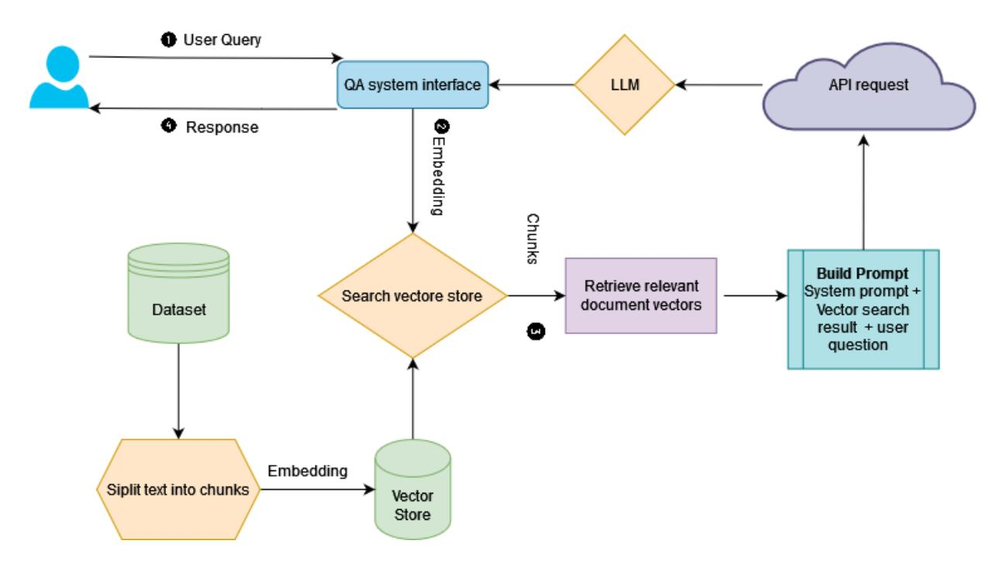

# **A RAG-based Question Answering System Proposal for Understanding Islam: MufassirQAS LLM**

**Ahmet Yusuf Alan, Enis Karaarslan\*, Omer Aydin**

*\* enis.karaarslan@mu.edu.tr*

## **Abstract***:*

There exist challenges in learning and understanding religions as the presence of complexity and depth of religious doctrines and teachings. Chatbots as question-answering systems can help in solving these challenges. LLM chatbots use NLP techniques to establish connections between topics and accurately respond to complex questions. These capabilities make it perfect to be used in enlightenment on religion as a question answering chatbot. However, LLMs also have a tendency to generate false information, known as hallucination. Also the responses of the chatbots can include content that insults personal religious beliefs, interfaith conflicts, and controversial or sensitive topics. It needs to avoid such cases without promoting hate speech or offending certain groups of people or their beliefs. This study uses a vector database-based Retrieval Augmented Generation (RAG) approach to enhance the accuracy and transparency of LLMs. Our question-answering system is called as "*MufassirQAS''*. We created a vector database with several open-access books that include Turkish context. These are Turkish translations, and interpretations on Islam. We worked on creating system prompts with care, ensuring they provide instructions that prevent harmful, offensive, or disrespectful responses. The system has the ability to share the answers with the information such as the page number in the relevant book and the articles from which the information was obtained. We also tested the *MufassirQAS* and ChatGPT with sensitive questions. We got better performance with our system. Study and enhancements are still in progress. Results and future works are given.

**Keywords***: Question Answering Systems, Chatbots, Generative Artificial Intelligence, Large Language Model,* Retrieval Augmented Generation, *Quran*

# **1. INTRODUCTION**

There exist challenges in learning and understanding religions, such as the presence of complexity and depth of religious doctrines and teachings.

Chatbots, as question-answering systems, are becoming widely used as they provide detailed natural responses to users' inquiries on a given topic. They maintain a conversational tone and ensure a logical flow of conversation. The strength of the LLM chatbot lies in its ability to establish connections between topics and accurately respond to complex questions about sensitive topics. These capabilities make it perfect to be used in enlightenment on religion. However, a drawback of such systems is the tendency for LLMs to generate false information, known as hallucination. The research questions are as follows:

❖ Can we use Retrieval Augmented Generation (RAG) approach to prevent hallucination in LLMs? ❖ Can we deploy a system that utilizes this concept for understanding Islam?

# **2. FUNDAMENTALS**

In this section, we will commence by disseminating fundamental information concerning the large language models (LLM) that serve as the primary driving force behind contemporary chatbots, which are progressively aligning themselves with the domain of artificial intelligence. Moreover, we will delve into the vector-based databases in Retrieval Augmented Manufacturing (RAG). Subsequently, we will address the potential challenges encountered in the development of this language model. Additionally, there will be a shared section on the Islamic sources to be used in this study.

# **2.1. Large Language Model and Vector Based Databases**

LLMs are a type of artificial intelligence system that can process and generate natural language texts. They are trained on massive amounts of text data, such as books, articles, web pages, social media posts, and more, using deep neural networks. LLMs can learn the patterns and structures of natural language from the data, and use them to perform various tasks, such as answering questions, summarizing texts, translating languages, and writing essays.

Despite their remarkable capabilities, LLMs are not without limitations. Concerns regarding potential biases embedded within training data, factual inaccuracies, and the absence of ethical consideration. Also, they lack explainability and transparency. This makes it nearly impossible to understand how they generate responses and how the LLM works.

#### **2.2. Vector Databases and RAG as a Solution**

Retrieval-augmented generation (RAG) can be used for knowledge-intensive NLP tasks [4]. RAG is a technique for enhancing the accuracy and reliability of generative AI models with facts fetched from predetermined external sources.

LLMs have some limitations, such as; presenting false information when they do not have the answer, presenting out-of-date or generic information, and creating a response from non-authoritative sources in train data. RAG addresses these challenges by redirecting the LLM to retrieve relevant information from authoritative, predetermined knowledge sources. This way, LLM can use the retrieved data as context for generating a response that is more relevant, accurate, and useful in various contexts. RAG applications potentially provide user transparency by revealing the sources of the retrieved data, offering insight into how the LLM generates its responses.

# **2.3. Islamic sources**

First of all, we can start by learning the word Mufassir and its meaning, which is also mentioned in the title of this study. It is an Arabic word and the name given to theologians who deal with tafsir. Tafsir is mostly used to explain what the Quran's words, compositions and sentences mean. Details about the Tafsir are given below. Now, let's learn the concepts we need to know within the scope of this study, starting from the most basic source of Islam. The Quran is the name of the word that was sent down to the prophet of the Islamic religion through revelation, written on the Mushafs, spread and transmitted through the tongue, and worshipped by reading it (Temel, 2018, p. 106). There are different approaches to the root of the name of the Quran. Revelation, on the other hand, is the creator's general informing of the ways of action of beings, and in particular, his transmission to his prophets of all the orders, prohibitions and news that he wants to convey to people, secretly and rapidly, in a direct or unmediated manner (Çelik, 2013, p. 22). As it is known, the Quran reached the prophet Muhammad through the angel of revelation, Gabriel. It started to be downloaded in the month of Ramadan, one of the Hijri months, and in the Night of al-Qadr (Danacı, 2020). The Quran was transferred from the Preserved Tablet (Levh-i Mahfuz) to the angel of revelation in a manner whose condition we do not know, and through him, it was sent down to the prophet Muhammad at various time intervals (Keskinoğlu, 2012, p. 12). While the Prophet Muhammad was alive, many of the Muslims of the period who believed in him and followed the Prophet's path memorized the whole

part of the Quran, so that the Quran was preserved both in writing, on tablets and pages, and in memory by memorization. We should also draw attention to the great efforts made by the Prophet Muhammad in educating the Quran and passing it on to future generations (Öge, 2019, p. 27,28).

Since it is impossible to translate the Quran verses into another language without missing any meaning, the translation of the Quran into other languages is called "Meal". This refers to the approximate meaning of the verse. On the other hand, Tafsir (Interpretation) means to declare something, to discover something, to reveal something covered up; It means explaining what is meant by a word whose meaning is unclear and whose meaning is difficult to understand. Tafsir is mostly used to explain what the Quran's words, compositions and sentences mean. Tafsir is a branch of science. In this branch of science, the Quran is interpreted, and the meanings of words and sentences, their provisions and wisdom are explained (Diyanethaber, 2021). On the other hand, Hadith is the antonym of "Kadîm". As it is known, Kadim means "Old". Over time, Hadith's meaning is "News" and over time it is created from the infinitive Tahdîs. The word Hadith gained a different meaning in Islam. The words of the Prophet Muhammad are called "el-ehâdîsü'l-kavliyye", his actions are called "el-ehâdîsü'l-fi'liyye", and the things he approves (takrir) are called "el-ehâdîsü't-takrîriyye" (Ebü'l-Bekā, pp. 370, 402).

These are the most important resources for people to understand Islam as a faith and to pass it on to the next generations. For this reason, it has become important to learn Islam from the right sources and at the same time to convey them using today's technological blessings.

### **3. RELATED WORKS**

Different use cases for Generative AI and RAG are available in the literature. The use of vector-based databases also finds a place in the literature. LLMs have been shown to experience hallucinations in their responses to instruction-following tasks. Fine-tuning with new data may not prevent hallucinations and may be costly. Therefore, RAG was introduced to provide factual information and adapt to new information (Borgeaud et al. 2022). RAG uses a vector database. When a query is made to RAG, the most relevant data from this database is selected. This data is included in the prompt for LLMs. This process can combine existing information without requiring constant fine-tuning and provides context-based information, increasing the clarity and relevance of responses. RAG provides the LLM with the ability to gain a focused understanding vis-à-vis a query. There are studies in the literature where RAG is used in NLP tasks (Borgeaud et al. 2022; Al Ghadban et al. 2023; Mallen et al. 2023; Ram et al. 2023; ). Pal et al. sought to create unique and enjoyable music using Generative AI. When provided with a starting bar of music, the initial Discriminatory network, incorporating Support Vector Machines and Neural Nets, selects a note or chord to guide the subsequent bar. Building upon this chosen chord or note, a Generative Net, which includes Generative Pretrained Transformers (GPT-2) and LSTMs, then generates the entire bar of music. Their innovative two-step approach aims to closely emulate the process of real music composition to enhance the authenticity of the generated music (Pal, 2020).

Kulkarni et al. proposed a Retrieval-Augmented Generator (RAG) approach for constructing a chatbot capable of addressing user queries using Frequently Asked Questions (FAQ) data. The chatbot employs an open API-based paid ChatGPT model as a Language Model (LLM), recognizing the potential to optimize LLM token usage and cost by leveraging previously retrieved-context for specific query patterns. The authors employ Reinforcement Learning (RL) to optimize the number of LLM tokens within the constraints of a fixed retrieval model and LLM. The proposed RL-based optimization, coupled with a similarity threshold, achieves notable cost savings with a slight enhancement in accuracy. The study emphasizes the general applicability of the RL approach beyond FAQ chatbots to any existing RAG pipeline (Kulkarni et al., 2024).

There are ChatGPT-based studies in the literature such as [1-2] and online chatbot services such as QuranGPT [\(https://qurangpt.live/\)](https://qurangpt.live/). The validity of the services based on ChatGPT is argued as these services do not give references [3]. Our work differentiates from these works by fine-tuning the user prompt and giving references.

# **4. METHOD**

In this study, we implemented a retrieval augmented generation (RAG) system to enhance the accuracy and transparency of large language models (LLMs) for natural language question answering tasks. We followed the RAG architecture and the proposed system is shown in Figure 1. Study consists of the following components: knowledge base, vector store, question answering LLM, user interface. The algorithm of Question answering with the RAG system is shown in Algorithm 1. The proposed system is formed of following functions which is described in the following sections.

Figure 1. RAG based System

#### **4.1. Forming knowledgebase**

We use the pdf format of open access books to correctly acquire metadata of books. Following dataset are used to form the vector store:

- "Kuran yolu Türkçe meal ve tefsir" (The Way of the Quran -Turkish translation and interpretation) [5]
- Kütüb-i Sitte [6]
- "İslam İlmihali" (Islamic Catechism) [7]

# **4.2. Creating Vector Store**

A vector database is a specific type of database designed to store and retrieve vectors. Vectors are lists of numbers that represent data in a multi-dimensional space. Vector search methods can be used to find similar data by querying for the nearest vectors in the space. This capability is particularly useful for applications that require fast and accurate data matching based on similarity.

In order to enable vector search, the text in the knowledge base needs to be divided into fixed-length segments called chunks. Since the context of religion issues could be long we assign a higher chunk length. It's important to assign a value to indicate how much overlap each chunk has with the previous one, known as the chunk overlap. To ensure the comprehension of sensitive content by the language model, a higher chunk overlap value is assigned. Once these values are determined, the chunks should be embedded using the appropriate language model for the question-answering system. Embedding helps to capture the syntactic and semantic relationships between words by LLMs.

# **4.3. Vector Search**

After the user enters a question, the system creates an embedding of the user's question. The embedding helps the LLM to understand the semantic context. The "essence" of the question can be searched for relevant chunks then by assigning a similarity score to each. The system uses these selected chunks to create a knowledge context for answering questions. We define the number of chunks that have the highest similarity score to the question as n. Given the multitude of cross-references and diverse explanations regarding religious matters, we prioritize assigning a higher value to "n" in order to offer LLM a greater amount of information regarding the question.

#### **4.4. Tuning Prompt**

After gathering the necessary information, we need to create a prompt to send to the LLM. During this process, we should inform the LLM about the restrictions, including the desired response format and the tone. Also, it is important to specify when the system prompt should not generate a response.

A system prompt serves as a natural language instruction that guides a large language model in performing a specific task. These system prompts are crucial for LLMs as they enable users to tap into the extensive knowledge and capabilities of the models without requiring fine-tuning on specific datasets or domains.

In this study we work on creating system prompts with care, ensuring they provide instructions that prevent the generation of harmful, offensive, or disrespectful responses. The chatbot needs to avoid insulting personal religious beliefs, handle interfaith conflicts respectfully, and approach controversial or sensitive topics without promoting hate speech or offending certain groups of people or their beliefs.

# **5. IMPLEMENTATION**

We used the ChatGPT3.5 turbo 16k context window version. ChatGPT 3.5 can use a maximum of 32 thousand tokens. When we set the chunk size to 2000, we can provide up to 15 chunks of information. We used OpenAI embeddings and the temperature as 0.5. Langchain toolkit ([https://www.langchain.com\)](https://www.langchain.com/) for RAG. Memory vector store is used for now. We use chunk Size 2000, chunk overlap 100. We give the top 5 chunks as a result of the search. Flowise (<https://github.com/FlowiseAI/Flowise>) is added to show the reference document and vector search results which is used to answer the questions. Sample screenshots of the implementation are given in Figure 2 and 3. Turkish versions of the samples are given in the Appendix. The chunk for the question "According to Islam, are women or men superior?" is given in Figure 4. The answers of the systems are discussed in the next section.

Figure 2. Answer to the Vaccination Question with (a) ChatGpt (b) MufassirQAS

Figure 3. Answer to the Man Woman Equality Question (a) ChatGpt (b) MufassirQAS

Figure 4. Example chunk for question "According to Islam, are women or men superior?"

#### **6. RESULTS AND DISCUSSION**

In many general religion-related questions, ChatGPT and MufassirQAS provide similar answers. This is expected because ChatGPT has been trained on a vast amount of data, so it likely includes similar religion-related questions and answers. However, MufassirGPT demonstrates its strength when faced with questions like "Is there evolution according to Islam?" (see Figure 5), where ChatGPT tends to give uncertain responses and consider the question complex and open to discussion. In contrast, MufassirQAS immediately answers with a clear statement and provides an explanation.

Figure 5. Answer to the Evolution Question

Another distinction between MufassirQAS and ChatGPT is that MufassirQAS tends to provide more references to hadiths and verses, as instructed in the system prompt. For example, when asked "According to Islam, are women or men superior?"; ChatGPT refers to an expression from the Quran without clearly indicating its source (see Figure 3.a). Meanwhile, MufassirQAS not only shows the users the knowledge source but also directly explains the matter using three Quranic verses (see Figure 3.b). Overall, we can consider MufassirQAS a reliable solution for avoiding vague and unclear responses to questions on Islam.

# **7. LIMITATIONS OF THE STUDY**

We acknowledge limitations, such as potential biases in the dataset and the challenge of ensuring religious sensitivity in responses. We are also aware of the security vulnerabilities of LLMs which can result in unexpected responses to prompts.

#### **8. CONCLUSION**

A proof of concept prototype of the MufassirQAS is developed during this study. This study is ongoing, and further refinements are planned to enhance MufassirQAS's capabilities.

The user cannot express the question in his mind properly some of the time. An extra layer of artificial intelligence can be used to refine the users' questions.

Future work will focus on expanding the corpus, incorporating user feedback, and exploring advanced techniques for bias mitigation and religious context awareness.

#### **ACKNOWLEDGMENT**

The study is a part of LLM joint research between MSKU Metaverse Lab and Celal Bayar University.

# **FUNDING**

This research received no specific grant from any funding agency in the public, commercial, or not-for-profit sectors.

# **AUTHORS` CONTRIBUTIONS**

All authors have participated in drafting the manuscript. All authors read and approved the final version of the manuscript. All authors contributed equally to the manuscript and read and approved the final version of the manuscript.

### **CONFLICT OF INTEREST**

The authors certify that there is no conflict of interest with any financial organization regarding the material discussed in the manuscript.

# **REFERENCES**

[1] Alnefaie, E. A. S., & Alsalka, M. A. (2023, October). Is GPT-4 a Good Islamic Expert for Answering Quran Questions?. In Proceedings of the 35th Conference on Computational Linguistics

and Speech Processing (ROCLING 2023) (pp. 124-133). [2] Sembok, T. M., & Wani, S. (2023, October). Is ChatGPT not Appropriate for Religious Use?. In International Visual Informatics Conference (pp. 595-605). Singapore: Springer Nature Singapore.

[3] Quran GPT and the dangers of propagating a homogenized version of Islam, retrieved on 30.12.2023. https://english.alarabiya.net/views/2023/08/09/Quran-GPT-and-the-dangers-of-propagating-a-homog enized-version-of-Islam [4] Lewis, P., Perez, E., Piktus, A., Petroni, F., Karpukhin, V., Goyal, N., ... & Kiela, D. (2020). Retrieval-augmented generation for knowledge-intensive NLP tasks. *Advances in Neural Information Processing Systems*, *33*, 9459-9474. [5] Karaman, H., Çağrıcı, M., Dönmez, İ. K., & Gümüş, S. (2020). *Kuran Yolu Türkçe Meal Ve Tefsir-2 (The Way of the Quran: Turkish Translation and Interpretation)*. Diyanet İşleri Başkanlığı, https://yayin.diyanet.gov.tr/e-kitap/kuran-yolu-turkce-meal-ve-tefsir-1/prof-dr-hayrettin-karaman/kur an-kitapligi/3788 [6] Kandemir, M. Y. (2008). "Kütüb-i Sitte". DİA, İstanbul 2008, cilt: 27, s. 6-7. [7] ŞENTÜRK, L., & YAZICI, S. (2012). İslâm İlmihali, Diyanet İşleri Başkanlığı Yayınları. [8] Yazır, E. M. H. (2002). Kur'ân-ı Kerîm'in Yüce Meâli. *Cev: K. Yayla. İstanbul: Merve yayıncılık*. [9] Temel, N. (2018). Kıraat ve Tecvid Istılahları. (4.b.) İstanbul: İFAV. [10] Çelik, Ö. (2013). Tefsir Usûlü ve Tarihi. İstanbul, Türkiye: Kampanya Kitapları. [11] Keskinoğlu, O. (2012). Nüzûlünden Günümüze Kur'an-ı Kerim Bilgileri. Ankara: T.D.V. [12] Öge, A. (2019). 18. Yüzyıl Osmanlı Âlimlerinden Yusuf Efendizâde'nin Kıraat İlmindeki Yeri. İstanbul: Hacıveyiszade İlim ve Kültür Vakfı Yayınları. [13] Danacı, S. (2020). Kur'ân-ı Kerim'in Metinleşme Süreci ve Sûrelerin Tertibine Dair Görüşlerin Değerlendirilmesi. Çankırı Karatekin Üniversitesi Karatekin Edebiyat Fakültesi Dergisi, 8(1), 138-166. [14] Diyanethaber (2021). Meal ve Tefsir ne demektir? Diyanethaber.com.tr Web sitesi. https://www.diyanethaber.com.tr/meal-ve-tefsir-ne-demektir Accessed: 25.01.2024 [15] Ebu'l-Bekâ elKefevî. el-Külliyyât. [16] Kulkarni, M., Tangarajan, P., Kim, K., & Trivedi, A. (2024). Reinforcement Learning for Optimizing RAG for Domain Chatbots. *arXiv preprint arXiv:2401.06800*.

- [17] Pal, A., Saha, S., & Anita, R. (2020). Musenet: Music Generation using Abstractive and Generative Methods. *International Journal of Innovative Technology and Exploring Engineering*, *9*(6), 784-788. [18] Borgeaud, S., Mensch, A., Hoffmann, J., Cai, T., Rutherford, E., Millican, K., ... & Sifre, L. (2022, June). Improving language models by retrieving from trillions of tokens. In *International conference on machine learning* (pp. 2206-2240). PMLR. [19] Al Ghadban, Y., Lu, H. Y., Adavi, U., Sharma, A., Gara, S., Das, N., ... & Hirst, J. E. (2023). Transforming Healthcare Education: Harnessing Large Language Models for Frontline Health Worker Capacity Building using Retrieval-Augmented Generation. medRxiv, 2023-12. [20] Mallen, A., Asai, A., Zhong, V., Das, R., Khashabi, D., & Hajishirzi, H. (2023, July). When not to trust language models: Investigating effectiveness of parametric and non-parametric memories. In Proceedings of the 61st Annual Meeting of the Association for Computational Linguistics (Volume 1: Long Papers) (pp. 9802-9822). [21] Ram, O., Levine, Y., Dalmedigos, I., Muhlgay, D., Shashua, A., Leyton-Brown, K., & Shoham,
- Y. (2023). In-context retrieval-augmented language models. arXiv preprint arXiv:2302.00083.

# **APPENDIX - TURKİSH VERSIONS OF THE SAMPLES**

Figure 2. Answer to the Vaccination Question in Turkish (a) ChatGpt (b) MufassirQAS

Figure 3. Answer to the Man Woman Equality Question (a) ChatGpt (b) MufassirQAS

Figure 4. Answer to the Evolution Question

Figure 5. Example chunk for question "What are the conditions to go to heaven?"