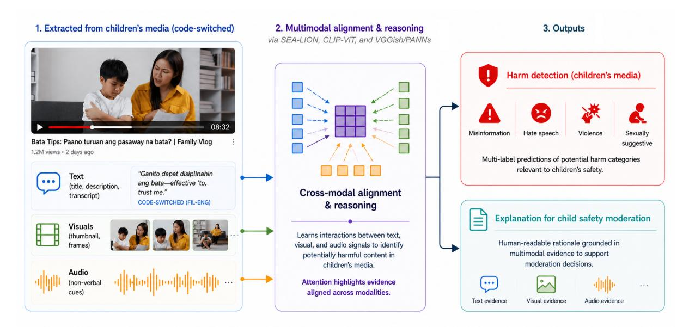
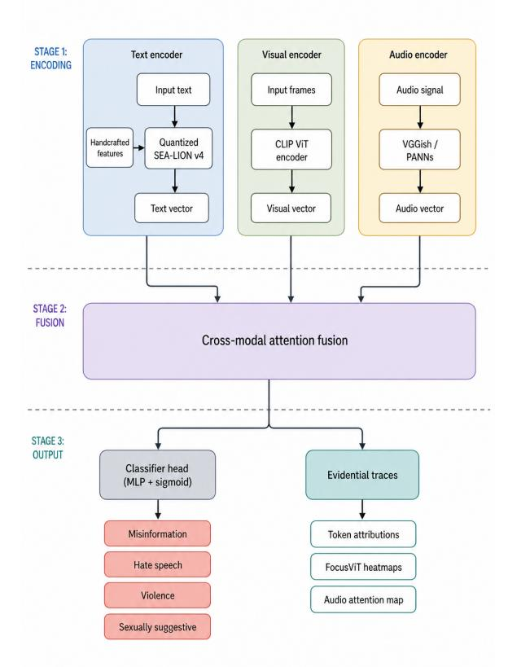

# Thesis Proposal: An Explainable Multimodal Framework for Detecting Harmful Content in Code-Switched Children's Media

Juliana Isabelle Guillermo1∗ Jasper Kyle Catapang2,3 Nathaniel Oco1[∗](#page-0-0)

1College of Computer Studies, De La Salle University

2Graduate School of Global Studies, Tokyo University of Foreign Studies

3Money Forward, Inc.

juliana\_guillermo@dlsu.edu.ph, catapang.jasper.kyle.y0@tufs.ac.jp, nathaniel.oco@dlsu.edu.ph

# Abstract

Current automated content moderation systems fail to protect children from harmful YouTube content, particularly in under-resourced, codeswitched settings. These systems are often text-only, English-centric, and operate as 'black boxes,' lacking the multimodal understanding and transparency needed for effective moderation. This thesis proposes a novel hybrid framework for the explainable multimodal detection of harmful content in videos with codeswitching. The proposed framework integrates a fine-tuned classifier for accurate, scalable detection with an LLM-powered module that synthesizes the classifier's internal evidential signals (e.g., text attention and visual heat maps) to generate faithful, human-readable rationales for each decision. As a primary case study, the framework will be developed and validated on an English–Filipino code-switched dataset. Expected contributions include a new dataset publicly available under controlled access (deidentified transcripts, blacked-out frames, extracted feature representations, and metadata via data-sharing agreement) and a blueprint for building more equitable, transparent, and trustworthy AI safety systems.

## 1 Introduction

With billions of hours of video content consumed daily, YouTube has become a primary source of education and entertainment for children around the world. However, the vast scale of the platform makes it a fertile ground for the spread of harmful content (misinformation, hate speech, violence, and sexually suggestive material) aimed at this vulnerable audience. This harm appears in many forms, including misinformation, discriminatory hate speech, graphic violence, and sexually suggestive content. Such harmful materials can even be disguised as child-friendly programming [\(Kim et al.,](#page-11-0) [2023\)](#page-11-0).

Children have a near-endless supply of both harmful and beneficial content from the millions of videos uploaded to YouTube daily. Parents of younger children often rely on smartphones, tablets, and video content to keep their kids occupied, especially during periods of stress or when parental attention is limited. This is known as the "digital babysitter" effect [\(Andrisano Ruggieri et al.,](#page-10-0) [2024\)](#page-10-0). Relying on digital devices carries a significant risk. Automated recommendation algorithms can easily guide children from safe content to videos with harmful ideologies and material, often with minimal parental oversight.

In addition to YouTube's own content moderation system, significant research has been dedicated to automated moderation. Many studies have developed sophisticated models for detecting specific online harms in text and images. However, most research on content detection targets resource-rich languages, especially English, where abundant data is available. Few resources address the nuances of code-switched languages. As a result, current moderation efforts are limited to resource-rich languages, which often leads to English-centric biases. For example, a video might feature a child playing with a seemingly benign English title, 'Let's play,' but include the Tagalog phrase 'sa apoy' (with fire) in the audio. A standard English-only detector would classify this video as safe, completely missing the severe physical danger conveyed through the code-switched context. This creates situations in which users of hundreds of other languages may see policy-violating content on YouTube even when searching for benign queries [\(Nigatu and Raji,](#page-11-1) [2024\)](#page-11-1). This poses a more difficult challenge for low-resource and code-switched languages, which pose unique technical hurdles for standard NLP models.

From a technical perspective, harmful content detection in children's media poses three compounding challenges. First, harmful cues are inherently

∗Corresponding authors.

Figure 1: The proposed explainable multimodal framework decomposes Filipino-English YouTube videos into text, visual, and audio streams. These are fused via cross-modal attention to generate harm-category predictions and evidential traces, which an LLM-powered module synthesizes into human-readable rationales for moderators.

multimodal, requiring joint reasoning over text, visuals, and audio. Second, real-world content frequently exhibits code-switching, which violates the assumptions of monolingual NLP pipelines and degrades performance in low-resource settings. Third, existing systems operate largely as black boxes, providing little transparency or justification for moderation decisions. Addressing all three challenges simultaneously remains an open problem.

Although there is existing research on multimodal content detection in videos, traditional multimodal approaches often fail to capture nuances in real-world content. A significant amount of contextual information is lost when cultural differences arise, leading current detectors to classify harmful content, such as hate speech, as safe [\(Wei et al.,](#page-12-0) [2025\)](#page-12-0). Implicit biases, such as stereotypes, are also difficult to detect, as many cases show low agreement among human annotators, making it a very culturally dependent issue [\(De Grazia et al.,](#page-10-1) [2025\)](#page-10-1).

Finally, the majority of these advanced detection models operate as 'black boxes.' They can flag a video as harmful, but would not be able to provide interpretable explanations, if any, behind their decision. There have been some content detection systems that use explainable AI, although their implementation has been limited to a single modality [\(Joseph et al.,](#page-11-2) [2025\)](#page-11-2). It has been used for offensive content and hate speech detection [\(Sivasundaram,](#page-11-3) [2025\)](#page-11-3), although it also has uses in humor detection

[\(Jaiswal,](#page-10-2) [2025\)](#page-10-2).

Given these, there is a lack of explainable multimodal content-detection models for Filipino codemixed language. The proposed study will further explore this gap by detecting YouTube videos harmful to children under 13. The main objective of this study is to answer the following questions:

- RQ1: How can a multimodal dataset for harmful content in a target low-resource, code-switched setting be systematically collected and annotated to demonstrate the failure points of standard unimodal systems?
- RQ2: What is an effective multimodal architecture that can fuse visual and textual signals to accurately classify harmful content videos featuring code-switched languages?
- RQ3: To what extent are LLM-synthesized, evidence-constrained rationales plausible and faithful to the classifier's internal decision process, as measured by automated metrics?
- RQ4: How effectively can the proposed explainable multimodal framework adapt to other code-switched language distributions (e.g., Cebuano-English or Hindi-English) under zero-shot or few-shot conditions?

To answer these questions, four studies will be conducted across the proposed research. Study 1 establishes the foundation by collecting, annotating, and benchmarking a novel multimodal dataset of Filipino-English videos, demonstrating the limitations of current monolingual baselines. Study 2 develops the core multimodal classifier that fuses textual and visual signals to perform video-level harmful content detection. Study 3 evaluates the explainability module via automated plausibility and faithfulness metrics (with a human moderator study planned as future work). Finally, Study 4 conducts a preliminary cross-lingual feasibility study, testing which components of the framework are language-agnostic versus require adaptation when applied to other code-switched settings. Figure [1](#page-1-0) illustrates the full framework end-to-end.

## 2 Related Work

## 2.1 Automated Detection of Harmful Content

Many methods have been developed and used to perform automated detection of harmful content, mostly focusing on toxic and hateful speech. One of these methods is traditional machine learning. Early approaches to toxic content detection relied on traditional machine learning models such as SVMs and Naive Bayes, which were highly dependent on extensive feature engineering, including content-based, user-based, and network-based features [\(Kaur et al.,](#page-11-4) [2021\)](#page-11-4).

Another approach would be deep learning methods. [Badjatiya et al.](#page-10-3) [\(2017\)](#page-10-3) investigated CNNs and Long Short-Term Memory Networks (LSTMs) for hate speech detection. Their study demonstrated that deep learning models, such as Convolutional Neural Networks and LSTMs, achieved better results in hate speech detection than existing methods. A study by [Isha et al.](#page-10-4) [\(2025\)](#page-10-4), which also focused on classifying toxic sentiments in comments, evaluated deep learning and machine learning approaches and found that CNNs are the best and most reliable models, while a keyword-based machine learning approach is ineffective.

Another study by [Pavlopoulos et al.](#page-11-5) [\(2017\)](#page-11-5) focused on Recurrent Neural Networks for user comment moderation. It showed that a GRU-based RNN operating on word embeddings outperforms the previous leading methods for comment moderation, which used classifiers like Logistic Regression or Multi-layer Perceptrons with character or word n-gram features. They also found that RNN-based models consistently outperformed regular CNNs designed for the same task across the datasets they

tested. The performance of these models improves with classification-specific attention mechanisms that help a model focus on the most "suspicious" words in a comment, thereby enhancing classification accuracy.

Today, the state of the art in text-based classification is dominated by Transformer architectures like BERT (Bidirectional Encoder Representations from Transformers) and its variants, which generate powerful contextual embeddings and achieve superior performance. [Mozafari et al.](#page-11-6) [\(2019\)](#page-11-6) introduced a transfer learning approach using BERT to detect hate speech. They used a pre-trained BERT model and fine-tuned it with four architectural strategies. Standard BERT fine-tuning in this study involves taking the final-layer output for a specific token and feeding it directly into a simple classification layer to determine whether the tweet was hateful. The best performing method, however, was inserting a CNN layer. Instead of using the final layer of BERT, it took the outputs from all 12 of BERT's transformer encoder layers, which were then combined to form a matrix. A CNN was used to analyze this matrix and extract the most important features. Another study by [Jansen et al.](#page-11-7) [\(2022\)](#page-11-7), which focused on detecting adult and harmful content, used transformer models as one of its classification approaches. They chose to fine-tune BERT and RoBERTa and found that they performed very well on the data they were trained on, but failed completely when applied to the actual target data, where they generalized in ways that were mostly harmful.

#### 2.2 Multimodal Analysis for Content Understanding

To address the limitations of text-only systems, research has increasingly turned to multimodal analysis, fusing signals from text, images, and video. A study by [Jo et al.](#page-11-8) [\(2024\)](#page-11-8) aimed to analyze and classify YouTube videos by feeding a Multimodal Large Language Model (MLLM) multiple types of data (or "modes") simultaneously. For each video in their dataset, they extracted visual and textual data, then used GPT-4 Turbo, one of OpenAI's flagship MLLMs, for classification. They utilized zero-shot prompting, not fine-tuning or training the model. They instead designed a "zero-shot" prompt that provided the model with all the necessary context and instructions to perform the classification task, in which the video would be classified

into six harm categories (Information, Hate, Addictive, Clickbait, Sexual, Physical). They then compared the results of this prompting with those of non-expert human labelers and domain experts. While GPT-4 Turbo outperformed non-expert labelers, it did not match domain experts' performance, achieving only about 60% accuracy on expert labels.

Another study by [AlDahoul et al.](#page-10-5) [\(2024\)](#page-10-5) also evaluated sensitive content in text, images, and videos through LLMs. They had found that generalpurpose LLMs are more effective and flexible than dedicated moderation tools. Specialized models for detection, like Llama-Guard and OpenAI, performed poorly in detecting graphic violence and abuse categories as they were not part of their predefined safety taxonomies. There does not seem to be any single "best" model, as different LLMs excel at different tasks. Gemini 1.5 Pro was best for video violence, while Llama-3.2-Vision-Instruct was best for photo nudity, and GPT-4o was a top performer on textual violence. General-purpose LLMs also proved that they were capable of identifying a wider and more nuanced range of sensitive content (e.g., alcohol and child abuse) that specialized models with fixed categories completely missed.

While recent multimodal large language models (MLLMs) such as GPT-4o, Gemini, and Qwen-Omni demonstrate strong zero-shot capabilities for video understanding, their effectiveness in lowresource and code-switched contexts remains inconsistent, as current multilingual LLMs have been shown to underperform on code-mixed inputs compared with fine-tuned models and struggle with linguistic mixing in realistic data distributions [\(Zhang](#page-12-1) [et al.,](#page-12-1) [2023\)](#page-12-1). Moreover, adapting MLLMs to lowresource languages remains a significant challenge due to limited representation and the need for specialized datasets [\(Lupascu et al.,](#page-11-9) [2025\)](#page-11-9). Their ability to handle culturally nuanced content and provide consistent, transparent explanations is also constrained, with evaluations showing inconsistent decision explanations in multilingual and codemixed scenarios, and inherent black-box behavior that resists auditability and faithful explanation [\(Ochieng et al.,](#page-11-10) [2024\)](#page-11-10). These limitations motivate the hybrid design, which uses a specialized multimodal classifier trained on verified Filipino–English data for scalable detection, paired with an LLM used exclusively for grounded evidence synthesis rather than primary prediction.

#### 2.3 The Challenge with Low-Resource and Code-Mixed Languages

Code-switched Filipino-English content, which fluidly mixes Filipino and English, poses a significant challenge for standard NLP models that assume a single grammatical and semantic structure. A study that attempted to detect abusive language in lowresource, code-mixed languages such as Nepali-English and Telugu-English identified several reasons why this is difficult. There is a lack of labeled datasets for low-resource languages, and those that exist are small, unbalanced, or not annotated for abusive content, making it incredibly difficult to build and train effective detection models [\(Pandey](#page-11-11) [et al.,](#page-11-11) [2025\)](#page-11-11). In addition, most hate-speech detection tools are trained on high-resource languages such as English. These models struggle significantly when they encounter code-mixed text because they cannot understand the grammar, syntax, or vocabulary from other languages. Languages like Tamil, Swahili, and Quechua are agglutinative, meaning they form complex words by adding morphemes to a root. Filipino is also considered to be agglutinative. Frequency-based tokenizers (like WordPiece or BPE used in BERT) are not designed for this and incorrectly split words, leading to meaningless tokens and flawed models [\(Shahid](#page-11-12) [et al.,](#page-11-12) [2025\)](#page-11-12).

### 2.4 Explainable AI (XAI) for Content Moderation

Recent research demonstrates that explainable AI (XAI) frameworks are being actively developed for content detection, particularly for tasks such as detecting fake news, harmful memes, and misogyny. These frameworks combine multiple data types and provide interpretable outputs to help users understand model decisions. One study uses a two-part framework that separates the task of understanding hate speech from the task of classifying it, called the TARGE Framework. [Hashir et al.](#page-10-6) [\(2025\)](#page-10-6) uses an LLM to generate rationale explanations and then feeds those explanations back to improve the final classification model. The framework achieved accuracy that was comparable to, and in some cases better than, traditional black-box models.

There have also been efforts for multimodal XAI models. Another paper used a framework called LogicDM (Logic-based multimodal misinformation Detection Model), which is built on the

principles of Neural-Symbolic AI. It combines the pattern-recognition power of neural networks with the explainable reasoning of symbolic logic. It has been shown to outperform existing state-of-the-art multimodal detection methods in both accuracy and F1-score on three public datasets (Twitter, Weibo, and Sarcasm) [\(Liu et al.,](#page-11-13) [2023\)](#page-11-13).

Closely related to this proposal are video- and multimodal-specific pipelines for harmful or childsafety content. MultiHateLoc (WS-MHL) [\(Sun](#page-11-14) [et al.,](#page-11-14) [2026\)](#page-11-14) uses tri-modal temporal encoders with MIL top-K localization for hateful content. TikGuard and MTikGuard [\(Balat et al.,](#page-10-7) [2024;](#page-10-7) [Nguyen et al.,](#page-11-15) [2025\)](#page-11-15) employ video transformers for child-safety on short-form video, with multimodal fusion of ASR and OCR. SHORTCHECK [\(Vatndal and Setty,](#page-11-16) [2025\)](#page-11-16) provides a modular interpretable pipeline with replaceable components. Hate-CLIPper [\(Kumar and Nandakumar,](#page-11-17) [2022\)](#page-11-17) uses CLIP-based mid-level fusion (FIM) for interpretable cross-modal interaction. MemeMind [\(Gu et al.,](#page-10-8) [2025\)](#page-10-8) introduces the MemeMind dataset and the MemeGuard detection framework, which together explore chain-of-thought supervision for interpretable content moderation. These works motivate the need for temporal and tri-modal reasoning as well as replaceable, auditable components in the present framework.

Prior work has explored harmful content detection using text-only models, multimodal architectures, and large multimodal language models. However, existing approaches typically address these challenges in isolation. There remains a lack of frameworks that jointly support multimodal reasoning, robust handling of code-switched data, and faithful, human-interpretable explanations. This gap motivates the proposed explainable multimodal framework.

## 3 Proposed Methodology

To address the challenges of multimodal reasoning, code-switching, and black-box moderation, the proposed methodology is structured into four studies.

#### 3.1 Study 1: Dataset Construction and Linguistic Baselines

The proposed task is multilabel video-level classification of harmful content in children's YouTube videos featuring code-switched language. Each video may be assigned zero, one, or multiple harm labels corresponding to misinformation, hate

speech, violence, and sexually suggestive content. In this study, the framework is instantiated and evaluated using an English–Filipino code-switched case study.

In this work, code-switching refers to the use of Filipino and English either within the same utterance (intra-sentential) or across adjacent utterances (inter-sentential) within a single video, as defined by [Li](#page-11-18) [\(2020\)](#page-11-18).

Harm labels are assigned at the video level. Annotators additionally provide localized rationales (relevant transcript phrases and visual frames/regions) that justify each harmful label.

To build a multimodal, multilabel dataset of harmful Filipino-English children's content, four steps must be taken: data sourcing, data extraction, data preprocessing, and data annotation. To mitigate keyword selection bias and ensure a sufficient yield of harmful examples, initial keyword-based searches will be augmented by algorithmic snowball sampling from known harmful seed videos. Human annotation will occur after this modelassisted pre-filtering. The target is 500 videos, achieved through broader keyword coverage and more seed channels. A finalized annotation entry consists of video metadata, multilabel harm categories, and transcript spans plus visual frame timestamps justifying the labels.

Candidate videos are initially defined through keyword-based search queries that include both Filipino and English terms commonly co-occurring in video content. During annotation, annotators verify the presence of code-switching by confirming the use of both languages either within the same utterance or across adjacent utterances in the video transcript. Videos that do not exhibit verified codeswitching are excluded from the final dataset. Codeswitching is not assigned as a label; rather, it serves as an inclusion criterion for the dataset. Annotators are provided with brief guidelines and examples to ensure consistent identification of code-switching across videos.

For each video identified, text, audio, and visuals (thumbnails and sampled frames) will be extracted for further pre-processing. Audio will be transcribed using OpenAI Whisper. For the annotation process, annotators will assign one or more video-level harm labels reflecting the overall presence of harmful content in the video. They will provide a brief written rationale for any 'harmful' label, highlighting the specific transcript segments

(words or phrases) and visual evidence (frames or regions) that justify each assigned label. At least two annotators will label each video. Inter-Annotator Agreement will be quantified using Cohen's or Fleiss' kappa for video-level harm labels, and token-level or frame-level F1 or Jaccard overlap for rationale spans, to ensure consistency and adjudicate disagreements.

Code-switching is an inclusion criterion, not a prediction target. Children's content is defined as videos labeled for children or whose metadata and visuals target under-13 audiences.

Differentiation from prior code-mixed abusive language work. Prior shared tasks such as DravidianLangTech [\(Chakravarthi et al.,](#page-10-9) [2021\)](#page-10-9) established text-only benchmarks for abusive language detection in Tamil–English and related pairs. This framework advances beyond that line of work in three ways: (1) it extends detection to the video domain with synchronized visual and audio streams; (2) it targets children's YouTube content, absent from prior shared tasks; and (3) it produces faithful, human-readable explanations grounded in classifier-internal evidence. The novelty lies in the multimodal, child-safety-focused, and explainable instantiation of the problem.

To establish linguistic baselines, the newly annotated data will be evaluated against standard textonly and monolingual models (such as RoBERTa Tagalog Base). This will empirically demonstrate the capture of the semantic and structural nuances of Filipino-English code-switching, thereby justifying the need for a specialized multimodal approach.

### 3.2 Study 2: The Multimodal Classification Engine

The classifier operates on naturally occurring codeswitched input without explicit language segmentation or prior code-switch detection. Sub-models for each modality will be trained.

For the text modality sub-model, the inputs are the video title, description, and audio transcript. These will undergo specialized preprocessing to account for the agglutinative nature of Filipino. Because standard frequency-based tokenizers (such as WordPiece) often incorrectly fragment complex Tagalog words, this study will use CalamanCy, a specialized NLP toolkit for Philippine languages, to perform rule-informed morphological segmentation and part-of-speech tagging.

Following this preprocessing, feature extraction

will use the text-only SEA-LION v4 4B model with AWQ 4-bit quantization, given GPU constraints. SEA-LION is decoder-only; embeddings are obtained by EOS-token last-hidden-state extraction (e.g., via vLLM's pooling runner). Decoder-only models have been shown to yield competitive embeddings when pooled appropriately [\(Wang et al.,](#page-11-19) [2024;](#page-11-19) [Muennighoff et al.,](#page-11-20) [2024\)](#page-11-20). The model was not contrastively fine-tuned for embedding tasks, so representations may be less well-clustered than dedicated encoders—this limitation is acknowledged and will be evaluated via an encoder baseline ablation (XLM-R-large or mDeBERTa-v3) to assess whether SEA pre-training still yields gains on this task. Training will use either a frozen quantized backbone with a light classification head (MLP) or LoRA fine-tuning, given the dataset size of 500 videos. Unlike standard monolingual models such as RoBERTa Tagalog Base, SEA-LION is pre-trained on Southeast Asian corpora, including extensive Filipino data, which is a linguistic advantage for code-switching. These embeddings will be collated to produce a text vector that summarizes the video's linguistic and semantic intent. Language ID tagging will be applied during preprocessing to signal switch points to the transformer before embedding.

These embeddings will be augmented with features such as all-caps ratios and excessive punctuation to capture the sensationalism often correlated with harmful content. While transformers capture semantics, certain stylistic patterns also indicate low-quality, harmful content. The embeddings from the transformer model will be augmented with a small set of handcrafted features. Examples would include counting the ratio of all-caps words and the frequency of excessive punctuation (e.g., "!!!", "???"). These features directly capture sensationalism and clickbait-style language, which often correlates with misinformation and other harms. They provide strong and interpretable signals that complement the dense embeddings.

As for the visual modality submodel, it is designed to capture harmful cues that are not mentioned in the text or transcript. It analyzes the video's thumbnail and frame-by-frame content. One of the features to be extracted would be object and scene semantics. A pre-trained visionlanguage model, such as CLIP, will be used. Each frame and thumbnail will be passed through CLIP's image encoder. While traditional object detectors

(like YOLO) are good at finding specific things like a knife or a person, CLIP models are more advanced, as they understand the semantic content of an image. Its embeddings can distinguish between a "cartoon knife in a kitchen" and a "person holding a knife menacingly" due to its spatial awareness [\(Geng et al.,](#page-10-10) [2023\)](#page-10-10). This helps to capture visual concepts to assist in understanding visual narratives in videos. This will result in a sequence of visual vectors, one for each frame, representing the visual content over time.

Crucially, to understand which parts of an image the model is focusing on, a post-hoc explainability technique will be applied. Because this framework uses the CLIP image encoder, which is built on a Vision Transformer (ViT) architecture, gradientbased saliency methods such as Grad-CAM are mathematically incompatible and prone to resolution degradation. The study will therefore integrate FocusViT [\(Ali et al.,](#page-10-11) [2026\)](#page-10-11), an interpretability framework for ViTs that combines gradientweighted attention attribution with dynamic layerskipping, as presented at AISTATS 2026. FocusViT produces localized heatmaps that reflect the hierarchical token processing of the visual model. These heatmaps will highlight the pixels and regions (e.g., a face, a weapon, a specific gesture) that were most influential in the model's final prediction for a given harm category.

Audio modality sub-model. Non-verbal audio (prosody, tone, background music, sound effects) will be represented as a third modality stream. Audio feature extraction will use PANNs (CNN14) to produce fixed-size 2048-dimensional audio embeddings. The cross-modal attention mechanism will be extended to tri-modal fusion so that text, visual, and audio streams can attend to each other. The audio stream will contribute evidential traces (e.g., which time windows or spectral bands are most attended) for the explainability module. An ablation comparing bi-modal (text+visual) vs. trimodal (text+visual+audio) will be included in the evaluation plan. The pipeline figure will be updated to reflect the tri-modal design.

These sub-models (text, visual, and audio) will then be combined. The baseline strategy will use a simple fusion technique: the final text, visual, and audio vectors would be concatenated into one long vector as a benchmark. The design rationale for maintaining separate submodels rather than using early fusion is that it isolates modality-specific features and enables the extraction of distinct evidential traces (token attributions, FocusViT heatmaps, and audio attention) required for the downstream explainability stage.

The more advanced strategy is to implement a cross-modal attention mechanism that allows the text, visual, and audio sub-models to combine information across modalities to make a decision. The attention mechanism enables the model to dynamically weight different features. For instance, if the transcript contains the word "dulas" (slippery), the model can learn to pay much closer attention to visual frames that show a wet floor or a person falling [\(Song et al.,](#page-11-21) [2022\)](#page-11-21). The final fused vector will be passed to a classifier head (like a Multi-Layer Perceptron) with a sigmoid activation function to produce two outputs: a prediction vector and evidential traces. The prediction vector gives the probability for each of the four harm labels (misinformation, hate speech, violence, sexually suggestive) for multi-label classification; "safe" corresponds to the absence of any label (all-zeros). The evidential traces are the internal model data needed for explanation: text token attributions (see below) and visual FocusViT heatmaps from the visual sub-model.

FocusViT is used consistently for visual attribution; LIME or SHAP are not used for frame-byframe video analysis due to computational cost.

Handling cross-modal contradictions. A known evasion tactic in harmful children's content is the deliberate pairing of innocuous signals in one modality with harmful content in another (e.g., cheerful audio over violent visuals). The cross-modal attention mechanism surfaces such incongruities: semantically opposing streams produce high inter-modality mismatch in the attention weights. The evaluation plan includes an adversarial diagnostic subset with deliberately misaligned audio/visual sentiment; per-label confidence and attention entropy will be reported for these cases.

These evidential traces do not constitute explanations by themselves, but serve as structured inputs for the downstream LLM-based explanation module.

Study 2 will empirically evaluate these architectures. The primary objective is to demonstrate that the cross-modal attention mechanism yields a statistically significant improvement in multi-label classification accuracy over the simple concatena-

Figure 2: Cross-modal attention architecture. Three modality encoders (text, visual, audio) feed into the attention fusion module. The classifier head produces both harm-label predictions via sigmoid activation and evidential traces (token attributions, FocusViT heatmaps, audio attention maps) for the downstream explainability module.

tion baseline. The classifier will yield a prediction vector for the four harm labels and the evidential traces needed for explainability. The full architecture is illustrated in Figure [2.](#page-7-0)

#### 3.3 Study 3: An LLM-Powered Explainability Module

Unlike end-to-end MLLM-based moderation, the LLM is constrained to synthesizing explanations from externally generated evidential signals, targeting human platform moderators as the end audience—the goal being to enable faster and more accurate accept/reject decisions than reviewing raw video alone.

The LLM will be prompted with all the information from the previous stages: the classifier's verdict, evidence, and the original data. The verdict would be the specific harm labels predicted by the Stage 2 model, and the evidence would be

textual token attributions (see below) and a structured textual description of the visual FocusViT heatmaps. The original data consists of the full transcript and specific video frames with the highest visual attention.

Heatmap-to-text conversion pipeline. FocusViT heatmaps are converted to natural-language evidence in three steps: (1) the map is thresholded at the 90th percentile and contiguous high-activation regions are extracted over the ViT patch grid; (2) each region is mapped to a semantic location label and the top-3 CLIP text-image similarity scores over a harm-relevant vocabulary (e.g., "weapon," "explicit gesture") are retrieved; (3) region labels and scores are serialized into a structured evidence block (e.g., region: "center", label: "weapon", score: 0.81) and appended to the LLM prompt. This preserves spatial and semantic signal without requiring the LLM to interpret raw pixels; fidelity is validated by comparing LLM region references against the ground-truth heatmap during faithfulness evaluation.

Using attention weights as the primary textual evidence is contested [\(Jain and Wallace,](#page-10-12) [2019;](#page-10-12) [Wiegr](#page-12-2)[effe and Pinter,](#page-12-2) [2019\)](#page-12-2). The study will therefore use Integrated Gradients (or input × gradient) as a complementary token attribution method alongside attention. Faithfulness of the chosen attribution will be validated via erasure and sufficiency tests in the evaluation plan, and the approach will be justified in light of this planned validation.

The LLM will then be instructed to act as an analyst, synthesizing evidence into a report for a human moderator. This design is inspired by structured reasoning approaches such as ReAct-style prompting. Unlike ReAct, the LLM is constrained to synthesizing explanations strictly from externally provided evidence, promoting faithfulness and reducing hallucination risk. The prompt will request a structured JSON output. This JSON object will contain a human-readable explanation that connects the model's prediction to specific evidence from the video.

To evaluate the efficacy of this explainability module, Study 3 will employ a rigorous suite of automated metrics focusing on two dimensions: plausibility and faithfulness. A human moderator study (N≈15–20) is planned as future work to assess the impact on moderator accuracy and trust.

Plausibility measures how well the generated ex-

planations align with human reasoning. This will be evaluated by comparing the LLM-synthesized rationales against the human-written rationales collected during the Study 1 annotation phase. Semantic similarity metrics, such as BERTScore and ROUGE, will quantify this overlap.

Faithfulness measures how accurately the explanation reflects the classifier's internal decisionmaking process. This will be tested via erasure and sufficiency: masking the specific text tokens or visual regions (highlighted by token attribution and FocusViT) that the LLM claims are evidence, and measuring the subsequent drop in the classifier's confidence. A significant drop confirms the rationale is faithfully grounded in the model's architecture. Deletion and insertion AOPC (Area Over the Perturbation Curve) metrics [\(Samek et al.,](#page-11-22) [2017\)](#page-11-22) will be reported alongside these tests. The outputs of this constrained synthesis approach will be compared against unconstrained, zero-shot MLLM baselines to demonstrate a reduction in hallucinations and an increase in grounded auditability.

### 3.4 Study 4: Preliminary Cross-Lingual Feasibility

Study 4 is a preliminary cross-lingual feasibility study. The central hypothesis is that visuallygrounded modalities (CLIP, PANNs) transfer more effectively across code-switched pairs than textdependent components (SEA-LION, CalamanCy), predicting a per-class F1 drop of <10 points for the visual-only ablation versus >15 points for the textonly ablation. The classifier will be tested under zero-shot and few-shot conditions on a secondary dataset (e.g., Cebuano-English or Hindi-English), with performance drops quantified per modality stream to confirm this decomposition. The explainer module will be assessed for its ability to synthesize evidential traces under a shifted grammatical structure. This pilot identifies which pipeline components require language-specific adaptation; claims about generalizability are tempered accordingly.

## 3.5 Evaluation Plan

Classification evaluation will report per-class F1, macro F1, micro F1, and AUROC. Given the dataset size, confidence intervals and permutation tests will be reported where applicable. Evaluating the LLM-generated explanations will utilize ROUGE and BERTScore to measure overlap with human-written rationales. Explanation faithfulness

will be rigorously tested through: span alignment (whether text spans cited by the LLM correspond to tokens with high attribution from the classifier); erasure and sufficiency testing; and deletion/insertion AOPC metrics. LLM-as-judge evaluation methods will be explicitly avoided to prevent compounding hallucination risks. The classifier's performance evaluation will include: (1) baselines—textonly RoBERTa Tagalog, CLIP zero-shot, a videotransformer baseline (TimeSformer or ViViT), and an MLLM zero-shot baseline (GPT-4o or Gemini); (2) an ablation comparing bi-modal vs. trimodal (with the audio stream); (3) an encoder ablation (XLM-R-large or mDeBERTa-v3) for the text stream; and (4) an ablation on high-density vs. low-density code-switched videos. Thumbnails and sampled frames with pooled CLIP embeddings may miss short harmful segments; temporal localization will be addressed either by incorporating MIL top-K frame selection or by including a videotransformer baseline to contextualize the framesampling limitation (relevant prior work includes [Sun et al.](#page-11-14) [\(2026\)](#page-11-14) and [Balat et al.](#page-10-7) [\(2024\)](#page-10-7); [Nguyen](#page-11-15) [et al.](#page-11-15) [\(2025\)](#page-11-15)).

## 4 Conclusion

Harmful content on platforms like YouTube threatens children's well-being, especially in linguistic communities underserved by mainstream AI. Current moderation systems, designed for English, are inadequate for low-resource and code-switched languages.

This thesis proposes a hybrid framework combining a fine-tuned multimodal classifier with an LLM-powered explanation module. It will be validated on Filipino-English children's media: a specialized model enables scalable detection while the LLM produces faithful, human-readable rationales. Expected contributions: (1) a multimodal dataset for harmful Filipino-English children's content, publicly available under controlled access (deidentified transcripts, blacked-out frames, features, metadata); (2) a hybrid detection and explanation framework; and (3) analysis of a relatively unexplored domain in AI safety. This work contributes toward more transparent, equitable content detection for Filipino children and beyond.

## Acknowledgments

We thank the annotators for their time and effort in labeling potentially distressing content and acknowledge their contribution to this research. Juliana Isabelle Guillermo and Nathaniel Oco gratefully acknowledge support from De La Salle University (College of Computer Studies, Faculty Development Program). Jasper Kyle Catapang was supported by a research grant from Money Forward, Inc. Figures [1](#page-1-0) and [2](#page-7-0) were generated with ChatGPT Images 2.0. Figure [1](#page-1-0) incorporates stock photographs by PreciousJ/Shutterstock.com (IDs: 2681986127, 2680008753), used under Shutterstock Standard License.

## Ethics Consideration

While all video data will be sourced from the publicly accessible YouTube platform, the responsibility to protect the privacy of the individuals, especially the children, depicted in this content, is recognized. Before any data collection or annotation commences, formal approval will be sought from the relevant Institutional Review Board (IRB) or ethics committee at the lead institution, and data sharing will proceed only under a data-sharing agreement reviewed and approved by that body. To the greatest extent possible, all data will be anonymized. Identifiable faces, particularly those of children, will be fully blacked out (not merely blurred, as blurring techniques can be reversed) in the video frames used for model training and analysis. Personal identifying information (such as real names or locations mentioned in comments) will be scrubbed from the textual data. The collected dataset will be stored on a secure, encrypted server with access strictly limited to the research team. The data will not be publicly redistributed without further ethics review and potential data-sharing agreements that enforce these privacy standards.

Another primary ethical concern is the potential for psychological harm to the human annotators who will be required to view and label potentially distressing content. To protect their well-being, all annotators will be fully informed of the nature of the content they will be viewing and the potential for psychological distress. Participation will be strictly voluntary. Annotators will also receive a briefing on how to handle exposure to harmful material and recognize symptoms of vicarious trauma. Annotators will be provided access to mental health and counseling resources and encouraged to take regular breaks. They will have the right to opt out of the annotation task at any time without penalty.

## Limitations

This work has several limitations that should be considered when interpreting its findings.

First, the proposed framework is evaluated on a newly constructed dataset focused on Filipino–English code-switched children's YouTube content. While this dataset enables targeted study of an under-resourced and high-risk domain, it is limited in scale and scope. Videos are sourced using keyword-based retrieval, which may bias the dataset toward more explicit manifestations of harm and under-represent subtle or emerging harmful patterns. As a result, the trained models may not capture the full diversity of harmful content encountered on large-scale platforms.

Second, although the framework is designed to be language-agnostic, it is instantiated and validated only on Filipino–English code-switched data. Cultural norms, linguistic structures, and interpretations of harm vary across regions and language pairs. Consequently, the reported findings may not directly generalize to other code-mixed settings (e.g., Hindi–English or Spanish–English) or to other Philippine languages such as Cebuano or Ilocano without additional data collection and adaptation.

Third, harm annotation in children's media is inherently subjective, particularly for categories such as suggestive content and misinformation. While multiple annotators and inter-annotator agreement measures are used to mitigate individual bias, cultural background, and personal interpretation may still influence labeling decisions. The resulting annotations, therefore, represent informed judgments rather than absolute ground truth.

Fourth, the multimodal classifier does not fully model all available modalities. While non-verbal audio (prosody, tone, background music, sound effects) is represented via PANNs embeddings, these fixed-size representations may not capture the full richness or subtle nuances of such cues. Additionally, harm is labeled at the video level rather than temporally localized, which may obscure brief or context-dependent harmful segments within otherwise benign videos.

Fifth, the explainability components rely on post-hoc techniques such as token attribution (Integrated Gradients or input × gradient) and FocusViT heatmaps, which provide approximate rather than causal explanations of model behavior. Although the LLM-based explanation module is constrained

to synthesize externally generated evidence, the resulting explanations may still abstract away lowlevel model behavior or reflect prompt sensitivity, limiting their interpretability in high-stakes moder-

ation settings. Comments are not included as a text input (only video title, description, and audio transcript) because comments are frequently disabled on children's videos, motivating this design choice. Sixth, training the custom cross-modal attention mechanism from scratch on a dataset of only 500 videos poses a significant risk of overfitting, which may inflate performance metrics and compromise the validity of baseline comparisons. To mitigate this, three strategies will be employed: (1) pre-trained backbone encoders (SEA-LION, CLIP, PANNs) will be frozen or LoRA-adapted rather than trained end-to-end, with only the fusion head and classification layer updated; (2) dropout regularisation will be applied to the cross-modal attention layers; and (3) stratified 5-fold cross-validation will be used in place of a single train/test split, with permutation significance tests applied to all reported performance differences. Finally, this study does not evaluate real-time deployment. The proposed tri-modal pipeline carries a substantially higher inference cost than a text-only baseline: processing a single video requires one forward pass through SEA-LION v4 4B (AWQ 4-bit quantized), CLIP ViT-L/14 (307M), PANNs CNN14, and a cross-modal attention module, amounting to an estimated inference latency on the order of several seconds per video on a single GPU. This makes the framework most suitable for asynchronous batch moderation rather than realtime streaming. Optimization strategies such as model distillation or early-exit classification are left as future work, as are long-term human-in-theloop effectiveness studies. References Nouar AlDahoul, Myles Joshua Toledo Tan, Harishwar Reddy Kasireddy, and Yasir Zaki. 2024. [Advanc](http://arxiv.org/abs/2411.17123)[ing content moderation: Evaluating large language](http://arxiv.org/abs/2411.17123) [models for detecting sensitive content across text,](http://arxiv.org/abs/2411.17123) [images, and videos.](http://arxiv.org/abs/2411.17123) Mohsin Ali, Haider Raza, John Q Gan, and Muhammad Haris Khan. 2026. [Focusvit: Faithful expla](https://openreview.net/forum?id=8FwDBlYUFB)[nations for vision transformers via gradient-guided](https://openreview.net/forum?id=8FwDBlYUFB) [layer-skipping.](https://openreview.net/forum?id=8FwDBlYUFB) In *The 29th International Conference on Artificial Intelligence and Statistics*. Ruggero Andrisano Ruggieri, Monica Mollo, and Grazia Marra. 2024. [Smartphone and tablet as digital](https://doi.org/10.3390/socsci13080412) [babysitter.](https://doi.org/10.3390/socsci13080412) *Soc. Sci. (Basel)*, 13(8):412. Pinkesh Badjatiya, Shashank Gupta, Manish Gupta, and Vasudeva Varma. 2017. [Deep learning for hate](https://doi.org/10.1145/3041021.3054223) [speech detection in tweets.](https://doi.org/10.1145/3041021.3054223) In *Proceedings of the 26th International Conference on World Wide Web Companion - WWW '17 Companion*, New York, New York, USA. ACM Press. Mazen Balat, Mahmoud Gabr, Hend Bakr, and Ahmed B Zaky. 2024. [Tikguard: A deep learning](https://doi.org/10.1109/NILES63360.2024.10753192) [transformer-based solution for detecting unsuitable](https://doi.org/10.1109/NILES63360.2024.10753192) [TikTok content for kids.](https://doi.org/10.1109/NILES63360.2024.10753192) In *2024 6th Novel Intelligent and Leading Emerging Sciences Conference (NILES)*, pages 337–340. IEEE. Bharathi Raja Chakravarthi, Vigneshwaran Muralidaran, Ruba Priyadharshini, and John Philip McCrae. 2021. [Findings of the shared task on offensive language](https://aclanthology.org/2021.dravidianlangtech-1.0) [identification in Tamil, Malayalam, and Kannada.](https://aclanthology.org/2021.dravidianlangtech-1.0) In *Proceedings of the First Workshop on Speech and Language Technologies for Dravidian Languages*. Association for Computational Linguistics. Laura De Grazia, Pol Pastells, Mauro Vázquez Chas, Desmond Elliott, Danae Sánchez Villegas, Mireia Farrús, and Mariona Taulé. 2025. [MuSeD: A multi](http://arxiv.org/abs/2504.11169)[modal spanish dataset for sexism detection in social](http://arxiv.org/abs/2504.11169) [media videos.](http://arxiv.org/abs/2504.11169) Shijie Geng, Jianbo Yuan, Yu Tian, Yuxiao Chen, and Yongfeng Zhang. 2023. [HiCLIP: Contrastive](http://arxiv.org/abs/2303.02995) [language-image pretraining with hierarchy-aware at](http://arxiv.org/abs/2303.02995)[tention.](http://arxiv.org/abs/2303.02995) Hexiang Gu, Qifan Yu, Yuan Liu, Zikang Li, Saihui Hou, Jian Zhao, and Zhaofeng He. 2025. [Meme-](https://arxiv.org/abs/2506.18919)[Mind: A large-scale multimodal dataset with chain](https://arxiv.org/abs/2506.18919)[of-thought reasoning for harmful meme detection.](https://arxiv.org/abs/2506.18919) *arXiv preprint arXiv:2506.18919*. Muhammad Haseeb Hashir, Memoona, and Sung Won Kim. 2025. [TARGE: large language model-powered](https://doi.org/10.7717/peerj-cs.2911) [explainable hate speech detection.](https://doi.org/10.7717/peerj-cs.2911) *PeerJ Comput. Sci.*, 11:e2911. Isha, Anjali, Karuna Sharma, Kirti, and Vibha Pratap. 2025. Classifying toxic comments with machine learning and deep learning approaches. *Int J Sci Res Sci & Technol*, 12(2):1074–1082. Sarthak Jain and Byron C. Wallace. 2019. [Attention](https://aclanthology.org/N19-1357) [is not explanation.](https://aclanthology.org/N19-1357) In *Proceedings of the 2019 Conference of the North American Chapter of the Association for Computational Linguistics: Human Language Technologies*, pages 3543–3556. Association for Computational Linguistics. Arunima Jaiswal. 2025. Humor detection on social media textual data using machine learning and explainable AI. *Int. J. Res. Appl. Sci. Eng. Technol.*, 13(5):6802–6808.

- Tim Jansen, Yangling Tong, Victoria Zevallos, and Pedro Ortiz Suarez. 2022. [Perplexed by quality: A](http://arxiv.org/abs/2212.10440) [perplexity-based method for adult and harmful con](http://arxiv.org/abs/2212.10440)[tent detection in multilingual heterogeneous web](http://arxiv.org/abs/2212.10440) [data.](http://arxiv.org/abs/2212.10440) Claire Wonjeong Jo, Miki Wesołowska, and Magdalena Wojcieszak. 2024. [Harmful YouTube video detec](http://arxiv.org/abs/2411.05854)[tion: A taxonomy of online harm and MLLMs as](http://arxiv.org/abs/2411.05854) [alternative annotators.](http://arxiv.org/abs/2411.05854) Alan Joseph, Abhinay, Anagha Tess, Adham Saheer, Fabeela Ali Rawther, and Gee Varghese Titus. 2025. Explainable ai for offensive content detection and analysis on social media. In *2025 Advanced Computing and Communication Technologies for High Performance Applications (ACCTHPA)*, pages 1–5. IEEE. Simrat Kaur, Sarbjeet Singh, and Sakshi Kaushal. 2021. [Abusive content detection in online user-generated](https://doi.org/10.1016/j.procs.2021.05.098) [data: A survey.](https://doi.org/10.1016/j.procs.2021.05.098) *Procedia Comput. Sci.*, 189:274–
- 281. Sung Koo Kim, Da Som Wi, and Kyung Mi Kim. 2023. [Effect of media exposure on social de](https://doi.org/10.1177/2333794X231159224)[velopment in children.](https://doi.org/10.1177/2333794X231159224) *Glob. Pediatr. Health*, 10:2333794X231159224. Gokul Karthik Kumar and Karthik Nandakumar. 2022. [Hate-CLIPper: Multimodal hateful meme classifica](https://doi.org/10.18653/v1/2022.nlp4pi-1.20)[tion based on cross-modal interaction of CLIP fea](https://doi.org/10.18653/v1/2022.nlp4pi-1.20)[tures.](https://doi.org/10.18653/v1/2022.nlp4pi-1.20) In *Proceedings of the Second Workshop on NLP for Positive Impact (NLP4PI)*, pages 171–183. Wei Li. 2020. *[The Bilingualism Reader](https://doi.org/10.4324/9781003060406)*. Hui Liu, Wenya Wang, and Haoliang Li. 2023. [Inter](https://doi.org/10.18653/v1/2023.findings-acl.620)[pretable multimodal misinformation detection with](https://doi.org/10.18653/v1/2023.findings-acl.620) [logic reasoning.](https://doi.org/10.18653/v1/2023.findings-acl.620) In *Findings of the Association for Computational Linguistics: ACL 2023*, pages 9781– 9796, Stroudsburg, PA, USA. Association for Computational Linguistics. Marian Lupascu, Ana Rogoz, Mihai Sorin Stupariu, and Radu Tudor Ionescu. 2025. [Large multimodal](https://doi.org/10.48550/arXiv.2502.05568) [models for low-resource languages: A survey.](https://doi.org/10.48550/arXiv.2502.05568) Marzieh Mozafari, Reza Farahbakhsh, and Noel Crespi. 2019. [A BERT-based transfer learning approach for](http://arxiv.org/abs/1910.12574) [hate speech detection in online social media.](http://arxiv.org/abs/1910.12574) Niklas Muennighoff, Hongjin Su, Liang Wang, Nan Yang, Furu Wei, Tao Yu, Amanpreet Singh, and Douwe Kiela. 2024. [Generative representational in](https://arxiv.org/abs/2402.09906)[struction tuning.](https://arxiv.org/abs/2402.09906) *arXiv preprint arXiv:2402.09906*. Dat Thanh Nguyen, Nguyen Hung Lam, Anh Hoang-Thi Nguyen, and Trong-Hop Do. 2025. [MTikGuard](https://arxiv.org/abs/2511.17955) [system: A transformer-based multimodal system for](https://arxiv.org/abs/2511.17955) [child-safe content moderation on TikTok.](https://arxiv.org/abs/2511.17955) *arXiv preprint arXiv:2511.17955*. Hellina Hailu Nigatu and Inioluwa Deborah Raji. 2024. ["i searched for a religious song in amharic and got](https://doi.org/10.1145/3630106.3658546) [sexual content instead": Investigating online harm](https://doi.org/10.1145/3630106.3658546) [in low-resourced languages on YouTube.](https://doi.org/10.1145/3630106.3658546) In *The 2024 ACM Conference on Fairness Accountability and Transparency*, pages 141–160, New York, NY, USA. ACM. Millicent Ochieng, Varun Gumma, Sunayana Sitaram, Jindong Wang, Vishrav Chaudhary, Keshet Ronen, Kalika Bali, and Jacki O'Neill. 2024. [Beyond met](http://arxiv.org/abs/2406.00343)[rics: Evaluating llms' effectiveness in culturally nu](http://arxiv.org/abs/2406.00343)[anced, low-resource real-world scenarios.](http://arxiv.org/abs/2406.00343) Manish Pandey, Nageshwar Prasad Yadav, Mokshada Adduru, and Sawan Rai. 2025. [Creating and evaluat](http://arxiv.org/abs/2504.21026)[ing code-mixed Nepali-English and Telugu-English](http://arxiv.org/abs/2504.21026) [datasets for abusive language detection using tradi](http://arxiv.org/abs/2504.21026)[tional and deep learning models.](http://arxiv.org/abs/2504.21026) John Pavlopoulos, Prodromos Malakasiotis, and Ion Androutsopoulos. 2017. [Deep learning for user com](https://doi.org/10.18653/v1/W17-3004)[ment moderation.](https://doi.org/10.18653/v1/W17-3004) In *Proceedings of the First Workshop on Abusive Language Online*, pages 25–35, Stroudsburg, PA, USA. Association for Computational Linguistics. Wojciech Samek, Alexander Binder, Grégoire Montavon, Sebastian Lapuschkin, and Klaus-Robert Müller. 2017. [Evaluating the visualization of what a](https://doi.org/10.1109/TNNLS.2016.2599820) [deep neural network has learned.](https://doi.org/10.1109/TNNLS.2016.2599820) *IEEE Trans. Neural Netw. Learn. Syst.*, 28(11):2660–2673. Farhana Shahid, Mona Elswah, and Aditya Vashistha. 2025. [Think outside the data: Colonial biases and](http://arxiv.org/abs/2501.13836) [systemic issues in automated moderation pipelines](http://arxiv.org/abs/2501.13836) [for low-resource languages.](http://arxiv.org/abs/2501.13836) Malatthi Sivasundaram. 2025. Hybrid deep learning for advanced fake news detection using explainable AI and fast text. *J. Inf. Syst. Eng. Manag.*, 10(51s):693–
  - 698. Xinrui Song, Hanqing Chao, Xuanang Xu, Hengtao Guo, Sheng Xu, Baris Turkbey, Bradford J Wood, Thomas Sanford, Ge Wang, and Pingkun Yan. 2022. [Cross-modal attention for multi-modal image regis](https://doi.org/10.1016/j.media.2022.102612)[tration.](https://doi.org/10.1016/j.media.2022.102612) *Med. Image Anal.*, 82(102612):102612. Qiyue Sun, Tailin Chen, Yinghui Zhang, Yuchen Zhang, Jiangbei Yue, Jianbo Jiao, and Zeyu Fu. 2026. [Multi](https://doi.org/10.1145/3774904.3793032)[hateloc: Towards temporal localisation of multimodal](https://doi.org/10.1145/3774904.3793032) [hate content in online videos.](https://doi.org/10.1145/3774904.3793032) In *Proceedings of the ACM Web Conference 2026*, pages 9024–9032. Henrik Vatndal and Vinay Setty. 2025. [ShortCheck:](https://doi.org/10.18653/v1/2025.ijcnlp-demo.9) [Checkworthiness detection of multilingual short](https://doi.org/10.18653/v1/2025.ijcnlp-demo.9)[form videos.](https://doi.org/10.18653/v1/2025.ijcnlp-demo.9) In *Proceedings of The 14th International Joint Conference on Natural Language Processing and The 4th Conference of the Asia-Pacific Chapter of the Association for Computational Linguistics: System Demonstrations*, pages 77–85. Liang Wang, Nan Yang, Xiaolong Huang, Linjun Yang, Rangan Majumder, and Furu Wei. 2024. [Improv](https://aclanthology.org/2024.acl-long.642)[ing text embeddings with large language models.](https://aclanthology.org/2024.acl-long.642) In *Proceedings of the 62nd Annual Meeting of the Association for Computational Linguistics (Volume 1: Long Papers)*, pages 11897–11916.

Zheng Wei, Mingchen Li, Pu Zhang, Xinyu Liu, Huamin Qu, and Pan Hui. 2025. ContextAware: A multi-agent framework for detecting harmful imagebased comments on social media. In *Proceedings of the Thirty-Fourth International Joint Conference on Artificial Intelligence*, pages 9927–9935, California. International Joint Conferences on Artificial Intelligence Organization. Sarah Wiegreffe and Yuval Pinter. 2019. [Attention is](https://aclanthology.org/D19-1002) [not not explanation.](https://aclanthology.org/D19-1002) In *Proceedings of the 2019 Conference on Empirical Methods in Natural Language Processing and the 9th International Joint Conference on Natural Language Processing*, pages 11–20. Association for Computational Linguistics. Ruochen Zhang, Samuel Cahyawijaya, Jan Christian Blaise Cruz, Genta Indra Winata, and Alham Fikri Aji. 2023. [Multilingual large language](http://arxiv.org/abs/2305.14235) [models are not \(yet\) code-switchers.](http://arxiv.org/abs/2305.14235)