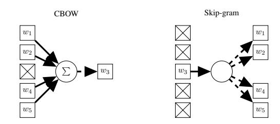

# Representations of Meaning in Neural Networks for NLP: a Thesis Proposal

Tomáš Musil

Charles University, Faculty of Mathematics and Physics Institute of Formal and Applied Linguistics Prague, Czech Republic musil@ufal.mff.cuni.cz

## Abstract

Neural networks are the state-of-the-art method of machine learning for many problems in natural language processing (NLP). Their success in machine translation and other NLP tasks is phenomenal, but their interpretability is challenging. We want to find out how neural networks represent meaning. We will focus on lexical semantics in the embedding layer of the network. We propose to examine the distribution of meaning in the vector space representation of words in neural networks trained for NLP tasks. Furthermore, we propose to consider various theories of meaning in the philosophy of language and to find a methodology that would enable us to connect these areas.

## 1 NLP, Language, and Meaning

Language has been one of the central topics of artificial intelligence (AI) research ever since [Tur](#page-7-0)[ing](#page-7-0) [\(1950\)](#page-7-0) considered the question "Can machines think?" and proposed to replace it with the "imitation game", based purely on textual communication.

Even though language is still one of the hardest problems in AI, there has been a tremendous development in recent years in NLP. Machine translation systems achieve super-human performance (at least in a competition setting) [\(Barrault et al.,](#page-5-0) [2019;](#page-5-0) [Popel et al.,](#page-6-0) [2020\)](#page-6-0). Voice assistants are getting better and better. Some text generation models are so powerful that their authors consider them to pose a danger to society [\(Radford et al.,](#page-6-1) [2019a\)](#page-6-1).

Artificial neural networks are behind a lot of these achievements. The models that are used in NLP can have billions of parameters. The same architecture is often used for various tasks. Consequently, neural networks are often regarded as black boxes, and interpretation of the trained models presents a major scientific challenge [\(Belinkov](#page-5-1) [et al.,](#page-5-1) [2019\)](#page-5-1).

Certain specific questions, such as whether a layer of a particular model contains information

about part of speech (POS) can be answered with various methods. Other, more general questions, are proving more difficult. How do neural machine translation (NMT) systems achieve the level of translation quality comparable to humans? Are there any fundamental limitations in language understanding for artificial neural networks? Do neural networks represent meaning and if they do, then how?

It is the last question we are interested in. The nature of meaning is itself a subject of debate in the philosophy of language. This presents a challenging methodological problem: on the one hand, we need a definition of meaning for the question to make sense; on the other hand, we do not want to restrict our research to a predefined concept of meaning, because then we are in danger of assuming the conclusion and presenting a circular argument. The solution would be to refine the sought-after concept of meaning gradually, based on careful justification supported by empirical observations.

The focus of this work is on lexical semantics in the embedding layer the neural network. We believe that this is a good place to start, as it is the interface between the input text and the network. Furthermore, there are interesting models for obtaining words embeddings without any hidden layers.

## 1.1 Thesis Proposal

The thesis will consist of two parts. In the first part, described in Section [2,](#page-1-0) we will consider various theories and properties of meaning from the point of view of philosophy of language. We will find which aspects of these theories are useful to describe the process of representing meaning in neural networks in NLP.

In the second part, described in Section [3,](#page-2-0) we will examine the distribution of word representations in the embedding spaces with respect to meaning. We propose to use mostly unsupervised methods, such as clustering, principal component analysis (PCA), independent component analysis (ICA) and unsupervised mapping of embedding spaces.

The goal of the thesis is to show which theories of meaning offer a conceptual framework that would be useful for understanding the empirical results of the analysis of the embeddings.

### 2 NLP and Philosophy of Language

There is no agreed-upon general definition of 'meaning' (or 'sense', 'semantics', . . . ; see e.g. [Stokhof](#page-7-1) [\(2013\)](#page-7-1), [Bender and Koller](#page-5-2) [\(2020\)](#page-5-2)).

To be able to talk about representations of meaning, we will have to review different conceptualizations of meaning and find one that is useful for describing the phenomena we encounter when we examine how neural networks work in NLP. We will contrast meaning representations in neural language models with representations in other applications, with emphasis on NMT.

There is very little related work that connects NLP with the philosophy of language. [Honkela](#page-6-2) [\(2007\)](#page-6-2) links neural language models, selforganizing maps and Quine's semantic holism. The works of [Melby](#page-6-3) [\(1994,](#page-6-3) [1995\)](#page-6-4) are discussed in Section [2.5.](#page-2-1)

#### 2.1 The Distributional Hypothesis

Many NLP applications only use raw text for training data (language models, models for embedding pretraining, arguably even NMT models, although the alignment in parallel corpora may be considered an additional source of information). If they represent meaning, the information must be derived from the training corpus, usually presented to the model through a sliding window of tokens. This may be the reason behind the popularity of the distributional hypothesis in neural language model (LM) literature. The famous saying by [Firth](#page-6-5) [\(1957\)](#page-6-5), "You shall know a word by the company it keeps!", is quoted in most papers concerned with vector space models of language.

The general distributional hypothesis states that the meaning of a word is given by the contexts in which it occurs. It is, however, worth noticing that in Firth's theory, collocation is just one among multiple levels of meaning, and his text does not support the idea of meaning being based on the context alone.

The distributional hypothesis would explain why word embeddings capture meaning. However, by itself it tells us nothing about what meaning is and how it relates to the world or people who are using the language.

#### 2.2 The *Use Theory* of Meaning

The *use theory* of meaning can be summed up as "the meaning of a word is its use in the language" [\(Wittgenstein,](#page-7-2) [1953,](#page-7-2) § 43). It is associated with late Wittgenstein's concept of language game. Meaning determines which combinations of words are "in circulation", excluding the senseless combinations and therefore "bounding of the domain of language" [\(Wittgenstein,](#page-7-2) [1953,](#page-7-2) § 499), which is precisely what a LM does; therefore, the use theory may be one way to connect language modelling and semantics.

That "knowledge of language emerges from language use" is also one of the main hypotheses of cognitive linguistics [\(Croft and Cruse,](#page-6-6) [2004\)](#page-6-6).

This approach tells us a bit more about how meaning relates to entities outside language: people are *using* language to accomplish something in the world.

#### 2.3 Structuralism

In structuralism, the meaning of a word is given by its relation to the other words of the language [\(de Saussure,](#page-6-7) [1916\)](#page-6-7). The nature of the sign is arbitrary. This holds for word representations in artificial neural networks as well. Due to the random initialization, the vectors are different every time the model is trained. The individual dimensions of an embedding vector do not have any preconceived interpretation and their values are arbitrary. The embedding vectors do not have any meaning other than their position among the rest of the vectors, and a single vector does not have any significance outside the model.

### 2.4 Semantic Holism and Atomism

*Semantic holism* (or *meaning holism*) is "the thesis that what a linguistic expression means depends on its relations to many or all other expressions within the same totality. [. . . ] The totality in question may be the language to which the expressions belong or a theory formulation in that language" [\(Fodor and](#page-6-8) [Lepore,](#page-6-8) [1992\)](#page-6-8). The opposing view is called *semantic atomism*, and it claims that there are expressions (typically words), whose meaning does not depend on the meaning of other expressions. The meaning of these expressions is given by something outside

language (e.g. their relation to physical or mental objects).

#### 2.5 Objectivism and Experientialism

Study of metaphor and its connection to experience led [Lakoff and Johnson](#page-6-9) [\(1980\)](#page-6-9) to criticize what they call the *objectivist* approach to language. [Melby](#page-6-3) [\(1994\)](#page-6-3) applies this critique to machine translation (MT) and says that "most work in machine translation is explicitly or implicitly based on [the objectivist framework]." He lists the following beliefs as characteristic for objectivism:

- 1. Words and expressions are mapped to senses.
- 2. Each sense exists independently and has the properties of mathematical sets.
- 3. The meaning of a sentence can be obtained by combining the word senses from the bottom up.

[Melby](#page-6-4) [\(1995\)](#page-6-4) claimed that then-current techniques of machine translation will never be extended to handle general language texts and that entirely new techniques that avoid the assumptions of objectivism will be needed; the systems need to understand dynamic metaphor and exhibit flexibility in handling new situations. If Lakoff and Johnson's theory of metaphor holds, this is a trivial consequence: since understanding metaphor is based on experience and contemporary translation systems do not experience anything, they cannot understand and translate metaphors. The *experientialist* view of language places emphasis on the shared experience of the world, which is structured by metaphors.

More than 25 years later, NMT is based on principles that can hardly be construed as an extension of the old techniques. They are more flexible and produce significantly better translations. Do neural networks somehow evade the pitfalls of objectivism? Maybe going repeatedly through the enormous quantity of textual data constitutes a kind of experience; perhaps it is possible to extract the experience of others from the data? May that be one of the reasons for their sudden success in MT and other NLP applications?

## 2.6 Meaning and Understanding

Can a LM really understand natural language? [Ben](#page-5-2)[der and Koller](#page-5-2) [\(2020\)](#page-5-2) argue that methods based only on text cannot learn meaning. They define *meaning* as mapping from words to *communicative intent*. Because text itself does not contain

communicative intent, it is impossible to learn to understand it from a textual corpora alone.

Our approach works in the opposite direction: instead of picking a theory of meaning and projecting restrictions on technical possibilities, we want to start with what is already achieved in NLP. We will analyse the models and find out which aspects of language use are they able to understand. We will then find a theory of meaning that explains the results of the analysis well.

The way a computer solves the NLP tasks does not necessarily correspond to what a person does when solving the same. Therefore our results may not be usable for explaining how we experience language. However, the results would still be useful for understanding the linguistic behavior of blackbox neural models. Comparing our results with neurological findings about biological representations of meaning would be interesting, however it is outside the scope of the proposed thesis.

### 2.7 Conclusion: Properties of Meaning

Based on the properties of word embeddings mentioned in the preceding sections, we want the concept of meaning that we are looking to be compatible with the distributional hypothesis, structuralism, and semantic holism. Based on the arguments given by [Lakoff and Johnson](#page-6-9) [\(1980\)](#page-6-9); [Melby](#page-6-4) [\(1995\)](#page-6-4) and others, we believe that the correct account of meaning should not be objectivist.

We propose to investigate a possibility of a concept of meaning of an expression as a combination of various components. These components would emerge from the use of the expression in context (*semantic holism, distributional hypothesis*). Each of them would represent a specific relation to other expressions (*structuralism*). The components would be continuous and will not form a simple tree hierarchy, therefore avoiding the most problematic aspects of *objectivism*. Instead of definition or enumeration, the components would be described by prototypes (*experientialism, cognitive linguistics*). ICA of word embeddings is a plausible candidate for such conceptualization.

## 3 Properties of Word Embeddings

In this section, we present methods for analysis of words embeddings and provide examples of results obtained with these methods.

We will concentrate on embeddings from unsupervised learning algorithms, language models

and NMT. Unsupervised learning algorithms for obtaining word representations, such as Word2vec [\(Mikolov et al.,](#page-6-10) [2013a\)](#page-6-10), GloVe [\(Pennington et al.,](#page-6-11) [2014\)](#page-6-11) or FastText [\(Bojanowski et al.,](#page-5-3) [2017\)](#page-5-3), have the advantage of being simple, both conceptually and regarding computational costs. Language modelling is the most general language task. Pretrained models, such as masked LMs from the BERT family [\(Devlin et al.,](#page-6-12) [2018\)](#page-6-12), can be finetuned for many NLP tasks. Large generative LMs can even be used for various tasks with little or no fine-tuning [\(Radford et al.,](#page-7-3) [2019b;](#page-7-3) [Brown et al.,](#page-5-4) [2020\)](#page-5-4). NMT is a mature NLP application and the task itself is closely connected to the concept of meaning. By comparing embeddings from different models, we hope to distinguish between properties of the specific model and general properties of continuous word representations.

We will also investigate contextual representations in current Transformer models (e.g. [Radford](#page-6-1) [et al.,](#page-6-1) [2019a\)](#page-6-1). It is possible to reduce contextual embedding to static embeddings [\(Bommasani et al.,](#page-5-5) [2020\)](#page-5-5) and apply the methods for analyzing static embeddings.

In this section we present methods for analyzing word embeddings and their results. Related work on examining vector representations in NLP was surveyed by [Bakarov](#page-5-6) [\(2018\)](#page-5-6). Further information can also be found in the overview of methods for analyzing deep learning models for NLP by [Belinkov](#page-5-7) [and Glass](#page-5-7) [\(2019\)](#page-5-7). For more on interpretation in general and unsupervised methods in examining word embeddings, see [Marecek et al.](#page-6-13) ˇ [\(2020,](#page-6-13) Chapters 3 and 4).

Probing is the most common approach for examining linguistic properties in neural network components [\(Belinkov and Glass,](#page-5-7) [2019\)](#page-5-7). It is the method of using a supervised classifier to predict these properties from activations of the neural network. The methodology may present problems with train/test overlap [\(Rosa et al.,](#page-7-4) [2020\)](#page-7-4).

Probing is most useful when there are high quality annotated data for the property that is being probed. Even though we plan to occasionally use probing in such cases, we will generally emphasize unsupervised methods of interpretation, because we do not want to bias the results by restricting the possible outcome by probing for specific features.

Component Analysis is an unsupervised method for factoring the vector space of embeddings into meaningful components.

PCA is a generally well known example. It is often used for dimensionality reduction. The resulting components are ordered by their importance and they maximize variance of the data given all the previous components.

ICA [\(Jutten and Herault,](#page-6-14) [1991;](#page-6-14) [Comon,](#page-6-15) [1994;](#page-6-15) [Hyvärinen and Oja,](#page-6-16) [2000\)](#page-6-16) is an algorithm originally developed for finding separate sources in a mixed signal, such as a recording of multiple people in the same room speaking at the same time. It was used, for example, to extract features from distribution representations of the words [\(Honkela et al.,](#page-6-17) [2010\)](#page-6-17). The ICA algorithm consists of: optional dimension reduction, usually with PCA; centering the data and *whitening* them (setting variance of each component to 1); iteratively finding directions in the data that are the most non-Gaussian. The last step is based on the assumption of the central limit theorem: the mixed signal is a sum of independent variables, therefore it should be closer to the normal distribution, than the variables themselves.

Clustering is another unsupervised method for examining embeddings. The t-SNE clustering algorithm is often used for visualizing embeddings (e.g. [Maaten and Hinton,](#page-6-18) [2008\)](#page-6-18). Word embeddings are clustered according to meaning in t-SNE [\(Liu](#page-6-19) [et al.,](#page-6-19) [2018\)](#page-6-19).

We show elsewhere [\(Musil et al.,](#page-6-20) [2019\)](#page-6-20) that clusters of embeddings of derivational relations mostly match manually annotated semantic categories of these relations (e.g. the relation 'bake– baker' belongs to the category 'actor', and a correct clustering puts it into the same cluster as 'govern– governor').

Unsupervised Mapping There are unsupervised methods for finding a mapping between two embedding spaces that can be used for simple word-forword translation, as a starting point for creating an unsupervised NMT system [\(Lample et al.,](#page-6-21) [2017\)](#page-6-21).

Mapping of embedding spaces from different corpora of the same language can lead to interesting insights, as demonstrated by [KhudaBukhsh](#page-6-22) [et al.](#page-6-22) [\(2020\)](#page-6-22), who show polarization in US political comments by highlighting different use of specific words or phrases by supporters of different political parties.

We have found that a neural translation model divides words into POS classes [\(Musil,](#page-6-23) [2019\)](#page-6-23). It also distinguishes between proper names and general nouns. The structure of representation varies between the encoder and the decoder of the NMT system.

The structure of the representation of the same data in the word2vec model is different, for example, in that it distinguishes infinitive forms of verbs or modal verbs. A completely different structure is found in the space of representations of words in the neural model for sentiment analysis. All of these facts can be shown without annotated data and thus without deciding beforehand what we will look for in the space of representations. For this reason, we find these results more convincing than if they had been obtained through probing.

### 3.1 Semantic properties

[Hollis and Westbury](#page-6-24) [\(2016\)](#page-6-24) have found that principal components of word2vec embedding space are correlated with various psycholinguistic and semantic properties of words.

One example of a semantic property we have found is that the shape of the space of word embeddings in a convolutional neural network (CNN) model trained for sentiment analysis is triangular [Musil](#page-6-23) [\(2019\)](#page-6-23).

With the help of PCA, we show that the first principal component represents the polarity of the words (good/bad); the second component represents intensity (strong/neutral). The triangular shape may be explained by the fact that words that are far from the center on the polarity axis are always of high intensity. This is an example of component analysis showing more than a probing classifier about the structure of the representation.

This may in fact be all the information that the CNN uses to classify the sentiment. We propose to test this empirically by projecting the embeddings on the first two principal components, retraining the rest of the network and measuring the impact of this on its performance.

### 3.2 Word2vec and Semantic Holism

Word representations obtained from the word2vec model [\(Mikolov et al.,](#page-6-10) [2013a\)](#page-6-10) exhibit interesting semantic properties. They obey the vector arithmetic of meanings illustrated by the following equation:

vking − vman + vwoman ≈ vqueen,

meaning that if we start with the word "king", by subtracting the vector for the word "man" and adding the vector for the word "woman" we arrive

at a vector that is nearest in the vector space to the one that corresponds to the word "queen". This means that *queen* is to *woman* as *king* is to *man*.

This is usually explained by referring to the general distributional hypothesis. We propose a more specific approach based on Frege's holistic and functional approach to meaning.

Figure 1: CBOW and Skip-gram language models according to [\(Mikolov et al.,](#page-6-10) [2013a\)](#page-6-10).

There are two variants of the word2vec model [\(Mikolov et al.,](#page-6-10) [2013a\)](#page-6-10). The CBOW variant predicts a missing word based on the context; the Skip-gram variant predicts context words based on a single word (see Figure [1\)](#page-4-0). The Skip-gram variant performs better in analogy tasks [\(Mikolov](#page-6-25) [et al.,](#page-6-25) [2013b\)](#page-6-25). We show that the training process the Skip-gram variant of word2vec is analogous to a holistic definition of meaning.

Taking Tugendhat's formal reinterpretation of Frege's holistic approach to meaning [\(Tugendhat,](#page-7-5) [1970\)](#page-7-5) as a starting point, we demonstrate that it is analogical to the process of training the Skipgram model and it offers a possible explanation of its semantic properties. Tugendhat's definition of meaning as truth-value potential is:

[T]wo expressions ϕ and ψ have the same truth-value potential if and only if, whenever each is completed by the same expression to form a sentence, the two sentences have the same truth-value.

This definition has one crucial aspect in common with the Skip-gram version of the word2vec model: while we examine the meaning of an expression, the expression is fixed, and the context is changing for comparison. Therefore, it presupposes the context as the source of meaning, in the same way, that Skip-gram learns the representation of a word from the representation of the context. The fact that the holistic Skip-gram version of word2vec works better in analogy tasks than the complementary atomistic CBOW version supports the holistic approach to meaning.

### 3.3 Independent Component Analysis

Our preliminary experiments with ICA indicate, that the independent components represent both morpho-syntactic and semantic features. For our data, we are able to explain roughly 10% of the dimensions by morphological/syntactic features (by using correlations with annotated data). The other 90% seem to be semantic, although the distinction between syntactic and semantic properties is blurry in this context.

ICA of word embeddings seems to be a good candidate for a non-hierarchical system for describing relations between words, as expressed in Section [2.7.](#page-2-2)

## 4 Conclusion and Future Work

Interpretability is an important challenge for neural networks in NLP. There is a limited amount of findings about linguistic phenomena that we are able to predict from embeddings. Much less is known about the semantic properties of the embedding space. The proposed approach to finding a description of the process of representing meaning in neural networks for NLP both from the technological and philosophical perspective would contribute to our understanding of the technology and of the concept of meaning.

Future work could also address the relation between neural networks for natural language inference and the philosophy of *inferentialism* [\(Bran](#page-5-8)[dom,](#page-5-8) [1994\)](#page-5-8).

This proposal leaves out important methodological questions: we are using machine learning methods to run experiments on the results of other machine learning methods. It may be a challenging task to interpret experiments correctly and attribute the discovered properties to the original model or to the model we are using to examine it. The question of how to incorporate results of machine learning into the scientific workflow is starting to come up in other sciences as well, e.g. biology [\(Currie,](#page-6-26) [2019\)](#page-6-26).

This question is perhaps too broad and general to be solved as a part of this thesis. However, we hope to at least formulate in detail the challenges that we are facing when performing this kind of research, as we encounter them while completing the work proposed in the previous sections.

## 5 Acknowledgements

This research was partially supported by SVV project number 260 575 and Grant Agency of Charles University in Prague project GAUK 370721 "Analýza nezávislých komponent vektorových reprezentací slov".

I would like to thank Sebastian Ruder for valuable feedback on the manuscript.

### References

Amir Bakarov. 2018. [A Survey of Word Embeddings](http://arxiv.org/abs/1801.09536) [Evaluation Methods.](http://arxiv.org/abs/1801.09536) *arXiv:1801.09536 [cs]*. ArXiv: 1801.09536. Loïc Barrault, Ondˇrej Bojar, Marta R. Costa-jussà, Christian Federmann, Mark Fishel, Yvette Graham, Barry Haddow, Matthias Huck, Philipp Koehn, Shervin Malmasi, Christof Monz, Mathias Müller, Santanu Pal, Matt Post, and Marcos Zampieri. 2019. [Findings of the 2019 Conference on Machine Trans](http://www.aclweb.org/anthology/W19-5301)[lation \(WMT19\).](http://www.aclweb.org/anthology/W19-5301) In *Proceedings of the Fourth Conference on Machine Translation (Volume 2: Shared Task Papers, Day 1)*, pages 1–61, Florence, Italy. Association for Computational Linguistics. Yonatan Belinkov, Nadir Durrani, Fahim Dalvi, Hassan Sajjad, and James Glass. 2019. [On the Lin](http://arxiv.org/abs/1911.00317)[guistic Representational Power of Neural Machine](http://arxiv.org/abs/1911.00317) [Translation Models.](http://arxiv.org/abs/1911.00317) *arXiv:1911.00317 [cs]*. ArXiv: 1911.00317. Yonatan Belinkov and James Glass. 2019. [Analysis](https://doi.org/10.1162/tacl_a_00254) [Methods in Neural Language Processing: A Survey.](https://doi.org/10.1162/tacl_a_00254) *Transactions of the Association for Computational Linguistics*, 7:49–72. Emily M. Bender and Alexander Koller. 2020. [Climbing](https://doi.org/10.18653/v1/2020.acl-main.463) [towards NLU: On meaning, form, and understanding](https://doi.org/10.18653/v1/2020.acl-main.463) [in the age of data.](https://doi.org/10.18653/v1/2020.acl-main.463) In *Proceedings of the 58th Annual Meeting of the Association for Computational Linguistics*, pages 5185–5198, Online. Association for Computational Linguistics. Piotr Bojanowski, Edouard Grave, Armand Joulin, and Tomas Mikolov. 2017. [Enriching Word Vectors with](http://arxiv.org/abs/1607.04606) [Subword Information.](http://arxiv.org/abs/1607.04606) *Transactions of the Association for Computational Linguistics*, 5:135–146. ArXiv: 1607.04606. Rishi Bommasani, Kelly Davis, and Claire Cardie. 2020. [Interpreting Pretrained Contextualized Representa](https://doi.org/10.18653/v1/2020.acl-main.431)[tions via Reductions to Static Embeddings.](https://doi.org/10.18653/v1/2020.acl-main.431) In *Proceedings of the 58th Annual Meeting of the Association for Computational Linguistics*, pages 4758– 4781, Online. Association for Computational Linguistics. Robert Brandom. 1994. *Making it explicit: Reasoning, representing, and discursive commitment*. Harvard university press. Tom B Brown, Benjamin Mann, Nick Ryder, Melanie Subbiah, Jared Kaplan, Prafulla Dhariwal, Arvind Neelakantan, Pranav Shyam, Girish Sastry, Amanda Askell, et al. 2020. Language models are few-shot learners. *arXiv preprint arXiv:2005.14165*.

- Pierre Comon. 1994. Independent component analysis, a new concept? *Signal processing*, 36(3):287–314. William Croft and D. Alan Cruse. 2004. *[Cognitive](https://doi.org/10.1017/CBO9780511803864) [Linguistics](https://doi.org/10.1017/CBO9780511803864)*, 1 edition. Cambridge University Press. David J. Currie. 2019. [Where Newton might have](https://doi.org/10.1111/geb.12842) [taken ecology.](https://doi.org/10.1111/geb.12842) *Global Ecology and Biogeography*, 28(1):18–27. Ferdinand de Saussure. 1916. *Course in General Linguistics*. Duckworth, London. Jacob Devlin, Ming-Wei Chang, Kenton Lee, and Kristina Toutanova. 2018. Bert: Pre-training of deep bidirectional transformers for language understanding. *arXiv preprint arXiv:1810.04805*. John R Firth. 1957. A synopsis of linguistic theory, 1930-1955. *Studies in linguistic analysis*. Jerry A Fodor and Ernest Lepore. 1992. *Holism: A shopper's guide*. Blackwell. Geoff Hollis and Chris Westbury. 2016. The principals of meaning: Extracting semantic dimensions from co-occurrence models of semantics. *Psychonomic bulletin & review*, 23(6):1744–1756. Timo Honkela. 2007. Philosophical aspects of neural, probabilistic and fuzzy modeling of language use and translation. In *Neural Networks, 2007. IJCNN 2007. International Joint Conference on*, pages \mbox2881– 2886. IEEE. Timo Honkela, Aapo Hyvärinen, and Jaakko J. Väyrynen. 2010. [WordICA—emergence of linguistic rep](https://doi.org/10.1017/S1351324910000057)[resentations for words by independent component](https://doi.org/10.1017/S1351324910000057) [analysis.](https://doi.org/10.1017/S1351324910000057) *Natural Language Engineering*, 16(3):277–
  - 308.
- A. Hyvärinen and E. Oja. 2000. [Independent compo](https://doi.org/10.1016/S0893-6080(00)00026-5)[nent analysis: algorithms and applications.](https://doi.org/10.1016/S0893-6080(00)00026-5) *Neural Networks*, 13(4-5):411–430. Christian Jutten and Jeanny Herault. 1991. Blind separation of sources, part I: An adaptive algorithm based on neuromimetic architecture. *Signal processing*, 24(1):1–10. Ashiqur R KhudaBukhsh, Rupak Sarkar, Mark S Kamlet, and Tom M Mitchell. 2020. We don't speak the same language: Interpreting polarization through machine translation. *arXiv preprint arXiv:2010.02339*. George Lakoff and Mark Johnson. 1980. *Metaphors we live by*. University of Chicago press. Guillaume Lample, Alexis Conneau, Ludovic Denoyer, and Marc'Aurelio Ranzato. 2017. Unsupervised machine translation using monolingual corpora only. *arXiv preprint arXiv:1711.00043*. Shusen Liu, Peer-Timo Bremer, Jayaraman J. Thiagarajan, Vivek Srikumar, Bei Wang, Yarden Livnat, and Valerio Pascucci. 2018. [Visual Exploration of Se](https://doi.org/10.1109/TVCG.2017.2745141)[mantic Relationships in Neural Word Embeddings.](https://doi.org/10.1109/TVCG.2017.2745141) *IEEE Transactions on Visualization and Computer Graphics*, 24(1):553–562. Laurens van der Maaten and Geoffrey Hinton. 2008. Visualizing data using t-SNE. *Journal of machine learning research*, 9(Nov):2579–2605. David Marecek, Jind ˇ ˇrich Libovický, Tomáš Musil, Rudolf Rosa, and Tomasz Limisiewicz. 2020. *Hidden in the Layers: Interpretation of Neural Networks for Natural Language Processing*, volume 20 of *Studies in Computational and Theoretical Linguistics*. Institute of Formal and Applied Linguistics, Prague, Czechia. Backup Publisher: Institute of Formal and Applied Linguistics. Alan Melby. 1994. Machine Translation and Philosophy of Language. In *Machine Translation — Ten Years On*, Cranfield, Bedford. Cranfield University Press. Alan K. Melby. 1995. *The Possibility of Language : a Discussion of the Nature of Language, with Implications for Human and Machine Translation*. John Benjamins Publishing Company. Tomas Mikolov, Kai Chen, Gregory S. Corrado, and Jeffrey Dean. 2013a. [Efficient Estimation of Word Rep](http://arxiv.org/abs/1301.3781)[resentations in Vector Space.](http://arxiv.org/abs/1301.3781) *CoRR*, abs/1301.3781. Tomas Mikolov, Wen-tau Yih, and Geoffrey Zweig. 2013b. [Linguistic Regularities in Continuous Space](https://www.aclweb.org/anthology/N13-1090) [Word Representations.](https://www.aclweb.org/anthology/N13-1090) In *Proceedings of the 2013 Conference of the North American Chapter of the Association for Computational Linguistics: Human Language Technologies*, pages 746–751, Atlanta, Georgia. Association for Computational Linguistics. Tomáš Musil. 2019. [Examining Structure of Word Em](https://doi.org/10.1007/978-3-030-27947-9_18)[beddings with PCA.](https://doi.org/10.1007/978-3-030-27947-9_18) In *Text, Speech, and Dialogue*, pages 211–223, Cham. Springer International Publishing. Tomáš Musil, Jonáš Vidra, and David Marecek. 2019. ˇ [Derivational Morphological Relations in Word Em](https://doi.org/10.18653/v1/W19-4818)[beddings.](https://doi.org/10.18653/v1/W19-4818) In *Proceedings of the 2019 ACL Workshop BlackboxNLP: Analyzing and Interpreting Neural Networks for NLP*, pages 173–180, Florence, Italy. Association for Computational Linguistics. Jeffrey Pennington, Richard Socher, and Christopher Manning. 2014. [Glove: Global Vectors for Word](https://doi.org/10.3115/v1/D14-1162) [Representation.](https://doi.org/10.3115/v1/D14-1162) In *Proceedings of the 2014 Conference on Empirical Methods in Natural Language Processing (EMNLP)*, pages 1532–1543, Doha, Qatar. Association for Computational Linguistics. Martin Popel, Marketa Tomkova, Jakub Tomek, Łukasz Kaiser, Jakob Uszkoreit, Ondˇrej Bojar, and Zdenekˇ Žabokrtský. 2020. [Transforming machine transla](https://doi.org/10.1038/s41467-020-18073-9)[tion: a deep learning system reaches news translation](https://doi.org/10.1038/s41467-020-18073-9) [quality comparable to human professionals.](https://doi.org/10.1038/s41467-020-18073-9) *Nature Communications*, 11(1):4381. Alec Radford, Jeffrey Wu, Dario Amodei, Jack Clark, Amanda Askell, Miles Brundage, and Ilya Sutskever. 2019a. [Better Language Models and Their Implica](https://openai.com/blog/better-language-models/)[tions.](https://openai.com/blog/better-language-models/)

Alec Radford, Jeffrey Wu, Rewon Child, David Luan, Dario Amodei, and Ilya Sutskever. 2019b. Language models are unsupervised multitask learners. *OpenAI blog*, 1(8):9. Rudolf Rosa, Tomáš Musil, and David Marecek. 2020. ˇ Measuring memorization effect in word-level neural networks probing. In *Text, Speech, and Dialogue*, pages 180–188, Cham. Springer International Publishing. Martin Stokhof. 2013. [Formal semantics and Wittgen](https://doi.org/10.5840/monist20139629)[stein: An alternative?](https://doi.org/10.5840/monist20139629) *The Monist*, 96(2):205–231. Ernst Tugendhat. 1970. The meaning of 'Bedeutung' in Frege. *Analysis*, 30(6):177–189. Alan M. Turing. 1950. [Computing Machinery and In](https://doi.org/10.1093/mind/LIX.236.433)[telligence.](https://doi.org/10.1093/mind/LIX.236.433) *Mind*, LIX(236):433–460. Ludwig Wittgenstein. 1953. *Philosophical Investigations*. Wiley-Blackwell.