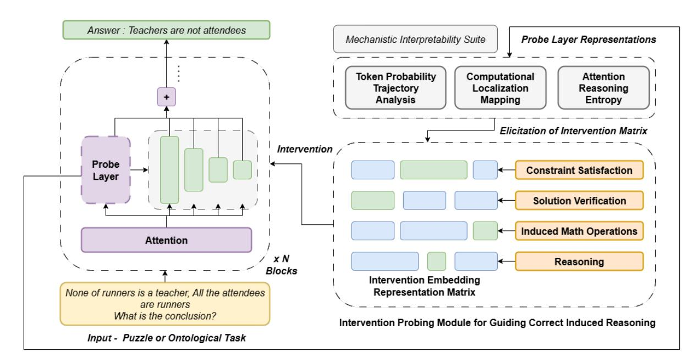

# Thesis Proposal: Interpretable Reasoning Enhancement in Large Language Models through Puzzle and Ontological Task Analysis

Mihir Panchal

Department of Computer Engineering Dwarkadas J. Sanghvi College of Engineering Mumbai, India mihirpanchal5400@gmail.com

## Abstract

Large language models (LLMs) excel across diverse natural language processing tasks but remain opaque and unreliable. This thesis investigates how LLM reasoning can be made both interpretable and reliable through systematic analysis of internal dynamics and targeted interventions. Unlike prior work that examines reasoning broadly, this research focuses on two representative domains: puzzle solving, where reasoning steps can be precisely tracked, and ontological inference, where hierarchical structures constrain valid reasoning. The central questions are: (1) How can systematic error patterns in domain specific reasoning be detected through layer wise probing and mitigated through targeted interventions? (2) How can probing frameworks and middle layer analyses reveal and enhance the computational mechanisms underlying inference? By combining probing methods, middle layer investigations, and probe guided interventions, the work aims to uncover interpretable reasoning patterns, identify systematic failure modes, and develop adaptive enhancement strategies. The expected outcome is a domain grounded framework that advances both theoretical understanding of neural reasoning and the design of practical, trustworthy AI systems.

## 1 Introduction

Large language models (LLMs) achieve state-ofthe-art performance across diverse natural language processing tasks, demonstrating capabilities in reasoning, inference, and problem solving (Brown et al., 2020; Wei et al., 2022; Touvron et al., 2023). Yet these abilities remain unreliable and poorly understood, limiting safe deployment in critical applications (Berglund et al., 2023; Schaeffer et al., 2023; Huang et al., 2025). LLMs often generate plausible but unfaithful explanations (Radhakrishnan et al., 2023; Turpin et al., 2023), highlighting the gap between observed outputs and internal decision processes.

Recent work on chain-of-thought (CoT) prompting improves reasoning performance by encouraging explicit reasoning steps (Wang et al., 2022b; Wei et al., 2022; Hao et al., 2023). However, whether these external traces reflect genuine internal computation remains uncertain (Lanham et al., 2023). Meanwhile, empirical studies suggest that the middle layers of transformer architectures play a crucial role in reasoning, showing dynamic transformations linked to reasoning complexity (Vig and Belinkov, 2019; Li et al., 2024; Sharma et al., 2024).

This thesis addresses the following specific research questions:

- 1. RQ1 (Localization): Do reasoning relevant computational patterns cluster in specific transformer layers during puzzle solving and ontological inference? Can we identify distinct layer wise specialization for constraint satisfaction versus hierarchical reasoning?
- 2. RQ2 (Mechanism): What specific neural circuits mediate multi step reasoning in these domains? Do puzzle solving and ontological reasoning share common computational pathways, or do they employ domain specific mechanisms?
- 3. RQ3 (Failure Modes): What systematic failure patterns emerge in puzzle and ontological reasoning, and can these be detected through layer specific probing before they manifest in outputs?
- 4. RQ4 (Intervention): Can targeted interventions in middle layers, guided by probing classifiers, improve reasoning reliability without degrading general language capabilities? What is the trade-off between intervention strength and preservation of creative problem solving?

These two domains were selected for their complementary characteristics that together cover fundamental reasoning patterns encountered in broader AI applications. Puzzle solving exemplifies constraint reasoning, where solutions must satisfy explicit rules and logical dependencies a pattern ubiquitous in planning, code generation, mathematical problem solving, and scientific hypothesis testing (Cobbe et al., 2021; Hendrycks et al., 2024). The traceable solution paths in puzzles enable precise verification of whether model reasoning aligns with ground truth inference steps, addressing the faithfulness challenge identified in broader reasoning research (Turpin et al., 2023). Ontological reasoning, conversely, represents structured knowledge manipulation, requiring models to navigate hierarchical relationships, perform inheritance inference, and maintain consistency across taxonomic structures. This reasoning pattern underlies question answering, knowledge base completion, common sense reasoning, and semantic understanding tasks (Petroni et al., 2019; Wang et al., 2021). Together, these domains instantiate two core reasoning paradigms, procedural constraint satisfaction and declarative knowledge inference whose combination characterizes complex real world reasoning.

## 2 Related Works

#### 2.1 Interpretability in Large Language Models

Probing classifiers have become a fundamental tool for investigating what linguistic information is encoded in neural representations (Belinkov and Glass, 2019; Clark et al., 2019a; Hewitt and Manning, 2019; Rogers et al., 2021). The development of tools like LogitLens and TunedLens has enabled researchers to examine how predictions evolve across transformer layers, revealing that meaningful predictions often emerge in intermediate layers rather than only in final outputs (nostalgebraist, 2020; Belrose et al., 2023). Circuit analysis approaches have attempted to identify specific computational pathways within models, though these methods face significant challenges when applied to the dense, distributed representations found in large language models (Wang et al., 2022a; Conmy et al., 2023; Syed et al., 2023; Kramár et al., 2024).

Mechanistic interpretability has emerged as a particularly promising direction, focusing on understanding the specific algorithms and computational mechanisms that models use to solve tasks

(Olah et al., 2020; Elhage et al., 2021; Nanda et al., 2023). This approach has yielded insights into how models handle tasks like arithmetic, factual recall, and simple logical operations (Power et al., 2022; Bereska and Gavves, 2024). Recent work has also explored the use of attention visualization and analysis to understand reasoning processes (Clark et al., 2019b; Kovaleva et al., 2019; Gould et al., 2023). However, attention patterns do not always correlate with reasoning processes, and models can attend to irrelevant information while still producing correct outputs (Jain and Wallace, 2019; Serrano and Smith, 2019).

### 2.2 Reasoning in Transformer Models and Chain-of-Thought Methods

Recent theoretical analysis has begun to explain why chain-of-thought is effective, showing that it fundamentally expands the computational power of transformer architectures by providing additional computation time and intermediate storage (Merrill and Sabharwal, 2023; Li et al., 2024). Self consistency methods aggregate multiple reasoning chains to improve reliability (Wang et al., 2022b). Treeof-thought approaches explore multiple reasoning paths simultaneously (Yao et al., 2023). Zero-shot chain-of-thought methods eliminate the need for hand crafted examples while maintaining performance improvements (Kojima et al., 2022). Recent work has also explored enhancing chain-of-thought reasoning through logic integration and formal reasoning frameworks (Pan et al., 2023; Paul et al., 2024; Zhang et al., 2025).

While chain-of-thought can improve reasoning performance, studies have shown that models can generate plausible but ultimately unfaithful explanations that do not reflect their actual decision making processes (Saparov and He, 2022; Turpin et al., 2023). Models can exhibit inconsistent reasoning performance across similar problems, struggle with novel reasoning patterns not seen during training, and fail to maintain logical consistency across long reasoning chains (Dziri et al., 2023; Zhang et al., 2023, 2024). This raises important questions about whether the explicit reasoning chains correspond to the computational processes that actually drive model behavior, or whether they are merely posthoc rationalizations.

Figure 1: Overview of the probe guided intervention framework: mechanistic interpretability tools analyze middle layer representations to detect reasoning errors, enabling targeted interventions that enhance domain specific reasoning in puzzle solving and ontological tasks.

### 2.3 Middle Layer Dynamics and Transformer Analysis

Recent empirical investigations have revealed intriguing patterns in the intermediate layers of transformer models, particularly during reasoning tasks (Clark et al., 2019a; Jawahar et al., 2019). Studies using techniques like activation patching and causal intervention have shown that middle layers play crucial roles in reasoning tasks, with different layers contributing to different aspects of the reasoning process (Meng et al., 2022; Wang et al., 2022a; Geiger et al., 2025). Recent work has begun to address this challenge through more sophisticated analysis methods, including sparse autoencoders for feature discovery and specialized probing techniques for reasoning specific representations (Cunningham et al., 2023; Bills et al., 2023). These approaches have revealed that models develop specialized circuits for different types of reasoning, with some circuits being shared across tasks and others being task specific (Olsson et al., 2022; Ameisen et al., 2025).

If reasoning processes can be characterized and localized within specific layers, it may be possible to design targeted interventions that enhance reasoning performance while maintaining overall model coherence (Li et al., 2023). This possibility has motivated recent research into activation editing and representation manipulation techniques, though these approaches are still in early stages of

development (Mitchell et al., 2021; Ilharco et al., 2022).

### 2.4 Puzzle and Ontological Reasoning in Language Models

Mathematical and logic puzzles provide controlled environments for studying reasoning processes, as they often have well defined solution paths and allow for precise evaluation of reasoning steps (Cobbe et al., 2021; Dutta et al., 2024; Hendrycks et al., 2024). Recent work has shown that models can solve increasingly complex puzzles through chain-of-thought prompting, but they often struggle with novel puzzle types or variations that require creative insight (Welleck et al., 2021; Hao et al., 2023).

Ontological reasoning, involving the understanding and manipulation of concept hierarchies and relationships, is fundamental to many AI applications (Petroni et al., 2019; Hogan et al., 2021; Wang et al., 2021). Language models have shown remarkable ability to perform taxonomic reasoning and understand concept relationships learned during pre-training (Clark et al., 2019a; Hohenecker and Lukasiewicz, 2020; Rogers et al., 2021). However, they often struggle with systematic ontological inference and can be inconsistent in their application of hierarchical knowledge (Elazar et al., 2020; Kassner et al., 2021). Puzzle solving tasks often have traceable solution paths that can be compared

with model reasoning chains, while ontological reasoning provides structured knowledge domains where concepts and relationships can be systematically varied and analyzed (Ribeiro et al., 2020; Wu et al., 2024).

### 3 Aims

This research is structured around two major aims to be pursued over the course of the PhD:

#### 3.1 Aim 1: Developing Domain Specific Probing Methods and Evaluation Frameworks

#### 3.1.1 Probing Architectures for Puzzle and Ontological Reasoning

The approach will involve creating hierarchical probing structures specifically designed to capture reasoning patterns in puzzle solving and ontological domains. We will implement multi layer perceptron (MLP) probes with 2-3 hidden layers trained on frozen transformer representations. For puzzle specific tasks, we employ constraint satisfaction probes that classify whether intermediate representations encode valid puzzle states and multi-step probes that predict the next valid operation from a discrete action space. Rather than relying solely on linear classifiers, the methodology will incorporate attention probing mechanisms using scaled dot product attention over sequence representations to identify relationships between different reasoning steps specific to these domains and track the flow of information across layers during puzzle solving and concept manipulation tasks (Beyer and Reed, 2025). As illustrated in Figure 1, these probing mechanisms form the foundation of our Mechanistic Interpretability Suite, which employs Token Probability Trajectory Analysis, Computational Localization Mapping, and Attention Reasoning Entropy to extract reasoning relevant representations from designated probe layers.

For ontological reasoning tasks, probes will focus on hierarchical relationship detection, concept inheritance patterns, classification consistency, and taxonomic inference processes. These specialized probes will monitor how models represent concept hierarchies, perform inheritance reasoning, resolve taxonomic conflicts, and maintain consistency across ontological inferences. The probing objectives will include parent child relationship detection, sibling concept identification, multiple inheritance resolution, and concept boundary determination. Cross domain analysis between puzzle and ontological reasoning will examine whether shared or distinct mechanisms underlie structured problem solving and concept manipulation. Using unified methods including shared MLP probes, cross domain transfer testing, representational similarity (CKA) analysis, and aligned intervention and evaluation protocols, we will identify convergent or specialized processing pathways, guiding the design of general yet domain grounded reasoning enhancement methods.

#### 3.1.2 Specialized Dataset Creation and Evaluation Frameworks

A critical component of this research involves creating comprehensive datasets specifically designed for evaluating reasoning in puzzle and ontological domains (Shojaee et al., 2025). These datasets will go beyond existing benchmarks by providing fine grained annotations of reasoning steps, multiple solution paths, and systematic variations in problem complexity. For puzzle solving evaluation, datasets will include mathematical puzzles with step-by-step solution annotations, logic puzzles with constraint satisfaction tracking, spatial reasoning problems with transformation sequences, and creative puzzles requiring insight and novel approach generation. Each puzzle will be annotated with ground truth reasoning steps, alternative solution paths, common failure modes, and difficulty gradations based on required reasoning depth.

For ontological reasoning evaluation, datasets will encompass taxonomic classification tasks with hierarchical relationship annotations, concept inheritance problems with multiple inheritance scenarios, ontological consistency checking with systematic inconsistency patterns, and novel concept introduction tasks requiring integration with existing knowledge. These datasets will include systematic variations in hierarchy depth, concept similarity, and relationship complexity. The evaluation framework will incorporate both quantitative metrics including step wise accuracy, reasoning consistency, solution efficiency, and error pattern analysis, and qualitative assessment methods including reasoning faithfulness evaluation, explanation quality assessment, solution creativity scoring, and failure mode categorization. This comprehensive evaluation approach will enable precise measurement of reasoning improvements and systematic identification of remaining limitations.

#### 3.1.3 Middle Layer Analysis Framework for Domain Specific Reasoning

The methodology will combine multiple complementary analysis techniques specifically tailored for puzzle and ontological reasoning to provide a complete picture of middle layer behavior in these domains. Middle-layer dynamics refers to the transformation of hidden representations in layers L/3 to 2L/3 of the transformer architecture, where L is the total number of layers regions empirically shown to mediate multi-step reasoning (Li et al., 2024; Sharma et al., 2024). We operationalize this through: (1) layer wise activation magnitude tracking (computing ℓ2 norms of hidden states across layers), (2) representation drift analysis (measuring cosine distance between consecutive layer outputs), and (3) information flow quantification using mutual information estimation between layer pairs.

For puzzle solving analysis, the framework will investigate how middle layers represent puzzle constraints, track solution progress, maintain working memory for multi-step problems, and implement backtracking and search strategies. Special attention will be given to understanding how representations transform as puzzle complexity increases and how models handle puzzle variants that require creative insight. For ontological reasoning analysis, the framework will examine how middle layers encode concept hierarchies, perform inheritance computations, resolve conflicting taxonomic information, and integrate new concepts with existing knowledge structures. The analysis will explore how different types of ontological relationships are represented and how models handle systematic variations in concept similarity and hierarchy depth. This analysis will reveal the computational pathways most critical for each reasoning domain and inform the design of targeted interventions.

The framework will also investigate temporal dynamics of middle layer processing during multistep reasoning, examining how representations evolve across forward passes in models that engage in iterative reasoning or self-correction within these specific domains. This analysis will provide insights into whether models implement domain specific reasoning through parallel processing across layers or through more sequential, step-bystep computation.

#### 3.2 Aim 2: Creating Domain Targeted Interventional Frameworks

#### 3.2.1 Probe Guided Intervention Strategies for Specific Reasoning Domains

The methodology will involve developing monitoring systems that use domain-specific probing classifiers to track reasoning processes in real-time during puzzle solving and ontological inference. Probe guided intervention is operationalized as follows: probing classifiers (trained as described in 3.1.1) evaluate intermediate representations at inference time; when probe confidence drops below a calibrated threshold τ (determined via held out validation to balance precision recall), targeted interventions modify the representation vector hl at layer l through direction specific steering: h ′ l = hl + α · vcorrect, where vcorrect is the mean activation difference between correct and incorrect reasoning examples, and α is an intervention strength parameter tuned to minimize reasoning error while preserving perplexity on held out text. The intervention architecture, depicted in Figure 1, maintains an Intervention Embedding Representation Matrix that encodes domain specific reasoning patterns across four categories: Constraint Satisfaction, Solution Verification, Induced Mathematical Operations, and General Reasoning. When the interpretability suite detects anomalies such as probe confidence below threshold τ or divergent probability trajectories the system retrieves the appropriate intervention vector and applies the correction h ′ l = hl + α · vcorrect to steer the model toward valid reasoning paths.

For ontological reasoning interventions, the system will track hierarchical consistency, inheritance computation accuracy, concept boundary maintenance, and taxonomic inference validity. Interventions may include hierarchy clarification, inheritance correction, concept boundary reinforcement, and consistency restoration. These interventions will help models maintain coherent ontological reasoning while preserving their ability to handle novel concepts and relationships. The intervention strategies will be adaptive, learning from the success or failure of previous interventions within each domain to improve future performance. This adaptive capability will enable the system to handle novel puzzles and ontological structures without requiring manual reconfiguration while maintaining domain specific expertise.

#### 3.2.2 Inference-Time Reasoning Enhancement for Focused Domains

Building on domain specific probing insights, this research will develop methods for inference time reasoning enhancement specifically optimized for puzzle and ontological reasoning domains. The framework illustrated in Figure 1 demonstrates the complete workflow: during inference on tasks such as syllogistic reasoning (e.g., "None of the runners is a teacher. All the attendees are runners. What is the conclusion?"), the system monitors middle layer representations, applies probing classifiers to verify correct transitive inference, detects failures in recognizing logical relationships, retrieves appropriate intervention vectors, and validates that corrections propagate to produce reliable outputs like "Teachers are not attendees." For puzzle solving enhancement, the inference time system provides constraint checking (verifying puzzle rule satisfaction), solution validation (detecting invalid intermediate steps), and systematic search guidance (redirecting toward valid solution spaces when dead ends are detected via probe confidence thresholds).

For ontological reasoning enhancement, the realtime system will offer hierarchy navigation assistance, inheritance computation support, consistency checking, and novel concept integration guidance. This system will help models maintain coherent ontological reasoning while expanding their capability to handle complex taxonomic structures and novel concept relationships. The real-time enhancement framework will include domain specific uncertainty quantification and confidence estimation, allowing the system to determine when interventions are needed and how confident it should be in its corrections within each reasoning domain. This capability is crucial for avoiding over correction and maintaining model reliability in domain specific contexts.

### 3.2.3 Comprehensive Evaluation Protocols for Domain Specific Interventions

Developing robust evaluation methods for reasoning interventions in puzzle and ontological domains is crucial for ensuring their effectiveness and safety. This research will establish comprehensive evaluation protocols specifically designed for these domains that go beyond simple accuracy metrics to assess the quality, faithfulness, and reliability of domain specific reasoning processes. The evaluation framework will include both quantitative and qualitative assessment methods tailored to each do-

main. For puzzle solving evaluation, quantitative measures will track solution accuracy, step efficiency, creative insight generation, and robustness across puzzle variations. Qualitative analysis will examine solution elegance, reasoning faithfulness, creative problem solving maintenance, and preservation of human like puzzle solving strategies. For ontological reasoning evaluation, quantitative measures will assess taxonomic accuracy, consistency maintenance, inheritance computation correctness, and scalability across ontology sizes. Qualitative analysis will examine reasoning coherence, concept boundary maintenance, novel concept integration quality, and preservation of flexible taxonomic thinking.

Special attention will be given to evaluating intervention robustness across different puzzle types and ontological structures, assessing whether improvements generalize within domains and how interventions handle edge cases and novel variations. The protocols will also assess potential negative effects of interventions, including reduction in creative problem solving, introduction of domain specific biases, and decreased flexibility in reasoning approaches. Human studies will assess whether intervention enhanced reasoning in puzzle and ontological domains is more convincing, trustworthy, and useful to human users compared to baseline model outputs. These studies will focus on domain experts including mathematicians, logicians, and knowledge engineers to ensure that enhancements align with expert reasoning patterns while maintaining accessibility to non experts.

## 4 Timeline and Deliverables

The research will produce open source software tools and libraries specifically designed for puzzle and ontological reasoning analysis and enhancement, making the methods accessible to researchers working in these domains. Comprehensive evaluation benchmarks and annotated datasets for both puzzle solving and ontological reasoning will be released to enable future research in domain specific reasoning interpretability.

Additional deliverables include educational materials and tutorials for applying the developed methods to puzzle and ontological reasoning tasks, collaboration with domain experts including mathematicians and knowledge engineers for real world validation, and guidelines for responsible deployment of reasoning enhanced AI systems in educa-

| Year     | Deliverables    | and Milestones     |                 |               |                    |                 |                 |                   |
|----------|-----------------|--------------------|-----------------|---------------|--------------------|-----------------|-----------------|-------------------|
| Year 1   |                 |                    |                 |               |                    |                 |                 |                   |
| Conduct  |                 | comprehensive      | literature      | review        | on LLM             | reasoning,      |                 | interpretability, |
| and      |                 | puzzle/ontological | reasoning.      |               |                    |                 |                 |                   |
| Develop  |                 | preliminary        | datasets        | (500          | annotated          | examples        | across          | domains) and      |
|          | annotation      | protocols.         |                 |               |                    |                 |                 |                   |
| Develop  | novel           | probing            | architectures   |               | for puzzle         | and             | ontological     | reasoning         |
| Set      | up              | experimental       | frameworks      | and           | baseline           | models          | across selected | reason           |
| ing      | benchmarks,     | testing            | on              | preliminary   | datasets.          |                 |                 |                   |
|          | Deliverables:   | Pilot              | datasets with   | annotation    |                    | guidelines,     | initial         | probing frame    |
| work     | tested          | on pilot data,     | baseline        | models,       | literature         | survey          | report,         | 1–2 review        |
| paper    | publications    | or                 | workshop        | papers.       |                    |                 |                 |                   |
| Year 2   |                 |                    |                 |               |                    |                 |                 |                   |
| Scale    | up and          | complete           | full            | annotated     | datasets for       | puzzle          | solving         | and ontolog      |
| ical     | reasoning,      | incorporating      |                 | lessons from  | Year               | 1 pilot         | studies.        |                   |
| Refine   | and             | validate           | probing         | classifiers   | on                 | domain-specific |                 | reasoning tasks   |
| using    | complete        | datasets.          |                 |               |                    |                 |                 |                   |
| Conduct  |                 | comprehensive      | middle          | layer         | analysis           | to              | investigate     | reasoning dy     |
| namics   | across          | model              | architectures.  |               |                    |                 |                 |                   |
|          | Deliverables:   | Complete           | annotated       | datasets      | (publicly          |                 | released),      | validated and     |
| refined  | probing         | classifiers,       |                 | comprehensive | middle             | layer           | analysis        | report, 1–2       |
|          | conference      | publications       | on dataset      |               | methodology,       | annotation      |                 | framework, and    |
| probing  | results.        |                    |                 |               |                    |                 |                 |                   |
| Year 3   |                 |                    |                 |               |                    |                 |                 |                   |
| Identify | and             | validate           | key reasoning   |               | representation     | patterns        | across          | domains.          |
| Develop  |                 | cross-task         | reasoning       | pattern       | discovery          | methods         | and unified     | analysis          |
| Begin    | design          | and                | implementation  | of            | probe-guided       |                 | intervention    | strategies.       |
|          | Deliverables:   | Analysis           | framework,      |               | cross-task         | pattern         | insights,       | initial inter    |
| vention  |                 | prototypes, 1–2    | major           |               | journal/conference |                 | publications on | reasoning         |
| patterns | and             | middle             | layer analysis. |               |                    |                 |                 |                   |
| Year 4   |                 |                    |                 |               |                    |                 |                 |                   |
|          | Implement       | and validate       |                 | probe-guided  | intervention       |                 | systems with    | real-time         |
|          | reasoning       | enhancement.       |                 |               |                    |                 |                 |                   |
|          | Establish       | comprehensive      | evaluation      |               | protocols,         | including       | human           | evaluation        |
| Conduct  |                 | large-scale        | experiments     | to assess     |                    | effectiveness   | and             | generalization of |
|          | Complete        | thesis writing,    | finalize        |               | datasets/tools,    | and prepare     | for             | defense.          |
|          | Deliverables:   | Fully              | validated       | intervention  | system,            |                 | evaluation      | reports, final    |
|          | datasets/tools, | thesis             | document,       | 1–2 final     | publications       |                 | summarizing     | interven         |
| tions,   | evaluation,     | and                | framework.      |               |                    |                 |                 |                   |

Table 1: Research timeline with milestones, deliverables, and expected publications aligned to puzzle and ontological reasoning aims.

tional and knowledge management applications. 5 Research Significance and Conclusion This research advances both theoretical understanding and practical applications of reasoning in large language models. By focusing on puzzle solving and ontological inference, it investigates how consistent and interpretable reasoning patterns emerge, particularly within the middle layers of transformer architectures. These controlled yet rich domains provide the structure needed for fine grained analysis while retaining sufficient complexity to reveal broader insights about reasoning mechanisms. The study is expected to uncover distinct yet partially overlapping neural circuits for different types of reasoning, shedding light on the modular nature of cognitive processes in LLMs. Such findings would inform the design of reasoning systems that combine creative problem solving with systematic inference. At the same time, the development of interventional frameworks aims to enhance reasoning in real time, maintaining efficiency while reinforcing coherence and reliability. If successful, this work will establish probing and intervention methods as practical tools for understanding and improving reasoning in language models. Beyond theoretical contributions, it will deliver datasets, evaluation frameworks, and enhancement strategies that benefit both research and applied contexts. The outcomes are expected to support applications in education, knowledge management, and creative problem solving, while also providing a foundation for building more interpretable and trustworthy AI systems. References Emmanuel Ameisen, Jack Lindsey, Adam Pearce, Wes Gurnee, Nicholas L. Turner, Brian Chen, Craig Citro, David Abrahams, Shan Carter, Basil Hosmer, Jonathan Marcus, Michael Sklar, Adly Templeton, Trenton Bricken, Callum McDougall, Hoagy Cunningham, Thomas Henighan, Adam Jermyn, Andy Jones, and 8 others. 2025. Circuit tracing: Revealing computational graphs in language models. *Transformer Circuits Thread*. Yonatan Belinkov and James Glass. 2019. Analysis methods in neural language processing: A survey. *Transactions of the Association for Computational Linguistics*, 7:49–72. Nora Belrose, Zach Furman, Logan Smith, Danny Halawi, Igor Ostrovsky, Lev McKinney, Stella Biderman, and Jacob Steinhardt. 2023. Eliciting latent predictions from transformers with the tuned lens. *arXiv preprint arXiv:2303.08112*. Leonard Bereska and Efstratios Gavves. 2024. Mechanistic interpretability for ai safety–a review. *arXiv preprint arXiv:2404.14082*. Lukas Berglund, Meg Tong, Max Kaufmann, Mikita Balesni, Asa Cooper Stickland, Tomasz Korbak, and Owain Evans. 2023. The reversal curse: Llms trained on" a is b" fail to learn" b is a". *arXiv preprint arXiv:2309.12288*. Henrike Beyer and Chris Reed. 2025. Lexical recall or logical reasoning: Probing the limits of reasoning abilities in large language models. In *Proceedings of the 63rd Annual Meeting of the Association for Computational Linguistics (Volume 1: Long Papers)*, pages 13532–13557. Steven Bills, Nick Cammarata, Dan Mossing, Henk Tillman, Leo Gao, Gabriel Goh, Ilya Sutskever, Jan Leike, Jeff Wu, and William Saunders. 2023. Language models can explain neurons in language models. https://openaipublic.blob.core.windows. net/neuron-explainer/paper/index.html. Tom Brown, Benjamin Mann, Nick Ryder, Melanie Subbiah, Jared D Kaplan, Prafulla Dhariwal, Arvind Neelakantan, Pranav Shyam, Girish Sastry, Amanda Askell, and 1 others. 2020. Language models are few-shot learners. *Advances in neural information processing systems*, 33:1877–1901. Kevin Clark, Urvashi Khandelwal, Omer Levy, and Christopher D Manning. 2019a. What does bert look at? an analysis of bert's attention. *arXiv preprint arXiv:1906.04341*. Kevin Clark, Urvashi Khandelwal, Omer Levy, and Christopher D Manning. 2019b. What does bert look at? an analysis of bert's attention. *arXiv preprint arXiv:1906.04341*. Karl Cobbe, Vineet Kosaraju, Mohammad Bavarian, Mark Chen, Heewoo Jun, Lukasz Kaiser, Matthias Plappert, Jerry Tworek, Jacob Hilton, Reiichiro Nakano, and 1 others. 2021. Training verifiers to solve math word problems. *arXiv preprint arXiv:2110.14168*. Arthur Conmy, Augustine Mavor-Parker, Aengus Lynch, Stefan Heimersheim, and Adrià Garriga-Alonso. 2023. Towards automated circuit discovery for mechanistic interpretability. *Advances in Neural Information Processing Systems*, 36:16318–16352. Hoagy Cunningham, Aidan Ewart, Logan Riggs, Robert Huben, and Lee Sharkey. 2023. Sparse autoencoders find highly interpretable features in language models. *arXiv preprint arXiv:2309.08600*. Subhabrata Dutta, Joykirat Singh, Soumen Chakrabarti, and Tanmoy Chakraborty. 2024. How to think stepby-step: A mechanistic understanding of chain-ofthought reasoning. *arXiv preprint arXiv:2402.18312*.

Nouha Dziri, Ximing Lu, Melanie Sclar, Xiang Lorraine Li, Liwei Jiang, Bill Yuchen Lin, Sean Welleck, Peter West, Chandra Bhagavatula, Ronan Le Bras, and 1 others. 2023. Faith and fate: Limits of transformers on compositionality. *Advances in Neural Information Processing Systems*, 36:70293–70332. Yanai Elazar, Shauli Ravfogel, Alon Jacovi, and Yoav Goldberg. 2020. Amnesic probing: Behavioral explanation with amnesic counterfactuals. arxiv eprints, page. *arXiv preprint arXiv:2006.00995*. Nelson Elhage, Neel Nanda, Catherine Olsson, Tom Henighan, Nicholas Joseph, Ben Mann, Amanda Askell, Yuntao Bai, Anna Chen, Tom Conerly, and 1 others. 2021. A mathematical framework for transformer circuits. *Transformer Circuits Thread*, 1(1):12. Atticus Geiger, Duligur Ibeling, Amir Zur, Maheep Chaudhary, Sonakshi Chauhan, Jing Huang, Aryaman Arora, Zhengxuan Wu, Noah Goodman, Christopher Potts, and 1 others. 2025. Causal abstraction: A theoretical foundation for mechanistic interpretability. *Journal of Machine Learning Research*, 26(83):1–64. Rhys Gould, Euan Ong, George Ogden, and Arthur Conmy. 2023. Successor heads: Recurring, interpretable attention heads in the wild. *arXiv preprint arXiv:2312.09230*. Shibo Hao, Yi Gu, Haodi Ma, Joshua Jiahua Hong, Zhen Wang, Daisy Zhe Wang, and Zhiting Hu. 2023. Reasoning with language model is planning with world model. *arXiv preprint arXiv:2305.14992*. Dan Hendrycks, Collin Burns, Saurav Kadavath, Akul Arora, Steven Basart, Eric Tang, Dawn Song, and Jacob Steinhardt. 2024. Measuring mathematical problem solving with the math dataset, 2021. *URL https://arxiv. org/abs/2103.03874*, 2. John Hewitt and Christopher D Manning. 2019. A structural probe for finding syntax in word representations. In *Proceedings of the 2019 Conference of the North American Chapter of the Association for Computational Linguistics: Human Language Technologies, Volume 1 (Long and Short Papers)*, pages 4129–4138. Aidan Hogan, Eva Blomqvist, Michael Cochez, Claudia d'Amato, Gerard De Melo, Claudio Gutierrez, Sabrina Kirrane, José Emilio Labra Gayo, Roberto Navigli, Sebastian Neumaier, and 1 others. 2021. Knowledge graphs. *ACM Computing Surveys (Csur)*, 54(4):1–37. Patrick Hohenecker and Thomas Lukasiewicz. 2020. Ontology reasoning with deep neural networks. *Journal of Artificial Intelligence Research*, 68:503–540. Lei Huang, Weijiang Yu, Weitao Ma, Weihong Zhong, Zhangyin Feng, Haotian Wang, Qianglong Chen, Weihua Peng, Xiaocheng Feng, Bing Qin, and 1 others. 2025. A survey on hallucination in large language models: Principles, taxonomy, challenges, and open questions. *ACM Transactions on Information Systems*, 43(2):1–55. Gabriel Ilharco, Marco Tulio Ribeiro, Mitchell Wortsman, Suchin Gururangan, Ludwig Schmidt, Hannaneh Hajishirzi, and Ali Farhadi. 2022. Editing models with task arithmetic. *arXiv preprint arXiv:2212.04089*. Sarthak Jain and Byron C Wallace. 2019. Attention is not explanation. *arXiv preprint arXiv:1902.10186*. Ganesh Jawahar, Benoît Sagot, and Djamé Seddah. 2019. What does bert learn about the structure of language? In *ACL 2019-57th Annual Meeting of the Association for Computational Linguistics*. Nora Kassner, Philipp Dufter, and Hinrich Schütze. 2021. Multilingual lama: Investigating knowledge in multilingual pretrained language models. *arXiv preprint arXiv:2102.00894*. Takeshi Kojima, Shixiang Shane Gu, Machel Reid, Yutaka Matsuo, and Yusuke Iwasawa. 2022. Large language models are zero-shot reasoners. *Advances in neural information processing systems*, 35:22199– 22213. Olga Kovaleva, Alexey Romanov, Anna Rogers, and Anna Rumshisky. 2019. Revealing the dark secrets of bert. *arXiv preprint arXiv:1908.08593*. János Kramár, Tom Lieberum, Rohin Shah, and Neel Nanda. 2024. Atp\*: An efficient and scalable method for localizing llm behaviour to components. *arXiv preprint arXiv:2403.00745*. Tamera Lanham, Anna Chen, Ansh Radhakrishnan, Benoit Steiner, Carson Denison, Danny Hernandez, Dustin Li, Esin Durmus, Evan Hubinger, Jackson Kernion, and 1 others. 2023. Measuring faithfulness in chain-of-thought reasoning. *arXiv preprint arXiv:2307.13702*. Kenneth Li, Oam Patel, Fernanda Viégas, Hanspeter Pfister, and Martin Wattenberg. 2023. Inferencetime intervention: Eliciting truthful answers from a language model. *Advances in Neural Information Processing Systems*, 36:41451–41530. Zhiyuan Li, Hong Liu, Denny Zhou, and Tengyu Ma. 2024. Chain of thought empowers transformers to solve inherently serial problems. *arXiv preprint arXiv:2402.12875*, 1. Kevin Meng, David Bau, Alex Andonian, and Yonatan Belinkov. 2022. Locating and editing factual associations in gpt. *Advances in neural information processing systems*, 35:17359–17372. William Merrill and Ashish Sabharwal. 2023. The expressive power of transformers with chain of thought. *arXiv preprint arXiv:2310.07923*. Eric Mitchell, Charles Lin, Antoine Bosselut, Chelsea Finn, and Christopher D Manning. 2021. Fast model editing at scale. *arXiv preprint arXiv:2110.11309*.

- Neel Nanda, Lawrence Chan, Tom Lieberum, Jess Smith, and Jacob Steinhardt. 2023. Progress measures for grokking via mechanistic interpretability. *arXiv preprint arXiv:2301.05217*. nostalgebraist. 2020. Interpreting gpt: the logit lens. https://www.lesswrong. com/posts/AcKRB8wDpdaN6v6ru/ interpreting-gpt-the-logit-lens. Chris Olah, Nick Cammarata, Ludwig Schubert, Gabriel Goh, Michael Petrov, and Shan Carter. 2020. Zoom in: An introduction to circuits. *Distill*, 5(3):e00024–
- 001. Catherine Olsson, Nelson Elhage, Neel Nanda, Nicholas Joseph, Nova DasSarma, Tom Henighan, Ben Mann, Amanda Askell, Yuntao Bai, Anna Chen, and 1 others. 2022. In-context learning and induction heads. *arXiv preprint arXiv:2209.11895*. Liangming Pan, Alon Albalak, Xinyi Wang, and William Yang Wang. 2023. Logic-lm: Empowering large language models with symbolic solvers for faithful logical reasoning. *arXiv preprint arXiv:2305.12295*. Debjit Paul, Robert West, Antoine Bosselut, and Boi Faltings. 2024. Making reasoning matter: Measuring and improving faithfulness of chain-of-thought reasoning. *arXiv preprint arXiv:2402.13950*. Fabio Petroni, Tim Rocktäschel, Patrick Lewis, Anton Bakhtin, Yuxiang Wu, Alexander H Miller, and Sebastian Riedel. 2019. Language models as knowledge bases? *arXiv preprint arXiv:1909.01066*. Alethea Power, Yuri Burda, Harri Edwards, Igor Babuschkin, and Vedant Misra. 2022. Grokking: Generalization beyond overfitting on small algorithmic datasets. *arXiv preprint arXiv:2201.02177*. Ansh Radhakrishnan, Karina Nguyen, Anna Chen, Carol Chen, Carson Denison, Danny Hernandez, Esin Durmus, Evan Hubinger, Jackson Kernion, Kamile˙ Lukošiut¯ e, and 1 others. 2023. Question decompo- ˙ sition improves the faithfulness of model-generated reasoning. *arXiv preprint arXiv:2307.11768*. Marco Tulio Ribeiro, Tongshuang Wu, Carlos Guestrin, and Sameer Singh. 2020. Beyond accuracy: Behavioral testing of nlp models with checklist. *arXiv preprint arXiv:2005.04118*. Anna Rogers, Olga Kovaleva, and Anna Rumshisky. 2021. A primer in bertology: What we know about how bert works. *Transactions of the association for computational linguistics*, 8:842–866. Abulhair Saparov and He He. 2022. Language models are greedy reasoners: A systematic formal analysis of chain-of-thought. *arXiv preprint arXiv:2210.01240*. Rylan Schaeffer, Brando Miranda, and Sanmi Koyejo. 2023. Are emergent abilities of large language models a mirage? *Advances in neural information processing systems*, 36:55565–55581. Sofia Serrano and Noah A Smith. 2019. Is attention interpretable? *arXiv preprint arXiv:1906.03731*. Arnab Sen Sharma, David Atkinson, and David Bau. 2024. Locating and editing factual associations in mamba. *arXiv preprint arXiv:2404.03646*. Parshin Shojaee, Iman Mirzadeh, Keivan Alizadeh, Maxwell Horton, Samy Bengio, and Mehrdad Farajtabar. 2025. The illusion of thinking: Understanding the strengths and limitations of reasoning models via the lens of problem complexity. *arXiv preprint arXiv:2506.06941*. Aaquib Syed, Can Rager, and Arthur Conmy. 2023. Attribution patching outperforms automated circuit discovery. *arXiv preprint arXiv:2310.10348*. Hugo Touvron, Thibaut Lavril, Gautier Izacard, Xavier Martinet, Marie-Anne Lachaux, Timothée Lacroix, Baptiste Rozière, Naman Goyal, Eric Hambro, Faisal Azhar, and 1 others. 2023. Llama: Open and efficient foundation language models. *arXiv preprint arXiv:2302.13971*. Miles Turpin, Julian Michael, Ethan Perez, and Samuel Bowman. 2023. Language models don't always say what they think: Unfaithful explanations in chain-ofthought prompting. *Advances in Neural Information Processing Systems*, 36:74952–74965. Jesse Vig and Yonatan Belinkov. 2019. Analyzing the structure of attention in a transformer language model. *arXiv preprint arXiv:1906.04284*. Kevin Wang, Alexandre Variengien, Arthur Conmy, Buck Shlegeris, and Jacob Steinhardt. 2022a. Interpretability in the wild: a circuit for indirect object identification in gpt-2 small. *arXiv preprint arXiv:2211.00593*. Siyuan Wang, Wanjun Zhong, Duyu Tang, Zhongyu Wei, Zhihao Fan, Daxin Jiang, Ming Zhou, and Nan Duan. 2021. Logic-driven context extension and data augmentation for logical reasoning of text. *arXiv preprint arXiv:2105.03659*. Xuezhi Wang, Jason Wei, Dale Schuurmans, Quoc Le, Ed Chi, Sharan Narang, Aakanksha Chowdhery, and Denny Zhou. 2022b. Self-consistency improves chain of thought reasoning in language models. *arXiv preprint arXiv:2203.11171*. Jason Wei, Xuezhi Wang, Dale Schuurmans, Maarten Bosma, Fei Xia, Ed Chi, Quoc V Le, Denny Zhou, and 1 others. 2022. Chain-of-thought prompting elicits reasoning in large language models. *Advances in neural information processing systems*, 35:24824– 24837. Sean Welleck, Jiacheng Liu, Ronan Le Bras, Hannaneh Hajishirzi, Yejin Choi, and Kyunghyun Cho. 2021. Naturalproofs: Mathematical theorem proving in natural language. *arXiv preprint arXiv:2104.01112*.

Zhaofeng Wu, Linlu Qiu, Alexis Ross, Ekin Akyürek, Boyuan Chen, Bailin Wang, Najoung Kim, Jacob Andreas, and Yoon Kim. 2024. Reasoning or reciting? exploring the capabilities and limitations of language models through counterfactual tasks. arxiv. *Preprint posted online March*, 28. Shunyu Yao, Dian Yu, Jeffrey Zhao, Izhak Shafran, Tom Griffiths, Yuan Cao, and Karthik Narasimhan. 2023. Tree of thoughts: Deliberate problem solving with large language models. *Advances in neural information processing systems*, 36:11809–11822. Hugh Zhang, Jeff Da, Dean Lee, Vaughn Robinson, Catherine Wu, William Song, Tiffany Zhao, Pranav Raja, Charlotte Zhuang, Dylan Slack, and 1 others. 2024. A careful examination of large language model performance on grade school arithmetic. *Advances in Neural Information Processing Systems*, 37:46819– 46836. Shun Zhang, Zhenfang Chen, Yikang Shen, Mingyu Ding, Joshua B Tenenbaum, and Chuang Gan. 2023. Planning with large language models for code generation. *arXiv preprint arXiv:2303.05510*. Yufeng Zhang, Xuepeng Wang, Lingxiang Wu, and Jinqiao Wang. 2025. Enhancing chain of thought prompting in large language models via reasoning patterns. In *Proceedings of the AAAI Conference on Artificial Intelligence*, volume 39, pages 25985– 25993.