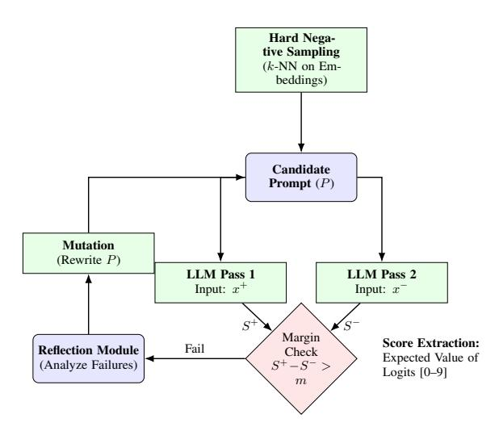
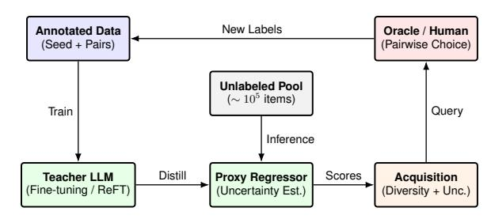

# Thesis Proposal: Measuring Prejudice at Scale

Zoran Fijavž1,2, Senja Pollak3 , Veronika Bajt2

1 Jožef Stefan International Postgraduate School, Slovenia,

2Peace Institute, Slovenia,

3 Jožef Stefan Institute, Slovenia,

Correspondence: [zoran.fijavz@mirovni-institut.si](mailto:zoran.fijavz@mirovni-institut.si)

### Abstract

This thesis proposal addresses methodological gaps in applying NLP to social science by shifting from categorical classification to comparative scaling of grounded constructs. We first extend predictive capacity on existing specialized political datasets with prompt optimization and distillation approaches. We then develop an active learning framework for efficient comparative annotation to scale latent dimensions from large corpora. Finally, we apply this pipeline to measure benevolent sexism in Slovenian media and migration threat perception in parliamentary discourse. This work establishes a scalable workflow for moving NLP from ad-hoc classification to theoretically grounded comparative measurement.

## 1 Introduction

NLP in social science frequently fails in construct validity [\(Baden et al.,](#page-9-0) [2022\)](#page-9-0) or underpowered modeling methods [\(Bonikowski et al.,](#page-9-1) [2022\)](#page-9-1).

First, existing NLP datasets rarely confirm construct validity, which is coherence with an underlying theory including the separability of the new variable from expected co-founding ones [\(Strauss](#page-13-0) [and Smith,](#page-13-0) [2009\)](#page-13-0). Descriptive typologies are the endpoint of social science research, capturing constructs like contemporary sexist and racist attitudes [\(Swim et al.,](#page-13-1) [1995\)](#page-13-1), religious nationalism [\(Lewis,](#page-11-0) [2021\)](#page-11-0), or political populism [\(Bonikowski](#page-9-1) [et al.,](#page-9-1) [2022\)](#page-9-1). NLP in social science commonly prioritizes predictive accuracy over validity [\(Baden](#page-9-0) [et al.,](#page-9-0) [2022;](#page-9-0) [Matamoros-Fernández and Farkas,](#page-12-0) [2021;](#page-12-0) [Hase et al.,](#page-11-1) [2023;](#page-11-1) [Németh,](#page-12-1) [2023\)](#page-12-1), adapting general methods like clustering or sentiment analysis that preclude specific research conclusions [\(Baden et al.,](#page-9-0) [2022\)](#page-9-0). The resulting predictions are incommensurable: social psychology studies sexism and racism of prejudice as group-oriented attitudes that sustain unequal social hierarchies [\(Nel](#page-12-2)[son,](#page-12-2) [2024\)](#page-12-2), while the same phenomena are studied

in NLP as expressions of verbal aggression and hate speech [\(Matamoros-Fernández and Farkas,](#page-12-0) [2021;](#page-12-0) [Fontanella et al.,](#page-10-0) [2024\)](#page-10-0).

Second, existing datasets remain limited by the method of data collection. Textual data commonly follows power-law distributions [\(Ha et al.,](#page-10-1) [2009\)](#page-10-1) in which uncommon examples are key for generalization [\(Feldman,](#page-10-2) [2020\)](#page-10-2) and are easily missed by randomly sampling from a domain. Furthermore, label aggregation through majority voting remains common-practice [\(Klie et al.,](#page-11-2) [2024\)](#page-11-2), in spite of alternatives that prevent the data loss it entails [\(Wu](#page-14-0) [et al.,](#page-14-0) [2023;](#page-14-0) [Martinez et al.,](#page-12-3) [2014;](#page-12-3) [Gruber et al.,](#page-10-3) [2024\)](#page-10-3).

Third, there is a modeling gap for existing highly specialized social science datasets, which cover theory-driven categories such as national pride [\(Bonikowski et al.,](#page-9-1) [2022\)](#page-9-1) and political populism [\(Cocco and Monechi,](#page-9-2) [2022;](#page-9-2) [Erhard et al.,](#page-10-4) [2025\)](#page-10-4), yet are primarily modeled with BERT fine-tuning in spite of potential benefits of advanced NLP methods. Inversely, state-of-the-art modeling methods may provide key new lessons, but fall short of performance required for applied research.

To address these limitations, this thesis proposal introduces a methodological workflow designed to move beyond the constraints of fixed shared tasks and toward independent, theoretically-driven and resource-efficient data collection. We provide a unified framework for both categorical modeling and comparative scaling, enabling the operationalization of specialized constructs with modest computational and annotation resources. By applying this framework to benevolent sexism in media and migration threat perception in parliamentary discourse, we seek to contribute to the spectrum of data collection methods that allow researchers to acquire high-validity data tailored to specific research questions, mitigating the trade-off between the high cost of manual labeling and the conceptual limitations of existing datasets of unsupervised

methods.

## 2 Background and Related Work

## 2.1 Construct Validity and Task Specification

Insufficient construct validity is a key drawback for NLP in social science, affecting content analysis [\(Baden et al.,](#page-9-0) [2022\)](#page-9-0), political polarization [\(Németh,](#page-12-1) [2023\)](#page-12-1), journalism [\(Hase et al.,](#page-11-1) [2023\)](#page-11-1), and critical race studies [\(Matamoros-Fernández and Farkas,](#page-12-0) [2021\)](#page-12-0). Bibliographical analysis points to an increasing insularity of NLP papers, with only few links to other disciplines [\(Wahle et al.,](#page-13-2) [2023\)](#page-13-2). Social psychology frames sexism and racism as prejudice: a group-based set of attitudes and evaluations that disadvantage individuals based on membership in social categories and contribute to unequal intergroup relations [\(Nelson,](#page-12-2) [2024\)](#page-12-2). NLP frames sexism and racism as forms of online hate speech [\(Fontanella et al.,](#page-10-0) [2024;](#page-10-0) [Matamoros-Fernández](#page-12-0) [and Farkas,](#page-12-0) [2021\)](#page-12-0) and samples the discourse of extreme online communities [\(Abercrombie et al.,](#page-8-0) [2023\)](#page-8-0), with very limited compatible typologies and cross-dataset generalization [\(Fortuna et al.,](#page-10-5) [2020,](#page-10-5) [2021\)](#page-10-6). Fine-grained, non-orthogonal sub-classes result in low predictive accuracy beyond the binary label [\(Kostikova et al.,](#page-11-3) [2024;](#page-11-3) [Plaza et al.,](#page-12-4) [2025\)](#page-12-4). While empirical studies of gendered online hostility are necessary [\(Maulana,](#page-12-5) [2021\)](#page-12-5), survey studies demonstrate opposition to hate speech and highly prejudiced positions can be positively correlated [\(Bilewicz et al.,](#page-9-3) [2017\)](#page-9-3). Furthermore, NLP studies of hate speech claim automated content moderation as a direct motivation rather than theory building: our qualitative analysis of content moderation in the Slovenian digital sphere demonstrated moderation is an instrumental practice targeting disruptive, organizationally incongruent or legally actionable content rather than theoretically coherent typologies [\(Fijavž,](#page-10-7) [2025\)](#page-10-7). Even newer approaches using structured datasets like MARPOR yield performance that is too low for post-inference multivariate analysis [\(Nikolaev and Papay,](#page-12-6) [2025\)](#page-12-6).

Other studies explicitly anchor NLP methods in existing empirical theories: [Mohammad](#page-12-7) [\(2025\)](#page-12-7) uses keywords to replicate the coarse results of the stereotype content model [\(Cuddy et al.,](#page-10-8) [2007\)](#page-10-8), and [Bonikowski et al.](#page-9-1) [\(2022\)](#page-9-1) model national pride, replicating a known strategic oppositional use of "national decline" narratives. Such grounding helps ensure classifier separability, orthogonality, and relevance, as well as provides options for hypothesis

testing based on the related work.

This thesis seeks to operationalize two sets of constructs, which have received limited attention in computational social sciences: ambivalent sexism theory [Glick and Fiske](#page-10-9) [\(1996\)](#page-10-9) and integrated threat theory [\(Stephan et al.,](#page-13-3) [1998,](#page-13-3) [2016\)](#page-13-4) applied to parliamentary discourse on migration. Ambivalent sexism theory [Glick and Fiske](#page-10-9) [\(1996\)](#page-10-9) decomposes sexism into hostile sexism, antipathy toward women, and benevolent sexism (BS), affectively positive but limiting attitudes on gender roles. The latter further divides into sub-components. *Protective Paternalism* establishes women as requiring protection through their relationship with men. *Complementary Gender Differentiation* entails an essentialist binary ascribing positive traits (e.g., moral purity) to women to "balance" perceived deficits of men. *Heterosexual Intimacy* frames romantic heterosexual relationships as crucial for psychological wholeness and places women on a pedestal for fulfilling that role. In spite of superficial positivity, BS is linked to negative outcomes distinct from overt hostility: a lower level of self-perceived workplace competence [\(Dardenne et al.,](#page-10-10) [2007\)](#page-10-10), lower support for collective action [\(Becker and Wright,](#page-9-4) [2011\)](#page-9-4), increased fear of intimate partner violence [\(Expósito et al.,](#page-10-11) [2010\)](#page-10-11), and increased victim blaming in responses to descriptions of sexual violence [\(Viki and Abrams,](#page-13-5) [2002\)](#page-13-5). Crucially, texts that contain BS receive mildly positive evaluations [\(Kil](#page-11-4)[ianski and Rudman,](#page-11-4) [1998\)](#page-11-4) or induce less negative emotional responses than hostile sexism [\(Buie and](#page-9-5) [Croft,](#page-9-5) [2023\)](#page-9-5). The limited NLP research on BS relies on limited methods, such as word analogy tasks [\(Jha and Mamidi,](#page-11-5) [2017\)](#page-11-5), subsumes it within broader categories [\(Plaza et al.,](#page-12-4) [2025\)](#page-12-4), and can be more difficult to trace in online discourse than more overt forms [\(Zeinert et al.,](#page-14-1) [2021\)](#page-14-1). [Jha and Mamidi](#page-11-5) [\(2017\)](#page-11-5) mistakenly define BS based on form (backhanded compliments) rather than content, providing examples of "old-fashioned" sexism ("Smart for a girl."), which [Glick and Fiske](#page-10-12) [\(2011\)](#page-10-12) sought to move past to explain the *preservation* of unequal gendered power relations in the face of *declining* endorsements of such attitudes in poll data. This notion was propagated in other NLP research on sexism [\(Zeinert et al.,](#page-14-1) [2021\)](#page-14-1).

We apply integrated threat theory (ITT) [\(Stephan](#page-13-3) [et al.,](#page-13-3) [1998,](#page-13-3) [2016\)](#page-13-4), which divides perceived outgroup threat into realistic threat (physical/economic danger) and symbolic threat (value incompatibility) and has been replicated in meta-analytic reviews

[\(Riek et al.,](#page-12-8) [2006\)](#page-12-8) and experimental settings [\(Zárate](#page-14-2) [et al.,](#page-14-2) [2004\)](#page-14-2). Both forms are linked to collective action against out-groups through eliciting negative emotions [\(Shepherd et al.,](#page-13-6) [2018\)](#page-13-6) with different effects. Realistic threat mediates the relationship to immigration in terms of border policies while symbolic threat mediates opposition to naturalization policies [Pereira et al.](#page-12-9) [\(2010\)](#page-12-9) and threat types vary across target groups [\(Hellwig and Sinno,](#page-11-6) [2017\)](#page-11-6).

Finally, a key finding of literature on prejudice is that it is not bound to single identities or to the private sphere, but functions as a generalized behavioral driver. At the micro-level, seemingly distinct constructs like benevolent sexism intersect with transphobia [\(Nagoshi et al.,](#page-12-10) [2008\)](#page-12-10) and racism [\(McMahon and Kahn,](#page-12-11) [2016\)](#page-12-11). Such empirical findings gave rise to a framework of generalized prejudice [\(Akrami et al.,](#page-8-1) [2011;](#page-8-1) [Allport,](#page-8-2) [1954\)](#page-8-2) with common factors, such as social dominance orientation and right-wing authoritarianism overlapping with identity-specific measures of prejudice [\(Duckitt](#page-10-13) [and Sibley,](#page-10-13) [2007\)](#page-10-13) and driving political behavior, such as electoral choice [\(Rusowicz et al.,](#page-13-7) [2024;](#page-13-7) [Ollerenshaw,](#page-12-12) [2023\)](#page-12-12). Consequently, constructs such as populism and nationalism may stem from political science, yet are entangled with questions of prejudice through the claim of representing a collective political body.

### 2.2 Annotation Paradigms: From Categorical to Comparative

Categorical annotation and classification remain a key approach to annotate textual machine learning datasets. This is somewhat surprising, given the ubiquitous use of ordinal Likert scales to quantify opinions and attitudes in social science survey research, where 5-level Likert agreement scales and subsequent exploratory and confirmatory factorial analysis are standard methodology for crafting and testing theories on social phenomena. While some NLP work uses direct Likert scaling to annotate data [\(Mohammad,](#page-12-7) [2025\)](#page-12-7) and explicit training objective adaptations for deep learning ordinal regression tasks have been proposed [\(Cao et al.,](#page-9-6) [2020\)](#page-9-6), Likert scales can produce inconsistent answers, particularly with few respondents (annotators) and on more difficult tasks where categorical or scale-based responses over small perceptual differences is inconsistent [\(Martinez et al.,](#page-12-3) [2014\)](#page-12-3). Even knowledgeable text annotators may disagree on exact concept boundaries, leading to data loss with majority voting, which is a common aggregation method [\(Klie et al.,](#page-11-2) [2024\)](#page-11-2). Alternative approaches minimize this by collecting data on annotator confidence and aggregating through soft labeling [\(Wu et al.,](#page-14-0) [2023\)](#page-14-0) or repeatedly annotating items near decision boundaries [\(Gruber et al.,](#page-10-3) [2024\)](#page-10-3).

A different approach is an altogether different format of annotator responses, where the task is to choose the "best" of two or more (text) items, which allows the computation of an explicit latent utility score. A key benefit of such comparative annotation is the "law" of comparative judgment [\(Thurstone,](#page-13-8) [1927\)](#page-13-8), which posits relative choice tasks yield increased consistency by calibrating decisions across subjects. Such methods are rarely used for text annotation with exceptions for sentiment tasks [\(Kiritchenko and Mohammad,](#page-11-7) [2017\)](#page-11-7) and a few specialized datasets, in which crowdsourced comparative annotations are aligned with expert Likert-scale annotations [\(Carlson and Mont](#page-9-7)[gomery,](#page-9-7) [2017;](#page-9-7) [Park,](#page-12-13) [2021\)](#page-12-13). The latter datasets received renewed attention in modeling social science constructs [\(Bergström et al.,](#page-9-8) [2024;](#page-9-8) [Licht et al.,](#page-11-8) [2025\)](#page-11-8). Pair-level comparisons can be extended to best-worst scaling (BWS) with the objective of selecting a most and least preferred item on a list, effectively enforcing a margin on the difference between items and speeding up the data collection process [\(Louviere et al.,](#page-11-9) [2015\)](#page-11-9). Block designs allow conducting small-scale BWS with a linear number list-wise comparisons compared to the total number of evaluated items, but optimal combinatorial sampling in large corpora is an NP-hard problem due of optimal sequence sampling from an exponential search space [\(Biyik and Sadigh,](#page-9-9) [2018;](#page-9-9) [Ailon,](#page-8-3) [2012\)](#page-8-3). While attitudes in text can constitute continuous or ordinal variables, collapsing a noisy continuous measure into a binary category via thresholding is straightforward, but the reverse is substantially more difficult.

### 2.3 Active Learning and Comparative Extensions

Textual data follows power-law distributions [\(Ha](#page-10-1) [et al.,](#page-10-1) [2009\)](#page-10-1). Random sampling misses rare instances important for generalization [\(Feldman,](#page-10-2) [2020\)](#page-10-2). Keyword filtering risks biasing constructs by prioritizing explicit vocabulary [\(Abercrombie](#page-8-0) [et al.,](#page-8-0) [2023\)](#page-8-0). Active learning (AL) addresses both, though neural model require calibration [\(Guo et al.,](#page-10-14) [2017\)](#page-10-14) with solutions like diversified ensembling [\(Zhang et al.,](#page-14-3) [2020;](#page-14-3) [Iva¸scu et al.,](#page-11-10) [2022;](#page-11-10) [Chandorkar](#page-9-10)

[and Kharbanda,](#page-9-10) [2024\)](#page-9-10), particularly for zero-shotcapable models with strong priors [\(Brown et al.,](#page-9-11) [2020\)](#page-9-11).

Batch AL must further balance exploration and exploitation via sampling for diversity or uncertainty. Random sampling remains a strong exploration baseline in small datasets [\(Bergström et al.,](#page-9-8) [2024\)](#page-9-8). An optimal sampling strategy is unpredictable [\(Siddhant and Lipton,](#page-13-9) [2018\)](#page-13-9) giving an appeal to methods accounting for both diversity and uncertainty with minimal hyperparameters, such as BADGE [\(Ash et al.,](#page-8-4) [2019\)](#page-8-4). Larger models can use proxy models for sampling [\(Coleman et al.,](#page-9-12) [2020\)](#page-9-12), with frozen LLM embeddings presenting a high-performing option even without deep learning [\(Buckmann and Hill,](#page-9-13) [2024\)](#page-9-13). Embedding quality has been demonstrated a better predictor of performance than the original model size in active learning for classification tasks [\(Rauch et al.,](#page-12-14) [2025\)](#page-12-14).

Active learning for comparative labeling for textual data remains underexplored, as datasets for testing such approaches are uncommon with the notable exception of [\(Carlson and Montgomery,](#page-9-7) [2017\)](#page-9-7). Active preference learning in this literature typically uses probabilistic preference models with classical optimization or Bayesian strategies to maximize information gain [\(Bergström et al.,](#page-9-8) [2024;](#page-9-8) [Thekumparampil et al.,](#page-13-10) [2025\)](#page-13-10) with some applications of deep learning for sampling LLM prompt responses [\(Melo et al.,](#page-12-15) [2025\)](#page-12-15). Item feature concatenation has been used for diversity sampling of image lists [\(Kumari et al.,](#page-11-11) [2020\)](#page-11-11). Successive elimination has been proposed as a method fo simultaneously applying diversity and uncertainty criteria by iteratively comparing sequence pairs and discarding the least uncertain one [\(Biyik and Sadigh,](#page-9-9) [2018\)](#page-9-9). BALD remains a key method for uncertainty quantification in pair-wise comparison data, as a pair is representable as a binary label [\(Bergström et al.,](#page-9-8) [2024\)](#page-9-8). Sequence-level approaches use Plackett-Luce models to estimate sequence-level uncertainty [\(Nadagouda et al.,](#page-12-16) [2023\)](#page-12-16). Large datasets may require random sub-sampling to even apply pairwise acquisition functions [\(Bergström et al.,](#page-9-8) [2024\)](#page-9-8). Lastly, preference data has been modeled through the lens of preferential Bayesian optimization with a key caveat that duel-based acquisition functions seek to identify maximal-utility items rather than a broader utility function of outcomes given a input feature space (?).

### 2.4 Representation Learning and Model Distillation

Even recent classification-based approaches to political texts commonly use fine-tuning encoder-only models like BERT and RoBERTa [\(Bonikowski](#page-9-1) [et al.,](#page-9-1) [2022;](#page-9-1) [Erhard et al.,](#page-10-4) [2025;](#page-10-4) [Timoneda and](#page-13-11) [Vera,](#page-13-11) [2025\)](#page-13-11). While this is a reliable baseline with modest performance (F1 ≈ 0.65–0.75), options for key data efficiency improvements remain underexplored. For instance, SetFit [\(Tunstall et al.,](#page-13-12) [2022\)](#page-13-12) uses contrastive pretraining based on class labels to tune the feature space, which results in few-shot performance compared to standard finetuning. Beyond predictive performance, concept interpretability is highly useful to understand the role of spurious correlations, such as classifying on the basis of named entities rather than text content [\(Jankowski and Huber,](#page-11-12) [2023\)](#page-11-12). While feature importance methods like SHAP highlight keywords, recent developments in inverse prompt tuning provide human-readable prompts. GEPA, Generative Evolving Prompt Agents [\(Agrawal et al.,](#page-8-5) [2025\)](#page-8-5) initializes a population of candidate prompts and iteratively evolves them using an evolutionary algorithm. A larger reflection LLM periodically analyzes the performance of current prompts, identifies failure modes, and proposes a refined prompt. Finetuning LLMs is the most straightforward method for using existing annotated data and is made computationally feasible by parameter-efficient finetuning approaches that update a fraction of the total LLM parameters. A recent advance is representation fine-tuning (ReFT) [\(Wu et al.,](#page-14-4) [2024\)](#page-14-4), that learns sparse interventions on the model's residual stream rather than updating weights, offering even greater parameter efficiency than methods like LoRA [\(Hu et al.,](#page-11-13) [2021\)](#page-11-13). To further bridge the gap between larger teacher models and deployable inference, distillation is often necessary. This can be achieved via standard output matching [\(Hinton](#page-11-14) [et al.,](#page-11-14) [2015\)](#page-11-14) or through feature-based distillation. For example, contrastive representation distillation [\(Tian et al.,](#page-13-13) [2019\)](#page-13-13) aligns the penultimate layer representations of the student and teacher networks by maximizing the mutual information between the two latent spaces. The greater computational demands of distillation in comparison to direct finetuning may be warranted in active learning scenarios, for which repeated inference and labeling costs are a key consideration and can outweigh slower training on a comparatively limited dataset.

| Concept          |                | Domain |          |            | Unit  | N     | IAA   | Max   | Source     |               |     |        |
|------------------|----------------|--------|----------|------------|-------|-------|-------|-------|------------|---------------|-----|--------|
|                  |                |        |          |            |       | (Tot) | ( κ/α | ) F 1 |            |               |     |        |
| Political        | Nostalgia      | EU     | Parties’ | Manifestos | Sent. | 3,515 | 0.56  | 0.81  | Müller     | and Proksch   |     | (2024) |
| Populism         | (Gen.)         | US     | Pres.    | Speeches   | Para. | 2,624 | 0.66  | 0.64  | Bonikowski | et            | al. | (2022) |
| Authoritarianism |                | US     | Pres.    | Speeches   | Para. | 2,624 | 0.90  | 0.69  | Bonikowski | et            | al. | (2022) |
| Exclusionary     | Nationalism    | US     | Pres.    | Speeches   | Para. | 2,624 | 0.81  | 0.81  | Bonikowski | et            | al. | (2022) |
| Inclusive        | Nationalism    | US     | Pres.    | Speeches   | Para. | 2,624 | 0.81  | 0.73  | Bonikowski | et            | al. | (2022) |
| High             | National Pride | US     | Pres.    | Speeches   | Para. | 2,624 | 0.82  | 0.67  | Bonikowski | et            | al. | (2022) |
| Low              | National Pride | US     | Pres.    | Speeches   | Para. | 2,624 | 0.83  | 0.59  | Bonikowski | et            | al. | (2022) |
| Anti-Elitism     |                | German |          | Bundestag  | Sent. | 8,795 | 0.41  | 0.84  | Erhard     | et al. (2025) |     |        |
| People-Centrism  |                | German |          | Bundestag  | Sent. | 8,795 | 0.24  | 0.71  | Erhard     | et al. (2025) |     |        |

Table 1: Overview of expert-annotated concepts used for benchmarking.

# 3 Research Objectives

# 3.1 RO1: Generative Concept Extraction

We will extend predictive performance on specialized political datasets using transformer finetuning, few-shot prompting, and inverse prompt generation. We focus on three expert-annotated datasets representing distinct political constructs (see Table [1\)](#page-4-0). [Bonikowski et al.](#page-9-1) [\(2022\)](#page-9-1) define populism generally as moral claims-making that juxtaposes a corrupt elite against a virtuous people. [Er](#page-10-4)[hard et al.](#page-10-4) [\(2025\)](#page-10-4) further decompose this ideational core into anti-elitism, a moralized critique of power holders, and people-centrism, appeals to the people as the sole legitimate sovereign. Regarding nationalism, [Bonikowski et al.](#page-9-1) [\(2022\)](#page-9-1) distinguish between exclusionary nationalism, which restricts legitimate membership based on nativist criteria like ancestry or race, and inclusive nationalism, which emphasizes pluralism and equality within the national body. They further capture affective dimensions: high national pride celebrates national virtues and achievements, while low national pride focuses on decline and failure. Authoritarianism is defined as the endorsement of punitive state power against domestic enemies or the violation of liberal norms [\(Bonikowski et al.,](#page-9-1) [2022\)](#page-9-1). Finally, [Müller](#page-12-17) [and Proksch](#page-12-17) [\(2024\)](#page-12-17) identify political nostalgia not merely as conservatism, but as a rhetorical strategy invoking positive affect toward a momentous past.

Modeling Approaches: RoBERTa fine-tuning serves as the baseline, compared against zero- and few-shot LLM Prompting and GEPA on binary tasks as well as contrastive GEPA proposed below. We evaluate modeling strategies via 5-fold crossvalidation within the datasets. We further examine

cross-dataset performance between the two datasets measuring populism. A limited sample of texts of applicable categories from others datasets will be annotated with zero-shot prompting or active learning methods to measure the

Contrastive GEPA: We propose an adaptation of GEPA to a Siamese contrastive setup (see Figure [1\)](#page-5-0) with the goal of eliciting class boundaries. The task is to discriminate within text pairs consisting of a positive class example and a hard-negative example, retrieved with k-nearest neighbor (k-NN) from the positive. For a given candidate prompt P, the item is passed to the prompt independently. The prompt explicitly instructs the model to provide a numerical score. Feedback stems from a margin objective, rewarding prompts that ensure S + − S − > m. Pairs that fail to meet this margin are retrieved and fed into the reflection module. The optimizer analyzes these specific failures to generate mutations of P that better discriminate between the target construct and its semantic neighbors. This is following the observation a contrastive learning objectives in transformer learning before classification training improved the inductive bias of trained models and is particularly effective with limited available data as contrastive pairs serve as a form of data augmentation [\(Tunstall et al.,](#page-13-12) [2022\)](#page-13-12).

## 3.2 RO2: Active Scaling for Comparative Annotation

Active learning for comparative text annotation remains underexplored, requiring combinatorial sampling while existing datasets are limited and small. We explore pair-wise active learning on three datasets from [Carlson and Montgomery](#page-9-7) [\(2017\)](#page-9-7): Immigration Attitudes, capturing negative sen-

Figure 1: The Contrastive GEPA Workflow. Candidate prompts are evaluated in a Siamese setting against hard negatives. Low-margin pairs drive the reflection and mutation steps to evolve more discriminative definitions.

timent in survey responses (N = 334 items, K = 6, 489 pairs); Wisconsin Ads, quantifying negativity in campaign transcripts (N = 935, K = 9, 489); and Human Rights, scaling torture severity in US State Department reports (N = 1, 652, K = 16, 520). Random sampling in these small datasets is a strong exploration-first baseline [\(Bergström et al.,](#page-9-8) [2024\)](#page-9-8). We benchmark the datasets with an array of approaches, ranging from regressors to LLM fine-tuning (2.1). We proceed to test full AL pipelines with various acquisition strategies (2.2), and finally propose components for a usable pipeline for list-wise active best-worst scaling (2.3).

RO2.1: Benchmarking and Possible Proxies We first evaluate the overall performance of different modeling approaches. Uncertainty-based sampling can fail when the underlying model has low capacity [\(Rahmati et al.,](#page-12-18) [2025\)](#page-12-18). Providing a high inductive bias through model selection or additional pre-training does not only lead to early performance gains [\(Yi et al.,](#page-14-5) [2022\)](#page-14-5), but has been theorized as essential for effective uncertainty sampling that acts as a task disambiguation step [\(Tamkin](#page-13-14) [et al.,](#page-13-14) [2022\)](#page-13-14).

We thus first examine the data intensity and performance of an array of approaches, including parameter efficient fine-tuning of LLMs, BERT models and frozen LLM embedding backbones (e.g. *Qwen3-8B* embeddings). We explore different modeling objectives such as RankNet [\(Burges et al.,](#page-9-14) [2005\)](#page-9-14), direct preference optimization [\(Rafailov](#page-12-19)

[et al.,](#page-12-19) [2023\)](#page-12-19), spectral ranking regression that alternates between optimizing a pair-based Markov chain [\(Yıldız et al.,](#page-14-6) [2022\)](#page-14-6) and an item-based regressor or directly learning item quality scores as an additional multi-task objective [\(Bai et al.,](#page-9-15) [2023\)](#page-9-15).

We further follow the links between regression and ranking problems in evolutionary algorithms [\(Naharro et al.,](#page-12-20) [2022\)](#page-12-20) and bipartite ranking settings [\(Shen and Lin,](#page-13-15) [2013;](#page-13-15) [Agarwal,](#page-8-6) [2014;](#page-8-6) [Kotłowski](#page-11-15) [et al.,](#page-11-15) [2011\)](#page-11-15), which opens regression-based active learning approaches, such as deep probabilistic regression ensembles [\(Lakshminarayanan et al.,](#page-11-16) [2017\)](#page-11-16), evidential neural network regression [\(Amini](#page-8-7) [et al.,](#page-8-7) [2020\)](#page-8-7), or gradient-boosted probabilistic regression [\(Duan et al.,](#page-10-15) [2020\)](#page-10-15).

We benchmark models on the [Carlson and Mont](#page-9-7)[gomery](#page-9-7) [\(2017\)](#page-9-7) datasets with cross-validation and multiple seeds, reporting pair-wise accuracy, Spearman's ρ, and expected calibration error (ECE). We test on different data size splits to understand the data intensity of each method, which is key in active learning applications. Regression targets are standardized (µ = 0, σ2 = 1) for stability [\(Le-](#page-11-17)[Cun et al.,](#page-11-17) [2012\)](#page-11-17). For evaluation, point-wise outputs are converted to pair-wise probabilities via P ij = σ(ˆyi − yˆj ), enabling unified calculation of pair-wise accuracy and calibration error. Specifically, we are interested in the absolute predictive capacity of various models as well as their calibration in a pair-wise setting, which is a strong indicator for suitability in active learning pipelines.

We will furthermore explore semi-supervised pretraining on generated in-domain tasks [\(Vu et al.,](#page-13-16) [2021\)](#page-13-16) self-regularizing multi-task training objective (e.g. via generated back-translation) [\(Feng](#page-10-16) [et al.,](#page-10-16) [2021\)](#page-10-16) or, alternatively embedding denoising if modeling with static embeddings [\(Asl et al.,](#page-8-8) [2023\)](#page-8-8).

For the best performing models, we furthermore experiment with ensembling methods, such as randomly initialized models or adapters [\(Wang et al.,](#page-14-7) [2021\)](#page-14-7) or branching branching ensembles with a shared feature layers and multiple prediction heads [\(Chandorkar and Kharbanda,](#page-9-10) [2024\)](#page-9-10).

Finally, we will explore methods for prediction explainability: comparative annotation yields a continuous variable with opaque unit meanings. [Carl](#page-9-7)[son and Montgomery](#page-9-7) [\(2017\)](#page-9-7) use expert ordinal judgments to show the validity of their approach, raising the question whether it is possible to reconstruct the semantic difference between scale steps (e.g. between 1 and 3 on negative advertisement).

Figure 2: The Active Scaling Pipeline. A teacher LLM distills learned information into a smaller regression proxy, capable of uncertainty estimation over a large unlabeled pool to guide pairwise queries to the oracle.

We split the continuous scales into stratified bins and test contrastive GEPA on the objective of a discriminator prompt between bins.

RO2.2 Active Sampling Strategy: We simulate an active learning loop (illustrated in Figure 2) on [Carlson and Montgomery](#page-9-7) [\(2017\)](#page-9-7) datasets.

Acquisition Functions: We evaluate both pointwise and pairwise acquisition functions. Regression proxies provide item-level uncertainty via ensemble predictive variance [\(Lakshminarayanan](#page-11-16) [et al.,](#page-11-16) [2017\)](#page-11-16). For pairwise selection, we use a BALD approximation [\(Houlsby et al.,](#page-11-18) [2011\)](#page-11-18) to maximize mutual information with model parameters. Detailed formulas are provided in Appendix [A.2.](#page-15-0)

Batch Selection and Diversification: We experiment with a random and an uncertainty-based sampling strategy as a baseline. We apply successive elimination as a diversity sampling strategy [\(Biyik and Sadigh,](#page-9-9) [2018\)](#page-9-9) to filter the search space to the top K% of items or pairs. We further experiment with stochastic batch acquisition [\(Kirsch](#page-11-19) [et al.,](#page-11-19) [2021\)](#page-11-19) to both item and pair uncertainty measures, meaning a monotone power scaling with Gumbel noise is applied to correct the fact initial uncertainty measures do not hold in sequential selection.

Simulation Protocol: The loop starts with 50 random pairs. Items are removed after 5 comparisons to prevent overfitting. We report learning curves evaluated with AUC on held-out test pairs and Spearman's ρ, calculated by correlating the model's predicted ranking with Bradley-Terry scores derived from the full test set.

# 3.3 RO2.3: Calibrated BWS Neural Scaling

The majority of learn-to-rank algorithms optimize performance for top-k results as a key optimization for search applications [\(Burges et al.,](#page-9-16) [2006\)](#page-9-16), which

is incompatible with scaling applications. To scale latent dimensions from Best-Worst Scaling (BWS) data, we implement a list-wise neural ranker as a hybrid of the discrete choice framework by [Marley](#page-12-21) [and Louviere](#page-12-21) [\(2005\)](#page-12-21) and the calibration objectives of [Bai et al.](#page-9-15) [\(2023\)](#page-9-15). A shared neural encoder maps each text segment in a set S to a latent score s. The joint probability P(i, j|S) of selecting item i as best and item j as worst is defined as:

P(i, j|S) = σ(si)σ(−sj ) P r∈S P t∈S,t̸=r σ(sr)σ(−st) (1)

where σ is the sigmoid function. Sigmoid-based utilities rather than exponential utilities of Plackett-Luce models mitigate translation invariance and the resulting score drift. In the formulation shown in Equation [1,](#page-6-0) the numerator represents the joint utility of the selected best-worst pair, while the denominator normalizes against all possible ordered pairs (r, t) in S where r ̸= t.

The model is optimized via a multi-task objective L that anchors the latent scores to a stable probability scale:

L = − log P(i, j|S) + λ X k∈S ℓ(sk, yk) (2)

The first term in Equation [2](#page-6-1) is the list-wise negative log-likelihood of the observed best-worst choice. The second term is a point-wise sigmoid cross-entropy loss ℓ weighted by the hyperparameter λ. For this component, the targets yk are derived from the annotator's feedback: 1.0 for the best item, 0.0 for the worst, and 0.5 for unselected (middle) items. Aligning list-wise and point-wise objectives ensures score calibration meaning item scores can be directly used in downstream regression. For more details, see Appendix [A.1](#page-14-8) BWS datasets for language processing are even more limited and span research on taboo words [\(Sulpizio](#page-13-17) [et al.,](#page-13-17) [2024\)](#page-13-17), humor [\(Westbury and Hollis,](#page-14-9) [2021\)](#page-14-9) and sentiment intensity [\(Kiritchenko and Moham](#page-11-7)[mad,](#page-11-7) [2017\)](#page-11-7).

A final key requirement for active learning on "wild" corpora is out-of-distribution detection (OODD). Datasets by [\(Carlson and Montgomery,](#page-9-7) [2017\)](#page-9-7) assume the underlying texts have high target feature variance to be annotated, while sizable parts of a keyword-filtered corpus may be fully neutral or irrelevant to a target feature. Baseline OODD

and uncertainty sampling method both leverage predictive uncertainty [\(Berry and Meger,](#page-9-17) [2023;](#page-9-17) [Hendrycks and Gimpel,](#page-11-20) [2017\)](#page-11-20), requiring a different strategy for both. Current OODD methods follow several trends based on data availability. Labeled approaches utilize auxiliary datasets to regularize models against potential outliers [\(Hendrycks et al.,](#page-11-21) [2018\)](#page-11-21). Label-free approaches isolate candidate outliers with approaches, such as uncertainty-aware optimal transport to assign pseudo-labels [\(Lu et al.,](#page-12-22) [2023\)](#page-12-22). Self-supervised contrastive learning can separate in- and out-distribution data into high- and low-density feature space [\(Aathreya and Canavan,](#page-8-9) [2025\)](#page-8-9). Finally, LLMs can be used for zero-shot reasoning detectors or to generate synthetic outliers to mitigate data scarcity [\(Xu and Ding,](#page-14-10) [2025\)](#page-14-10). Supervised approaches are particularly interesting for BWS annotation, as negative OOD examples can be labeled in sets during initial data collection.

# 3.4 RO3: Empirical Application

Finally, we apply the proposed methodology to measure benevolent sexism in Slovenian media and perceptions of symbolic and concrete threat of migration in Slovenian parliamentary discourse.

RO3.1: Benevolent Sexism in News Media: We collect, clean, label and analyze benevolent sexism in the Slovenian News Corpus (2020–2023), comprising over 100,000 news paragraphs from eight Slovenian digital outlets, using a broad keyword filter including domains such as family, politics and romantic relationships. Each article is associated with publication source and date. Benevolent sexism is measured as a latent textual dimension, expressed through linguistic framing and quantified as a continuous degree score. We construct this measure using an active scaling pipeline aligned with the three sub-components of benevolent sexism: protective paternalism, complementary gender differentiation, and heterosexual intimacy. The model assigns each paragraph a degree score for benevolent sexism, enabling systematic comparison across outlets, time, and latent content classes.

Paragraph-level scores are aggregated by outlet to proxy editorial orientations and analyze temporal variation (2020–2023). Semantic clustering approximates genre and discourse styles. Convergent validity is tested against sentiment-analysis outputs (expecting non-negative sentiment) and the workplace sexism dataset [\(Grosz and Conde-Cespedes,](#page-10-17) [2020\)](#page-10-17) (expecting positive association). Divergent validity is tested on the EXIST social-media dataset

[\(Rodríguez-Sánchez et al.,](#page-13-18) [2021\)](#page-13-18), with the measure expected to show little or negative alignment with the categorical labels.

RO3.2: Migration Threat in Parliamentary Discourse: We apply a comparative active scaling framework to measure two expressed threat dimensions in Slovenian parliamentary discourse: Realistic Threat frames migration as competition for resources (jobs, housing, welfare) or physical danger and Symbolic Threat centers on perceived dangers to in-group worldviews, values, or norms. The transcripts of parliamentary sessions are available in the *Parlamint-SI* corpus [\(Erjavec et al.,](#page-10-18) [2023\)](#page-10-18) with rich metadata, including speaker identity and party affiliation.

We analyze the overlap of the two measured dimensions and their relative frequency in different policy discussions not directly tied to migration. We validate against three external sources. Annual party-aggregated threat scores are compared to the Chapel Hill Expert Survey [\(Rovny et al.,](#page-13-19) [2025\)](#page-13-19). In CHES, immigration and multiculturalism are each measured with paired salience and position items on 0–10 Likert scales: salience captures how important the issue is in a party's public stance, while position captures substantive orientation (open vs. restrictive immigration policies; support for multicultural vs. assimilatory policies). DEMIG [\(de](#page-10-19) [Haas et al.,](#page-10-19) [2015\)](#page-10-19) and MIPEX [\(Solano and Hud](#page-13-20)[dleston,](#page-13-20) [2020\)](#page-13-20), contain records of national policy changes. The policy indices have been criticized for arbitrary scoring [\(Klarsfeld et al.,](#page-11-22) [2021\)](#page-11-22), but we use them to identify temporal inflection points to analyze changes in threat metrics within 6-month windows of each change. Finally, we measure threat spillover into secondary discussions, such as welfare, labor, and public spending which are commonly entangled with questions of migration, citizenship and identity [\(Eberl et al.,](#page-10-20) [2018;](#page-10-20) [Perocco,](#page-12-23) [2025\)](#page-12-23).

# 4 Conclusion

This thesis outlines moving from ad-hoc categorical classification to theoretically grounded comparative scaling, which addresses addresses validity gaps in NLP datasets for social science. We seek to apply comparative active learning to large, representative corpora with the goal of analyzing benevolent sexism and migration threat perception in Slovenia.

# Limitations

Ideal pairwise annotation assumes a continuous concept and consistent criteria; however, context and salience effects can cause global scale inconsistencies and uninterpretable unit differences. However, a binary classifier derived from a bipartite ranking should be recoverable with thresholding, preserving the calibration benefits of comparative annotation during data collection. A further limitation applied to running a full list-wise active learning procedure on large corpora. While ranking models produce items scores on a forward pass, even simple list-wise softmax calculation can become computationally intractable in large data spaces. We propose regression as a surrogate task to allow highly scalable item-level uncertainty estimation, but do not provide a specific training procedure. A speculative baseline approach would be training probabilistic or evidential regressors via data distillation. Optimal design approaches exist in the literature [\(Thekumparampil et al.,](#page-13-10) [2025\)](#page-13-10) but resort random sub-sampling. E-optimal experimental design on text embedding representations, leveraging Fisher information–based criteria and greedy optimization (e.g., Frank–Wolfe) would provide a way to select a diverse and informative quadruplet in the embeddings space. Lastly, we assume high inductive bias can be achieved via pre-training or regularization, which does factor in inherent task difficulty: [Bagdon et al.](#page-9-18) [\(2024\)](#page-9-18) and [Licht et al.](#page-11-8) [\(2025\)](#page-11-8) report contradictory finding on contrastive LLM prompting with a distinguishing criteria that the first model a sentiment intensity task and the second more complex behavior. High inductive bias further elevates the impact of annotation mistakes in individual annotated examples, albeit the contrastive setup is a protective factor.

# Acknowledgments

This research was supported by the Slovenian Research and Innovation Agency (ARIS) through the core research programs P5-0413: Equality and Human Rights in the Times of Global Governance and P2-0103: Knowledge Technologies.

# Ethical Considerations

This work analyzes publicly available texts for scientific research. Data processing follows text and data mining standards. Labeled data on constructs, such as sexism, can be used for LLM steering to

amplify or suppress concepts during text generation. However, we aim to collect text expressing biases which are subtle compared to existing, publicly available datasets.

# References

Saandeep Aathreya and Shaun Canavan. 2025. [Flow-](https://doi.org/10.1007/978-3-031-72640-8_11)[Con: Out-of-Distribution Detection Using Flow-](https://doi.org/10.1007/978-3-031-72640-8_11)[Based Contrastive Learning.](https://doi.org/10.1007/978-3-031-72640-8_11) In *Computer Vision – ECCV 2024*, pages 192–209, Cham. Springer Nature Switzerland. Gavin Abercrombie, Aiqi Jiang, Poppy Gerrard-abbott, Ioannis Konstas, and Verena Rieser. 2023. [Resources](https://doi.org/10.18653/v1/2023.woah-1.17) [for Automated Identification of Online Gender-Based](https://doi.org/10.18653/v1/2023.woah-1.17) [Violence: A Systematic Review.](https://doi.org/10.18653/v1/2023.woah-1.17) In *The 7th Workshop on Online Abuse and Harms (WOAH)*, pages 170–186, Toronto, Canada. Association for Computational Linguistics. Shivani Agarwal. 2014. Surrogate Regret Bounds for Bipartite Ranking via Strongly Proper Losses. *The Journal of Machine Learning Research*, 15(1):1653– 1674. Lakshya A. Agrawal, Shangyin Tan, Dilara Soylu, Noah Ziems, Rishi Khare, Krista Opsahl-Ong, Arnav Singhvi, Herumb Shandilya, Michael J. Ryan, Meng Jiang, Christopher Potts, Koushik Sen, Alex Dimakis, Ion Stoica, Dan Klein, Matei Zaharia, and Omar Khattab. 2025. GEPA: Reflective Prompt Evolution Can Outperform Reinforcement Learning. In *First Workshop on Foundations of Reasoning in Language Models*. Nir Ailon. 2012. An Active Learning Algorithm for Ranking from Pairwise Preferences with an Almost Optimal Query Complexity. *J. Mach. Learn. Res.*, 13(1):137–164. Nazar Akrami, Bo Ekehammar, and Robin Bergh. 2011. [Generalized prejudice: Common and specific compo](https://doi.org/10.1177/0956797610390384)[nents.](https://doi.org/10.1177/0956797610390384) *Psychological Science*, 22(1):57–59. Gordon W. Allport. 1954. *The Nature of Prejudice*. The Nature of Prejudice. Addison-Wesley, Oxford, England. Alexander Amini, Wilko Schwarting, Ava Soleimany, and Daniela Rus. 2020. Deep evidential regression. In *Proceedings of the 34th International Conference on Neural Information Processing Systems*, NIPS '20, pages 14927–14937, Red Hook, NY, USA. Curran Associates Inc. Jordan T. Ash, Chicheng Zhang, Akshay Krishnamurthy, John Langford, and Alekh Agarwal. 2019. Deep Batch Active Learning by Diverse, Uncertain Gradient Lower Bounds. In *International Conference on Learning Representations*. Javad Asl, Eduardo Blanco, and Daniel Takabi. 2023. [RobustEmbed: Robust Sentence Embeddings Using](https://doi.org/10.18653/v1/2023.findings-emnlp.305)

- [Self-Supervised Contrastive Pre-Training.](https://doi.org/10.18653/v1/2023.findings-emnlp.305) In *Findings of the Association for Computational Linguistics: EMNLP 2023*, pages 4587–4603, Singapore. Association for Computational Linguistics. Christian Baden, Christian Pipal, Martijn Schoonvelde, and Mariken A. C. G van der Velden. 2022. [Three](https://doi.org/10.1080/19312458.2021.2015574) [Gaps in Computational Text Analysis Methods for](https://doi.org/10.1080/19312458.2021.2015574) [Social Sciences: A Research Agenda.](https://doi.org/10.1080/19312458.2021.2015574) *Communication Methods and Measures*, 16(1):1–18. Christopher Bagdon, Prathamesh Karmalkar, Harsha Gurulingappa, and Roman Klinger. 2024. ["You are](https://doi.org/10.18653/v1/2024.naacl-long.439) [an expert annotator": Automatic Best–Worst-Scaling](https://doi.org/10.18653/v1/2024.naacl-long.439) [Annotations for Emotion Intensity Modeling.](https://doi.org/10.18653/v1/2024.naacl-long.439) In *Proceedings of the 2024 Conference of the North American Chapter of the Association for Computational Linguistics: Human Language Technologies (Volume 1: Long Papers)*, pages 7924–7936, Mexico City, Mexico. Association for Computational Linguistics. Aijun Bai, Rolf Jagerman, Zhen Qin, Le Yan, Pratyush Kar, Bing-Rong Lin, Xuanhui Wang, Michael Bendersky, and Marc Najork. 2023. [Regression Compat](https://doi.org/10.1145/3583780.3614712)[ible Listwise Objectives for Calibrated Ranking with](https://doi.org/10.1145/3583780.3614712) [Binary Relevance.](https://doi.org/10.1145/3583780.3614712) In *Proceedings of the 32nd ACM International Conference on Information and Knowledge Management*, CIKM '23, pages 4502–4508, New York, NY, USA. Association for Computing Machinery. Julia C. Becker and Stephen C. Wright. 2011. [Yet an](https://doi.org/10.1037/a0022615)[other dark side of chivalry: Benevolent sexism under](https://doi.org/10.1037/a0022615)[mines and hostile sexism motivates collective action](https://doi.org/10.1037/a0022615) [for social change.](https://doi.org/10.1037/a0022615) *Journal of Personality and Social Psychology*, 101(1):62–77. Herman Bergström, Emil Carlsson, Devdatt Dubhashi, and Fredrik D. Johansson. 2024. Active preference learning for ordering items in- and out-of-sample. In *The Thirty-eighth Annual Conference on Neural Information Processing Systems*. Lucas Berry and David Meger. 2023. [Normalizing](https://doi.org/10.1609/aaai.v37i6.25834) [flow ensembles for rich aleatoric and epistemic un](https://doi.org/10.1609/aaai.v37i6.25834)[certainty modeling.](https://doi.org/10.1609/aaai.v37i6.25834) In *Proceedings of the Thirty-Seventh AAAI Conference on Artificial Intelligence and Thirty-Fifth Conference on Innovative Applications of Artificial Intelligence and Thirteenth Symposium on Educational Advances in Artificial Intelligence*, volume 37 of *AAAI'23/IAAI'23/EAAI'23*, pages 6806–6814. AAAI Press. Michal Bilewicz, Wiktor Soral, Marta Marchlewska, and Mikołaj Winiewski. 2017. [When Authoritari](https://doi.org/10.1111/pops.12313)[ans Confront Prejudice. Differential Effects of SDO](https://doi.org/10.1111/pops.12313) [and RWA on Support for Hate-Speech Prohibition.](https://doi.org/10.1111/pops.12313) *Political Psychology*, 38(1):87–99. Erdem Biyik and Dorsa Sadigh. 2018. Batch Active Preference-Based Learning of Reward Functions. In *Proceedings of The 2nd Conference on Robot Learning*, pages 519–528. PMLR. Bart Bonikowski, Yuchen Luo, and Oscar Stuhler. 2022. [Politics as Usual? Measuring Populism, Nationalism,](https://doi.org/10.31235/osf.io/uhvbp) [and Authoritarianism in U.S. Presidential Campaigns](https://doi.org/10.31235/osf.io/uhvbp) [\(1952-2020\) with Deep Neural Language Models.](https://doi.org/10.31235/osf.io/uhvbp) Tom B. Brown, Benjamin Mann, Nick Ryder, Melanie Subbiah, Jared Kaplan, Prafulla Dhariwal, Arvind Neelakantan, Pranav Shyam, Girish Sastry, Amanda Askell, Sandhini Agarwal, Ariel Herbert-Voss, Gretchen Krueger, Tom Henighan, Rewon Child, Aditya Ramesh, Daniel M. Ziegler, Jeffrey Wu, Clemens Winter, and 12 others. 2020. Language models are few-shot learners. In *Proceedings of the 34th International Conference on Neural Information Processing Systems*, NIPS '20, pages 1877–1901, Red Hook, NY, USA. Curran Associates Inc. Marcus Buckmann and Edward Hill. 2024. [Lo](https://doi.org/10.48550/arXiv.2408.03414)[gistic Regression makes small LLMs strong and](https://doi.org/10.48550/arXiv.2408.03414) [explainable "tens-of-shot" classifiers.](https://doi.org/10.48550/arXiv.2408.03414) *Preprint*, arXiv:2408.03414. Hannah Buie and Alyssa Croft. 2023. [The Social Media](https://doi.org/10.1525/collabra.71341) [Sexist Content \(SMSC\) Database: A Database of](https://doi.org/10.1525/collabra.71341) [Content and Comments for Research Use.](https://doi.org/10.1525/collabra.71341) *Collabra: Psychology*, 9(1):71341. Chris Burges, Tal Shaked, Erin Renshaw, Ari Lazier, Matt Deeds, Nicole Hamilton, and Greg Hullender. 2005. [Learning to rank using gradient descent.](https://doi.org/10.1145/1102351.1102363) In *Proceedings of the 22nd International Conference on Machine Learning*, ICML '05, pages 89–96, New York, NY, USA. Association for Computing Machinery. Christopher Burges, Robert Ragno, and Quoc Le. 2006. Learning to Rank with Nonsmooth Cost Functions. In *Advances in Neural Information Processing Systems*, volume 19. MIT Press. Wenzhi Cao, Vahid Mirjalili, and Sebastian Raschka. 2020. [Rank consistent ordinal regression for neural](https://doi.org/10.1016/j.patrec.2020.11.008) [networks with application to age estimation.](https://doi.org/10.1016/j.patrec.2020.11.008) *Pattern Recognition Letters*, 140:325–331. David Carlson and Jacob M. Montgomery. 2017. [A Pair](https://doi.org/10.1017/S0003055417000302)[wise Comparison Framework for Fast, Flexible, and](https://doi.org/10.1017/S0003055417000302) [Reliable Human Coding of Political Texts.](https://doi.org/10.1017/S0003055417000302) *American Political Science Review*, 111(4):835–843. A Chandorkar and A Kharbanda. 2024. [Divergent En](https://doi.org/10.5121/ijci.2024.130605)[semble Networks: Enhancing Uncertainty Estima](https://doi.org/10.5121/ijci.2024.130605)[tion with Shared Representations and Independent](https://doi.org/10.5121/ijci.2024.130605) [Branching.](https://doi.org/10.5121/ijci.2024.130605) *International Journal on Cybernetics & Informatics*, 13(6):69–78. Jessica Di Cocco and Bernardo Monechi. 2022. [How](https://doi.org/10.1017/pan.2021.29) [Populist are Parties? Measuring Degrees of Pop](https://doi.org/10.1017/pan.2021.29)[ulism in Party Manifestos Using Supervised Machine](https://doi.org/10.1017/pan.2021.29) [Learning.](https://doi.org/10.1017/pan.2021.29) *Political Analysis*, 30(3):311–327.
  - C. Coleman, C. Yeh, S. Mussmann, B. Mirzasoleiman,
    - P. Bailis, P. Liang, J. Leskovec, and M. Zaharia. 2020. Selection via Proxy: Efficient Data Selection for Deep Learning. *International Conference on Learning Representations (ICLR)*.

- Amy J. C. Cuddy, Susan T. Fiske, and Peter Glick. 2007. [The BIAS map: Behaviors from intergroup affect](https://doi.org/10.1037/0022-3514.92.4.631) [and stereotypes.](https://doi.org/10.1037/0022-3514.92.4.631) *Journal of Personality and Social Psychology*, 92(4):631–648. Benoit Dardenne, Muriel Dumont, and Thierry Bollier. 2007. [Insidious dangers of benevolent sexism:](https://doi.org/10.1037/0022-3514.93.5.764) [Consequences for women's performance.](https://doi.org/10.1037/0022-3514.93.5.764) *Journal of Personality and Social Psychology*, 93(5):764–779. Hein de Haas, Katharina Natter, and Simona Vezzoli. 2015. [Conceptualizing and measuring migration pol](https://doi.org/10.1186/s40878-015-0016-5)[icy change.](https://doi.org/10.1186/s40878-015-0016-5) *Comparative Migration Studies*, 3(1):15. Tony Duan, Avati Anand, Daisy Yi Ding, Khanh K. Thai, Sanjay Basu, Andrew Ng, and Alejandro Schuler. 2020. NGBoost: Natural Gradient Boosting for Probabilistic Prediction. In *Proceedings of the 37th International Conference on Machine Learning*, pages 2690–2700. PMLR. John Duckitt and Chris G. Sibley. 2007. [Right wing](https://doi.org/10.1002/per.614) [authoritarianism, social dominance orientation and](https://doi.org/10.1002/per.614) [the dimensions of generalized prejudice.](https://doi.org/10.1002/per.614) *European Journal of Personality*, 21(2):113–130. Jakob-Moritz Eberl, Christine E. Meltzer, Tobias Heidenreich, Beatrice Herrero, Nora Theorin, Fabienne Lind, Rosa Berganza, Hajo G. Boomgaarden, Christian Schemer, and Jesper Strömbäck. 2018. [The Euro](https://doi.org/10.1080/23808985.2018.1497452)[pean Media Discourse on Immigration and its Effects:](https://doi.org/10.1080/23808985.2018.1497452) [A Literature Review.](https://doi.org/10.1080/23808985.2018.1497452) *Annals of the International Communication Association*, 42(3):207–223. Lukas Erhard, Sara Hanke, Uwe Remer, Agnieszka Falenska, and Raphael Heiko Heiberger. 2025. [Pop-](https://doi.org/10.1017/pan.2024.12)[BERT. Detecting Populism and Its Host Ideologies in](https://doi.org/10.1017/pan.2024.12) [the German Bundestag.](https://doi.org/10.1017/pan.2024.12) *Political Analysis*, 33(1):1–
- 17. Tomaž Erjavec, Matyáš Kopp, Maciej Ogrodniczuk, Petya Osenova, Rodrigo Agerri, Manex Agirrezabal, Tommaso Agnoloni, José Aires, Monica Albini, Jon Alkorta, Iván Antiba-Cartazo, Ekain Arrieta, Mario Barcala, Daniel Bardanca, Starkaður Barkarson, Roberto Bartolini, Roberto Battistoni, Nuria Bel, Maria del Mar Bonet Ramos, and 80 others. 2023. Linguistically annotated multilingual comparable corpora of parliamentary debates ParlaMint.ana 4.0. *https://www.clarin.eu/parlamint*. Francisca Expósito, M. Carmen Herrera, Miguel Moya, and Peter Glick. 2010. [Don't Rock the Boat:](https://doi.org/10.1111/j.1471-6402.2009.01539.x) [Women's Benevolent Sexism Predicts Fears of Mar](https://doi.org/10.1111/j.1471-6402.2009.01539.x)[ital Violence.](https://doi.org/10.1111/j.1471-6402.2009.01539.x) *Psychology of Women Quarterly*, 34(1):36–42. Vitaly Feldman. 2020. [Does learning require memoriza](https://doi.org/10.1145/3357713.3384290)[tion? a short tale about a long tail.](https://doi.org/10.1145/3357713.3384290) In *Proceedings of the 52nd Annual ACM SIGACT Symposium on Theory of Computing*, pages 954–959, Chicago IL USA. ACM. Steven Feng, Varun Gangal, Jason Wei, Sarath Chandar, Soroush Vosoughi, Teruko Mitamura, and Eduard Hovy. 2021. [A Survey of Data Augmentation Ap](https://doi.org/10.18653/v1/2021.findings-acl.84)[proaches for NLP.](https://doi.org/10.18653/v1/2021.findings-acl.84) In *Findings of the Association for Computational Linguistics: ACL-IJCNLP 2021*, pages 968–988, Online. Association for Computational Linguistics. Zoran Fijavž. 2025. Digital discourse dilemmas: Moderating slovenian digital landscapes. *ANNALES, SE-RIES HISTORIA ET SOCIOLOGIA*, 35(4):473–486. Lara Fontanella, Berta Chulvi, Elisa Ignazzi, Annalina Sarra, and Alice Tontodimamma. 2024. [How do](https://doi.org/10.1057/s41599-024-02978-7) [we study misogyny in the digital age? A system](https://doi.org/10.1057/s41599-024-02978-7)[atic literature review using a computational linguistic](https://doi.org/10.1057/s41599-024-02978-7) [approach.](https://doi.org/10.1057/s41599-024-02978-7) *Humanities and Social Sciences Communications*, 11(1):478. Paula Fortuna, Juan Soler, and Leo Wanner. 2020. Toxic, Hateful, Offensive or Abusive? What Are We Really Classifying? An Empirical Analysis of Hate Speech Datasets. In *Proceedings of the Twelfth Language Resources and Evaluation Conference*, pages 6786–6794, Marseille, France. European Language Resources Association. Paula Fortuna, Juan Soler-Company, and Leo Wanner. 2021. [How well do hate speech, toxicity, abusive](https://doi.org/10.1016/j.ipm.2021.102524) [and offensive language classification models gener](https://doi.org/10.1016/j.ipm.2021.102524)[alize across datasets?](https://doi.org/10.1016/j.ipm.2021.102524) *Information Processing & Management*, 58(3):102524. Peter Glick and Susan T. Fiske. 1996. [The Ambiva](https://doi.org/10.1037/0022-3514.70.3.491)[lent Sexism Inventory: Differentiating hostile and](https://doi.org/10.1037/0022-3514.70.3.491) [benevolent sexism.](https://doi.org/10.1037/0022-3514.70.3.491) *Journal of Personality and Social Psychology*, 70(3):491–512. Peter Glick and Susan T. Fiske. 2011. [Ambivalent](https://doi.org/10.1177/0361684311414832) [Sexism Revisited.](https://doi.org/10.1177/0361684311414832) *Psychology of Women Quarterly*, 35(3):530–535. Dylan Grosz and Patricia Conde-Cespedes. 2020. [Au](https://doi.org/10.1007/978-3-030-60470-7_11)[tomatic Detection of Sexist Statements Commonly](https://doi.org/10.1007/978-3-030-60470-7_11) [Used at the Workplace.](https://doi.org/10.1007/978-3-030-60470-7_11) In *Trends and Applications in Knowledge Discovery and Data Mining: PAKDD 2020 Workshops, DSFN, GII, BDM, LDRC and LBD, Singapore, May 11–14, 2020, Revised Selected Papers*, pages 104–115, Berlin, Heidelberg. Springer-Verlag. Cornelia Gruber, Katharina Hechinger, Matthias Assenmacher, Göran Kauermann, and Barbara Plank. 2024. More Labels or Cases? Assessing Label Variation in Natural Language Inference. In *Proceedings of the Third Workshop on Understanding Implicit and Underspecified Language*, pages 22–32, Malta. Association for Computational Linguistics. Chuan Guo, Geoff Pleiss, Yu Sun, and Kilian Q. Weinberger. 2017. On Calibration of Modern Neural Networks. In *Proceedings of the 34th International Conference on Machine Learning*, pages 1321–1330. PMLR. Le Quan Ha, Philip Hanna, Ming Ji, and F.J. Smith. 2009. [Extending Zipf's law to n-grams for large](https://doi.org/10.1007/s10462-009-9135-4) [corpora.](https://doi.org/10.1007/s10462-009-9135-4) *Artificial Intelligence Review*, 32(1-4):101– 113.

- Valerie Hase, Daniela Mahl, and Mike S. Schäfer. 2023. [The "computational turn": An "interdisciplinary](https://doi.org/10.1515/omgc-2023-0003) [turn"? A systematic review of text as data approaches](https://doi.org/10.1515/omgc-2023-0003) [in journalism studies.](https://doi.org/10.1515/omgc-2023-0003) *Online Media and Global Communication*, 2(1):122–143. Timothy Hellwig and Abdulkader Sinno. 2017. [Differ](https://doi.org/10.1080/1369183X.2016.1202749)[ent groups, different threats: Public attitudes towards](https://doi.org/10.1080/1369183X.2016.1202749) [immigrants.](https://doi.org/10.1080/1369183X.2016.1202749) *Journal of Ethnic and Migration Studies*, 43(3):339–358. Dan Hendrycks and Kevin Gimpel. 2017. A Baseline for Detecting Misclassified and Out-of-Distribution Examples in Neural Networks. In *International Conference on Learning Representations*. Dan Hendrycks, Mantas Mazeika, and Thomas Dietterich. 2018. Deep Anomaly Detection with Outlier Exposure. In *International Conference on Learning Representations*. Geoffrey Hinton, Oriol Vinyals, and Jeff Dean. 2015. [Distilling the Knowledge in a Neural Network.](https://doi.org/10.48550/arXiv.1503.02531) *Preprint*, arXiv:1503.02531. Neil Houlsby, Ferenc Huszár, Zoubin Ghahramani, and Máté Lengyel. 2011. [Bayesian Active Learning for](https://doi.org/10.48550/arXiv.1112.5745) [Classification and Preference Learning.](https://doi.org/10.48550/arXiv.1112.5745) *Preprint*, arXiv:1112.5745. Edward J. Hu, Yelong Shen, Phillip Wallis, Zeyuan Allen-Zhu, Yuanzhi Li, Shean Wang, Lu Wang, and Weizhu Chen. 2021. LoRA: Low-Rank Adaptation of Large Language Models. In *International Conference on Learning Representations*. Carina Iva¸scu, Richard M. Everson, and Jonathan E. Fieldsend. 2022. [Optimising Diversity in Classifier](https://doi.org/10.1007/s42979-022-01063-7) [Ensembles.](https://doi.org/10.1007/s42979-022-01063-7) *SN Computer Science*, 3(3):191. Michael Jankowski and Robert A. Huber. 2023. [When](https://doi.org/10.1017/pan.2022.32) [Correlation Is Not Enough: Validating Populism](https://doi.org/10.1017/pan.2022.32) [Scores from Supervised Machine-Learning Models.](https://doi.org/10.1017/pan.2022.32) *Political Analysis*, 31(4):591–605. Akshita Jha and Radhika Mamidi. 2017. [When does](https://doi.org/10.18653/v1/W17-2902) [a compliment become sexist? Analysis and classi](https://doi.org/10.18653/v1/W17-2902)[fication of ambivalent sexism using twitter data.](https://doi.org/10.18653/v1/W17-2902) In *Proceedings of the Second Workshop on NLP and Computational Social Science*, pages 7–16, Vancouver, Canada. Association for Computational Linguistics. Stephen E. Kilianski and Laurie A. Rudman. 1998. [Wanting it both ways: Do women approve of benev](https://doi.org/10.1023/A:1018814924402)[olent sexism?](https://doi.org/10.1023/A:1018814924402) *Sex Roles: A Journal of Research*, 39(5-6):333–352. Svetlana Kiritchenko and Saif Mohammad. 2017. [Best-](https://doi.org/10.18653/v1/P17-2074)[Worst Scaling More Reliable than Rating Scales: A](https://doi.org/10.18653/v1/P17-2074) [Case Study on Sentiment Intensity Annotation.](https://doi.org/10.18653/v1/P17-2074) In *Proceedings of the 55th Annual Meeting of the Association for Computational Linguistics (Volume 2: Short Papers)*, pages 465–470, Vancouver, Canada. Association for Computational Linguistics. Andreas Kirsch, Sebastian Farquhar, Parmida Atighehchian, A. Jesson, Frederic Branchaud-Charron, and
  - Y. Gal. 2021. Stochastic Batch Acquisition: A Simple Baseline for Deep Active Learning. *Trans. Mach. Learn. Res.* Alain Klarsfeld, Laura E. M. Traavik, and Hans van Dijk. 2021. MIPEX: From a European index, to an international database. In *Handbook on Diversity and Inclusion Indices*, chapter Handbook on Diversity and Inclusion Indices, pages 252–269. Edward Elgar Publishing. Jan-Christoph Klie, Richard Eckart de Castilho, and Iryna Gurevych. 2024. [Analyzing Dataset Annota](https://doi.org/10.1162/coli_a_00516)[tion Quality Management in the Wild.](https://doi.org/10.1162/coli_a_00516) *Computational Linguistics*, 50(3):817–866. Aida Kostikova, Benjamin Paassen, Dominik Beese, Ole Pütz, Gregor Wiedemann, and Steffen Eger. 2024. [Fine-Grained Detection of Solidarity for Women and](https://doi.org/10.18653/v1/2024.emnlp-main.337) [Migrants in 155 Years of German Parliamentary De](https://doi.org/10.18653/v1/2024.emnlp-main.337)[bates.](https://doi.org/10.18653/v1/2024.emnlp-main.337) In *Proceedings of the 2024 Conference on Empirical Methods in Natural Language Processing*, pages 5884–5907, Miami, Florida, USA. Association for Computational Linguistics. Wojciech Kotłowski, Krzysztof Dembczynski, and Eyke ´ Hüllermeier. 2011. Bipartite ranking through minimization of univariate loss. In *Proceedings of the 28th International Conference on International Conference on Machine Learning*, ICML'11, pages 1113– 1120, Madison, WI, USA. Omnipress. Priyadarshini Kumari, Ritesh Goru, Siddhartha Chaudhuri, and Subhasis Chaudhuri. 2020. [Batch Decorre](https://doi.org/10.24963/ijcai.2020/312)[lation for Active Metric Learning.](https://doi.org/10.24963/ijcai.2020/312) In *Proceedings of the Twenty-Ninth International Joint Conference on Artificial Intelligence*, pages 2255–2261, Yokohama, Japan. International Joint Conferences on Artificial Intelligence Organization. Balaji Lakshminarayanan, Alexander Pritzel, and Charles Blundell. 2017. Simple and Scalable Predictive Uncertainty Estimation using Deep Ensembles. In *Advances in Neural Information Processing Systems*, volume 30. Curran Associates, Inc. Yann A. LeCun, Léon Bottou, Genevieve B. Orr, and Klaus-Robert Müller. 2012. [Efficient BackProp.](https://doi.org/10.1007/978-3-642-35289-8_3) In Grégoire Montavon, Geneviève B. Orr, and Klaus-Robert Müller, editors, *Neural Networks: Tricks of the Trade: Second Edition*, pages 9–48. Springer, Berlin, Heidelberg. Andrew R Lewis. 2021. [Taking America Back for God:](https://doi.org/10.1093/socrel/sraa053) [Christian Nationalism in the United States.](https://doi.org/10.1093/socrel/sraa053) *Sociology of Religion*, 82(1):111–115. Hauke Licht, Rupak Sarkar, Patrick Y. Wu, Pranav Goel, Niklas Stoehr, Elliott Ash, and Alexander Miserlis Hoyle. 2025. [Measuring Scalar Constructs in Social](https://doi.org/10.48550/arXiv.2509.03116) [Science with LLMs.](https://doi.org/10.48550/arXiv.2509.03116) *Preprint*, arXiv:2509.03116. Jordan J. Louviere, Terry N. Flynn, and A. A. J. Marley. 2015. *[Best-Worst Scaling: Theory, Methods and Ap](https://doi.org/10.1017/CBO9781107337855)[plications](https://doi.org/10.1017/CBO9781107337855)*. Cambridge University Press, Cambridge.

- Fan Lu, Kai Zhu, Wei Zhai, Kecheng Zheng, and Yang Cao. 2023. [Uncertainty-Aware Optimal Transport](https://doi.org/10.1109/CVPR52729.2023.00320) [for Semantically Coherent Out-of-Distribution De](https://doi.org/10.1109/CVPR52729.2023.00320)[tection.](https://doi.org/10.1109/CVPR52729.2023.00320) In *2023 IEEE/CVF Conference on Computer Vision and Pattern Recognition (CVPR)*, pages 3282– 3291, Vancouver, BC, Canada. IEEE.
- A. A. J. Marley and J. J. Louviere. 2005. [Some proba](https://doi.org/10.1016/j.jmp.2005.05.003)[bilistic models of best, worst, and best–worst choices.](https://doi.org/10.1016/j.jmp.2005.05.003) *Journal of Mathematical Psychology*, 49(6):464–480. Hector P. Martinez, Georgios N. Yannakakis, and John Hallam. 2014. [Don't Classify Ratings of Affect;](https://doi.org/10.1109/TAFFC.2014.2352268) [Rank Them!](https://doi.org/10.1109/TAFFC.2014.2352268) *IEEE Transactions on Affective Computing*, 5(3):314–326. Ariadna Matamoros-Fernández and Johan Farkas. 2021. [Racism, Hate Speech, and Social Media: A System](https://doi.org/10.1177/1527476420982230)[atic Review and Critique.](https://doi.org/10.1177/1527476420982230) *Television & New Media*, 22(2):205–224. Moh Faiz Maulana. 2021. [Meme and cyber sexism:](https://doi.org/10.21107/sml.v4i2.11899) [Habitus and symbolic violence of patriarchy on the](https://doi.org/10.21107/sml.v4i2.11899) [Internet.](https://doi.org/10.21107/sml.v4i2.11899) *Simulacra*, 4(2):215–228. Jean M. McMahon and Kimberly Barsamian Kahn. 2016. [Benevolent racism? The impact of target race](https://doi.org/10.1177/1368430215583153) [on ambivalent sexism.](https://doi.org/10.1177/1368430215583153) *Group Processes & Intergroup Relations*, 19(2):169–183. Luckeciano C. Melo, Panagiotis Tigas, Alessandro Abate, and Yarin Gal. 2025. Deep Bayesian active learning for preference modeling in large language models. In *Proceedings of the 38th International Conference on Neural Information Processing Systems*, volume 37 of *NIPS '24*, pages 118052–118085, Red Hook, NY, USA. Curran Associates Inc. Saif M. Mohammad. 2025. [Words of Warmth: Trust](https://doi.org/10.18653/v1/2025.acl-long.922) [and Sociability Norms for over 26k English Words.](https://doi.org/10.18653/v1/2025.acl-long.922) In *Proceedings of the 63rd Annual Meeting of the Association for Computational Linguistics (Volume 1: Long Papers)*, pages 18830–18850, Vienna, Austria. Association for Computational Linguistics. Stefan Müller and Sven-Oliver Proksch. 2024. [Nostal](https://doi.org/10.1017/S0007123423000571)[gia in European Party Politics: A Text-Based Mea](https://doi.org/10.1017/S0007123423000571)[surement Approach.](https://doi.org/10.1017/S0007123423000571) *British Journal of Political Science*, 54(3):993–1005. Namrata Nadagouda, Austin Xu, and Mark A. Davenport. 2023. Active metric learning and classification using similarity queries. In *Proceedings of the Thirty-Ninth Conference on Uncertainty in Artificial Intelligence*, pages 1478–1488. PMLR. Julie L. Nagoshi, Katherine A. Adams, Heather K. Terrell, Eric D. Hill, Stephanie Brzuzy, and Craig T. Nagoshi. 2008. [Gender Differences in Correlates of](https://doi.org/10.1007/s11199-008-9458-7) [Homophobia and Transphobia.](https://doi.org/10.1007/s11199-008-9458-7) *Sex Roles*, 59(7):521–
- 531. Pablo S. Naharro, Pablo Toharia, Antonio LaTorre, and José-María Peña. 2022. [Comparative study of regres](https://doi.org/10.1016/j.swevo.2022.101176)[sion vs pairwise models for surrogate-based heuristic](https://doi.org/10.1016/j.swevo.2022.101176) [optimisation.](https://doi.org/10.1016/j.swevo.2022.101176) *Swarm and Evolutionary Computation*, 75:101176. Todd D. Nelson, editor. 2024. *[Handbook of Prejudice,](https://doi.org/10.4324/9781003399162) [Stereotyping, and Discrimination](https://doi.org/10.4324/9781003399162)*, 3 edition. Routledge, New York. Renáta Németh. 2023. [A scoping review on the use of](https://doi.org/10.1007/s42001-022-00196-2) [natural language processing in research on political](https://doi.org/10.1007/s42001-022-00196-2) [polarization: Trends and research prospects.](https://doi.org/10.1007/s42001-022-00196-2) *Journal of Computational Social Science*, 6(1):289–313. Dmitry Nikolaev and Sean Papay. 2025. [Strategies](https://doi.org/10.18653/v1/2025.nlp4dh-1.38) [for political-statement segmentation and labelling in](https://doi.org/10.18653/v1/2025.nlp4dh-1.38) [unstructured text.](https://doi.org/10.18653/v1/2025.nlp4dh-1.38) In *Proceedings of the 5th International Conference on Natural Language Processing for Digital Humanities*, pages 437–451, Albuquerque, USA. Association for Computational Linguistics. Trent Ollerenshaw. 2023. [Authoritarianism and sup](https://doi.org/10.1177/20531680231188258)[port for Trump and Clinton in the 2016 primaries.](https://doi.org/10.1177/20531680231188258) *Research & Politics*, 10(3):20531680231188258. Ju Yeon Park. 2021. [When Do Politicians Grandstand?](https://doi.org/10.1086/709147) [Measuring Message Politics in Committee Hearings.](https://doi.org/10.1086/709147) *The Journal of Politics*, 83(1):214–228. Cícero Pereira, Jorge Vala, and Rui Costa-Lopes. 2010. [From prejudice to discrimination: The legitimizing](https://doi.org/10.1002/ejsp.718) [role of perceived threat in discrimination against im](https://doi.org/10.1002/ejsp.718)[migrants.](https://doi.org/10.1002/ejsp.718) *European Journal of Social Psychology*, 40(7):1231–1250. Fabio Perocco, editor. 2025. *[Welfare Racism: The Dis](https://doi.org/10.4324/9781003606437)[cursive Dimension](https://doi.org/10.4324/9781003606437)*. Routledge, London. Laura Plaza, Jorge Carrillo-de-Albornoz, Iván Arcos, Paolo Rosso, Damiano Spina, Enrique Amigó, Julio Gonzalo, and Roser Morante. 2025. [EXIST 2025:](https://doi.org/10.1007/978-3-031-88720-8_65) [Learning with Disagreement for Sexism Identifica](https://doi.org/10.1007/978-3-031-88720-8_65)[tion and Characterization in Tweets, Memes, and Tik-](https://doi.org/10.1007/978-3-031-88720-8_65)[Tok Videos.](https://doi.org/10.1007/978-3-031-88720-8_65) In *Advances in Information Retrieval*, pages 442–449, Cham. Springer Nature Switzerland. Rafael Rafailov, Archit Sharma, Eric Mitchell, Christopher D. Manning, Stefano Ermon, and Chelsea Finn. 2023. Direct Preference Optimization: Your Language Model is Secretly a Reward Model. In *Thirty-Seventh Conference on Neural Information Processing Systems*. Amir Hossein Rahmati, Mingzhou Fan, Ruida Zhou, Nathan M. Urban, Byung-Jun Yoon, and Xiaoning Qian. 2025. [When Uncertainty-Based Active Learn](https://doi.org/10.1007/978-3-031-78107-0_6)[ing May Fail?](https://doi.org/10.1007/978-3-031-78107-0_6) In *Pattern Recognition*, pages 84–100, Cham. Springer Nature Switzerland. Lukas Rauch, Moritz Wirth, Denis Huseljic, Marek Herde, Bernhard Sick, and Matthias Aßenmacher. 2025. [No Free Lunch in Active Learning: LLM](https://doi.org/10.48550/arXiv.2506.01992) [Embedding Quality Dictates Query Strategy Success.](https://doi.org/10.48550/arXiv.2506.01992) *Preprint*, arXiv:2506.01992. Blake M. Riek, Eric W. Mania, and Samuel L. Gaertner. 2006. [Intergroup threat and outgroup attitudes:](https://doi.org/10.1207/s15327957pspr1004_4) [A meta-analytic review.](https://doi.org/10.1207/s15327957pspr1004_4) *Personality and Social Psychology Review: An Official Journal of the Society for Personality and Social Psychology, Inc*, 10(4):336– 353.

- Francisco Rodríguez-Sánchez, Jorge Carrillo-de-Albornoz, Laura Plaza, Julio Gonzalo, Paolo Rosso, Miriam Comet, and Trinidad Donoso. 2021. Overview of EXIST 2021: sEXism Identification in Social neTworks. *Procesamiento del Lenguaje Natural*, 67(0):195–207. Jan Rovny, Jonathan Polk, Ryan Bakker, Liesbet Hooghe, Seth Jolly, Gary Marks, Marco Steenbergen, and Milada Anna Vachudova. 2025. [The 2024](https://doi.org/10.1016/j.electstud.2025.102981) [Chapel Hill Expert Survey on political party position](https://doi.org/10.1016/j.electstud.2025.102981)[ing in Europe: Twenty-five years of party positional](https://doi.org/10.1016/j.electstud.2025.102981) [data.](https://doi.org/10.1016/j.electstud.2025.102981) *Electoral Studies*, 97:102981. Aleksandra Rusowicz, Felicia Pratto, and Natalie Shook. 2024. [The dual process of prejudice: Racism, na](https://doi.org/10.3389/frsps.2024.1479895)[tionalism, and sexism in the 2020 U.S. presidential](https://doi.org/10.3389/frsps.2024.1479895) [election.](https://doi.org/10.3389/frsps.2024.1479895) *Frontiers in Social Psychology*, 2. Wei-Yuan Shen and Hsuan-Tien Lin. 2013. Active Sampling of Pairs and Points for Large-scale Linear Bipartite Ranking. In *Proceedings of the 5th Asian Conference on Machine Learning*, pages 388–403. PMLR. Lee Shepherd, Fabio Fasoli, Andrea Pereira, and Nyla R. Branscombe. 2018. [The role of threat, emotions, and](https://doi.org/10.1002/ejsp.2346) [prejudice in promoting collective action against im](https://doi.org/10.1002/ejsp.2346)[migrant groups.](https://doi.org/10.1002/ejsp.2346) *European Journal of Social Psychology*, 48(4):447–459. Aditya Siddhant and Zachary C. Lipton. 2018. [Deep](https://doi.org/10.18653/v1/D18-1318) [Bayesian Active Learning for Natural Language Pro](https://doi.org/10.18653/v1/D18-1318)[cessing: Results of a Large-Scale Empirical Study.](https://doi.org/10.18653/v1/D18-1318) *Proceedings of the 2018 Conference on Empirical Methods in Natural Language Processing*, pages 2904–2909. Giacomo Solano and Thomas Huddleston. 2020. *Migrant Integration Policy Index 2020*. Barcelona Center for International Affairs (CIDOB), Barcelona. Walter G. Stephan, Oscar Ybarra, Carmen Martnez Martnez, Joseph Schwarzwald, and Michal Tur-Kaspa. 1998. [Prejudice toward Immigrants to Spain](https://doi.org/10.1177/0022022198294004) [and Israel: An Integrated Threat Theory Analysis.](https://doi.org/10.1177/0022022198294004) *Journal of Cross-Cultural Psychology*, 29(4):559–
- 576. Walter G. Stephan, Oscar Ybarra, and Kimberly Rios. 2016. [Intergroup threat theory.](https://doi.org/10.4324/9781841697772) In T. D., Nelson, editor, *Handbook of Prejudice, Stereotyping, and Discrimination, 2nd Ed*, pages 255–278. Psychology Press, New York, NY, US. Milton E. Strauss and Gregory T. Smith. 2009. [Con](https://doi.org/10.1146/annurev.clinpsy.032408.153639)[struct Validity: Advances in Theory and Methodol](https://doi.org/10.1146/annurev.clinpsy.032408.153639)[ogy.](https://doi.org/10.1146/annurev.clinpsy.032408.153639) *Annual Review of Clinical Psychology*, 5(Volume 5, 2009):1–25. Simone Sulpizio, Fritz Günther, Linda Badan, Benjamin Basclain, Marc Brysbaert, Yuen Lai Chan, Laura Anna Ciaccio, Carolin Dudschig, Jon Andoni Duñabeitia, Fabio Fasoli, Ludovic Ferrand, Dušica Filipovic Ður ´ devi ¯ c, Ernesto Guerra, Geoff Hollis, ´ Remo Job, Khanitin Jornkokgoud, Hasibe Kahraman, Naledi Kgolo-Lotshwao, Sachiko Kinoshita, and 19 others. 2024. [Taboo language across the](https://doi.org/10.3758/s13428-024-02376-6) [globe: A multi-lab study.](https://doi.org/10.3758/s13428-024-02376-6) *Behavior Research Methods*, 56(4):3794–3813. Janet K. Swim, Kathryn J. Aikin, Wayne S. Hall, and Barbara A. Hunter. 1995. [Sexism and racism: Old](https://doi.org/10.1037/0022-3514.68.2.199)[fashioned and modern prejudices.](https://doi.org/10.1037/0022-3514.68.2.199) *Journal of Personality and Social Psychology*, 68(2):199–214. Alex Tamkin, Dat Nguyen, Salil Deshpande, Jesse Mu, and Noah Goodman. 2022. Active Learning Helps Pretrained Models Learn the Intended Task. *Advances in Neural Information Processing Systems*, 35:28140–28153. Kiran Koshy Thekumparampil, Gaurush Hiranandani, Kousha Kalantari, Shoham Sabach, and Branislav Kveton. 2025. Comparing Few to Rank Many: Active Human Preference Learning Using Randomized Frank-Wolfe Method. In *Proceedings of the 42nd International Conference on Machine Learning*, pages 59355–59376. PMLR.
  - L. L. Thurstone. 1927. [A law of comparative judgment.](https://doi.org/10.1037/h0070288) *Psychological Review*, 34(4):273–286. Yonglong Tian, Dilip Krishnan, and Phillip Isola. 2019. Contrastive Representation Distillation. In *International Conference on Learning Representations*. Joan C. Timoneda and Sebastián Vallejo Vera. 2025. [BERT, RoBERTa, or DeBERTa? Comparing Per](https://doi.org/10.1086/730737)[formance Across Transformers Models in Political](https://doi.org/10.1086/730737) [Science Text.](https://doi.org/10.1086/730737) *The Journal of Politics*, 87(1):347–
  - 364. Lewis Tunstall, Nils Reimers, Unso Eun Seo Jo, Luke Bates, Daniel Korat, Moshe Wasserblat, and Oren Pereg. 2022. Efficient Few-Shot Learning Without Prompts. *Proceedings of the Second Workshop on Efficient Natural Language and Speech Processing (ENLSP-II) at NeurIPS 2022*.
  - G. Tendayi Viki and Dominic Abrams. 2002. [But She](https://doi.org/10.1023/A:1021342912248) [Was Unfaithful: Benevolent Sexism and Reactions to](https://doi.org/10.1023/A:1021342912248) [Rape Victims Who Violate Traditional Gender Role](https://doi.org/10.1023/A:1021342912248) [Expectations.](https://doi.org/10.1023/A:1021342912248) *Sex Roles*, 47(5):289–293. Tu Vu, Minh-Thang Luong, Quoc Le, Grady Simon, and Mohit Iyyer. 2021. [STraTA: Self-Training with](https://doi.org/10.18653/v1/2021.emnlp-main.462) [Task Augmentation for Better Few-shot Learning.](https://doi.org/10.18653/v1/2021.emnlp-main.462) In *Proceedings of the 2021 Conference on Empirical Methods in Natural Language Processing*, pages 5715–5731, Online and Punta Cana, Dominican Republic. Association for Computational Linguistics. Jan Philip Wahle, Terry Ruas, Mohamed Abdalla, Bela Gipp, and Saif Mohammad. 2023. [We are Who We](https://doi.org/10.18653/v1/2023.emnlp-main.797) [Cite: Bridges of Influence Between Natural Lan](https://doi.org/10.18653/v1/2023.emnlp-main.797)[guage Processing and Other Academic Fields.](https://doi.org/10.18653/v1/2023.emnlp-main.797) In *Proceedings of the 2023 Conference on Empirical Methods in Natural Language Processing*, pages 12896– 12913, Singapore. Association for Computational Linguistics.

- Xinyi Wang, Yulia Tsvetkov, Sebastian Ruder, and Graham Neubig. 2021. [Efficient Test Time Adapter En](https://doi.org/10.18653/v1/2021.findings-emnlp.63)[sembling for Low-resource Language Varieties.](https://doi.org/10.18653/v1/2021.findings-emnlp.63) In *Findings of the Association for Computational Linguistics: EMNLP 2021*, pages 730–737, Punta Cana, Dominican Republic. Association for Computational Linguistics. Chris Westbury and Geoff Hollis. 2021. [A pompous](https://doi.org/10.1037/cep0000234) [snack: On the unreasonable complexity of the](https://doi.org/10.1037/cep0000234) [world's third-worst jokes.](https://doi.org/10.1037/cep0000234) *Canadian Journal of Experimental Psychology / Revue canadienne de psychologie expérimentale*, 75(4):327–347. Ben Wu, Yue Li, Yida Mu, Carolina Scarton, Kalina Bontcheva, and Xingyi Song. 2023. [Don't waste](https://doi.org/10.18653/v1/2023.findings-emnlp.355) [a single annotation: Improving single-label classi](https://doi.org/10.18653/v1/2023.findings-emnlp.355)[fiers through soft labels.](https://doi.org/10.18653/v1/2023.findings-emnlp.355) In *Findings of the Association for Computational Linguistics: EMNLP 2023*, pages 5347–5355, Singapore. Association for Computational Linguistics. Zhengxuan Wu, Aryaman Arora, Zheng Wang, Atticus Geiger, Dan Jurafsky, Christopher D. Manning, and Christopher Potts. 2024. [ReFT: Representation Fine](https://doi.org/10.52202/079017-2041)[tuning for Language Models.](https://doi.org/10.52202/079017-2041) *Advances in Neural Information Processing Systems*, 37:63908–63962. Ruiyao Xu and Kaize Ding. 2025. [Large Language](https://doi.org/10.18653/v1/2025.findings-naacl.333) [Models for Anomaly and Out-of-Distribution De](https://doi.org/10.18653/v1/2025.findings-naacl.333)[tection: A Survey.](https://doi.org/10.18653/v1/2025.findings-naacl.333) In *Findings of the Association for Computational Linguistics: NAACL 2025*, pages 5992–6012, Albuquerque, New Mexico. Association for Computational Linguistics. John Seon Keun Yi, Minseok Seo, Jongchan Park, and Dong-Geol Choi. 2022. [PT4AL: Using Self](https://doi.org/10.1007/978-3-031-19809-0_34)[supervised Pretext Tasks for Active Learning.](https://doi.org/10.1007/978-3-031-19809-0_34) In *Computer Vision – ECCV 2022*, pages 596–612, Cham. Springer Nature Switzerland. ˙Ilkay Yıldız, Jennifer Dy, Deniz Erdogmu¸s, Susan ˘ Ostmo, J. Peter Campbell, Michael F. Chiang, and Stratis Ioannidis. 2022. [Spectral Ranking Regres](https://doi.org/10.1145/3530693)[sion.](https://doi.org/10.1145/3530693) *ACM Transactions on Knowledge Discovery from Data*, 16(6):1–38. Michael A. Zárate, Berenice Garcia, Azenett A. Garza, and Robert T. Hitlan. 2004. [Cultural threat and per](https://doi.org/10.1016/S0022-1031(03)00067-2)[ceived realistic group conflict as dual predictors of](https://doi.org/10.1016/S0022-1031(03)00067-2) [prejudice.](https://doi.org/10.1016/S0022-1031(03)00067-2) *Journal of Experimental Social Psychology*, 40(1):99–105. Philine Zeinert, Nanna Inie, and Leon Derczynski. 2021. [Annotating Online Misogyny.](https://doi.org/10.18653/v1/2021.acl-long.247) In *Proceedings of the 59th Annual Meeting of the Association for Computational Linguistics and the 11th International Joint Conference on Natural Language Processing (Volume 1: Long Papers)*, pages 3181–3197, Online. Association for Computational Linguistics. Wentao Zhang, Jiawei Jiang, Yingxia Shao, and Bin Cui. 2020. [Efficient Diversity-Driven Ensemble for Deep](https://doi.org/10.1109/ICDE48307.2020.00014) [Neural Networks.](https://doi.org/10.1109/ICDE48307.2020.00014) In *2020 IEEE 36th International Conference on Data Engineering (ICDE)*, pages 73–
  - 84.

### A Appendix

### A.1 BWS Objective and Loss Function

Ratio-Scale MaxDiff. The foundation of Best-Worst Scaling (BWS) is the Maximum Difference (MaxDiff) model. As defined by [Marley and Lou](#page-12-21)[viere](#page-12-21) [\(2005\)](#page-12-21), an item i in a set S possesses a positive ratio-scale utility for being chosen as best, b(i), and a utility for being chosen as worst, w(i). A consistent BWS model requires these utilities to be reciprocals, w(i) = 1/b(i). In a neural implementation, mapping the latent score si to these utilities via the exponential function yields b(i) = exp(si) and w(i) = exp(−si). The joint probability P(i, j|S) of selecting i as best and j as worst is the product of their respective utilities normalized over all possible pairs:

P(i, j|S) = exp(si) exp(−sj ) P r∈S P t∈S,t̸=r exp(sr) exp(−st) (3)

Taking the negative log-likelihood of Equation [\(3\)](#page-14-11) reveals a linear objective: L = −(si − sj ) + log(denominator). This objective effectively maximizes the utility gap between the selected extremes.

Translation Invariance and Score Drift. The model in Equation [\(3\)](#page-14-11) is translation-invariant; adding a constant c to all scores (s → s + c) leaves the difference si − sj and the probability P unchanged. While this captures relative order, it lacks absolute grounding. In deep learning applications, this leads to score drift, where utilities shift indefinitely along the number line. This drift causes numerical instability and saturates the gradients of the ensemble, which collapses the uncertainty estimates required for effective active learning.

Sigmoid Utility Transformation. To resolve score drift, we replace the exponential utility with the sigmoid function σ(s) = (1 + exp(−s))−1 . This substitution leverages the property σ(−s) = 1 − σ(s), which serves as the probabilistic equivalent of the reciprocal rule established by [Marley](#page-12-21) [and Louviere](#page-12-21) [\(2005\)](#page-12-21). The joint probability is updated to:

P(i, j|S) = σ(si)σ(−sj ) P r∈S P t∈S,t̸=r σ(sr)σ(−st) (4)

Unlike the exponential, the sigmoid utility is bounded in [0, 1]. This ensures that once the model achieves high confidence in a ranking, the gradient diminishes, preventing scores from drifting to

infinity and maintaining the sensitivity of the ensemble's disagreement signal.

Multi-Task Alignment. The final architecture integrates the list-wise objective with a pointwise calibration loss to ensure the scores carry regression-compatible meaning. Following [Bai](#page-9-15) [et al.](#page-9-15) [\(2023\)](#page-9-15), we define the multi-task objective:

L = − log P(i, j|S) + λ X k∈S ℓ(sk, yk) (5)

where ℓ is the sigmoid cross-entropy loss. We assign targets yk of 1.0 (best), 0.0 (worst), and 0.5 (middle). [Bai et al.](#page-9-15) [\(2023\)](#page-9-15) demonstrate that these objectives are mutually aligned: the optimal score for the point-wise task is also the global minimum for the list-wise task. This alignment anchors the indifference point at s = 0, transforming the ranker into a stable scaling tool where the magnitude of s represents a calibrated probability of relevance.

### A.2 Acquisition Functions

Ensemble Predictive Variance. For an ensemble of M probabilistic regressors, the total predictive variance for an input x is:

σ 2 ∗ (x) = M−1 X M m=1 σ 2 θm (x) + µ 2 θm (x) − µ 2 ∗ (x),

where θm denotes the parameters of the m-th member, µθm and σ 2 θm are its predictive mean and variance, and µ∗ is the ensemble mean prediction.

BALD for Pairwise Selection. We approximate Bayesian Active Learning by Disagreement (BALD) to select pairs maximizing mutual information with model parameters:

I[y; θ | x] = H(¯p) − 1 M X M m=1 H(pm),

where H(·) denotes entropy, p¯ is the ensemble mean prediction, and pm is the prediction of the m-th member. Applying the logistic link function enables regression proxies to use pairwise acquisition functions.