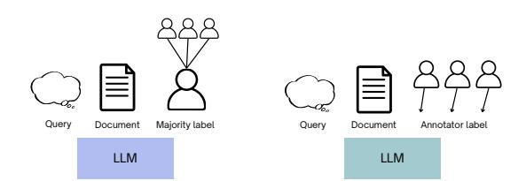
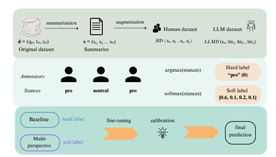
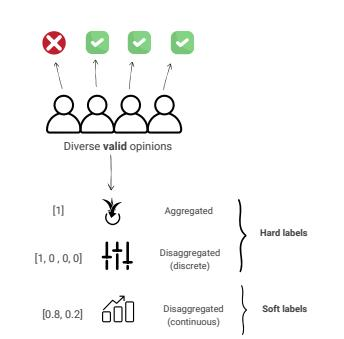
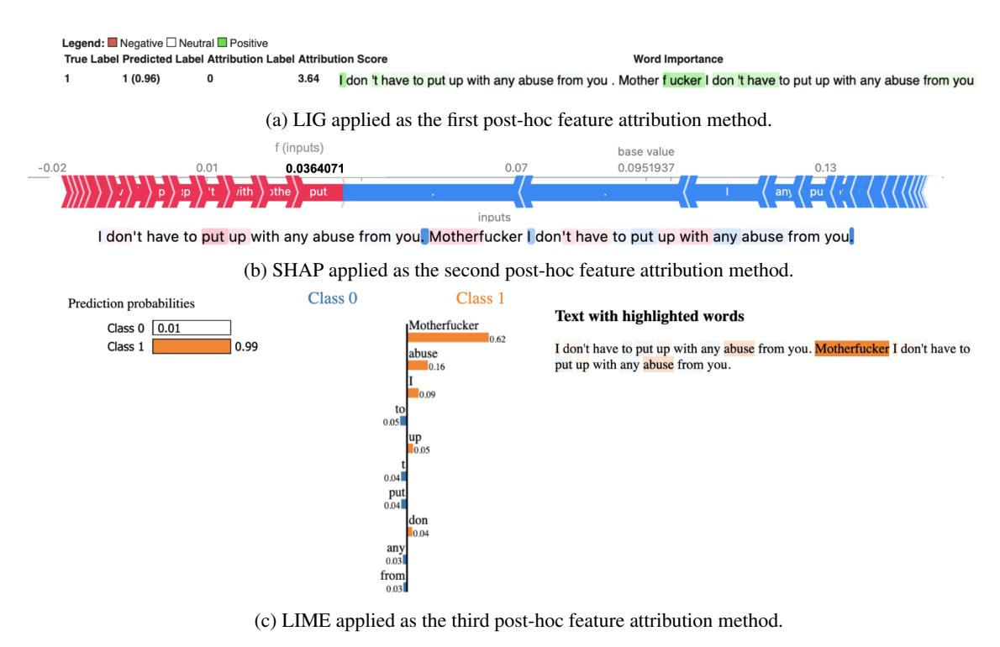
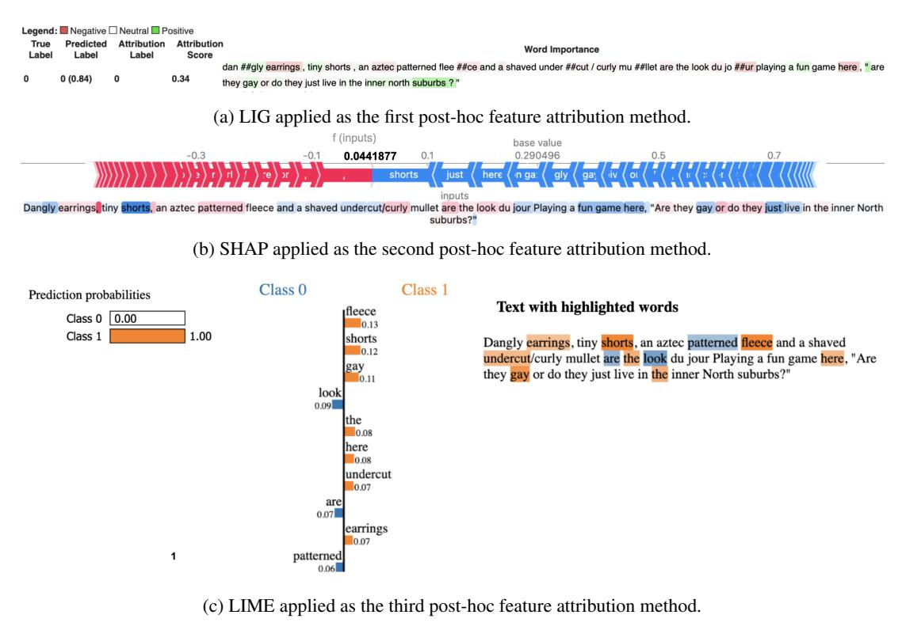

# Towards Multi-Perspective NLP Systems: A Thesis Proposal

Benedetta Muscato

Scuola Normale Superiore, Pisa, Italy benedetta.muscato@sns.it

## Abstract

In the field of Natural Language Processing (NLP), a common approach for resolving human disagreement involves establishing a consensus among multiple annotators. However, previous research shows that overlooking individual opinions can result in the marginalization of minority perspectives, particularly in subjective tasks, where annotators may systematically disagree due to their personal preferences. Emerging *Multi-Perspective* approaches challenge traditional methodologies that treat disagreement as mere noise, instead recognizing it as a valuable source of knowledge shaped by annotators' diverse backgrounds, life experiences, and values. This thesis proposal aims to (1) identify the challenges of designing disaggregated datasets i.e., preserving individual labels in human-annotated datasets for subjective tasks (2) propose solutions for developing Perspective-Aware by design systems and (3) explore the correlation between human disagreement and model uncertainty leveraging eXplainable AI techniques (XAI). Our longterm goal is to create a framework adaptable to various subjective NLP tasks to promote the development of more responsible and inclusive models.

# 1 Introduction

Recent advancements in Artificial Intelligence (AI), especially in the NLP field, have been largely driven by the availability of extensive datasets annotated with human judgments. However, in traditional classification tasks, annotations, often gathered from multiple annotators through crowdsourcing, are typically aggregated into a single ground truth per instance. While this approach simplifies the data processing pipeline, it fails to account for the inherent subjectivity and the resulting disagreements that can arise among annotators. This is especially pronounced in subjective NLP tasks, such as hate speech, stance and emotion detection, where

human preferences can vary significantly depending on individual perspectives and preferences. For instance, detecting hate speech frequently involves subjective annotations, as individuals may interpret what constitutes hateful content differently based on their different personal life experience or cultural context, as influenced by sociodemographic factors [\(Sap et al.,](#page-11-0) [2021\)](#page-11-0). As Large Language Models (LLMs) continue to evolve and integrate into various aspects of society, aligning them with pluralistic values [1](#page-0-0) has become increasingly important. Recent studies highlight that leveraging disagreements in human annotations can enhance both model performance and confidence [\(Casola et al.,](#page-9-0) [2023;](#page-9-0) [Davani et al.,](#page-9-1) [2022;](#page-9-1) [Sandri et al.,](#page-11-1) [2023;](#page-11-1) [Mus](#page-10-0)[cato et al.,](#page-10-0) [2024;](#page-10-0) [Chen et al.,](#page-9-2) [2024\)](#page-9-2). This emerging framework, referred to as *Perspectivism*[2](#page-0-1) , advocates for a paradigm shift in model design [\(Cabitza](#page-9-3) [et al.,](#page-9-3) [2023;](#page-9-3) [Fleisig et al.,](#page-10-1) [2024a\)](#page-10-1), calling for systems that are not only Perspective-Aware but also more Responsible and Socially-Aware [\(Yang et al.,](#page-11-2) [2025;](#page-11-2) [Kovac et al.](#page-10-2) ˇ , [2023\)](#page-10-2). Thus, the goal is not only to assess the overall performance of the model but also to ensure a fair representation of the diverse perspectives. This approach emphasizes a system's awareness of social factors, contexts, and dynamics, as well as their broader implications for the social environment.

In practice, a system designed to be *perspectiveaware by design* must utilize disaggregated datasets[3](#page-0-2) to capture human disagreements [\(Uma](#page-11-3) [et al.,](#page-11-3) [2021\)](#page-11-3), amplifying diverse voices and, if pos-

1A system is considered pluralistic if it is designed to accommodate a broad range of human values and viewpoints [\(Sorensen et al.,](#page-11-4) [2024\)](#page-11-4).

2A research line in machine learning that investigates the advantages and challenges of integrating diverse perspectives into model training. This approach uses individually annotated data to capture variations in opinions and worldviews, aiming to build Perspective-Aware models.

3 In human-labeled datasets, disaggregated labels preserve all individual annotations rather than collapsing them into a single label through methods like majority voting.

sible, incorporating sociodemographic information from annotators into the dataset design process. This ensures that resulting models reflect multiple perspectives, preventing the suppression of minority voices, rather than reinforcing a dominant, majoritarian viewpoint.

While the multi-perspective approach[4](#page-1-0) offers a promising alternative to traditional annotation practices, it also introduces important ethical and technical considerations. For instance, retaining disaggregated labels increases data complexity and raises questions about how to effectively model and interpret diverse perspectives. [Srivastava et al.](#page-11-5) [\(2022\)](#page-11-5) demonstrate that LLMs are susceptible to inherent biases, which are especially evident in ambiguous contexts where human judgments are subjective. Similarly, [Santurkar et al.](#page-11-6) [\(2023\)](#page-11-6) note that LLMs often reflect a predominantly left-leaning perspective, which further restricts their capacity to provide a broad range of opinions.

In light of these challenges, we ask our first research question:

- RQ1 *How can we design a multi-perspective (disaggregated) dataset for subjective NLP tasks?*

For this purpose, we follow established practices from the literature, ensuring a balanced representation of the diverse opinions involved.

However, we observe that LLMs are primarily designed to predict aggregated labels, which limits their effectiveness in scenarios involving multiple *valid* perspectives. To address these limitations, we explore diverse training paradigms using pretrained LLMs of various size, exploring both finetuning and, as a cost-efficient alternative, in-context learning (ICL). Our objective is to assess their ability to learn from human disagreement, while generalizing across different subjective tasks. This leads to our second research question:

- RQ2 *How can pre-trained LLMs (from BERT to GPT-4) be adapted to effectively learn and capture diverse perspectives?*

To this end, we propose a *multi-perspective* approach that incorporates the diversity of annotations into the model's learning phase, capturing the nuances of varying preferences. We evaluate

its effectiveness across a range of subjective tasks, including stance detection, hate speech detection and irony detection.

However, to assess the impact of annotator disagreement on model confidence, it is essential to analyze the decision-making processes that underpin model predictions. This issue is particularly significant due to the limited transparency of LLMs, which are often characterized as black-box systems. As a potential solution, XAI techniques can facilitate the interpretation of model behavior in a manner comprehensible to humans. This leads to our third research question:

- RQ3 *What is the relationship between model uncertainty and human disagreement, and how can XAI be utilized to improve the transparency of pre-trained LLMs?*

Section [3,](#page-2-0) Section [4](#page-4-0) and Section [5](#page-6-0) describe our progress on the three research questions. Section [6](#page-8-0) concludes the paper by synthesizing the main contributions of this thesis proposal.

# 2 Background

This section explores long-standing assumptions about the causes of human disagreement that are challenged by the multi-perspective approach.

Sources of Disagreement Recent studies investigate the root causes of human disagreement in subjective tasks. [Uma et al.](#page-11-3) [\(2021\)](#page-11-3) identify five reasons for human disagreement. One common cause is annotator errors and interface issues, which can arise from mistakes made by annotators or issues with the platform used to collect annotations. Another significant factor is an incomplete or vague annotation schema, which, combined with the inherent ambiguity of language, can lead to inconsistent interpretations and varied annotations depending on the context. Item difficulty and rater subjectivity also contribute to disagreement, stemming from task complexity and individual differences in interpretation, beliefs, and experiences. Similarly, [San](#page-11-1)[dri et al.](#page-11-1) [\(2023\)](#page-11-1) propose a taxonomy categorizing linguistic sources of disagreement into four groups. These include sloppy annotations, ambiguity, missing contextual information, and subjectivity shaped by personal background, beliefs, and knowledge.

Disagreement is everywhere In traditional machine learning, annotator disagreement is often criticized as an issue of label quality or a sign of annotator inexperience [\(Nowak and Rüger,](#page-10-3) [2010\)](#page-10-3),

4We refer to a multi-perspective approach when the Perspectivism framework is applied, where the ultimate goal is to build perspective-aware systems by design, explicitly modeling distinct viewpoints while avoiding their aggregation.

especially in crowd-sourced settings like MTurk[5](#page-2-1) . Typically, label quality is assessed with agreement metrics e.g. by measuring inter-annotator agreement, though these are unreliable for capturing task difficulty or textual ambiguity in subjective tasks [\(Röttger et al.,](#page-11-7) [2022;](#page-11-7) [Abercrombie et al.,](#page-8-1) [2023\)](#page-8-1). Prior research shows that disagreement can also arise in tasks perceived as objective, such as Partof-Speech (POS) tagging [\(Plank,](#page-11-8) [2022\)](#page-11-8) or word sense disambiguation [\(Alonso et al.,](#page-9-4) [2015\)](#page-9-4), challenging the idea that disagreement only reflects subjectivity or poor labeling.

The emergence of a Crowd Truth Within the perspectivist community, the idea that a single ground truth exists for all instances is increasingly debated [\(Cabitza et al.,](#page-9-3) [2023;](#page-9-3) [Uma et al.,](#page-11-3) [2021\)](#page-11-3). Instead of assuming that truth aligns with majority consensus, recent research promotes the emerging concept of *crowd truth*, acknowledging the inherently subjective nature of human interpretation. This approach suggests that aggregating annotations from multiple individuals offers a meaningful "representation of their subjectivity and the spectrum of reasonable interpretations" [\(Aroyo and](#page-9-5) [Welty,](#page-9-5) [2015\)](#page-9-5).

# 3 Multi-Perspective Datasets

RQ1 How can we design a multiperspective (disaggregated) dataset for subjective NLP tasks?

## 3.1 Related work

Recent studies outline best practices for capturing annotator subjectivity in human labeled datasets. [Röttger et al.](#page-11-7) [\(2022\)](#page-11-7) distinguish between two data annotation paradigms: *descriptive* and *prescriptive*. The *descriptive paradigm* encourages annotators to express their own subjectivity, capturing diverse perspectives and beliefs. For example, a researcher studying hate speech might adopt the descriptive paradigm to better reflect different perspectives. In contrast, the *prescriptive paradigm* limits annotator subjectivity by enforcing strict guidelines, ensuring annotations align with a single judgment. For instance, a content moderation engineer at a social media company may use the prescriptive paradigm to ensure annotations align with platform policies.

According to [Uma et al.](#page-11-3) [\(2021\)](#page-11-3), current approaches for learning from human disagreement can be grouped into four categories, including aggregated and disaggregated labels, reflecting the tension between the prescriptive and the descriptive annotation paradigms.

Aggregated vs Disaggregated labels Consensusbased aggregation methods, such as majority voting, resolve annotator disagreements by combining multiple opinions into a single (aggregated hard label), completely discarding instances with high disagreement. Similarly, hard-item filtering discards ambiguous instances, both aligning with the prescriptive goal of enforcing consensus. In contrast, soft-labeling transforms annotations into probability distributions (disaggregated soft label) e.g. using softmax function to capture the diversity of perspectives. Hybrid methods, aligned with the descriptive paradigm, combine hard and soft labels to capture both clear and ambiguous cases, treating annotator subjectivity as valuable information.

| Dataset   | Train | Test | Dev  | Tot. Class | Ann. | Full Agr. (%) |           | Subj.      | Task      |
|-----------|-------|------|------|------------|------|---------------|-----------|------------|-----------|
| HS-Brexit | 784   | 168  | 168  | 2          | 6    | 69%           | Hate      | speech     | detection |
| MD-Agr    | 6592  | 3057 | 1104 | 2          | 5    | 42%           | Offensive | lang.      | detection |
| ConvAbuse | 2398  | 840  | 812  | 2          | 3-8  | 86%           | Abusive   | lang.      | detection |
| ArMIS     | 657   | 141  | 145  | 2          | 3-8  | 65%           | Misogyny  | and sexism | detection |

Table 1: Dataset overview from the LeWiDi competition.

Benchmark overview The disaggregated datasets currently available for the research community can be accessed through the Data Perspectivist Manifesto website[6](#page-2-2) . As an illustrative example, the LeWiDi competition datasets[7](#page-2-3) are showed in Table [1.](#page-2-4) They cover a range of subjective NLP tasks, primarily in English, highlighting the limited availability of multilingual datasets. These tasks include detecting offensive language, hate speech in social media posts, and abusive language in dialogues. For instance, [Akhtar](#page-9-6) [et al.](#page-9-6) [\(2020\)](#page-9-6) introduce the HS-Brexit dataset, which consists of English tweets related to Brexit, annotated for different language phenomena such as hate speech, aggressiveness, offensiveness, stereotypes and irony. The dataset is labeled by six individuals, including three Muslim immigrants as a target group and three researchers with Western backgrounds as a control group. Similarly, [Curry](#page-9-7) [et al.](#page-9-7) [\(2021\)](#page-9-7), explores abusive language detection

5 <https://www.mturk.com>

6 <https://pdai.info>

7 <https://le-wi-di.github.io>

task within dialogues between AI conversational agents and humans, with annotations provided by multiple domain experts. However, a growing number of datasets now include the collection of sociodemographic information, which is crucial for capturing perspectives shaped by demographics, beliefs, and personal experiences [\(Kumar et al.,](#page-10-4) [2021;](#page-10-4) [Davani et al.,](#page-9-8) [2024\)](#page-9-8).

#### 3.2 Preliminary results

Leveraging previously mentioned approaches to learn from annotations containing disagreements, we conduct an exploratory analysis aimed at proposing a novel strategy for designing and modeling a multi-perspective, disaggregated dataset tailored to a subjective task [\(Muscato et al.,](#page-10-0) [2024\)](#page-10-0). We use an existing stance detection dataset from [Gezici et al.](#page-10-5) [\(2021\)](#page-10-5) on controversial topics[8](#page-3-0) to apply a multi-perspective approach. The objective is to evaluate the performance of perspective-aware classification models and investigate the impact of annotator disagreement on model confidence as illustrated in Figure [1.](#page-3-1)

Figure 1: Comparison of dataset design strategies for model finetuning. The baseline approach utilizes aggregated label determined by majority voting (majority label), whereas the multi-perspective considers each annotator's individual label (annotator label).

Baseline The baseline model follows a traditional label aggregation approach using majority voting, resulting in a single consensus label per document. Accordingly, each document di in the baseline dataset is represented as a tuple of query, content, and majority label: di = {qi , ci , mi}.

Multi-perspective In contrast, the multiperspective model is constructed through data augmentation, allowing multiple annotations per document to reflect diverse viewpoints. Each document di has an associated annotation set

A(di) = {a1, a2, a3}, where annotations may differ based on the annotators' perspectives. Thus, the multi-perspective dataset consists of di , where di is added to the dataset three times with the corresponding annotations as di 1 = {qi , ci , a1}, di 2 = {qi , ci , a2}, and di 3 = {qi , ci , a3}.

Fine-tuning To assess the effectiveness of our dataset design strategy, we fine-tune encoder-based models, BERT-base and RoBERTa-base [\(Devlin](#page-9-9) [et al.,](#page-9-9) [2019\)](#page-9-9), using both the baseline and multiperspective approaches with default hyperparameters. Results show that the multi-perspective consistently outperform the baseline models with this pattern observed in both BERT-base and RoBERTabase (Appendix [A\)](#page-13-0). For the best-performing BERTbase model, the F1 score increased from 26.67 (baseline) to 50.21 (multi-perspective). Similarly, for the best-performing RoBERTa-base model, the F1 score improved from 40.48 (baseline) to 47.45 (multi-perspective). Notably, RoBERTabase exhibits greater confidence in its predictions compared to BERT-base when using the multiperspective approach.

#### 3.3 Future direction

In future, we plan to design a multi-lingual disaggregated dataset (covering Italian, Turkish and Indian) that adheres to perspectivist principles for both subjective and objective NLP tasks. Following [Fleisig et al.](#page-10-6) [\(2024b\)](#page-10-6), we argue that in objective tasks it is crucial to move beyond the notion of a single aggregated label per data point. Instead, some instances may be inherently ambiguous, shaped by genuine human disagreement. This effort seeks to increase the number of available disaggregated datasets for the community that reflect diverse sociodemographic groups perspectives and include annotators' natural language explanations to capture their reasoning and uncertainties. However, a key limitation of this research direction is the exclusion of instances with total disagreement, due to the absence of a majority label. In future work, we aim to incorporate these cases into the perspectiveaware model learning process, also counting on label variability. We also aim to expand the set of baselines to better assess the impact of the multiperspective approach compared to simply increasing the number of annotations per instance.

8 Including, but not limited to, education, health, entertainment, religion, and politics.

## 4 Perspective-Aware by design models

RQ2 How can pre-trained LLMs (from BERT to GPT-4) be adapted to effectively learn and capture diverse perspectives?

#### 4.1 Related work

Modeling annotator disagreement is gaining increasing attention, particularly due to its potential to preserve annotation diversity while enhancing model performance [\(Mokhberian et al.,](#page-10-7) [2024;](#page-10-7) [Anand et al.,](#page-9-10) [2024;](#page-9-10) [Davani et al.,](#page-9-1) [2022\)](#page-9-1). To address the challenge of accommodating diverse annotator preferences, various strategies are developed for both disaggregated hard and soft labels, with the latter proving particularly effective for subjective tasks by capturing the nuances of perspectives [\(Leonardelli et al.,](#page-10-8) [2023;](#page-10-8) [Schmeisser-Nieto et al.,](#page-11-9) [2024\)](#page-11-9).

Fine-tuning Proposed approaches include finetuning ensemble of annotator-specific classifiers [\(Mokhberian et al.,](#page-10-7) [2024;](#page-10-7) [Akhtar et al.,](#page-9-6) [2020\)](#page-9-6), adopting single-task and multi-task architectures [\(Davani et al.,](#page-9-1) [2022\)](#page-9-1) and incorporating sociodemographic information [\(Fleisig et al.,](#page-10-9) [2023\)](#page-10-9).

In-context learning (ICL) Recent work highlights in-context learning (ICL) [\(Brown et al.,](#page-9-11) [2020\)](#page-9-11) as an alternative to traditional fine-tuning, allowing models to perform new tasks without parameter updates. By formatting a few examples as demonstrations within a prompt, in fact LLMs are able to select the answer with the highest probability [\(Dong et al.,](#page-9-12) [2024\)](#page-9-12). For subjective tasks, [Chen](#page-9-2) [et al.](#page-9-2) [\(2024\)](#page-9-2) show that prompting LLMs with a small set of expert-provided labels and explanations can approximate human label distributions. However, it remains unclear whether these findings extend to non-expert annotators.

In the following sections, we discuss the approaches explored for leveraging fine-tuning and in-context learning for multi-perspective models.

#### 4.1.1 Fine-tuning: A Multi-Perspective approach with Soft labels

Building on prior studies [\(Davani et al.,](#page-9-1) [2022;](#page-9-1) [Pavlovic and Poesio,](#page-11-10) [2024a;](#page-11-10) [Zhu et al.,](#page-12-0) [2023\)](#page-12-0), we propose a multi-perspective approach [\(Muscato](#page-10-10) [et al.,](#page-10-10) [2025a\)](#page-10-10), designed to incorporate disaggregated soft labels, rather than disaggregated hard labels as in previous works (Section [3\)](#page-2-0) into model

learning. To assess the effect of our approach on stance detection task, we compare two methodologies: a *Baseline* model with aggregated hard labels and *Multi-Perspective* model with disaggregated soft labels. We introduce a multi-stage framework, tailored for stance detection task, consisting of the following steps. First we summarize documents from the original dataset [\(Gezici et al.,](#page-10-5) [2021\)](#page-10-5) using state-of-the-art model GPT4-Turbo. Second, we augment the dataset by collecting annotations generated by different LLMs[9](#page-4-1) , resulting into two different datasets: a human-annotated (HD) and LLM-annotated dataset (LLMD). Third, we finetuned BERT-based models with default hyperparameters[10](#page-4-2) , and applied temperature scaling [\(Guo](#page-10-11) [et al.,](#page-10-11) [2017\)](#page-10-11) for calibration, as illustrated in Figure [2.](#page-4-3)

Figure 2: The multi-perspective stance detection framework includes dataset preparation with summarization and LLM-based annotation, label transformation into hard and soft formats, model fine-tuning, and final prediction score calibration.

In particular, for the the baseline approach, we follow the traditional paradigm in which the majority label that is the most frequent label among the multiple annotations provided by the annotators is created and used for each data instance. While for the multi-perspective we employ disaggregated labels, initially represented as discrete values (hard labels) and later converted into continuous values through a softmax function [\(Uma et al.,](#page-11-11) [2020\)](#page-11-11), referred to as soft labels.

For evaluation, hard metrics including accuracy, precision, recall, macro F1, along with confidence scores, and soft metrics like cross-entropy (CE) are used [\(Uma et al.,](#page-11-3) [2021\)](#page-11-3). The results show that multi-perspective models generally outperform the

9Namely, the open-source models LLama-3-8b [\(Dubey](#page-9-13) [et al.,](#page-9-13) [2024\)](#page-9-13), Mistral-7b [\(Jiang et al.,](#page-10-12) [2023\)](#page-10-12) and Olmo-7b [\(Groeneveld et al.,](#page-10-13) [2024\)](#page-10-13).

10We trained the models for 6 epochs, with a learning rate of 1×10−15 , weight decay of 0.01 and 500 warmup steps. We used a training batch size of 8.

baselines, though we observe reduced performance when using the LLM-based annotation dataset (Appendix [B\)](#page-13-1). The best-performing baseline model is RoBERTa-large fine-tuned on HD with the F1 score of 57.22, while the best multi-perspective model is RoBERTa-large fine-tuned on HD with 61.90. However, the baseline models exhibit higher confidence (except the BERT-large model on HD), likely due to the increased model uncertainty introduced by the multi-perspective approach, which assigns equal weight to diverse viewpoints. These findings suggest that confidence scores alone may not be the most appropriate metric for evaluating multi-perspective models. A secondary focus of this research is to determine whether model calibration improves the alignment between the predicted class probabilities and actual outcomes. As a calibration method, we employed temperature scaling[11](#page-5-0) [\(Guo et al.,](#page-10-11) [2017\)](#page-10-11). The effectiveness of this approach is assessed using Expected Calibration Error (ECE), which evaluates how well predicted probabilities match the ground truth distribution. The results reveal that uncalibrated baseline models are already well-aligned with the ideal calibration (ECE close to 0), thus calibration did not create a significant effect. However, for the multiperspective approach, calibration reveal mixed effects: it leads to poorer calibration (higher ECE) for models fine-tuned on the human-annotated dataset (HD) but improved calibration (lower ECE) for models fine-tuned on the LLM-generated dataset (LLMD).

## 4.2 Future direction

In future work, we aim to broaden our evaluation by incorporating a wider range of subjective tasks and expanding the set of baseline models, following well known approaches from the literature [\(Davani](#page-9-1) [et al.,](#page-9-1) [2022\)](#page-9-1). As a result, we will include both multitask and single-task architectures to further validate the robustness and generalizability of the multiperspective approach. While this study primarily focused on hard evaluation metrics, future work will emphasize soft metrics to better align with our broader research objectives.

A potential research direction is to apply active learning techniques [\(Van Der Meer et al.,](#page-11-12) [2024\)](#page-11-12) to make more efficient use of limited perspectivist datasets in multilingual settings. Additionally, frameworks like learning to defer [\(Madras et al.,](#page-10-14) [2018\)](#page-10-14) will be considered, from a multi-perspective lens, to make model decision-making more inclusive and fair.

#### 4.3 In-context learning: Multi-Perspective Priming

In standard applications, LLMs are typically prompted to provide direct answer to questions e.g., "Classify the following tweet as hate speech based on the options" [\(Antypas et al.,](#page-9-14) [2023\)](#page-9-14), without explicit instructions to account for the task's inherent subjectivity and ambiguity. This study [\(Muscato et al.,](#page-10-15) [2025b\)](#page-10-15) explores two alternative strategies to assess whether LLMs are able to handle multiple perspectives, applying them to four open-source instruction-tuned models[12](#page-5-1): Olmo-7B-Instruct[13](#page-5-2), Llama-3-8B-Instruct[14](#page-5-3), Gemma-7B-IT[15](#page-5-4), and Deepseek-7B-Chat[16](#page-5-5) .

Figure 3: Aggregated and disaggregated (hard and soft) labels are provided as input to the model. Note that aggregated labels are exclusively discrete, whereas disaggregated labels can be represented in both discrete and continuous formats.

Specifically, we leverage English LeWiDi competition datasets on hate speech, abusive and offensive language detection (Table [1\)](#page-2-4) by comparing a standard baseline approach and a multi-perspective approach, both with and without role-playing. We build on the work of [Pavlovic and Poesio](#page-11-13) [\(2024b\)](#page-11-13) by broadening both the methodological scope and the depth of analysis. First, rather than relying on a single closed-source model, we evaluate four opensource large language models, offering a more diverse perspective on model behavior. Second,

11We tuned the T on our validation set for six epochs.

12The original chat template is used for all models, along with a greedy search configuration, where do*\_*sample = F alse.

13[https://huggingface.co/allenai/](https://huggingface.co/allenai/OLMo-7B-Instruct) [OLMo-7B-Instruct](https://huggingface.co/allenai/OLMo-7B-Instruct)

14[https://huggingface.co/meta-llama/](https://huggingface.co/meta-llama/Meta-Llama-3-8B-Instruct)

[Meta-Llama-3-8B-Instruct](https://huggingface.co/meta-llama/Meta-Llama-3-8B-Instruct)

15<https://huggingface.co/google/gemma-7b-it> 16[https://huggingface.co/deepseek-ai/](https://huggingface.co/deepseek-ai/deepseek-llm-7b-chat)

[deepseek-llm-7b-chat](https://huggingface.co/deepseek-ai/deepseek-llm-7b-chat)

we explore both zero-shot and few-shot prompting learning, allowing us to compare performance across varying setups. Third, we introduce carefully designed selection and ordering strategies for demonstrations in few-shot prompting—strategies that are specifically tailored to the challenges posed by subjective tasks. Finally, we expand the label space (Figure [3\)](#page-5-6) to include not only aggregated hard labels but also disaggregated hard & soft labels, capturing a richer representation of annotator disagreement.

In detail, for aggregated labels, we compare the baseline standard prompting with our multiperspective approach, which explicitly instructs the model to consider diverse viewpoints in Box [4.1](#page-6-1) ↓ in purple, where t does not contain the bold statement and l remains the same to obtain yˆ as an aggregated hard label. For disaggregated labels, we exclusively adopt the multi-perspective approach. Our multi-perspective (MP) prompt template is illustrated in Box [4.1](#page-6-2) ↑ in green.

## Our MP Prompt Template

- TASK DEFINITION (t):
- Hate speech
- Offensive language
- Abusive language LABEL SPACE (l):
- Hard: Aggregated or Disaggregated
- Soft : Disaggregated DEMONSTRATION EXAMPLE(S) (D):
- (text, hard agg.): (e.g., yes)
- (text, hard disagg.): (e.g., [0,0,1,1,0])
- (text, soft): (e.g., [0.7, 0.3]) INPUT:
- Tweet (x): {text}
- Answer (yˆ): [output]

# Example MP Prompt for Hate Speech

[t] Does the following tweet contain hate speech, particularly xenophobia or islamophobia? The task is subjective, so please answer considering different perspectives from Muslim immigrants as well as others from different backgrounds.

[l] There are two options: *yes* and *no*.

[D] Examples: Any future terrorist attack in Europe will

be blame on Brexit by the lmsm, yes

Now consider the following example and only output your

option without punctuation.

[x] Tweet: What the referendum seem to have mean to alarm number a vote for anyone look foreign to leave

immediately [yˆ] Answer:

Demonstration examples are organized in two stages: first, they are selected using approaches based on textual similarity (BM-25 and cosine similarity between PLMs embeddings) and annotator disagreement (entropy-based), and then re-ranked

based on both factors. Next, the examples are ordered either randomly or following a curriculum learning (CL) approach, starting with the easiest examples and progressing to the most difficult [\(Liu](#page-10-16) [et al.,](#page-10-16) [2024\)](#page-10-16). Results indicate that multi-perspective priming significantly affects all scenarios respectively for each dataset, especially benefiting the zero-shot setup, yielding lower Jensen-Shannon Divergence (JSD) (0.19, 0.14, 0.14) and CE scores (0.35, 0.43, 0.38) as well as higher F1 scores (64.93, 60.01, 45.83), outperforming the few-shot approach (Appendix [B\)](#page-13-2). In particular, LLMs perform best when predicting aggregated labels, rather than disaggregated hard or soft labels, as they tend to produce monolithic and bimodal preferences, without capturing the nuances of human disagreement. These findings suggest that demonstration selection and ordering may not always offer advantages for subjective NLP classification tasks.

# 4.4 Future direction

In future work, we aim to explore whether multiperspective priming can be generalized to other subjective tasks. We also plan to experiment with closed LLMs, such as GPT-4[17](#page-6-3) and Claude[18](#page-6-4), to further validate our findings. Furthermore, future research should focus on a comprehensive assessment of evaluation frameworks related to fairness and inclusivity, given the limited amount of work in this area.

# 5 XAI and Human Disagreement

RQ3 What is the relationship between model uncertainty and human disagreement, and how can XAI be utilized to improve the transparency of pre-trained LLMs?

There is growing interest within the NLP community in understanding the uncertainty of LLM outputs, which are often regarded as black boxes due to their opaque internal mechanisms [\(Ahdritz](#page-9-15) [et al.,](#page-9-15) [2024\)](#page-9-15). This has led to the emergence of Explainable AI (XAI) as a tool, which aims to make model behavior more interpretable. Enhancing explainability of LLMs, particularly in perspectivist contexts, is critical for building user trust though reasoning processes behind model predictions and for helping researchers detect and address potential biases [\(Mastromattei et al.,](#page-10-17) [2022;](#page-10-17) [Astorino et al.,](#page-9-16)

17<https://openai.com/index/gpt-4/>

18<https://docs.anthropic.com/it/docs/welcome>

[2024\)](#page-9-16). In the following section, we provide an overview of the most prominent XAI approaches in the field of NLP, the challenges they address, and their relevance.

### 5.1 Related Work

Recent work has explored how XAI can shed light on the behavior of LLMs [\(Cambria et al.,](#page-9-17) [2024;](#page-9-17) [Weidinger et al.,](#page-11-14) [2021\)](#page-11-14). [Zhao et al.](#page-12-1) [\(2024\)](#page-12-1) outline two key approaches: fine-tuning, in which XAI can help in interpreting how pre-training influences decision-making, and prompting, where models respond to natural language prompts, and explanations focus on understanding how they utilize pre-trained knowledge for specific tasks.

Local vs Global explanations In both finetuning and prompting paradigms, explanations can be local or global. While local explanations focus on individual predictions, global explanations offer a broader understanding of the model's overall behavior.

XAI for Pre-trained LLMs In the context of fine-tuning, feature attribution methods are widely used to generate local explanations. Techniques such as Integrated Gradients (IG) [\(Sundararajan](#page-11-15) [et al.,](#page-11-15) [2017\)](#page-11-15), as well as surrogate models like LIME [\(Ribeiro et al.,](#page-11-16) [2016\)](#page-11-16) and SHAP [\(Lundberg and Lee,](#page-10-18) [2017\)](#page-10-18) aim to estimate the importance of input features for individual predictions. Another emerging direction in explainable AI involves neuron activation analysis. This approach can offer both local and global insights by linking neuron activations to specific input tokens [\(Zini and Awad,](#page-12-2) [2022\)](#page-12-2). Specifically, it helps uncover how models process inputs and revealing potential biases [\(Durrani et al.,](#page-9-18) [2022;](#page-9-18) [Rai and Yao,](#page-11-17) [2024\)](#page-11-17).

Pre-trained LLMs for XAI In the prompting paradigm, Chain-of-Thought (CoT) prompting [\(Wei et al.,](#page-11-18) [2022\)](#page-11-18) is gaining attention for enhancing interpretability by guiding models to generate intermediate reasoning steps, improving transparency in complex decisions. Similarly, natural language explanations offer a user-friendly way to explain model behavior. Techniques like explain-thenpredict, predict-then-explain, and joint predictexplain are still under investigation. The choice of method depends on the task, aiming to clarify how models reach their outputs. For a comprehensive overview of explainability techniques for LLMs, please refer to [\(Zhao et al.,](#page-12-1) [2024\)](#page-12-1).

#### 5.2 Preliminary results

In our study [\(Muscato et al.,](#page-10-19) [2025c\)](#page-10-19), we explore the relationship between model predictions and human disagreement, building on previous findings on uncertainty from the multi-perspective approach (Section [4.1.1\)](#page-4-4), leveraging XAI a tool to increase transparency. We conduct a comprehensive analysis across various subjective text classification tasks, including hate speech, irony, abusive language and stance detection. We fine-tune BERT-based models, using a multi-perspective approach with soft labels, comparing it to two different baselines (fine-tuning results are reported in Appendix [C\)](#page-13-3). Following [\(Da](#page-9-1)[vani et al.,](#page-9-1) [2022\)](#page-9-1), the first baseline is a single-task classifier predicting aggregated labels, while the second is an ensemble model that learns individual annotator labels before aggregating them. To compare model predictions between aggregated (baseline) and disaggregated (multi-perspective) labels, we applied XAI techniques to RoBERTalarge and BERT-large models[19](#page-7-0). Using post- hoc feature-based attribution methods, we identify key tokens influencing model decisions and perspective preferences. In particular we employ Layer Integrated Gradient (LIG) [\(Sundararajan et al.,](#page-11-15) [2017\)](#page-11-15), a variant of Integrate Gradient (IG) that computes importance scores for input features approximating the integral of the model's output across different layers, as well as LIME and SHAP, to analyze the best-performing models for both baseline and multi-perspective approaches. For a focused analysis, we select ten instances, five with the highest and five with the lowest confidence scores. A key factor in feature-based attribution methods is the number of salient tokens (*k*) analyzed. Following [\(Krishna et al.,](#page-10-20) [2022\)](#page-10-20), we determine *k* iteratively based on average sentence length to ensure a balanced and meaningful token selection. Overall, our findings highlight inconsistencies across different post-hoc methods (LIG, SHAP, and LIME), demonstrating variability in token importance depending on perspective exhibited by the predicted aggregated label (Appendix [C\)](#page-13-3). This underscores the limitations of relying on a single explanation method, particularly in subjective tasks where language interpretation is highly affected by the annotator's perspective.

19We trained the models for 8 epochs, with a learning rate of 5 × 10−5 , early stopping patience set to 3, a weight decay of 0.01, and 500 warmup steps. We used a training batch size of 16.

#### 5.3 Future direction

Building on the observed limitations of featurebased explanations in capturing different human perspectives, in future work we plan to investigate which input features contribute to high model uncertainty, and how this uncertainty aligns with human disagreement. We also aim to explore other explainability techniques, including example-based and attention-based approaches, to systematically analyze the root causes of human disagreement. Additionally, we will study how LLMs can be leveraged to enhance model performance through natural language explanations. To generate these explanations, we will employ perturbation strategies, counterfactual examples [\(Dehghanighobadi](#page-9-19) [et al.,](#page-9-19) [2025;](#page-9-19) [Tanneru et al.,](#page-11-19) [2024;](#page-11-19) [Ortega-Bueno](#page-11-20) [et al.,](#page-11-20) [2025\)](#page-11-20) and chain-of-thoughts reasoning with the validation of human experts. With these approaches our goal is to improve both interpretability and insight into model reasoning in subjective classification tasks.

## 6 Conclusion

This PhD research provides an overview of the current literature on preserving human disagreement in NLP subjective tasks, while proposing solutions for developing Perspective-Aware by design systems. Starting with the curation of disaggregated datasets to preserve individual perspectives (Section [3\)](#page-2-0), we explore model learning strategies, including fine-tuning (Section [4.1.1\)](#page-4-4) and in-context learning (Section [4.3\)](#page-5-7) as a cost-efficient alternative, using both disaggregated hard and soft labels. Additional insights are gained through XAI techniques (Section [5\)](#page-6-0). Recognizing the limitations of (1) current LLMs in capturing human subjectivity and (2) the inadequacy of existing evaluation metrics to assess inclusivity and fairness, this work introduces a *multi-perspective* approach that values individual viewpoints and moves beyond consensus-based methods to support more responsible and inclusive NLP systems. Our analysis shows that existing techniques for learning from human disagreement remain constrained by their tendency to favor aggregated labels, marginalizing minority viewpoints. To address this, we advocate for a pluralistic approach [\(Sorensen et al.,](#page-11-4) [2024\)](#page-11-4), aligning LLMs with diverse human values and recognizing that the majority view is not always the preferred one.

## 7 Limitation

This work is subject to certain limitations. First, our analysis is constrained by limited resources, particularly due to the emerging status of perspectivism as a research paradigm. Consequently, our evaluation relies on benchmark datasets that are predominantly monolingual (English) and centered on binary classification tasks, which limits the generalizability of our findings to multilingual settings or more complex classification scenarios. Second, we exclude instances with high levels of annotator disagreement to enable fair comparisons with baseline models. While necessary for evaluation, we acknowledge the importance of these ambiguous cases, as they reflect the annotators' diverse backgrounds, experiences, and values. Lastly, existing XAI methods in NLP field often fall short in providing the level of interpretability and insight achieved in other domains.

Ethics Statement Modeling human perspectives is inherently tied to social bias, as annotators' personal backgrounds, experiences, and values influence both LLMs training and the evaluation. We acknowledge the broader societal impact of these technologies, which can reinforce dominant perspectives and unintentionally marginalize underrepresented groups. To foster inclusivity in NLP systems, it is crucial to incorporate minority viewpoints, ensuring that diverse perspectives are represented and not overshadowed by majoritarian opinions.

# Acknowledgments

This work has been supported by the European Union under ERC-2018-ADG GA 834756 (XAI), the Partnership Extended PE00000013 - "FAIR - Future Artificial Intelligence Research" - Spoke 1 "Human-centered AI". The author gratefully acknowledges the invaluable supervision of Prof. Fosca Giannotti and Dr. Gizem Gezici, as well as the contributions of collaborators involved in the various research lines: Dr. Lucia Passaro, Dr. Zhixue Zhao, Praveen Bushipaka, and Yue Li.

# References

Gavin Abercrombie, Verena Rieser, and Dirk Hovy. 2023. Consistency is key: Disentangling label variation in natural language processing with intra-annotator agreement. *arXiv preprint arXiv:2301.10684*.

- Gustaf Ahdritz, Tian Qin, Nikhil Vyas, Boaz Barak, and Benjamin L Edelman. 2024. Distinguishing the knowable from the unknowable with language models. In *International Conference on Machine Learning*, pages 503–549. PMLR. Sohail Akhtar, Valerio Basile, and Viviana Patti. 2020. Modeling annotator perspective and polarized opinions to improve hate speech detection. In *Proceedings of the AAAI conference on human computation and crowdsourcing*, volume 8, pages 151–154. Héctor Martínez Alonso, Anders Johannsen, Oier Lopez de Lacalle, and Eneko Agirre. 2015. Predicting word sense annotation agreement. In *Proceedings of the first workshop on linking computational models of lexical, sentential and discourse-level semantics*, pages 89–94. Abhishek Anand, Negar Mokhberian, Prathyusha Naresh Kumar, Anweasha Saha, Zihao He, Ashwin Rao, Fred Morstatter, and Kristina Lerman. 2024. Don't blame the data, blame the model: Understanding noise and bias when learning from subjective annotations. In *Workshop on Uncertainty-Aware NLP (UncertaiNLP 2024)*, page
- 102. Dimosthenis Antypas, Asahi Ushio, Francesco Barbieri, Leonardo Neves, Kiamehr Rezaee, Luis Espinosa-Anke, Jiaxin Pei, and Jose Camacho-Collados. 2023. Supertweeteval: A challenging, unified and heterogeneous benchmark for social media nlp research. *arXiv preprint arXiv:2310.14757*. Lora Aroyo and Chris Welty. 2015. Truth is a lie: Crowd truth and the seven myths of human annotation. *AI Magazine*, 36(1):15–24. Alessandro Astorino, Giulia Rizzi, and Elisabetta Fersini. 2024. Integrated gradients as proxy of disagreement in hateful content. In *Proceedings of the 9th Italian Conference on Computational Linguistics CLiC-it 2023: Venice, Italy, November 30-December 2, 2023*, page 47. Accademia University Press. Tom Brown, Benjamin Mann, Nick Ryder, Melanie Subbiah, Jared D Kaplan, Prafulla Dhariwal, Arvind Neelakantan, Pranav Shyam, Girish Sastry, Amanda Askell, et al. 2020. Language models are few-shot learners. *Advances in neural information processing systems*, 33:1877–1901. Federico Cabitza, Andrea Campagner, and Valerio Basile. 2023. Toward a perspectivist turn in ground truthing for predictive computing. In *Proceedings of the AAAI Conference on Artificial Intelligence*, volume 37, pages 6860–6868. Erik Cambria, Lorenzo Malandri, Fabio Mercorio, Navid Nobani, and Andrea Seveso. 2024. Xai meets llms: A survey of the relation between explainable ai and large language models. *arXiv preprint arXiv:2407.15248*. Silvia Casola, SODA Lo, Valerio Basile, Simona Frenda, Alessandra Cignarella, Viviana Patti, Cristina Bosco, et al. 2023. Confidence-based ensembling of perspective-aware models. In *Proceedings of the 2023 Conference on Empirical Methods in Natural Language Processing*, pages 3496–3507. Houda Bouamor, Juan Pino, Kalika Bali. Beiduo Chen, Xinpeng Wang, Siyao Peng, Robert Litschko, Anna Korhonen, and Barbara Plank. 2024. "seeing the big through the small": Can llms approximate human judgment distributions on nli from a few explanations? In *Findings of the Association for Computational Linguistics: EMNLP 2024*, pages 14396–14419. Amanda Cercas Curry, Gavin Abercrombie, and Verena Rieser. 2021. Convabuse: Data, analysis, and benchmarks for nuanced abuse detection in conversational ai. In *Proceedings of the 2021 Conference on Empirical Methods in Natural Language Processing*, pages 7388–7403. Aida Mostafazadeh Davani, Mark Díaz, Dylan Baker, and Vinodkumar Prabhakaran. 2024. D3code: Disentangling disagreements in data across cultures on offensiveness detection and evaluation. In *Proceedings of the 2024 Conference on Empirical Methods in Natural Language Processing*, pages 18511–18526. Aida Mostafazadeh Davani, Mark Díaz, and Vinodkumar Prabhakaran. 2022. Dealing with disagreements: Looking beyond the majority vote in subjective annotations. *Transactions of the Association for Computational Linguistics*, 10:92–110. Zahra Dehghanighobadi, Asja Fischer, and Muhammad Bilal Zafar. 2025. Can llms explain themselves counterfactually? *arXiv preprint arXiv:2502.18156*. Jacob Devlin, Ming-Wei Chang, Kenton Lee, and Kristina Toutanova. 2019. [BERT: Pre-training of](https://doi.org/10.18653/v1/N19-1423) [deep bidirectional transformers for language under](https://doi.org/10.18653/v1/N19-1423)[standing.](https://doi.org/10.18653/v1/N19-1423) In *Proceedings of the 2019 Conference of the North American Chapter of the Association for Computational Linguistics: Human Language Technologies, Volume 1 (Long and Short Papers)*, pages 4171–4186, Minneapolis, Minnesota. Association for Computational Linguistics. Qingxiu Dong, Lei Li, Damai Dai, Ce Zheng, Jingyuan Ma, Rui Li, Heming Xia, Jingjing Xu, Zhiyong Wu, Baobao Chang, et al. 2024. A survey on in-context learning. In *Proceedings of the 2024 Conference on Empirical Methods in Natural Language Processing*, pages 1107–1128. Abhimanyu Dubey, Abhinav Jauhri, Abhinav Pandey, Abhishek Kadian, Ahmad Al-Dahle, Aiesha Letman, Akhil Mathur, Alan Schelten, Amy Yang, Angela Fan, et al. 2024. The llama 3 herd of models. *arXiv preprint arXiv:2407.21783*. Nadir Durrani, Fahim Dalvi, and Hassan Sajjad. 2022. Linguistic correlation analysis: Discovering salient neurons in deepnlp models. *arXiv preprint arXiv:2206.13288*.

- Eve Fleisig, Rediet Abebe, and Dan Klein. 2023. When the majority is wrong: Modeling annotator disagreement for subjective tasks. In *Proceedings of the 2023 Conference on Empirical Methods in Natural Language Processing*, pages 6715–6726. Eve Fleisig, Su Lin Blodgett, Dan Klein, and Zeerak Talat. 2024a. The perspectivist paradigm shift: Assumptions and challenges of capturing human labels. In *Proceedings of the 2024 Conference of the North American Chapter of the Association for Computational Linguistics: Human Language Technologies (Volume 1: Long Papers)*, pages 2279–2292. Eve Fleisig, Su Lin Blodgett, Dan Klein, and Zeerak Talat. 2024b. [The perspectivist paradigm shift: As](https://doi.org/10.18653/v1/2024.naacl-long.126)[sumptions and challenges of capturing human labels.](https://doi.org/10.18653/v1/2024.naacl-long.126) In *Proceedings of the 2024 Conference of the North American Chapter of the Association for Computational Linguistics: Human Language Technologies (Volume 1: Long Papers)*, pages 2279–2292, Mexico City, Mexico. Association for Computational Linguistics. Gizem Gezici, Aldo Lipani, Yucel Saygin, and Emine Yilmaz. 2021. Evaluation metrics for measuring bias in search engine results. *Information Retrieval Journal*, 24:85–113. Dirk Groeneveld, Iz Beltagy, Evan Walsh, Akshita Bhagia, Rodney Kinney, Oyvind Tafjord, Ananya Jha, Hamish Ivison, Ian Magnusson, Yizhong Wang, et al. 2024. Olmo: Accelerating the science of language models. In *Proceedings of the 62nd Annual Meeting of the Association for Computational Linguistics (Volume 1: Long Papers)*, pages 15789–15809. Chuan Guo, Geoff Pleiss, Yu Sun, and Kilian Q Weinberger. 2017. On calibration of modern neural networks. In *International conference on machine learning*, pages 1321–1330. PMLR. Albert Q Jiang, Alexandre Sablayrolles, Arthur Mensch, Chris Bamford, Devendra Singh Chaplot, Diego de las Casas, Florian Bressand, Gianna Lengyel, Guillaume Lample, Lucile Saulnier, et al. 2023. Mistral 7b. *arXiv preprint arXiv:2310.06825*. Grgur Kovac, Masataka Sawayama, Rémy Portelas, Cé- ˇ dric Colas, Peter Ford Dominey, and Pierre-Yves Oudeyer. 2023. Large language models as superpositions of cultural perspectives. *arXiv preprint arXiv:2307.07870*. Satyapriya Krishna, Tessa Han, Alex Gu, Steven Wu, Shahin Jabbari, and Himabindu Lakkaraju. 2022. The disagreement problem in explainable machine learning: A practitioner's perspective. *arXiv preprint arXiv:2202.01602*. Deepak Kumar, Patrick Gage Kelley, Sunny Consolvo, Joshua Mason, Elie Bursztein, Zakir Durumeric, Kurt Thomas, and Michael Bailey. 2021. Designing toxic content classification for a diversity of perspectives. In *Seventeenth Symposium on Usable Privacy and Security (SOUPS 2021)*, pages 299–318. Elisa Leonardelli, Gavin Abercrombie, Dina Almanea, Valerio Basile, Tommaso Fornaciari, Barbara Plank, Verena Rieser, Alexandra Uma, and Massimo Poesio. 2023. Semeval-2023 task 11: Learning with disagreements (lewidi). In *Proceedings of the 17th International Workshop on Semantic Evaluation (SemEval-2023)*, pages 2304–2318. Yinpeng Liu, Jiawei Liu, Xiang Shi, Qikai Cheng, Yong Huang, and Wei Lu. 2024. Let's learn step by step: Enhancing in-context learning ability with curriculum learning. *arXiv preprint arXiv:2402.10738*. Scott M Lundberg and Su-In Lee. 2017. A unified approach to interpreting model predictions. *Advances in neural information processing systems*, 30. David Madras, Toni Pitassi, and Richard Zemel. 2018. Predict responsibly: improving fairness and accuracy by learning to defer. *Advances in neural information processing systems*, 31. Michele Mastromattei, Valerio Basile, and Fabio Massimo Zanzotto. 2022. Change my mind: How syntaxbased hate speech recognizer can uncover hidden motivations based on different viewpoints. In *Proceedings of the 1st Workshop on Perspectivist Approaches to NLP@ LREC2022*, pages 117–125. Negar Mokhberian, Myrl Marmarelis, Frederic Hopp, Valerio Basile, Fred Morstatter, and Kristina Lerman. 2024. Capturing perspectives of crowdsourced annotators in subjective learning tasks. In *Proceedings of the 2024 Conference of the North American Chapter of the Association for Computational Linguistics: Human Language Technologies (Volume 1: Long Papers)*, pages 7330–7342. Benedetta Muscato, Praveen Bushipaka, Gizem Gezici, Lucia Passaro, Fosca Giannotti, and Tommaso Cucinotta. 2025a. Embracing diversity: A multiperspective approach with soft labels. *arXiv preprint arXiv:2503.00489*. Benedetta Muscato, Praveen Bushipaka, Gizem Gezici, Lucia Passaro, Fosca Giannotti, et al. 2024. Multiperspective stance detection. In *CEUR WORK-SHOP PROCEEDINGS*, volume 3825, pages 208–
  - 214. CEUR-WS. Benedetta Muscato, Yue Li, Gizem Gezici, Zhixue Zhao, and Fosca Giannotti. 2025b. Bridging the gap: Incontext learning for modeling human disagreement. *arXiv preprint arXiv:2506.06113*. Benedetta Muscato, Lucia Passaro, Gizem Gezici, and Fosca Giannotti. 2025c. Perspectives in play: A multi-perspective approach for more inclusive nlp systems. *arXiv preprint arXiv:2506.20209*. Stefanie Nowak and Stefan Rüger. 2010. How reliable are annotations via crowdsourcing: a study about inter-annotator agreement for multi-label image annotation. In *Proceedings of the international conference on Multimedia information retrieval*, pages 557–566.

Reynier Ortega-Bueno, Elisabetta Fersini, and Paolo Rosso. 2025. On the robustness of transformerbased models to different linguistic perturbations: A case of study in irony detection. *Expert Systems*, 42(6):e70062. Maja Pavlovic and Massimo Poesio. 2024a. The effectiveness of llms as annotators: A comparative overview and empirical analysis of direct representation. *LREC-COLING 2024*, page 100. Maja Pavlovic and Massimo Poesio. 2024b. [The ef](https://aclanthology.org/2024.nlperspectives-1.11/)[fectiveness of LLMs as annotators: A comparative](https://aclanthology.org/2024.nlperspectives-1.11/) [overview and empirical analysis of direct represen](https://aclanthology.org/2024.nlperspectives-1.11/)[tation.](https://aclanthology.org/2024.nlperspectives-1.11/) In *Proceedings of the 3rd Workshop on Perspectivist Approaches to NLP (NLPerspectives) @ LREC-COLING 2024*, pages 100–110, Torino, Italia. ELRA and ICCL. Barbara Plank. 2022. The'problem'of human label variation: On ground truth in data, modeling and evaluation. *arXiv preprint arXiv:2211.02570*. Daking Rai and Ziyu Yao. 2024. An investigation of neuron activation as a unified lens to explain chain-ofthought eliciting arithmetic reasoning of llms. *arXiv preprint arXiv:2406.12288*. Marco Tulio Ribeiro, Sameer Singh, and Carlos Guestrin. 2016. " why should i trust you?" explaining the predictions of any classifier. In *Proceedings of the 22nd ACM SIGKDD international conference on knowledge discovery and data mining*, pages 1135– 1144. Paul Röttger, Bertie Vidgen, Dirk Hovy, and Janet Pierrehumbert. 2022. [Two contrasting data annotation](https://doi.org/10.18653/v1/2022.naacl-main.13) [paradigms for subjective NLP tasks.](https://doi.org/10.18653/v1/2022.naacl-main.13) In *Proceedings of the 2022 Conference of the North American Chapter of the Association for Computational Linguistics: Human Language Technologies*, pages 175–190, Seattle, United States. Association for Computational Linguistics. Marta Sandri, Elisa Leonardelli, Sara Tonelli, and Elisabetta Ježek. 2023. Why don't you do it right? analysing annotators' disagreement in subjective tasks. In *Proceedings of the 17th Conference of the European Chapter of the Association for Computational Linguistics*, pages 2428–2441. Shibani Santurkar, Esin Durmus, Faisal Ladhak, Cinoo Lee, Percy Liang, and Tatsunori Hashimoto. 2023. Whose opinions do language models reflect? In *International Conference on Machine Learning*, pages 29971–30004. PMLR. Maarten Sap, Swabha Swayamdipta, Laura Vianna, Xuhui Zhou, Yejin Choi, and Noah A Smith. 2021. Annotators with attitudes: How annotator beliefs and identities bias toxic language detection. *arXiv preprint arXiv:2111.07997*. Wolfgang S Schmeisser-Nieto, Pol Pastells, Simona Frenda, and Mariona Taulé. 2024. Human vs. machine perceptions on immigration stereotypes. In *Proceedings of the 2024 Joint International Conference on Computational Linguistics, Language Resources and Evaluation (LREC-COLING 2024)*, pages 8453–8463. Taylor Sorensen, Jared Moore, Jillian Fisher, Mitchell Gordon, Niloofar Mireshghallah, Christopher Michael Rytting, Andre Ye, Liwei Jiang, Ximing Lu, Nouha Dziri, et al. 2024. Position: a roadmap to pluralistic alignment. In *Proceedings of the 41st International Conference on Machine Learning*, pages 46280–46302. Aarohi Srivastava, Abhinav Rastogi, Abhishek Rao, Abu Awal Md Shoeb, Abubakar Abid, Adam Fisch, Adam R Brown, Adam Santoro, Aditya Gupta, Adrià Garriga-Alonso, et al. 2022. Beyond the imitation game: Quantifying and extrapolating the capabilities of language models. *arXiv preprint arXiv:2206.04615*. Mukund Sundararajan, Ankur Taly, and Qiqi Yan. 2017. Axiomatic attribution for deep networks. In *International conference on machine learning*, pages 3319– 3328. PMLR. Sree Harsha Tanneru, Chirag Agarwal, and Himabindu Lakkaraju. 2024. Quantifying uncertainty in natural language explanations of large language models. In *International Conference on Artificial Intelligence and Statistics*, pages 1072–1080. PMLR. Alexandra Uma, Tommaso Fornaciari, Dirk Hovy, Silviu Paun, Barbara Plank, and Massimo Poesio. 2020. A case for soft loss functions. In *Proceedings of the AAAI Conference on Human Computation and Crowdsourcing*, volume 8, pages 173–177. Alexandra N Uma, Tommaso Fornaciari, Dirk Hovy, Silviu Paun, Barbara Plank, and Massimo Poesio. 2021. Learning from disagreement: A survey. *Journal of Artificial Intelligence Research*, 72:1385–1470. Michiel Van Der Meer, Neele Falk, Pradeep Murukannaiah, and Enrico Liscio. 2024. Annotator-centric active learning for subjective nlp tasks. In *Proceedings of the 2024 Conference on Empirical Methods in Natural Language Processing*, pages 18537–18555. Jason Wei, Xuezhi Wang, Dale Schuurmans, Maarten Bosma, Fei Xia, Ed Chi, Quoc V Le, Denny Zhou, et al. 2022. Chain-of-thought prompting elicits reasoning in large language models. *Advances in neural information processing systems*, 35:24824–24837. Laura Weidinger, John Mellor, Maribeth Rauh, Conor Griffin, Jonathan Uesato, Po-Sen Huang, Myra Cheng, Mia Glaese, Borja Balle, Atoosa Kasirzadeh, et al. 2021. Ethical and social risks of harm from language models. *arXiv preprint arXiv:2112.04359*. Diyi Yang, Dirk Hovy, David Jurgens, and Barbara Plank. 2025. Socially aware language technologies: Perspectives and practices. *Computational Linguistics*, pages 1–14.

Haiyan Zhao, Hanjie Chen, Fan Yang, Ninghao Liu, Huiqi Deng, Hengyi Cai, Shuaiqiang Wang, Dawei Yin, and Mengnan Du. 2024. Explainability for large language models: A survey. *ACM Transactions on Intelligent Systems and Technology*, 15(2):1–38. Yiming Zhu, Peixian Zhang, Ehsan-Ul Haq, Pan Hui, and Gareth Tyson. 2023. Can chatgpt reproduce human-generated labels? a study of social computing tasks. *arXiv preprint arXiv:2304.10145*. Julia El Zini and Mariette Awad. 2022. On the explainability of natural language processing deep models.

*ACM Computing Surveys*, 55(5):1–31.

## Appendix

## A RQ1 Results

Model performance using the data augmentation approach reported in Section [3.2.](#page-3-2)

| Approach Model    | Chunk | Acc.  | Prec. | Rec.  | F1    | Avg. Conf. |
|-------------------|-------|-------|-------|-------|-------|------------|
| BERT-base         | no    | 28.66 | 27.59 | 22.42 | 17.17 | 0.33       |
| Baseline          | yes   | 33.12 | 30.70 | 28.17 | 26.67 | 0.44       |
| RoBERTa-base      | no    | 36.30 | 34.99 | 31.82 | 27.07 | 0.39       |
|                   | yes   | 45.85 | 39.47 | 43.13 | 40.48 | 0.52       |
| BERT-base         | no    | 32.48 | 31.12 | 28.22 | 24.81 | 0.51       |
| Multi-Perspective | yes   | 47.48 | 53.90 | 49.86 | 50.21 | 0.52       |
| RoBERTa-base      | no    | 47.77 | 44.27 | 43.63 | 41.43 | 0.55       |
|                   | yes   | 47.48 | 52.68 | 50.14 | 47.45 | 0.54       |

Table 2: Overall model evaluation results for the baseline and multi-perspective models.

# B RQ2 Results

Fine-tuning Model performance using finetuned LMs with multi-perspective approach reported in Section [4.1.](#page-4-5)

| Approach Dataset  | Model         | Acc.  | Prec. | Rec.  | F1    | Avg. Conf. |
|-------------------|---------------|-------|-------|-------|-------|------------|
| HD                | BERT-large    | 36.69 | 39.03 | 35.93 | 33.80 | 40.20      |
| Baseline          | RoBERTa-large | 56.11 | 61.11 | 58.04 | 57.22 | 57.25      |
| LLMD              | BERT-large    | 60.78 | 15.50 | 24.60 | 19.01 | 60.59      |
|                   | RoBERTa-large | 61.76 | 15.44 | 25.00 | 19.09 | 60.44      |
| HD                | BERT-large    | 46.76 | 46.88 | 47.16 | 46.75 | 45.82      |
| Multi-Perspective | RoBERTa-large | 60.43 | 63.55 | 62.83 | 61.90 | 48.76      |
| LLMD              | BERT-large    | 61.76 | 15.44 | 25.00 | 19.09 | 30.42      |
|                   | RoBERTa-large | 61.76 | 15.44 | 25.00 | 19.09 | 30.13      |

Table 3: Comparative evaluation results of fine-tuned baseline and multi-perspective models with human dataset (HD) and large language model dataset (LLMD).

In-context learning Model performance using ICL with multi-perspective approach reported in Section [4.1.](#page-4-6)

| Dataset   | LLM              | Approach                           | Acc ↑       | F1 ↑        | JSD ↓     | CE ↓      |
|-----------|------------------|------------------------------------|-------------|-------------|-----------|-----------|
| HS-Brexit | Deepseek-7b-chat |                                    |             |             |           |           |
|           |                  | Baseline_aggr_0S                   | 89.28       | 47.16       | 0.36      | 0.66      |
|           |                  | Baseline_aggr_0S_RL                | 88.09       | 46.83       | 0.26      | 0.46      |
|           |                  | MultiP_aggr_0S MultiP_aggr_0S_RL   | 89.28 86.90 | 64.93 50.64 | 0.19 0.28 | 0.35 0.50 |
|           |                  | Baseline_aggr_FS                   | 89.28       | 52.15       | 0.21      | 0.39      |
|           |                  | Baseline_aggr_FS_RL                | 86.90       | 46.49       | 0.21      | 0.43      |
|           |                  | MultiP_aggr_FS MultiP_aggr_FS_RL   | 88.69 86.31 | 51.74 50.30 | 0.19 0.24 | 0.42 0.42 |
| MD-Agr    | Deepseek-7b-chat |                                    |             |             |           |           |
|           |                  | Baseline_aggr_0S                   | 49.72       | 49.22       | 0.28      | 0.45      |
|           |                  | Baseline_aggr_0S_RL                | 45.14       | 43.42       | 0.28      | 0.47      |
|           |                  | MultiP_aggr_0S                     | 51.08       | 47.58       | 0.26      | 0.54      |
|           |                  | MultiP_aggr_0S_RL                  | 66.69       | 60.01       | 0.14      | 0.43      |
|           |                  | Baseline_aggr_FS                   | 54.72       | 49.47       | 0.24      | 0.34      |
|           |                  | Baseline_aggr_FS_RL                | 57.11       | 55.42       | 0.23      | 0.37      |
|           |                  | MultiP_aggr_FS                     | 51.78       | 47.35       | 0.25      | 0.34      |
|           |                  | MultiP_aggr_FS_RL                  | 54.69       | 52.01       | 0.18      | 0.25      |
|           |                  | Baseline_aggr_0S                   | 42.79       | 45.68       | 0.25      | 0.41      |
|           | Deepseek-7b-chat | Baseline_aggr_0S_RL MultiP_aggr_0S | 52.71 46.83 | 51.95 45.83 | 0.14 0.24 | 0.29 0.38 |
| ConvAbuse |                  | MultiP_aggr_0S_RL                  | 53.14       | 45.09       | 0.18      | 0.32      |
|           |                  | Baseline_aggr_FS                   | 46.73       | 45.68       | 0.25      | 0.41      |
|           | Olmo-7b-Instruct | Baseline_aggr_FS_RL MultiP_aggr_FS | 50.73 46.83 | 44.95 45.83 | 0.14 0.24 | 0.29 0.38 |
|           |                  | MultiP_aggr_FS_RL                  | 53.14       | 45.09       | 0.18      | 0.32      |

Table 4: Zero-shot (0S) and Few-shot (F S) results for the best-performing LLMs. Few-shot uses BM-25 retrieval. RL = role-playing, aggr = aggregated labels. Best JSD scores in bold, best CE and F1 scores are underlined.

### C RQ3 Results

Fine-tuning and XAI Model performance using a multi-perspective approach with soft labels is discussed in Section [5.2,](#page-7-1) followed by an illustration of the applied XAI techniques (LIG, SHAP, and LIME) used to explain the model's predictions.

| Approach           | RoBERTa      | GabHate BERT      | RoBERTa       | ConvAbuse BERT | RoBERTa | EPIC BERT  | RoBERTa         | StanceDetection BERT |
|--------------------|--------------|-------------------|---------------|----------------|---------|------------|-----------------|----------------------|
| Accuracy Maj. vote | 91.54        | 91.47             | 82.97         | 82.14          | 79.11   | 70.88      | 46.76           | 38.84                |
| Ensemble           | 91.49        | 91.49             | 82.14         | 82.14          | 78.22   | 77.33      | 58.99           | 43.16                |
| MultiP             | 91.73        | 92.21             | 85.11         | 78.92          | 74.44   | 74.22      | 58.27           | 38.84                |
| Macro-F1 Maj. vote | 48.63        | 47.77             | 61.24         | 45.09          | 66.80   | 56.79      | 45.61           | 39.15                |
| Ensemble           | 47.77        | 47.77             | 45.09         | 45.09          | 59.93   | 47.99      | 59.21           | 43.30                |
| MultiP             | 72.26        | 71.03             | 48.96         | 57.71          | 69.38   | 61.00      | 61.08           | 45.22                |
| (a)                | Accuracy and | Macro-F1          | scores across | RoBERTa-Large  | and     | BERT-Large | models.         |                      |
|                    |              | GabHate           |               | ConvAbuse      |         | EPIC       |                 | StanceDetection      |
| Approach           | RoBERTa      | BERT              | RoBERTa       | BERT           | RoBERTa | BERT       | RoBERTa         | BERT                 |
| Avg. Conf. Maj.    | vote 93.40   | 94.84             | 79.73         | 87.74          | 97.92   | 93.63      | 70.48           | 60.76                |
| Ensemble           | 95.40        | 94.90             | 86.07         | 87.61          | 83.54   | 79.26      | 47.37           | 50.07                |
| MultiP             | 97.55        | 96.19             | 98.02         | 90.84          | 89.35   | 77.61      | 62.60           | 51.18                |
| (b)                | Average      | confidence scores | across        | RoBERTa-Large  | and     | BERT-Large | models.         |                      |
|                    | GabHate      |                   | ConvAbuse     |                | EPIC    |            | StanceDetection |                      |
| Approach           | RoBERTa      | BERT              | RoBERTa       | BERT           | RoBERTa | BERT       | RoBERTa         | BERT                 |
| JSD Maj. vote      | 0.388        | 0.694             | 0.138         | 0.245          | 0.655   | 0.548      | 0.281           | 0.297                |
| Ensemble           | 0.264        | 0.567             | 0.131         | 0.239          | 0.583   | 0.498      | 0.210           | 0.205                |
| MultiP             | 0.052        | 0.051             | 0.127         | 0.195          | 0.134   | 0.095      | 0.085           | 0.062                |

(c) Jensen-Shannon Divergence (JSD) scores across RoBERTa-Large and BERT-Large models.

Table 5: Performance comparisons across different models and metrics. Each subtable corresponds to a distinct evaluation measure.

Figure 4: Three XAI methods applied to a low-confidence instance identified by the best multi-perspective model on ConvAbuse.

Figure 5: Three XAI methods applied to a low-confidence instance identified by the best baseline model on EPIC.