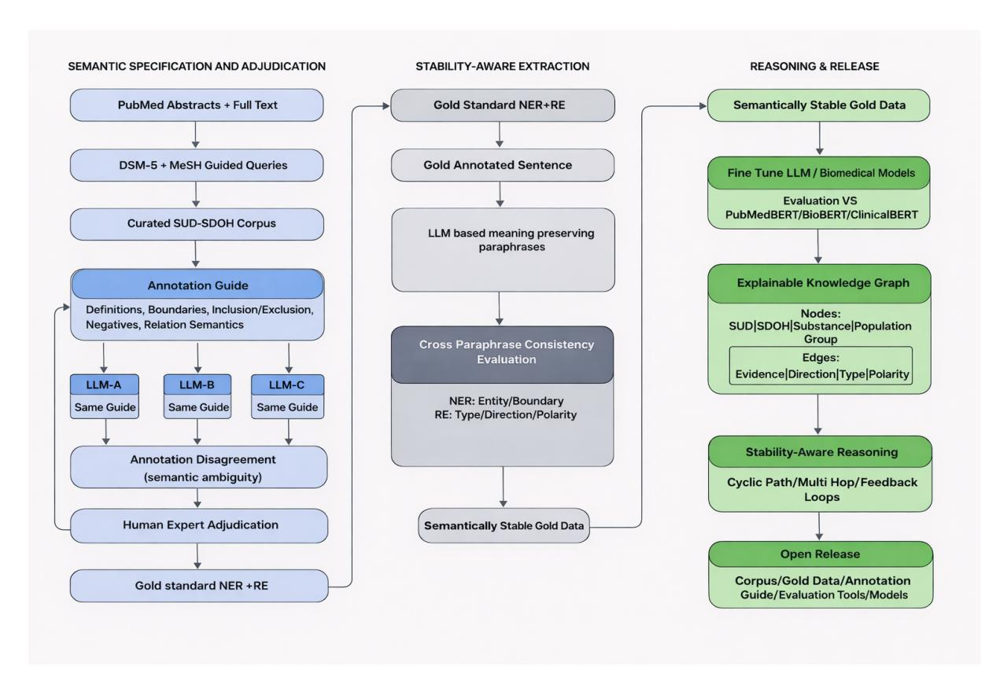

# Thesis Proposal: Stability-Aware, Evidence-Grounded Knowledge Graph for Substance Use Disorders and Social Determinants of Health

Gautham Vijay Kumar1 Annika M. Schoene2 Christian Poellabauer1

1Knight Foundation School of Computing and Information Sciences

Florida International University, Miami, FL, USA

2Bouve College of Health Sciences, Northeastern University, Charlotte, NC, USA

{gv001,cpoellab}@fiu.edu a.schoene@northeastern.edu

## Abstract

Clinical Natural Language Processing (NLP) integrates large language models (LLMs) to extract biomedical insights from unstructured clinical text. Most named entity recognition (NER) and relation extraction (RE) datasets rely on manual annotation, which is costly and difficult to scale. Many biomedical knowledge graphs (KG) suffer from underspecified relations, conflate causal and correlational claims, and edges lack evidence for reasoning. This dissertation presents a semantic stability framework for constructing explainable KGs, highlighting stable extraction as fundamental for scalable NER and RE, and essential for graph structure. We applied this to Substance Use Disorders (SUD) and Social Determinants of Health (SDOH) from PubMed corpus and NER and RE annotation guide. Multiple LLMs perform extraction under shared semantic constraints, with disagreements resolved through Human-in-the-Loop (HITL) validation. We define semantic stability through NER and RE metrics, using stabilized gold data for model training and evaluation. We then develop a claim-centered KG, where edges represent evidence, provenance, relation type, directionality, polarity, and stability indicators. This benchmark and pipeline supports multi-hop reasoning, triadic SUD–SDOH–SUD mediation patterns, and feedback loop analysis. This will advance etiological inquiries and data-driven health policy analysis.

# 1 Introduction

Substance use disorders (SUDs) are closely intertwined with social determinants of health (SDOH), forming a complex web of behavioral, structural, and medical factors that amplify negative outcomes (Brown and Elliot, 2021). Research shows how socioeconomic instability, discrimination, trauma exposure, and housing insecurity exacerbate substance use and obstruct recovery (Peacock et al., 2014). Understanding the temporal and bidirectional interactions between these domains is essential for developing equitable, data-driven public health interventions (Calman et al., 2012; Tomines et al., 2013).

Electronic health records (EHRs) and biomedical literature contain detailed accounts of these interdependencies in unstructured narratives (Nashwan and Abujaber, 2023). Conventional analytical methods using structured fields fail to capture nuanced relationships between SUD and SDOH (Guevara et al., 2024; Nashwan and Abujaber, 2023). Recent advances in LLMs fine-tuned with domainspecific objectives have shown promise in extracting insights from text (Doumanas et al., 2025; Gu et al., 2025).

Despite their potential, LLMs face significant challenges in clinical and public health contexts. Unstructured clinical data on SDOH and SUDs are often scarce and context-sensitive, risking misinterpretation (Deferio et al., 2019; Gu et al., 2025). These limitations are critical for the deployment of LLMs in sensitive applications. Without proper data curation and bias mitigation, models can reinforce the disparities they aim to address (Arora et al., 2023; Giuffrè and Shung, 2023; Liu et al., 2024). Clinical utility requires robust NLP pipelines that incorporate fairness-aware modeling and transparent interpretability (Luschi et al., 2023).

## 2 Contributions

This dissertation introduces semantic stability and claim-level explainability as principles for extracting behavioral health knowledge and constructing interpretable KGs. We argue that the challenges in robustness, interpretability, and downstream applications for SUD–SDOH NLP systems stem from vague semantic definitions and inadequately specified relational representations rather than model

Figure 1: Overview of the Semantic-Stability-Aware pipeline.

limitations. While prior studies focused on robustness from a model perspective, they often fail to ensure extracted knowledge is explainable, auditable, or ready for analysis. However, this dissertation argues that in behavioral health NLP, true explainability requires making semantic commitments explicit at entity, relation, and claim levels, rather than just clarifying model mechanisms.

This study presents a semantically grounded SUD–SDOH corpus sourced from biomedical literature, along with stability-aware evaluation protocols for NER and RE. It also introduces a multi-LLM-assisted annotation framework that incorporates selective human adjudication and a claimfocused knowledge graph that applies these concepts. A key methodological innovation of this dissertation is a stability-aware evaluation approach that augments token-level metrics with paraphrasebased invariance tests, revealing failure modes that traditional accuracy metrics overlook. To our knowledge, this study is among the first to address semantic stability and claim-level explainability as integrated design goals across annotation, extraction, evaluation, and knowledge graph construction in the field of behavioral health NLP.

## 2.1 Semantic Stability as a Unifying Principle:

We introduce semantic stability, defined as the consistency of extracted entities and relations across meaning preserving paraphrases. From this perspective, instability reflects semantic underspecification rather than model error, motivating evaluation beyond token-level accuracy.

#### 2.2 A Semantically Grounded SUD–SDOH Corpus:

We created a specialized corpus using PubMed abstracts and full-text articles based on the Diagnostic and Statistical Manual of Mental Disorders (DSM-5) and Medical Subject Headings (MeSH). We established a formal annotation guide for NER and RE, detailing semantic definitions, boundary rules, criteria for inclusion and exclusion, and providing contrastive examples. This framework facilitates reproducible annotations and allows for systematic identification and analysis of semantic ambiguity.

### 2.3 Multi-LLM Assisted Annotation with Human Adjudication:

We propose a stability-aware annotation framework in which multiple LLMs act as semantic annotators under identical guidelines. Cross-model and

cross-paraphrase disagreements serve as diagnostic signals for semantic ambiguity rather than being resolved through majority voting. PhD-level annotators adjudicate flagged cases, making semantic commitments or labeling instances as ambiguous, and refine guidelines when needed. This process yields semantically consistent gold-standard annotations.

#### 2.4 Stability-Aware NER Evaluation under Paraphrasing:

Using gold-standard data, we will evaluate NER through standard precision, recall, and F1 metrics, while also incorporating paraphrase-based semantic stability measures. These evaluations examine the consistency of entity presence, type, and boundary assignment across meaning-equivalent expressions, revealing failure modes that token-level accuracy alone does not capture.

#### 2.5 Evidence-Grounded Relation Extraction for Linguistic Claims:

For sentences with SUD and SDOH entities, we will frame RE as the identification of explicit semantic claims based on sentence evidence. Each relation encodes type, directionality, and polarity, justified through cited evidence spans and linguistic cues in the prompt schema. This framing distinguishes correlational, causal, and feedback statements and supports stable interpretation under paraphrasing.

#### 2.6 Benchmarking and Explainable Knowledge-Graph Reasoning:

We will fine-tune LLMs for NER and RE and benchmark against PubMedBERT, ClinicalBERT, and BioBERT for accuracy and semantic stability. Stable, evidence-grounded claims will be integrated into a claim-centered, explainable KG supporting stability-aware querying and analysis of higher-order structures, such as mediation chains and feedback loops, rather than unrestricted inference. All datasets, models, and evaluation tools will be publicly released on Hugging Face.

The main objective of this thesis is to answer the following questions:

- RQ1 (Semantic Stability in NER): How can semantic stability be defined, operationalized, and evaluated for NER of SUD and SDOH concepts under paraphrasing, and how does

this perspective expose failure modes not captured by token-level accuracy metrics?

- RQ2 (Evidence-Grounded Relation Extraction): How can the relationship between SUDs and SDOHs be represented as evidencegrounded semantic claims with explicit relation type, directionality, and polarity, and what mechanisms ensure their stability under meaning-preserving paraphrases?
- RQ3 (Explainable Knowledge-Graph Reasoning): How can semantically stable entities and relations be composed into an interpretable KG that supports reliable multi-hop analysis of directional and feedback patterns in SUD–SDOH interactions?

## 3 Related Work

#### 3.1 Named Entity Recognition for SUD and SDOH

NER refers to the task of identifying the names of all people, organizations, and geographic locations in a given text (Munnangi, 2024). RE is a task that focuses on identifying and extracting the intricate relationships between different entities mentioned in textual content (Diaz-Garcia and Lopez, 2024).

NER is a foundational task in biomedical and clinical natural language processing that enables downstream tasks, such as RE and KG creation. In SUD-SDOH NER, a major challenge is the dependence on manual annotation by domain experts or trained annotators. Although crucial for quality, this process is labor-intensive, expensive, and difficult to scale, especially for social entities with high linguistic variability, leading to small datasets that fail to represent paraphrastic and contextual diversity (Ralevski et al., 2024).

Progress in biomedical NER has been driven by domain-specific pretrained language models, such as ClinicalBERT (Huang et al., 2019), BioBERT (Lee et al., 2020), and PubMedBERT (Gu et al., 2021), which excel at identifying biomedical entities at the span level. Most NER systems focus on precision, recall, and F1 scores, assuming consistent annotation boundaries and semantic scopes. These assumptions often fail with SDOH entities, such as housing instability or financial stress, which are implicit, context-sensitive, and expressed in varied ways.

Approaches using prompts and large language models, such as PromptNER (Ashok and Lipton, 2023), reduce annotation costs and enable zero or few-shot extraction. However, they struggle with unstable span boundaries and inconsistent semantic types. Recent models on SDOH trained through careful corpus selection or weak supervision (Guevara et al., 2024) have improved coverage. However, they still treat NER as a single-pass prediction task without formalizing the annotation logic or evaluating the robustness to paraphrasing and contextual variation.

#### 3.2 Relation Extraction and Structured Modeling of SUD–SDOH Interactions

RE discerns semantic connections between entities in text (Lybarger et al., 2023). In biomedical NLP, RE has focused on molecular and clinical relationships, such as interactions between drugs or genes and diseases, with transformer-based and span-based architectures showing strong performance on benchmarks. However, these methods extract undirected or weakly typed relations, limiting interpretability beyond surface-level associations.

In the SUD and SDOH literature, research has mainly focused on extracting entity or event information. Richie et al. (2023) suggested the use of multitask transformer models to identify substanceuse events and attributes, whereas Lybarger et al. (2023) presented joint entity–relation architectures (mSpERT) for extracting structured social history. These approaches capture event internal structure but do not address directionality, causal language, or interactions between substance use and SDOH.

LLMs have been used to extract relationships from clinical and social narratives through prompting or weak supervision. Although these systems can detect associations in text, they often confuse correlational and causal terminology and rarely base relationships on clear evidence spans. These shortcomings are not entirely due to the models, most biomedical RE datasets and evaluation protocols do not incorporate directionality, polarity, confidence, or causal language as primary relation attributes, making it difficult to learn or evaluate these distinctions.

#### 3.3 Knowledge Graph Construction and Reasoning in Behavioral Health

KGs are extensively utilized to structure extracted biomedical information and facilitate tasks such as information retrieval, link prediction, and question answering. Large-scale biomedical KGs are designed to maximize coverage by treating extracted

relationships as unqualified assertions. In clinical NLP workflows, KG construction incorporates NER and RE outputs without re-evaluating upstream annotation ambiguities, extraction inconsistencies, or evidential uncertainties.

Frameworks focused on event-centric and structured extraction, such as those utilizing the Social History Annotation Corpus (SHAC), represent significant advancements toward more comprehensive representations of clinical narratives (Lybarger et al., 2020). These approaches enhance the modeling of triggers and arguments but do not extend to multi-hop reasoning, causal interpretation or feedback modeling across domains. The SOcial DeterminAnts (SODA) framework (Yu et al., 2024) exemplifies ongoing research on fairness and demographic bias in SDOH extraction, highlighting the critical need for interpretable and accountable representations. However, it falls short of addressing the reasoning process for the extracted knowledge.

Recent studies on methods for constructing knowledge graphs highlight extraction, learning, and evaluation as distinct phases, incorporating LLM-enhanced pipelines and considerations for interpretability (Choi and Jung, 2025). Nevertheless, this focus on pipelines tends to neglect how issues like annotation ambiguity, linguistic variability, and extraction instability affect subsequent reasoning processes. Consequently, current biomedical KGs are not well equipped to address why-oriented inquiries, such as why job loss leads to substance relapse in some people but not in others.

## 4 Proposed Methodology

## 4.1 Motivation

Despite advances in biomedical NER, event extraction, and relation modeling, most approaches continue to treat SDOH and SUD as separate modeling problems. This separation leads to persistent limitations, including unstable entity definitions, neglected cross-domain interactions, fragmented behavioral health representations, and limited support for interpretable or inferential reasoning. In practice, however, these domains are deeply interconnected for example, job loss may increase alcohol use, which in turn disrupts treatment engagement and contributes to housing instability through multi-step, context-dependent pathways.

To address these gaps, we introduce a stabilityaware, reasoning-oriented framework for extracting and modeling interactions among SUD and SDOH

factors from biomedical literature. Using a curated corpus of PubMed abstracts and full-text articles retrieved via DSM-5 diagnostic criteria and MeSH terms, we will extract semantically consistent entities spanning substances, social conditions, clinical states, and behavioral factors, along with evidencegrounded relationships. Each relation will be modeled as an explicit claim annotated with a semantic type (e.g., causal or correlational), directionality, polarity, confidence, and textual provenance. These claims will be organized into a typed, directed, and attributed KG designed to support multi-hop, context-aware, and interpretable reasoning across intertwined behavioral health pathways (see [Fig](#page-1-0)[ure 1\)](#page-1-0).

## 4.2 Dataset creation and Pre-processing

Several reasons favor the use of the PubMed corpus over clinical databases such as MIMIC-III/IV or social media platforms such as Reddit. PubMed offers peer-reviewed and scientifically validated content aligned with the DSM-5 and MeSH ontologies (see [Table 2\)](#page-6-0). It provides detailed causal and correlation narratives showing interactions between SUD and SDOH, which are often limited in health records and user-generated content. PubMed ensures ethical transparency through publicly accessible anonymized content suitable for reproducible benchmarks. Its organized narrative style and precise language are ideal for extracting semantically stable entities and evidence-based relationships using LLMs.

We constructed a corpus of Substance-Related and Addictive Disorders using DSM-5 diagnostic terms and MeSH vocabularies from PubMed and PMC. After deduplication and exclusion of invalid records, the dataset spanned 2021–2025 and comprised 531,203 documents, including abstracts and full texts. From this corpus, we extracted entity categories based on DSM-5 definitions (see [Table 1\)](#page-4-0).

#### 4.3 Annotation Guidelines and Semantic Constraints

We created a comprehensive annotation guide that outlined entity definitions, boundary rules, inclusion and exclusion criteria, and contrastive positive and negative examples for SUD and SDOH concepts. The guidelines are based on DSM-5 and MeSH to ensure domain validity. Crucially, these guidelines were implemented as explicit decision rules rather than descriptive definitions, allowing for consistent application across models and anno-

| Disorder              | Category                   | PubMed + PMC |
|-----------------------|----------------------------|--------------|
| Substance             | Abuse / Addictive Disorder | 57,724       |
| Alcohol-Related       | Disorders                  | 155,158      |
| Caffeine-Related      | Disorders                  | 24,697       |
| Cannabis-Related      | Disorders                  | 28,620       |
| Hallucinogen-Related  | Disorders                  | 22,083       |
| Inhalant-Related      | Disorders                  | 42,770       |
| Opioid-Related        | Disorders                  | 31,412       |
| Sedative,             | Hypnotic, or Anxiolytic    | Use          |
| Stimulant-Related     | Disorders                  | 17,066       |
| Tobacco-Related       | Disorders                  | 91,345       |
| Non-Substance-Related | Disorders                  | (be         |
| havioral addictions)  |                            |              |

Table 1: Substance Use Disorder categories extracted from PubMed and PMC.

tators.

## 4.4 Multi-LLM Annotation Pipeline

During the annotation phase, several LLMs, such as GPT-5, Claude 4 Sonnet, Gemini 2.5, and DeepSeek-V2, act as independent semantic annotators. Each LLM annotates the same text using identical prompts and guidelines. At this stage, no model training or fine-tuning was performed. The goal is not to identify the best-performing model but to assess whether the annotation guide yields consistent semantic decisions across various model architectures and reasoning styles. Each model will perform two coordinated tasks:

- Named Entity Recognition (NER): NER will be used to detect and label entities under the categories – substance use, SDOH, behavioral, and population. Prompts will incorporate exemplar spans and contextual cues to ensure consistent and domain-specific tagging.
- Relation Extraction (RE): For each sentence that includes at least one Substance Use and one SDOH entity, the model will infer the relation type (causal, correlational, or bidirectional), direction, and polarity. The prompts will explicitly define relation schemas and request accompanying evidence spans and linguistic cues to justify each prediction.

## 4.5 Chain-of-Thought Reasoning

To enhance interpretability and support future research on explainability, each model will be tasked with producing chain-of-thought (CoT) rationales that outline its reasoning process, explaining why a specific entity or causal or correlational connection was deduced (Lee et al., 2022).

#### 4.6 Human-in-the-Loop (HITL) Validation

We will use an iterative human-in-the-loop (HITL) validation process to convert the model outputs into a gold standard benchmark (Mosqueira-Rey et al., 2022). Instances showing cross-model or crossparaphrase disagreement will be escalated to PhDlevel annotators for adjudication. Disagreements will not be resolved by majority vote. Instead, annotators will assess whether source text supports semantic commitment under current guidelines. Each case will receive one outcome: (1) confirmation of entity annotation, (2) rejection of annotation, or (3) explicit labeling as semantically ambiguous due to insufficient evidence. Disagreements that expose underspecified guideline criteria will trigger targeted revisions (e.g., refined definitions, boundary rules, or examples). The ambiguity intrinsic to the text will be preserved rather than coerced into a definitive label, ensuring the benchmark reflects semantic uncertainty rather than bias.

#### 4.7 Role of Semantic Stability Beyond Annotation

Semantic stability will be initially employed diagnostically during annotation, and later will be used as an evaluation metric for trained models and a structural constraint in KG construction. In the annotation phase discussed here, however, stability is solely a tool for semantic validation and ambiguity detection, ensuring that subsequent modeling and reasoning are based on a dependable semantic foundation.

## 4.8 Knowledge Graph Construction

All validated relational claims will be instantiated in a heterogeneous, directed knowledge graph implemented using the Neo4j framework (Chaudhary, Vyas, Arora, and D'Mello, 2024). Only relations that satisfy predefined stability and evidence criteria are promoted to graph edges, whereas uncertain claims are retained with confidence metadata.

- Nodes: Semantically normalized entities typed as SUD, Substance, SDOH, Clinical Condition, Behavioral Factor, Population Context.
- Edges: Directed, evidence-grounded edges representing explicit relational claims between entities. Edges are labeled with relation semantics (e.g., causal, correlational, or feedback-oriented), directionality, polarity and sentence-level source evidence.

- Schema: A typed and attributed schema designed to represent SUD–SDOH interactions, including multi-hop pathways and cyclic structures reflecting reinforcing or mitigating feedback loops.

Multiple extractions referring to the same entity pairs will be aggregated across documents and models to compute edge-level stability and confidence indicators, where confidence reflects consistency under semantic constraints and evidentiary support. This aggregation allows the graph to retain heterogeneous relations, such as differing relation types, directionality, and polarity, while explicitly preserving uncertainty. The resulting structure supports graph traversal and analytic queries that trace multi-step pathways (e.g., stress → substance use → employment disruption) and examine how social and behavioral factors propagate across interconnected entities. This design aligns with recent work emphasizing the role of structured knowledge graphs in downstream analytical tasks in biomedical research (Shao et al., 2024) and extends prior approaches by incorporating semantic stability and explicit evidence at the point of graph instantiation.

### 4.9 Evaluation

### Extraction Accuracy:

We will evaluate NER using both standard performance metrics and semantic stability metrics designed to assess consistency under meaningpreserving paraphrases. Standard NER Metrics like span-level precision, recall, and F1, will be computed against gold annotations. These metrics measure whether the model can correctly identify entity spans and labels under conventional evaluation assumptions (Richie et al., 2023).

We propose a stability-based evaluation conducted over paraphrase clusters, where each cluster comprises multiple sentences conveying the same meaning. For each entity in a canonical sentence, we assess: Entity Semantic Stability (ESS), which is the proportion of paraphrases where the same entity is extracted.

Relation Extraction (RE): We evaluate RE using standard precision, recall, and F1 score, computed against gold-standard relation annotations. A predicted relation is considered correct only if both participating entities are correctly identified and the predicted relation semantics match the gold annotation (Richie et al., 2023).

To evaluate robustness against variations that

#### Social Determinants of Health (SDOH)

| Entity     | Type             | Example        | Mentions        |           | / Phrases              |               |                         |                |               |                              |
|------------|------------------|----------------|-----------------|-----------|------------------------|---------------|-------------------------|----------------|---------------|------------------------------|
| Economic   | Status           | poverty,       | low             | income,   | food                   | insecurity,   | financial               | hardship,      | economic      | strain                       |
| Employment | Status           | unemployment,  |                 | job       | loss, underemployment, |               |                         | unstable work, | occupational  | stress                       |
| Housing    | Stability        | homelessness,  |                 | housing   | instability,           |               | eviction, overcrowding, |                | insecure      | housing                      |
| Education  | Level            | low education, |                 | literacy, | school                 | dropout,      | educational             | attainment,    | academic      | stress                       |
| Social     | Isolation        | loneliness,    | lack            | of social | support,               |               | community               | disconnection, | social        | exclusion                    |
| Stigma     | & Discrimination | stigma,        | discrimination, |           | racism,                | bias,         | marginalization,        | prejudice      |               |                              |
| Violence   | & Trauma         | interpersonal  |                 | violence, | abuse,                 | trauma,       | domestic                | violence,      | adverse       | childhood experiences (ACEs) |
| Insurance  | Status           | insurance      | coverage,       |           | Medicaid,              | out-of-pocket |                         | costs, lack    | of insurance, | underinsurance               |

Substance Use Disorders (DSM-5 / MeSH)

| Entity Type           |                                      | Example              | Mentions       |              | / Phrases             |                   |                 |               |
|-----------------------|--------------------------------------|----------------------|----------------|--------------|-----------------------|-------------------|-----------------|---------------|
| Substance             | Abuse / Addictive Disorder           | substance            | use            | disorder,    | substance             | dependence,       | substance       | abuse,        |
|                       |                                      | substance-induced    |                | disorder     |                       |                   |                 |               |
| Alcohol-Related       | Disorders                            | alcohol              | use            | disorder,    | binge drinking,       |                   | alcohol         | dependence,   |
|                       |                                      | chronic              | alcohol        | use,         | alcohol intoxication, |                   | alcohol         | withdrawal,   |
|                       |                                      | alcohol              | abuse          |              |                       |                   |                 |               |
| Caffeine-Related      | Disorders                            | caffeine             | intoxication,  |              | caffeine              | withdrawal,       | excessive       | caffeine      |
|                       |                                      | use,                 | energy         | drink abuse, | caffeine              | dependence        |                 |               |
| Cannabis-Related      | Disorders                            | cannabis             | use            | disorder,    | marijuana             | abuse,            | THC             | intoxication, |
|                       |                                      | cannabis             | dependence,    |              | chronic cannabis      | use               |                 |               |
| Hallucinogen-Related  | Disorders                            | LSD                  | abuse,         | hallucinogen | intoxication,         |                   | psilocybin      | use, PCP      |
|                       |                                      | abuse,               | hallucinogen   |              | use disorder          |                   |                 |               |
| Inhalant-Related      | Disorders                            | inhalant             | abuse,         | solvent      | use, aerosol          | misuse,           | inhalant        | intoxication  |
| Opioid-Related        | Disorders                            | opioid               | use disorder,  | heroin       | dependence,           | prescription      |                 | opioid mis   |
|                       |                                      | use,                 | fentanyl       | overdose,    | opioid withdrawal     |                   |                 |               |
| Sedative,             | Hypnotic, or Anxiolytic Use Disorder | benzodiazepine       |                | misuse,      | sedative              | abuse, anxiolytic |                 | dependence,   |
|                       |                                      | sleeping             | pill           | addiction,   | Xanax withdrawal      |                   |                 |               |
| Stimulant-Related     | Disorders                            | stimulant            | use            | disorder,    | cocaine               | dependence,       | methamphetamine |               |
|                       |                                      | abuse,               | crack          | addiction,   | stimulant-induced     |                   | psychosis       |               |
| Tobacco-Related       | Disorders                            | nicotine             | dependence,    |              | tobacco               | use disorder,     | vaping          | addiction,    |
|                       |                                      | smoking              | relapse,       | withdrawal   | craving               |                   |                 |               |
| Non-Substance-Related | Disorders (Behavioral                | Addictions) gambling | disorder,      | internet     | gaming                | disorder,         | compulsive      | shop         |
|                       |                                      | ping,                | sex addiction, | social       | media                 | addiction,        | behavioral      | addiction     |

Table 2: Social Determinants of Health (SDOH) and Substance Use Disorder (SUD) entity types with representative examples derived from DSM-5 and MeSH vocabularies.

preserve meaning, we introduce Relation Semantic Stability (RSS). For each relation identified in a reference sentence within a paraphrase cluster, RSS calculates the proportion of paraphrases in which the relation's semantic attributes such as relation type (causal vs. correlational), directionality and polarity remain consistent.

Graph Integrity : We will evaluate extracted claims against a gold standard using precision, recall, and F1, following established practice in largescale fact extraction and knowledge graph refinement (Dong et al., 2014; Paulheim, 2016). A prediction is considered correct only if it matches the reference on relation family, argument roles, directionality and polarity.

We will evaluate support for interpretable multihop analysis using structured queries corresponding to known or hypothesized SUD–SDOH pathways (e.g., SDOH → SUD → outcome). The metrics include path validity, path coherence, and coverage of literature-supported pathways. This evaluation strategy is aligned with established benchmarks for multi-hop reasoning over biomedical knowledge graphs, which systematically assess reasoning across 1-hop and 2-hop graph tasks (Kim et al., 2025).

# Conclusion

This dissertation introduces a framework centered on semantic stability for the extraction, evaluation, and representation of behavioral health knowledge from unstructured biomedical texts, specifically targeting SUDs and SDOHs. Moving away from model-focused ideas of robustness, this study reinterprets instability in NER and RE as an indication of vague semantics rather than a failure of the model, asserting that dependable downstream rea-

Minimal Viable Study: Phased Plan and Research Questions

| Phase                 | Scope, Progress, and Deliverables                                                  |
|-----------------------|------------------------------------------------------------------------------------|
| Phase 1: Corpus & NER | Bench                                                                             |
| mark (RQ1)            |                                                                                    |
|                       | Progress: Completed / In Progress.                                                 |
|                       | Completed: Curated a DSM-5 and MeSH grounded SUD–SDOH corpus and developed         |
|                       | a rule-based NER annotation guide.                                                 |
|                       | In progress: Multi-LLM NER annotation with HITL adjudication to produce a gold    |
|                       | standard dataset.                                                                  |
|                       | Planned: Fine-tuning and semantic stability evaluation.                            |
| Phase 2: Relation     | Extraction                                                                         |
| Benchmark (RQ2)       |                                                                                    |
|                       | Progress: Planned.                                                                 |
|                       | Develop RE annotation guidelines, perform multi-LLM annotation with HITL adjudica |
|                       | tion, fine-tune RE models, and evaluate Relation Semantic Stability (RSS).         |
| Phase 3: Knowledge    | Graph                                                                              |
| Construction (RQ3)    |                                                                                    |
|                       | Progress: Planned.                                                                 |
|                       | Construct a claim-centered SUD–SDOH knowledge graph with evidence, directionality, |
|                       | polarity, and stability indicators; evaluate multi-hop pathways.                   |

Table 3: Minimal viable study design showing completed, ongoing, and planned phases mapped to Research Questions RQ1–RQ3.

soning necessitates clear semantic commitments in annotation, extraction, and representation.

This study creates a semantically based SUD–SDOH corpus by integrating multi-LLM–assisted annotation with human adjudication and introduces stability-aware evaluation metrics to measure consistency in meaning-preserving paraphrases. These assessments highlight the shortcomings of traditional token-level accuracy and encourage the development of stabilized gold standards for training and evaluating extraction models in the future. Building on these findings, this dissertation enhances evidence-based relation extraction by considering relations as linguistic assertions annotated with semantic type, directionality, polarity, provenance, and stability indicators.

The claim-centered knowledge graph developed here surpasses simple associative connections by enabling interpretable multi-step reasoning, mediation sequences, and feedback loops, which are crucial for understanding the causes of behavioral health issues. By making all data, annotation guides, evaluation tools, and trained models accessible to the public through [Hugging Face,](https://huggingface.co) this study lays a transparent and reproducible groundwork for future studies. In a broader sense, this highlights that achieving explainability in clinical NLP goes beyond merely clarifying models, it necessitates the development of semantically stable and auditable representations that effectively connect language, evidence, and reasoning for research on data-driven health policies and interventions.

Furthermore, the use of HITL and CoT mechanisms in our method will help in mitigating one of the major challenges in applying AI to this research. the tendency of LLMs to produce spurious entities and relationships during extraction which may lead to distorted causal pathways between SUD and SDOH, potentially misguiding policy and deepening disparities. These methods will iteratively refine outputs, reducing hallucinations and improving graph integrity.

This initiative will allow the research community to replicate, expand, and utilize our framework with new datasets and domains, thereby accelerating advancements in explainable and socially aware clinical NLP. This thesis makes a significant contribution by offering not only a new methodological framework, but also a strategic plan for utilizing AI to unravel the intricate social-behavioral aspects of health. It establishes a basis for creating fair, transparent, and context-sensitive clinical decision support tools and paves the way for future research on multimodal integration, longitudinal analysis, and real-time public health surveillance. The minimal viable study design is shown in [Table 3.](#page-7-0)

## Limitations

The dataset used in this study was derived from PubMed abstracts and PMC full-text articles and did not include electronic health record (EHR) data, such as MIMIC-III or MIMIC-IV, or real-world patient records. As a result, clinical narrative characteristics, including abbreviations, fragmented syntax, shorthand expressions, and implicit entity mentions common in EHRs, were underrepresented. This study focuses on unstructured textual data and does not incorporate complementary modalities such as medical imaging, structured EHR fields, or clinical coding systems (e.g., International Classification of Diseases [ICD] and Current Procedural Terminology [CPT]), which limits multimodal and

longitudinal modeling. The knowledge graph is constructed from a static snapshot of the literature and does not support continual learning or updates, limiting its ability to adapt to new evidence or to evolving clinical knowledge. The claim-centered graph representation with edges annotated with textual evidence, provenance, semantic type, directionality, polarity, and stability indicators adds computational and storage overhead compared to conventional knowledge graphs, which may limit scalability in large-scale or real-time deployment settings. References Anmol Arora, Joseph E Alderman, Joanne Palmer, Shaswath Ganapathi, Elinor Laws, Melissa D Mccradden, Lauren Oakden-Rayner, Stephen R Pfohl, Marzyeh Ghassemi, Francis Mckay, and 1 others. 2023. [The value of standards for health datasets](https://doi.org/10.1038/s41591-023-02608-w) [in artificial intelligence-based applications.](https://doi.org/10.1038/s41591-023-02608-w) *Nature Medicine*, 29(11):2929–2938. Deepak Ashok and Zachary C. Lipton. 2023. [Prompt](https://arxiv.org/abs/2305.15444)[ner: Prompting for named entity recognition.](https://arxiv.org/abs/2305.15444) *arXiv*. Jami Smith Brown and Rowena W Elliott. 2021. [Social](https://doi.org/10.37526/1526-744X.2021.48.2.131) [determinants of health: Understanding the basics and](https://doi.org/10.37526/1526-744X.2021.48.2.131) [their impact on chronic kidney disease.](https://doi.org/10.37526/1526-744X.2021.48.2.131) *Nephrology Nursing Journal*, 48(2):131–145. Neil Calman, Diane Hauser, Joseph Lurio, Winfred Y Wu, and Michelle Pichardo. 2012. [Strengthening](https://doi.org/10.2105/AJPH.2012.301000) [public health and primary care collaboration through](https://doi.org/10.2105/AJPH.2012.301000) [electronic health records.](https://doi.org/10.2105/AJPH.2012.301000) *American Journal of Public Health*, 102(11):e13–e18. Shikha Chaudhary, Hirenkumar Vyas, Naveen Arora, and Sejal D'Mello. 2024. [Graph-based named entity](https://doi.org/10.23919/INDIACom61295.2024.10499187) [information retrieval from news articles using neo4j.](https://doi.org/10.23919/INDIACom61295.2024.10499187) In *2024 11th International Conference on Computing for Sustainable Global Development (INDIACom)*, pages 320–324. Sangwoo Choi and Yoon Jung. 2025. [Knowledge graph](https://doi.org/10.3390/app15073727) [construction: Extraction, learning, and evaluation.](https://doi.org/10.3390/app15073727) *Applied Sciences*, 15(7):3727. Joseph J Deferio, Scott Breitinger, Dhruv Khullar, Amit Sheth, and Jyotishman Pathak. 2019. [Social determi](https://doi.org/10.1093/jamia/ocz049)[nants of health in mental health care and research: A](https://doi.org/10.1093/jamia/ocz049) [case for greater inclusion.](https://doi.org/10.1093/jamia/ocz049) *Journal of the American Medical Informatics Association*, 26(8-9):895–899. José A. Díaz-García and Julio Amador Díaz López. 2024. [A survey on cutting-edge relation extraction](https://arxiv.org/abs/2411.18157) [techniques based on language models.](https://arxiv.org/abs/2411.18157) *arXiv preprint arXiv:2411.18157*. Xin Dong, Kevin Murphy, Shaohua Sun, Will Horn, Wenhao Zhang, Ni Lao, Geremy Heitz, Thomas Strohmann, and Evgeniy Gabrilovich. 2014. [Knowl](https://doi.org/10.1145/2623330.2623623)[edge vault.](https://doi.org/10.1145/2623330.2623623) In *Proceedings of the 20th ACM SIGKDD International Conference on Knowledge Discovery and Data Mining (KDD '14)*, pages 601–610. ACM. Dimitrios Doumanas, Andreas Soularidis, Dimitris Spiliotopoulos, Costas Vassilakis, and Konstantinos Kotis. 2025. [Fine-tuning large language models for](https://doi.org/10.3390/app15042146) [ontology engineering: A comparative analysis of gpt-](https://doi.org/10.3390/app15042146)[4 and mistral.](https://doi.org/10.3390/app15042146) *Applied Sciences*, 15(4):2146. Mauro Giuffrè and Dennis L. Shung. 2023. [Harnessing](https://doi.org/10.1038/s41746-023-00927-3) [the power of synthetic data in healthcare: Innova](https://doi.org/10.1038/s41746-023-00927-3)[tion, application, and privacy.](https://doi.org/10.1038/s41746-023-00927-3) *NPJ Digital Medicine*, 6(1):186. Bowen Gu, Vivian Shao, Ziqian Liao, Valentina Carducci, Santiago Romero Brufau, Jie Yang, and Rishi J Desai. 2025. [Scalable information extraction from](https://doi.org/10.1186/s12874-025-02470-z) [free text electronic health records using large lan](https://doi.org/10.1186/s12874-025-02470-z)[guage models.](https://doi.org/10.1186/s12874-025-02470-z) *BMC Medical Research Methodology*, 25(1):23. Yu Gu, Robert Tinn, Hao Cheng, Michael Lucas, Naoto Usuyama, Xiaodong Liu, Tristan Naumann, Jianfeng Gao, and Hoifung Poon. 2021. [Domain-specific lan](https://doi.org/10.1145/3458754)[guage model pretraining for biomedical natural lan](https://doi.org/10.1145/3458754)[guage processing.](https://doi.org/10.1145/3458754) *ACM Transactions on Computing for Healthcare*, 3(1):1–23. Marco Guevara, Shan Chen, Spencer Thomas, Tafadzwa L Chaunzwa, Idalid Franco, Benjamin H Kann, Shalini Moningi, Jack M Qian, Madeleine Goldstein, Susan Harper, and 1 others. 2024. [Large](https://doi.org/10.1038/s41746-023-00970-0) [language models to identify social determinants of](https://doi.org/10.1038/s41746-023-00970-0) [health in electronic health records.](https://doi.org/10.1038/s41746-023-00970-0) *NPJ Digital Medicine*, 7(1):6. Kexin Huang, Jaan Altosaar, and Rajesh Ranganath. 2019. [Clinicalbert: Modeling clinical notes and pre](https://arxiv.org/abs/1904.05342)[dicting hospital readmission.](https://arxiv.org/abs/1904.05342) *arXiv*. Yunsoo Kim, Yusuf Abdulle, and Honghan Wu. 2025. Biohopr: A benchmark for multi-hop, multi-answer reasoning in biomedical domain. In *Findings of the Association for Computational Linguistics: ACL 2025*, pages 12894–12908. Jinhyuk Lee, Wonjin Yoon, Sungdong Kim, Donghyeon Kim, Sunkyu Kim, Chan Ho So, and Jaewoo Kang. 2020. [Biobert: a pre-trained biomedical language](https://doi.org/10.1093/bioinformatics/btz682) [representation model for biomedical text mining.](https://doi.org/10.1093/bioinformatics/btz682) *Bioinformatics*, 36(4):1234–1240. Mingxuan Liu, Yilin Ning, Yuhe Ke, Yuqing Shang, Bibhas Chakraborty, Marcus Eng Hock Ong, Roger Vaughan, and Nan Liu. 2024. [Faim: Fairness-aware](https://doi.org/10.1016/j.patter.2024.100943) [interpretable modeling for trustworthy machine learn](https://doi.org/10.1016/j.patter.2024.100943)[ing in healthcare.](https://doi.org/10.1016/j.patter.2024.100943) *Patterns*, 5(10). Alessio Luschi, Paolo Nesi, and Ernesto Iadanza. 2023. [Evidence-based clinical engineering: Health infor](https://doi.org/10.1016/j.heliyon.2023.e22252)[mation technology adverse events identification and](https://doi.org/10.1016/j.heliyon.2023.e22252) [classification with natural language processing.](https://doi.org/10.1016/j.heliyon.2023.e22252) *Heliyon*, 9(11).

Kevin Lybarger, Mari Ostendorf, and Meliha Yetisgen. 2020. [Annotating social determinants of health](https://doi.org/10.48550/arxiv.2004.05438) [using active learning, and characterizing determi](https://doi.org/10.48550/arxiv.2004.05438)[nants using neural event extraction.](https://doi.org/10.48550/arxiv.2004.05438) *arXiv preprint arXiv:2004.05438*. Kevin Lybarger, Meliha Yetisgen, and Özlem Uzuner. 2023. [The 2022 n2c2/uw shared task on extracting](https://doi.org/10.1093/jamia/ocad012) [social determinants of health.](https://doi.org/10.1093/jamia/ocad012) *Journal of the American Medical Informatics Association*, 30(8):1367– 1378. Eduardo Mosqueira-Rey, Elena Hernández-Pereira, David Alonso-Ríos, José Bobes-Bascarán, and Ángel Fernández-Leal. 2023. [Human-in-the-loop machine](https://doi.org/10.1007/s10462-022-10246-w) [learning: a state of the art.](https://doi.org/10.1007/s10462-022-10246-w) *Artificial Intelligence Review*, 56(4):3005–3054. Monica Munnangi. 2024. [A brief history of named](https://arxiv.org/abs/2411.05057) [entity recognition.](https://arxiv.org/abs/2411.05057) *arXiv preprint arXiv:2411.05057*. Abdulqadir J. Nashwan and Ahmad A. AbuJaber. 2023. [Harnessing the power of large language models](https://doi.org/10.7759/cureus.42634) [\(llms\) for electronic health records \(ehrs\) optimiza](https://doi.org/10.7759/cureus.42634)[tion.](https://doi.org/10.7759/cureus.42634) *Cureus*, 15(7):e42634. Heiko Paulheim. 2016. [Knowledge graph refinement:](https://doi.org/10.3233/sw-160218) [A survey of approaches and evaluation methods.](https://doi.org/10.3233/sw-160218) *Semantic Web*, 8(3):489–508. Walter Gillis Peacock, Shannon Van Zandt, Yang Zhang, and Wesley E Highfield. 2014. [Inequities in long](https://doi.org/10.1080/01944363.2014.980440)[term housing recovery after disasters.](https://doi.org/10.1080/01944363.2014.980440) *Journal of the American Planning Association*, 80(4):356–371. Alex Ralevski, Naeha Taiyab, Matthew Nossal, Lauren Mico, Sarah Piekos, and Jennifer Hadlock. 2024. [Us](https://doi.org/10.2196/63445)[ing large language models to abstract complex social](https://doi.org/10.2196/63445) [determinants of health from original and deidentified](https://doi.org/10.2196/63445) [medical notes: Development and validation study.](https://doi.org/10.2196/63445) *Journal of Medical Internet Research*, 26:e63445. Russell Richie, Victor M Ruiz, Sifei Han, Lingyun Shi, and Fuchiang Tsui. 2023. [Extracting social determi](https://doi.org/10.1093/jamia/ocad046)[nants of health events with transformer-based multi](https://doi.org/10.1093/jamia/ocad046)[task, multilabel named entity recognition.](https://doi.org/10.1093/jamia/ocad046) *Journal of the American Medical Informatics Association*, 30(8):1379–1388. Shuai Shao, Pedro Henrique Ribeiro, Carlos M. Ramirez, and Jason H. Moore. 2024. [A review of fea](https://doi.org/10.1093/bib/bbae521)[ture selection strategies utilizing graph data structures](https://doi.org/10.1093/bib/bbae521) [and knowledge graphs.](https://doi.org/10.1093/bib/bbae521) *Briefings in Bioinformatics*, 25(6). Alan Tomines, Heather Readhead, Adam Readhead, and Steven Teutsch. 2013. [Applications of electronic](https://doi.org/10.13063/2327-9214.1019) [health information in public health: uses, opportu](https://doi.org/10.13063/2327-9214.1019)[nities & barriers.](https://doi.org/10.13063/2327-9214.1019) *eGEMs (Generating Evidence & Methods to Improve Patient Outcomes)*, 1(2):1019. Jason Wei, Xuezhi Wang, Dale Schuurmans, Maarten Bosma, Fei Xia, Ed Chi, Quoc V Le, Denny Zhou, and 1 others. 2022. [Chain-of-thought prompting elic](https://proceedings.neurips.cc/paper_files/paper/2022/hash/9d5609613524ecf4f15af0f7b31abca4-Abstract-Conference.html)[its reasoning in large language models.](https://proceedings.neurips.cc/paper_files/paper/2022/hash/9d5609613524ecf4f15af0f7b31abca4-Abstract-Conference.html) *Advances in Neural Information Processing Systems*, 35:24824– 24837. Zhe Yu, William R. Hogan, Yuting Guo, Thomas J. George, Xi Yang, Chengyin Dang, Yizhao Wu, Purushottam Adekkanattu, Yifan Peng, Chih-Yin Chang, Wei-Hsuan Lo-Ciganic, Bibek Gopal Patra, Ching-Hua Peng, Jiang Bian, Jyotishman Pathak, and Daniel L. Wilson. 2024. [Identifying social determi](https://doi.org/10.1016/j.jbi.2024.104642)[nants of health from clinical narratives: A study of](https://doi.org/10.1016/j.jbi.2024.104642) [performance, documentation ratio, and potential bias.](https://doi.org/10.1016/j.jbi.2024.104642) *Journal of Biomedical Informatics*, 153:104642.