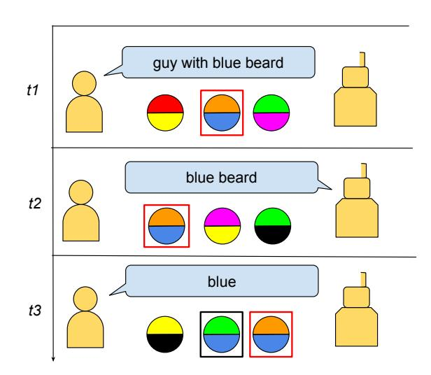

# Referring Expressions in Human-Robot Common Ground: A Thesis Proposal

Jaap Kruijt Vrije Universiteit Amsterdam j.m.kruijt@vu.nl

### Abstract

In this PhD, we investigate the processes through which common ground shapes the pragmatic use of referring expressions in Human-Robot Interaction (HRI). A central point in our investigation is the interplay between a growing common ground and changes in the surrounding context, which can create ambiguity, variation and the need for pragmatic interpretations. We outline three objectives that define the scope of our work: 1) obtaining data with common ground interactions, 2) examining reference-making, and 3) evaluating the robot interlocutor. We use datasets as well as a novel interactive experimental framework to investigate the linguistic processes involved in shaping referring expressions. We also design an interactive robot model, which models these linguistic processes and can use pragmatic inference to resolve referring expressions. With this work, we contribute to existing work in HRI, reference resolution and the study of common ground.

### 1 Introduction

While there has been a huge leap in conversational AI in recent years, innovations in multi-modal, situated conversational AI have not seen similar progress. One area which especially deserves attention is situated common ground in human-robot interaction (HRI). Understanding how common ground and conventions play a role in the use of referring expressions in HRI can help create more efficient, enjoyable and successful communication. A robot that does not build up common ground and learn the conventions may have difficulty identifying the referent of a referring expression, leading to confusion and errors.

In human conversation, there is an implicit drive to be only as informative as necessary (Grice, 1975). This leads to pragmatic behavior in humanhuman conversation, and explains why seemingly

Figure 1: Schematic representation of how common ground can shape referring expressions within a changing context. Over time, the human and robot form a convention for the entity in the red box. This is associated with a reduction in the utterance length leading to underspecified language. The use and interpretation of this convention can remain consistent even if ambiguous information is introduced, such as the entity in the black box at t3.

underspecified, ambiguous or unrelated utterances are interpreted correctly by humans.

For instance, consider the following scenario: Two close friends, Anna (A) and Bob (B), frequently meet up at a bar in the centre of town. One of the bartenders there has a distinctive blue beard and a strange personality. Anna and Bob do not know his name, but often joke about his antics. When talking about him, they call him *Blue* for his beard.

The referring expression *Blue* provides enough information to A and B, because they share a common ground due to their situational grounding and a history of previous exchanges at the bar (Stalnaker, 2002). The more common ground has been built

up, the more information can be left implicit, which enables more efficient communication. This is especially true for referring expressions such as *Blue*, which are the result of a process of *conventionformation*. A key point in conventions is that they are stable (Hawkins et al., 2017): A and B could continue using the name *Blue* with each other even when *Blue* changes his beard. Pragmatic interpretation of the convention allows A and B to use this referring expression when there is conflicting information, such as another individual with a blue beard.

While the effects of common ground on communication have been examined in detail for humanhuman communication, less is known about its role in HRI. Therefore, this dissertation examines the impact of common ground on the pragmatic use of referring expressions within HRI. The pragmatic behaviour is analysed through linguistic, contextual and social factors such as patterns of reference, ambiguity, and convention formation. We model these factors in a multi-modal interactive robot equipped with pragmatic reasoning capabilities, which allows us to assess which factors contribute the most to the use and interpretation of referring expressions in HRI.

## 2 Background

Referring expressions are studied within NLP in coreference resolution and entity linking (EL) tasks. Although there are similarities between the tasks, they have distinct goals, and separate models exist for either task (Sukthanker et al., 2020; Sevgili et al., 2022). The problem we are investigating in this research draws important elements from both tasks, but actually establishes a new research space by combining and expanding on them. On top of linking entities and clustering them within a dialogue, in our work references should be understood in the broader context of the common ground which is built up over multiple interactions. Furthermore, we examine the interpretation of references within a situated, multi-modal context rather than the unimodal data that are used in coreference resolution and EL. We also examine the production of references as well as their interpretation.

In 2024, both downstream tasks could be performed by Large Language Models (LLMs). However, there could still be issues when applied in a situated multi-modal environment, as LLMs are still mostly unimodal and not situated. Furthermore, while LLMs have been shown to be capable of pragmatic inference to some extent (Lipkin et al., 2023), fine-tuning is still required to get desirable results (Ruis et al., 2024).

Iterated reference games such as the tangram task (Clark and Wilkes-Gibbs, 1986; Hawkins et al., 2017) and the PhotoBook task (Haber et al., 2019) have studied how spontaneous linguistic conventions form as a result of common ground. These games simulate common ground by invoking repeated references to the same image or figure over a number of rounds. However, common ground is analysed in a static environment rather than within a changing context. In the Dynamic OneCommon task by (Udagawa and Aizawa, 2021), contexts do change, but convention-formation is not an aspect in this task. All tasks mentioned above are performed in human-human interaction. In HRI, the role of conventions and common ground has been studied for gent policies and strategies (Shih et al., 2021), rather than for natural language understanding and generation.

## 3 Research Goals and Questions

The main goal of this research project is to better understand the processes through which common ground shapes referring expressions within Human-Robot Interaction. Our main research question is:

#### RQ To what extent does common ground influence the pragmatic use of referring expressions in Human-Robot Interaction?

By simulating the advancement of common ground while changes occur in the surrounding context, we aim to examine how common ground impacts the use of referring expressions and their interpretation within the context.

We outline three objectives that need to be tackled in order to answer our research question:

- Obtaining and Interpreting Data containing Common Ground Interactions
- Examining Reference-Making
- Examining the Robot Interlocutor

For each of these objectives, we define one or more sub-questions that address the objective.

#### 3.1 Obtaining and Interpreting Data containing Common Ground Interactions

One of the main challenges of this research is obtaining the data that allow us to investigate referring expressions while common ground is built up. While datasets containing referring expressions exist for coreference resolution and entity linking, these datasets are often very standardized for the two separate tasks. Most coreference resolution and EL models are evaluated on a fixed set of datasets, which consist of news or telephone conversations (Sukthanker et al., 2020; Sevgili et al., 2022; Ng, 2017). There is no long-term temporal structure outside a single document, which makes it impossible to evaluate the existence or effects of common ground. Furthermore, common ground develops in dialogue between two conversation partners, and is therefore social in nature (Enfield, 2008). Datasets made up of news also lack this social dialogue.

Datasets which do have both temporal structure and social dialogue are usually based on TV-shows such as *Friends*. Chen and Choi (2016)'s character identification task uses such a dataset. However, their task is not aimed at investigating common ground, and thus requires additional restructuring to simulate the buildup of common ground.

Another avenue for obtaining data is to create the data using an interaction task. The iterated reference studies by Hawkins et al. (2017) and Haber et al. (2019) provide datasets which can be used to investigate convention formation through the buildup of common ground. However, in both these studies, they do not define what they consider to be part of the common ground at each step. Rather, the common ground is assumed to increase for all referents by making the surrounding context static. Because the changing context in which common ground is built up is essential to answering our research question, both these task designs and datasets still lack a critical element, which is to formalize what is part of the common ground and what is not.

The issues described above are addressed in the following sub-questions:

SQ1 How do we obtain or create data for investigating the main research question? SQ2 How do we simulate common ground in interaction data?

and what is not, we categorize the individuals which are part of interactions as belonging to either the *inner* or *outer circle*. Individuals in the inner circle are part of the common ground, while those in the outer circle are not. This distinction allows us to analyze the linguistic processes outlined in the following section.

To obtain data, we take two approaches. First, we restructure Chen and Choi (2016)'s dataset to obtain a temporal structure in the data that shows an increase in common ground. We annotate the characters in the dataset for either inner or outer circle based on the frequency of their occurrence in the show. Second, we design a novel interactive iterated reference framework inspired by Clark and Wilkes-Gibbs (1986) which is used in Human-Robot Interaction experiments. In this framework, participants use referring expressions to identify characters in a visual scene over a number of rounds. By having some characters appear each round and others appear only once, we create a distinction between inner circle and outer circle, which allows us to investigate the reference patterns for each circle. We will perform both online and in-person experiments. For the in-person experiments, we will recruit participants at events as well as at the university. With the framework, participants of the experiment build up common ground while the surrounding contexts change.

### 3.2 Examining Reference-Making

Linguistic patterns of reference Analyses of conventions in human-human iterated reference games show that the information content and discriminativeness of a convention remains the same throughout the game despite the referring expression becoming less descriptive (Giulianelli et al., 2021; Takmaz et al., 2022). This means that known individuals (the inner circle) do not need to be introduced in detail, because the information required can be accessed through the common ground. For instance, recall the example of Anna and Bob in Section 1. *Blue* can be introduced into their conversations at the bar without any context due to the convention that was established. In contrast, an unfamiliar individual (someone from the outer circle) would require a more elaborate description providing more context (e.g. *That woman sitting at the bar*).

The ease with which individuals in the inner circle can be mentioned may make it harder for an artificial agent to detect and keep track of their references. To understand how common ground can influence (re)introductions and the structure of a sequence of references, we investigate the following sub-question:

#### SQ3 What linguistic patterns of referring expressions arise as common ground is built up?

We address this question by examining the linguistic structure of sequences of utterances and reference clusters to the inner circle and outer circle individuals in the restructured dataset by Chen and Choi (2016) and the data collected through our framework. The linguistic analysis includes the part of speech and the amount of content and function words in each subsequent reference. First results from this analysis show that distinct patterns of reference exist for inner and outer circle references. This information can be included in the design of artificial agents, to allow them to better detect and distinguish references in case of high common ground. Based on existing work in reference games (Clark and Wilkes-Gibbs, 1986; Hawkins et al., 2017; Haber et al., 2019), we expect that conventions can be found for the inner circle, such as (nick)names and shorthand descriptions.

Conventions, Context and Pragmatics When common ground is built up while the surrounding context changes, two factors may be introduced in the use and interpretation of a referring expression: *ambiguity* may arise as a result of the introduction of conflicting information in the context; and *variation* may be introduced in the choice of reference because new information about known entities is introduced, or a new context leads to new associations for inner circle individuals (Ilievski et al., 2016).

Recall the example for *Blue* from section 1. If a new bartender who has blue hair, but no beard, comes to work alongside *Blue*, the convention used may become ambiguous with respect to these two bartenders. A and B might need to resolve this ambiguity. A pragmatic approach would be to continue using the convention *Blue* to refer to its established referent, while choosing a different way to refer to the newly introduced individual such that ambiguity is avoided. However, the success of this approach may depend on the strength of the convention and cues from context. If the convention *Blue* is not yet very strong, A and B might start referring to him as *Beard Guy* instead. This creates variation in the referring expressions that may be

used for a certain inner circle individual. Due to the effects of recency (Brennan and Clark, 1996), this new referring expression may become the convention, but it is also possible that conversation partners return to the original convention once the ambiguity disappears.

Ambiguity and variation can present problems for a robot which attempts to interpret the referring expressions: if the robot does not rely enough on the common ground and the established convention, it may be unable to resolve the ambiguity when the referring expression requires a pragmatic interpretation, whereas if it relies *too much* on the convention, it may fail to identify the inner circle individual whose convention was changed. Therefore, investigating the interplay between ambiguity, conventions and pragmatic interpretations in Human-Robot Interaction is needed to assess how a robot should approach and use the common ground, and adapt to changing contexts.

The factors and issues described here are addressed in the following two sub-questions:

SQ4 To what extent do recency, ambiguity, and conventions play a role in the pragmatic use of referring expressions? SQ5 What is the role of context in creating variation in referring expressions?

These questions are tackled in the experiments with our framework using the distinction between inner and outer circle individuals. For the inner circle, conventions may exist or be established over time. The outer circle can present possibly ambiguous cases with the conventions established for the inner circle. By comparing the referring expressions used for inner and outer circle characters as common ground develops, we can measure how pragmatic the behaviour of humans and robots is. Based on Brennan and Clark (1996), we expect the most recent reference for an inner circle individual to be used if this does not lead to ambiguity. If this reference is used enough, it will become conventionalized, which will lead to a decrease in utterance length (Hawkins et al., 2020). Based on the principles of pragmatic inference (Grice, 1975), we then expect Furthermore, the contexts also evoke particular associations for individuals, to allow us to study whether this leads to variation.

#### 3.3 Examining the Robot Interlocutor

The robot's role in convention formation In our iterated reference experiments, the robot is an active player who must play the game well in order to observe the effects of common ground. Therefore, the linguistic processes that we outlined in the previous section must be modeled in the robot. The robot should be able to interpret human referential expressions correctly, so it needs to be aware of potential ambiguity and actively try to resolve it. It should also be able to use the common ground to its advantage, by relying on established conventions. Lastly, it will need to use pragmatic inference when interpreting referential expressions used by the human conversation partner.

The robot should also generate appropriate referring expressions itself. Both the human-human iterated language games (Clark and Wilkes-Gibbs, 1986) and studies on agent policies and strategies in HRI (Shih et al., 2021; Chai et al., 2014) have stressed the importance of collaboration in the process of convention formation. Therefore, we investigate the collaborative role that an artificial agent can play in shaping conventions. Should it actively engage in shaping the convention, or take a passive role and let the human take the initiative? If the robot takes a passive role, the human might assume that there is common ground when there is none (Chai et al., 2014), but if the robot shapes conventions with too much confidence, the human might rely too much on the robot's choices, so that the convention does not form as a result of true collaboration (Herse et al., 2021). In order to address these issues, we investigate the following sub-questions:

SQ6 How do we design an agent which understands the pragmatic references used by human conversation partners?

SQ7 Does agent engagement in reference-making contribute to convention formation?

We design our robot model to address these problems using a combination of neural models and knowledge-based reasoning. The model is designed for our iterated reference game, which defines a limited world with a set of characters C and a set of visual attributes A. We also define a lexicon L(a, c) which maps an attribute a and a character c to {0, 1} depending on whether the character has the attribute or not. During an interaction, the model creates an embedding of an

utterance u produced by the human interaction partner using SentenceBERT (Reimers and Gurevych, 2019), and then uses cosine similarity Cs(u, A) to find semantic matches with embeddings of the attributes. The model then applies the lexicon L(a, c) on these matches to find the character that has the highest match with the utterance. In case there is more than one top-scoring match, the model applies an additional pragmatic reasoning step on the topscoring candidate characters to resolve ambiguity. For this, we use an implementation of the Rational Speech Act model (RSA) (Goodman and Frank, 2016). This model simulates the Gricean Maxims by creating a probability distribution over the possible utterances that a pragmatic speaker might use to denote a specific meaning given the context. In our case, the context is formed by the distribution of attributes a. In case pragmatic reasoning fails, the robot may also ask appropriate clarification questions. Based on this process, the robot selects a character as the intended referent and provides a response to the human that progresses the game.

As the interaction progresses, the robot builds up a history H(c) of mentions m of a particular character. At production of a new utterance, in addition to the process described above, the robot also compares the new utterance with the mention history for each character. This is done through an additional cosine similarity measure Cs(u, H) as well as a textual similarity Ts(u, H). In this way, we model recency and convention forming and the buildup of common ground. The resulting scores Ss(c) and Sh(c) for each character based on the semantic match and the history respectively are then averaged to find the top-scoring candidate.

We test the robot engagement through our iterated reference game by creating two response types for our autonomous robot model: one in which the robot takes a passive role with respect to using the convention, letting the human take the initiative; and one in which it actively reinforces the convention that is being established in its responses to the human, by repeating the phrase that the human used.

Evaluating the Robot Finally, we look at how a variety of factors involved in using a robot as an interlocutor may influence the interaction. Using a robot comes with a number of challenges, some of which have not been solved yet by the research community, but which are important in order to achieve successful human-robot interaction (Taniguchi et al., 2019; Marge et al., 2022). However, to investigate how robots can build up common ground, it is essential that the robot and human actively engage in interaction. Therefore, only evaluating the performance of a robot model on a dataset will not suffice: the model needs to be implemented in the situated environment where it is able to interact with humans and respond to their input. Since social relations play an important role in the development of common ground (and vice versa) (Enfield, 2008), humans must also be allowed to adapt their social attitude towards the robot as common ground grows. This behaviour can only be studied when humans interact directly with the robot.

To assess how successful our robot model is at building up and utilizing common ground in interactions, we investigate the final sub-question:

### SQ8 How do we evaluate agent behaviour?

We address this question by analyzing a number of metrics. Firstly, we compare the agent performance in the iterated reference game with human performance in a human-human study. We measure the number of turns it takes for humans and robots to reach a convention, and how stable these conventions remain throughout the game. We also measure the length and number of function and content words in the utterances as the game progresses as a measure of convention formation. We also evaluate the robot's task success and adaptation to the common ground by measuring the amount of errors it made in resolving referring expressions in subsequent rounds of the interaction, and by measuring whether it correctly learned conventions by comparing its selections during the interaction with the ground truth. Furthermore, we evaluate the flow of dialogue in the human-robot interaction in terms of humanness. Finally, we collect human judgments about our robot from the participants that interact with our robot through questionnaires.

## 4 Conclusion

This thesis proposal outlines the data that needs to be collected, and the linguistic processes that need to be examined and modeled to understand the role of common ground in shaping referring expressions in Human-Robot Interaction. The findings of this work can be used to design social robots which can sustain meaningful and enjoyable long-term interaction with humans. Next to this, the findings obtained for Human-Robot Interaction can also inform us about how common ground influences communication between humans. The thesis will also include an assessment of future steps that need to be taken to further improve social robots.

### References

- Susan E Brennan and Herbert H Clark. 1996. Conceptual pacts and lexical choice in conversation. *Journal of experimental psychology: Learning, memory, and cognition*, 22(6):1482. Joyce Y. Chai, Lanbo She, Rui Fang, Spencer Ottarson, Cody Littley, Changsong Liu, and Kenneth Hanson. 2014. [Collaborative effort towards common ground](https://doi.org/10.1145/2559636.2559677) [in situated human-robot dialogue.](https://doi.org/10.1145/2559636.2559677) In *Proceedings of the 2014 ACM/IEEE International Conference on Human-Robot Interaction*, HRI '14, page 33–40, New York, NY, USA. Association for Computing Machinery. Yu-Hsin Chen and Jinho D Choi. 2016. Character identification on multiparty conversation: Identifying mentions of characters in tv shows. In *Proceedings of the 17th annual meeting of the special interest group on discourse and dialogue*, pages 90–100. Herbert H. Clark and Deanna Wilkes-Gibbs. 1986. [Re](https://doi.org/https://doi.org/10.1016/0010-0277(86)90010-7)[ferring as a collaborative process.](https://doi.org/https://doi.org/10.1016/0010-0277(86)90010-7) *Cognition*, 22(1):1–
- 39. Nicholas J. Enfield. 2008. *[Common ground as a re](https://doi.org/doi:10.1515/9783110211474.2.223)[source for social affiliation](https://doi.org/doi:10.1515/9783110211474.2.223)*, pages 223–254. De Gruyter Mouton, Berlin, New York. Mario Giulianelli, Arabella Sinclair, and Raquel Fernández. 2021. Is information density uniform in task-oriented dialogues? In *Proceedings of the 2021 Conference on Empirical Methods in Natural Language Processing*, pages 8271–8283. Noah D Goodman and Michael C Frank. 2016. Pragmatic language interpretation as probabilistic inference. *Trends in cognitive sciences*, 20(11):818–829. Herbert P Grice. 1975. Logic and conversation. In *Speech acts*, pages 41–58. Brill. Janosch Haber, Tim Baumgärtner, Ece Takmaz, Lieke Gelderloos, Elia Bruni, and Raquel Fernández. 2019. [The PhotoBook dataset: Building common ground](https://doi.org/10.18653/v1/P19-1184) [through visually-grounded dialogue.](https://doi.org/10.18653/v1/P19-1184) In *Proceedings of the 57th Annual Meeting of the Association for Computational Linguistics*, pages 1895–1910, Florence, Italy. Association for Computational Linguistics. Robert D Hawkins, Michael C Frank, and Noah D Goodman. 2020. Characterizing the dynamics of learning in repeated reference games. *Cognitive science*, 44(6):e12845.

Robert XD Hawkins, Mike Frank, and Noah D Goodman. 2017. Convention-formation in iterated reference games. In *CogSci*. Sarita Herse, Jonathan Vitale, Benjamin Johnston, and Mary-Anne Williams. 2021. [Using trust to deter](https://doi.org/10.1145/3434073.3444673)[mine user decision making & task outcome during](https://doi.org/10.1145/3434073.3444673) [a human-agent collaborative task.](https://doi.org/10.1145/3434073.3444673) In *Proceedings of the 2021 ACM/IEEE International Conference on Human-Robot Interaction*, HRI '21, page 73–82, New York, NY, USA. Association for Computing Machinery. Filip Ilievski, Marten Postma, and Piek Vossen. 2016. [Semantic overfitting: what 'world' do we consider](https://aclanthology.org/C16-1112) [when evaluating disambiguation of text?](https://aclanthology.org/C16-1112) In *Proceedings of COLING 2016, the 26th International Conference on Computational Linguistics: Technical Papers*, pages 1180–1191, Osaka, Japan. The COL-ING 2016 Organizing Committee. Benjamin Lipkin, Lionel Wong, Gabriel Grand, and Joshua B Tenenbaum. 2023. Evaluating statistical language models as pragmatic reasoners. *arXiv preprint arXiv:2305.01020*. Matthew Marge, Carol Espy-Wilson, Nigel G. Ward, Abeer Alwan, Yoav Artzi, Mohit Bansal, Gil Blankenship, Joyce Chai, Hal Daumé, Debadeepta Dey, Mary Harper, Thomas Howard, Casey Kennington, Ivana Kruijff-Korbayová, Dinesh Manocha, Cynthia Matuszek, Ross Mead, Raymond Mooney, Roger K. Moore, Mari Ostendorf, Heather Pon-Barry, Alexander I. Rudnicky, Matthias Scheutz, Robert St. Amant, Tong Sun, Stefanie Tellex, David Traum, and Zhou Yu. 2022. [Spoken language interaction with robots:](https://doi.org/https://doi.org/10.1016/j.csl.2021.101255) [Recommendations for future research.](https://doi.org/https://doi.org/10.1016/j.csl.2021.101255) *Computer Speech & Language*, 71:101255. Vincent Ng. 2017. [Machine learning for entity corefer](https://doi.org/10.1609/aaai.v31i1.11149)[ence resolution: A retrospective look at two decades](https://doi.org/10.1609/aaai.v31i1.11149) [of research.](https://doi.org/10.1609/aaai.v31i1.11149) *Proceedings of the AAAI Conference on Artificial Intelligence*, 31(1). Nils Reimers and Iryna Gurevych. 2019. [Sentence-](https://doi.org/10.18653/v1/D19-1410)[BERT: Sentence embeddings using Siamese BERT](https://doi.org/10.18653/v1/D19-1410)[networks.](https://doi.org/10.18653/v1/D19-1410) In *Proceedings of the 2019 Conference on Empirical Methods in Natural Language Processing and the 9th International Joint Conference on Natural Language Processing (EMNLP-IJCNLP)*, pages 3982–3992, Hong Kong, China. Association for Computational Linguistics. Laura Ruis, Akbir Khan, Stella Biderman, Sara Hooker, Tim Rocktäschel, and Edward Grefenstette. 2024. The goldilocks of pragmatic understanding: Finetuning strategy matters for implicature resolution by llms. *Advances in Neural Information Processing Systems*, 36. Özge Sevgili, Artem Shelmanov, Mikhail Arkhipov, Alexander Panchenko, and Chris Biemann. 2022. Neural entity linking: A survey of models based on deep learning. *Semantic Web*, 13(3):527–570. Andy Shih, Arjun Sawhney, Jovana Kondic, Stefano Ermon, and Dorsa Sadigh. 2021. [On the critical role](https://openreview.net/forum?id=8Ln-Bq0mZcy) [of conventions in adaptive human-{ai} collaboration.](https://openreview.net/forum?id=8Ln-Bq0mZcy) In *International Conference on Learning Representations*. Robert Stalnaker. 2002. Common ground. *Linguistics and philosophy*, 25(5/6):701–721. Rhea Sukthanker, Soujanya Poria, Erik Cambria, and Ramkumar Thirunavukarasu. 2020. [Anaphora and](https://doi.org/https://doi.org/10.1016/j.inffus.2020.01.010) [coreference resolution: A review.](https://doi.org/https://doi.org/10.1016/j.inffus.2020.01.010) *Information Fusion*, 59:139–162. Ece Takmaz, Sandro Pezzelle, and Raquel Fernández. 2022. Less descriptive yet discriminative: Quantifying the properties of multimodal referring utterances via clip. In *Proceedings of the workshop on cognitive modeling and computational linguistics*, pages 36–42. T Taniguchi, D. Mochihashi, T. Nagai, S. Uchida, N. Inoue, I. Kobayashi, T. Nakamura, Y. Hagiwara, N. Iwahashi, and T. Inamura. 2019. [Survey on frontiers of](https://doi.org/10.1080/01691864.2019.1632223) [language and robotics.](https://doi.org/10.1080/01691864.2019.1632223) *Advanced Robotics*, 33(15- 16):700–730. Takuma Udagawa and Akiko Aizawa. 2021. [Main](https://doi.org/10.1162/tacl_a_00409)[taining Common Ground in Dynamic Environments.](https://doi.org/10.1162/tacl_a_00409) *Transactions of the Association for Computational Linguistics*, 9:995–1011.