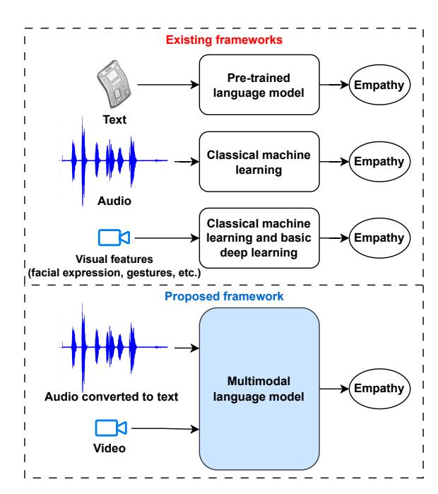
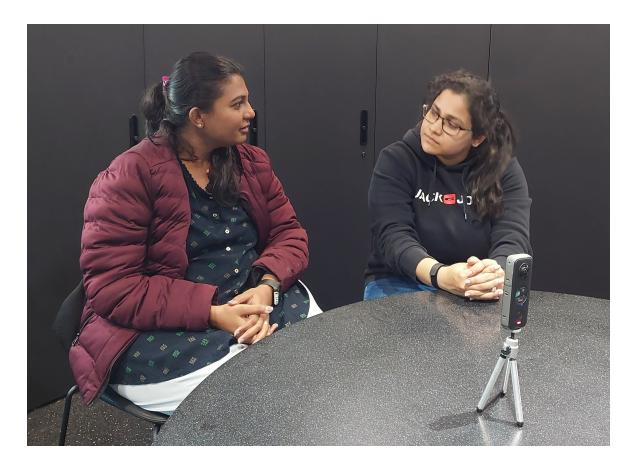
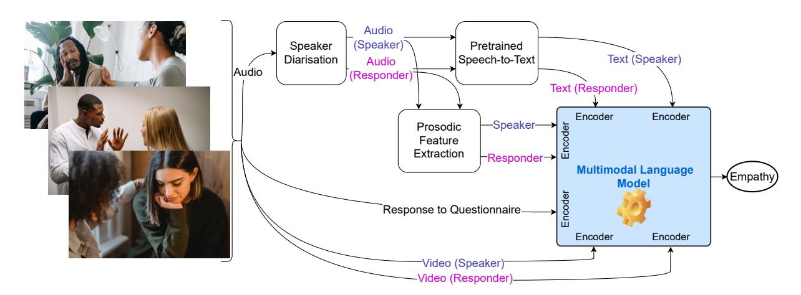

# Thesis Proposal: Detecting Empathy Using Multimodal Language Model

Md Rakibul Hasan1 Md Zakir Hossain1 Aneesh Krishna1

Shafin Rahman2 Tom Gedeon1

1Curtin University, Perth WA 6102, Australia

2North South University, Dhaka 1229, Bangladesh

{rakibul.hasan, zakir.hossain1, a.krishna}@curtin.edu.au shafin.rahman@northsouth.edu, tom.gedeon@curtin.edu.au

#### Abstract

Empathy is crucial in numerous social interactions, including human-robot, patient-doctor, teacher-student, and customer-call centre conversations. Despite its importance, empathy detection in videos continues to be a challenging task because of the subjective nature of empathy and often remains under-explored. Existing studies have relied on scripted or semi-scripted interactions in text-, audio-, or video-only settings that fail to capture the complexities and nuances of real-life interactions. This PhD research aims to fill these gaps by developing a multimodal language model (MMLM) that detects empathy in audiovisual data. In addition to leveraging existing datasets, the proposed study involves collecting real-life interaction video and audio. This study will leverage optimisation techniques like neural architecture search to deliver an optimised smallscale MMLM. Successful implementation of this project has significant implications in enhancing the quality of social interactions as it enables real-time measurement of empathy and thus provides potential avenues for training for better empathy in interactions.

## 1 Introduction

The ability to understand and respond appropriately to the feelings, viewpoints, and beliefs of others is referred to as empathy [\(Decety and Jackson,](#page-9-0) [2004;](#page-9-0) [Olderbak et al.,](#page-10-0) [2014\)](#page-10-0). Through engagement, this capacity can strengthen bonds among people and lessen stress and sadness. For instance, consider a situation where a family member falls ill, leading to personal distress. When sharing this sadness with a colleague, receiving genuine support can significantly mitigate unhappiness while enhancing the bond with that colleague. The significance of empathy is evident across a broad range of contexts, from socially assistive robots to human-to-human interactions [\(Hasan et al.,](#page-10-1) [2023b\)](#page-10-1).

Figure 1: Comparison of our proposed approach with the literature. Existing works on text-based empathy detection [\(Barriere et al.,](#page-9-1) [2022,](#page-9-1) [2023\)](#page-9-2) leverage pre-trained language models. There exist a few works on audioand video-based empathy detection [\(Alam et al.,](#page-9-3) [2016;](#page-9-3) [Mathur et al.,](#page-10-2) [2021\)](#page-10-2), where audio features or visual features are separately used mostly in classical machine learning algorithms. In contrast, we propose to leverage both audio and video information in a multimodal language model.

Assessment of empathy levels in real-life empathy-seeking interactions is crucial for determining the quality of such interactions [\(Bellet and](#page-9-4) [Maloney,](#page-9-4) [1991\)](#page-9-4). Empathy deficit often leads to conflicts and miscommunications, highlighting the importance of measuring empathy levels. Evaluating empathy levels can help answer questions such as 'To what extent does a teacher exhibit empathy towards students?', 'How empathic is a caregiver towards patients?' and 'Does an employer demonstrate empathy towards employees?', among others. Empathy detection allows for a comprehensive evaluation of empathy levels in various contexts and can facilitate the development of effective strategies to promote empathy in social interactions.

The term empathy is itself subjective [\(Decety](#page-9-0) [and Jackson,](#page-9-0) [2004\)](#page-9-0), so annotated video datasets of empathy are also scarce [\(Hosseini and Caragea,](#page-10-3) [2021\)](#page-10-3). To this front, we will collect and annotate audiovisual data of dyadic conversations. Our annotation protocol will consider the subjective experience of the participants involved in the dyadic conversation. Apart from our data, there are some public datasets (such as RealTalk [\(Geng et al.,](#page-10-4) [2023\)](#page-10-4)) where the data closely aligns with the scope of this research but not the annotation. To this end, we propose re-annotating some samples in terms of empathy and training the model using semi-supervised learning [\(Xu et al.,](#page-11-0) [2021\)](#page-11-0). Re-annotating these existing data can be challenging as we may no longer have the subjective experience of the study participants.

Empathy measurement is challenging for people [\(Lawrence et al.,](#page-10-5) [2004\)](#page-10-5), let alone automated systems. There are several works on empathy detection from textual contents [\(Barriere et al.,](#page-9-1) [2022,](#page-9-1) [2023;](#page-9-2) [Hasan et al.,](#page-10-1) [2023b\)](#page-10-1). Research in computational empathy from audio and audiovisual data is emerging with a few existing works [\(Alam et al.,](#page-9-3) [2016;](#page-9-3) [Barros et al.,](#page-9-5) [2019\)](#page-9-5). It is likely that a multimodal model with visual content – in addition to conventional textual content – can boost empathy detection performance because action and gesture play a crucial role in signalling the presence or absence of empathy.

Large language models, such as GPT-4 and PaLM, have shown excellent results in performing various complex tasks. Recently, multimodal language models (MMLMs), by integrating other modalities, such as images, demonstrate promising proof of concept in complex audiovisual recognition tasks [\(Driess et al.,](#page-9-6) [2023;](#page-9-6) [Wu et al.,](#page-11-1) [2023\)](#page-11-1). MMLM, therefore, seems an appropriate and stateof-the-art approach for empathy detection from audiovisual data, and hence, we propose to leverage MMLM as the backbone of our prediction system.

However, training an MMLM requires huge computational budgets (e.g., multiple GPUs or TPUs for multiple days). With a limited computational budget, this research aims to experiment in two aspects: (1) using small-scale MMLMs and (2) prompt engineering with large-scale MMLMs. Firstly, small-scale MMLMs, such as MiniVLM

[\(Wang et al.,](#page-11-2) [2021\)](#page-11-2) and SimVLM [\(Wang et al.,](#page-11-3) [2022\)](#page-11-3), or compressing comparatively large-scale MMLMs through knowledge distillation [\(Fang](#page-10-6) [et al.,](#page-10-6) [2021\)](#page-10-6) will allow us to leverage MMLMs in our experimental setup. One of the key aims of this research is to find an optimised and smallscale MMLM suitable for empathy detection. To this end, we will employ techniques such as neural architecture search, lottery ticket hypothesis or knowledge distillation. Secondly, prompt engineering and few-shot learning (fine-tuning with few data samples) with large-scale MMLMs shall reduce the huge computational requirement of full training and is thus considered appropriate for our low-computation and low-data scenario.

#### 1.1 Aims and research questions

The primary aim of this project is to develop a robust method for detecting empathy by leveraging a range of multimodal empathic cues associated with video and audio. This project starts with exploring existing text- and video-based datasets. We will collect real-life video conversations to address the inadequacy of existing datasets for empathy detection. This project endeavours to address the following key research questions:

#### RQ 1 Dataset

RQ 1.1 What methods can be employed to effectively collect and annotate audiovisual data for empathy detection?

RQ 1.2 How can we re-annotate existing audiovisual data with regard to empathy and leverage a semi-supervised learning technique?

#### RQ 2 Model development

RQ 2.1 How can an MMLM utilising video and audio be constructed to detect empathy?

RQ 2.2 How much can we optimise the initial MMLM by reducing computational requirements?

RQ 2.3 Through prompt engineering, how could we leverage large-scale MMLM with a limited computational budget?

# 2 Related work

# 2.1 Empathy from audiovisual data

The one-minute gradual empathy (OMG-Empathy) dataset, introduced by [Barros et al.](#page-9-5) [\(2019\)](#page-9-5), consists of semi-scripted storytelling videos between

a speaker and a responder, where the responder self-annotated their valence (as a continuous value from −1 to +1) of the interaction. It is worth noting that although this dataset is titled 'empathy', the output label space is actually a valence score. To explore the potential of this dataset, the OMG-Empathy 2019 prediction challenge[1](#page-2-0) was organised. Participants of the challenge, such as [Barbieri et al.](#page-9-7) [\(2019\)](#page-9-7), employed a multimodal neural network, incorporating audio signals, transcripts, raw faces, facial landmarks, and full-body images to predict continuous valence scores. Similarly, [Tan et al.](#page-11-4) [\(2019\)](#page-11-4) utilised a multimodal long short-term memory (LSTM) network, whereas [Hinduja et al.](#page-10-7) [\(2019\)](#page-10-7) implemented a convolutional neural network, using hand-crafted and deep features. Moreover, [Azari](#page-9-8) [et al.](#page-9-8) [\(2019\)](#page-9-8) employed both a support vector machine (SVM) and a neural network to predict valence scores (or arguably empathy) in the challenge. All these different approaches by diverse teams, however, could not outperform the baseline model consisting of VGG16, LSTM, and SVM models, which resulted in a maximum concordance correlation coefficient of 0.23 [\(Barros et al.,](#page-9-5) [2019\)](#page-9-5). These approaches indeed showcase the potential of utilising multimodal data and machine learning techniques to detect empathy from audiovisual data, but at the same time, there is potentially much room for improvement.

[Zhu et al.](#page-11-5) [\(2023\)](#page-11-5) introduced the MEDIC dataset consisting of psychotherapeutic counselling sessions and proposed baseline models to predict empathy. To combine video, audio, and text modalities, they experimented with the Tensor Fusion Network [\(Zadeh et al.,](#page-11-6) [2017\)](#page-11-6), the Sentimental Words Aware Fusion Network (SWAFN) [\(Chen and Li,](#page-9-9) [2020\)](#page-9-9), and a simple concatenation model. The SWAFN model performed significantly better than the other two models, providing an accuracy of 86.4% and an F1 score of 86.3%.

The RealTalk dataset, introduced by [Geng et al.](#page-10-4) [\(2023\)](#page-10-4), includes dyadic conversations among various individuals. This dataset is not designed for empathy detection tasks, nor does it have empathy annotation. Nevertheless, such dyadic conversations could be leveraged for empathy research, provided that appropriate annotation is possible. Such a complex annotation task can succeed, especially because the dataset has socially appropriate and

inappropriate scenarios, which could be considered as empathy and no empathy annotations.

Apart from human-human interaction, [Mathur](#page-10-2) [et al.](#page-10-2) [\(2021\)](#page-10-2) and [Spitale et al.](#page-11-7) [\(2022\)](#page-11-7) investigated empathy between human and socially assistive robots. They conducted experiments involving a humanoid robot and human participants, in which the robot interacted with 46 students by telling different scripted stories. At the end of each interaction, participants rated their level of empathy through a survey with a 5-point Likert scale. The experiment resulted in a 6.9-hour video dataset and corresponding empathy labels. Conversations were labelled as either empathic or non-empathic based on a threshold (median value) empathy score calculated from the survey response. To predict empathy on this dataset, [Mathur et al.](#page-10-2) [\(2021\)](#page-10-2) used eight different machine learning and deep learning models that utilised various features such as eye gaze, facial action units and landmarks, head pose, and point distribution parameters of the face. Their best approach, which is an XGBoost model, achieved an accuracy of 69% and an area under the receiver operating characteristic curve (AUC) of 72%.

It is important to note that the participants' audio was not considered in this dataset, which might contribute towards better empathy prediction. Extracted visual features from this dataset are publicly available[2](#page-2-1) , but the audio conversation is unavailable. It is worth noting that they solely focused on predicting empathy in human-robot interaction as a binary classification, distinguishing between empathy and non-empathy. However, it did not account for predicting empathy levels as a continuous value or categorising empathy into more nuanced categories. These limitations raise the opportunity to incorporate a more comprehensive range of empathy levels in any human interaction. By doing so, we can obtain a more nuanced understanding of empathic responses and facilitate a more precise evaluation of empathic tendencies.

# 2.2 Empathy from audio data

There has been limited research that predicts empathy solely on audio conversations. [Alam et al.](#page-9-3) [\(2016\)](#page-9-3) investigated empathy prediction in humanto-human call-centre conversations using SVM and reported an unweighted average recall of 65.1%. Meanwhile, [Gasteiger et al.](#page-10-8) [\(2022\)](#page-10-8) explored the

1 [https://www2.informatik.uni-hamburg.de/wtm/](https://www2.informatik.uni-hamburg.de/wtm/omgchallenges/omg_empathy_description_19.html) [omgchallenges/omg\\_empathy\\_description\\_19.html](https://www2.informatik.uni-hamburg.de/wtm/omgchallenges/omg_empathy_description_19.html)

2 [https://github.com/interaction-lab/](https://github.com/interaction-lab/empathy-modeling) [empathy-modeling](https://github.com/interaction-lab/empathy-modeling)

empathy of computer-generated audio, where transcripts were subjected to sentiment analysis, and corresponding audio files were evaluated by a group of 89 human participants. The results revealed a 70% agreement between the sentiment analyser and human annotations. These studies demonstrate the promising potential of audio for predicting empathy.

#### 2.3 Empathy from text data

The Workshop on Computational Approaches to Subjectivity, Sentiment & Social Media Analysis (WASSA) has organised a series of shared tasks[3](#page-3-0) on empathy prediction on text data with some demographic information. The dataset consists of essays written in response to news articles that involve harm to individuals, organisations or nature. The recent 2023 version of this dataset further consists of written conversation (speech turn) between participants [\(Omitaomu et al.,](#page-11-8) [2022;](#page-11-8) [Bar](#page-9-2)[riere et al.,](#page-9-2) [2023\)](#page-9-2). The WASSA 2021, 2022, and 2023 shared tasks challenge to detect empathy levels as a continuous value. Several participants, such as [Vasava et al.](#page-11-9) [\(2022\)](#page-11-9); [Chen et al.](#page-9-10) [\(2022\)](#page-9-10); [Qian et al.](#page-11-10) [\(2022\)](#page-11-10); [Del Arco et al.](#page-9-11) [\(2022\)](#page-9-11); [Lah](#page-10-9)[nala et al.](#page-10-9) [\(2022\)](#page-10-9); [Ghosh et al.](#page-10-10) [\(2022\)](#page-10-10); [Hasan et al.](#page-10-11) [\(2024\)](#page-10-11), have fine-tuned pre-trained language models (PLMs), such as RoBERTa [\(Liu et al.,](#page-10-12) [2019\)](#page-10-12), and BERT [\(Devlin et al.,](#page-9-12) [2019\)](#page-9-12), for these tasks. Overall, PLMs excelled in all WASSA empathy detection datasets [\(Tafreshi et al.,](#page-11-11) [2021;](#page-11-11) [Barriere](#page-9-1) [et al.,](#page-9-1) [2022,](#page-9-1) [2023\)](#page-9-2), with a maximum Pearson correlation coefficient of 0.924 in predicting empathy in written essays [\(Hasan et al.,](#page-10-11) [2024\)](#page-10-11) and 0.708 in predicting empathy in speech turns [\(Lu et al.,](#page-10-13) [2023\)](#page-10-13).

Apart from WASSA competition, PLMs were also fine-tuned in predicting empathy in detecting empathy in medical students' essays about simulated patient-doctor interactions [\(Dey and Girju,](#page-9-13) [2022\)](#page-9-13). They used various algorithms, including Naive Bayes, SVM, LSTM, and PLMs (BERT, RoBERTa) and found that PLMs are best suited for their empathy prediction setup, providing their best F1 score of 85%. These findings highlight the effectiveness of fine-tuning pre-trained models in text-based empathy prediction. Fine-tuning facilitates harnessing prior knowledge of PLMs, which helps enhance performance while minimising training time.

#### 3 Proposed methodology

#### 3.1 Problem formulation

Our primary aim is to detect empathy in dyadic conversations. Denoting speaker as S, responder as R, video as v, audio as a, and other numerical data (e.g., response to a questionnaire) as n, the multimodal data can be represented as X = {x v S , xv R, xa S , xa R, xn S , xn R}. Using X, the task is to build a model F to detect empathy Y . Depending on the dataset, Y can be binary classes (empathy and non-empathy), multi-classes (multiple levels of empathy) or continuous degrees of empathy (regression problem).

#### 3.2 Public datasets we will use

We plan to use four public datasets in our experiments [\(Table 1\)](#page-4-0). Apart from these, we may utilise the human-robot interaction dataset proposed by [Mathur et al.](#page-10-2) [\(2021\)](#page-10-2), which includes visual features of the human participants. A model capable of predicting empathy even with unavailable modality (e.g., missing audio in the human-robot dataset) could probably lead to a more robust model that can be applied to more diverse circumstances.

#### 3.2.1 NewsEmpathy

NewsEmpathy dataset, introduced by [Buechel et al.](#page-9-14) [\(2018\)](#page-9-14), consists of people's written essays in response to newspaper articles that are harmful to individuals, organisations or nature. To determine the annotation consistency, they calculated split-half reliability, which resulted in a 'very high' reliability value of 0.875. The dataset also consists of demographic information (age, sex, ethnicity, education, and income) of the study participants who wrote the essays. The annotation is done by the essay writers themselves on a continuous scale from 1 to 7. This dataset has undergone a series of improvements with additional data collection [\(Omitaomu](#page-11-8) [et al.,](#page-11-8) [2022;](#page-11-8) [Barriere et al.,](#page-9-2) [2023\)](#page-9-2), which resulted in a total of 3,755 samples. Although it is not an audiovisual dataset, we plan to leverage it in our preliminary experiment with language models.

#### 3.2.2 MEDIC

[Zhu et al.](#page-11-5) [\(2023\)](#page-11-5) introduced the MEDIC dataset to measure empathy in terms of three mechanisms: expression of experience, emotional reaction, and cognitive reaction. In each mechanism, the speech turns are annotated into three categories: no expression, weak expression, and strong expression. The

3 <https://wassa-workshop.github.io>

| SL 1 2 | Name NewsEmpathy MEDIC | Data Written essay (text) in response to newspaper articles Counselling case videos | # of samples 3,755 771 (total 11 hours) | Annotation Empathy Empathy |
|--------|------------------------|-------------------------------------------------------------------------------------|-----------------------------------------|----------------------------|
| 3      | OMG-Empathy            | Semi-scripted speaker-responder                                                     |                                         |                            |
|        |                        | storytelling                                                                        | 80 (total 8 hours)                      | Valence                    |
| 4      | RealTalk               | Unscripted conversations about                                                      |                                         |                            |
|        |                        | diverse experiences                                                                 |                                         |                            |
|        |                        |                                                                                     | 692 (total 115 hours)                   | Speaker presence           |
| 5      | Ours                   | Unscripted dyadic conversations                                                     | in progress                             | Empathy                    |

Table 1: Datasets to be leveraged in this project. As none of the public datasets completely aligns with the scope of this research, we plan to collect data, which is in progress.

dataset's annotation is a good match with the scope of the research; however, the data may not cover the complexities of real-life dyadic conversations envisioned in this project.

#### 3.2.3 OMG-Empathy

The OMG-Empathy dataset includes conversations of four speakers and ten responders [\(Barros et al.,](#page-9-5) [2019\)](#page-9-5). In each video, the speaker tells a semiscripted story from a pool of eight stories, and the responder responds in a natural way. Following the session, the responder annotated the recorded video frame with a valence score from −1 to +1. Although the videos are a good match with the scope of this research, one can argue that the output annotations need to be re-considered, as the annotations are not based on empathy.

#### 3.2.4 RealTalk

The RealTalk dataset comprises a wide variety of dyadic conversations among various individuals [\(Geng et al.,](#page-10-4) [2023\)](#page-10-4). The in-the-wild nature of this dataset makes it ideal to build a generalised AI model. However, this dataset does not have any empathy annotation.

## 3.3 Re-annotation of public datasets

Several datasets, such as MEDIC, adopt the Motivational Interviewing Treatment Integrity (MITI) code [\(Moyers et al.,](#page-10-14) [2016\)](#page-10-14) to annotate conversations in terms of empathy. MITI code is specifically designed to assess empathy of motivational interviewing-based treatment in healthcare and clinical sessions [\(Moyers et al.,](#page-10-14) [2016\)](#page-10-14). Although the conversations in OMG-Empathy and the RealTalk datasets may not be motivational interviewing, the

technique of empathy annotation from the MITI code could still be useful in annotating samples from OMG-Empathy and RealTalk datasets. Further, we aim to leverage the existing annotations (e.g., valence in the OMG-Empathy dataset) as a guide while annotating for empathy. We aim to recruit and train multiple annotators, and we will calculate annotation consistency using standard interrater reliability assessment techniques. Subsequently, we aim to train a model using semisupervised learning [\(Xu et al.,](#page-11-0) [2021\)](#page-11-0).

#### 3.4 Open for collaboration

In addition to using public datasets, we welcome collaboration with scholars who wish to contribute their expertise and/or relevant private datasets in this domain. Additional compatible datasets would allow for more robust model development and validation.

#### 3.5 Our dataset

As there are annotation mismatches with the OMG-Empathy and RealTalk datasets, we will collect and annotate new data. Details of our data collection experiment are discussed in the following subsections.

# 3.5.1 Study participants and their role

We will collect human-to-human dyadic conversations in empathy-seeking scenarios, where one person *(speaker)* talks about any concerning topics they face. Another person *(responder)* will interact with the speaker just like in a normal conversation. All participants (speaker and responder) will be free to use gestures (such as hand, head, or body)

Figure 2: A typical experimental setup for data collection with demo participants.

throughout the interaction. Our primary target participants are undergraduate students, postgraduate students, and staff at the host University. All participants must have normal vision and hearing abilities with necessary visual and hearing aids if required.

Speakers will be asked to reveal their emotions to talk about any concerning situations they have faced recently. They can choose to show any emotions in any situation. To help the participants decide on topics, the Geneva emotion wheel [\(Scherer,](#page-11-12) [2005\)](#page-11-12) [\(Table 2\)](#page-6-0) and some example topics [\(Table 3\)](#page-6-1) will be made available to the participants before the data collection. A major portion of the example topics are prepared after brainstorming with a unit (course) coordinator regarding what sorts of situations are most common among our university students. We will advise speakers to choose a topic that they are comfortable with. If any responder finds the topic confronting, we will advise the speaker to choose another topic.

#### 3.5.2 Equipment and data

To record the video and audio of the interactions between responders and the speaker, we will use an Insta360 ONE X2 camera[4](#page-5-0) , which has a built-in microphone and covers a 360-degree view. Participants will be seated on chairs. A typical setup is depicted in [Figure 2.](#page-5-1)

We will maintain a logbook for each participant, consisting of participation ID (such as 01, 02, etc.), their seating spot (left, right), and their role (speaker or responder).

#### 3.5.3 Questionnaire

At the end of the interaction, we will ask the participants (both speaker and responder) to fill in a questionnaire to collect demographic information and subjective ratings of the conversation regarding the degree of empathy. The questions will be hosted on the Qualtrics XM survey management system, which is a popular research survey management system used by other empathy research, such as [\(Gasteiger et al.,](#page-10-8) [2022\)](#page-10-8). All empathy assessmentrelated questions (other than demographic questions) are on an 11-point Likert scale (0 to 10, with 5 being the medium value) to provide many options to the participants, including a neutral opinion. The questionnaire includes the following four sections:

Participant information: This section includes eight questions, including the participant's demographic information and their role (speaker or responder). Depending on the role, the next set of questions is set to appear differently.

Speaker: This section includes 11 questions for speakers to reflect on their expressed emotions and assess their satisfaction with the conversation with the speakers. We designed four new questions, and the other seven are adapted from the consultation and relational empathy (CARE) scale proposed by [Mercer et al.](#page-10-15) [\(2004\)](#page-10-15). The CARE scale was designed to evaluate empathy in patient-doctor interactions, which resonates with our speakerresponder setup. In our experiment, speakers will share concerns with the other participants (responder), and the responder's empathy will be evaluated, which is similar to patients sharing their concerns with doctors and then evaluating the doctor's empathy, as in [\(Mercer et al.,](#page-10-15) [2004\)](#page-10-15).

Responder: This section includes 11 questions only for responders to assess their empathy towards the speakers. We developed two novel questions and adopted the remaining eight questions from empathy detection research by [Mathur et al.](#page-10-2) [\(2021\)](#page-10-2) and [Shen](#page-11-13) [\(2010\)](#page-11-13).

Responder – in general empathy: To assess the responders' empathy according to an established empathy measurement scale, this section includes the full questionnaire from the Toronto Empathy Questionnaire [\(Spreng et al.,](#page-11-14) [2009\)](#page-11-14), which includes 17 questions.

4 [https://store.insta360.com/product/one\\_x2](https://store.insta360.com/product/one_x2)

| Anger      | Sadness | Shame      | Disappointment | Fear     | Disgust     | Hate  |
|------------|---------|------------|----------------|----------|-------------|-------|
| Regret     | Guilt   | Pride      | Joy            | Pleasure | Contentment | Love  |
| Admiration | Relief  | Compassion | Amusement      | Interest | Contempt    | Other |

Table 2: List of emotions speaker can choose to express [\(Scherer,](#page-11-12) [2005\)](#page-11-12).

| SL | Topics      |               |             |                 |                |             |           |                                                           |
|----|-------------|---------------|-------------|-----------------|----------------|-------------|-----------|-----------------------------------------------------------|
| 1  | Facing      | challenges    |             | in academic     | work           |             | (exams    | or other assessments) or finding it difficult to keep     |
|    | up with     | studies       |             |                 |                |             |           |                                                           |
| 2  | Feelings    | of            |             | homesickness    | or missing     |             |           | family/friends/pets back home                             |
| 3  | Being       | bullied       | by          | peers or        | classmates     |             |           |                                                           |
| 4  | Dealing     | with          | financial   |                 | difficulties,  | such        | as        | not being able to afford food, housing, or other basic    |
| 5  |             | Accomplishing | a           | personal        | goal, such     | as          |           | winning a competition or achieving a high grade on a test |
| 6  |             | Overcoming    | a           | personal        | challenge,     | such        | as        | overcoming a fear or learning a new skill                 |
| 7  | Choice      | of the        | project     | in a            | course         |             |           |                                                           |
| 8  | In a        | group         | project,    | conflict        | among          | group       |           | members about what direction should the project go in     |
| 9  | Deciding    | who           | will        | do what         | role           | based       | on        | a skillset in a group project                             |
| 10 | Deciding    | who           | will        | do what         | work           | and         | how       | long in a group project                                   |
| 11 |             | Contributions | of          | team            | members in     | a           | group     | project                                                   |
| 12 | Dealing     | with          | a           | physical        | illness/injury |             | of        | self or relative                                          |
| 13 | Recent      | bad           | experiences | in              | travel         |             |           |                                                           |
| 14 |             | Experiencing  |             | difficulties or | challenges     |             |           | related to family, such as divorce                        |
| 15 |             | Experiencing  |             | difficulties in | relationships  |             |           | with friends, romantic partners, or family members        |
| 16 | Feeling     | lonely        | or          | disconnected    | from           |             | others    |                                                           |
| 17 | Struggling  | with          |             | cultural or     | personal       |             | identity, | such as feeling marginalised or discriminated against     |
| 18 | Having      | trouble       |             | adapting to     | a new          | school      |           | or community                                              |
| 19 | Coping      | with          | the         | loss of a       | loved one,     |             | such      | as a pet or family member                                 |
| 20 | Struggling  |               | with        | substance       | abuse or       |             | addiction |                                                           |
| 21 | Facing      | harassment    |             | or              | discrimination |             | based     | on factors such as race, gender, or sexual orientation    |
| 22 | Excited     | with          |             | graduation      | from           |             |           | school/college/university                                 |
| 23 | Starting    | a new         |             | romantic        | relationship   | or          |           | friendship                                                |
| 24 | Celebrating | a             | special     | occasion,       | such           | as          | a         | birthday                                                  |
| 25 | Travelling  | or            |             | experiencing    | new            | adventures, |           | such as travelling to a new country or trying a new       |
| 26 | Struggling  |               | with        | mental health   | issues         |             | such      | as anxiety, depression or stress                          |
| 27 | Cannot      | find          | preferred   |                 | accommodation  |             |           |                                                           |
| 28 | Other       |               |             |                 |                |             |           |                                                           |

Table 3: List of sample topics the speaker can choose to discuss with the responder.

# 3.6 Multimodal language model

The primary aim is to detect the responder's empathy towards the speaker's perspective. As depicted in [Figure 3,](#page-7-0) conversation transcripts and visual data will be fed into a multimodal language model (MMLM) for final empathy detection. The distinct patterns of hand and facial gestures observed in the top and bottom interactions exhibited in [Figure 3](#page-7-0) indicate a higher level of empathy than

in the middle. Consequently, integrating facial expressions and hand gestures should significantly enhance the accuracy of empathy detection and thus be considered in this project.

# 3.6.1 Audiovisual data pre-processing

We will use Insta360 Studio video editing software[5](#page-6-2) to extract the listener and responder video frames.

5 [https://www.insta360.com/download/](https://www.insta360.com/download/insta360-onex2) [insta360-onex2](https://www.insta360.com/download/insta360-onex2)

Figure 3: Our proposed framework of empathy detection. To process audiovisual data, we first separate the audio and video of the speaker and the responder. Following speech-to-text conversion and prosodic feature extraction, we will leverage a multimodal language model to detect empathy.

The first step in audio processing is to diarise the audio, which means separating the speech of the speaker and the responder from any background noise. To extract the audio from the video, we will use FFMPEG[6](#page-7-1) as done in [\(Azari et al.,](#page-9-8) [2019\)](#page-9-8). Following this, three speech-to-text converters – OpenAI Whisper[7](#page-7-2) , Google speech-to-text[8](#page-7-3) , and Watson speech-to-text[9](#page-7-4) – will be used to convert the audio conversation into text. Agreement among the three converters will be checked for each word, and any disagreement will be settled through manual intervention. The converted textual information will be used as features for empathy detection. In addition, prosodic features, such as pitch and loudness, will be extracted from audio and leveraged in the empathy detection pipeline.

#### 3.6.2 Features and output labels from questionnaire

We will use the following features from the questionnaire:

- a. Speaker's demographic information
- b. Responder's demographic information
- c. Speaker's response to the questionnaire on revealed emotion
- d. Responder's general empathy

We will aggregate the answers to the responder's questions and calculate a single empathy score (ES) for each interaction between one speaker and one responder:

ES = X N i=1 qi (1)

where N is the number of empathy assessmentrelated questions (N = 9) answered by the responder, and q is the value of the Likert scale (0 to 10). This empathy score will be used as the continuous ground truth empathy score.

This project envisages modelling empathy prediction both as a regression (continuous empathy score) and a classification (empathy levels) problem. Motivated by a recent study on text-based empathy detection [\(Montiel-Vázquez et al.,](#page-10-16) [2022\)](#page-10-16), we will annotate each interaction into five categories from a third-person perspective: (1) not empathic at all, (2) a little empathic, (3) somewhat empathic, (4) empathic, and (5) very much empathic.

# 3.6.3 Model development

The model primarily takes in audio and video data from both the speaker and the responder and uses it to infer the level of empathy that the responder feels towards the speaker. The visual and text data go through independent encoders to obtain encoded representations for each modality per speaker. We will leverage a video vision transformer, ViViT, [\(Arnab et al.,](#page-9-15) [2021\)](#page-9-15) to encode video sequences. Depending on the language model backbone (e.g., BERT, RoBERTa), we will leverage the corresponding tokeniser to encode text transcripts. These encoded representations likely capture various cues: visual cues like facial expressions and hand gestures and linguistic cues from the transcripts. The representations are then fused together with numerical information from the questionnaire using

6 <http://www.ffmpeg.org/>

7 <https://openai.com/research/whisper>

8 <https://cloud.google.com/speech-to-text/>

9 [https://www.ibm.com/cloud/](https://www.ibm.com/cloud/watson-speech-to-text)

[watson-speech-to-text](https://www.ibm.com/cloud/watson-speech-to-text)

methods like early or late fusion. The fused multimodal context representation is input to an empathy detection model, which detects if the responder empathises towards the speaker.

#### 3.6.4 Optimisation

One of the key aims of this project is to find out an optimised small-scale MMLM. To this front, we aspire to leverage techniques such as neural architecture search (NAS), lottery ticket hypothesis, and knowledge distillation.

NAS involves a systematic exploration of various neural network alternatives using automated testing to identify the best-performing architecture [\(Elsken et al.,](#page-10-17) [2019\)](#page-10-17). The lottery ticket hypothesis suggests that large networks may contain smaller efficient subnetworks, and pruning techniques can be used to find these lottery ticket subnetworks. This can lead to smaller, faster, and more efficient models without significantly reducing performance. Finally, the knowledge distillation technique compresses and optimises a large teacher model into a smaller student model while retaining most of its capabilities.

#### 3.6.5 Model evaluation

We will evaluate the performance of the final model using cross-validation and compare it with baseline models. To compare with existing studies, we will use specific data from our dataset, such as using audiovisual data to compare with [Mathur et al.](#page-10-2) [\(2021\)](#page-10-2); [Barbieri et al.](#page-9-7) [\(2019\)](#page-9-7); [Tan et al.](#page-11-4) [\(2019\)](#page-11-4), audio data to compare with [Alam et al.](#page-9-3) [\(2016\)](#page-9-3); [Gasteiger et al.](#page-10-8) [\(2022\)](#page-10-8), and text data with [Vasava et al.](#page-11-9) [\(2022\)](#page-11-9); [Chen et al.](#page-9-10) [\(2022\)](#page-9-10); [Qian et al.](#page-11-10) [\(2022\)](#page-11-10); [Del Arco](#page-9-11) [et al.](#page-9-11) [\(2022\)](#page-9-11); [Lahnala et al.](#page-10-9) [\(2022\)](#page-10-9); [Ghosh et al.](#page-10-10) [\(2022\)](#page-10-10); [Barriere et al.](#page-9-1) [\(2022,](#page-9-1) [2023\)](#page-9-2); [Hasan et al.](#page-10-18) [\(2023a\)](#page-10-18). As for the evaluation metrics, we will adopt established metrics corresponding to each public dataset so that we can compare our results with the literature. For our collected dataset, we will provide results in multiple established evaluation metrics: (1) Pearson correlation coefficients, Spearman's correlation coefficient, and concordance correlation coefficient for continuous degree of empathy prediction, and (2) accuracy, precision, recall, F1 score, and AUC score for empathy level prediction.

# 4 Preliminary experiments

We have experimented with the NewsEmpathy datasets [\(Omitaomu et al.,](#page-11-8) [2022;](#page-11-8) [Barriere et al.,](#page-9-2)

[2023\)](#page-9-2), where we experimented with fine-tuning three PLMs (ALBERT, DistillBERT, and BERT). The dataset has numerical demographic information, which enhanced empathy detection because of the subjective nature of empathy. To this end, we constructed meaningful sentences from the numeric demographic information, which in fact, boosted empathy detection performance. As for data-centric improvement, we also leveraged T5 based PLMs for text summarising and rephrasing [\(Hasan et al.,](#page-10-18) [2023a\)](#page-10-18).

As a follow-up study, we leveraged GPT-3.5 LLM to mitigate annotation noise in crowdsource datasets. Crowdsourcing is a faster and cheaper way to collect data and annotation in computational social science research, such as empathy. However, crowdsourcing involves many different people who may undertake such jobs only for financial benefit, and thus it becomes difficult to maintain the quality of collected data and annotation [\(Sheehan,](#page-11-15) [2018\)](#page-11-15). To this end, we proposed reannotating noisy and misleading annotations using GPT-3.5 LLM and mixing these new annotations with human-provided good annotations. Apart from this, we also leveraged GPT-3.5 in converting numerical demographic information into meaningful sentences and data augmentation through paraphrasing [\(Hasan et al.,](#page-10-11) [2024\)](#page-10-11).

## 5 Conclusion

The ability to detect and understand empathy is central to improving social interaction. This PhD research proposes a multimodal framework by modelling empathy based on video and speech transcripts in an integrated manner. We start with public datasets and further collect data tailor-made for empathy detection, as most currently available corpora do not fully match the target objectives. With the recent success of multimodal language models (MMLMs), this project aims to use cross-modality dynamics and joint representations of multimodal audiovisual data in an MMLM. To accommodate MMLM in a resource-constrained environment, this research aims to adopt optimisation techniques, such as neural architecture search, lottery ticket hypothesis, and knowledge distillation. The proposed MMLM can be used to detect empathy in various settings, such as in education, healthcare, and businesses.

# Ethics statement

The project involves collecting video and audio from human participants. Therefore, to conduct the data collection experiments, necessary ethics approval will be sought from the Human Research Ethics Committee of the host university. Before each data collection session, we will brief the participant and provide an information form and consent form for signing, including how the data will be stored and utilised, the purpose of the experiment and the data collection methods. We will collect signed consent forms from all participants. References Firoj Alam, Morena Danieli, and Giuseppe Riccardi. 2016. [Can we detect speakers' empathy?: A real-life](https://doi.org/10.1109/CogInfoCom.2016.7804525) [case study.](https://doi.org/10.1109/CogInfoCom.2016.7804525) In *2016 7th IEEE International Conference on Cognitive Infocommunications (CogInfo-Com)*, pages 000059–000064. IEEE. Anurag Arnab, Mostafa Dehghani, Georg Heigold, Chen Sun, Mario Luciˇ c, and Cordelia Schmid. 2021. ´ ViViT: A video vision transformer. In *Proceedings of the IEEE/CVF international conference on computer vision*, pages 6836–6846. Bita Azari, Zhitian Zhang, and Angelica Lim. 2019. [Towards an emocog model for multimodal empathy](https://doi.org/10.1109/FG.2019.8756612) [prediction.](https://doi.org/10.1109/FG.2019.8756612) In *2019 14th IEEE International Conference on Automatic Face & Gesture Recognition (FG 2019)*, pages 1–4. IEEE. Francesco Barbieri, Eric Guizzo, Federico Lucchesi, Giovanni Maffei, Fermín Moscoso del Prado Martín, and Tillman Weyde. 2019. [Towards a multimodal](https://doi.org/10.1109/FG.2019.8756532) [time-based empathy prediction system.](https://doi.org/10.1109/FG.2019.8756532) In *2019 14th IEEE International Conference on Automatic Face & Gesture Recognition (FG 2019)*, pages 1–5. Valentin Barriere, João Sedoc, Shabnam Tafreshi, and Salvatore Giorgi. 2023. [Findings of WASSA 2023](https://doi.org/10.18653/v1/2023.wassa-1.44) [shared task on empathy, emotion and personality](https://doi.org/10.18653/v1/2023.wassa-1.44) [detection in conversation and reactions to news ar](https://doi.org/10.18653/v1/2023.wassa-1.44)[ticles.](https://doi.org/10.18653/v1/2023.wassa-1.44) In *Proceedings of the 13th Workshop on Computational Approaches to Subjectivity, Sentiment, & Social Media Analysis*, pages 511–525, Toronto, Canada. Association for Computational Linguistics. Valentin Barriere, Shabnam Tafreshi, João Sedoc, and Sawsan Alqahtani. 2022. [WASSA 2022 shared task:](https://doi.org/10.18653/v1/2022.wassa-1.20) [Predicting empathy, emotion and personality in re](https://doi.org/10.18653/v1/2022.wassa-1.20)[action to news stories.](https://doi.org/10.18653/v1/2022.wassa-1.20) In *Proceedings of the 12th Workshop on Computational Approaches to Subjectivity, Sentiment & Social Media Analysis*, pages 214– 227, Dublin, Ireland. Association for Computational Linguistics. Pablo Barros, Nikhil Churamani, Angelica Lim, and Stefan Wermter. 2019. [The OMG-empathy dataset:](https://doi.org/10.1109/ACII.2019.8925530) [Evaluating the impact of affective behavior in story](https://doi.org/10.1109/ACII.2019.8925530)[telling.](https://doi.org/10.1109/ACII.2019.8925530) In *2019 8th International Conference on Affective Computing and Intelligent Interaction (ACII)*, pages 1–7. Paul S. Bellet and Michael J. Maloney. 1991. [The impor](https://doi.org/10.1001/jama.1991.03470130111039)[tance of empathy as an interviewing skill in medicine.](https://doi.org/10.1001/jama.1991.03470130111039) *JAMA*, 266(13):1831–1832. Sven Buechel, Anneke Buffone, Barry Slaff, Lyle Ungar, and João Sedoc. 2018. [Modeling empathy and dis](https://doi.org/10.18653/v1/D18-1507)[tress in reaction to news stories.](https://doi.org/10.18653/v1/D18-1507) In *Proceedings of the 2018 Conference on Empirical Methods in Natural Language Processing*, pages 4758–4765, Brussels, Belgium. Association for Computational Linguistics. Minping Chen and Xia Li. 2020. [SWAFN: Sentimen](https://doi.org/10.18653/v1/2020.coling-main.93)[tal words aware fusion network for multimodal sen](https://doi.org/10.18653/v1/2020.coling-main.93)[timent analysis.](https://doi.org/10.18653/v1/2020.coling-main.93) In *Proceedings of the 28th International Conference on Computational Linguistics*, pages 1067–1077, Barcelona, Spain (Online). International Committee on Computational Linguistics. Yue Chen, Yingnan Ju, and Sandra Kübler. 2022. [Iucl](https://doi.org/10.18653/v1/2022.wassa-1.21) [at wassa 2022 shared task: A text-only approach to](https://doi.org/10.18653/v1/2022.wassa-1.21) [empathy and emotion detection.](https://doi.org/10.18653/v1/2022.wassa-1.21) In *Proceedings of the 12th Workshop on Computational Approaches to Subjectivity, Sentiment & Social Media Analysis*. Jean Decety and Philip L Jackson. 2004. [The func](https://doi.org/10.1177/1534582304267187)[tional architecture of human empathy.](https://doi.org/10.1177/1534582304267187) *Behavioral and cognitive neuroscience reviews*, 3(2):71–100. Flor Miriam Del Arco, Jaime Collado-Montañez, L Alfonso Ureña, and María-Teresa Martín-Valdivia. 2022. [Empathy and distress prediction using trans](https://doi.org/10.18653/v1/2022.wassa-1.23)[former multi-output regression and emotion analysis](https://doi.org/10.18653/v1/2022.wassa-1.23) [with an ensemble of supervised and zero-shot learn](https://doi.org/10.18653/v1/2022.wassa-1.23)[ing models.](https://doi.org/10.18653/v1/2022.wassa-1.23) In *Proceedings of the 12th Workshop on Computational Approaches to Subjectivity, Sentiment & Social Media Analysis*, pages 239–244. Jacob Devlin, Ming-Wei Chang, Kenton Lee, and Kristina Toutanova. 2019. [BERT: Pre-training of](https://doi.org/10.18653/v1/N19-1423) [deep bidirectional transformers for language under](https://doi.org/10.18653/v1/N19-1423)[standing.](https://doi.org/10.18653/v1/N19-1423) In *Proceedings of the 2019 Conference of the North American Chapter of the Association for Computational Linguistics: Human Language Technologies, Volume 1 (Long and Short Papers)*, pages 4171–4186, Minneapolis, Minnesota. Association for Computational Linguistics. Priyanka Dey and Roxana Girju. 2022. Enriching deep learning with frame semantics for empathy classification in medical narrative essays. In *Proceedings of the 13th International Workshop on Health Text Mining and Information Analysis (LOUHI)*, pages 207–217. Danny Driess, Fei Xia, Mehdi S. M. Sajjadi, Corey Lynch, Aakanksha Chowdhery, Brian Ichter, Ayzaan Wahid, Jonathan Tompson, Quan Vuong, Tianhe Yu, Wenlong Huang, Yevgen Chebotar, Pierre Sermanet, Daniel Duckworth, Sergey Levine, Vincent Vanhoucke, Karol Hausman, Marc Toussaint, Klaus Greff, Andy Zeng, Igor Mordatch, and Pete Florence.

- 2023. [PaLM-e: An embodied multimodal language](https://proceedings.mlr.press/v202/driess23a.html) [model.](https://proceedings.mlr.press/v202/driess23a.html) In *Proceedings of the 40th International Conference on Machine Learning*, volume 202 of *Proceedings of Machine Learning Research*, pages 8469–8488. PMLR. Thomas Elsken, Jan Hendrik Metzen, and Frank Hutter. 2019. Neural architecture search: A survey. *The Journal of Machine Learning Research*, 20(1):1997– 2017. Zhiyuan Fang, Jianfeng Wang, Xiaowei Hu, Lijuan Wang, Yezhou Yang, and Zicheng Liu. 2021. [Com](https://openaccess.thecvf.com/content/ICCV2021/html/Fang_Compressing_Visual-Linguistic_Model_via_Knowledge_Distillation_ICCV_2021_paper.html)[pressing visual-linguistic model via knowledge dis](https://openaccess.thecvf.com/content/ICCV2021/html/Fang_Compressing_Visual-Linguistic_Model_via_Knowledge_Distillation_ICCV_2021_paper.html)[tillation.](https://openaccess.thecvf.com/content/ICCV2021/html/Fang_Compressing_Visual-Linguistic_Model_via_Knowledge_Distillation_ICCV_2021_paper.html) In *Proceedings of the IEEE/CVF International Conference on Computer Vision*, pages 1428– 1438. Norina Gasteiger, JongYoon Lim, Mehdi Hellou, Bruce A MacDonald, and Ho Seok Ahn. 2022. [Mov](https://doi.org/10.1109/ro-man53752.2022.9900559)[ing away from robotic interactions: Evaluation of](https://doi.org/10.1109/ro-man53752.2022.9900559) [empathy, emotion and sentiment expressed and de](https://doi.org/10.1109/ro-man53752.2022.9900559)[tected by computer systems.](https://doi.org/10.1109/ro-man53752.2022.9900559) In *2022 31st IEEE International Conference on Robot and Human Interactive Communication (RO-MAN)*, pages 1365–1370. IEEE. Scott Geng, Revant Teotia, Purva Tendulkar, Sachit Menon, and Carl Vondrick. 2023. [Affective faces for](http://arxiv.org/abs/2301.10939) [goal-driven dyadic communication.](http://arxiv.org/abs/2301.10939) *arXiv preprint arXiv:2301.10939*. Soumitra Ghosh, Dhirendra Maurya, Asif Ekbal, and Pushpak Bhattacharyya. 2022. [Team iitp-ainlpml at](https://doi.org/10.18653/v1/2022.wassa-1.26) [wassa 2022: Empathy detection, emotion classifica](https://doi.org/10.18653/v1/2022.wassa-1.26)[tion and personality detection.](https://doi.org/10.18653/v1/2022.wassa-1.26) In *Proceedings of the 12th Workshop on Computational Approaches to Subjectivity, Sentiment & Social Media Analysis*, pages 255–260. Md Rakibul Hasan, Md Zakir Hossain, Tom Gedeon, and Shafin Rahman. 2024. LLM-GEm: Large language model-guided prediction of people's empathy levels towards newspaper article. In *Findings of the Association for Computational Linguistics: EACL 2024*, St. Julians, Malta. Association for Computational Linguistics. Md Rakibul Hasan, Md Zakir Hossain, Tom Gedeon, Susannah Soon, and Shafin Rahman. 2023a. [Curtin](https://doi.org/10.18653/v1/2023.wassa-1.47) [OCAI at WASSA 2023 empathy, emotion and per](https://doi.org/10.18653/v1/2023.wassa-1.47)[sonality shared task: Demographic-aware prediction](https://doi.org/10.18653/v1/2023.wassa-1.47) [using multiple transformers.](https://doi.org/10.18653/v1/2023.wassa-1.47) In *Proceedings of the 13th Workshop on Computational Approaches to Subjectivity, Sentiment, & Social Media Analysis*, pages 536–541, Toronto, Canada. Association for Computational Linguistics. Md Rakibul Hasan, Md Zakir Hossain, Shreya Ghosh, Susannah Soon, and Tom Gedeon. 2023b. [Empathy](http://arxiv.org/abs/2311.00721) [detection using machine learning on text, audiovi](http://arxiv.org/abs/2311.00721)[sual, audio or physiological signals.](http://arxiv.org/abs/2311.00721) *arXiv preprint arXiv:2311.00721*. Saurabh Hinduja, Md Taufeeq Uddin, Sk Rahatul Jannat, Astha Sharma, and Shaun Canavan. 2019. [Fusion of](https://doi.org/10.1109/FG.2019.8756522) [hand-crafted and deep features for empathy predic](https://doi.org/10.1109/FG.2019.8756522)[tion.](https://doi.org/10.1109/FG.2019.8756522) In *2019 14th IEEE International Conference on Automatic Face & Gesture Recognition (FG 2019)*, pages 1–4. IEEE. Mahshid Hosseini and Cornelia Caragea. 2021. [Dis](https://doi.org/10.18653/v1/2021.findings-emnlp.314)[tilling knowledge for empathy detection.](https://doi.org/10.18653/v1/2021.findings-emnlp.314) In *Findings of the Association for Computational Linguistics: EMNLP 2021*, pages 3713–3724. Allison Lahnala, Charles Welch, and Lucie Flek. 2022. [Caisa at wassa 2022: Adapter-tuning for empathy](https://doi.org/10.18653/v1/2022.wassa-1.31) [prediction.](https://doi.org/10.18653/v1/2022.wassa-1.31) In *Proceedings of the 12th Workshop on Computational Approaches to Subjectivity, Sentiment & Social Media Analysis*, pages 280–285. Emma J Lawrence, Philip Shaw, Dawn Baker, Simon Baron-Cohen, and Anthony S David. 2004. [Measur](https://doi.org/10.1017/S0033291703001624)[ing empathy: reliability and validity of the empathy](https://doi.org/10.1017/S0033291703001624) [quotient.](https://doi.org/10.1017/S0033291703001624) *Psychological medicine*, 34(5):911–920. Yinhan Liu, Myle Ott, Naman Goyal, Jingfei Du, Mandar Joshi, Danqi Chen, Omer Levy, Mike Lewis, Luke Zettlemoyer, and Veselin Stoyanov. 2019. [RoBERTa: A robustly optimized BERT pretraining](http://arxiv.org/abs/1907.11692) [approach.](http://arxiv.org/abs/1907.11692) *arXiv preprint arXiv:1907.11692*. Xin Lu, Zhuojun Li, Yanpeng Tong, Yanyan Zhao, and Bing Qin. 2023. [HIT-SCIR at WASSA 2023: Empa](https://doi.org/10.18653/v1/2023.wassa-1.54)[thy and emotion analysis at the utterance-level and](https://doi.org/10.18653/v1/2023.wassa-1.54) [the essay-level.](https://doi.org/10.18653/v1/2023.wassa-1.54) In *Proceedings of the 13th Workshop on Computational Approaches to Subjectivity, Sentiment, & Social Media Analysis*, pages 574–580, Toronto, Canada. Association for Computational Linguistics. Leena Mathur, Micol Spitale, Hao Xi, Jieyun Li, and Maja J Mataric. 2021. ´ [Modeling user empathy](https://doi.org/10.1109/ACII52823.2021.9597416) [elicited by a robot storyteller.](https://doi.org/10.1109/ACII52823.2021.9597416) In *2021 9th International Conference on Affective Computing and Intelligent Interaction (ACII)*, pages 1–8. Stewart W Mercer, Margaret Maxwell, David Heaney, and Graham Cm Watt. 2004. [The consultation and](https://doi.org/10.1093/fampra/cmh621) [relational empathy \(care\) measure: development and](https://doi.org/10.1093/fampra/cmh621) [preliminary validation and reliability of an empathy](https://doi.org/10.1093/fampra/cmh621)[based consultation process measure.](https://doi.org/10.1093/fampra/cmh621) *Family practice*, 21(6):699–705. Edwin Carlos Montiel-Vázquez, Jorge Adolfo Ramírez Uresti, and Octavio Loyola-González. 2022. [An explainable artificial intelligence approach](https://doi.org/10.3390/app12199407) [for detecting empathy in textual communication.](https://doi.org/10.3390/app12199407) *Applied Sciences*, 12(19):9407. Theresa B. Moyers, Lauren N. Rowell, Jennifer K. Manuel, Denise Ernst, and Jon M. Houck. 2016. [The](https://doi.org/https://doi.org/10.1016/j.jsat.2016.01.001) [motivational interviewing treatment integrity code](https://doi.org/https://doi.org/10.1016/j.jsat.2016.01.001) [\(miti 4\): Rationale, preliminary reliability and valid](https://doi.org/https://doi.org/10.1016/j.jsat.2016.01.001)[ity.](https://doi.org/https://doi.org/10.1016/j.jsat.2016.01.001) *Journal of Substance Abuse Treatment*, 65:36–
  - 42. Sally Olderbak, Claudia Sassenrath, Johannes Keller, and Oliver Wilhelm. 2014. [An emotion](https://doi.org/10.3389/fpsyg.2014.00653)[differentiated perspective on empathy with the emo](https://doi.org/10.3389/fpsyg.2014.00653)[tion specific empathy questionnaire.](https://doi.org/10.3389/fpsyg.2014.00653) *Frontiers in Psychology*, 5.

Damilola Omitaomu, Shabnam Tafreshi, Tingting Liu, Sven Buechel, Chris Callison-Burch, Johannes Eichstaedt, Lyle Ungar, and João Sedoc. 2022. [Empathic conversations: A multi-level dataset](http://arxiv.org/abs/2205.12698) [of contextualized conversations.](http://arxiv.org/abs/2205.12698) *arXiv preprint arXiv:2205.12698*. Shenbin Qian, Constantin Orašan, Diptesh Kanojia, Hadeel Saadany, and Félix Do Carmo. 2022. [Surrey](https://doi.org/10.18653/v1/2022.wassa-1.29)[cts-nlp at wassa2022: An experiment of discourse](https://doi.org/10.18653/v1/2022.wassa-1.29) [and sentiment analysis for the prediction of empa](https://doi.org/10.18653/v1/2022.wassa-1.29)[thy, distress and emotion.](https://doi.org/10.18653/v1/2022.wassa-1.29) In *Proceedings of the 12th Workshop on Computational Approaches to Subjectivity, Sentiment & Social Media Analysis*, pages 271–275. Klaus R Scherer. 2005. [What are emotions? and how](https://doi.org/10.1177/0539018405058216) [can they be measured?](https://doi.org/10.1177/0539018405058216) *Social science information*, 44(4):695–729. Kim Bartel Sheehan. 2018. [Crowdsourcing research:](https://doi.org/10.1080/03637751.2017.1342043) [Data collection with amazon's mechanical turk.](https://doi.org/10.1080/03637751.2017.1342043) *Communication Monographs*, 85(1):140–156. Lijiang Shen. 2010. [On a scale of state empathy during](https://doi.org/10.1080/10570314.2010.512278) [message processing.](https://doi.org/10.1080/10570314.2010.512278) *Western Journal of Communication*, 74(5):504–524. Micol Spitale, Sarah Okamoto, Mahima Gupta, HAO Xi, and Maja J Mataric. 2022. ´ [Socially assistive robots](https://doi.org/10.1145/3538409) [as storytellers that elicit empathy.](https://doi.org/10.1145/3538409) *ACM Transactions on Human-Robot Interaction (THRI)*, 11(4):1–29. R Nathan Spreng, Margaret C McKinnon, Raymond A Mar, and Brian Levine. 2009. [The toronto empathy](https://doi.org/10.1080/00223890802484381) [questionnaire: Scale development and initial vali](https://doi.org/10.1080/00223890802484381)[dation of a factor-analytic solution to multiple em](https://doi.org/10.1080/00223890802484381)[pathy measures.](https://doi.org/10.1080/00223890802484381) *Journal of personality assessment*, 91(1):62–71. Shabnam Tafreshi, Orphée De Clercq, Valentin Barriere, Sven Buechel, João Sedoc, and Alexandra Balahur. 2021. Wassa 2021 shared task: Predicting empathy and emotion in reaction to news stories. In *Proceedings of the Eleventh Workshop on Computational Approaches to Subjectivity, Sentiment and Social Media Analysis*, pages 92–104. Association for Computational Linguistics. Zhi-Xuan Tan, Arushi Goel, Thanh-Son Nguyen, and Desmond C Ong. 2019. [A multimodal LSTM for](https://doi.org/10.1109/FG.2019.8756577) [predicting listener empathic responses over time.](https://doi.org/10.1109/FG.2019.8756577) In *2019 14th IEEE International Conference on Automatic Face & Gesture Recognition (FG 2019)*, pages 1–4. IEEE. Himil Vasava, Pramegh Uikey, Gaurav Wasnik, and Raksha Sharma. 2022. [Transformer-based architecture](https://doi.org/10.18653/v1/2022.wassa-1.27) [for empathy prediction and emotion classification.](https://doi.org/10.18653/v1/2022.wassa-1.27) In *Proceedings of the 12th Workshop on Computational Approaches to Subjectivity, Sentiment & Social Media Analysis*, pages 261–264. Jianfeng Wang, Xiaowei Hu, Pengchuan Zhang, Xiujun Li, Lijuan Wang, Lei Zhang, Jianfeng Gao, and Zicheng Liu. 2021. [MiniVLM: A smaller](http://arxiv.org/abs/2012.06946) [and faster vision-language model.](http://arxiv.org/abs/2012.06946) *arXiv preprint arXiv:2012.06946*. Zirui Wang, Jiahui Yu, Adams Wei Yu, Zihang Dai, Yulia Tsvetkov, and Yuan Cao. 2022. [Simvlm: Simple](http://arxiv.org/abs/2108.10904) [visual language model pretraining with weak super](http://arxiv.org/abs/2108.10904)[vision.](http://arxiv.org/abs/2108.10904) *arXiv preprint arXiv:2108.10904*. Wenhao Wu, Zhun Sun, and Wanli Ouyang. 2023. [Re](https://doi.org/10.1609/aaai.v37i3.25386)[visiting classifier: Transferring vision-language mod](https://doi.org/10.1609/aaai.v37i3.25386)[els for video recognition.](https://doi.org/10.1609/aaai.v37i3.25386) In *Proceedings of the AAAI conference on artificial intelligence*, volume 37(3), pages 2847–2855. Yi Xu, Jiandong Ding, Lu Zhang, and Shuigeng Zhou. 2021. [DP-SSL: Towards robust semi-supervised](https://proceedings.neurips.cc/paper_files/paper/2021/file/854d6fae5ee42911677c739ee1734486-Paper.pdf) [learning with a few labeled samples.](https://proceedings.neurips.cc/paper_files/paper/2021/file/854d6fae5ee42911677c739ee1734486-Paper.pdf) In *Advances in Neural Information Processing Systems*, volume 34, pages 15895–15907. Curran Associates, Inc. Amir Zadeh, Minghai Chen, Soujanya Poria, Erik Cambria, and Louis-Philippe Morency. 2017. [Tensor](https://doi.org/10.18653/v1/D17-1115) [fusion network for multimodal sentiment analysis.](https://doi.org/10.18653/v1/D17-1115) In *Proceedings of the 2017 Conference on Empirical Methods in Natural Language Processing*, pages 1103–1114, Copenhagen, Denmark. Association for Computational Linguistics. Zhouan Zhu, Chenguang Li, Jicai Pan, Xin Li, Yufei Xiao, Yanan Chang, Feiyi Zheng, and Shangfei Wang. 2023. [MEDIC: A multimodal empathy dataset in](https://doi.org/10.1145/3581783.3612346) [counseling.](https://doi.org/10.1145/3581783.3612346) In *Proceedings of the 31st ACM International Conference on Multimedia*, pages 6054–6062.