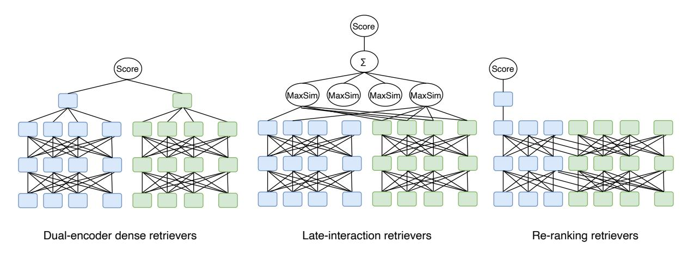
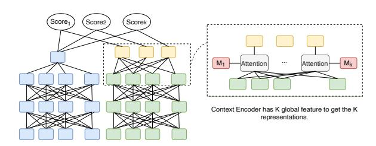
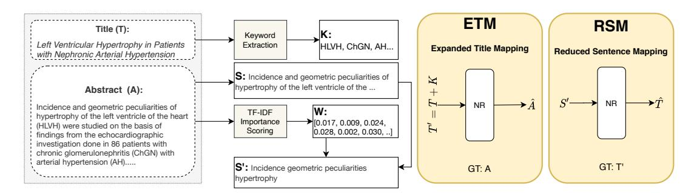
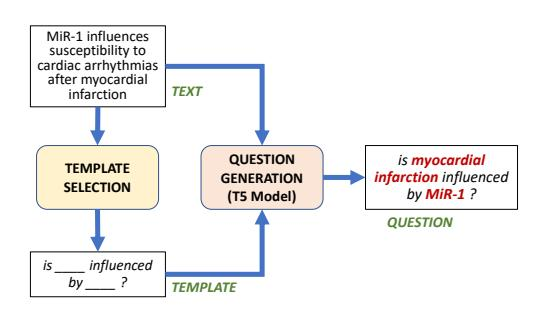
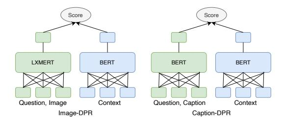

# Neural Retriever and Go Beyond: A Thesis Proposal

Man Luo Arizona State University mluo26@asu.edu

## Abstract

Information Retriever (IR) aims to find the relevant documents (e.g. snippets, passages, and articles) to a given query at large scale. IR plays an important role in many tasks such as open domain question answering and dialogue systems, where external knowledge is needed. In the past, searching algorithms based on term matching have been widely used. Recently, neural-based algorithms (termed as neural retrievers) have gained more attention which can mitigate the limitations of traditional methods. Regardless of the success achieved by neural retrievers, they still face many challenges, e.g. suffering from a small amount of training data and failing to answer simple entity-centric questions. Furthermore, most of the existing neural retrievers are developed for pure-text query. This prevents them from handling multimodality queries (i.e. the query is composed of textual description and images). This proposal has two goals. First, we introduce methods to address the abovementioned issues of neural retrievers from three angles, new model architectures, IR-oriented pretraining tasks, and generating large scale training data. Second, we identify the future research direction and propose potential corresponding solution[1](#page-0-0) .

## 1 Introduction

The convenience and advance of internet not only speed up the spread of information and knowledge, but also the generation of new information. Such phenomenon also boosts humans needs of knowledge and frequency of acquiring information, which makes Information retrieval (IR) an important task in human life. IR aims to find relevant information from a large corpus to satisfy an information need. It also plays an important role in other tasks such as open domain question

answering and open domain dialogue, where external knowledge are needed. Not only that, IR can also assistant other systems to achieve a tough goal. By providing external knowledge, IR can help numerical reasoning systems to reach the correct answer [\(Mishra et al.,](#page-7-0) [2022\)](#page-7-0) , and IR can enrich or update the knowledge of large pretrained language models (PrLMs) [\(Petroni et al.,](#page-7-1) [2019;](#page-7-1) [Sung et al.,](#page-8-0) [2021\)](#page-8-0). By filtering and selecting examples [\(Liu et al.,](#page-7-2) [2021;](#page-7-2) [Lin et al.,](#page-7-3) [2022\)](#page-7-3), IR can assist in-context learning (ICL), a process allows large PrLMs do a new task instructed by prompts and few examples with few-shot tuning [\(Gao et al.,](#page-6-0) [2021\)](#page-6-0) or without any fine-tuning [\(Brown et al.,](#page-6-1) [2020\)](#page-6-1).

IR has a long history and the first automated information retrieval system can be traced back to the 1950s. In this work, we call information retrieval methods or systems as retrievers. Traditional retrievers are mainly based on term-matching, i.e. searching for information that has an overlap with terms in the query. TF-IDF and BM25 [\(Robertson](#page-7-4) [and Zaragoza,](#page-7-4) [2009\)](#page-7-4) are two strong and efficient algorithms in this category. Although these algorithms consider the importance and frequency of terms in query and document, they suffer from term-mismatch issues and lack of semantic understanding of the query and document [\(Chang et al.,](#page-6-2) [2020\)](#page-6-2). Using neural models to represent the concatenation of query and passage is a promising way to achieve semantic matching [\(Nogueira and Cho,](#page-7-5) [2019;](#page-7-5) [Banerjee and Baral,](#page-6-3) [2020\)](#page-6-3). These methods are only applicable at small scale retrieval but not at large scale. Recently, dual-encoder architecture retrievers based on large pretrained language models (PrLMs), such as BERT [\(Devlin et al.,](#page-6-4) [2019\)](#page-6-4) have shown capability to do semantic matching and can be applicable at large scale [\(Karpukhin et al.,](#page-6-5) [2020;](#page-6-5) [Guu et al.,](#page-6-6) [2020;](#page-6-6) [Lewis et al.,](#page-7-6) [2020\)](#page-7-6). Such neural retrievers (NR) involve two PrLMs which are used to compute the vector representation of queries and documents respectively. Neural retriev-

1 Since previous work use context, documents or knowledge to represent the retrieved information given a query, we use these two terms interchangeably.

Figure 1: Architectures of three major types of retrievers. For simplicity, some lines in the figures are not drawn. Blue blocks represent the encoding for question, and the green blocks represent context or documents.

ers are trained in such a way that the documents which best answer a query maximize the dot product between the two representations. Despite the success of neural retrievers, they still face many challenges. In the next Section, we will present a brief overview of five types of retrievers and the efforts made toward building stronger retrievers. Section [3](#page-2-0) describes four limitations of current NRs and promising solutions. Section [4](#page-5-0) discusses three more research directions and potential solutions. We conclude the proposal in Section [5.](#page-5-1)

## 2 Retrievers in General

In general, the modern retrievers can be categorized in five classes (adapted from [\(Thakur et al.,](#page-8-1) [2021\)](#page-8-1)). Lexical retrievers such as BM25 are based on token-matching between two high-dimensional sparse vectors. The sparse vectors are represented based on the frequency of the terms in documents and thus does not require any annotated training data. Regardless of the simplicity of the algorithms, such methods perform well on new domains [\(Thakur et al.,](#page-8-1) [2021\)](#page-8-1). Dual-encoder dense retrievers consists of two encoders where the query encoder and context encoder generate a single dense vector representation for query and context respectively. Then the score can be computed by inner-dot product or cosine-similarity between the two representations [\(Karpukhin et al.,](#page-6-5) [2020;](#page-6-5) [Xiong et al.,](#page-8-2) [2020;](#page-8-2) [Hofstätter et al.,](#page-6-7) [2021\)](#page-6-7). Language models such as BERT [\(Devlin et al.,](#page-6-4) [2019\)](#page-6-4) are preferred choices for encoders. Sparse retrievers use sparse representations instead of dense representations for query and document [\(Dai and](#page-6-8) [Callan,](#page-6-8) [2020;](#page-6-8) [Zhao et al.,](#page-8-3) [2021;](#page-8-3) [Nogueira et al.,](#page-7-7) [2019\)](#page-7-7). Late-interaction retrievers different from

dense retrievers who use sequence-level representations of query and document, they use token-level representations for the query and passage: a bag of multiple contextualized token embeddings [\(Khat](#page-6-9)[tab and Zaharia,](#page-6-9) [2020\)](#page-6-9). The late-interactions are aggregated with sum of the max-pooling query term and a dot-product across all passage terms. Re-ranking retrievers include two stages, coarsesearch by efficient methods (e.g. BM25) and finesearch by cross-attentional re-ranking models. The re-ranking model takes input as the concatenation of the query and one candidate given by the first stage and produce a score based on the cross representation (e.g. the [CLS] token), and such process is repeated for every candidate, and finally re-rank candidates based on the generated scores.

Without changing the architectures, different efforts have been made toward learning better representation of dense vectors and improving the efficiency in terms of training resources as well as short inference time. One way to improve the representation of dense vectors is to construct proper negative instances to train a neural retriever. Inbatch negative training is a frequently used strategy to train dense retrievers, and the larger the batch size is, the better performance a dense retriever can achieve [\(Karpukhin et al.,](#page-6-5) [2020;](#page-6-5) [Qu et al.,](#page-7-8) [2021\)](#page-7-8). Using hard negative candidates is better than using random or simple in-batch negative samples, for example, [Karpukhin et al.](#page-6-5) [\(2020\)](#page-6-5) mine negative candidates by BM25 and [\(Xiong et al.,](#page-8-2) [2020\)](#page-8-2) mine negative candidates from the entire corpus using an optimized dense retriever. [Hofstätter et al.](#page-6-7) [\(2021\)](#page-6-7) selects the negative candidates from the same topic cluster, such a balanced topic aware sampling method allows the training with small

batch size and still achieves high quality dense representation. ColBert [\(Khattab and Zaharia,](#page-6-9) [2020\)](#page-6-9) is proposed to improve the efficiency of the ranking model. Since every token can be pre-indexed, it prevents inference time from getting representation of context. While Colbert is faster than singlemodel, it is slower compared to dual-models, thus, it is not suitable for retrieval at large scale. On the other hand, [Nogueira et al.](#page-7-7) [\(2019\)](#page-7-7) shortens the inference time by using sparse representation for queries. [Zhang et al.](#page-8-4) [\(2021\)](#page-8-4) integrates dense passage retriever and cross-attention ranker and use adversarial training to jointly both module.

Above methods are usually used to retrieve a document (e.g. a paragraph in Wikipedia) which can potentially contain the answer to a query. Some other retrievers directly retrieve the answer phrase (or entities) so that they can be directly used to answer questions without a reader [\(Seo et al.,](#page-7-9) [2019;](#page-7-9) [Lee et al.,](#page-6-10) [2020;](#page-6-10) [De Cao et al.,](#page-6-11) [2020,](#page-6-11) [2021\)](#page-6-12). While such methods can reduce the latency, it also increases the memory to store potential phrases which will be much larger than the number of raw documents. On the other hand, [Lee et al.](#page-6-13) [\(2021a](#page-6-13)[,b\)](#page-6-14) use generative model to generate the entities which largely reduce the memory.

## 3 Research Gaps and Solutions

In this section, we will describe multiple research gaps and the proposed methods introduced in [\(Luo](#page-7-10) [et al.,](#page-7-10) [2021a](#page-7-10)[,b,](#page-7-11) [2022b\)](#page-7-12).

Figure 2: Poly-DPR, the context encoder uses K representations to capture the information in context.

#### 3.1 Is One Dense Vector Enough to Capture Information?

Most of the neural retrievers use one dense representation for context [\(Karpukhin et al.,](#page-6-5) [2020;](#page-6-5) [Guu](#page-6-6) [et al.,](#page-6-6) [2020;](#page-6-6) [Lewis et al.,](#page-7-6) [2020\)](#page-7-6). Previous work found that one dense vector is not enough to capture enough information in the context, especially for a long context. One dense representation is

also hard to be applied to exact word matching so that it fails on entities-centric questions [\(Sci](#page-7-13)[avolino et al.,](#page-7-13) [2021\)](#page-7-13). To close the gap of existing NRs, we propose a new model called Poly-DPR which builds upon two recent developments: Poly-Encoder [\(Humeau et al.,](#page-6-15) [2020\)](#page-6-15) and Dense Passage Retriever [\(Karpukhin et al.,](#page-6-5) [2020\)](#page-6-5).

Method In Poly-DPR (see Figure [2\)](#page-2-1), the context encoder represents each *context* using K vectors and produces *query-specific vectors* for each context. In particular, the context encoder includes K global features (m1, m2, · · · , mk), which are used to extract representation v i c , ∀i ∈ {1 · · · k} by attending over all context tokens vectors.

v i c = X n w mi n hn, where (1)

(w mi 1 . . . , wmi n ) = softmax(mT i · h1, . . . , mT i · hn). (2)

After extracting K representations, a queryspecific context representation vc,q is computed by using the attention mechanism:

vc,q = X k wkv k c , where (3)

(w1, . . . , wk) = softmax(v T q · v 1 c , . . . , vT q · v k c ). (4)

To enable efficient search in inference (e.g. using MIPS [\(Shrivastava and Li,](#page-8-5) [2014\)](#page-8-5) algorithms), instead of computing query-specific context representation, we simply use the inner-dot product of each K representations with the query embeddings, and apply max pooling function to get the score.

Result We evaluate Poly-DPR on BioASQ8 [\(Nentidis et al.,](#page-7-14) [2020\)](#page-7-14) dataset to see how effective the model is. Instead of using the full corpus which has 19M PubMed articles, we construct a small corpus with 133,084 articles for efficient and comprehensive experiments purpose. We also examine the impact of changing the value of K on the performance. Furthermore, we design two context length, one is two sentences no more than 128 tokens (short) and the other one is up to 256 tokens (long). In Table [1,](#page-3-0) we have three values for K, where value 0 is the same as the original DPR. We see that in both settings, Poly-DPR is better than the original DPR, and a larger value of K leads to better performance.

Figure 3: Two IR-oriented pretraining tasks. ETM is suitable for corpus which have titles and passages. RSM is suitable for any type of corpus.

| CL K | B1    | B2    | B3    | B4    | B5    | Avg.  |
|------|-------|-------|-------|-------|-------|-------|
| 0    | 62.06 | 61.81 | 61.85 | 66.69 | 61.30 | 62.74 |
| 6    | 62.92 | 58.79 | 62.94 | 70.30 | 63.39 | 63.67 |
| 12   | 65.22 | 60.86 | 62.59 | 70.50 | 66.21 | 65.08 |
| 0    | 61.70 | 58.28 | 58.62 | 67.33 | 61.48 | 61.48 |
| 6    | 63.95 | 59.51 | 62.98 | 66.71 | 62.80 | 63.19 |
| 12   | 63.83 | 57.81 | 62.72 | 70.00 | 63.64 | 63.60 |

Table 1: Comparison among different values of K for Poly-DPR in both short and long context settings of BioASQ8 dataset using MRR metric. Bi stand for different testing batch.

### 3.2 Is IR-oriented Pretraining Important?

PrLMs are trained on general tasks, such as masked language prediction, and next sentence prediction [\(Devlin et al.,](#page-6-4) [2019\)](#page-6-4). While these pretraining tasks help the model to learn the linguistic knowledge, the model might still lack of specific skill to perform down-stream tasks, e.g. match similar words or characterize the relation between the question and answer. [Chang et al.](#page-6-2) [\(2020\)](#page-6-2) has shown that IR-oriented pretraining tasks can help model to develop basic retrieval skill. However, their proposed methods require specific document structure, e.g. the document includes external hyperlinks.

Method We propose two new IR-oriented pretraining strategies (Figure [3\)](#page-3-1). Our pre-training tasks are designed such that they can be used both for long contexts as short contexts. In Expanded Title Mapping (ETM), the model is trained to retrieve an abstract, given an extended title T ′ as a query. T ′ is obtained by extracting topm keywords from the abstract based on the TF-IDF score, denoted as K = {k1, k2, · · · , km}, and concatenating them with the title as: T ′ = {T, k1, k2, · · · , km}. The intuition behind ETM is to train the model to match the main topic of a document (keywords and title) with the entire

| CL PT    | B1    | B2    | B3    | B4    | B5    | Avg.  |
|----------|-------|-------|-------|-------|-------|-------|
| Short    | 54.48 | 50.51 | 53.8  | 59.06 | 48.71 | 53.31 |
| RSM      | 65.94 | 57.43 | 61.89 | 69.01 | 58.23 | 62.50 |
|          | 35.69 | 32.66 | 32.26 | 38.28 | 30.87 | 33.95 |
| ICT Long | 54.44 | 47.37 | 52.61 | 53.69 | 44.38 | 50.50 |
| ETM      | 56.63 | 46.63 | 52.79 | 56.97 | 49.61 | 52.53 |

Table 2: Effect of pre-training tasks (PT) on the performance of Poly-DPR with two context lengths (CL) on the BioASQ dataset.

abstract. Reduced Sentence Mapping (RSM) is designed to train the model to map a sentence from an abstract with the extended title T ′ . For a sentence S from the abstract, we first get the weight of each word W = {w1, w2, · · · , wn} by the normalization of TF-IDF scores of each word. We then reduce S to S ′ by selecting the words with the topm corresponding weights. The intuition behind a reduced sentence is to simulate a real query which usually is shorter than a sentence in an abstract.

Result We test on BioASQ dataset and use the similar experimental setting as in [§3.1,](#page-2-2) where we use both short and long context length settings. From Table [2,](#page-3-2) we see that in both settings, using our pretraining tasks are much better than without any pretraining with large margins. Furthermore, in the long context setting, we also compare our method with ICT [\(Lee et al.,](#page-6-16) [2019\)](#page-6-16) pretraining task, and we see that ETM beats than ICT on average with better performance on 4 out of 5 batches.

## 3.3 How to Obtain Enough Training Data?

While the pretraining makes language models more easily adapted to new tasks, a decent amount of domain-specific data for fine-tuning is still crucial to achieve good performance on downstream tasks [\(Howard and Ruder,](#page-6-17) [2018;](#page-6-17) [Clark et al.,](#page-6-18) [2019\)](#page-6-18). Collecting annotated data is expensive and time

Figure 4: Template-Based Question Generation.

consuming. Moreover, for some domains such as biomedical, annotation usually requires expert knowledge which makes the data collection harder [\(Tsatsaronis et al.,](#page-8-6) [2012\)](#page-8-6). To address this problem, [Ma et al.](#page-7-15) [\(2021\)](#page-7-15) uses a question generation model trained on existing large scale data to obtain synthetic question-answer pairs using domain articles. Still, the style of the generated questions are far away from the target-domain and limit the models' performance.

Method To address the domain adaptation issue, we propose a semi-supervised pipeline to generate questions using domain-templates (Figure [4\)](#page-4-0). To do so, we assume a small amount of domain annotated question-answer data is given. We first extract templates from the questions by using a name entity recognition model to identify question-specific entities and removing such entities. A template selection model is trained to select the template for a new passage. Finally a generative model (e.g. T5) is trained to generate questions conditioned on this template and a text passage. The questions generated using domain templates are much better than the previous question generation method.

Result Again, we use BioASQ8 as testbed with similar settings as previous experiments. We compare our method with an existing question generation method which extracts answer span first and then generates questions [\(Chan and Fan,](#page-6-19) [2019\)](#page-6-19). In Table [3,](#page-4-1) we compare three models trained on two generated questions as well as the training dataset of BioASQ8, and our proposed method is better than the other two especially with large gain (10%+) in long context setting.

#### 3.4 How to Retrieve Information for Multi-modality Queries?

Previous discussion focuses on retrieving relevant documents to text-only queries, while in current society, lots of information is presented by multi-

| CL PT     | FT | B1    | B2    | B3    | B4    | B5    | Avg.  |
|-----------|----|-------|-------|-------|-------|-------|-------|
| RSM Short | B  | 65.94 | 57.43 | 61.89 | 69.01 | 58.23 | 62.50 |
| RSM       | A  | 56.84 | 55.79 | 57.52 | 58.68 | 55.15 | 56.80 |
| RSM       | T  | 64.71 | 64.92 | 64.28 | 73.11 | 66.29 | 66.66 |
| ETM Long  | B  | 56.63 | 46.63 | 52.79 | 56.97 | 49.61 | 52.53 |
| ETM       | A  | 54.44 | 49.95 | 48.42 | 58.15 | 52.60 | 52.71 |
| ETM       | T  | 64.57 | 58.51 | 64.02 | 68.44 | 62.60 | 63.62 |

Table 3: Comparison of fine-tuning on different downstream training data B: BioASQ A: AnsQG and T: TempQG) on the performance of Poly-DPR with two context lengths (CL) on the BioASQ small corpus test set.

modalities such as text, image, speech, and video. Therefore, retrieving relevant documents to multimodality queries can have wide application in human's life. For instance an image of a milkshake and a complementary textual description "restaurants near me" should return potential matches of nearby restaurants serving milkshakes. In literature, OK-VQA [\(Marino et al.,](#page-7-16) [2019\)](#page-7-16) is a task that requires external knowledge to answer visual questions (i.e. the query is composed of image and text.). To find the relevant knowledge for such a query, current neural retrieval can not be directly applied since the text part in the query is not completed to understand the information needs and the model is unable to look at the image information. To address this issue, we propose three types of retrievers to handle multi-modality queries.

Method *Term-based retriever*, we first extract the image information by using a captions generation model [\(Li et al.,](#page-7-17) [2020\)](#page-7-17). Then we concatenate the question and the caption as a query and obtain knowledge by BM25. The other two multi-modality retrievers are adopted from the DPR model. *Image-DPR*: we use LXMERT [\(Tan and](#page-8-7) [Bansal,](#page-8-7) [2019\)](#page-8-7) as the question encoder, which takes image and question as input and outputs a crossmodal representation. *Caption-DPR*: similar to the strategy we use in term-based retrievers, we concatenate the question with the caption of an image as a query and use standard BERT as a query encoder to get the representation. In both *Image-DPR* and *Caption-DPR*, we use standard BERT as context encoder. Figure [5](#page-5-2) shows a comparison between these two retrievers. We find that the performance of Caption-DPR is better than Image-DPR, and the term-based retriever performs worst.

Result We evaluate three retrievers on OK-VQA dataset and use the knowledge base (with 112,724 pieces of knowledge) created in [\(Luo et al.,](#page-7-11) [2021b\)](#page-7-11)

| Model       |       |       |       |       | #     | of Retrieved |       | Knowledge |       |       |       |       |       |       |
|-------------|-------|-------|-------|-------|-------|--------------|-------|-----------|-------|-------|-------|-------|-------|-------|
|             |       | 1     |       | 5     |       | 10           |       | 20        |       | 50    |       | 80    |       | 100   |
|             | P*    | R*    | P*    | R*    | P*    | R*           | P*    | R*        | P*    | R*    | P*    | R*    | P*    | R*    |
| BM25        | 37.63 | 37.63 | 35.21 | 56.72 | 34.03 | 67.02        | 32.62 | 75.90     | 29.99 | 84.56 | 28.46 | 88.21 | 27.69 | 89.91 |
| Image-DPR   | 33.04 | 33.04 | 31.80 | 62.52 | 31.09 | 73.96        | 30.25 | 83.04     | 28.55 | 90.84 | 27.40 | 93.80 | 26.75 | 94.67 |
| Caption-DPR | 41.62 | 41.62 | 39.42 | 71.52 | 37.94 | 81.51        | 36.10 | 88.57     | 32.94 | 94.13 | 31.05 | 96.20 | 30.01 | 96.95 |

Table 4: Evaluation of three proposed visual retrievers on Precision (P) and Recall (R): Caption-DPR achieves the highest Precision and Recall on all number of retrieved knowledge.

Figure 5: Comparison of two multi-modality.

as the corpus. We retrieve 1/5/10/20/50/80/100 knowledge for each question. Table [4](#page-5-3) shows that the two neural retrievers are better than simple termbased retriever, and the Caption-DPR is the best model in all cases.

## 4 Future Work

Previous section describes multiple research problems for neural retrievers, while we provide some solutions, each problem can be further investigated. In the following, we identify more research directions and propose potential solutions.

Document Expansion Previous work [\(Nogueira](#page-7-7) [et al.,](#page-7-7) [2019\)](#page-7-7) has shown BM25 with expended documents using generated questions is an efficient way to retrieve documents. Such a method also showed good generalization across different domains [\(Thakur et al.,](#page-8-1) [2021\)](#page-8-1). The template-based question generation proposed in this work has better domain adaptation than the previous question generation method. It is interesting to see how each module in the pipeline performs on new domain without further fine-tuning. For example, can the template selection model select good templates for passage from new domain; can the question generation model generate good questions given a new template? Evaluating how our template-based question generation pipeline works when apply it to document expansion is an interesting future work.

Distinguish Between Negative Samples Many training data only provide positive candidates but not the negative candidates. Section [2](#page-1-0) summarizes existing methods to construct negative candidates; however, the negativeness of different candidates are different. For instance, if some candidates have the same topic as the queries while others do not, then in such cases, the former candidates should be less negative compared to the later. We propose to label the negativeness of candidates by using the similarity between the questions and the candidates and use such labels to train neural retrievers.

Generalization of Neural IR Previous work has shown that neural retrievers perform well on the same domain of the training data (IID) but poorly in out-of-domain [\(Thakur et al.,](#page-8-1) [2021\)](#page-8-1). In fact, generalization is a common issue in many other tasks such as image classification and question answering [\(Gokhale et al.,](#page-6-20) [2022;](#page-6-20) [Luo et al.,](#page-7-18) [2022a\)](#page-7-18). A range of methods including data augmentation, data filtering, and data debiasing methods have been proposed to improve the generalization capacity of models. Applying these methods to train neural retrievers can potentially improve their generalization capacity. Prompting or instruction learning has shown good generalization performance on many NLP tasks [\(Mishra et al.,](#page-7-19) [2021\)](#page-7-19) or in lowresource domain [\(Parmar et al.,](#page-7-20) [2022\)](#page-7-20), yet applying such method on retrieval task is less investigated, and it will be an interesting direction to explore.

## 5 Conclusion

In this proposal, we focus on an important task: information retrieval. From word-matching retrievers to neural retrievers, many efforts have been made toward building stronger retrievers that can achieve high recall and precision. We summarize five types of modern retrievers and methods to address some existing issues. While the development in this field is exciting, retrievers still have a long journey to go. We hope this proposal can shed some light on building a more capable retriever in future.

- References Pratyay Banerjee and Chitta Baral. 2020. Knowledge fusion and semantic knowledge ranking for open domain question answering. *ArXiv*, abs/2004.03101. Tom Brown, Benjamin Mann, Nick Ryder, Melanie Subbiah, Jared D Kaplan, Prafulla Dhariwal, Arvind Neelakantan, Pranav Shyam, Girish Sastry, Amanda Askell, et al. 2020. Language models are few-shot learners. *Advances in neural information processing systems*, 33:1877–1901. Ying-Hong Chan and Yao-Chung Fan. 2019. [A recur](https://doi.org/10.18653/v1/D19-5821)[rent BERT-based model for question generation.](https://doi.org/10.18653/v1/D19-5821) In *Proceedings of the 2nd Workshop on Machine Reading for Question Answering*, pages 154–162. Association for Computational Linguistics. Wei-Cheng Chang, F. Yu, Yin-Wen Chang, Yiming Yang, and S. Kumar. 2020. Pre-training tasks for embedding-based large-scale retrieval. *ArXiv*, abs/2002.03932. Kevin Clark, Minh-Thang Luong, Quoc V Le, and Christopher D Manning. 2019. Electra: Pre-training text encoders as discriminators rather than generators. In *International Conference on Learning Representations*. Zhuyun Dai and Jamie Callan. 2020. Context-aware term weighting for first stage passage retrieval. In *Proceedings of the 43rd International ACM SIGIR conference on research and development in Information Retrieval*, pages 1533–1536. Nicola De Cao, Gautier Izacard, Sebastian Riedel, and Fabio Petroni. 2020. Autoregressive entity retrieval. In *International Conference on Learning Representations*. Nicola De Cao, Ledell Wu, Kashyap Popat, Mikel Artetxe, Naman Goyal, Mikhail Plekhanov, Luke Zettlemoyer, Nicola Cancedda, Sebastian Riedel, and Fabio Petroni. 2021. Multilingual autoregressive entity linking. *arXiv preprint arXiv:2103.12528*. Jacob Devlin, Ming-Wei Chang, Kenton Lee, and Kristina Toutanova. 2019. [BERT: Pre-training of](https://doi.org/10.18653/v1/N19-1423) [deep bidirectional transformers for language under](https://doi.org/10.18653/v1/N19-1423)[standing.](https://doi.org/10.18653/v1/N19-1423) In *Proceedings of the 2019 Conference of the North American Chapter of the Association for Computational Linguistics: Human Language Technologies, Volume 1 (Long and Short Papers)*, pages 4171–4186, Minneapolis, Minnesota. Association for Computational Linguistics. Tianyu Gao, Adam Fisch, and Danqi Chen. 2021. Making pre-trained language models better few-shot learners. In *Proceedings of the 59th Annual Meeting of the Association for Computational Linguistics and the 11th International Joint Conference on Natural Language Processing (Volume 1: Long Papers)*, pages 3816–3830. Tejas Gokhale, Swaroop Mishra, Man Luo, Bhavdeep Singh Sachdeva, and Chitta Baral. 2022. Generalized but not robust? comparing the effects of data modification methods on out-of-domain generalization and adversarial robustness. *arXiv preprint arXiv:2203.07653*. Kelvin Guu, Kenton Lee, Z. Tung, Panupong Pasupat, and Ming-Wei Chang. 2020. Realm: Retrievalaugmented language model pre-training. *ArXiv*, abs/2002.08909. Sebastian Hofstätter, Sheng-Chieh Lin, Jheng-Hong Yang, Jimmy Lin, and Allan Hanbury. 2021. Efficiently teaching an effective dense retriever with balanced topic aware sampling. In *Proceedings of the 44th International ACM SIGIR Conference on Research and Development in Information Retrieval*, pages 113–122. Jeremy Howard and Sebastian Ruder. 2018. Universal language model fine-tuning for text classification. In *Proceedings of the 56th Annual Meeting of the Association for Computational Linguistics (Volume 1: Long Papers)*, pages 328–339. Samuel Humeau, Kurt Shuster, Marie-Anne Lachaux, and J. Weston. 2020. Poly-encoders: Architectures and pre-training strategies for fast and accurate multisentence scoring. In *ICLR*.
  - V. Karpukhin, Barlas Oguz, Sewon Min, Patrick Lewis, ˘ Ledell Yu Wu, Sergey Edunov, Danqi Chen, and Wen tau Yih. 2020. Dense passage retrieval for opendomain question answering. In *EMNLP*. Omar Khattab and Matei Zaharia. 2020. Colbert: Efficient and effective passage search via contextualized late interaction over bert. In *Proceedings of the 43rd International ACM SIGIR conference on research and development in Information Retrieval*, pages 39–
  - 48. Jinhyuk Lee, Minjoon Seo, Hannaneh Hajishirzi, and Jaewoo Kang. 2020. Contextualized sparse representations for real-time open-domain question answering. In *Proceedings of the 58th Annual Meeting of the Association for Computational Linguistics*, pages 912–919. Jinhyuk Lee, Mujeen Sung, Jaewoo Kang, and Danqi Chen. 2021a. Learning dense representations of phrases at scale. In *Association for Computational Linguistics (ACL)*. Jinhyuk Lee, Alexander Wettig, and Danqi Chen. 2021b. Phrase retrieval learns passage retrieval, too. In *Conference on Empirical Methods in Natural Language Processing (EMNLP)*. Kenton Lee, Ming-Wei Chang, and Kristina Toutanova. 2019. Latent retrieval for weakly supervised open domain question answering. *ArXiv*, abs/1906.00300.

- Patrick Lewis, Ethan Perez, Aleksandara Piktus, Fabio Petroni, Vladimir Karpukhin, Naman Goyal, Heinrich Kuttler, M. Lewis, Wen tau Yih, Tim Rocktäschel, Sebastian Riedel, and Douwe Kiela. 2020. Retrieval-augmented generation for knowledgeintensive nlp tasks. *ArXiv*, abs/2005.11401. Xiujun Li, Xi Yin, Chunyuan Li, Pengchuan Zhang, Xiaowei Hu, Lei Zhang, Lijuan Wang, Houdong Hu, Li Dong, Furu Wei, et al. 2020. Oscar: Objectsemantics aligned pre-training for vision-language tasks. In *European Conference on Computer Vision*, pages 121–137. Springer. Bill Yuchen Lin, Kangmin Tan, Chris Miller, Beiwen Tian, and Xiang Ren. 2022. Unsupervised crosstask generalization via retrieval augmentation. *arXiv preprint arXiv:2204.07937*. Jiachang Liu, Dinghan Shen, Yizhe Zhang, Bill Dolan, Lawrence Carin, and Weizhu Chen. 2021. What makes good in-context examples for gpt-3? *arXiv preprint arXiv:2101.06804*. Man Luo, Kazuma Hashimoto, Semih Yavuz, Zhiwei Liu, Chitta Baral, and Yingbo Zhou. 2022a. Choose your qa model wisely: A systematic study of generative and extractive readers for question answering. In *Proceedings of the 1st Workshop on Semiparametric Methods in NLP: Decoupling Logic from Knowledge*, pages 7–22. Man Luo, Arindam Mitra, Tejas Gokhale, and Chitta Baral. 2022b. Improving biomedical information retrieval with neural retrievers. *arXiv preprint arXiv:2201.07745*. Man Luo, Shailaja Keyur Sampat, Riley Tallman, Yankai Zeng, Manuha Vancha, Akarshan Sajja, and Chitta Baral. 2021a. 'just because you are right, doesn't mean i am wrong': Overcoming a bottleneck in development and evaluation of open-ended vqa tasks. In *Proceedings of the 16th Conference of the European Chapter of the Association for Computational Linguistics: Main Volume*, pages 2766–2771. Man Luo, Yankai Zeng, Pratyay Banerjee, and Chitta Baral. 2021b. Weakly-supervised visual-retrieverreader for knowledge-based question answering. In *Proceedings of the 2021 Conference on Empirical Methods in Natural Language Processing*, pages 6417–6431. Ji Ma, Ivan Korotkov, Yinfei Yang, Keith Hall, and Ryan McDonald. 2021. Zero-shot neural passage retrieval via domain-targeted synthetic question generation. In *Proceedings of the 16th Conference of the European Chapter of the Association for Computational Linguistics: Main Volume*, pages 1075–1088. Kenneth Marino, Mohammad Rastegari, Ali Farhadi, and Roozbeh Mottaghi. 2019. Ok-vqa: A visual question answering benchmark requiring external knowledge. In *Conference on Computer Vision and Pattern Recognition (CVPR)*. Swaroop Mishra, Daniel Khashabi, Chitta Baral, and Hannaneh Hajishirzi. 2021. Cross-task generalization via natural language crowdsourcing instructions. *arXiv preprint arXiv:2104.08773*. Swaroop Mishra, Arindam Mitra, Neeraj Varshney, Bhavdeep Sachdeva, Peter Clark, Chitta Baral, and Ashwin Kalyan. 2022. Numglue: A suite of fundamental yet challenging mathematical reasoning tasks. *arXiv preprint arXiv:2204.05660*. Anastasios Nentidis, Anastasia Krithara, Konstantinos Bougiatiotis, Martin Krallinger, Carlos Rodriguez-Penagos, Marta Villegas, and Georgios Paliouras. 2020. Overview of bioasq 2020: The eighth bioasq challenge on large-scale biomedical semantic indexing and question answering. In *International Conference of the Cross-Language Evaluation Forum for European Languages*, pages 194–214. Springer. Rodrigo Nogueira and Kyunghyun Cho. 2019. Passage re-ranking with bert. *ArXiv*, abs/1901.04085. Rodrigo Nogueira, Jimmy Lin, and AI Epistemic. 2019. From doc2query to doctttttquery. *Online preprint*, 6. Mihir Parmar, Swaroop Mishra, Mirali Purohit, Man Luo, M Hassan Murad, and Chitta Baral. 2022. Inboxbart: Get instructions into biomedical multi-task learning. *arXiv preprint arXiv:2204.07600*. Fabio Petroni, Tim Rocktäschel, Sebastian Riedel, Patrick Lewis, Anton Bakhtin, Yuxiang Wu, and Alexander Miller. 2019. [Language models as knowl](https://doi.org/10.18653/v1/D19-1250)[edge bases?](https://doi.org/10.18653/v1/D19-1250) In *Proceedings of the 2019 Conference on Empirical Methods in Natural Language Processing and the 9th International Joint Conference on Natural Language Processing (EMNLP-IJCNLP)*, pages 2463–2473, Hong Kong, China. Association for Computational Linguistics. Yingqi Qu, Yuchen Ding, Jing Liu, Kai Liu, Ruiyang Ren, Wayne Xin Zhao, Daxiang Dong, Hua Wu, and Haifeng Wang. 2021. Rocketqa: An optimized training approach to dense passage retrieval for opendomain question answering. In *Proceedings of the 2021 Conference of the North American Chapter of the Association for Computational Linguistics: Human Language Technologies*, pages 5835–5847.
  - S. Robertson and H. Zaragoza. 2009. The probabilistic relevance framework: Bm25 and beyond. *Found. Trends Inf. Retr.*, 3:333–389. Christopher Sciavolino, Zexuan Zhong, Jinhyuk Lee, and Danqi Chen. 2021. Simple entity-centric questions challenge dense retrievers. In *Proceedings of the 2021 Conference on Empirical Methods in Natural Language Processing*, pages 6138–6148. Minjoon Seo, Jinhyuk Lee, Tom Kwiatkowski, Ankur Parikh, Ali Farhadi, and Hannaneh Hajishirzi. 2019. Real-time open-domain question answering with dense-sparse phrase index. In *Proceedings of the 57th Annual Meeting of the Association for Computational Linguistics*, pages 4430–4441.

Anshumali Shrivastava and P. Li. 2014. Asymmetric lsh (alsh) for sublinear time maximum inner product search (mips). *ArXiv*, abs/1405.5869. Mujeen Sung, Jinhyuk Lee, Sean Yi, Minji Jeon, Sungdong Kim, and Jaewoo Kang. 2021. [Can language](https://doi.org/10.18653/v1/2021.emnlp-main.388) [models be biomedical knowledge bases?](https://doi.org/10.18653/v1/2021.emnlp-main.388) In *Proceedings of the 2021 Conference on Empirical Methods in Natural Language Processing*, pages 4723–4734, Online and Punta Cana, Dominican Republic. Association for Computational Linguistics. Hao Tan and Mohit Bansal. 2019. [LXMERT: Learning](https://doi.org/10.18653/v1/D19-1514) [cross-modality encoder representations from trans](https://doi.org/10.18653/v1/D19-1514)[formers.](https://doi.org/10.18653/v1/D19-1514) In *Proceedings of the 2019 Conference on Empirical Methods in Natural Language Processing and the 9th International Joint Conference on Natural Language Processing (EMNLP-IJCNLP)*, pages 5100–5111, Hong Kong, China. Association for Computational Linguistics. Nandan Thakur, N. Reimers, Andreas Ruckl'e, Abhishek Srivastava, and Iryna Gurevych. 2021. Beir: A heterogenous benchmark for zero-shot evaluation of information retrieval models. *ArXiv*, abs/2104.08663. George Tsatsaronis, Michael Schroeder, Georgios Paliouras, Yannis Almirantis, Ion Androutsopoulos, Eric Gaussier, Patrick Gallinari, Thierry Artieres, Michael R Alvers, Matthias Zschunke, et al. 2012. Bioasq: A challenge on large-scale biomedical semantic indexing and question answering. In *AAAI fall symposium: Information retrieval and knowledge discovery in biomedical text*. Citeseer. Lee Xiong, Chenyan Xiong, Ye Li, Kwok-Fung Tang, Jialin Liu, Paul N Bennett, Junaid Ahmed, and Arnold Overwijk. 2020. Approximate nearest neighbor negative contrastive learning for dense text retrieval. In *International Conference on Learning Representations*. Hang Zhang, Yeyun Gong, Yelong Shen, Jiancheng Lv, Nan Duan, and Weizhu Chen. 2021. Adversarial retriever-ranker for dense text retrieval. *arXiv preprint arXiv:2110.03611*. Tiancheng Zhao, Xiaopeng Lu, and Kyusong Lee. 2021. Sparta: Efficient open-domain question answering via sparse transformer matching retrieval. In *Proceedings of the 2021 Conference of the North American Chapter of the Association for Computational Linguistics: Human Language Technologies*, pages 565–575.