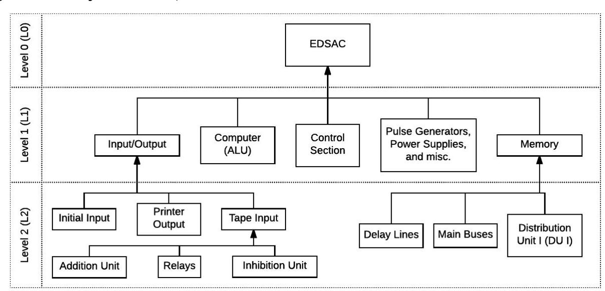
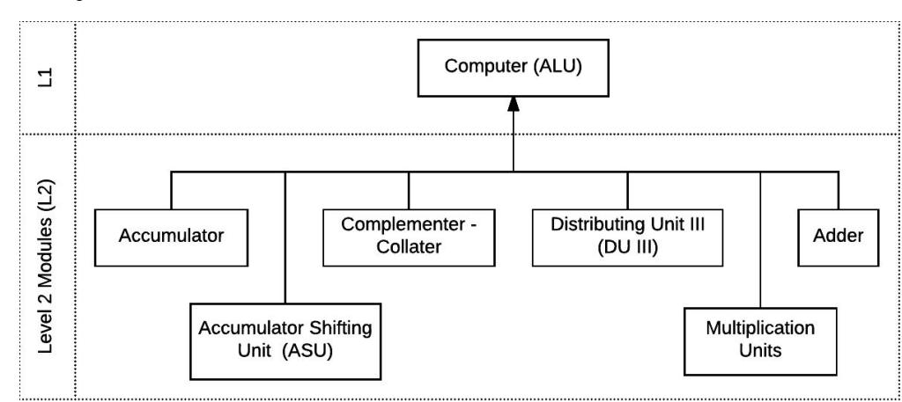
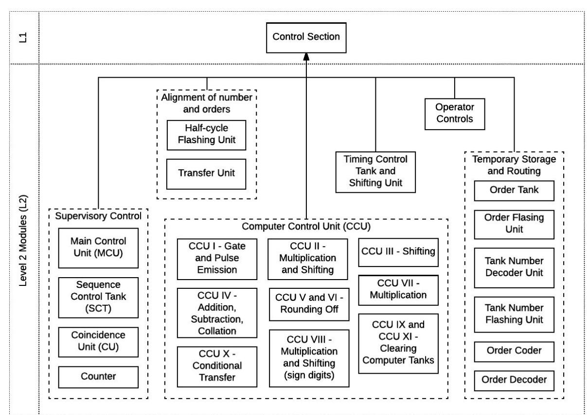
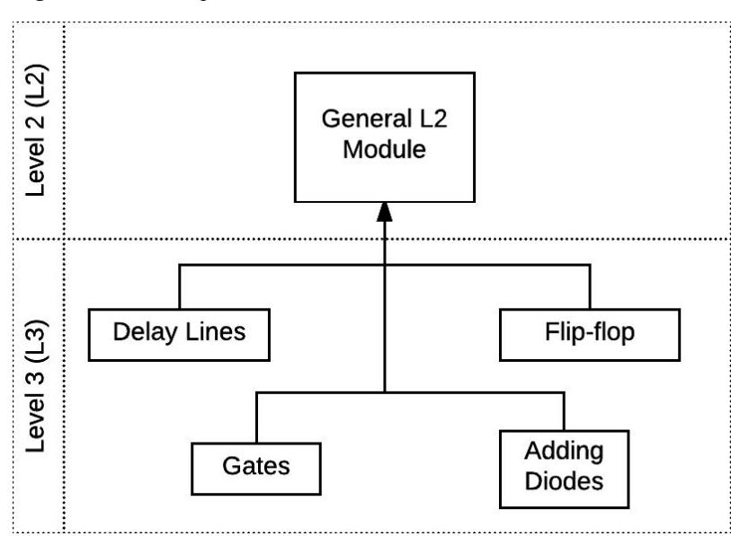

# **EDSAC Museum on FPGA**

Hatim Kanchwala

Undergraduate, Dept of Electrical Engineering, Indian Institute of Technology Patna

[hatim@hatimak.me](mailto:hatim@hatimak.me), [hatim.ee14@iitp.ac.in](mailto:hatim.ee14@iitp.ac.in)

### **1. Abstract**

Electronic Delay Storage Automatic Calculator (EDSAC) is a first generation British computer commissioned in 1949. It was built by Maurice Wilkes and his team at the University of Cambridge Mathematical Laboratory. EDSAC is the world's first stored-program computer.

The project's goal is to reimagine the EDSAC on modern hardware, with the ultimate objective to make the historic computer accessible to and reproducible by a new generation of computer architects and engineers. Investigating the evolution of computing techniques gives architects and engineers context to modern concepts of computer architecture, organisation and design.

The historic computer, complete with all its subsystems, will be replicated on an FPGA, using Verilog HDL, capable of accepting and executing all EDSAC Orders. To emulate the ancient I/O, various "I/O flavours" will be designed to interface with the FPGA board, via a standardised communication protocol. Users can choose, extend and even add new I/O flavours. An assembler utility will be built in Python, which users can utilise to debug and build their code for EDSAC, which can be then loaded onto the FPGA for execution.

# **2. EDSAC Details**

### 2.1. Operational Details of the Machine

EDSAC ran at a clock of 500 kHz with a pulse interval (p.i.) of 2.0µs, each pulse being 0.9µs wide, and an amplitude of 18V. It had a memory capacity equivalent to 512 10-decimal numbers and was later increased to 1024.

The duration of 36 pulse intervals, 72µs, is termed as a minor cycle (M/C), while the duration of 16 minor cycles, 1.15ms, is termed a major cycle. In any pulse train, the LSB occupies the first pulse, and the MSB the last - so basically numbers are read from right to left. Orders are 18 p.i. long whereas numbers are either short (5-digit decimal number equivalent to 18 p.i.) or long (10-digit decimal number equivalent to 36 p.i.).

Orders and numbers were input via punch tape (numbers input in decimal form and translation to binary carried out automatically by machine). Output, in decimal notation, was printed using a teleprinter.

### 2.2. Logic Hierarchy Trees

The following diagrams illustrate the hierarchical organisation of modules making up the EDSAC. The hierarchy can be split into 3 stacked pyramid "levels" -

- 1. Level 1 (L1) EDSAC Subsystems
- 2. Level 2 (L2) Logic Modules
- 3. Level 3 (L3) "Atomic" Modules

The EDSAC itself sits at the top of the pyramid at Level 0. The placement of these blocks and their associations shown are based on their input and output nature. The structure is derived from the original report where the author discusses L2 modules.

**Fig. 1: Hierarchy Tree for L0, L1 and L2**

L2 Logic Modules for I/O and Memory subsystems are shown.

**Fig. 2: Hierarchy Tree for L1 and L2 of ALU**

What is now well known as ALU was called "computer" in the original report. Some L2 modules here can be further split into sub-modules.

The control section is the most complex subsystem of EDSAC, as might be evident from the above figure.

**Fig. 4: Hierarchy Tree for L2 and L3**

A combination of a number of L3 "atomic" modules are used to build a general L2 Module. Of all the atomic modules, the delay line is the most fundamental to EDSAC.

### 2.3. Module Details

Detailed notes on modules are presented in the following sections. They have been prepared based on the original report, series of films uploaded on YouTube by TNMOC, and correspondence with Mr Bill Purvis of the EDSAC Replica Project Team (Computer Conservation Society). Along with notes, ideas on how to implement these modules on modern hardware are discussed.

Please refer to figures in § 3.2 to derive maximum comprehension of following discussion.

### 2.3.1. Level 3 "Atomic" Modules

The following section will be longer as compared to other module descriptions because L3 modules are basic building blocks of the machine. Hence significant time was spent studying them as it is advantageous to have a clear understanding in terms of both the original machine and the FPGA replica.

#### **2.3.1.1. Delay Lines**

The original machine used mercury delay lines to store data, utilising the acoustic properties of mercury. 16 pulse trains each of 1 minor cycle duration were in continuous circulation in the tank. Effectively, each pulse train was delayed by 16 minor cycles. Mercury was hazardous and demanded significant maintenance. The original machine also utilised phantastron circuits for smaller delays. The reconstructed machine will be using Nickel delay lines.

In the FPGA-Verilog implementation, shift registers can be used to model the memory. The D Flip-flop is a standard delay element in digital circuits today, and a series of those connected in a circular topology will allow circulation of bits. A latch at the input of this module would control the admission of pulse(s).

#### **2.3.1.2. Gates**

As described in the original report, these were diodes with a common anode load resistor. From circuit and functional standpoints, this element can be immediately identified as an AND gate as we know it today.

The implementation will be straightforward.

#### **2.3.1.3. Flip-flops**

These were used to maintain state for a short time. This element was identified as a resettable monostable in modern terms. The original machine also had a cathode follower at the output to take a negative emf from the anode.

In the implementation, use of D Flip-flop will serve the purpose.

The original machine had a single diode with anode connected to input leads and cathode connected through load resistor to ground. This arrangement can be immediately identified as modern OR gate.

The implementation will be straightforward.

#### **2.3.1.5. Reverser**

As the name suggests, the function of this element is to interchange 0's and 1's. Immediately, this can be identified as a NOT gate as we know it today. This element is described in the report along with Gates, but its widespread use in the machine and resemblance to NOT gate warranted a separate mention.

The implementation will be straightforward.

### 2.3.2. Level 2 Logic Modules

The following is a list of all Level 2 Logic Modules identified as of preparing this proposal. Based on study of original report, the following list defines the functional role of the modules. It should be noted here that logic diagrams for only a few of the following units were included in the original report.

Please refer to figures in § 3.2 to derive maximum comprehension of following discussion.

#### 1. **Initial Input**

These are Orders that are required to load and store input programs into Memory. It can be thought of as bootstrap loader, in modern terms.

#### 2. **Printer Output**

The original machine used a Creed model 7 teleprinter operating at 6 ⅔ characters per second speed to print the result of the program.

Please check § 4.3 for I/O implementation details.

#### 3. **Tape Input**

A 5-track paper tape reader operating at speed of 5 character per second was used. Data read from input first sets relays to represent data in static electrical form. Addition Unit converts data in a suitable form for transfer to Memory. The instructions are from the punch tape are read one by one.

Please check § 4.3 for I/O implementation details.

#### 4. **Memory tanks**

Apart from Delay Lines, some auxiliary components are also involved here, chief of them are Main Buses and Distributing Unit I (DU I). DU I provides routes to and from Memory Tank specified by Tank Number Decoder.

Consists of two tanks, Accumulator I (36 bits) and Accumulator II (32 bits), of 1 M/C and (1 M/C - 4 p.i.) delay respectively. Capacity to store 67 bits to accommodate a result of a multiplication operation. The Accumulator, ASU II, Adder and Complementer - Collater form a closed circulating system. The output from Accumulator to ASU II, Complementer - Collater and Adder comes from the longer 36 bit tank, Accumulator I. The effective delay in this phase is of (1 M/C + 4 p.i.). The output from this phase is fed into the shorter 32 bit tank, Accumulator II, bringing the total delay to 2 M/C.

#### 6. **Accumulator Shift Unit (ASU)**

This Unit comprises two sub units -

- a. ASU I responsible for generating proper control signals.
- b. ASU II carries out the actual shifting based on control signals received from ASU I, causes delay of 2 p.i.

#### 7. **Complementer - Collater**

Collation is simply bitwise AND. Comprises an open gate which is immediately replaced by a reverser upon passage of first pulse. EDSAC uses 2's complement form to store complements. This is noted to be a complex module that might require tweaks with delays in order to be functional.

#### 8. **Distribution Unit III (DU III)**

#### 9. **Adder**

Causes delay of 2 p.i. This is pretty straightforward. A quick Verilog module was hacked together based on original logic diagram, and it worked reasonably well.

#### 10. **Multiplication Units**

Operation involves repeated shifting. These operations are controlled by pulses emitted from the Timing Control Tank and Shifting Unit.

#### 11. **Half-cycle Flashing Unit**

Stores Order data specifying position in the M/C. This data is necessary for the CU to establish coincidence.

#### 12. **Transfer Unit**

Ensures alignment by introducing suitable delay of ½ M/C.

### 13. **Main Control Unit (MCU)**

Provides necessary routes and stimulating pulses to SCT, CU, Half-cycle Flashing Unit and Tank Number Units. This is a complex unit.

### 14. **Sequence Control Tank (SCT)**

This holds Memory position of the next order to be carried out and hence seems like the "Instruction Pointer" in modern terms.

Its purpose is to emit a gating emf when "coincidence" is established in the Order Tank or the SCT. This Unit is essential to the sequential access memory architecture of the EDSAC.

#### 16. **Counter**

This runs independently of everything and might seem to be what modern computer design theory describes as "Program Counter".

#### 17. **Computer Control Unit**

This is arguably the most complex unit within the control section. It is spread across several panels in the original machine. Among other roles, it is responsible for generating gating emf, rounding-off orders, clearing computer tanks and performing conditional transfer.

#### 18. **Timing Control Tank and Shifting Unit**

Responsible for generating series of pulses that are requisites for multiply and shift functions.

#### 19. **Order Tank**

In modern computer architecture terms, this can be identified as the "Instruction Register". It's a short tank with ½ M/C delay that holds the Order to establish coincidence and setup appropriate flashing units.

#### 20. **Order Flashing Unit**

#### 21. **Tank Number Decoder Unit**

Routes coincidence emf to appropriate tanks.

#### 22. **Tank Number Flashing Unit**

Selects and provides route to appropriate Memory Tank.

#### 23. **Order Decoder**

As the name might suggest, this is part of the Instruction Decoding phase in modern computer architecture terms.

#### 24. **Order Coder**

This also seems to be a part of Instruction Decoding phase. Consists of series of adding diodes (OR gates in modern terms) and cathode followers to generate gating emf from Order Decoder output.

Having coherent elucidation of functionality of each of the logic blocks making up the EDSAC will profoundly aid development and testing of modules implemented in Verilog, especially so in the absence of a majority of original logic diagrams.

### **3. Work Details**

### 3.1. Structure and Milestones

The entire project will be hosted on GitHub, under the [hatimak](https://github.com/hatimak) [GitHub](https://github.com/hatimak) handle. Collaborators, if any, will have to write and initiate a pull request in order to contribute. The entire source code and any accompanying documentation created as part of this project, including but not limited to logic diagrams, wiki, circuit diagrams, PCB designs, tutorials, and so on, will be released under the CERN Open Hardware License v1.2.

The modules that will be coded in Verilog have been discussed in § 3. This subsection will focus on the order in which these modules will be coded, the coding work itself and the general working structure.

### 3.1.1. Milestones

Up till now a top-down approach was pursued in developing the work breakdown. The outcome of that approach was a list logic blocks that make up the original machine.

Now, for the actual coding part, it will be suitable to follow a bottom-up divide-and-conquer approach. Coding will begin from L3 atomic modules, then L2 logic modules and finally L1 subsystems. It might be clear by now that the Hierarchy Trees from § 3.2 are a natural set of milestones for this project. Clearly, work will have been successfully completed when all major and minor milestones are attained.

#### **Milestone #0: Study EDSAC**

While this is not a tangible logic block, it is undoubtedly the most important prerequisite. Since the practical coding work on the FPGA is bound to reveal mysteries of EDSAC that theory cannot possibly cover, the endeavour to study EDSAC can be exhaustively covered only after the project concludes.

#### **Milestone #1: L3 Atomic Blocks**

This milestone will have 1 mini-milestone - delay lines, flip-flop, adding diodes and gates (see Fig. 4). This is expected to be the shortest milestone to achieve.

#### **Milestone #2: Memory**

This milestone is expected to have 3 mini-milestones corresponding to 3 L2 logic blocks (see Fig. 1).

#### **Milestone #3: Computer (ALU)**

This milestone is expected to have 6 mini-milestones corresponding to 6 L2 logic blocks (see Fig. 2).

This milestone is expected to have 22 mini-milestones corresponding to 22 L2 logic blocks (See Fig. 3; Operator Controls is omitted in the count as it is included in #5 below as part of I/O flavours).

#### **Milestone #5: Input/Output**

This milestone is expected to have 6 mini-milestones corresponding to 4 L2 logic blocks (see Fig. 1), and 2 I/O flavours (see § 4.3.3).

#### **Milestone #6: Bringing it all together**

This is the final milestone where all the work is brought together, corner cases are ironed out, the entire system is rigorously tested as a whole, and is made worthy for submission.

Documentation is a crucial slice of the whole project and will, therefore, be an intrinsic part of each mini-milestone. This arrangement is favourable than dealing with documentation as an isolated chunk (see § 4.4 for more details).

### 3.1.2. Guidelines

To extract maximum productivity of work and mitigate unforeseen exceptions even before they have arisen, it will be beneficial to adopt the following guidelines.

- Testing and documentation of each module will be an integral part of every mini-milestone. Each module will be simulated and tested independently before merging with main repository.
- Work will be broken down into independent chunks, with minimal inter-dependency. This is to ensure that each chunk can be dealt with in parallel, and any snag that may arise does not obstruct and block other portions of work.
- Report of work will be shared with mentors regularly, and over public channels wherever possible.

### 3.2 Assembler

A provision must be made in case a user wants to write their own code and execute it on the FPGA. Changing the code produced as part of this project in order to suit their immediate needs is not a very elegant approach. Such an arguably daunting exercise might even turn them away from trying out the replica on FPGA!

In order to rectify that, an "assembler" will be implemented. This utility will be supplied as part of this project. The user can write their code for EDSAC and run the assembler against it. Any errors in the code will be pointed out. Once the proper code is supplied to the assembler, the user can take either of two routes.

- 1. The assembler produces the proper source files that are programmed onto the FPGA. This arrangement is like one-time program, where the FPGA needs to be reprogrammed every time the code is changed.

- 2. The assembler will produce files appropriate to utilise with the user-chose I/O flavour (see § 4.3.3). This arrangement is closer to replicating the original experience - the FPGA board is like an engine, with the input coming from and output going to the I/O flavour.

The assembler will be written in Python and will expose the above described functionality over a command-line interface (CLI).

### 3.3. I/O Model

### 3.3.1. Motivation

In order to make the project accessible to and reproducible by a wide community, it is preferable to have a versatile I/O model. The FPGA board is a fundamental requirement in order to reproduce this work, but any additional hardware, especially one that is costly, will impose a severe limitation. So, in order to circumvent this obstacle, a standardised external communication protocol will be developed and implemented. This design approach will expose a consistent I/O interface, which means that the exact combination of hardware to use for I/O is a user choice depending on accessibility/availability of components at her/his end.

### 3.3.2. Standardised External Communication Protocol Draft Specification

EDSAC accepts 4 kinds of input -

- 1. Program input (Orders and numbers), originally coming in through a 5-track paper tape-reader
- 2. Controls
  - a. Start
  - b. Stop
  - c. Reset
  - d. Clear
  - e. EP (execute single instruction)
- 3. Rotary switch to cycle through long tanks (32 long tanks each tank holding 32 words displayed on a CRT monitor)
- 4. Rotary dial, numbers from 0 to 9 (to input single decimal number and used in post-mortem routines)

EDSAC produces 3 kinds of output -

- 1. Program output, originally through a Creed model 7 teleprinter
- 2. CRT display (to display content of Tanks)
  - a. Accumulator
  - b. Multiplier
  - c. Multiplicand
  - d. Counter
  - e. Sequence Control Tank
  - f. Order Tank
  - g. Long Tank (single long tank visible at once, governed by rotary switch)

All communication will occur over SPI protocol, which is widely supported, relatively straightforward to implement, and is suitable for low-distance communication. SPI easily allows transmission of variable length data.

The input hardware will be the SPI master and the input receiver block on the FPGA will be the SPI slave. In case of output, the output transmitter on the FPGA board will act as the SPI master and the output hardware will be the SPI slave. The FPGA will provide the clock pulses for the synchronous communication, in both input and output cases.

The communication runs in full duplex mode and the input and output blocks on the FPGA board are separate. Input and output transmission will occur in two stages. The start or end of any stage is marked by a change in the Slave Select (standard SPI signal, also known as Chip Select) signal (active low). The splitting into two stages is to allow for the FPGA board to perform any additional setup or change clock speed, if required. The minimum time separation between the two stages will be determined later based on practical implementation.

In the first stage, the input from the external hardware will identify the exact type and/or subtype of the input. In the second stage, following the first, the input hardware will move actual input into the FPGA board.

#### A generic first stage input will look like,

bbxxxxx where bb chooses the type of input and xxxxx chooses uniquely any of the subtype). For instance, 0000000 chooses program input (it has no subtype). 0110000 chooses the Stop control. 1000010 chooses the rotary switch to display the 3 rd long tank.

In the first stage, the output from the FPGA board into the external hardware will identify the exact type and/or subtype of the output. In the second stage, following the first, the FPGA board will move the actual output into the external hardware.

#### A generic output will look like,

For the first stage, bbxxx where bb chooses the type of output and xxx is used to choose the subtype of CRT display type output. For instance, 00000 chooses program output. 01010 choose Multiplicand. For the second stage, all data is driven out of the FPGA board with the LSB leading.

### 3.3.3. I/O Flavours

Now that the data going in and coming out of the FPGA board is standardised, we have the freedom of choosing a variety of hardware combinations to realise I/O. These variations in I/O hardware will be called "I/O Flavours". A user can choose any flavour and rest assured that it will work, and even better, the user can develop their own flavour to suit their taste (all thanks to the standardisation).

The following flavours will be implemented during the work period. It can be noted that the flavours discussed hence use components that are easily available and are also very cost-effective.

The Raspberry Pi will be used to communicate with the FPGA board (over the internal RPi SPI bus). The assembler discussed in § 4.2 will be launched in an interactive shell mode. Control commands, rotary dial and switch inputs can be supplied to the FPGA board interactively from the shell itself, and the output will be simultaneously displayed on the screen. In order to make the interface user-friendly, the ncurses library will be used. This makes for a delightful text-based GUI-like terminal-independent user interface. The proposed implementation will work irrespective of any of the widely chosen strategies to operate an RPi - connecting monitor and keyboard, SSH, VNC, and so on.

#### **3.3.3.2. The Teensy Flavour**

The Teensy is a tiny affordable Arduino-compatible microcontroller development board. The physical design of Teensy makes it naturally suitable for use with solderless breadboards. The Teensy will be placed on breadboard along with an array of LEDs and push buttons. The LEDs will display contents of Counter, Long Tanks, SCT, Order Tank, Accumulator and Multiplication Registers (all 6 monitor tubes as on EDSAC). The push buttons are for Start, Stop, Clear, Reset and EP controls, and for rotary dial and rotary cycle switch. The Teensy will drive this array of LEDs and push buttons and will be connected to the FPGA board via on-board SPI pins. The assembler discussed in § 4.2 will produce files that can be programmed onto the Teensy using the open-source Teensy Loader application available from developers of Teensy.

Realisation of this I/O flavour is subject to time constraint (see § 5.3).

### 3.4. Documentation and Work Conclusion

In keeping with the ultimate objective of making the work accessible and easily reproducible, it is hugely advantageous to invest effort and time into documentation, and into publishing tutorials on widely accessible electronics and DIY forums. To that end, the following actions will be taken throughout various stages of the project.

- 1. The Verilog code will be succinctly documented with comments, and annotated to illustrate association with the functioning of the original machine.
- 2. Wiki will be maintained as part of the GitHub repository, detailing the steps needed to clone, build and execute the code, along with steps for troubleshooting. The wiki will also include a section on how to construct or procure any auxiliary hardware.
- 3. Blog posts will be published at regular intervals throughout the work period. This is mainly for public perusal during work period. Currently it is planned to host the blog at <https://hatimak.me/notes> (*my personal domain*).
- 4. Upon completion of the project, a how-to guide will be published at DIY forums. The exact list of forums is not fixed right now, but will include Instructables and Hackaday.

### **4. Environment**

### 4.1. Hardware Requirements

|    | Requirement            |                       |            | Status                           |
|----|------------------------|-----------------------|------------|----------------------------------|
| 1. | MyStorm FPGA board     |                       | Mentors    | have kindly agreed to provide    |
| 2. | Raspberry Pi           | Already               | in         | possession                       |
| 3. | Teensy                 | Already               | in         | possession                       |
| 4. | Oscilloscope           |                       | Available  | in college lab (subject to grant |
|    |                        | of                    | permission | from instructor, but should      |
|    |                        | not                   | be         | difficult to obtain)             |
| 5. | Function generator     |                       | Available  | in college lab (subject to grant |
|    |                        | of                    | permission | from instructor, but should      |
|    |                        | not                   | be         | difficult to obtain)             |
| 6. | PCB board              | Easy                  | to         | procure                          |
| 7. | Glue logic (decoders,  | gates,                |            |                                  |
|    | mux/demux, flip-flops, | latches)              |            |                                  |
|    |                        | Easy                  | to         | procure                          |
| 8. | Multimeter             | Already               | in         | possession                       |
| 9. | LEDs, push buttons,    | breadboard,           |            |                                  |
|    | jumper wires, power    | supply, resistors,    |            |                                  |
|    | diodes, voltage        | regulators, soldering |            |                                  |
|    | iron, pin headers      |                       |            |                                  |
|    |                        | Easy                  | to         | procure                          |

### 4.2. Development Environment

The primary workstation is a Lenovo Z50 laptop running Ubuntu 16.04 LTS. Sublime Text 3, configured with linters for Verilog and Python forms coding environment. Development tools include iverilog, gtkwave, yosys and git/GitHub for version control and code collaboration.

A prototype Adder based on the original report and original logic diagram was coded and simulated following the above workflow.

# **5. Timeline**

### 5.1. Scheme

The following is relisting of milestones with target, dependencies and deliverables for each milestone. It might be noted that Milestone #0 is the most well-defined of all milestones. One of the goals of the Community Bonding Period of GSoC (non-coding phase) is to establish a detailed description of milestones, and fix on a much more thorough timeline (see § 6.2 for a timeline with week level visibility resolution). Also, while not explicitly mentioned, the availability of mentors, at

least for review and guidance, via synchronous and asynchronous channels of communication is a fundamental dependency to the attainability of each of the milestones.

#### Milestone #0: Study EDSAC

**Target**: Identification, study and documentation of logic blocks at all levels of abstraction (to provide future learners and users of this project with complete and precise information on EDSAC under a single roof). Finalisation of external communication protocol and I/O flavour designs. Design of assembler (see § 4.2). Discuss with mentors and agree on channel of communication, for of work review and reporting schedule.

#### **Deliverables**:

- EDSAC operational knowledge base
- Logic diagrams
- Verilog testbenches for all logic blocks (this should ease testing in the following milestones), and circuit diagrams for I/O flavours proposed in § 4.3.3
- Functional specification for assembler
- Specification for external communication protocol
- Design and circuit diagrams for I/O flavours
- Establish more detailed milestones and timeline (in terms of mini-milestones with a day-to-day level visibility resolution)

#### Milestone #1: L3 Atomic Blocks

**Target**: Implement delay lines, flip-flop, adding diodes and gates. Test and simulate.

**Dependencies**: Availability of logic diagrams and test benches from #0.

#### **Deliverables**:

- Individually tested Verilog modules

#### Milestone #2: Memory

**Target**: Implement Main Buses, DU I and Memory Tanks. Test and simulate.

**Dependencies**: Availability of logic diagrams and test benches from #0.

#### **Deliverables**:

- Individually tested Verilog modules

#### Milestone #3: Computer (ALU)

**Target**: Implement Accumulator, ASU, Complementer - Collater, DU III, Multiplication Units and Adder. Test and simulate.

**Dependencies**: Availability of logic diagrams and test benches from #0.

#### **Deliverables**:

- Individually tested Verilog modules

#### Milestone #4: Control Section

**Target**: Implement L2 modules illustrated in Fig. 3. Test and simulate.

**Dependencies**: Availability of logic diagrams and test benches from #0.

#### **Deliverables**:

- Individually tested Verilog modules

#### Milestone #5: Input/Output

**Target**: Implement Initial Input, Addition Unit, Relay and Inhibition Unit modules. Implement the two I/O flavours proposed in § 4.3.3. Build assembler utility (§ 4.2). Test and simulate.

**Dependencies**: Availability of logic diagrams and test benches from #0. Circuit design corresponding to the I/O flavours. Availability of functional specification of assembler.

#### **Deliverables**:

- Individually tested Verilog modules
- Assembler utility in Python
- Working I/O flavours

#### Milestone #6: Bringing it all together

**Target**: Iron out corner cases (including Verilog modules and assembler code). Build, test and debug all the modules and I/O flavours in conjunction.

**Dependencies**: Satisfactorily performing modules from all previous milestones. External I/O hardware.

#### **Deliverables**:

- Satisfactorily working replica of the EDSAC on FPGA
- Posts on DIY forums
- Finalisation of wiki (hosted with the public GitHub repo)

### 5.2. Timeline Chart

I will be able to easily devote 40-50 work hours per week including weekends. The only other engagement I will have this summer will be 2-3 online courses that I will take on Coursera.

I may go for a trip with friends after my examinations conclude. If this plan materialises, I'll give notification in advance, and will cover up for the lost time during the following weeks of the Community Bonding Period.

I intend to spend 1.5 months of summer in college (Patna, Bihar, India), during which I'll be taking the online courses. The remaining 1.5 month of my summer holidays will be spent at my home (Pune, Maharashtra, India). Travel time between home and college is of approximately two days and work will not be impeded while in transit.

|       |    | Duration |                 | GSoC timeline Personal and project |
|-------|----|----------|-----------------|------------------------------------|
| April | 3  | May      | 4 Organizations | review and                         |
|       |    |          | select student  | proposals.                         |
|       |    |          |                 | Continue to study EDSAC,           |
|       |    |          |                 | discuss ideas with mentors,        |
|       |    |          |                 | develop plans in more depth.       |
| April | 30 |          |                 | #0.                                |
|       |    |          |                 | Exams and semester                 |
|       |    |          |                 | conclude. Summer holidays          |
| May   | 1  | May      | 7               | Trip with friends (tentative).     |
|       |    |          |                 | Travel to home (Pune), stay for    |
|       |    |          |                 | next 6 weeks.                      |
| May   | 4  |          | Accepted        | student proposals                  |
| May   | 4  | May      | 30 Community    | Bonding Period. #0, #1 and #2      |
| May   | 30 |          | Coding          | phase begins.                      |
| May   | 30 | June     | 5               | #3                                 |
| June  | 6  | June     | 12              | #4                                 |
| June  | 13 | June     | 19              | #4                                 |
| June  | 20 | June     | 26              | #4                                 |
| June  | 26 |          | Mentors         | and students submit                |
|       |    |          | Phase 1         | evaluations.                       |
|       |    |          |                 | Travel back to college (Patna).    |
| June  | 27 | July     | 3               | #4                                 |
| July  | 4  | July     | 10              | #4                                 |
| July  | 11 | July     | 17              | #4                                 |
| July  | 18 | July     | 24              | #5                                 |
| July  | 24 |          | Mentors         | and students submit                |
|       |    |          | Phase 2         | evaluations.                       |
| July  | 28 |          |                 | Semester 7 begins at college.      |
| July  | 25 | July     | 31              | #5                                 |
| Aug   | 1  | Aug      | 7               | #5                                 |
| Aug   | 8  | Aug      | 14              | #6                                 |
| Aug   | 15 | Aug      | 21              | Buffer (see § 6.3)                 |

### 5.3. Exceptions

Any lag in the timeline caused on my due will be made up for by working over time. The design of the timeline is such that work on milestones can occur in parallel. This has the effect of introducing variation in work which will avoid any burnout, if any.

As you must have noted, two weeks have been assigned to buffer. This is to account for any unforeseen circumstances, including but not limited to, illnesses, travel time, urgent unavailability of mentors, unplanned delay in shipment of any hardware ordered.

The commencement of Semester 7 at college will not impede my ability to work. There are four weeks following the commencement of the new semester, two of which are scheduled to be work weeks and the remainder are for buffer. In keeping with sound project management practice, one week's worth of work will be uniformly distributed over four weeks of Phase 2 of coding period.

In the unfortunate circumstance of a time crunch, I believe it is safe to drop the Teensy I/O flavour (see § 3.3.3.2). Clearly, this accommodation will not harshly affect the project, because one I/O flavour is the bare minimum for the project to be deemed satisfactorily complete. However, the Teensy flavour will then be delegated to post-GSoC work (see § 6), along with addition of other flavours to extend the choices available to users.

### **6. Post GSoC and Future Work**

After having spent significant time and effort nurturing the project and delivering it to completion, it makes sense to keep the effort alive and continue to contribute to it. And I intend to do exactly that once GSoC concludes!

One of the primary post GSoC endeavours will be to present and demonstrate project at the annual ORConf conference in Hebden Bridge, UK (of course, if accepted).

Few ideas for long term future work -

- As the reconstruction effort at TNMOC takes shape and produces more documentation, continue to adapt design of modules to come closer and closer to original behaviour.
- Add more I/O flavours, especially ones that closely emulate original behaviour (using punch card reader, or thermal printer).
- Try to get work featured in some popular DIY forum, open-source magazine or computing magazine.
- Arrange seminar at college, talking about EDSAC, the importance of studying our computer heritage and demonstrate project work.

### **7. About Me**

I am an undergraduate pursuing Bachelors in Electrical Engineering at the Indian Institute of Technology Patna. My academic interests are in computer architecture and organisation domain, in which I hope to pursue higher studies. I have experience with FPGA and Verilog HDL as part of my curriculum and personal projects. By end of my current semester in college (April 2017), I will have passed a course on Embedded Systems.

Investigating documentation (EDSAC is known to have undergone various undocumented tweaks over its operational lifetime), identifying and mapping logic blocks onto modern hardware, building external interfaces and accomplishing all of that in a limited timeframe is a challenge I am very excited to take up. And to top it all, the entire work will be released as open-source making learning and collaboration accessible by anyone.

With this GSoC project, I hope to augment my theory classes, enhance my knowledge of FPGA and get more intimate with Verilog HDL. I hope to learn how computer architecture and design, has evolved over the decades, subject to available resources and technology of the time. This will lend relevance to all that I have been learning in classes and labs in college.

# **8. Contact Details**

For asynchronous communication, I am reachable at [hatim@hatimak.me](mailto:hatim@hatimak.me) (preferred) and [hatim.ee14@iitp.ac.in](mailto:hatim.ee14@iitp.ac.in) (University).

For synchronous communication, I am available on IRC (freenode, OFTC) as hatim; on Telegram (preferred), Keybase and Twitter as ihatimk; on WhatsApp with my phone number given below. I have push notifications setup for each of asynchronous channels on my workstation and phone, so their shouldn't be much lag in response.

For any urgent communication, my phone number is (+91) 966 5154 719.

My timezone throughout the work period will be IST (UTC+05:30).

My personal homepage is [https://hatimak.me](https://hatimak.me/) (where I will also host the blog for this project).

Link to my LinkedIn page - <https://www.linkedin.com/in/hatimak>. If you would like to peruse my CV, please drop me a mail.

# **9. Acknowledgements and References**

- I'd like to thank the mentors for this project Jeremy Bennett and Andrew Back for taking the time to reply to my queries, and discussing ideas with me. Discussions with them have always offered me an opportunity to learn at least one new thing. Here's a list of all our conversation threads, over the public LibreCores Discussion mailing list (in chronological order)
  - a. <https://lists.librecores.org/pipermail/discussion/2017-March/000287.html>
  - b. <https://lists.librecores.org/pipermail/discussion/2017-March/000290.html>

- c. <https://lists.librecores.org/pipermail/discussion/2017-March/000311.html>
- d. <https://lists.librecores.org/pipermail/discussion/2017-April/000321.html>
- I'd like to thank Victoria Alexander (Operations) of TNMOC, Bletchley Park. I had mailed requesting her to put me in touch with the EDSAC Replica Project Team members. She swiftly responded to my inquiry mail and kindly circulated my mail throughout the Team.
- I'd like to thank Bill Purvis, Logic Designer, EDSAC Replica Project Team. He kindly responded to my original mail circulated by Victoria. He also pointed me to a web-based database system he maintains, which greatly helped me develop whatever understanding of EDSAC I have. He patiently responded to my further queries. I am greatly in his debt.
- The original report on EDSAC, <http://www.cs.man.ac.uk/CCS/Archive/misc/EDSAC/EDSAC%20Report.pdf>
- An Ultrasonic Memory Unit for the EDSAC; <https://drive.google.com/file/d/0BwX2NgVo0yuwYURVamhMaG51bzQ/view?usp=sharing> (this is hosted on my Google Drive, since a permanent link to the original source couldn't be generated).
- The EDSAC simulator and accompanying documentation by Martin Campbell-Kelly was helpful, especially in putting all the literature on EDSAC in a practical context; <http://www.dcs.warwick.ac.uk/~edsac/>
- Documents here made for a pleasant reading, <http://www.cl.cam.ac.uk/events/EDSAC99/>
- There's a playlist of films on EDSAC uploaded on YouTube under the TNMOC account, [https://www.youtube.com/playlist?list=PLc\\_vHAAKFJcV0CqcSHHbHsUrxOeraQGCC.](https://www.youtube.com/playlist?list=PLc_vHAAKFJcV0CqcSHHbHsUrxOeraQGCC) The films are recommended!