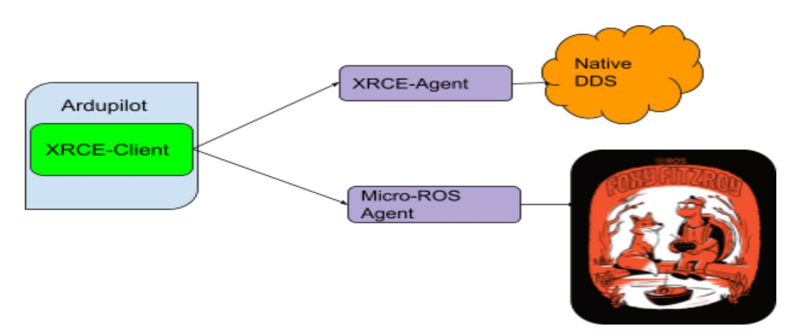
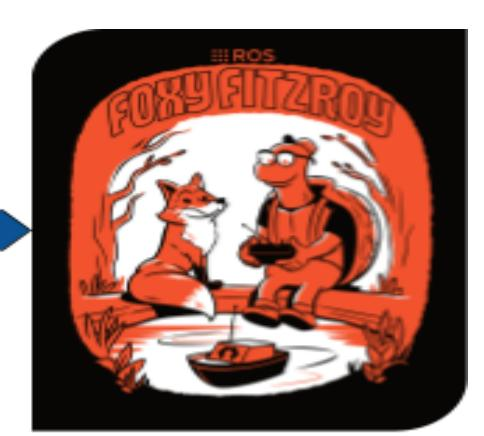
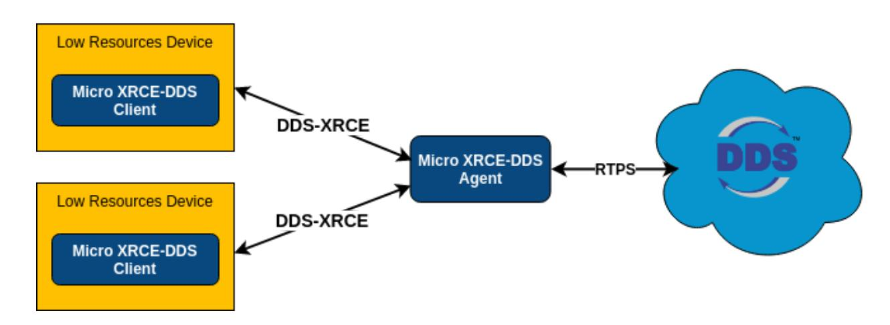

# ROS2 Native Support for Ardupilot

**April 2nd, 2021**

**Google Summer of Code Proposal**

**Organization: ArduPilot**

# **Contact Details**

Name : Arsh Pratap

Email : [arshpratapofficial@gmail.com](mailto:arshpratapofficial@gmail.com) : [arsh31pratap01@gmail.com](mailto:arsh31pratap01@gmail.com) (alternate)

Github : [arshPratap](https://github.com/arshPratap)

Contact No. : +91 6355119057

University : Indian Institute of Information Technology, Gwalior (2018-2023)

Current Year : 3

LinkedIn : Arsh [Pratap](https://www.linkedin.com/in/arsh-pratap-310674196/)

Hackerrank : [arshPratap](https://www.hackerrank.com/arshPratap?hr_r=1)

Time Zone : Indian Standard Time (GMT + 5:30)

Discord ID : arshPratap

Ardupilot Discuss : [arshPratap](https://discuss.ardupilot.org/u/arshpratap/)

# **About Me**

I am a third-year undergraduate student currently pursuing an integrated 5 years dual degree course (B.Tech + M.Tech) from Indian Institute of Information Technology, Gwalior. I am well-versed with C, C++, Python, and Java. I have experience in developing android apps (with React-Native) and websites. I have recently also started working and implementing Machine-Learning algorithms and have experience in taking part in data-science competitions on [Kaggle.](https://www.kaggle.com/arshpratap) My recent works include :

- [Bourbaki](https://github.com/arshPratap/Bourbaki-App) A mobile application that can automatically evaluate handwritten mathematical expressions and supports solving questions that range from basic BODMAS questions to calculating differential and integrals. Recently won the first prize in the [HackerEarth](https://www.hackerearth.com/challenges/hackathon/hack-ed-v10/) Hackathon
- [Jane-Street](https://www.kaggle.com/c/jane-street-market-prediction) Market Prediction Challenge My team's [submission](https://www.kaggle.com/arshpratap/competitions) for this competition involved creating a Machine-Learning Model that could maximize the profits based on a market data from a global stack exchange, currently ranks among the top 9 % (was in top 5% during the month of March) submissions registered for this challenge on Kaggle.

# **Experience with Ardupilot and related fields**

I have about 3 years of experience working on embedded and robotics projects. I have worked with the following boards :

- Arduino(Uno, Nano, and Mega),
- Raspberry Pi
- Esp32 boards
- STM32 boards

I have had experience in writing embedded drivers for the STM32 Nucleo Board (I2C, SPI peripherals) and as of now was learning to develop drivers for Beaglebone Black boards.

I also have experience participating in robotics competitions, with my team winning the Line-Following Bot competition that was organized by my college's Robotics Club in my first year. These [videos](https://drive.google.com/drive/folders/1MXM4vvSwe2jPOViFw0B_fZ6mRS08XzWe?usp=sharing) demonstrate the performance of the line following robot in the competition. I have also been a part of my college's IEEE branch and have served as the Secretary of the Branch for about 2 years(2018-2020).

I have been working and studying about the Ardupilot codebase since December and have had experiences contributing to the codebase either through smaller and trivial patches or trying my hand at some "bigger" patches (some of them might require some reworking to do). I have also engaged with some of the senior developers at Gitter, Discord, or through my git PRs. I also try to engage with other students on Gitter and Discord and always try my best to help them. I have also contributed to the Ardupilot-Wiki wherever I felt that the documentation would need an update.

Here is a list of some of my PRs made to the ardupilot community that I had a lot of fun working on :

- *● Copter: PreArm Battery low voltage [message](https://github.com/ArduPilot/ardupilot/pull/16530) repeated two times fix #16530*: fixed an issue where a low voltage message was being printed twice
- *● Copter: [AP\\_Arming:](https://github.com/ArduPilot/ardupilot/pull/16101) Added check for EKF origin altitude #16101*: added an additional check to check that EKF origin is not too far from the home altitude
- *● [AP\\_HAL:examples:Printf:](https://github.com/ArduPilot/ardupilot/pull/16260) Improvements in the Printf example #16260*:added improvements for the printf example files as suggested here
- *● [AP\\_HAL:examples:AnalogIn:](https://github.com/ArduPilot/ardupilot/pull/16229) Added comments in the AnalogIn example #16229* : added improvements for AnalogIn example files
- *● Copter: [Pre-arm](https://github.com/ArduPilot/ardupilot/pull/16895) check for first cmd to be takeoff #16895*: added a check after the introduction of the "AUTO\_OPTIONS" parameter to ensure that the first cmd for any mission is to be a takeoff command
- *● Copter: Implement [LOITER\\_TURNS](https://github.com/ArduPilot/ardupilot/pull/16473) in Guided Mode #16473*: implemented LOITER\_TURNS for guided mode for copter

- *● Morse: Added Vehicle Follow [Support](https://github.com/ArduPilot/ardupilot/pull/16779) #16779*: implemented the vehicle following camera for the Morse simulations(part of one of the GSoC projects listed this year)

Here is a list of some of my PRs made to the ardupilot-wiki:

- *[Wiki:Dev:](https://github.com/ArduPilot/ardupilot_wiki/pull/3265) Fixed some typos #3265* fixed some basic typos that I found while reading the ardupilot documentation
- *[starting.rst:](https://github.com/ArduPilot/ardupilot_wiki/pull/3300) Fix alignment issue #3300* fixed an alignment issue
- *[building-setup-windows10.rst:](https://github.com/ArduPilot/ardupilot_wiki/pull/3299) Updated the documentation #3299* updated the documentation for building the code on windows using wsl

For a full list, one can take a look [here](https://github.com/ArduPilot/ardupilot/pulls/arshPratap)

For a detailed log related to the PRs, the issue they tried to solve, and the current status of the PRs please do take a look [here](https://github.com/arshPratap/CommitLog/blob/main/Pull%20request%20LOG.md)

# **Logistics**

The GSoC timeline is in sync with my schedule. My final exams for the current sem should happen somewhere around the last week of April or the first week of May. I should be free by the time the GSoC program starts. The best-case scenario is that I should be free during the entire GSoC period but there is still a chance that my next sem might start from July end, although my college has declared that it won't open up for the next sem due to Corona Pandemic and even though some part of the program coincides, I won't be having any major exams, assignments or quizzes in the first half of my semester. I understand the importance of my project and the benefits that it would bring to the Ardupilot community and hence I plan to devote around 40-45 hours to the project and the GSoC program. Also, I have a flexible schedule and would be more than happy to change it in accordance with my mentors' opinion so as to make sure I have a good interaction with the mentors. Looking forward to contributing to the Ardupilot codebase and working with the community during my summer breaks!!!

# **Introduction**

# **Full Proposal Title**

Native ROS2 support with basic publish-subscribe functionalities

### **Abstract**

This project serves as a modification to the Project "Porting MAVROS for ROS2" and instead aims to provide Ardupilot with native support for ROS2 with basic publish-subscribe features. An older PR that had worked on this concept can be found here: <https://github.com/ArduPilot/ardupilot/pull/4700>

The protocol that would be followed to implement the native features would be the XRCE-DDS protocol (DDS for resource-constrained environments). This project would involve the building of an XRCE-DDS client along with necessary IDL files for publishing time-critical vehicle messages across to either an :

- XRCE-Agent (for native DDS models)
- Micro-ROS Agent (for ROS2 nodes) with basic publish-subscribe functionality

# **Current Scenario**

[Ardupilot](https://ardupilot.org/ardupilot/) is an open-source and versatile autopilot system that provides support for several vehicle types(Copters, Planes, Rovers, and more), sensors, and frame types. It's not only limited to the above-mentioned applications(use-cases) but also extends its reach by supporting several software [simulations](https://ardupilot.org/dev/docs/simulation-2.html) and frameworks. Among the host of softwares that Ardupilot supports, a special scenario is observed in the case of ROS.ROS - Robotics [Operating](https://www.ros.org/) System is an open-source robotics framework that provides a range of libraries, device drivers, and high-quality developer tools that helps students, hobbyists, and enthusiasts to develop their robotics softwares.Ardupilot currently uses [MAVROS](http://wiki.ros.org/mavros) to interact with ROS1 nodes.MAVROS acts as a bridge/translator between the ROS topics (standard ROS communication links) and MAVLINK messages.

[OSRF](https://www.openrobotics.org/) (the developers of ROS) have introduced [ROS2](https://docs.ros.org/en/foxy/index.html) a modified and upgraded form of ROS1. The latest(and last)ROS1 distribution(ROS Noetic) has its EOL in [2025](http://wiki.ros.org/Distributions) and OSRF is making ROS2 the official supported version of ROS. These changes make it natural for developers to move to using/supporting ROS2 for their projects. Ardupilot as of now lacks support for the new ROS2 middleware, an issue complicated further by the fact that ROS2 uses a completely new architecture(RTPS-DDS protocol) for implementing its middleware.

# **ROS1 vs ROS2**

The following table lists the differences between ROS1 and ROS2

| Criteria    |         |             | ROS1        |               | ROS2                             |
|-------------|---------|-------------|-------------|---------------|----------------------------------|
| Platforms   | Ubuntu, | OS          | X           |               | Ubuntu,OS X,Windows 10           |
| C++         | C++03   |             |             |               | C++11(C++14 for some cases)      |
| Python      | Python  | 2           |             |               | >=Python 3.5                     |
| Middleware  |         | Custom      | Centralized | Discovery     |                                  |
| RTOS        | Support | No(Possible | through     | Orocos)       | Yes                              |
| per Process |         |             |             |               |                                  |
|             | No      |             |             |               | Yes                              |
| Services    |         | Synchronous |             |               | Asynchronous(callback            |
| Roslaunch   | Written | in          | XML         | hence limited |                                  |
|             |         |             |             |               | Written in Python, allowing more |
|             |         |             |             |               | complex logic                    |

As seen from the above table, ROS2 differs a lot from its predecessor. A majority of the changes between the 2 versions can be traced to the different middlewares that have been used in the respective versions. ROS1 has a centralized discovery mechanism that allows the different nodes to communicate with each other(ros-master) meanwhile ROS-2 uses DDS protocol as its middleware which allows for a decentralized form of discovery and communication between the nodes. Also, some of the changes reflected in ROS-2 were also done so as to provide support for real-time operating systems and embedded microcontrollers(see [Micro-ROS\)](https://micro.ros.org/). This is another good reason why we should focus on extending native support for ROS-2.

# **DDS-RTPS Protocol**

DDS - Data [Distribution](https://www.dds-foundation.org/what-is-dds-3/) Service is a Data-Centric Publish-Subscribe(DCPS) model that can be used to develop communications between (link) distributed applications. It provides a decentralized form of architecture that allows for dynamic discovery of entities and also provides Quality of Service properties that help the user to adjust several properties of data distribution like resource usage, data availability, and much more.

A DDS model comprises of the following :

- DDS Domain Abstract plane that links all the distributed applications that are able to communicate with each other. Communication can occur among applications belonging to the same domain.
- Topics The communication links between the distributed applications. They are associated with a name(unique in the domain) and connected with a data type(data being propagated) and the respective QoS.
- Publishers Applications that want to contribute/write/update the data space. After every successful "publishing" of the data, the middleware informs all the interested listeners/subscribers.
- Subscribers Applications intending to access a part of data space.

RTPS - Real-Time [Publish-Subscribe](https://www.eprosima.com/index.php/resources-all/rtps) is a wire protocol that is used by the DDS model to provide message/communication features between the distributed applications. Its an interoperable wire protocol maintained by the OMG organization. It provides publish/subscribe communication features over transports such as TCP/UDP/IP and guarantees communication between applications with different DDS vendors.

Following is the list of DDS implementation that ROS2 [supports](https://docs.ros.org/en/foxy/Concepts/About-Different-Middleware-Vendors.html#supported-rmw-implementations) :

- eProsima Fast RTPS (Default ROS2 middleware)
- Eclipse Cyclone DDS
- RTI Connext
- RTI Connext(dynamic implementation)
- ADLINK Openslice

# **DDS-XRCE Protocol**

Given the robust and varied DDS implementations that ROS-2 supports, it seems natural that we too should focus on providing support for DDS implementations. But there is a catch, given that our target is to provide the support for the flight controller, we do need to look into resource and memory constrictions that come up with the vehicle setup. We need to make sure that the DDS implementations are :

- Not resource and memory heavy
- Easy to use and configure
- Provides high performance

Keeping in mind the above-mentioned points let's look into the DDS-XRCE protocol.

#### Flow diagram of DDS-XRCE protocol [\(source](https://micro-xrce-dds.docs.eprosima.com/en/latest/introduction.html#dds-xrce-protocol))

[DDS-XRCE](https://www.omg.org/spec/DDS-XRCE/About-DDS-XRCE/) is a wire protocol that aims to provide communication capabilities to eXtremely Resource Constrained Environments (XRCE) to interact with an existing DDS network. The protocol was defined in DDS for the eXtremely Resource Constrained Environments proposal that was submitted to the OMG consortium. The protocol comprises of the following :

- [XRCE-Client](https://micro-xrce-dds.docs.eprosima.com/en/latest/client.html): The client is the part of the protocol that resides in the low-resource environment and communicates with the DDS network through XRCE-Agent.The client communicates by issuing Operations to the Agent. The agent then sends back responses based on the issued operations. The operations include:
  - Create/Delete Sessions: Used to register the client to the agent and set up the basic
  - Create/Delete Entities: Used to tell the agent to register a
  - Write and Read the Data
- [XRCE-Agent](https://micro-xrce-dds.docs.eprosima.com/en/latest/agent.html): The agent is the other part of the protocol that is directly connected to a DDS network and receives the operations requested by the clients. It sends back the results of the received operations to the client(s). All the DDS entities requested by the client reside on the agent so that they can be reused by the client in the future.

For this project, I am going to use the eProsima implementation of DDS-XRCE protocol - Micro XRCE-DDS because the same implementation is used for developing [Micro-ROS](https://micro.ros.org/docs/concepts/middleware/Micro_XRCE-DDS/) (ROS2 for micro-controllers).

# **MAVLINK vs DDS**

The differences between MAVLINK and DDS are highlighted below in the table

| Criteria   | MAVLINK                    | DDS                           |
|------------|----------------------------|-------------------------------|
| Definition | MAVLINK is the standard    |                               |
|            | messaging protocol for     |                               |
|            | communicating with drones. |                               |
|            |                            | DDS is a protocol defined by  |
|            |                            | OMG for developing            |
|            |                            | communication between         |
|            |                            | distributed applications      |
|            |                            | Data-centric middleware and   |
|            |                            | API (different depending upon |
| Features   | ● Telemetry                |                               |
|            | communications between     |                               |
|            | Ground Control Stations    |                               |
|            | and drones                 |                               |
|            | ● Lightweight              |                               |
|            | ● Efficient                |                               |
|            |                            | ● Robust                      |
|            |                            | ● Reliable                    |
|            |                            | ● Support for IoT             |
|            |                            | ● Well suited for sharing     |
|            |                            | mission-critical data with    |
|            |                            | low latency                   |
|            | No                         | Yes                           |

# **Is DDS a replacement for MAVLINK ?**

Not at all, as described [here](https://mavlink.io/en/), MAVLINK is the standard and the most accurate protocol for communicating with UAVs over telemetry links.DDS is intended to be used in the following areas :

- ROS2 Native Support
- Providing communication between other DDS implementations
- Providing support for sharing critical/real-time information between vehicle and off-board computers

# **Using ros1\_bridge for connecting with MAVROS**

[ros1\\_bridge](https://github.com/ros2/ros1_bridge) (developed by OSRF) is a software package that provides a connection/bridge between the older ROS1 nodes (and packages) and the newer ROS2 nodes. We can use the ros1\_bridge to connect the autopilot with ROS2. Here, the autopilot will be connected to mavros which would then be connected with ROS2 nodes via the ros1\_bridge. Although this method could definitely be used, there are some downsides to relying on the ros1\_bridge. The downsides include:

- As discussed above, ROS2 uses the DDS protocol for communication, and using the ros1\_bridge might provide connections with ROS2 nodes, it would also skip over the complexities involved with the DDS protocol. Also from a technical point of view working on implementing the native protocols for ROS2 would be much more beneficial(next point) than using the ros1\_bridge.
- Trying to implement native DDS protocol would be beneficial as
  - Providing DDS functionalities will provide the ability to connect not only with ROS2 (in a much more efficient way than ros1\_bridge) but also with several other native DDS softwares and models.
  - DDS, as discussed above, specializes in sharing critical data with low latency and this was primarily one of the reasons behind ROS2 selecting DDS as their base protocol. [Audi](https://www.rti.com/blog/the-future-of-automotive/) uses DDS for their automotive hardware in the loop (HITL) tests for the above reasons. One can also take a look [here](https://www.dds-foundation.org/who-is-using-dds-2/) for the companies that have currently implemented DDS.
  - Having support for the DDS protocol would help Ardupilot efficiently communicate with the ROS2 nodes and in theory, can also remove the role of having a "middleman" software like mavros and hence provide a direct connection to ROS2. The community could also in theory work on developing some customized messaging protocols to use while natively communicating with ROS2.

# **Implementations**

I have divided the overall project into 4 tasks as it would be easy to manage and work on the project.

*Note: I have followed a color scheme to grade each task based on their difficulty level*

#### *Easy Medium Hard*

### **Task 1 - Configuring the build system and the environment :**

This task revolves around setting up the environment, the dependencies, and configuring ardupilot's build system to link the libraries and set up a rover(hardware testing)

- Ubuntu 20.04 (Operating System)
- ROS 2 (Foxy Fitzroy)
- microROS
- eProsima Micro-XRCE DDS software is organized into 3 parts
- eProsima [Micro-XRCE](https://micro-xrce-dds.docs.eprosima.com/en/latest/gen.html) DDS Gen: It is a tool that is used to generate source(boiler-plate) codes for the corresponding IDL files(C struct associated with the message to be sent). It would require
  - JDK
  - Gradle (v 6.8.3)
- eProsima Micro-XRCE DDS Client: It is a C API that is used to create a client for the XRCE platform (the flight controller in our case). It does not require any external dependencies
- eProsima Micro-XRCE DDS Agent: It is eProsima's implementation of the XRCE agent. It would run on the offboard computer and would require eProsima Fast DDS

- Micro-ros agent: It is an XRCE agent that is available for communicating with a micro-ros node(micro-controller) from a Ros2 off-board computer. It is built with the eProsima Micro-XRCE DDS Agent as its middleware.

Ardupilot uses the Waf build system to build the code for the necessary targets. After installing the Micro-XRCE Client, any application that uses the client API would depend on two libraries (installed with the client). Those libraries are

- microcdr
- microuxr

wscripts would then have to be configured to effectively link these libraries as failing to do so causes a linking error while building the code.

Senior developers have pointed me to the fact that ROS2/DDS components might eat up a large chunk of the available flash memory and hence can cause issues for other important operations. To counter the size constraints, we will also have to look into developing a customized build server for the project. Using a build server would further provide an option to users to download the firmware with additional features (like support for ROS2 and DDS protocol).

Hardware Required**: After having discussions with some of the senior developers and potential mentors over the discord channel, it was pointed out that targeting the project for the simulated builds would be a much better choice as focusing on the hardware build might eat up a major part of the coding phase, an issue amplified further by the fact that Google has reduced the timeframe for this year to 10 weeks(175 hours). Due to this, my focus for this project would be on** *Ardupilot's software simulated vehicles***.**

*Note : If the need for a hardware setup arises, then I already have the basic mRo Pixhawk development kit along with the telemetry modules and the lipo battery. I would mostly need a 2 WD RC car with a size ratio of 1:10 (for easily setting up the boards and sensors on the rover). The price of these rovers ranges around Rs.4500-5000(prices may vary in different countries). I will be discussing the specifics related to this part with the mentors during the community bonding period and try to receive the required hardware within 1-2 weeks. For the worst-case scenario, I have an old [arduino](https://robu.in/product/longer-version-4-wd-double-layer-smart-car-chassis/?gclid=CjwKCAjw3pWDBhB3EiwAV1c5rFCWkAEkUGxe04DkGqqmBiGm3JDZ4RFsT7NY38jxOAAKuufncAxnHhoCNOAQAvD_BwE) rover chassis that could be used.*

# **Task 2 - Setting up the Ardupilot XRCE-DDS client**

After the completion of task 1, here we focus on developing an XRCE client that would reside in the autopilot and provide a connection to the micro ros agent(ROS2) or an XRCE agent(a native DDS network).

The implementation of the client will consist of adding two-vehicle parameters

- **XRCE\_ENABLE:** This parameter will be used to enable/disable the xrce client. The values being used would be
  - 0: disabled. This deactivates the XRCE client (default)
  - 1: enabled. This activates the XRCE client
- **XRCE\_CONFIG:** This parameter sets up the mode of communication with the XRCE Agent. The values being used would be
  - 0: UDP. Communication will happen through UDP (default)
  - 1: TCP. Communication will happen through TCP
  - 2: Serial. Communication will happen through Serial Port(useful for companion computers)

IDLs - Interface Definition [Languages](https://micro-xrce-dds.docs.eprosima.com/en/latest/introduction.html#topic-type) are files that are created to define a user-defined data type that would be used by the client in the communication process. They are essentially C structs. These IDLs are used by Micro DDS Gen to generate header files that would provide the client to effectively use the data types described in the IDL file for

communication with the agent. These header files would provide functionalities that could be used to create client functions to send/receive data. The IDLs would be divided into two categories :

- Vehicle Generic information: These include generic vehicle information that would be common across the vehicle types and would be present in the libraries subfolder in the AP\_XRCE\_Client directory alongside the client class files.
- Vehicle Specific information: These would include vehicle-specific information and would be present in the respective vehicle directories.

A vehicle independent client library **AP\_XRCE\_Client** will then be created that would provide a client class and the vehicle codes based on the configuration of the above parameters could then create the proper instance of the client. The procedure followed to configure and setup the client in the codebase would be :

- Initialize a transport based on the configurations of the XRCE\_CONFIG.
- Initialize a session
- Create an input and output stream
- Create client operation requests to create entities on the agent side. Data types for the topic entities would be based on the IDLs that we would be using.
- Create functions to send and receive the data.
- Create functions to close/delete the session and transport in case if xrce client is disabled or on the completion of a particular task

# **Task 3 - Proper Integration into the Ardupilot Codebase**

After the completion of the above tasks, this step would focus on making sure that the integration of the XRCE-DDS protocol with the ardupilot codebase happens in a proper way. This in my opinion would be the most important task and I want to make sure that this task is executed properly. As mentioned earlier, Ardupilot is a very versatile project that supports different use cases, frameworks, software, and protocols. It was rightfully stated in this [PR](https://github.com/ArduPilot/ardupilot/pull/4700) that Ardupilot currently has support for :

- FrSky Telemetry
- Mavlink,

and adding native support for DDS models although beneficial, would definitely complicate the codebase and it's only natural that we should also focus on making sure the implementations added through the above tasks :

- Do not complicate the codebase
- Do not produce a drastic change
- Do not produce any dead/unused code
- Are seamlessly integrated with the existing protocols so that users and devs can easily use, understand and contribute to the code base

After reading through some of the documentation and having discussions with some of the senior developers in the ArduPilot Discord channel, the following workarounds could be employed to tackle this task.

- Ardupilot's [MAVLITE](https://github.com/ArduPilot/ardupilot/blob/master/libraries/AP_Frsky_Telem/AP_Frsky_MAVliteMsgHandler.cpp#L14) implementation has a message handler that translates the Mavlite message received and converts it into a mavlink command which is then processed like any normal mavlink message. We can have a similar translation library that can translate the incoming messages into mavlink commands and then can be processed accordingly. Although this is easier to implement and work around, the fact that having a DDS implementation translate to MAVLINK commands isn't a good choice.
- We can have an abstraction library that builds upon FrSky, MAVLINK, and DDS as backends, and then this library can be used by GCS\_MAVLINK for processing commands or can be made available for developing Lua Scripts. This is a harder workaround in comparison to the first one, but nevertheless, a far more accurate solution as it provides a generalization to the implementation of a communication protocol and any new messaging can easily be integrated into the model in the future. One drawback to this solution is that it breaks the

- mavlink based mindset and hence some users and developers might experience a harder time adapting to this change.
- We can also be creative with the way we handle the structure of the IDLs since there is no standard drone protocol for communication with the DDS model. Work can also be done on structuring the message data types sent from ROS2 to Ardupilot so that the received commands can easily be processed and then be properly executed.

# **Task 4 - Writing Ardupilot ROS 2 applications**

Completion of the above tasks would have provided Ardupilot the functionality to communicate with an existing DDS model or any native DDS implementation. For further communication with ROS2 using the XRCE agent, we will have to use eProsima's Integration Services. The above task can be simplified greatly by directly using a micro-ros agent as that would provide a direct link between ROS2 and our client. Once this link is established, work can then be done on writing ROS2 packages and example nodes to develop off-board applications to connect with the autopilot.

Note: These packages will not be available within the main codebase but as a separate Ardupilot Repository.

# **Benefits to the Ardupilot community**

This project aims to provide the following benefits to the Ardupilot community

- Provide Native Support for ROS-2
- Provide Support for native DDS participants that are not tied to ROS. For example - MAVSDK.
- Has faster throughput and lower latency and hence can be used in missions for sharing real-time/critical messages.

# **Future Improvements/Add-Ons**

This project would have the following improvements and add-ons to improve Ardupilot's native support for ROS2

- Improving message handling from ROS-2 nodes
- Adding further support for complex commands
- Adding Micro-ROS client code into the Ardupilot codebase

# **Time is no Bar**

Google has made some changes to the GSOC program for the year 2021. One of the major changes being the change from a 12 week(350 hrs) coding program to a 10 week (175 hrs) coding program.Through the discussion that follows I want to assure the mentors that I would be able to complete the project in the allotted time.

# **My Work So Far (Current Progress)**

To make sure that I am able to complete the project in a reduced time, I have already started to work on this project and some smaller prototypes. The work that I have done is as follows :

- I have already set up the development environment for Micro-XRCE, FastDDS, ROS2, and MicroROS on several platforms which include :
  - Ubuntu 20.04
  - WSL with Ubuntu 20.04
  - Windows 10
- I have successfully built and tested
  - the Micro-XRCE client and its examples
  - tested Fast-DDS publisher and subscriber examples
  - tested connection between the micro client and agent
  - micro client and micro ros agent

- I am currently focusing on building smaller customized Micro-XRCE applications to understand the Client APIs and the process of writing a client.
- I have also started a [branch](https://github.com/arshPratap/ardupilot/tree/prototypeXRCE) here to test a prototype of this project. The current prototype feature would revolve around the copter publishing its flight mode to the micro ros agent and switching the flight mode by subscribing to commands from a ros2 node.
- I am currently new to waf build systems and I was having a linking issue while compiling the codebase on the above-mentioned branch. It is related to the *microcdr* and *microuxr* libraries being not properly configured.I am currently learning about waf build [systems](https://waf.io/book/) and trying to solve this issue.

# **Timeline**

#### Pre GSoC Period

- Contribute to and further work on some of my Ardupilot commits
- Work on smaller projects related to Micro-XRCE clients and micro ros
- Work and learn the WAF build systems to properly configure the codebase
- Work on the prototype [branch](https://github.com/arshPratap/ardupilot/tree/prototypeXRCE)

#### Community Bonding Period

- Engage in discussions with mentors related to ardupilot codebase
- Reading Ardupilot Documentation
- Reading eProsima and ROS2 Documentation related to the project
- Discuss with mentors about the exact scope of the project and about the specifics related to it like the hardware required and a potential workaround for Task-3
- Contribute to the Ardupilot codebase

#### *Note: Difficult level color code :*

#### *Easy Medium Hard*

#### Coding Period

- Week 1 (June 7 June 13)
  - Setup the build environment
  - Setup a customized build server
  - Setup the rover for actual hardware testing (optional/in case if the need arises)
  - Properly Configure the Waf scripts to include *microcdr* and *microuxr* libraries
- Week 2-3 (June 14 June 27)
  - Define the vehicle parameters: **XRCE\_ENABLE** and **XRCE\_CONFIG**
  - Create the XRCE client library
  - Define IDL files with generic and specific vehicle information
- Week 4 (June 28 July 4)
  - Documentation
  - Running Tests on SITL(Copter, Plane, and Rovers) to make sure the client is able to connect to the XRCE-Agent/Micro-ROS agent (optional test on hardware, if required)
  - Code refactoring
- Week 5-6 & Mid-Evaluations(July 5 July 18, July 12-July 16 Evaluations)
  - Work on properly integrating the DDS-XRCE protocols with the other existing protocols
  - Submitting Mid Evaluation Report
- Week 7 (July 19 July 25)
  - Documentation
  - Tests on SITL (optional tests on hardware, if required)
  - Code Refactoring

- Week 8-9(July 26 August 8)
  - Writing ROS2 packages to communicate with the vehicle via the agent.
- Week 10 & Final Evaluations (August 9 August 23)
  - Final Documentations
  - Final Tests
  - Wrapping Up
  - Submitting Final Evaluations

# **References and other Useful Links**

- **● About DDS/RTPS**
  - <https://www.omg.org/spec/DDS/About-DDS/>
  - <https://fast-dds.docs.eprosima.com/en/latest/>
  - <https://www.omg.org/spec/DDSI-RTPS/About-DDSI-RTPS/>
  - <https://fast-dds.docs.eprosima.com/en/latest/#rtps-wire-protocol>
  - <https://youtu.be/6iICap5G7rw> (nice explanatory video)
- **● ROS1 vs ROS2**
  - <http://design.ros2.org/articles/changes.html>
  - [https://www.theconstructsim.com/infographic-ros-1-vs-ros-2-one-better-/](https://www.theconstructsim.com/infographic-ros-1-vs-ros-2-one-better-2/)
  - <https://roboticsbackend.com/ros1-vs-ros2-practical-overview/>
  - <https://blog.generationrobots.com/en/ros-vs-ros2/>
- **● MAVLINK vs DDS**
  - Px4 [presentation](https://px4.io/wp-content/uploads/2020/07/microROS-presentation-PX4DevSummit-2020.pdf) slides explaining differences between the two protocols
- **● Micro-XRCE DDS**
  - <https://micro-xrce-dds.docs.eprosima.com/en/latest/>
  - <https://www.omg.org/spec/DDS-XRCE/About-DDS-XRCE/>
  - [https://micro.ros.org/docs/concepts/middleware/Micro\\_XRCE-DDS/](https://micro.ros.org/docs/concepts/middleware/Micro_XRCE-DDS/)
- **● Micro-ROS**
  - <https://micro.ros.org/>
  - Supported Hardware: <https://micro.ros.org/docs/overview/hardware/>