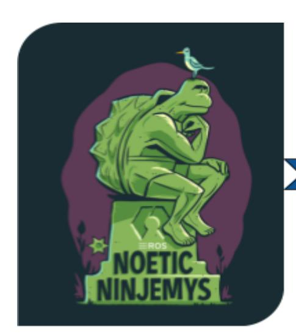
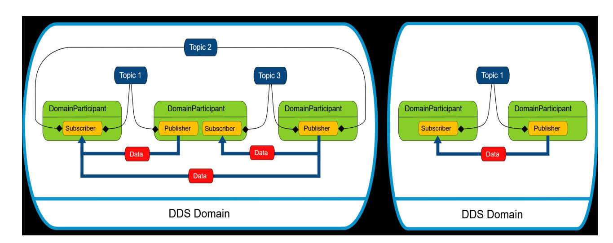
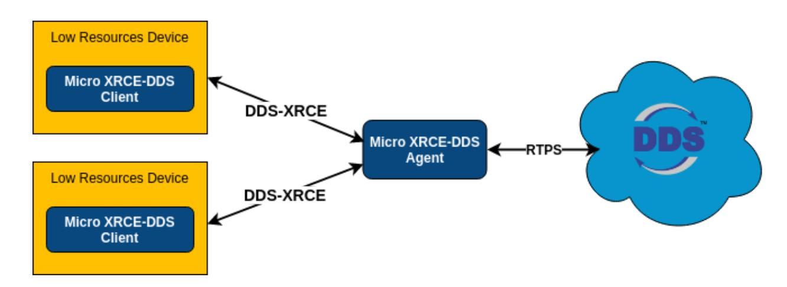
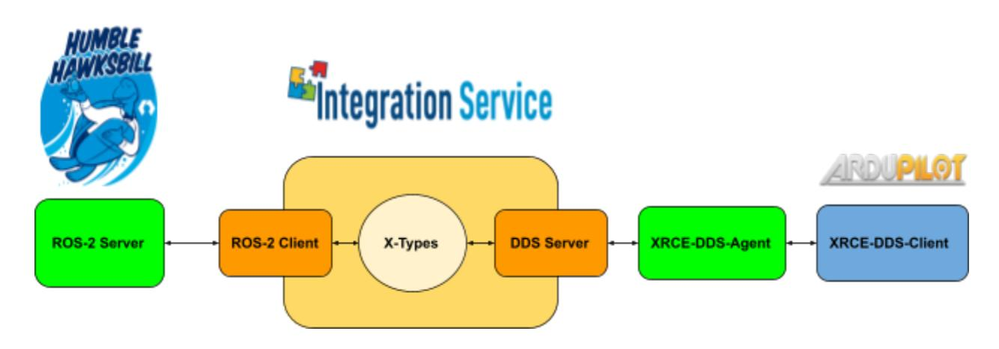

# Improvements for ROS2 Support for Ardupilot

**March 31st, 2023**

**Google Summer of Code Proposal**

**Organization: ArduPilot**

# **Contact Details**

Name : Arsh Pratap

Email : [arshpratapofficial@gmail.com](mailto:arshpratapofficial@gmail.com) : [arsh31pratap01@gmail.com](mailto:arsh31pratap01@gmail.com) (alternate)

Github : [arshPratap](https://github.com/arshPratap)

Contact No. : +91 6355119057

University : Indian Institute of Information Technology, Gwalior (2018-2023)

Current Year : 5

LinkedIn : Arsh [Pratap](https://www.linkedin.com/in/arsh-pratap-310674196/)

Time Zone : Indian Standard Time (GMT + 5:30)

Discord ID : arshPratap

Ardupilot Discuss : [arshPratap](https://discuss.ardupilot.org/u/arshpratap/)

# **About Me**

I am a final-year undergraduate student currently pursuing an integrated 5 years dual degree course (B.Tech + M.Tech) from Indian Institute of Information Technology, Gwalior. I am well-versed with C, C++, Python, and Java. I have experience in developing android applications and websites. I also have a keen interest in working on Machine Learning related projects and have experience in taking part in data-science competitions on [Kaggle](https://www.kaggle.com/arshpratap). Some of my software projects include :

- [Bourbaki](https://github.com/arshPratap/Bourbaki-App) A mobile application that can automatically evaluate handwritten mathematical expressions and supports solving questions that range from basic BODMAS questions to calculating differential and integrals. Recently won the first prize in the [HackerEarth](https://www.hackerearth.com/challenges/hackathon/hack-ed-v10/) Hackathon
- [Kronia](https://github.com/KroniaPytorch) A mobile application that is designed to provide technical aid to agricultural workers and farmers around the globe by providing them with features that helps them to diagnose their crops and provides them with crop and fertilizer recommendation (based on their agricultural land).The project came second in the Global Pytorch [Hackathon.](https://devpost.com/software/kronia)

# **Experience with Ardupilot and related fields**

I am experienced in working with embedded and robotics projects (including writing embedded software ). I have worked with the following boards :

- Arduino(Uno, Nano, and Mega),
- Raspberry Pi
- Esp32 boards
- STM32 boards
- Beaglebone Black

I have had experience in writing embedded drivers for development boards like STM32 Nucleo Board and BeagleBone Black.On a related note, I also have had experience in participating in several robotic competitions in my junior college years.

I have been working and studying about the Ardupilot codebase for about 2 years now and have had experiences contributing to the codebase either through smaller and trivial patches or trying my hand at some "bigger" patches (some of them might require some reworking to do). I have also engaged with some of the senior developers at Gitter, Discord, or through my git PRs. I also try to engage with other students on Gitter and Discord and always try my best to help them. I have also contributed to the Ardupilot-Wiki wherever I felt that the documentation would need an update.

**I was selected to work with Ardupilot organization for the GSoC mentorship session in the year 2021**. My project was titled ROS2 *Native Support for Ardupilot* and centered around providing Ardupilot with support for *XRCE-DDS* protocol so that the Ardupilot vehicles could seamlessly interact with other *ROS2* nodes and by extension other software projects that supported *DDS* protocol. More details regarding the project can be found here :

- *● GSoC 2021 : Native ROS2 [Support](https://discuss.ardupilot.org/t/gsoc-2021-native-ros2-support/75083)*

The following links provide a working demo of the aforementioned project :

- *● [Ardupilot-ROS2](https://youtu.be/MUth9duNFys) via XRCE-DDS Agent | GSoC' 21*
- *● [Ardupilot-ROS2](https://www.youtube.com/watch?v=fnDoRSWQ08Y) via Micro-ROS Agent | GSoC' 21*

Here is a list of some of my PRs made to the Ardupilot community that I had a lot of fun working on :

- *● Copter: PreArm Battery low voltage [message](https://github.com/ArduPilot/ardupilot/pull/16530) repeated two times fix #16530*: fixed an issue where a low voltage message was being printed twice
- *● Copter: [AP\\_Arming:](https://github.com/ArduPilot/ardupilot/pull/16101) Added check for EKF origin altitude #16101*: added an additional check to check that EKF origin is not too far from the home altitude

- *● [AP\\_HAL:examples:Printf:](https://github.com/ArduPilot/ardupilot/pull/16260) Improvements in the Printf example #16260*:added improvements for the printf example files as suggested here
- *● [AP\\_HAL:examples:AnalogIn:](https://github.com/ArduPilot/ardupilot/pull/16229) Added comments in the AnalogIn example #16229* : added improvements for AnalogIn example files
- *● Copter: [Pre-arm](https://github.com/ArduPilot/ardupilot/pull/16895) check for first cmd to be takeoff #16895*: added a check after the introduction of the "AUTO\_OPTIONS" parameter to ensure that the first cmd for any mission is to be a takeoff command
- *● Copter: Implement [LOITER\\_TURNS](https://github.com/ArduPilot/ardupilot/pull/16473) in Guided Mode #16473*: tried to implement LOITER\_TURNS for guided mode for copter
- *● Morse: Added Vehicle Follow [Support](https://github.com/ArduPilot/ardupilot/pull/16779) #16779*: implemented the vehicle following camera for the Morse simulations(part of one of the GSoC projects listed this year)

Here is a list of some of my PRs made to the ardupilot-wiki:

- *[Wiki:Dev:](https://github.com/ArduPilot/ardupilot_wiki/pull/3265) Fixed some typos #3265* fixed some basic typos that I found while reading the Ardupilot documentation
- *[starting.rst:](https://github.com/ArduPilot/ardupilot_wiki/pull/3300) Fix alignment issue #3300* fixed an alignment issue
- *[building-setup-windows10.rst:](https://github.com/ArduPilot/ardupilot_wiki/pull/3299) Updated the documentation #3299* updated the documentation for building the code on windows using wsl

For a full list, one can take a look [here](https://github.com/ArduPilot/ardupilot/pulls/arshPratap)

For a detailed log related to the PRs, the issue they tried to solve, and the current status of the PRs please do take a look [here](https://github.com/arshPratap/CommitLog/blob/main/Pull%20request%20LOG.md)

# **Logistics**

The GSoC timeline is in sync with my schedule. My final exams for the current sem should happen somewhere around the last week of April or the first week of May. I should be free by the time the GSoC program starts. I understand the importance of my project and the benefits that it would bring to the Ardupilot community and hence I plan to devote around 40-45 hours (weekly) to the project and the GSoC program. Also, I have a flexible schedule and would be more than happy to change it in accordance with my mentors' opinion so as to make sure I have a good interaction with the mentors. Looking forward to contributing to the Ardupilot codebase and working with the community during my summer breaks!!!

# **Introduction**

# **Full Proposal Title**

Improvements for Ardupilot's Native ROS-2 Support

## **Abstract**

This project serves as a follow up to the Project *ROS-2 Native [Support](https://discuss.ardupilot.org/t/gsoc-2021-native-ros2-support/75083)* (that I had worked on during my mentorship under Ardupilot in 2021) and aims to provide several technical enhancements to the currently implemented ROS-2 support features currently available in the Ardupilot codebase. The said technical enhancements would comprise of the following tasks :

- Implementation of data writer functions for some of the critical and important ROS-2 topics found in [ROS-REP](https://ros.org/reps/rep-0147.html) 147.
- Developing support for Gazebo and ROS-2 (via the Ardupilot SITL).One can read the corresponding project issue [here](https://github.com/ArduPilot/ROS2_Tools/issues/2)
- Improvements in the functioning of the DDS Client in Ardupilot that include :
  - Improving support for publishing multiple topics
  - Providing support for UDP based communication
  - Providing subscribing support to the current DDS client
  - Providing a more dynamic control over the DDS client (for e.g being able to change the client's parameters and have those changes reflected as soon as the parameters are changed,instead of closing and rebuilding the client again). Could lead up to a potential solution for the issue described [here.](https://github.com/ArduPilot/ardupilot/issues/23372)
- Designing a ROS-2 control interface based on the project issue described [here.](https://github.com/ArduPilot/ardupilot/issues/23363) This improvement naturally follows up on the development of the subscribing support for DDS client (mentioned above).

# **Current Scenario**

[Ardupilot](https://ardupilot.org/ardupilot/) is an open-source and versatile autopilot system that provides support for several vehicle types(Copters, Planes, Rovers, and more), sensors, and frame types. It's not only limited to the above-mentioned applications(use-cases) but also extends its reach by supporting several software [simulations](https://ardupilot.org/dev/docs/simulation-2.html) and frameworks. [OSRF](https://www.openrobotics.org/) (the developers of ROS) have introduced ROS2, a [modified](https://docs.ros.org/en/foxy/index.html) and upgraded form of ROS1. The latest(and last)ROS1 distribution(ROS Noetic) has its EOL in [2025](http://wiki.ros.org/Distributions) and OSRF is making ROS-2 the official supported version of ROS. These changes make it natural for developers to move to using/supporting ROS2 for their projects. After the pull request *[#17779](https://github.com/ArduPilot/ardupilot/pull/17779)* got merged Ardupilot now officially has implementations for a DDS client that provides basic publishing features to communicate with ROS-2 nodes (and potentially .other DDS applications) via the following :

- Micro-ROS Agent (preferred route),
- Micro-XRCE Agent (requires the use of eProsima's Integration Services)

*Note that both the Agents currently require a UART port as the supported medium for communication.*

# **ROS1 vs ROS2**

The following table lists the differences between ROS1 and ROS2

| Criteria    |         |             | ROS1        |               | ROS2                             |
|-------------|---------|-------------|-------------|---------------|----------------------------------|
| Platforms   | Ubuntu, | OS          | X           |               | Ubuntu,OS X,Windows 10           |
| C++         | C++03   |             |             |               | C++11(C++14 for some cases)      |
| Python      | Python  | 2           |             |               | >=Python 3.5                     |
| Middleware  |         | Custom      | Centralized | Discovery     |                                  |
| RTOS        | Support | No(Possible | through     | Orocos)       | Yes                              |
| per Process |         |             |             |               |                                  |
|             | No      |             |             |               | Yes                              |
| Services    |         | Synchronous |             |               | Asynchronous(callback            |
| Roslaunch   | Written | in          | XML         | hence limited |                                  |
|             |         |             |             |               | Written in Python, allowing more |
|             |         |             |             |               | complex logic                    |

As seen from the above table, ROS2 differs a lot from its predecessor. A majority of the changes between the 2 versions can be traced to the different middlewares that have been used in the respective versions. ROS1 has a centralized discovery mechanism that allows the different nodes to communicate with each other(ros-master) meanwhile ROS-2 uses DDS protocol as its middleware which allows for a decentralized form of discovery and communication between the nodes. Also, some of the changes reflected in ROS-2 were also done so as to provide support for real-time operating systems and embedded microcontrollers(see [Micro-ROS\)](https://micro.ros.org/).

# **DDS-RTPS Protocol**

DDS - Data [Distribution](https://www.dds-foundation.org/what-is-dds-3/) Service is a Data-Centric Publish-Subscribe(DCPS) model that can be used to develop communications between (link) distributed applications. It provides a decentralized form of architecture that allows for dynamic discovery of entities and also provides Quality of Service properties that help the user to adjust several properties of data distribution like resource usage, data availability, and much more.

A DDS model comprises of the following :

- DDS Domain Abstract plane that links all the distributed applications that are able to communicate with each other. Communication can occur among applications belonging to the same domain.
- Topics The communication links between the distributed applications. They are associated with a name(unique in the domain) and connected with a data type(data being propagated) and the respective QoS.
- Publishers Applications that want to contribute/write/update the data space. After every successful "publishing" of the data, the middleware informs all the interested listeners/subscribers.
- Subscribers Applications intending to access a part of data space.

RTPS - Real-Time [Publish-Subscribe](https://www.eprosima.com/index.php/resources-all/rtps) is a wire protocol that is used by the DDS model to provide message/communication features between the distributed applications. Its an interoperable wire protocol maintained by the OMG organization. It provides publish/subscribe communication features over transports such as TCP/UDP/IP and guarantees communication between applications with different DDS vendors.

Following is the list of DDS implementation that ROS2 [supports](https://docs.ros.org/en/foxy/Concepts/About-Different-Middleware-Vendors.html#supported-rmw-implementations) :

- eProsima Fast RTPS (Default ROS2 middleware)
- Eclipse Cyclone DDS
- RTI Connext
- RTI Connext(dynamic implementation)
- ADLINK Openslice

# **DDS-XRCE Protocol**

Given the robust and varied DDS implementations that ROS-2 supports, it seems natural that we too should focus on providing support for DDS implementations. But there is a catch, given that our target is to provide the support for the flight controller, we do need to look into resource and memory constrictions that come up with the vehicle setup. We need to make sure that the DDS implementations are :

- Not resource and memory heavy
- Easy to use and configure
- Provides high performance

Keeping in mind the above-mentioned points let's look into the DDS-XRCE protocol.

### Flow diagram of DDS-XRCE protocol [\(source](https://micro-xrce-dds.docs.eprosima.com/en/latest/introduction.html#dds-xrce-protocol))

[DDS-XRCE](https://www.omg.org/spec/DDS-XRCE/About-DDS-XRCE/) is a wire protocol that aims to provide communication capabilities to eXtremely Resource Constrained Environments (XRCE) to interact with an existing DDS network. The protocol was defined in DDS for the eXtremely Resource Constrained Environments proposal that was submitted to the OMG consortium. The protocol comprises of the following :

- [XRCE-Client](https://micro-xrce-dds.docs.eprosima.com/en/latest/client.html): The client is the part of the protocol that resides in the low-resource environment and communicates with the DDS network through XRCE-Agent.The client communicates by issuing Operations to the Agent. The agent then sends back responses based on the issued operations. The operations include:
  - Create/Delete Sessions: Used to register the client to the agent and set up the basic
  - Create/Delete Entities: Used to tell the agent to register a
  - Write and Read the Data
- [XRCE-Agent](https://micro-xrce-dds.docs.eprosima.com/en/latest/agent.html): The agent is the other part of the protocol that is directly connected to a DDS network and receives the operations requested by the clients. It sends back the results of the received operations to the client(s). All the DDS entities requested by the client reside on the agent so that they can be reused by the client in the future.

# **Gazebo**

[Gazebo](https://gazebosim.org/home) is an open-source, 3D physics-based simulator for robotics and automation applications. It provides a platform for simulating and testing various robotic systems, including robots, vehicles, and drones, in a virtual environment. Gazebo simulates the dynamics of objects in the environment, such as gravity, friction, and collisions, to provide realistic simulation results.

Gazebo offers a wide range of features, such as a graphical user interface for visualizing the simulation, support for sensor simulation, including cameras, lidar, and sonar, support for different physics engines, including ODE and Bullet, and integration with various robotic middleware, including ROS and ROS-2.

Gazebo is widely used in the robotics and automation industry for simulating and testing various systems before deploying them in real-world scenarios. It helps reduce development costs and time by allowing developers to test their systems in a simulated environment, which is less expensive and less risky than testing in real-world scenarios.

# **Implementations**

For the current project, the following environment versions are considered ideal :

- *● Ubuntu 22.04*
- *ROS-2 Humble*
- *● Micro-XRCE-DDS Gen [\(develop](https://github.com/eProsima/Micro-XRCE-DDS-Gen/tree/develop) branch and latest [version](https://github.com/eProsima/Micro-XRCE-DDS-Gen) (v 2.0.0))*
- *● Gazebo Garden* (for more details refer [here](https://gazebosim.org/docs))

As explained before, I have divided the overall project into 4 tasks as it would be easy to manage and work on the project.

*Note: I have followed a color scheme to grade each task based on their difficulty level*

### *Easy Medium Hard*

## **Task 1 - Implementation of Data Writer functions for ROS-2 messages**

**Motivation** : In our earlier implementation for DDS Client, the project consisted of using the topics defined in the [Ardupilot\\_ros2](https://github.com/arshPratap/ardupilot_ros2) package to send the necessary information to ROS-2 nodes.But owing to the poor string manipulation that was involved it made maintaining and adding support for ROS 2 topics rather troublesome.

Very recently due to active support from interested ROS-2 contributors and engineers and Ardupilot developers , we were able to remove the inefficient string [manipulation](https://github.com/ArduPilot/ardupilot/pull/17779) that was involved and replace it with a more efficient and generalized approach and hence were able to successfully have the *Time topic* being communicated over to the ROS-2 nodes. Given the current scenario, we would soon be implementing the following ROS-2 topics present in the Idl [folder](https://github.com/ArduPilot/ardupilot/tree/master/libraries/AP_DDS/Idl) . For this task I plan to further implement many of the following ROS-2 topics defined in [ROS-REP](https://ros.org/reps/rep-0147.html) 147. Some of the important ROS-2 topics for which data writers can be implemented are :

- **Sensor msgs** like Barometer, Compass, INS, etc. (earlier version for such messages implemented [here](https://github.com/arshPratap/ardupilot_ros2/tree/main/ap_custom_interfaces/msg)) .
- **Geographic\_msgs** (initial request made [here](https://github.com/ArduPilot/ardupilot/pull/17779#issuecomment-1461304815))
- **● Odometry msg**
- **● Vehicle status msg**
- **● Flight mode msg**

*Note : This by no means a final list and just represents a fragment of some of the more critical ROS 2 topics that could be implemented to improve the scope of the project.*

**Possible Workflow** : As of now, the current codebase consists of an *Idl folde*r (found [here](https://github.com/ArduPilot/ardupilot/tree/master/libraries/AP_DDS/Idl)) that consists of all the necessary IDL files that would be required for the development and to proceed further , one must generate the topic related files from the

*xrce-dds-gen* [tool](https://github.com/eProsima/Micro-XRCE-DDS-Gen) (that will be populated in a temporary generated folder).Once this is done, we now focus on :

- The *AP\_DDS folder* houses the *AP\_DDS\_Generic\_Fn\_T.h* [file](https://github.com/ArduPilot/ardupilot/blob/master/libraries/AP_DDS/AP_DDS_Generic_Fn_T.h) which consists of "topic blind" declaration of the necessary XRCE serializations and deserializations. Each of the required topic files is mapped to the aforementioned generic functions by populating the topic table found in [AP\\_DDS\\_Topic\\_Table.h.](https://github.com/ArduPilot/ardupilot/blob/master/libraries/AP_DDS/AP_DDS_Topic_Table.h) Our task here would be to automate the process of code generation to fill up the topic table.Few alternatives and routes to be followed here are :
  - Utilizing a route similar to how the code generation works in [MAVGEN](https://github.com/ArduPilot/pymavlink/blob/master/generator/mavgen.py).
  - Utilizing [Jinja](https://jinja.palletsprojects.com/en/3.1.x/).
- After this, the next task would be to accurately populate the necessary *update\_topic()* function, which contains necessary implementations for updating important information for the given topic. As of now, we have the proper implementation for the *ROS 2 Time msg and NavSatFix msg* .
- Recently , after the successful merge of PR ([#60](https://github.com/eProsima/Micro-XRCE-DDS-Gen/pull/60)) , the **xrce-dds-gen** tool now provides support for the complex file hierarchy and the resultant include issues that followed ([#51\)](https://github.com/eProsima/Micro-XRCE-DDS-Gen/issues/51). The tool now provides users with an -I flag to correctly specify include directories.We can now use this feature now to organize and group the ROS-2 topic files into specific folders.

**Current Hurdles/Potential Issues** : The following known issues have been encountered as of now are as follows :

- For *TwistStamped.idl* and *PoseStamped.idl*, the toolkit suffers from an issue where some of the structs that are to be used are already initialized,causing the generation of the required files to fail.

Both the above issues can be attributed to the bugs that are currently found in the XRCE-DDS-Gen tool. Solution to the above bugs would require one to submit patches to the XRCE-DDS-Gen repo ( a task that I am currently working on and aim to have the patches submitted before the coding period begins).

# **Task 2 - Development support for Gazebo Simulation with ROS-2**

**Motivation** : Ardupilot currently offers the feature for using Gazebo as one of the many alternatives for simulating the vehicles. Ardupilot currently has a [Gazebo](https://github.com/ArduPilot/ardupilot_gazebo) plugin that is utilized by users to successfully simulate vehicles with Gazebo. Given the fact that we now have functioning ROS-2 support , it seems quite natural that our next target will be regarding implementing support for Gazebo simulation with ROS-2. A project issue regarding the same was raised here.

**Possible Workflow** : Currently Ardupilot provides a Gazebo plugin that helps users simulate the necessary vehicles into Gazebo. This task for providing basic support for Gazebo with ROS-2 can be undertaken as follows :

- As described here, Gazebo package has the *[gazebo\\_plugins](https://classic.gazebosim.org/tutorials?tut=ros2_overview&cat=connect_ros)*, which in particular has the camera topic to publish regular updates to a ROS-2 node.(An alternative approach can also be to use the ROS 2 camera topic.) We can add publishing support for the aforementioned topic and have the simulation updates being shared with the ROS-2 nodes.
- As described here, Gazebo packages come equipped with the *[gazebo\\_msgs](https://classic.gazebosim.org/tutorials?tut=ros2_overview&cat=connect_ros)* which are used to communicate and take commands from other ROS-2 nodes.This can be an excellent ground to provide support for subscribing functionalities to the DDS Client.
- Another option that can be used to further improve the support for Gazebo simulation with DDS ( here ROS-2) could be to utilize Gazebo plugins for DDS implementations available online.(An example can be seen [here](https://github.com/rticommunity/gazebo-dds-plugins))

### **Current Hurdles/Potential Issues** :

- One of the bigger hurdles that I feel regarding the implementation in this project would be inexperience with directly working with robotics simulations in particular Gazebo, although I have had some experience operating with

Gazebo.To counter this issue, I plan to start working on a prototype as soon as the proposal phase for the current mentorship is over .

- The third point discussed in the above section regarding using Gazebo plugins for DDS implementation has an issue the fact being the said Gazebo plugin is developed and maintained by **RTICommunity** and not by **eProsima** (the DDS vendor whose implementation is currently being utilized by Ardupilot). We will either have to wait for eProsima to come up with their own Gazebo Plugin and then the said plugin can be implemented / experimented with in the future.

## **Task 3 - General Improvements for Ardupilot's DDS Client**

**Motivation** : During the development of my previous mentorship project , the Ardupilot and ROS-2 community have been extremely supportive of my work and project and have been kind enough to provide me with several suggestions and ideas to further improve the quality of this project. For all the suggestions that I received regarding the project, I was able to select the following tasks that I believe, if given the right solutions, would positively impact the future of this project :

- Improving the support for publishing multiple topics via the DDS client : This will massively come in aid when we have to send several complex pieces of information simultaneously to ROS-2 nodes.
- Providing support for UDP based communication : This will prove useful in the future with the release of several development boards having a strong focus on their ethernet ports.Having support for UDP based communication will help us to communicate more effectively with the said boards.
- Providingsubscribing support to the current DDS client : Implementation of this task will further aid in the progress of Task - 4 (defined below).
- Providing a more dynamic control over the DDS client will helps users have a more wholesome experience while using the DDS client as currently the users have to no control over :

- When the DDS Client initiates or exits communications with the ROS-2 nodes. As of now the DDS Client starts communicating when the particular vehicle starts running and stops when with the vehicle
- For every small change in the parameter that is needed to communicate with the ROS 2 node, the entire code has to be closed and rebuilt from the start.
- This task can potentially be expanded to cover the issue [#23372](https://github.com/ArduPilot/ardupilot/issues/23372) so as to further improve the functioning of the DDS Client.

**Possible Workflow** : For developing the feature of providing multi-topic publishing support , a PR ([#23285\)](https://github.com/ArduPilot/ardupilot/pull/23285) was made for a similar issue (utilizing publishing **NavSatFix** and **Time** topic simultaneously) which provides a solid foundation for publishing 2 different topics together.I plan to expand on this PR by adding support for 2 major issues :

- As rightly pointed [here](https://github.com/ArduPilot/ardupilot/pull/23285#discussion_r1146768923) , the update functions needed for each topic can be moved to the topic table that has been mentioned in Task 1 and hence, based on the table, the update function can easily be mapped in a similar way to a topic's other properties.(This subtask can potentially be linked with the first task).
- Building upon the previous point, we need to add upon the fact that as of now both the topics are being published simultaneously but I believe adding support for publishing any combination of the ROS-2 topics should be made possible

For developing support for UDP based communication with ROS-2 nodes, one has to add the following **uxrUDPtransport** variable similar to the **uxrSerialTransport** variable currently being used. This transport variable then needs to be properly initialized in eProsima's UDP transport initialization function. For reference as of now, XRCE-DDS supports the following modes of communication over the following OS (see next page) :

| Transport        | POSIX Windows |
|------------------|---------------|
| UDP              | ✓ ✓           |
| TCP              | ✓ ✓           |
| Serial           | ✓ ✗           |
| CAN FD           | ✓ ✗           |
| Custom Transport | ✓ ✓           |

In an earlier prototype that I had worked on for my previous mentorship , I had worked on adding UDP based transport for the implemented XRCE\_DDS client.One can find the related code for the UDP based communication [here](https://github.com/arshPratap/ardupilot/tree/ddswaftest/libraries/AP_XRCE_Client).

**Figure 1 : Micro XRCE Agent connecting with the DDS Client (via UDP)**

**Figure 2 : Ardupilot successfully sending a custom HelloWorld Topic (via UDP)**

Given our current implementation for DDS Client , we have all the necessary structure in place for writing the subscriber functions. AP\_DDS\_Generic\_Fn\_T.h gives us the following 3 topic-blind functions that have to be correctly mapped to the corresponding values in the topic table :

- *Generic Serialization function* (used by DataWriter to provide publishing support)
- *Generic Deserialization function* (used by DataReader to provide subscribing support)
- *Size of topic function*

For subscriber support, our major point of focus should be on accurately writing the **read\_topic** function that will be used to further carry out instructions based on the message received from the topic.

For us to have a more dynamic flow for the XRCE-DDS client , I propose that we have a parameter **AP\_DDS\_CLIENT\_EN** , that takes in 2 values :

- 0 (default), the DDS client is disabled,
- 1 , the DDS client is enabled

Currently instead of running the DDS Client initialization function only once in Ardupilot's main setup function ,we can have the initialization function run at certain intervals , and

if in between we find the DDS client enabled, the client will be initialized properly based on the given state of Ardupilot parameters. A similar thing can be done while trying to close the DDS Client.This change can provide us with a more dynamic control over the DDS Client and prevent us from closing and rebuilding for every single change any of the AP parameters.

**Current Hurdles/Potential Issues** : Some of the hurdles and potential issues that one can expect here as follows :

- For implementing multi DDS Client support, one must be very careful with the resultant task scheduling and semaphore handling involved.
- Another thing to note would be the max number of DDS Clients, Ardupilot vehicles can sustain without suffering major hits to the performance.
- While implementing subscriber functions, one must be careful with the information being read by the Ardupilot vehicles as such information in most cases will be regarding a change in some vehicle parameters ,for e.g. :
  - Changing a vehicle's drive mode by sending the necessary information from a ROS-2 node to the vehicles , or
  - Changing a motor's output (more discussed in Task 4)

Focus has to be put on places where the information being read by the subscriber is being utilized successfully by the system , and in examples described above ,one needs to make sure the parameters that are being read do not mess with workings of other Ardupilot sub systems.

### **Task 4 - Designing a ROS-2 control interface**

**Motivation** : Given our current scenario, it seems highly logical that our focus now is set on developing a ROS-2 control interface that allows users to control the vehicles from their offboard/companion computer side (ROS-2 side). An apt description regarding the situation can be found [here](https://github.com/ArduPilot/ardupilot/issues/23363)

**Possible Workflow** : For the development of a ROS-2 control interface, one major step would be the development of the subscriber support for the DDS client(see Task3) . Once the above mentioned task has been completed the following steps can be incorporated to for the development of the control interface :

- For a basic control interface, as rightly described [here](https://github.com/ArduPilot/ardupilot/issues/23363), our initial approach would be to utilize waypoints as means of receiving receiving input and having the vehicle algorithm figure out the rest.To add onto it, we can have options for switching vehicle modes by rightfully publishing and subscribing to vehicle flight mode topic [\(ROS-2](https://ros.org/reps/rep-0147.html#flight-modes) msg topic)
- We can take inspiration from the **LUA** based bindings used in Ardupilot and how they have been designed to expose the Ardupilot APIs for use in writing new sandboxed scripts in LUA (A demo code in LUA can be found [here](https://ardupilot.org/dev/docs/common-lua-scripts.html#a-sample-script)).
- For publishing data over to the control interface regarding the vehicle location and coordinates , we can focus on building a INS topic currently used in Ardupilot. A message type currently not found in [ROS-REP](https://ros.org/reps/rep-0147.html) 147 but used extensively throughout the Ardupilot codebase.

### **Current Hurdles/Potential Issues** :

- The lack of support for ROS-2 [services](https://docs.ros.org/en/foxy/How-To-Guides/Topics-Services-Actions.html) and actions from the DDS end can cause issue for creating a control interface.Reason behind this being the fact , that
  - ROS-2 services are better used for places where remote procedures are needed and can terminate quickly.For e.g querying the status of a ROS node.
  - ROS-2 services follows a request-response form of communication model instead of the publish-subscribe communication model (DDS protocol being an example)
  - ROS-2 actions are used in places where a discrete behavior is required for controlling the state of a robot and at the same time providing users with necessary feedback.

- In comparison to Services and Actions, ROS-2 topics are needed where a continuous flow of data is required, for e.g sensor messages.
- I might require aid from the Ardupilot dev team on planning how to rightfully send vehicle information and on accurately following up on topics being subscribed to from the ROS-2 nodes.

To counter the issue that DDS lacks direct support for ROS-2 actions and servers as defined above , a potential solution can be to utilize [eProsima's](https://integration-service.docs.eprosima.com/en/latest/examples/different_protocols/services/ros2-server.html) Integration Service as it provides support for communication between different protocols.

## ( **Publish/Subscribe <------> Request/Response**).

In this case we can potentially we can have the following :

- The DDS Client will initiate connection with the XRCE-DDS Agent,(thus becoming an entity in the DDS domain).
- The Integration Service will then convert the communication from the DDS system handle to the intermediate **XTypes** form.
- The Integration Service then converts the **XTypes** form into a ROS-2 client and has it connect with the ROS-2 server.

**Figure 3 : Proposed workflow for adding support for ROS-2 services**

# **Benefits to the Ardupilot community**

This project aims to provide the following benefits to the Ardupilot community

- Provide support for several standard and frequently used ROS-2 messages.
- Providing support for SITL vehicles to be accurately simulated in Gazebo simulator (via ROS-2).
- Adding UDP transport support for the new upcoming ethernet based boards
- Providing Basic DDS Subscribing Functionalities to Ardupilot vehicles.
- Having an improved support for publishing multiple topics for the DDS client will help users in sending/reading different topics simultaneously in complex missions.
- Having a basic ROS-2 control interface for interested users.

# **Tentative and Possible Future Improvements/Add-Ons**

This project would have the following improvements and add-ons to improve Ardupilot's native support for ROS2

- Adding further support for newer ROS-2 messages and topics
- Adding further support for more complex commands
- Adding Micro-ROS client code into the Ardupilot codebase. This can potentially provide better support for the ROS-2 services and actions and can help us in the future to further improve upon our ROS-2 control interface.

# **Timeline**

Google has made some changes to the GSOC program for the year 2023. One of the major changes being that now the mentorship projects will be split into 2 categories :

- *● Medium (about 3 months / 12 weeks long)*
- Large ( about 6 months / 24 weeks long)

Given the scope and my current circumstances , I believe having a medium sized scope for this project will be an ideal choice for me.

*Note : This is by no means , a confirmed size of the project and should the need arise for having a Large-Sized project , I am open to making the said changes*

## **My Work So Far (Current Progress)**

To make sure that I am able to complete the project in a reduced time, I have already started to work on this project and some smaller prototypes. The work that I have done is as follows :

- I have already set up the development environment for Micro-XRCE, FastDDS, ROS2, and MicroROS on several platforms which include :
  - **○ Ubuntu 22.04**
  - **○ WSL with Ubuntu 22.04**
  - **○ Windows 10**
- I have successfully built and tested
  - the **Micro-XRCE client** and its **examples**
  - tested **Fast-DDS publisher** and **subscriber** examples
  - tested connection between the micro client and agent
  - **○ Micro-XRCE-DDS Agent**
  - **microROS Agent** (tested with both **ROS-2 Foxy** and **ROS2-Humble**)
- I have successfully installed the target ROS-2 release, i.e; **ROS-2 Humble**
- I have successfully implemented a working prototype for the DDS client utilizing UDP as its mode of transport.
- Have already tested the current DDS Client publishing the **Time** and **NavSatFix** topic to a ROS-2 node
- Have developed a ROS2 package by the name [ardupilot\\_ros2](https://github.com/arshPratap/ardupilot_ros2), which was earlier utilized by the DDS client to publish important messages like GPS and IMU

information.The said package will be now refactored to provide new solutions for Task -1 and Task - 4.

# **Timeline**

### Pre GSoC Period

- Contribute to and further work on some of my Ardupilot DDS commits
- Work on smaller projects related to Micro-XRCE clients and micro ros , especially a Gazebo - DDS based prototype.
- Work on the prototype [branch](https://github.com/arshPratap/ardupilot/tree/ddswaftest/libraries/AP_XRCE_Client)

### Community Bonding Period

- Engage in discussions with mentors, maintainers and other community members regarding the Ardupilot codebase
- Reading Ardupilot Documentation
- Reading eProsima and ROS2 Documentation related to the project
- Discuss with mentors about the exact scope of the project and about the specifics related to it (like the hardware required) and other potential workflows for the above-mentioned tasks.
- Contribute to the Ardupilot codebase

### *Note: Difficulty level color code :*

### *Easy Medium Hard*

### Tentative Coding Period

- Week 1-2 (May 29 June 10)
  - Finalize the setup for the build environment
  - Prepare a complete list of topics that need to be implemented regarding Task 1

- Implement data writer function for each of the topics
- Week 3-5 (June 11 June 30)
  - Implementations for the task of Gazebo simulated Ardupilot vehicles to communicate with the ROS-2 nodes.
  - Documentations
  - Test out the new improvements over the Gazebo simulated vehicles here.
- Week 6-7 & Mid-Evaluations(July 1 July 14, July 10-July 14 Evaluations)
  - Working on providing UDP based communication option in the DDS Client
  - Documentations
  - Writing Support for Subscriber functionality and adding suitable examples if possible
  - Documentations
- Week 8-9 (July 15 July 28)
  - Writing Support for Subscriber functionality for the DDS client
  - Improving the support for publishing multiple different topics
  - Tweaking the lifecycle of the DDS Client to provide users with a more dynamic control over the DDS Client
- Week 10-13 & Final Evaluations(July 29 August 28, August 21 August 28 Evaluations)
  - Finalizing the right structure to use for publishing and subscribing to a ROS-2 control interface.
  - Based on the decided architecture, developing the intended ROS-2 control interface
  - Final Documentations
  - Final Tests
  - Wrapping Up
  - Submitting Final Evaluations

# **References and other Useful Links**

- **● About DDS/RTPS**
  - <https://www.omg.org/spec/DDS/About-DDS/>
  - <https://fast-dds.docs.eprosima.com/en/latest/>
  - <https://www.omg.org/spec/DDSI-RTPS/About-DDSI-RTPS/>
  - <https://fast-dds.docs.eprosima.com/en/latest/#rtps-wire-protocol>
  - <https://youtu.be/6iICap5G7rw> (nice explanatory video)
- **● ROS1 vs ROS2**
  - <http://design.ros2.org/articles/changes.html>
  - [https://www.theconstructsim.com/infographic-ros-1-vs-ros-2-one-better-/](https://www.theconstructsim.com/infographic-ros-1-vs-ros-2-one-better-2/)
  - <https://roboticsbackend.com/ros1-vs-ros2-practical-overview/>
  - <https://blog.generationrobots.com/en/ros-vs-ros2/>
- **● MAVLINK vs DDS**
  - Px4 [presentation](https://px4.io/wp-content/uploads/2020/07/microROS-presentation-PX4DevSummit-2020.pdf) slides explaining differences between the two protocols
- **● Micro-XRCE DDS**
  - <https://micro-xrce-dds.docs.eprosima.com/en/latest/>
  - <https://www.omg.org/spec/DDS-XRCE/About-DDS-XRCE/>
  - [https://micro.ros.org/docs/concepts/middleware/Micro\\_XRCE-DDS/](https://micro.ros.org/docs/concepts/middleware/Micro_XRCE-DDS/)
- **● Micro-ROS**
  - <https://micro.ros.org/>
  - Supported Hardware: <https://micro.ros.org/docs/overview/hardware/>
- **● GAZEBO**
  - [https://classic.gazebosim.org/tutorials?tut=ros2\\_overview&cat=connect\\_r](https://classic.gazebosim.org/tutorials?tut=ros2_overview&cat=connect_ros) [os](https://classic.gazebosim.org/tutorials?tut=ros2_overview&cat=connect_ros)
  - <https://gazebosim.org/docs>
  - <https://github.com/rticommunity/gazebo-dds-plugins>
  - [https://docs.px4.io/v1.12/en/simulation/multi\\_vehicle\\_simulation\\_gazebo](https://docs.px4.io/v1.12/en/simulation/multi_vehicle_simulation_gazebo.html#build-and-test-rtps-dds) [.html#build-and-test-rtps-dds](https://docs.px4.io/v1.12/en/simulation/multi_vehicle_simulation_gazebo.html#build-and-test-rtps-dds)