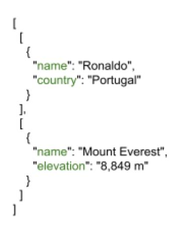
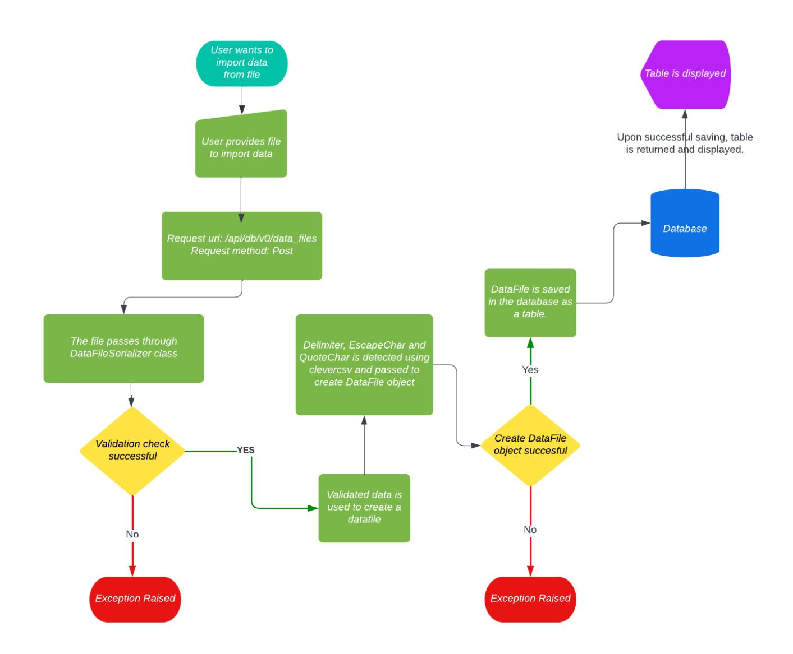
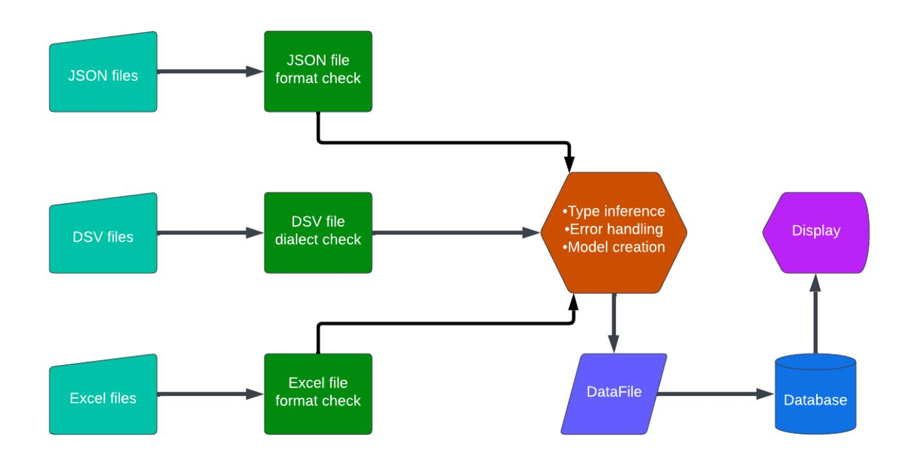

## Google Summer of Code '23

# **Support importing Excel and JSON files**

**Project: Support importing Excel and JSON files**

**Organization: Mathesar**

**Name: Aritra Majumder**

Currently, Mathesar UI allows users to import data into a table from a *CSV* or *TSV* (or any type of Delimiter Separated Values) file. Along with them, *Excel* and *JSON* are also extremely popular data storing and transmitting open standard file formats. This project aims that at the end of the GSoC '23 period, Mathesar UI will be able to allow users to import data from *Excel* as well as *JSON* files.

### **Feature Description:**

❖ The projected UI should support importing JSON and Excel files. ❖ Importing a file should create a single table, and we should allow the user to preview that table, remove/rename columns, change data types etc. ➢ If the JSON or Excel files are not in a format where they can be easily imported as a single table, we should develop algorithms to convert the files into a suitable format. ➢ If the algorithm doesn't work, we should refuse to import the files and provide the user with a readable error. ❖ Column data types should be guessed during the import process. ❖ We have APIs for importing data into existing tables. Ideally, those should also work with the two new file types.

### **Architectural Problems:**

JSON and Excel files are more complex than CSV/TSV files. The primary architectural challenges for this project are:

- 1. Figuring out a good algorithm for importing a single JSON file into a single table.
- 2. Figuring out a good algorithm for importing a single Excel file into a single table.
- 3. Integrating the new file types into our existing import process while preserving all our functionality.

### **Project Length:**

As discussed in the project idea, this project has a length **Long (~350 hours)**. I have planned the timelines and deliverables accordingly.

As I have already mentioned, our goal is to modify an existing API that takes in a **JSON** or **EXCEL** file and creates a table based on the data. Let's take a look at a typical **JSON** Object:

This represents an object with "name", "city" and "country" properties with values "Aritra", "Kolkata" and "India" respectively. So, we can infer that this represents a person object whose name is Aritra and the person lives in Kolkata, India. But, can we tabulate this object? Yes, we can. We will assign the properties as headers of the table and the values of the object as a row.

Now, what about JSON arrays? Can we tabulate them as well? Well, let us try for this JSON array.

| name    | city    | country   |
|---------|---------|-----------|
| Messi   | Rosario | Argentina |
| Ronaldo | Madeira | Portugal  |

This was obvious, but what will be the case when two objects don't have the same properties? Let's take this case,

What we can do is we can treat different properties as different headers and if an object doesn't contain a property we will assign a default (or null) value to the corresponding row.

| name    | city    | country   | Euro | Copa |
|---------|---------|-----------|------|------|
| Messi   | Rosario | Argentina | null | 2021 |
| Ronaldo | Madeira | Portugal  | 2016 | null |

Now let us handle the **nested fields** in JSON. When a field (or property) has value as a JSON object that's called a nested field.

Well, we can concatenate the nested property names to get the headers (There are already some routines to truncate header names)

| name    | city    | country   |                    |             |             |
|---------|---------|-----------|--------------------|-------------|-------------|
|         |         |           | awards/Ballon d’Or | awards/Euro | awards/Copa |
| Messi   | Rosario | Argentina | 7                  | 0           | 1           |
| Ronaldo | Madeira | Portugal  | 5                  | 1           | 0           |

Great, that's what we wanted. So far, so good.

Again, the property value might be an array. In this case, it will be a bit complex to convert JSON to a table. Let's see why.

Isn't that something we have already done? we will simply assign the array (or string) to the value of that property.

| name    | city    | country   | awards/Ballon | d’Or  |
|---------|---------|-----------|---------------|-------|
| Messi   | Rosario | Argentina | [2009,        | 2010] |
| Ronaldo | Madeira | Portugal  | [2008,        | 2012] |

But that would result in some **severe problems**. If we want to know which player won the Ballon d'or in 2009, we have to go through the *awards/Ballon d'or column* and check each cell if that cell contains the year 2009. What we can do is we can assign the **cell value as a variable of array data type** and therefore utilizes the corresponding functions of the same. Sorting and searching will be possible then. Also, if **we want to ensure atomicity**, we have an alternative.

| name    | city    | country   | awards/Ballon d’Or |
|---------|---------|-----------|--------------------|
| Messi   | Rosario | Argentina | 2009               |
| Messi   | Rosario | Argentina | 2010               |
| Ronaldo | Madeira | Portugal  | 2008               |
| Ronaldo | Madeira | Portugal  | 2012               |

This is also another option, as **sorting and searching** on *awards/Ballon d'or column* is possible. But, this table has too much redundant data as we have written two rows almost identical consecutively. To further optimise this table, we need to convert it to *Boyce Codd normal form (BCNF)* and that might generate multiple tables for a single JSON file. As primarily we are focusing on single-table creation as mentioned in the idea, we are going with one of the proposed tables for now.

Sometimes a user might want to import **an array of JSON arrays**. It might be a case when data is stored in batches. Let's consider the following JSON file:

If all the batches have a common schema, we will be able to tabulate them:

| name    | country   |
|---------|-----------|
| Messi   | Argentina |
| Ronaldo | Portugal  |
| Modric  | Croatia   |

But what will happen if they don't have a common schema or if they store different objects? We can still tabulate them, But the result might not be satisfactory.

The corresponding table view will be,

| name          | country  | Elevation |
|---------------|----------|-----------|
| Ronaldo       | Portugal | null      |
| Mount Everest | null     | 8,849 m   |

It hardly makes sense to keep Ronaldo and Mount Everest at the same table. So, for an array of JSON arrays, we will be checking if they all have the same sets of fields and if yes, then only we will tabulate them. else we will reject them as it might get complicated otherwise.

Once we successfully convert them to the table (I have implemented the logic [here\)](https://colab.research.google.com/drive/1aIomsdKqshI6CnIa9UTBCU0jst6onu4K?usp=sharing), type inference algorithms can be used to get the type of data. **Here is the type inference performance of the above-mentioned JSON file using the existing algorithm**.

Once the table view is rendered, the user should be able to modify the column names, cell values etc before saving as they can now.

**Now, let's try the same for Excel files**. We are creating a table from an EXCEL file (which already stores data in tabular form). Shouldn't that be easier? Well, here is a *messy* Excel file provided in the resources.

Even if we can see that there are two tables, Excel won't be able to detect that. Also, our primary focus is to create a single table, so we will allow the user to import the first available table. Let's look at another problem.

When we will be creating a table from the above file, the table might consider the first row as headers, but the first row in the figure is left blank. It's not only the first row, but the data can start from anywhere as well can lie in any of the available sheets.

There are popular python packages like [OpenPyXl](https://openpyxl.readthedocs.io/en/stable/), [pandas](https://pypi.org/project/pandas/) and [xlwings](https://pypi.org/project/xlwings/) which are extensively used to convert Excel files to pandas dataframes or CSVs considering the above problems.

Based on the working of those packages, we have to develop an algorithm that takes an Excel file as input and returns the first available table as the output.

Also, an Excel file might contain data in different sheets. So, we will allow the users to import the data from only the first sheet or all the sheets (if they have a common schema). Alternatively, we might allow importing data from multiple sheets which follow the schema of the first sheet.

Currently, OpenPyXl doesn't support **.ods** (OpenDocument Spreadsheet) files, there is another library **[pyexcel-ods](https://pypi.org/project/pyexcel-ods/)** which is an alternative that supports .ods files.

Mathesar currently allows creating tables from scratch and importing data from DSV files. When a file is imported, the data\_file API sends and validates the data in the backend and the corresponding table view is fetched.

The above depicted is the current flow of the data\_files API. This API works with valid **DSV** files. In addition to this, we need to implement algorithms so that the API will be able to accept JSON and Excel files as well and give the table output as the response.

import os filename, file\_extension = os.path.splitext('data\_file.ext')

We can get the extension of a file using the built-in **OS** module. Based on the file extensions, we will route the files to the corresponding algorithms. Currently, **DSV** files (.txt, .csv, .tsv) are parsed, tabulated and converted to a DataFile object using the **clevercsv** package. Similarly, JSON files (.json) and Excel files (.xlsx, .ods, .xlsb, .xlsm) should be routed to the corresponding logic to parse and tabulate them and to raise exceptions on failure.

An excel file might have multiple sheets. In that case, we will allow users to import only the first sheet or import all sheets if they have a common schema. Alternatively, we can allow the sheets that follow the schema of the first sheet as we did in the case of JSON.

Similarly for JSON files, if there are any parsing errors, we should be able to return a response highlighting the errors (This might be integrated with another GSoC project, **JSON editor** which will assist users with writing and parsing .json files). The API flow might be so designed that, table view requests are sent only for valid JSON files.

As I have already mentioned, we might need to append nested properties to get headers for the table. Sometimes, it will get lengthy (we will be using truncating routines to shorten them) or confusing and the user might want to change that to something convenient or readable. So, in this case, the table view might be necessary as well.

Currently, Mathesar has algorithms that takes in a DSV file infer the types of different columns, handles the errors and create the datafile models. On top of this, we need to develop algorithms that do the same for the Excel as well as JSON files.

### **API Spec:**

We don't have to modify the API endpoint here. Currently, the API takes in a file and returns a table as an output only for DSV (or .txt) files, otherwise throws an error. We have to change the underlying logic to accept JSON and Excel files as well, parse them, tabulate them and return the table as an API response.

Whenever we upload a file, a **POST** request is sent to **"api/db/v0/data\_files/"** with the file as payload.

On successful conversion, the **POST** request to the following endpoint "**http://api/db/v0/tables/6461/previews/"** fetches the records (rows) and previews the data into a table. Here is the sample preview of the response of the query to the endpoint.

After the user modifies the table, a **PATCH** request is sent to the following endpoint, "**api/db/v0/tables/6461/"** with payload "import\_verified" as **true** and the table is saved.

### **Type inference:**

When the user imports data from a JSON and Excel file, the column datatypes need to be inferred from the values of the columns. If a column has two distinct values **1** and **0**, then the datatype might be assumed as a Boolean. Similarly, if the column values are limited to numbers (integers), we can specify the column datatype as Number. If the column value is an array, the column will have JSON array data type.

Currently, Mathesar has the following type models:

- **Boolean**: Database Type: Boolean. Value is either 0 or 1.
- **Date**: Database Type: Date. Example: "mm/dd/yyyy".
- **Date & Time**: Database Type: Timestamp with or without Time Zones. Example: "mm/dd/yyyy hh:mm".
- **Duration**: Database Type: Interval.
- **Email**: Database type: Email. Example: "abc@gmail.com"
- **JSON List**: Database Type: JSON array. Example: ["a","b"]
- **Map**: Database Type: JSON object. Example: {"a":"b"}
- **Money**: Database Type: Money. Example: "\$50".
- **Number**: Database Type: Numeric. Example: 3
- **Text**: Database Type: Text. Example: "Aritra"
- **URI**: Database Type: URI. Example: "https://www.google.com"

Based on those data types, algorithms should be able to distinguish between datatypes and return the most specific one. 0 and 1 may be generalised as **Numbers**, but **Booleans** should be more appropriate. Similarly, 1, 2, 3 ... can be generalised as **Texts,** but should be inferred as **Numbers.** The same goes for JSON arrays and objects which can be generalised as Texts.

- [Pandas](https://pypi.org/project/pandas/): Pandas dataframe is one of the most popular tabular data representation data-structure. There are already implemented functions to convert Excel files and JSON (Python dictionary) to dataframe.
- [Json2table](https://pypi.org/project/json2table/): It's a simple Python package to convert python dictionary to an HTML table.
- [OpenPyXl:](https://pypi.org/project/openpyxl/) openpyxl is a Python library to read/write Excel 2010 xlsx/xlsm/xltx/xltm files.
- [Pyexcel-ods](https://pypi.org/project/pyexcel-ods/): pyexcel-ods is a tiny wrapper library to read, manipulate and write data in ods format using python
- [XLWings:](https://pypi.org/project/xlwings/) xlwings is an open-core spreadsheet automation package with a beautiful API.

All the libraries provided here might not be able to create a table that we have planned. It is better to develop algorithms that hardly rely on those libraries directly, rather rely on the underlying algorithm.

### **Research and References:**

I have added links for the packages to the corresponding documentation. Here I will add the google-colab files, I am (or will be working) on to implement the logic of converting JSON and Excel to table in python.

- Getting [delimiters](https://colab.research.google.com/drive/1aIomsdKqshI6CnIa9UTBCU0jst6onu4K?usp=sharing) from a DSV file (Done ✅)
- JSON to table [conversion](https://colab.research.google.com/drive/1aIomsdKqshI6CnIa9UTBCU0jst6onu4K?usp=sharing) (Done ✅)
- Excel to table [conversion](https://colab.research.google.com/drive/16aWY79PDRI2DqgwPM9pacrX_RuflYw35?usp=sharing) (Working on it ✍��) I have modified the general access to **commenter** for these files also,

happy to acknowledge your suggestions there.

Here are all the references:

- [CleverCSV](https://clevercsv.readthedocs.io/en/latest/source/clevercsv.html) and [this](https://github.com/alan-turing-institute/CleverCSV/issues/91) issue.
- How [Pandas](https://pandas.pydata.org/docs/reference/api/pandas.ExcelFile.parse.html) parses the Excel files

### **Timeline and Deliverables:**

| May    | 4  | Proposal  | accepted or                                                          |
|--------|----|-----------|----------------------------------------------------------------------|
|        |    | rejected. | ● Community Bonding Period Discussing the project with               |
|        |    |           | mentors and finalizing the project implementation.                   |
|        |    |           | ● Testing the APIs to better understand the API flow.                |
|        |    |           | ● Go through the documentation of Django Rest Framework,             |
|        |    |           | SQLAlchemy, Svelte and the codebase of Mathesar.                     |
| May    | 29 | Pre-work  | complete Coding Officially begins!                                   |
| Jun    | 6  | Milestone | #1                                                                   |
|        |    |           | ● Develop the algorithm to convert a JSON file to a table view.      |
|        |    |           | and test it for various JSON formats as mentioned above.             |
|        |    |           | ● Explore the alternatives to create a table that is close to the    |
|        |    |           | BCNF form.                                                           |
|        |    |           | ● Determine when a JSON file can’t be mapped into a single           |
|        |    |           | table and therefore take appropriate steps.                          |
| June   | 20 | Milestone | #2                                                                   |
|        |    |           | ● Modify the existing API to accept JSON files as well.              |
|        |    |           | ● Develop a class that validates the JSON and maps it into a         |
|        |    |           | single table and returns the table view to the user allowing         |
|        |    |           | him/her to modify the table.                                         |
| July   | 6  | Milestone | #3                                                                   |
|        |    |           | ● Explore all possible JSON-specific operations user should be       |
|        |    |           | able to perform on the table view.                                   |
|        |    |           | ● Modify the API endpoints to save the modified table view.          |
| July   | 20 | Milestone | #4                                                                   |
|        |    |           | ● Handle all kinds of errors that might happen when user-given       |
|        |    |           | files are poorly structured.                                         |
|        |    |           | ● Thoroughly test the APIs to assess the functionality, reliability, |
|        |    |           | performance and failure-handling capability.                         |
| August | 1  |           |                                                                      |
| August | 4  |           |                                                                      |
|        |    | Phase     | 1 Evaluation                                                         |
|        |    |           | ● During this period, I need to submit a report to my mentors on     |
|        |    |           | the performance of the API after integrating JSON support.           |
|        |    |           | ● If required, I need to work on the performance and response        |
|        |    |           | time of the same to improve user experience.                         |

| August    | 4  | Milestone | #5                                                                   |
|-----------|----|-----------|----------------------------------------------------------------------|
|           |    |           | ● Develop the algorithm to convert an Excel file to a table view.    |
|           |    |           | ● Modify the algorithm to create a common schema from the first      |
| August    | 18 | Milestone | #6                                                                   |
|           |    |           | ● Handle importing data into the table from all possible sheets.     |
|           |    |           | ● Determine when an Excel file (or a particular sheet) can’t be      |
|           |    |           | mapped into a single table and therefore take appropriate            |
| September | 1  | Milestone | #7                                                                   |
|           |    |           | ● Modify the existing API endpoint to accept Excel files as well.    |
|           |    |           | ● Develop a class that validates the Excel and maps it into a        |
|           |    |           | single table and returns the table view to the user allowing         |
|           |    |           | him/her to modify the table.                                         |
| September | 15 | Milestone | #8                                                                   |
|           |    |           | ● Explore all possible Excel-specific operations user should be      |
|           |    |           | able to perform on the table view.                                   |
|           |    |           | ● Modify the API endpoints to save the modified table view.          |
|           |    |           | ● Thoroughly Test the APIs to assess the functionality, reliability, |
|           |    |           | performance and failure-handling capability.                         |
| October   | 1  | Milestone | #9                                                                   |
|           |    |           | ● During this period, I need to submit a report to my mentors on     |
|           |    |           | the performance of the API after integrating Excel support.          |
|           |    |           | ● Based on the feedback received, I might work on the                |
|           |    |           | implementation of table normalization to ensure atomicity and        |
|           |    |           | reduce data redundancy.                                              |
| October   | 16 | Milestone | #10                                                                  |
|           |    |           | ● By now, Mathesar should be able to import data from both           |
|           |    |           | JSON and Excel files.                                                |
|           |    |           | ● Finalize everything done till now, add (or update) the             |
|           |    |           | documentation, add tests for the new features.                       |
| November  | 1  | Final     | week                                                                 |
|           |    |           | ● Submit my final work and wait for the evaluation.                  |
|           |    |           | ● Write a blog about my experience as a contributor to Mathesar      |
|           |    |           | under GSoC.                                                          |

This timeline is tentative and adjustable based on the mentors' feedback, advice and current progress.

### **Questionnaire:**

#### **1.** Why are you interested in working on Mathesar?

I had chosen Mathesar because I liked the idea behind Mathesar and it's tech-stack perfectly aligns with my expertise. I stayed with the organization because of the wonderful community it has.

#### 2. Why are you interested in working on this project idea?

I have previous experience working with Excel files and converting them to corresponding dataframe or tables. JSON (or YAML) to table conversion is something new to me and as a developer, I think, this will be extremely helpful to the developer community worldwide.

#### 3. What about your skills and experience makes you well-suited to take on this project?

I have previous experience working with Excel files and converting them to corresponding dataframe or tables. JSON (or YAML) to table conversion is something new to me and as a developer, I think, this will be extremely helpful to the developer community worldwide.

#### 4. Do you have any other commitments during the program period? Provide dates, such as holidays, when you will not be available.

After my final semester ends (May 15), I don't have any other commitments.

#### 5. If your native language is not English, are you comfortable working closely with a mentor in English?

Yes, absolutely.

- 6. Have you worked on a project remotely and/or with people in other time zones before? If you have, please provide details.

No, I did work on some projects remotely but not with people in other time zones.

#### 7. Are you interested in contributing to Mathesar after the program is complete?

Yes. I started open-source contribution recently and am enjoying it very much. After this project is completed, some issues and bugs might be raised by the users and contributors. I will love to solve those issues and other issues as well.

### **About Myself:**

I am a senior pursuing a B.E. degree in electrical engineering at Jadavpur University, Kolkata, India. I have been into web development and competitive programming since 2021. Apart from them, I enjoy playing football and athletics and watching soccer games, anime etc. My favourite subject is **Mathematics.**

- Name: Aritra Majumder
- IRC: @arima\_kun:matrix.org
- Mail Id: [aritramajumder8438@gmail.com](mailto:aritramajumder8438@gmail.com)
- Phone No: +918240484924
- GitHub: <https://github.com/Aritra8438>
- LinkedIn: <https://www.linkedin.com/in/aritra-majumder-juee23/>
- Country: India
- Primary language: English, Bengali.
- Typical work hours: 10:00 AM 8:00 PM IST (UTC + 05:30)
- Previous GSoC participation: This is the first time I am participating in GSoC.

### **Education:**

- Institution: Jadavpur University
- Degree: Bachelor of Electrical Engineering
- Major: Electrical Engineering
- Graduation Year: 2023
- Courses Taken:
  - Web Development
  - Data Structures and Algorithms
  - Object-oriented Programming
  - Database Management System

### **Skills:**

| Skill name | Proficiency | Where      | I’ve       | used this skill                    |
|------------|-------------|------------|------------|------------------------------------|
| Python     | 4           | Internship | at         | PwC                                |
| Django     | 4           | During     |            | Internship at Shiksha-sopan and in |
|            |             | projects   | under      | Mercor                             |
| Javascript | 3           | In my      | various    | projects.                          |
| DBMS       | 3           | Internship | at         | PwC                                |
| SQL        | 4           | Internship | at         | PwC                                |
| Teamwork   | 5           |            | Throughout | my life                            |

### **Experience:**

| Brief     | Description     | Relevant links Additional Notes                            |
|-----------|-----------------|------------------------------------------------------------|
| Worked    | on              | developing an                                              |
| online    | assessment      | platform                                                   |
| operated  | under           | H.C.Verma                                                  |
|           |                 | NAEST website                                              |
|           |                 | This project is confidential.                              |
|           |                 | Worked on developing the                                   |
|           |                 | backend written using Django.                              |
| Worked    | on              | developing                                                 |
| “Twilio   | Medicine        | Reminder”                                                  |
| under     | Mercor.         |                                                            |
| (under    | Mercor)         |                                                            |
|           |                 | Live demo                                                  |
|           |                 | The actual implementation is                               |
|           |                 | private under Mercor                                       |
|           |                 | Worked on the backend                                      |
|           |                 | ( Django ) and frontend ( VueJS )                          |
|           |                 | and the database ( PostgreSQL)                             |
|           |                 | of the site and integrated Twilio                          |
|           |                 | Twilio messaging API.                                      |
| Developed | a               | demo                                                       |
|           | E-commerce site | from                                                       |
|           |                 | Code Worked on the backend                                 |
|           |                 | ( Django ) and frontend ( VueJS )                          |
|           |                 | and the database ( SQLite)                                 |
| Project   | Lighthouse      |                                                            |
| (under    | PwC)            |                                                            |
|           |                 | This project is confidential. An industry-oriented project |
|           |                 | where I have extensively learnt                            |
|           |                 | and used Python, SQL and                                   |
|           |                 | packages like OpenPyXL,                                    |
|           |                 | XlWings and pandas.                                        |

### **Why I might be a Good Contributor:**

While I have a comprehensive electrical background, my emphasis is on software development. I have a considerable background in PostgreSQL (and MySQL), Python and Javascript and the frameworks built on them like Django and VueJS (I have mentioned VueJS because Svelte and VueJS have surprisingly similar structures). I have worked on Django and PostgreSQL to a great extent in my projects and internships.

Moreover, I have a good understanding of Django ORM (object-relational mapper) which might be relevant to this project. I have never used SQLAlchemy in my projects before but as one of the Python ORMs, I have an understanding of how Python ORMS works. I also have a good knowledge of SQL as I had to work on it during my internship period.

I have a strong knowledge of **Data Structures** and **Algorithms** which might be helpful when it comes to optimizing or improving the time complexity of an algorithm making the user experience. As I have a good understanding of the prerequisites, I can focus more on the project goals and implement many relevant features.

You can get a broader overview of me [here.](https://www.linkedin.com/in/aritra-majumder-juee23/)

### **Other Commitments:**

I have my final semester starting on May 1 and ending on May 15. After that, I'll be able to devote a minimum of 4 hours daily during May, June and July.

And in August, I have to choose a career option, but irrespective of what I choose, I will be able to devote 2 hours daily and 4 hours on weekends.

Mathesar is a tool that aims at delivering database assets to non-technical personnel. Moreover, JSON and Excel have emerged as very popular open standard file formats for data storage and transmission. This project aims at tabulating those data files in a convenient way both for non-technical personnel as well as the developer community worldwide.

#### **Contributions to Mathesar:**

I have started contributing to Mathesar very recently and one of my pull requests has been merged yet.

Here is the list of bugs and feature requests I have reported:

- 1. Support Importing [Semicolon](https://github.com/centerofci/mathesar/issues/2753) Separated Values file #2753
- 2. Exploration Inconsistency when [Corresponding](https://github.com/centerofci/mathesar/issues/2747) Table is Deleted #2747
- 3. [Database](https://github.com/centerofci/mathesar/issues/2736) Page not reflecting updated Table Count unless reloaded #2736

Here are the pull requests:

- 1. [#2720](https://github.com/centerofci/mathesar/pull/2770) This might optimize this [issue](https://github.com/centerofci/mathesar/issues/2663).
- 2. [#2759](https://github.com/centerofci/mathesar/pull/2759) This might fix this [issue](https://github.com/centerofci/mathesar/issues/2753).
- 3. [#2736](https://github.com/centerofci/mathesar/pull/2745) This might fix this [issue](https://github.com/centerofci/mathesar/issues/2736).

#### **Thank You, Mathesar:**

I hardly had any open-source contributions until I recently found Mathesar (to be specific, on the 20th of this month). But thanks to all the mentors and the maintainers of the community, their constant guidance and quick responses made open-source contribution easier and much more interesting for me in such a small time. Thank you for this beautiful community.

It's my earnest request to you to grant me a little time so that I can contribute towards the community. I am looking forward to being a part of Mathesar. Thank you, again.