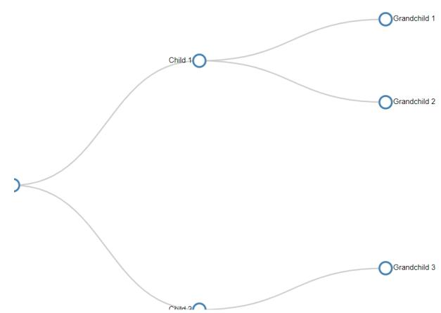

# **PROPOSAL FOR GSoC 2023**

## **Title: Interactive Mindmap Visualization for Collection Formats Organization : Postman Mentor : [Gbadebo](https://github.com/Gbahdeyboh) Bello**

#### *Abstract*

This project aims to develop an interactive mindmap visualization tool for the collection format, which will enable users to explore hierarchical data structures with ease. It will facilitate better understanding and navigation of complex relationships within collections and provide a user-friendly interface for organizing, manipulating, and traversing these structures.

#### *Personal Information*

| Name       |         | Jaydip Dey                                                 |
|------------|---------|------------------------------------------------------------|
| Email      |         | jaydipdey2807@gmail.com                                    |
| TimeZone   |         | Indian Standard Time (IST)                                 |
| University |         | Jadavpur University, Kolkata, India                        |
| Major      |         | Computer Science and Engineering                           |
|            | Skills  | HTML, CSS, JS, MERN Stack, Spring, Python, ML, C++, C, Sql |
| LinkedIn   | Profile | https://www.linkedin.com/in/jaydip-dey/                    |
| GitHub     | Profile | https://github.com/jaydip1235                              |

**About my achievements:** I am currently an SDE intern at [Mercor](https://mercor.io/) and a Full Stack development Instructor at [Placewit](https://placewit.com/). I have also been the finalist of Smart India [Hackathon](https://www.sih.gov.in/) 2022 and been an SDE Intern at [Optum](https://www.optum.com/). Beside that I have also contributed to [HacktoberFest](https://hacktoberfest.com/) and in many open source projects. I have won more than 10 Hackathons (inter-college and national) and am a hardworker and a quick learner. To see more about my achievements click [here](https://drive.google.com/drive/u/0/folders/1a3WOnKpL0INtFs27_IKlvrbNJTW0xCjs).

### *Related Work*

I have worked earlier with [visjs](https://visjs.org/) (a Javascript visualization library) to create an application of Dijkstra's shortest path algorithm. Project can be found [here](https://github.com/jaydip1235/Dijkstra_application_js)

Also **Contribution to Interactive Mindmap Visualization for Collection Formats project** issue can be found [here](https://github.com/postman-open-technologies/collection-format-mindmap/issues/3#issuecomment-1484737125) and [here](https://github.com/postman-open-technologies/collection-format-mindmap/issues/2#issuecomment-1484780433)

#### *Questions and Answers(as per this [guidance\)](https://github.com/postman-open-technologies/gsoc-2023/blob/main/CONTRIBUTOR_GUIDANCE.md)*

#### **1. What interests you most about this project?**

**Ans:** I am most interested in this project due to the following reasons:

- It will help me to explore the collection format and come up with an interactive mindmap for the same. I think I will be able to come up with the most viable solution for that as I have good knowledge for the same.
- I will be able to expand my knowledge more towards Javascript and the visualization tool.
- It will also allow me to contribute to postman, an organization in which I have a dream of joining.

#### **2. As mentors and project coordinators, how can we get the best out of you?**

**Ans:** As mentors and project coordinators, you can get the best out of me by:

- A regular/periodic communication and feedback.
- Guidance and support when needed. A little bit of support is enough for me since I am a quick learner and will be able to learn the rest on my own.

I will try my best to deliver the best possible solution.

#### **3. Is there anything that you'll be studying or working on whilst working alongside us?**

**Ans:** I will completely devote my time while working with you. Also I don't have any time bound, I can work in the morning as well as at night. Besides that I will study and research the necessary things related to this project so that I can come out with the most viable solution.

#### **4. We'd love to hear a bit on your work preferences, e.g. how you keep yourself organized, what tools you use, etc?**

**Ans:** I prefer to use bitrix24 for managing my work so as to come up with the best possible result. Also I try to prioritize my work and divide my time schedule on the basis of that. I try to complete my work 1-2 days before the deadline and manage to do it in most of the cases. Once I complete my task I get reviewed by my mentor and work on the changes suggested. In all these ways, I keep myself organized.

#### **5. Once you've selected a project from the ideas section, please suggest a weekly schedule with clear milestones and deliverables around it. Alternatively, if you want to propose your own idea then please include an outline, goals, and a well-defined weekly schedule with clear milestones and deliverables.**

**Ans:**

| Week 1-2   | Research and gather requirements, establish project structure.                   |
|------------|----------------------------------------------------------------------------------|
| Week 3-4   | Select appropriate libraries for visualization and interaction and exploring all |
|            | possible outcomes for the same                                                   |
| Week 5-6   | Develop the core functionality for parsing and displaying JSON files as          |
|            | interactive mindmaps.                                                            |
| Week 7-8   | Implement mindmap interaction features, such as zooming, panning, and            |
|            | node reorganization and backend implementation(if required)                      |
| Week 9-10  | Integrate customizable visual elements and user interface enhancements.          |
| Week 11-12 | Testing, bug fixing, documentation, and finalizing the project.                  |

Periodic meetings, taking regular feedback from the mentors and work on the same will be a part of all the weeks.

#### *Project Goals*

The primary goal of this project is to develop an interactive mindmap visualization tool for collection formats, with the following features:

- Interactive, user-friendly interface for navigating and manipulating the mindmap.
- Customizable visual elements, such as colors, fonts, and icons, to facilitate easier understanding of the data.
- Allowing other features like zooming, editing, expanding nodes and other customization.
- Integration with popular web-based platforms for increased accessibility and usability.

#### *HLD and LLD*

High-level design (HLD) and low-level design (LLD) are two stages in the software development process. The HLD stage focuses on the overall architecture of the software, while the LLD stage deals with the details of each component of the software. Here is an HLD and LLD of an interactive mind map visualization for collection formats.

#### **High-Level Design:**

The system will have the following components:

- **User Interface:** The user interface will be the primary component of the system. It will be responsible for presenting the mind map visualization to the user and providing them with the necessary tools to manipulate and interact with the data.

- **Data Storage:** The data storage component will be responsible for storing the collection data in a hierarchical format that can be easily represented by the mind map visualization.
- **Server-Side Logic(Future scope):** The server-side logic will be responsible for handling the user's requests and interacting with the data storage component.(Future scope)

#### **Low-Level Design:**

In the starting we will consider the schema for [this](https://schema.postman.com/collection/json/v2.1.0/draft-07/collection.json) JSON and then proceed with the UI, data storage and server side logic.

- **● User Interface:**
  - 1. The user interface will be built using HTML, CSS, and JavaScript.
  - 2. The mindmap visualization will be implemented using a third-party JavaScript library,such as D3.js or Vis.js.
  - 3. Mindmap can be traversed using **depth-first search** (DFS) or **breadth-first search** (BFS) and information can be stored in an array-like data structure.**DFS** traverses the mindmap by visiting a node and then exploring as far as possible along each branch before backtracking. **BFS** traverses the mindmap level by level, processing all nodes at the current level before moving on to the next level.
  - 4. The user interface will provide the user with the following functionalities:
    - i. Add new nodes to the mind map
    - ii. Delete existing nodes from the mind map
    - iii. Edit node labels and other properties
    - iv. Expand and collapse nodes to show and hide child nodes
    - v. Zoom in and out of the mind map
    - vi. Save and load mind map data
- **● Data Storage:**
  - 1. The collection data will be stored in a hierarchical format, such as JSON.
  - 2. The data will be stored on the server-side in a database, such as MySQL or MongoDB.
  - 3. The server-side logic will be responsible for querying and updating the database as needed.
- **● Server-Side Logic(Future scope):**
  - 1. The server-side logic will be built using a server-side programming language,
  - 2. The logic will be responsible for handling the user's requests, such as adding, deleting, or editing nodes, and returning the appropriate responses.
  - 3. The logic will interact with the data storage component to query and update the data as needed.

#### *Research work on mindmap libraries in js*

There are numerous mind mapping tools available in JavaScript, each with its unique features and capabilities.

- 1. **[D3.js](https://d3js.org/)** is a popular JavaScript library for creating data visualizations, including mind maps.

Pros:

- Highly customizable.
- Supports interactive features such as zooming, panning, and node manipulation.
- Uses a modular approach to reuse code and create reusable components.
- Capable of handling large datasets and rendering complex visualizations.

Cons:

- Does not provide a built-in mind map layout.
- Limited backward compatibility.

- 2. **[jsMind](https://github.com/hizzgdev/jsmind)** is a lightweight and efficient mind mapping library. It is easy to integrate and provides extensive customization options.

Pros:

- Simple, intuitive API
- Supports various themes and layout styles
- Export to JSON, text, or image formats
- Touch device support

Cons:

- Limited built-in features compared to other libraries
- No automatic layout adjustments on node addition or removal

- 3. **[Mindmup](https://github.com/mindmup/mapjs)** is a powerful and feature-rich mind mapping library that provides an interactive user interface and a flexible API.

Pros:

- Advanced layout capabilities
- Keyboard navigation and shortcuts
- Integration with cloud storage providers
- Import and export in multiple formats

Cons:

- More complex and heavyweight compared to jsMind
- May require additional dependencies

- 4. **[d3-mindmap](https://github.com/d3-node/d3-mindmap)** is a mind mapping library built on top of the popular D3.js library. It offers excellent visualization capabilities and leverages D3's flexibility.

Pros:

- D3.js integration enables advanced data-driven visualizations
- Interactive and smooth animations
- Highly customizable

Cons:

- Larger file size due to D3 dependency

- 5. **[GoJS](https://gojs.net/latest/samples/mindMap.htm)** is a feature-rich diagramming library that includes mind mapping capabilities. It is highly customizable and offers a wealth of features. Pros:
  - Advanced layout and interaction features
  - Extensive documentation and support
  - Touch device support
  - Undo/redo functionality Cons:
    - Proprietary software (not open-source)
    - May be overkill for simple mind mapping needs

#### *Implementation Details*

#### **Frontend**

The project will be implemented using the following technologies and libraries: HTML, CSS, Javascript and D3.js (for creating the interactive mindmap visualization).

**JSON** and **XML** parsers are to be created for converting the collection formats into a hierarchical data structure that can be used by D3.js.

Converting a collection of data into a hierarchical format is often necessary for visualizing data with D3.js because it allows for easy manipulation of the data and provides a natural structure for creating visual elements such as nodes, links, and labels. Hierarchical data structures allow for a clear representation of the relationships between the data elements, making it easier to identify patterns and trends. In addition, hierarchical data structures can be useful for organizing and presenting complex data sets in a more understandable way.

Below shows the **code for the JSON Parser, its explanation and output.**

**Explanation :** The function initializes an empty object called *hierarchy*, then iterates through each object in the array using a *for* loop. It extracts the keys of each object using the *Object.keys* method, and then iterates through those keys using another *for* loop. For each key-value pair, the function creates a new node in the *hierarchy* if it does not already exist, and then moves the *currentNode* variable down to the newly created node. At the end of the function, it returns the *hierarchy* object.

Code for JSON Parser

The following output is obtained after converting the collection formats into a hierarchical data structure

Output

Similarly XML parser is used to parse XML into hierarchical data structure.

Below shows the **code for the XML Parser, its explanation and output.**

**Explanation :** This code uses the *DOMParser* object to parse an XML string into an XML document object, and then recursively traverses the document object to build a JavaScript object representation of the hierarchical data structure.

XML Parser

The following output is obtained after converting the collection formats into a hierarchical data structure:

After converting the collection format to hierarchical data structure, the UI needs to be build using HTML and CSS and the visualization is to be shown using D3.js or any other visualization tools.

Below shows a sample **HTML snippet** for the same:

**Explanation :** The first *<script>* element loads the D3.js library from the specified URL. The second *<script>* element loads the *mindmap.js* file, which is a custom JavaScript file that uses D3.js to create a mind map visualization.

Below shows **CSS snippet** for the above HTML file:

**Explanation :** The above css rules define the visual appearance of a graph, with nodes as circles with white fill and steel blue outline, node text in *sans-serif* font, and links as lines with light gray color.

After adding HTML and CSS, a *mindmap.js* file is created to populate the graph.

**Explanation :** The code first defines an object called *data* which contains information about the tree structure, including the name of the root node and the names of its children and grandchildren.

Then, it defines the size of the SVG element and appends it to the body of the HTML document.

The code creates a hierarchical layout for the data using the *d3.hierarchy()* function. It also creates a tree layout using the *d3.tree()* function and sets the size of the tree layout to match the size of the SVG element.

Afterwards, it creates a *linkGenerator* function using *d3.linkHorizontal()*, which will be used to generate the path for the links between the nodes.

Then, it applies the tree layout to the root node using the *treeLayout()* function. Finally, the code adds the links and nodes to the SVG element using the *selectAll()*, *data()*, *enter()*, and *append()* methods.

It creates paths for the links and circles and text for the nodes, using the *linkGenerator()* function to determine the path for the links and the transform attribute to position the nodes on the SVG. The text is positioned using the text-anchor, dx, and dy attributes.

Finally the following graph is displayed on the browser:

Now, for extracting the information of each node the mindmap can be traversed using **DFS** or **BFS**

DFS

Both of these methods allows us to traverse a collection format mindmap and extract information by providing a callback function. The callback function can be customized to process the nodes and extract any specific information as per the need.

#### **Additional Points:**

- 1. We can add interaction to a D3.js visualization by using event listeners to capture user actions, such as mouse clicks or mouse movements, and update the visualization accordingly.

In the below code snippet, we select the SVG element using *d3.select("svg")* and append a circle to it using *.append("circle")*. We then add a mouse click event listener to the circle using *.on("click", function() {...})*. Inside the event listener function, we update the fill color of the circle using *d3.select(this).style("fill", "red")*.

- 2. React can be used instead of HTML to create the frontend. Several advantages of React over HTML includes:
  - Component-based architecture
  - Virtual DOM
  - Declarative programming
  - Server-side rendering

#### **Backend**

**Node.js** and **Express.js** are used for the back-end server to handle file import/export and **Socket.IO** for real-time collaboration.

For creating the backend, we need to install **express**, **socket.io** and **multer** for file upload. After that a main server file is to be created

Below shows the **explanation and sample code snippet** for the same

**Explanation:** First, the program imports the required dependencies - Express, Socket.IO, and Multer - using the *require()* function. It creates an instance of the Express application using *express()* function and an instance of the HTTP server using *http.createServer()* method provided by Node.js's built-in http module, passing in the Express app instance as an argument.

Next, it sets up a WebSocket server using Socket.IO library with the server instance, which allows real-time communication between the server and the client using WebSockets protocol. Then, it sets up Multer middleware to handle file uploads. Multer is a Node.js middleware for handling multipart/form-data, which is primarily used for uploading files. The *multer.diskStorage()* function configures the storage engine used by Multer to store the uploaded files. Here, the function specifies that uploaded files should be stored in the uploads/ directory with a unique filename generated using the *Date.now()* function and the original filename of the uploaded file.

After configuring the file upload storage, the program specifies that the Express app should serve static files located in the public/ directory using the *express.static()* middleware function. Finally, the program sets up the HTTP server to listen on a specified port number using the *server.listen()* function.

After that creation of **Routes** will be followed

Below shows the **explanation and sample code snippet** for the same

**Explanation:** The first route is responsible for handling file uploads. When a POST request is sent to the "/upload" endpoint, it uses the upload middleware to handle a single file upload with the field name "mindmap". If the file is successfully uploaded, the server responds with a 200 status code and a JSON message indicating that the file was uploaded successfully. The second route is responsible for handling file export functionality.

The third code block is responsible for handling Socket.IO connections. When a user connects to the server, the server logs a message saying "User connected". Whenever a user makes any changes to the "mindmap" data, the server sends a broadcast message to all connected clients except the sender, to update the mindmap data for them.

Finally, when a user disconnects from the server, the server logs a message saying "User disconnected".

Routes

**Additional Point:** More Routes can be created with the requirements and Database (SQL or NOSQL) can be used to store the data as per the need

At the end of the GSoC period, the following deliverables are expected:

- A fully functional, interactive mindmap visualization tool for collection formats.
- Import and export support for JSON and XML formats.
- Real-time collaboration functionality for multiple users.
- Comprehensive documentation and user guides.

#### *Future work*

After the successful completion of this project, potential future developments could include:

- Integration with popular cloud storage services, such as Google Drive and Dropbox.For example there should be a provision to save the mindmap directly from the UI to Google drive for further use.
- Development of plugins for popular code editors and IDEs, such as Visual Studio Code and JetBrains IDEs.

#### *Conclusion*

This project will greatly benefit by providing a user-friendly and interactive tool for visualizing and understanding collection formats. By offering real-time collaboration and integration with web-based platforms, the tool will enhance productivity and promote a better understanding of hierarchical data structures.

#### *Note of Thanks*

I would like to thank my mentor [Gbadebo](https://github.com/Gbahdeyboh) Bello for his extreme support and guidance towards writing this GSoC proposal. I am super excited to work on this project and with Postman.

## **THANK YOU**