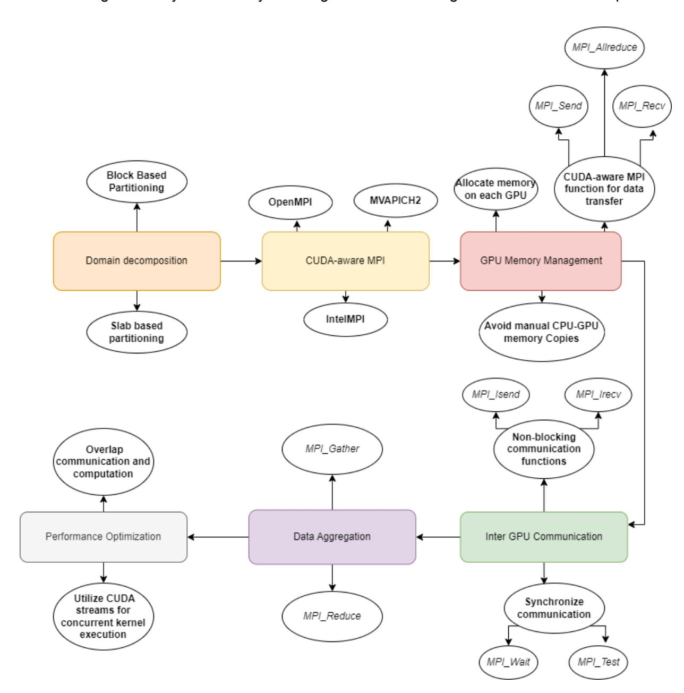

# **PROPOSAL FOR GSoC 2023**

## **Title: Multi-GPU model execution Organization : gprMax**

#### *Abstract*

The project aims to develop a multi-GPU model execution framework for large-scale simulations that exceed the memory capacity of a single GPU. This will implement a domain decomposition or memory sharing approach using Python and CUDA to efficiently distribute the workload and share memory across multiple GPUs. The primary goal is to expand the capabilities of the existing GPU-based (PyCuda) solver to handle complex simulations that require more memory than a single GPU can provide.

### *Personal Information*

| Full name        |                         | Jaydip          | Dey                                     |                               |
|------------------|-------------------------|-----------------|-----------------------------------------|-------------------------------|
| Email            |                         |                 | jaydipdey2807@gmail.com                 |                               |
| Location         |                         | Kolkata,        | India                                   |                               |
| TimeZone         |                         | Indian Standard | Time                                    | (IST)                         |
| University       | Jadavpur                | University,     |                                         | Kolkata, India                |
| Major            | Computer                | Science         | and                                     | Engineering                   |
| LinkedIn Profile |                         |                 | https://www.linkedin.com/in/jaydip-dey/ |                               |
| GitHub Profile   |                         |                 | https://github.com/jaydip1235           |                               |
|                  | I am pursuing B.E in    | CSE from        | Jadavpur                                | University, Kolkata. I am     |
|                  | currently an SDE intern | at              | Mercor and                              | a Full Stack development      |
|                  | Instructor at Placewit  | I have          | also been                               | the finalist of Smart India   |
|                  | Hackathon 2022 and      | been an         | SDE Intern                              | at Optum. Beside that I       |
|                  | have also contributed   | to              | HacktoberFest                           | and in many open source       |
|                  | projects. I have won    | more than       | 10                                      | Hackathons (inter-college and |
|                  | national) and am a      | hardworker      | and a                                   | quick learner. To see more    |
|                  | about                   | my              | achievements                            | click here.                   |

#### *Motivation and Experience(as per this [guidance\)](https://github.com/gprMax/GSoC/blob/main/project-template.md)*

#### **● Describe your motivation for participating in Google Summer of Code?**

I am motivated to participate in GSoC because it provides an opportunity to work on real-world, open-source projects, improve my coding skills, and network with experienced developers. Additionally, the program helps to build my portfolio, making me more marketable for future job opportunities.

#### **● Have you participated in Google Summer of Code in the past?**

I have not participated in GSoC before. However I have participated in many open source projects

#### **● Why did you choose gprMax?**

I chose gprMax because I am interested in computational electromagnetics, and gprMax is a well-established, widely-used software in this field. I believe working on gprMax would allow me to deepen my understanding of electromagnetics and contribute to a project with significant real-world applications.

#### **● Why did you select this project idea?**

I selected this project idea because it aligns with my interests and skill set. Moreover, it presents a challenge that allows me to learn new technologies and concepts while making a meaningful impact on the software's functionality and performance.

- **● What are your expectations from us during and after successful completion of the program?**

During the program, I expect guidance and mentorship from the project maintainers to help me understand the codebase, review my contributions, and provide feedback. After successful completion, I hope to continue contributing to the project, maintain a professional relationship with the mentors, and leverage the experience for future opportunities.

#### **● What are you hoping to learn?**

I am hoping to learn more about computational electromagnetics, advanced programming techniques, and optimization strategies. I also aim to improve my skills in Python, C, and CUDA.

- **● How much time will you be able to devote to the project? Are you doing any other internships this summer?**

I can devote approximately 40 hours per week to the project. I am not doing any other internship this summer, so GSoC will be my primary focus.

- **● What kind of projects have you worked on in the past? What technologies did you use?**

In the past, I have worked on projects involving machine learning, web development, and data analysis. I have used technologies like Python, JavaScript, and various ML libraries like TensorFlow and scikit-learn.

#### **● What is your experience with Python, C, CUDA?**

I have a strong background in Python, having used it extensively for various projects and coursework. I have intermediate experience with C, mostly from systems programming and data structure courses. My experience with CUDA is limited, but I am eager to learn and apply it in the context of the GSoC project.

#### *Weekly Schedule*

| Week 1   |  | ●          | Introduction | to       | the    | project      | and             | understanding | the       | requirements.        |
|----------|--|------------|--------------|----------|--------|--------------|-----------------|---------------|-----------|----------------------|
|          |  | ●          | Research     | existing |        | solutions    | for             | multi-GPU     | model     | execution and        |
|          |  |            | memory       | sharing. |        |              |                 |               |           |                      |
|          |  | ● Study    | the          | current  |        | GPU-based    | (PyCuda)        | solver        |           | implementation.      |
| Week 2-3 |  | ●          | Develop a    | plan     | for    | implementing | the             | multi-GPU     |           | model execution.     |
|          |  | ●          | Discuss the  | plan     | with   | mentors      | and             | gather        | feedback. |                      |
|          |  | ● Start    | working      | on       | the    |              | implementation  | based         | on the    | feedback received.   |
| Week 4-5 |  | ●          | Continue     | working  | on     | the          | implementation. |               |           |                      |
|          |  | ●          | Implement    | the      | domain |              | decomposition   | approach      |           | for multi-GPU model  |
| Week 6   |  | ●          | Implement    | the      | memory | sharing      |                 | approach for  |           | multi-GPU model      |
|          |  | ● Begin    | testing      | the      | domain |              | decomposition   | and           | memory    | sharing              |
|          |  |            | approaches   | for      |        | correctness  | and             | efficiency.   |           |                      |
| Week 7   |  | ●          | Continue     | testing  | both   |              | approaches.     |               |           |                      |
|          |  | ● Identify | and          | fix      | any    | issues or    | bottlenecks     | in            | the       | implementation.      |
|          |  | ● Start    | working      | on       | the    | integration  | of              | the multi-GPU |           | model execution with |
|          |  | the        | existing     |          | PyCuda | solver.      |                 |               |           |                      |

| Week 8 ●  |          | Continue | integrating   | the            | multi-GPU |              | model          | execution     | with the existing  |
|-----------|----------|----------|---------------|----------------|-----------|--------------|----------------|---------------|--------------------|
|           | PyCuda   |          | solver.       |                |           |              |                |               |                    |
| ●         | Perform  |          | testing       | and debugging  |           | to ensure    | correct        | and           | efficient          |
| ●         |          | Compare  | the           | performance    | of the    | domain       |                | decomposition | and memory         |
|           | sharing  |          | approaches.   |                |           |              |                |               |                    |
| Week 9 ●  | Based    | on       | the           | performance    |           | comparison,  | choose         | the           | best approach for  |
|           | the      | project. |               |                |           |              |                |               |                    |
| ●         | Make     |          | necessary     | changes        | to the    | PyCuda       | solver         | to            | support the chosen |
| ●         | Perform  |          | extensive     | testing        | and       | debugging    | to             | ensure        | correct            |
| Week 10 ● |          | Optimize | the           | multi-GPU      | model     | execution    | for            | better        | performance and    |
| ●         | Work     | on       | documentation |                | and       | preparing    | examples       | to            | demonstrate the    |
|           | usage    | of       | the           | multi-GPU      | model     | execution.   |                |               |                    |
| ●         | Finalize | the      |               | implementation | and       | ensure       | it meets       | the           | project            |
| Week 11 ● | Prepare  | the      | final         | report and     |           | presentation | of the         | project.      |                    |
| ●         | Discuss  | the      | project       | results        | and       |              | implementation | with          | the mentors.       |
| ●         | Address  | any      | final         | feedback       | from      | the          | mentors        | and           | make necessary     |
|           | changes  | to       | the           | implementation |           | and          | documentation. |               |                    |
| Week 12 ● | Submit   | the      | final         | report and     | code      | for          | evaluation.    |               |                    |
| ●         | Share    | the      | results       | of the         | project   | with the     | community      |               | and gather         |
| ●         |          | Complete | any final     | tasks          | and       | wrap up      | the project.   |               |                    |

#### *Introduction*

As computational models become more sophisticated, the need for high-performance computing (HPC) resources grows. One of the most popular ways to address this need is by utilizing Graphics Processing Units (GPUs), which offer significant performance improvements over traditional Central Processing Units (CPUs) for many tasks. However, this performance comes with limitations, particularly regarding memory capacity. As simulations increase in size and complexity, their memory requirements often exceed the capacity of a single GPU.

This project aims to investigate and implement methods for multi-GPU model execution, allowing models to execute and share memory across multiple GPUs. This will enable more complex and larger-scale simulations to be performed efficiently, opening up new possibilities in various research fields.

#### *Objectives*

- Investigating and assessing existing methods for multi-GPU model execution and memory sharing.
- Development of a suitable strategy for implementing multi-GPU model execution, considering both MPI-based domain decomposition and memory sharing approaches.
- Implementing the chosen strategy within the PyCuda solver framework.
- Evaluating the performance and scalability of the implemented solution using various benchmarks and real-world simulation scenarios.
- Providing comprehensive documentation and user guides for the developed solution.

#### *HLD and LLD*

#### **High-Level Design (HLD)**

#### **Overview:**

Designing a distributed GPU-based (PyCuda) solver that can execute large-scale simulations, which require memory beyond the capacity of a single GPU. Implementation of a solution to enable models to run and share memory across multiple GPUs, leveraging domain decomposition or memory sharing techniques.

#### **Components:**

- a. Data Partitioning Module
- b. GPU Communication Module
- c. Solver Module
- d. Load Balancer Module
- e. Result Aggregator Module

#### **Workflow:**

- a. Dividing the simulation data into smaller chunks using the Data Partitioning Module.
- b. Assigning data chunks to available GPUs using the Load Balancer Module.
- c. Implementing the GPU Communication Module to share memory and synchronize data between GPUs.
- d. Execution of the Solver Module on each GPU, processing the assigned data.
- e. Aggregation the results from all GPUs using the Result Aggregator Module.

#### **Low-Level Design (LLD):**

#### **Data Partitioning Module:**

- a. Analyzing the simulation data and dividing it into smaller, equally-sized chunks based on the available GPUs.
- b. Ensuring that the partitioning is optimal for efficient execution and minimal data communication overhead.

#### **GPU Communication Module:**

- a. Using MPI or another suitable library to establish communication between GPUs.
- b. Implementing shared memory spaces for efficient data transfer.
- c. Implementing synchronization mechanisms to ensure data consistency and prevent race conditions.

#### **Solver Module:**

- a. Modifying the existing PyCuda solver to work with the distributed data model.
- b. Implementing the solver to process assigned data chunks on each GPU.
- c. Communication with other GPUs to share intermediate results and synchronize data.

#### **Load Balancer Module:**

- a. Monitoring the workload on each GPU and ensuring even distribution of tasks.
- b. Dynamically reassign tasks among GPUs to avoid bottlenecks and optimize performance.

#### **Result Aggregator Module:**

- a. Collection of the processed data chunks from each GPU.
- b. Combination and analyzing the results to generate the final output of the simulation.

#### *Literature review*

Investigate existing methods and frameworks for multi-GPU model execution and memory sharing. This involves studying relevant publications and comparing different approaches, such as MPI-based domain decomposition and memory sharing techniques.

#### *Strategy development*

Based on the literature review, development of a suitable strategy is necessary for implementing multi-GPU model execution within the PyCuda solver framework. This will involve considering factors such as ease of implementation, performance, scalability, and compatibility with existing code.

#### *Implementation:*

One of the ways of implementing this is to use a hybrid approach that combines MPI (Message Passing Interface) with CUDA-aware MPI for domain decomposition and memory sharing. This approach allows to distribute the model across multiple GPUs, enabling large-scale simulations without being limited by the memory of a single GPU. Here's a general flowchart of the process:

#### **Domain Decomposition:**

First, decompose the problem domain into smaller subdomains. Each subdomain will be assigned to a separate GPU. This can be done using regular spatial decomposition methods like block-based or slab-based partitioning.

#### **CUDA-aware MPI:**

Implementing a version of MPI that is aware of CUDA and can handle GPU memory directly. This will enable efficient communication between different GPUs. There are several CUDA-aware MPI implementations available, such as **OpenMPI**, **MVAPICH2**, and **Intel MPI**.

#### **GPU Memory Management:**

For each subdomain, allocate memory on the respective GPU. When transferring data between GPUs, use CUDA-aware MPI functions like **MPI\_Send**, **MPI\_Recv**, or **MPI\_Allreduce**, which can directly handle GPU memory buffers without the need for manual CPU-GPU memory copies.

#### **Inter-GPU Communication:**

It may be required to exchange data between GPUs at specific intervals during the simulation. This can be done using non-blocking communication functions like **MPI\_Isend** and **MPI\_Irecv**, which allows to perform other computations while data is being exchanged. Synchronizing the communication using **MPI\_Wait** or **MPI\_Test** functions is required to ensure data consistency.

#### **Data Aggregation:**

After the simulation is complete, aggregate the results from all GPUs. This can be done using the **MPI\_Gather** or **MPI\_Reduce** functions, which allows collecting data from all GPUs into a single buffer.

#### **Performance Optimization:**

To improve performance,overlapping communication and computation using asynchronous communication functions is considered. Also, utilization of CUDA streams will be done to execute multiple kernels concurrently within a single GPU.

#### **Here's a high-level pseudocode to illustrate the process:**

By following this approach, we can efficiently distribute models across multiple GPUs, allowing us to execute large-scale simulations without being constrained by the memory limitations of a single GPU.

#### *Deliverables*

By the end of the project, we expect to have:

- A well-researched and implemented multi-GPU execution framework for the GPU-based solver.
- Enhanced capabilities of the existing PyCuda solver to handle large-scale simulations that exceed the memory capacity of a single GPU.
- A thorough performance evaluation demonstrating the effectiveness and scalability of the developed framework.
- Comprehensive documentation and a user guide for using the multi-GPU execution framework.

#### *Questions and answers (On the basis of the project information section [here\)](https://github.com/gprMax/GSoC/blob/main/project-template.md)*

- **● How will you deal with project, task, and time management? Will you utilize software? If so, which tool and why?**

To deal with project, task, and time management, I will utilize a combination of software tools and communication strategies. For effective time and task management, I will use **Trello**, a project management tool that allows for the creation of boards, lists, and cards to organize tasks and set deadlines. **Trello** is suitable for this project because it facilitates easy collaboration with mentors and offers a clear overview of progress.

- **● How often and by what means will you communicate with the mentors?**

For communication with the mentors, I will use a mix of email, Slack, and video calls. Regular communication is crucial to ensure we are aligned and to address any questions or concerns. I propose weekly progress meetings via video calls to discuss the project status and plan for the next week, while Slack will be used for day-to-day communication and email for formal updates.

- **● Include what you hope to achieve in the community bonding period. If you feel that there is something that you will have to learn before the coding period starts, mention it.**

During the community bonding period, I hope to achieve the following:

- 1. Build rapport with mentors and team members.
- 2. Gain a deeper understanding of the project requirements and objectives.
- 3. Familiarize myself with the existing codebase and development environment.
- 4. Identify any knowledge gaps and begin learning necessary concepts, such as advanced CUDA programming techniques and MPI.

#### **● Which aspect of the project idea do you see as the most difficult?**

The most difficult aspect of the project idea is likely to be the development of an efficient domain decomposition or memory sharing approach to enable multi-GPU model execution. This will require in-depth understanding of GPU memory management, CUDA programming, and parallel computing concepts.

#### **● Which aspect of the project idea do you see as the easiest?**

The easiest aspect of the project idea is likely to be the integration of the developed solution into the existing PyCuda-based solver, given that the project already utilizes Python and CUDA, which are among the required skills.

#### **● Future Work - what might be the next steps after completion of this project?**

Future work for this project may include:

- 1. Optimizing the developed solution for different types of GPU architectures and memory configurations.
- 2. Extending the multi-GPU support to other solvers and frameworks in the organization's ecosystem.
- 3. Developing performance benchmarking tools to evaluate the efficiency of the multi-GPU solution.
- 4. Investigating the potential of using other parallel programming models or APIs, such as OpenCL or Vulkan, to achieve similar results.

# **THANK YOU**