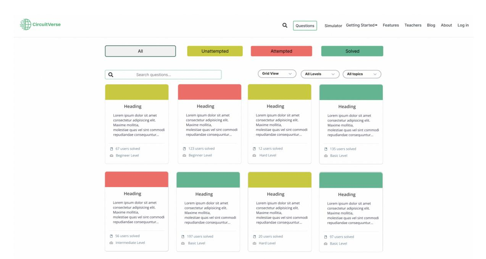
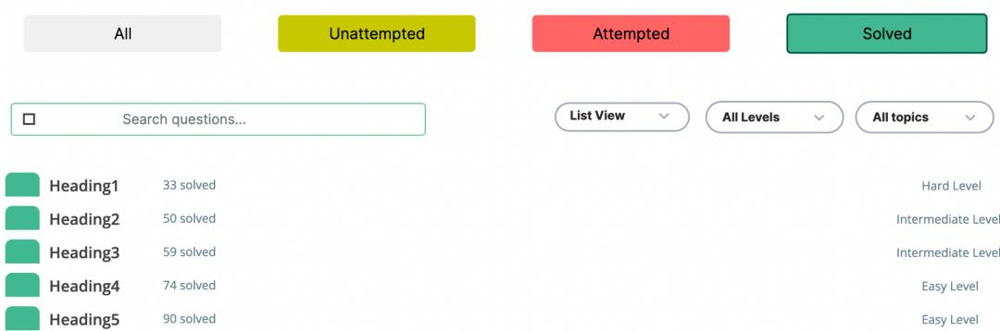
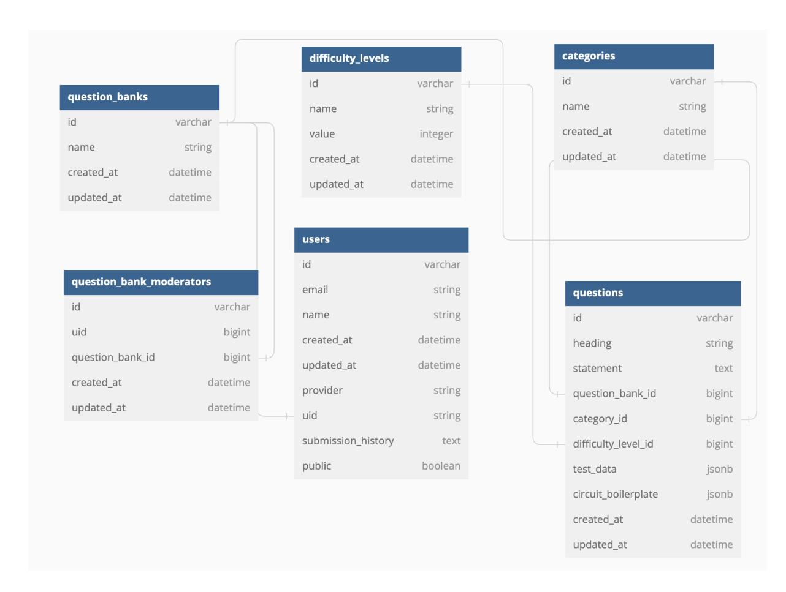
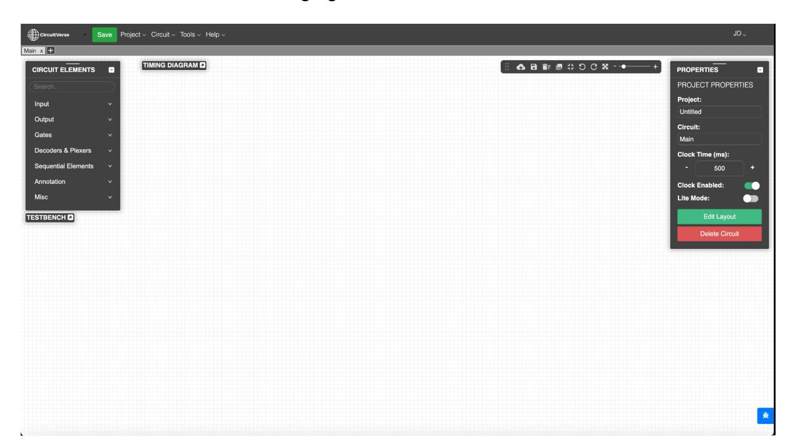
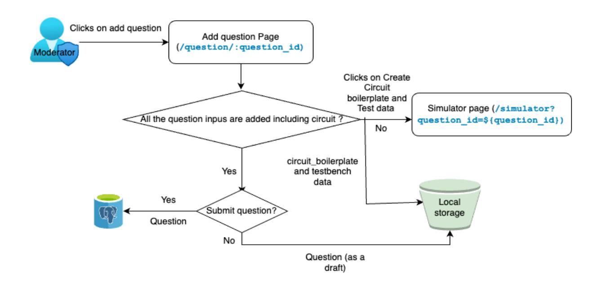
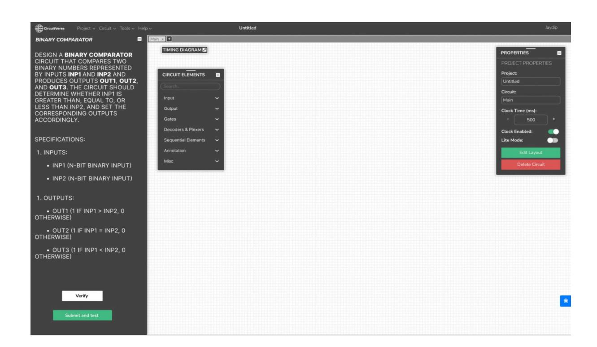
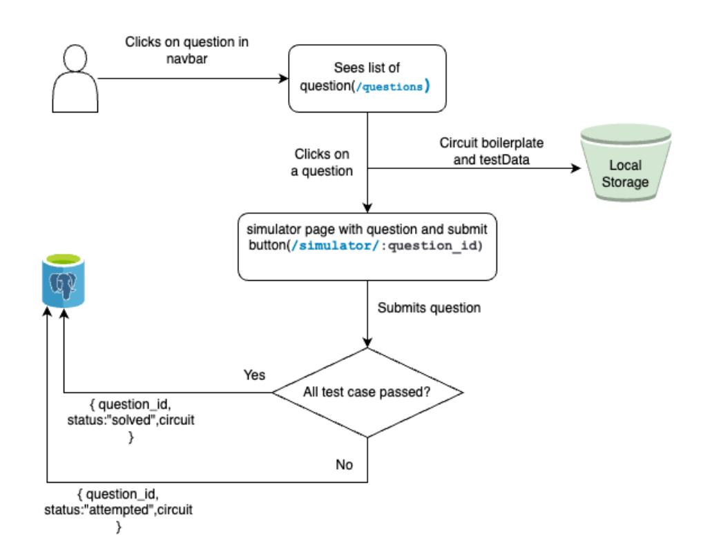
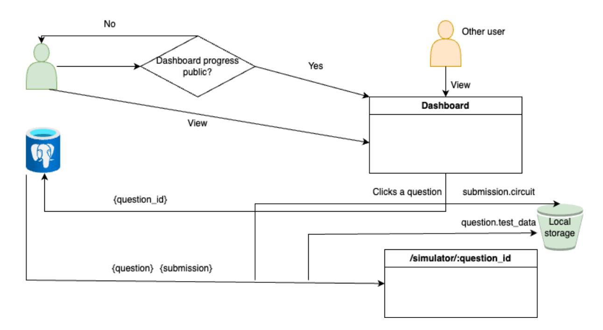

# *GSoC'24 Proposal - CircuitVerse*

## **Project 4 - CircuitVerse Practice section**

## Table of Content

| Project       | 4 CircuitVerse Practice section | 1  |
|---------------|---------------------------------|----|
| Table         | of Content                      | 2  |
| Personal      | Details                         | 3  |
| About         | Me                              | 3  |
| Motivation    | and Interest                    | 4  |
| Previous      | open source participations      | 5  |
| Contributions | so far                          | 5  |
| Proposal      |                                 | 5  |
| Circuitverse  | Practice section                | 6  |
| Synopsis      |                                 | 6  |
| DB            | setup for the system            | 8  |
| Controllers   |                                 | 11 |
| Frontend      |                                 | 18 |
|               | Admin and moderator pov         | 18 |
|               | User’s pov                      | 25 |
| Key           | Deliverables                    | 33 |
| Future        | improvements                    | 33 |
| Project       | Plan                            | 34 |
| Testing       | and verification                | 36 |
| Major         | milestone                       | 37 |
| Additional    | Information                     | 37 |
| Mentors       |                                 | 37 |

| Name                 | Jaydip Dey                                                   |
|----------------------|--------------------------------------------------------------|
| Course               | Computer Science and Engineering                             |
| Email                | jaydipdey2807@gmail.com                                      |
| Github               | https://github.com/jaydip1235                                |
| LinkedIn             | https://www.linkedin.com/in/jaydip-dey/                      |
| Phone                | +919875490885                                                |
| Current Country:     | India                                                        |
| Link to Resume / CV: | https://drive.google.com/file/d/1ywaTQ-7sj7RMDxbV67whjgT_b   |
| Achievements         | https://drive.google.com/drive/u/0/folders/1a3WOnKpL0INtFs27 |

## About Me

I am Jaydip Dey, currently employed as an **SDE-1** at [Optum](https://www.optum.com/en/), a Fortune 500 company. I graduated with a Bachelor of Engineering in **Computer Science and Engineering** from Jadavpur University, Kolkata, achieving **First Class Distinction**. In 2023, I founded the Product Club at my college, where we developed a platform to aid in interview preparation through personalised AI-driven conversations based on uploaded resumes, job descriptions, or audio inputs. You can find more details about this [here](https://www.linkedin.com/posts/prod-club-ju_juproc-innovation-entrepreneurship-activity-7124777775713988610-ScEm?utm_source=share&utm_medium=member_desktop) .

As a results-oriented Software Developer and Coder, I possess a solid track record in software development and problem-solving. Throughout my college years, I actively participated in various hackathons, ranging from intercollege to national and international levels. Notably, I secured the **First Runner-up position** in the Intel OneAPI GenAI LLM Challenge held in Bangalore, competing against over 1000 participants across India. Additionally, I was recognized as an Incode'23 Global Finalist, showcasing my ability to excel in global competitions and tackle diverse challenges. My other achievements include a 5 ⭐ rating on Codechef, securing top positions in over 15 hackathons, as well as being a top 100 participant in the Amazon ML Challenge and a finalist in SIH'22, highlighting my dedication to innovation and excellence. As a former Software Development Engineer Intern at [Mercor](https://mercor.io/), I gained valuable hands-on experience contributing to real-world projects and significantly contributing to the team's success.

P.S.-All the citations of my achievements are in the Personal details section.

Furthermore, my experience as an Instructor at [Placewit](https://placewit.com/) allowed me to deepen my expertise in full stack and MERN stack development while effectively imparting this knowledge to others. During my tenure as a Teaching Assistant at [Crio.do,](http://crio.do) I refined my communication and mentoring skills by guiding students in mastering complex technical concepts.

I have also served as a mentor for various open source events and twice as a judge for [Hack4Bengal,](https://www.hack4bengal.tech/) one of Eastern India's largest hackathons. Additionally, I held the role of chapter lead at GirlScript Kolkata, where I led a team in organising technical events and seminars.

In terms of technical expertise, I primarily work with the MERN stack and Java Spring. Additionally, I have also made some projects using Ruby on Rails and Machine Learning, and have hands-on experience with Android and Kotlin, having developed several basic applications. My dedication as a quick learner and hard worker sets me apart from others in the field.

## Motivation and Interest

I find the CircuitVerse really interesting because it's great for learning about digital circuits. I like the Practice section because it helps students with different kinds of questions organised neatly. This makes it easy to find what you need to study.

Since I've worked on CircuitVerse before and know its code well, I think I could work on this project. I've had an idea before that's similar to this which motivates me more, where there could be circuit design contests just like coding contests on websites like codeforces or leetcode. Answers would be checked automatically, and people would get points based on how well their circuits worked. Plus, I'm good with Vue.js and Ruby on Rails, so I can handle the technical side of things without any trouble.

So, I'm excited about the opportunity to work on this project. It combines my interest in digital circuits with my skills in programming, and I think I could make a valuable contribution to making CircuitVerse even better.

## Previous open source participations

I had submitted 3 proposals in GSoC'23 under Postman, Internet Health Report and gprMax, but unfortunately none of the projects were selected.

Links of proposals are as follows: [Postman](https://summerofcode.withgoogle.com/media/user/891c05ea541c/proposal/gAAAAABl_7hQCVwo2lTIGFeDjnf3kgoKBlxhRTSvlsBP-JMB9hwLBoyWZplAAA7B1ZyTp_FbOfa9jM28z_7OyTf3a_OApW44HPv9lC0QJPDCEM_59ldBDAs=.pdf) , [Internet](https://summerofcode.withgoogle.com/media/user/891c05ea541c/proposal/gAAAAABl__dAB8ml9a17FRMnKp0Mk4sr86rhez3BUHztduFUwfGQyV6eA9aRgwttKy2MYASJw4cUmjiAyEkmPT_vdWX0YcmC3DnUQBkYdBAWr4_TGwDfCWU=.pdf) Health Report , [gprmax](https://summerofcode.withgoogle.com/media/user/891c05ea541c/proposal/gAAAAABl__dAY6qwhNhkPFV4bgXhxQBO1RzVwvkCGjpxtQfsOTtUh-pXLjLUoB266Yaws2ioMxeuiOfQSBR1eYW5f9jo4OiozFGtZiG2NRt4EShfwofaRSI=.pdf)

But this time, I am submitting only 1 proposal.

## Contributions so far

| SR | Pull Request                                         | Status | Repository   |
|----|------------------------------------------------------|--------|--------------|
| 1  | fix: placeholder added for login and signup          | Merged | CircuitVerse |
| 2  | fix: signUp form ui layout fixed when alert is shown | Merged | CircuitVerse |

## Proposal

### **Overview:**

A CircuitVerse Practice section to enhance learning, providing students with a platform to practise a variety of questions conveniently. This feature aims to accelerate learning and engagement by enabling users to attempt questions, design circuits, and have their answers automatically verified.

### The goals of the project:

- 1. **Question Bank Management:** Develop a Question Bank page categorising questions into groups for easy browsing and practice. Users can filter questions by group for focused practice.
- 2. **Circuit Template:** Each question will include a circuit boilerplate with input/output probes and a pre-configured testbench for practical application.
- 3. **Markdown Content:** Implement support for adding and displaying questions as markdown text for enhanced readability and flexibility.
- 4. **Question Bank Moderator:** Introduce a role, such as 'question\_creator', for selected CircuitVerse users to add and modify digital logic questions. Admins will have the authority to assign this role to specific users.
- 5. **Auto-verify Submitted Answers:** Utilise the existing testbench feature in CircuitVerse to automatically verify submitted answers against predefined input/output, enhancing the learning experience.
- 6. **Progress Dashboard:** Create a personalised dashboard within the user profile, showcasing submission history and progress. Users can opt to make their dashboard public or private.

- 1. HTML
- 2. CSS
- 3. JavaScript
- 4. Ruby on Rails

## Circuitverse Practice section

### **Synopsis**

There will be a separate navigation option in the top going to the question bank page. This is shown below:

Now when user clicks on, it a page will open as follows:

In this page on the top row (just below the navbar), users will have 4 buttons to filter according to the user's perspective. It is of 4 types:

- All questions.
- Unattempted questions.
- Attempted question ( It means that the user has attempted the question and submitted the question at least once but all test cases are not passed).

- Solved questions ( It means that the user has completely solved those questions with all the test cases passed).

On the next row, there is a global search input whether an user can search on the basis of any question name, question statements, partial statements, matching keyword etc.

Beside that there will be 3 dropdowns where:

- **View Dropdown** : In this dropdown, user can select the view of the questions, whether its a list view or Grid view
- **Levels Dropdown** : Here user can choose among various levels like Basic, Intermediate, Hard etc.
- **Topics dropdown** : Filtering can be done on the basis of topic/tag added to questions like sequential circuit, combinational circuit etc..

In this way users will get the ability to do extensive filtering and can apply multiple filters at a time to make the search more specific. **Pagination** can be done if the number of questions increases.

After that all the questions will be visible according to the view user has chosen. By default all the questions will be visible to the user sorted according to the date added in descending order ( latest added question will come first).

#### **A synopsis of how the grid view will look like is shown [here](https://circuitverse-questions-grid.netlify.app/)**

Below shows the screenshot of how the page would look like when the user wants to see all his/her solved questions in the list view. In list view, more questions can be accommodated in a page

### **DB setup for the system**

We need to create six tables with the attributes and and modify the existing user table:

Question\_Bank:

**create\_table "question\_banks", force: :cascade do |t| t.string "name" t.datetime "created\_at", null: false t.datetime "updated\_at", null: false end**

Difficulty\_Level:

**create\_table "difficulty\_levels", force: :cascade do |t| t.string "name" t.integer "value" t.datetime "created\_at", null: false t.datetime "updated\_at", null: false end**

#### Category:

**create\_table "categories", force: :cascade do |t| t.string "name" t.datetime "created\_at", null: false t.datetime "updated\_at", null: false end**

Question:

**create\_table "questions", force: :cascade do |t| t.string "heading" t.text "statement" t.bigint "question\_bank\_id" t.bigint "category\_id" t.bigint "difficulty\_level\_id" t.jsonb "test\_data" t.jsonb "circuit\_boilerplate" t.datetime "created\_at", null: false t.datetime "updated\_at", null: false end**

#### Question\_Bank\_Moderator:

**create\_table "question\_bank\_moderators", force: :cascade do |t| t.bigint "uid" t.bigint "question\_bank\_id" t.datetime "created\_at", null: false t.datetime "updated\_at", null: false end**

User table is updated with addition of 2 more attributes:

**t.jsonb "submission\_history", array: true, default: [] t.boolean "public", default: true**

In the above, submission history will be an array of json objects where each object will have the question\_id referenced from question table , its status whether its partially accepted or fully accepted or not accepted(0 test case passed on submission) and the circuit data (so that user's progress is saved when he opens the question next time). And public boolean will indicate whether the questions dashboard is private or public for the user

The following foreign key constraints are added to establish relationship between the tables:

**add\_foreign\_key "questions", "question\_banks" add\_foreign\_key "questions", "categories" add\_foreign\_key "questions", "difficulty\_levels" add\_foreign\_key "question\_bank\_moderators", "users" add\_foreign\_key "question\_bank\_moderators", "question\_banks" add\_foreign\_key "users", "question\_banks", column: "uid"**

The follow shows the ERD diagram of the system

**P.S**.- The user table contains more attributes that are already existing. All are not shown due to lack of space

#### Adding Association between models.

- models/question\_bank.rb **has\_many :questions has\_many :question\_bank\_moderators**
- models/difficulty\_level.rb **has\_many :questions**
- models/category.rb **has\_many :questions**
- models/question.rb **belongs\_to :question\_bank belongs\_to :category belongs\_to :difficulty\_level**
- models/question\_bank\_moderator.rb **belongs\_to :user belongs\_to :question\_bank**

- models/user.rb **has\_many :question\_bank\_moderators**

### **Controllers**

Now the following controllers are added to ensure backend functionality

- controllers/difficulty\_levels\_controller.rb

**class DifficultyLevelsController < ApplicationController** *# GET /difficulty\_levels* **def index @difficulty\_levels = DifficultyLevel.all render json: @difficulty\_levels end** *# GET /difficulty\_levels/:id* **def show @difficulty\_level = DifficultyLevel.find(params[:id]) render json: @difficulty\_level end end**

- controllers/difficulty\_levels\_controller.rb

**class DifficultyLevelsController < ApplicationController** *# GET /difficulty\_levels* **def index @difficulty\_levels = DifficultyLevel.all render json: @difficulty\_levels end** *# GET /difficulty\_levels/:id* **def show @difficulty\_level = DifficultyLevel.find(params[:id]) render json: @difficulty\_level end end**

Above two controllers are for getting the difficulty levels and categories from the database ( Can be stored hard coded in the frontend also)

- controllers/questions\_controller.rb

**class QuestionsController < ApplicationController** *# GET /questions* **def index @questions = Question.all render json: @questions end** *# GET /questions/:id* **def show @question = Question.find(params[:id]) render json: @question end** *# GET /questions/filter # Params: category\_id, difficulty\_level\_id* **def filter @questions = Question.where(category\_id: params[:category\_id], difficulty\_level\_id: params[:difficulty\_level\_id]) render json: @questions end** *# GET /questions/status # Params: status (unattempted, attempted, solved)* **def status case params[:status] when "unattempted"** *# Fetch questions with no submission history for the current user* **@questions = Question.where.not(id: current\_user.submission\_history.map { |submission| submission["question\_id"] }) when "attempted"** *# Fetch questions with submission history for the current user* **@questions = Question.where(id: current\_user.submission\_history.map { |submission| submission["question\_id"] }) when "solved"** *# Fetch questions with fully accepted status for the current user* **@questions = current\_user.submission\_history.select { |submission| submission["status"] == "solved" } else render json: { error: "Invalid status parameter" }, status: :bad\_request return end render json: @questions end**

*# GET /questions/search # Params: any random string* **def search search\_query = params[:q] if search\_query.present? @questions = Question.where("statement ILIKE ? OR heading ILIKE ?", "%#{search\_query}%", "%#{search\_query}%") render json: @questions, status: :ok else render json: { error: 'Search query cannot be blank' }, status: :unprocessable\_entity end end** *# GET /question/solved # Params: id* **def users\_who\_solved question = Question.find(params[:id]) users = User.joins(:submission\_history) .where("submission\_history @> ?", [{ question\_id: question.id, status: 'solved' }].to\_json) render json: { count: users.count } end end**

The aforementioned controllers include functionalities for retrieving all questions, fetching a specific question, obtaining all questions filtered by category and difficulty level, and retrieving questions filtered by status (from the perspective of the current logged-in user). Additionally, there is another function designed to search for strings similar to the headings or statements of all questions in the database and return the matching ones. Also there is a function which gets the number of users who solved a particular question

Also here when we send a get request to fetch question/s, all the other parameters, including testData, circuit boilerplate etc. of a question goes to the frontend as mentioned in the models.

Now we need another controllers for handling the submission of the user and also to get the submission of a particular question from submission history

- controllers/submissions\_controller.rb **class SubmissionsController < ApplicationController**

**before\_action :authenticate\_user!** *# Action to post user submission* **def post\_submission submission\_params = params.require(:submission).permit(:question\_id, :status,:circuit) question\_id = submission\_params[:question\_id] status = submission\_params[:status] circuit = submission\_params[:circuit]** *# Validate status* **unless %w(unattempted attempted solved).include?(status) return render json: { error: 'Invalid submission status' }, status: :unprocessable\_entity end** *# Update or create submission history for the current user* **current\_user.submission\_history ||= [] current\_user.submission\_history.delete\_if { |submission| submission['question\_id'] == question\_id } current\_user.submission\_history << { 'question\_id' => question\_id, 'status' => status, 'circuit' => circuit } if current\_user.save render json: { message: 'Submission posted successfully' }, status: :ok else render json: { error: 'Failed to post submission' }, status: :unprocessable\_entity end end** *# Action to get a submission of a particular question from submission\_history* **def show question\_id = params[:question\_id]** *# Find the submission for the given question ID* **submission = current\_user.submission\_history.find { |submission| submission['question\_id'] == question\_id } if submission render json: submission, status: :ok else render json: { error: 'Submission not found' }, status: :not\_found end end**

**end**

A controller to get the submission status of questions of a particular user should be there which will be used for personalised dashboard

- controllers/user\_submissions\_controller.rb

**class UserSubmissionsController < ApplicationController before\_action :set\_user def index @submissions = @user.submission\_history end private def set\_user @user = User.find(params[:id]) end**

**end**

Another controller is needed to make the question dashboard of the user private or public. We can add the following definition in

#### controllers/users/circuitverse\_controller.rb

**def update\_public\_status status = params[:status] if status == "public" @user.update(public: true) else @user.update(public: false) end redirect\_to user\_path(@user) end**

All these controllers are for any users who are authenticated into circuit verse. Now for authorization and for the question bank moderators to create, edit and delete question, question banks , we need another controller.

But before that the admin needs to grant access to some users for becoming question bank moderators for specific questions. We already have a field in the user table : **t.boolean "admin", default: false** . So we will use this property, so that admin can give access to question bank moderators.

Below is the following controller for that:

- controllers/users\_controller.rb **class UsersController < ApplicationController before\_action :authenticate\_superuser! def grant\_access question\_bank\_id = params[:question\_bank\_id] email= params[:email] user = User.find\_by(email: email) moderator = QuestionBankModerator.new(uid:user.uid, question\_bank\_id: question\_bank\_id) if moderator.save render json: { message: 'Access granted successfully' }, status: :ok else render json: { error: 'Failed to grant access' }, status: :unprocessable\_entity end end private def authenticate\_superuser! unless current\_user && current\_user.admin? render json: { error: 'Unauthorized' }, status: :unauthorized end end end**

Now we add another controller related to all the actions that a question a bank moderator can do with the question (CRUD) . It is shown below:

**class QuestionBankModeratorsController < ApplicationController before\_action :authenticate\_user! before\_action :set\_question\_bank\_moderator, only: [:edit\_question, :delete\_question, :add\_question]** *# GET /question\_bank\_moderators/:id/edit\_question* **def edit\_question if @question\_bank\_moderator.present? question = Question.find(params[:question\_id]) question.update(question\_params) render json: question else render json: { error: "Unauthorized" }, status: :unauthorized end end** *# DELETE /question\_bank\_moderators/:id/delete\_question* **def delete\_question if @question\_bank\_moderator.present? question = Question.find(params[:question\_id]) question.destroy head :no\_content else render json: { error: "Unauthorized" }, status: :unauthorized end end** *# POST /question\_bank\_moderators/:id/add\_question* **def add\_question if @question\_bank\_moderator.present? question = Question.new(question\_params) if question.save render json: question, status: :created else render json: question.errors, status: :unprocessable\_entity end else render json: { error: "Unauthorized" }, status: :unauthorized end end private def set\_question\_bank\_moderator @question\_bank\_moderator = QuestionBankModerator.find\_by(uid:**

**current\_user.id) end def question\_params params.require(:question).permit(:heading, :statement, :question\_bank\_id, :category\_id, :difficulty\_level\_id, :test\_data, :circuit\_boilerplate) end end**

Now after adding all the controllers, and adding proper routes in routes.rb file, the backend will be able to process incoming requests from the client and send appropriate responses.

### **Frontend**

#### **Admin and moderator pov**

In the frontend, admin will be able to add the email id of the person to be added as a question bank moderator

Now after the moderators are added, they will get a separate options in the navbar to add questions

After the moderator clicks on the add question,it will go to **/question/:question\_id** in the url params where they will get a new interface to add question

#### **Now from where the question\_id will come ?**

To generate unique id, we will use the [short-unique-id](https://www.npmjs.com/package/short-unique-id) package which also supports in browsers. For that we will include the following cdn:

****

After that inside a script tag, we instantiate the uid

****

Now wherever we want to generate a unique id we just need to call the uid() function. Everytime it will generate a new unique id, within the scope of the application:

**var question\_id=uid();**

Above shows the interface to add questions.

- First row shows a hyperlink written **Create Circuit boilerplate and Test data.** On clicking it, moderators will be able to navigate to the simulator page where they will get the simulator to add **circuit boilerplate** and the **testBench** data. It is shown in the following figure:

It will navigate to the url **/simulator?question\_id=\${question\_id}**.

#### **So how will it be different ?**

When the moderator clicks on the hyperlink **Create Circuit boilerplate and Test data,** we will store the question\_id from the url parameter in localstorage as and its value as an empty string.

Now when the moderator navigates to the simulator page to add questions, we will check whether the value in the query params (question\_id) exists as a key in localstorage or not. If it exists we will render the corresponding value which will be the empty string initially. When the moderator clicks on the save button on the top (which will be visible only when the question id in query params is there in the localstorage) after adding circuit and the testBench Data, then value of the localstorage corresponding to the question\_id key will be the circuitData(including circuit boilerplate and testBench Data). So next time when the moderator visits the simulator page again, he/she will not have to remake the circuit boilerplate and testBench Data again.

Following is the code snippet of what happens when the simulator page loads, here we are using the load() function already defined in project.js to render circuit

**window.onload = function() {** *// Extract question\_id from the URL* **const urlParams = new URLSearchParams(window.location.search); const questionId = urlParams.get('question\_id');** *// Check if the current path is "/simulator" and question\_id exists in localStorage* **if (window.location.pathname.startsWith("/simulator") && questionId && localStorage.getItem(questionId)) { load(JSON.parse(localStorage.getItem(questionId))); } };**

Below showing the code snippet of what happens when the user clicks on Save button in simulator page

**export function saveQuestion(){** *// Extracting question\_id from URL parameters* **const urlParams = new URLSearchParams(window.location.search); const question\_id = urlParams.get('question\_id');**

**if (question\_id) { let fl = 1; const data = generateSaveData("Untitled", fl); const localStorageKey = `\${question\_id}`; localStorage.setItem(localStorageKey, data); alert("Circuit boilerplate and test data saved"); } else { alert("Error: Something went wrong! Try again"); } }**

We have used the function generateSaveData() function,However a small modification inside the generateSaveDate() needs to be done at the starting such that prompt will be shown in normal cases and not when moderator is using simulator for adding questions (fl is the flag which indicates that)

**export function generateSaveData(name,fl, setName = true) { data = {};** *// Prompts for name, defaults to Untitled* **if(!fl) name = getProjectName() || name || prompt('Enter Project Name:') || 'Untitled';**

In these ways we use the existing functions and add as less code as possible to serve the purpose

- Then the second row contains the Name input where the moderator can write the question name i.e the heading.
- The next row contains the input for the description. Here **markdown is supported** , so that moderators can write the description in the markdown editor. For this editor, we use [SimpleMDE](https://simplemde.com/) Markdown editor

At first we include the link tag and script tag in the top of the question\_form.erb file to include css and js cdn

****

We also include the following snippet in the same file to render textarea to the UI

**<h6><%= form.label :description %></h6> <textarea id="question\_description" name="question[statement]" class="form-control form-input"></textarea>**

Following script tag is added to the bottom of the same file which initialises a SimpleMDE instance on an HTML element with the ID "question\_description" when the document is ready,

****

To display the description field as per the markdown content, a markdown parser like [Redcarpet](https://rubygems.org/gems/redcarpet/versions/3.3.4?locale=en) is used in the application.

Redcarpet is already installed in the application. If not then we need to write the following in the Gemfile and run bundle install

**gem 'redcarpet', '~> 3.3', '>= 3.3.4'**

After that we need to write the following snippet where we want to show the markdown in the .erb file . We will be showing it in the simulator page when the end user clicks on a question.

**
 <%= markdown(@question.statement) %> 
**

We also need to define a helper method to parse markdown content using Redcarpet. For that we create a new file in the **app/helpers** directory , e.g., markdown\_helper.rb and write the following content in it

**module MarkdownHelper def markdown(text) renderer = Redcarpet::Render::HTML.new markdown = Redcarpet::Markdown.new(renderer) markdown.render(text).html\_safe end end**

Now to include this helper module globally we need to write the following in the application\_controller.rb

**include MarkdownHelper**

- The next two input fields are the dropdowns where moderators can select the question topic and difficulty level of the question.
- Two buttons are there Save question and Draft question. When a moderator clicks on a submit question, a post request will be sent to the backend with the payload ( will be visible to the end user in questions page) and when the moderator clicks on a draft proposal , it will be stored in the localstorage (not be shown to the end user) . At max, a moderator will be able to create 3 draft proposal

**The demo of add question section is shown [here](https://youtu.be/NmjIUXorbwE) ([https://youtu.be/NmjIUXorbwE\)](https://youtu.be/NmjIUXorbwE)**

**The moderator's question dashboard will look similar to [this](https://circuitverse-questions-moderator.netlify.app/)** where they will be able to see the questions, can filter according to difficulty and tags and will be able to **view**, **edit** and **delete**.

Following flowchart shows the above flow:

**User's pov**

Now coming to the point where users who want to practise are attempting questions. When he clicks on a question then a similar page will open with the question description and circuit boilerplate (if any) and the url parameter will be **/simulator/:question\_id**

When a user clicks on a question, the question is fetched from question id from the database. Below shows sample question card div and its attribute will be question id **<% @questions.each do |question| %> 
"> // question card 
 <% end %>**

Following function is triggered when the user clicks on a question which fetches the question, stores the circuit boilerplate and test Data in the local storage.

**document.querySelectorAll('.fetch-question').forEach(function(button) { button.addEventListener('click', function() { var questionId = this.getAttribute('data-question-id'); fetchQuestionDataAndRedirect(questionId); }); }); function fetchQuestionDataAndRedirect(questionId) { fetch(`/questions/\${questionId}`) .then(response => response.json()) .then(data => {** *// Store the test data and circuit boilerplate in local storage* **localStorage.setItem('questionTestData', JSON.stringify(data.test\_data)); localStorage.setItem('circuitBoilerplate', JSON.stringify(data.circuit\_boilerplate));** *// Redirect to the simulator page* **window.location.href = `/simulator/\${questionId}`; }) .catch(error => { console.error('Error fetching question data:', error); }); }**

Now when the simulator page loads then we check for the question\_id parameter, if its present then we load the circuit boilerplate and hide the testbench (containing the class testbench-manual-panel ) from the UI

**window.onload = function() {** *// Extract question\_id from the URL pathname* **const questionId = window.location.pathname.split('/').pop();** *// Check if the current path is "/simulator" and questionId exist in params* **if (window.location.pathname.startsWith("/simulator") && questionId) { const circuitBoilerplate = JSON.parse(localStorage.getItem('circuitBoilerplate')); const testBench = document.querySelector('.testbench-manual-panel');** *// Load the circuit boilerplate* **load(circuitBoilerplate);** *// Hide the test bench* **if (testBench) { testBench.style.display = 'none'; } } };**

The above approach helps to distinguish from the normal simulator page and the question specific simulator page since one will be having testBench and question and other will not. Hence we will also display the question in the simulator page conditionally.

**<% question\_id = request.path.split('/').last %> <% if window.location.pathname.starts\_with?("/simulator") && question\_id.present? && localStorage.getItem(question\_id) %> 
 // Contents of the question in form of markdown and the buttons as shown in the UI 
**

**<% end %>**

Now when the user clicks on submit and test button, it fetches the compares the truth table in the testData in the localstorage with the circuit and alerts the number of test cases passed and accordingly updates the status and post it to the database

**export function testResult() { const urlParts = window.location.pathname.split('/'); const questionId = urlParts[urlParts.length - 1]; const testData=JSON.parse(localStorage.getItem('questionTestData')); const isValid = validate(testData, globalScope); const results = runAll(testData, globalScope); const { passed, total } = results.summary; const status = (passed === total) ? 'solved' : 'attempted'; alert(`\${passed} out of \${total}`);** *// POST request to submit the result* **fetch('/submissions/post\_submission', { method: 'POST', headers: { 'Content-Type': 'application/json', }, body: JSON.stringify({ submission: { question\_id: questionId, status: status, circuit: globalScope } }) }) .then(response => {**

**if (response.ok) { console.log('Submission posted successfully'); } else { throw new Error('Failed to post submission'); } }) .catch(error => { console.error('Error posting submission:', error); }); }**

Here we are using the runAll() function and validate() function which are already defined in testbench.js

The above flow is shown below:

## **User's submission demo is shown [here\(](https://youtu.be/YQXtZd0hAq8)**<https://youtu.be/YQXtZd0hAq8>) **. Alert shows the number of test**

#### **cases passed**

The progress of the user will be shown in their dashboard

The dashboard will have all the solved and attempted questions and filtering options will also be there like the main question page. Also there is a dropdown where users can select between the public and private whether to make that section visible to the other user or not.

When other user visits the [https://circuitverse.org/users/:user\\_id](https://circuitverse.org/users/:user_id) page , then only if the public boolean of the user visited is true then only it will be shown to other user Questions dashboard

**<% if @user.public? %> // Questions section <% end %>**

Now two cases may happen

- **The user who owns the dashboard clicks on the view button of a particular question** : When it happens, it fetches the question from the db with question id along with submission history of that question for the user

with the question id. Now in this case instead of loading the circuit boilerplate from the question table , we will load the circuit that we posted to db when that user submitted the question earlier. In this way users will be able to restore the progress and can edit it .

**function fetchQuestionDataAndRedirect(questionId) { fetch(`/questions/\${questionId}`) .then(response => response.json()) .then(data => {** *// Store the test data in local storage* **localStorage.setItem('questionTestData', JSON.stringify(data.test\_data));** *// GET request to fetch the submission data* **fetch(`/questions/\${questionId}/submission`) .then(response => response.json()) .then(submissionData => {** *// Store the circuit data from the submission history in local storage* **localStorage.setItem('circuitData', JSON.stringify(submissionData.circuit));** *// Redirect to the simulator page* **window.location.href = `/simulator/\${questionId}`; }) .catch(error => { console.error('Error fetching submission data:', error); }); }) .catch(error => { console.error('Error fetching question data:', error); }); }**

- **Other users click on the view button of a particular question on another's public dashboard** : In that case also, the user will be able to see what the other user did and will be able to make changes and submit, which will be reflected in his own submission.

The flowchart is shown below:

## Key Deliverables

- A dedicated practice platform where all questions will be available for practice
- Filtering questions according to tags, difficulties etc.
- Allow admin to grant CRUD operation on questions to moderators
- Allow moderators to add, edit and delete questions with ease along with circuit templates.
- Allow the users to practise and submit questions and a progressive dashboard where they will be able to track themselves.
- Auto verification of submitted answers.
- Interactive UI with markdown editor for question addition and view the contents of the markdown.

## Future improvements

- Currently teachers add assignments and those are checked manually, but this feature can be integrated with that to allow auto verification and assign marks.

- A dedicated section where users can see all the submissions to a question made by other users.
- One daily problem (similar to leetcode) can be given everyday to help them maintain a streak and users will be rated.

## Project Plan

As I embark on the CircuitVerse Practice Section project, my primary goal is to create an interactive practice platform that fosters engagement and skill development for students in digital logic. To kickstart the initiative, I'll dedicate the pre-GSoC phase to making the UI and deep dive into the detailed requirements and also on learning.

In the first phase of development, I'll focus on laying the groundwork for the platform's essential features. This includes structuring the question bank database, writing appropriate controllers and routes and other backend functionalities. Additionally, I'll dive into user authentication and authorization crafting roles like 'question\_moderator' to facilitate smooth management of the platform.

Moving into the second phase, my efforts will shift towards refining the user experience and adding advanced functionalities. I'll automate the answer verification process using circuitVerse's testbench feature. Simultaneously, I'll construct personalised progress dashboards within user profiles, empowering learners to track their submissions.

Throughout the development journey, I'll maintain open lines of communication with mentors, seeking guidance and feedback to ensure the project aligns with expectations.

## **Project Plan - Preliminary Plan**

### **Community Bonding Period [May 1 - May 26]**

Before and during the community bonding, I will gather detailed requirements about all the criterias and features to be implemented and will also make a documentation for the same so that I can follow that along the way. Also I will explore various ways of implementing a particular feature and will make a note of the best one by considering all the factors including scalability, robustness etc.

The detailed timeline is shown below:

|       | Start Date End Date Tasks to be completed                        |
|-------|------------------------------------------------------------------|
| Phase | 1 May 27 July 12                                                 |
| Week  | 1 May 27 June 2 -Work on creating schemas for the question bank  |
|       | management system from the user's point of view and              |
|       | add routes and controllers.                                      |
|       | Pull request for above implementation.                           |
|       | Work on request changes(if any).                                 |
|       | Publish the blog.                                                |
| Week  | 2 June 3 June 9 Work on creating schemas for the question bank   |
|       | management system from the admin and moderators                  |
|       | point of view and add routes and controllers.                    |
|       | Implement authorization.                                         |
|       | Pull request for above implementation.                           |
|       | Work on requested changes(if any).                               |
|       | Publish the blog                                                 |
| Week  | 3                                                                |
| Week  | 4                                                                |
| Week  | 5                                                                |
|       | June 10 June 30 Start working on UI for enabling admin to add    |
|       | Implement the add question page from the                         |
|       | moderator's point of view responsive on all screens.             |
|       | Implement the feature to add circuit boilerplate and             |
|       | testBench data                                                   |
| Week  | 6 July 1 July 7 Integrate the question addition feature with the |
|       | Major Improvements before the phase one                          |
|       | Publish the blog.                                                |
| Phase | 1                                                                |
|       | July 8 July 12 Key Deliverables:                                 |
|       | Backend fully functional routes (can be tested with              |
|       | Feature to allow admin to grant access to moderators             |
|       | Fully functional question addition feature with circuit          |

| Start Date End Date Tasks      | to          | be            | completed  |                                |
|--------------------------------|-------------|---------------|------------|--------------------------------|
| Phase 2 July 12 August 26      |             |               |            |                                |
| Week 1 July 13 July 19 Start   |             | working       | on the     | UI for moderators dashboard    |
|                                | Integrate   | it with       | the        | backend ( able to perform CRUD |
|                                | operation   | on            | questions) |                                |
| Pull                           | request     | for           | the        | same                           |
|                                | Work on     | requested     |            | changes(if any)                |
|                                | Publish     | a blog        |            |                                |
| Week 2                         |             |               |            |                                |
| Week 3                         |             |               |            |                                |
| July 20 August 2 Will          | work        | on the        | UI of      | question practice page making  |
| it                             | responsive  | on            | all        | screens                        |
|                                | Implement   | filtering     | logic      | and its integration with the   |
|                                | Implement   | the           | auto       | verification and submission of |
| Pull                           | request     | for           | the        | same                           |
|                                | Work on     | requested     |            | changes(if any)                |
| Week 4 August 3 August 9 Start |             | working       | on the     | progressive dashboard for the  |
| user                           | showing     |               | submission | history and progress           |
|                                | Integration | of            | dashboard  | with the backend               |
| PR                             | and         | will work     | on         | requested changes(if any).     |
| Week 5 August 10 August 16     | Major       | Improvements  |            | before final evaluation.       |
|                                | Publish     | a blog.       |            |                                |
| Week 6                         |             |               |            |                                |
| August 17 August 26 Key        |             | Deliverables: |            |                                |
| Fully                          |             | functional    | question   | practice platform.             |
| Auto                           |             | verification  | and        | submission                     |
|                                | Progressive |               | dashboard. |                                |

## Testing and verification

After completing each milestone mentioned above, the new feature will undergo testing according to the documented requirements. Feedback will be solicited from mentors and fellow GSOC students. Any suggested changes from the feedback will be incorporated until the mentor is fully satisfied. Additionally, code reviews will be conducted to ensure comprehensive coverage of all requirements, absence of logical errors, and adherence to existing style guidelines.

## Major milestone

- 1. Question CRUD operation from moderators Point of view (Deadline ~ July 7)
- 2. Auto verification and submission of question (Deadline ~ August 2)
- 3. Progressive dashboard and question practice platform (Deadline ~ August 26)

## Additional Information

OS: Windows and MacOS

Code editor: VS code

I believe that I am the perfect candidate to complete the project as I am familiar with a major part of the codebase and implemented various functionalities locally on my system related to this problem statement. I also attached the code snippet for the same in the proposal section

My involvement with the CircuitVerse community has been enriching, providing valuable learning experiences through interactions with mentors and fellow contributors. I'm enthusiastic about the prospect of continuing to collaborate with CircuitVerse in the future

## Mentors

[Vaibhav](https://github.com/VaibhavUpreti) Upreti, [Tanmoy](https://github.com/tanmoysrt) Sarkar, [Smriti](https://github.com/smritigarg) Garg, [Vedant](https://github.com/vedant-jain03) Jain