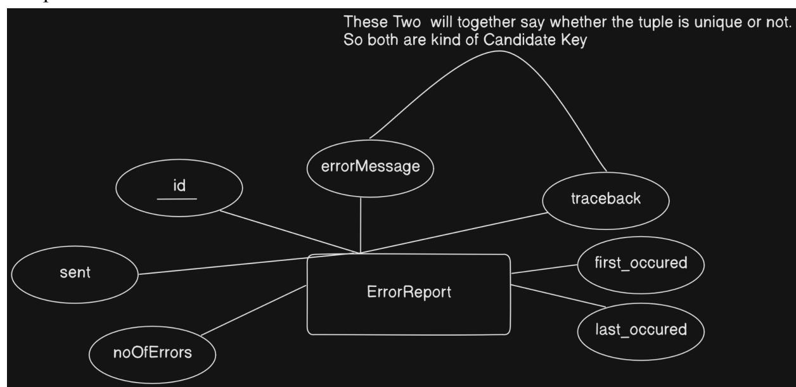
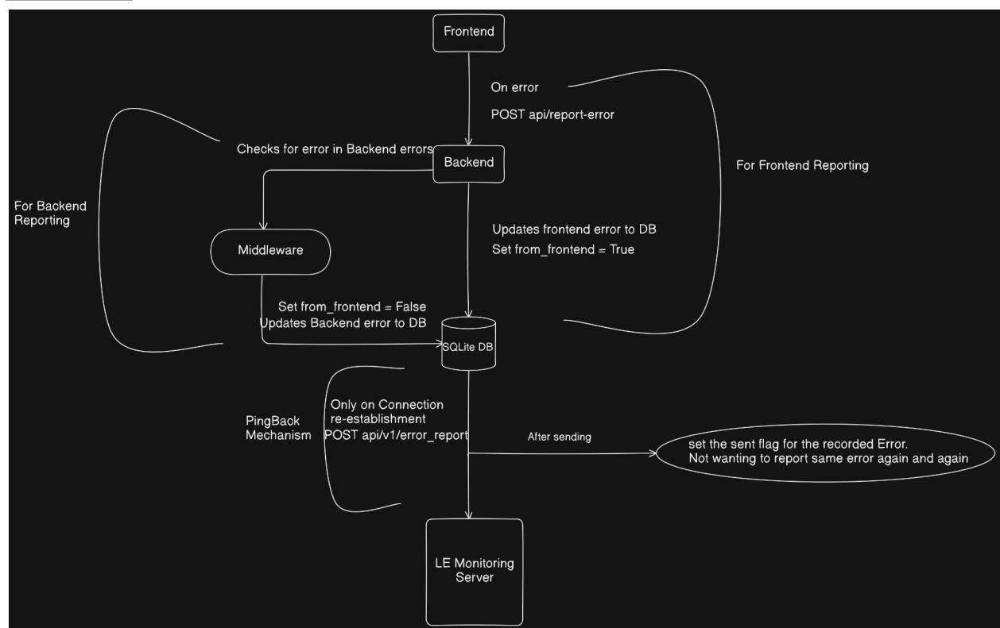

# Distributed Error Reporting

GSoC Project proposal for Kolibri

## Personal Details and Contact Information

- **- Github:** [thesujai](https://github.com/thesujai)
- **- Email:** email@email.com
- **- University:** National Institute of Technology, Sikkim, India
- **- Time-zone:** IST- India Standard Time (UTC +5:30) (IST)
- **- Linkedin:** [thesujai](https://www.linkedin.com/in/thesujai/)

## Synopsis

This project focuses on Distributed Error Reporting in Kolibri Learning Platform. Kolibri mostly focuses on offline access to education where Internet connectivity is low. So user statistics cannot be fetched in real time as the app is offline, for that we are using a ping-back mechanism which pings the kolibri server with all the statistics like facility and channel. In a similar manner we want to ping the kolibri server with all the errors whenever the connection is restored.

The basic workflow of this reporting mechanism will be:

- 1. Record All the Error occurring to users and store it into Database or local.
- 2. Report to server once the connectivity is restored with all the error
- 3. Remove the error from the database

The target repository will be [kolibri](https://github.com/learningequality/kolibri)

This project will be mentored to success by:

- Richard Tibbles: email@email.com
- Samson Akol:email@email.com

## Benefits to the Community

- The developer community has been continuously working on improving the product with the users' convenience in mind. However, not all errors are caught during development or by the QA team, leading some to make it into production. These errors are typically only reported by end-users to developers. Therefore, this project aims to automate the error reporting process to developers, resulting in quicker issue resolution
- Our target users primarily consist of students with low internet connectivity and limited technical knowledge, making it difficult for them to report errors to the development community. This project will benefit them by automatically reporting errors to our servers without any effort required on their part

## Current Status of the Project

- All the errors are reported using logging as of now.
- There already exists a ping-back mechanism for reporting facility and channel statistics, same mechanism shall be used for error reporting also. So the errors reports will be piggy backed on the current pinback mechanism, but seperate API will need to be created.

## Goals

- *● Goal 1: Implement a Schema to store Error*
- *● Goal 2: Create a middleware that will add into ErrorReport whenever there is an error in backend.*
- *● Goal 3: Create an api that shall report all frontend errors and also insert those to ErrorReport.*
- Goal 4: Configure frontend to make a post req to our api whenever there is an error.
- Goal 5: Implement ping back mechanism for reporting all the captured error when connectivity is restored.
- Goal 6: Write TestCase for middleware, api and ping\_back mechanism

## Deliverables

- *● Deliverable 1: Schema for ErrorReport and middleware to capture backend errors into ErrorReport*
- *● Deliverable 2: API to capture frontend error and its configuration in frontend*
- *● Deliverable 3: Ping back mechanism to server and testcases*

## Expected Results

- A new middleware that will track all errorsand update it into DB
- New API to report frontend errors
- Configured frontend to report error to new api
- Updated current pingback mechanism to also send with the error-reports, maybe a new api end point in server[\(https://telemetry.learningequality.org\)](https://telemetry.learningequality.org) will be formed like just like **/api/v1/error-report**

## Approach

#### *Implementing ErrorReport Schema*

Sample Schema would look like:

Field explanation:

- errorFrom: To know is the error from frontend or backend
- errorMessage: shall be the actual error message, like 'Operational Error'
- traceback: shall be containing the meaningful stack traces
- first\_occured: for knowing the time error occurred at(shall be in utc)
- last\_occured: if same error occurs, this will be set to that time. This is important to know how frequent was a error the error, like a difference between first\_occured and last\_occured will give us an idea.
- sent: to know whether the error is sent or not. To stay on the safe side and not Delete error just after sending. So virtually deleting it.
- noOfErrors: To count how many similar types of error are there. More the number of error, more shall be priority will taking ticket in the Reports section in Server.

Table creation:

CREATE TABLE IF NOT EXISTS error\_report ( id INTEGER PRIMARY KEY, error\_from TEXT DEFAULT "Backend", error\_message TEXT, traceback TEXT, first\_occurred TIMESTAMP DEFAULT CURRENT\_TIMESTAMP, last\_occurred TIMESTAMP DEFAULT CURRENT\_TIMESTAMP, sent BOOLEAN DEFAULT 0, noOfErrors INTEGER DEFAULT 1 )

The above query is just to demonstrate the datatypes and default values. In actual implementation it might be different making it more optimized.

#### *EdgeCase: When App Database itself encounters error?*

Considering main App DB can itself encounter error, so this will not be integrated as django model. Instead we will use a seperate SQLite file(say error\_report.sqlite) in which we will create Table with the above method.

Here is a sample how things about table implementation will look like:

[https://github.com/thesujai/kolibri/blob/error-report/kolibri/core/error\\_reporting/db\\_utils.](https://github.com/thesujai/kolibri/blob/error-report/kolibri/core/error_reporting/db_utils.py) [py](https://github.com/thesujai/kolibri/blob/error-report/kolibri/core/error_reporting/db_utils.py)

*After sending set the sent to true for all the sent error.*

How to **delete these errors** once sent? Covered in **Future Scope**

#### *Implementing Middleware*

Sample middleware would look like:

*Fig 2: MiddleWare*

- This middleware shall be enable across the backend and it will capture errors and insert into ErrorReport
- We will be using **traceback** to get the stack tree of the error which will make the job convenient
- **Handling Duplicates:** We will check if the error with similar traceback and error\_message already exists, if yes then update the noOfErrors field of the error object(after reporting if this is set high, it means of high priority to next hotfixes or releases)

### *How will the above be Implemented* ?

We will be creating a new django-app called 'error\_reporting' and inside that only we will define things like middleware, models, the api(for frontend) etc.

I know this can be integrated with any other django-app like just define new class inside middleware of device, integrate the api into api.py and api\_urls.py of device but that will just cause readabily issue as the code will look device specific only, and following best practices a new app for error reporting isn't causing any harm I think.

I have this diff ready to make you understand that how am i planning to implement it in low level context:

<https://github.com/thesujai/kolibri/compare/develop...thesujai:kolibri:error-report>

The above diff is just to show my approach while project implementation, and this can be changed if the there is any other way to implement this thing that will match the code standards more appropriately.

Just the thing is we will add this middleware in settings/base.py just like below:

[https://github.com/thesujai/kolibri/compare/develop...thesujai:kolibri:error-report#diff-10](https://github.com/thesujai/kolibri/compare/develop...thesujai:kolibri:error-report#diff-1043d09a34ebb69bfcfa9517975b802a6b0dcb56a14bf85416e9ea2956d21d94R102) [43d09a34ebb69bfcfa9517975b802a6b0dcb56a14bf85416e9ea2956d21d94R102](https://github.com/thesujai/kolibri/compare/develop...thesujai:kolibri:error-report#diff-1043d09a34ebb69bfcfa9517975b802a6b0dcb56a14bf85416e9ea2956d21d94R102)

### *Recording Error In frontend*

Sentry tracks the error in the frontend in the runtime. Similar to the sentry mechanism we can track the error in the frontend.

As we are using **VUE Framework** for out frontend we can use the errorHandler provided by Vue

References:

- [https://www.raymondcamden.com/2019/05/01/handling-errors-in-vuejs#error-han](https://www.raymondcamden.com/2019/05/01/handling-errors-in-vuejs#error-handling-technique-one%3A-errorhandler) [dling-technique-one%3A-errorhandler](https://www.raymondcamden.com/2019/05/01/handling-errors-in-vuejs#error-handling-technique-one%3A-errorhandler)
- <https://vuejs.org/api/application.html#app-config-errorhandler>

So we can use the followig in snippet for different plugins:

*Fig 3: Code Snippet Vue Error Handler*

We can add the above in KolibriApp of kolibri\_app so it will record all the errors do the post request, explained below.

This approach can also be Negotiated if there are some problems with this, or there are some more best practices that can be followed for frontend capturing.

#### *Implementing API (For frontend error reporting)*

End-point: api/error-report

data: {error\_message, traceback}

Sample FrontentEnd mixin:

*Fig 4: Error Report Call from frontend*

*In Frontend we can user stack property of error object as the traceback field of error reporting, so no external library will be required.*

### Sampe API:

*Fig 5: API to take request from frontend*

The above api will be placed here:

[https://github.com/thesujai/kolibri/blob/error-report/kolibri/core/error\\_reporting/api.py#L](https://github.com/thesujai/kolibri/blob/error-report/kolibri/core/error_reporting/api.py#L11) [11](https://github.com/thesujai/kolibri/blob/error-report/kolibri/core/error_reporting/api.py#L11)

I have also added some to-dos above.

#### *Implementing PingBack Mechanism*

We will use the our current pingback [mechanism](https://github.com/learningequality/kolibri/blob/0b496d0fe59b52e1cdacb7fe17a67359d261cf91/kolibri/core/analytics/utils.py#L475) . With few tweaks:

1)Also capture ErrorReport and error\_report\_logs.json and store those into list of dictionary.

2)We will add another function similat to [this](https://github.com/learningequality/kolibri/blob/0b496d0fe59b52e1cdacb7fe17a67359d261cf91/kolibri/core/analytics/utils.py#L463), called extract\_error(). The Psuedo Code for this is below. This will be called from this [function](https://github.com/learningequality/kolibri/blob/0b496d0fe59b52e1cdacb7fe17a67359d261cf91/kolibri/core/analytics/utils.py#L463) at the end end of this function.

#### **Sample implementation** of the above(**How will i implement**):

- [https://github.com/thesujai/kolibri/blob/error-report/kolibri/core/analytics/utils.py#](https://github.com/thesujai/kolibri/blob/error-report/kolibri/core/analytics/utils.py#L455) [L455](https://github.com/thesujai/kolibri/blob/error-report/kolibri/core/analytics/utils.py#L455)
- [https://github.com/thesujai/kolibri/blob/error-report/kolibri/core/analytics/utils.py#](https://github.com/thesujai/kolibri/blob/error-report/kolibri/core/analytics/utils.py#L486) [L486](https://github.com/thesujai/kolibri/blob/error-report/kolibri/core/analytics/utils.py#L486)

#### *Should this Error Report be Optional?*

Yes it should be optional. But to what extend will be an interesting subject. Currently we can choose not to send channel statistics.

#### Reference:

- [https://github.com/learningequality/kolibri/blob/develop/kolibri/utils/options.py#L](https://github.com/learningequality/kolibri/blob/develop/kolibri/utils/options.py#L575) [575](https://github.com/learningequality/kolibri/blob/develop/kolibri/utils/options.py#L575)
- [https://github.com/learningequality/kolibri/blob/develop/kolibri/core/analytics/task](https://github.com/learningequality/kolibri/blob/develop/kolibri/core/analytics/tasks.py#L57) [s.py#L57](https://github.com/learningequality/kolibri/blob/develop/kolibri/core/analytics/tasks.py#L57)

So as Described in the [Implementting](#page-9-0) PingBack Mechanism we will piggy back the error\_report mechanism in the existing PingBack Mechanism. So Whenever channel statics are sent, error reports will also be sent. But the sending of both will only depend on DISABLE\_PING. So this option should alone dictate reporting of statistics and error reporting.

But Error Reporting can be explicitly made optional also by just adding another option namely **DISABLE\_ERROR\_REPORTING** in the deployment section and in the ping\_once sections checking if this option is disable before getting error analytics Here is code Representation

- <https://github.com/thesujai/kolibri/blob/error-report/kolibri/utils/options.py#L580>
- [https://github.com/thesujai/kolibri/blob/error-report/kolibri/core/analytics/utils.py#](https://github.com/thesujai/kolibri/blob/error-report/kolibri/core/analytics/utils.py#L485) [L485](https://github.com/thesujai/kolibri/blob/error-report/kolibri/core/analytics/utils.py#L485)

#### *Flow Chart*

*Fig 6: Flow Chart*

#### *Future Scope*

- Deleting the Error in the ErrorReport and error\_report\_logs.json
  - We can set a threshold like 2 month or anyother suitable threshold and we can do the checking in the ping only that if a error status is sent and the timestamp is old than the threshold then just delete it from the database and the json file.
- Implementing manual ErrorReporting
  - Here we can give flexibility to a user to report error if it occurs. If error occurs, capture it in db and if there is a live connection then give the user a pop up of shall he report the error
  - Else whenever connection is restored follow the above approach only
- Add Somewhat of automation to create GH issue for reported error depending on the priority of issue and assigning tickets.

## Timeline

|        | Period    |          | Task                                            |
|--------|-----------|----------|-------------------------------------------------|
| After  |           | proposal | submission                                      |
| [April | 2         | May      | 1]                                              |
|        |           |          | Continue to contribute to kolibri and will keep |
|        |           |          | enhancing the project idea                      |
|        |           |          | Will discuss project more to enhance it         |
|        | Community |          | Bonding Period                                  |
| [May   | 1         | May      | 26]                                             |
|        |           |          | Get to know more about community and            |
|        |           |          | Will discuss the entire project in advanced to  |
|        |           |          | implement it wisely                             |
| Week   | 1         | and      | 2                                               |
| [May   | 27        | June     | 9]                                              |
|        |           |          | Implement the schema to store errors            |
|        |           |          | Start working on Middleware                     |
| Week   | 3         | and      | 4                                               |
| [May   | 27        | June     | 9]                                              |
|        |           |          | Complete the middleware and integrate it with   |
| Week   | 5         | and      | 6                                               |
| [June  | 10        | June     | 23]                                             |
|        |           |          | Complete the api for frontend error reporting   |
|        |           |          | and integrate it with frontend completely       |
|        |           |          | Start working on pingback mechanism             |

| Week  | 7 and      | 8   |                                          |
|-------|------------|-----|------------------------------------------|
| [June | 24 July    | 7]] |                                          |
|       |            |     | Complete the pingback mechanism          |
|       |            |     | Start writing testcases                  |
| Final | Evaluation | and | Final Week                               |
|       |            |     | Complete the testcases                   |
|       |            |     | Test the final project and do changes(if |
| After | Completion | of  | GSOC                                     |
|       |            |     | Work on the Future Score                 |
|       |            |     | Continue contributing to kolibri         |

## **About Me**

I'm a third-year Computer Science undergrad at the National Institute of Technology Sikkim, India, diving into open-source development with a clear purpose. I want to solve real-world problems, making life easier for developers and improving user experiences globally.

### *Skills:*

- **System Design**: I am proficient in system designing which includes designing DBMS, CLIENT-SERVER architecture and designing overall workflow of a system.
- **Languages**: Python, JavaScript, TypeScript, Java, C
- **Frameworks**: DJANGO, DRF, REACT, VUE
- **Databases**: Postgres, MongoDB, MySQL
- **Operations**: Git, Docker, Kubernetes, AWS

#### *Projects:*

- **● Medical Test and Report Management System:** This project lets patients book appointments for medical tests, and view their test reports, and let doctors respond to appointments and generate test results. *Technology:* Django, DBMS core concepts like ER diagrams, Relationship Schemas, Normalization of Database etc *Github link*: <https://github.com/thesujai/MedicalTestandReportManagementSystem>
- **● Kala-Jaadu:** A browser extension for detecting all the Dark Patterns in an e-commerce website. *Technology:* Javascript(For DOM manipulation), Machine Learning(Naive Bayes Model), Flask etc *Github link:* <https://github.com/thesujai/Kala-Jaadu>
- **● VedaPharma:** Ayurvedic Drug Recommendation System. A software that suggests drugs and formulations for a disease/pharmacological property based on the Ayurvedic classical books/Repositories. *Technology:* Machine Learning, Python, Streamlit (Used Naive Bayes Model) etc *Github link:* <https://github.com/thesujai/TechVeda>

#### *Experience:*

- **Upraised**: SDE Intern (OCT 2023 MARCH 2024) Here i worked on projects that include providing test environment(coding, aptitude, database) for users(Just like leetcode). I explored containerization here that how it can be used to provide different environment for different users and how load balancing is done when there is a load in server. I also explored the use of microservices.
- **● Mathesar:** Open Source contributor
  - **○** PR 1: Updated [frontend](https://github.com/mathesar-foundation/mathesar/pull/2985) to send a single bulk delete request instead of one [request](https://github.com/mathesar-foundation/mathesar/pull/2985) for each record
  - **○** PR 2: Update icon in exploration editor [breadcrumb](https://github.com/mathesar-foundation/mathesar/pull/2757)

#### *Contributions to kolibri ecosystem:*

- Fix to Env Var and Config persisting in options.ini in [KOLIBRI\\_HOME](https://github.com/learningequality/kolibri/pull/11737)
- *●* ENFORCE CSRF [verification](https://github.com/learningequality/kolibri/pull/11978) in API to be accessed by a browser strictly
- Add [pre-commit-ci-lite](https://github.com/learningequality/kolibri/pull/12034) action to automate PR lint fixes
- Add IsAuthenticated permission class in [api/content/contentrequest](https://github.com/learningequality/kolibri/pull/11995) (Continuation of above)
- Add [regression](https://github.com/learningequality/kolibri/pull/11896) testing for channel update deletion behaviour
- Fix failing csv report [generation](https://github.com/learningequality/kolibri/pull/11933) api test in different timezones
- Watch core for changes if KDS option is provided, in [devserver-with-kds](https://github.com/learningequality/kolibri/pull/11785)
- Add write to disk options for build [command](https://github.com/learningequality/kolibri/pull/12006)
- Refactor error handling in [CustomDjangoCache](https://github.com/learningequality/kolibri/pull/11808)
- Fix to new badge being shown on [channel](https://github.com/learningequality/kolibri/pull/11676) delete
- NewBadge missing when [downloading](https://github.com/learningequality/kolibri/pull/11484) channel (Related to above)
- [removed](https://github.com/learningequality/kolibri-design-system/pull/449) updation of style while text updates (First contribution)
- Linting issue in [no-console](https://github.com/learningequality/kolibri/pull/11707)
- Introduce [flake8-print](https://github.com/learningequality/kolibri/pull/11994) as pre-commit hook with migration of print to logger
- Replace KResponseWindow with [useKResponseWindow](https://github.com/learningequality/kolibri/pull/11349) in Device plugin
- Replace KResponseWindow with [useKResponseWindow](https://github.com/learningequality/kolibri/pull/11366) in Learn plugin
- Replace KResponseWindow with [useKResponseWindow](https://github.com/learningequality/kolibri/pull/11358) in User Profile plugin
- Replace KResponseWiindow with [useKResponseWindow](https://github.com/learningequality/kolibri/pull/11369) in Epub Viewer plugin
- Adding padding in [ViewMore](https://github.com/learningequality/kolibri/pull/11398) button
- Remove [CACHES](https://github.com/learningequality/kolibri/pull/11706) override in dev settings
- Pytest [upgrade](https://github.com/learningequality/kolibri/pull/11759) 3.7.1 -> 6.2.5 (I am working on it, still debugging what is causing the issues)

#### *Why kolibri?*

I'm drawn to Kolibri because it aligns with my interests in Django and its noble mission to offer educational technology to underserved communities. It's a cause I deeply believe in, and I'm excited to contribute my skills to make a difference.

### *Summer Plans and After GSOC:*

As i am applying for one project only in gsoc that is this. I do not have any other plans other in Summer other than GSOC and I shall remain a part of Learning Equality dev

community after GSOC period as the satisfaction I get with my contribution is my motivation.