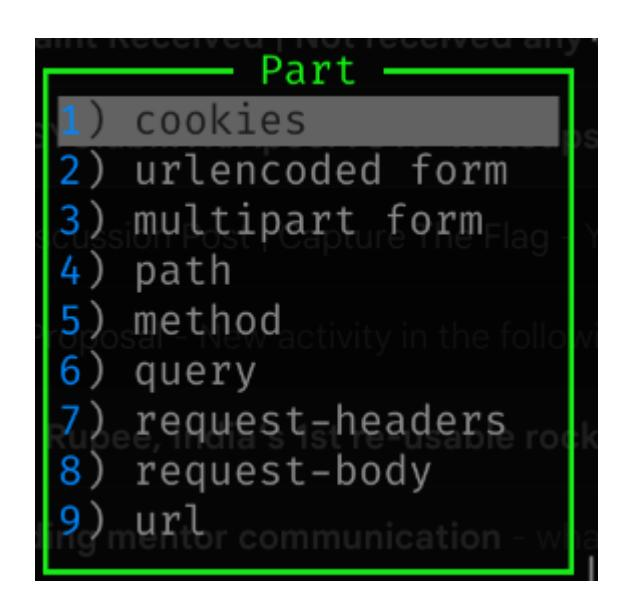
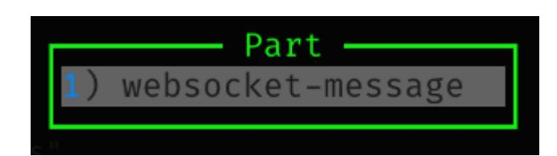
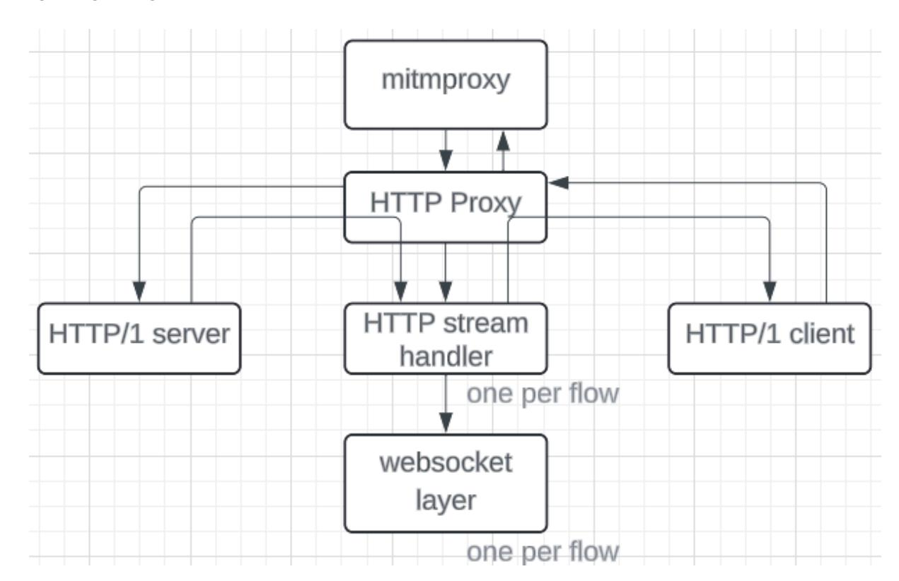

**Note: My GSoC project had been changed after acceptance. You can find my project report here: [link](https://gist.github.com/errorxyz/af6f26549e9122f3ff3b93fd9d257df1)**

# **Background**

**Your Name:** Gaurav Jain **Discord Username:** errorxyz **Email Address:** gjain1563@gmail.com **Nationality:** Indian **Primary Spoken Language:** English, Hindi

#### **1. Top project choice**

Mitmproxy

# **2. Desired project size (90/175/350 hours)**

# I would prefer a medium sized project. (175 hours)

### **3. Are you willing and able to work on other projects instead?**

Yes, I'd love to work with anything related to cybersecurity and even if it's not I'd be willing to check it out.

### **4. Please describe your preferred coding languages and experience.**

I am quite comfortable using Python and Ruby. Using Python, I've made games like tic-tac-toe online multiplayer which uses the sockets library to communicate. I've also made numerous web-based CTF challenges using python-flask in the backend.

Using Ruby, I've made a rudimentary implementation of a web server that parses requests, creates a response and delivers it. I've also used ruby while working on an open-source project - Metasploit-framework.

**5. Please describe any Windows, Unix or Mac OS X development experience relevant to your chosen project. If your project does not require OS-specific expertise, feel free to leave it empty.**

-

### **6. Please describe any previous usage with Honeynet Project tools or honeypots in general.**

I've used mitmproxy to solve and make numerous web challenges. Here's one such snippet of when I used mitmproxy to make a web challenge that was vulnerable to SSRF:

#### **7. Please describe any previous Honeynet Project or honeypot related development experience, including details of any patches, code or ideas you may have previously submitted.**

I've worked on mitmproxy to resolve a few issues:

- a. Added a content\_view\_lines\_cutoff option to mitmdump to filter the number of content lines shown when flow-detail is set to 3. [\(PR\)](https://github.com/mitmproxy/mitmproxy/pull/6692)
- b. Enhanced mitmproxy to allow for runtime modifications of HTTP flow filters while replaying server responses from a file. [\(PR](https://github.com/mitmproxy/mitmproxy/pull/6695))
- c. Added feature for primitive websocket interception and modification. ([PR\)](https://github.com/mitmproxy/mitmproxy/pull/6766)

**8. Please describe any previous open source development experience, including projects you have worked on.**

I've previously worked on rapid7's metasploit-framework which is a collection of exploits, scanners, etc. My contribution to the project includes the following:

- a. Developed an exploit module for Apache Commons Text RCE (CVE-2022-42889). ([PR\)](https://github.com/rapid7/metasploit-framework/pull/18638)
- b. Enhanced exploit for ManageEngine ServiceDesk Plus and Endpoint Central RCE (CVE-2022-47966) to be more stealthy using in-memory remote payload loading. ([PR\)](https://github.com/rapid7/metasploit-framework/pull/18515) [\(PR\)](https://github.com/rapid7/metasploit-framework/pull/18796)
- c. Added a library with common methods used in modules against Splunk to reduce code repetition. ([PR](https://github.com/rapid7/metasploit-framework/pull/18715))
- d. Updated deprecated method calls in various modules to improve functionality. ([PR\)](https://github.com/rapid7/metasploit-framework/pull/18398)

- e. Added documentation for an auxiliary module that scans for HTTP traversal vulnerabilities in websites. ([PR](https://github.com/rapid7/metasploit-framework/pull/18394))
- f. Modified the syntax of the sessions command to make it consistent across metasploit. ([PR](https://github.com/rapid7/metasploit-framework/pull/18885))
- g. Issues I've raised while working on metasploit: [link](https://github.com/rapid7/metasploit-framework/issues/created_by/errorxyz)

I am also working on implementing a rudimentary web server from scratch using the sockets library in Ruby in my free time. It can handle GET requests, simple form data in POST requests and serve different content types with the appropriate headers. ([link](https://github.com/errorxyz/ruby-web-server))

I have also created numerous web based CTF challenges for my college's annual CTF event that cover various security issues like command injection, IDOR, SQL injection, SSTI, JWT attacks, etc [\(link\)](https://github.com/errorxyz/CTF-web-challenges)

#### **9. What school do you attend and what is your specialty/major at the school?**

I am pursuing my Bachelor of Technology, Computer Science and Engineering at the Indian Institute of Information Technology(IIIT), Kottayam.

# **10. How many years have you attended there?**

I will be completing 2 years of my study at IIIT Kottayam by April 2024.

### **11. What city/country will you be spending this summer in?**

I will be spending this summer at my home in Chennai, Tamil Nadu, India.

### **12. How much time do you expect to have for this project?**

My semester break starts from May 1st and ends on July 31. Due to other commitments that I've listed in the next section, my GSoC community bonding period would have to be extended till June 2nd, and the coding period to begin thereafter. I can easily devote at least 20 hours per week during my semester break with the flexibility to add more hours if the work demands. Once my college starts from August 1st, I can work a maximum of 2-3 hours during weekdays and 5-6 hours during weekends(maximum of 25 hours/week once my college starts).

### **13. Please list all jobs, summer classes, vacations and/or other commitments that you'll need to work around.**

I will be shifting my house which will keep me busy from 1st May to 7th May. During this time, I'll try to do some work here and there. I will also be going on a vacation from May 11 to May 24. I'll also be spending an hour or two everyday until June 5th for driving classes. Other than this I don't have any other commitments and expect to devote my entire time to GSoC.

**14. Have you participated in any previous Summer of Code projects? If so please describe your projects and experience, including what you liked or didn't like about the experience**

No

**15. Have you applied for (or intend to apply for) any other Google Summer of Code 2024 projects? If so, which ones?**

No

**16. If you have a URL for your resume/CV, please list it here.**

[resume](https://drive.google.com/file/d/1m3oAiWovo6Jk4fRZsu3IeHKR2aM1E_ZR/view?usp=sharing)

**17. If you wish to list any personal/blog URLs, do so here.**

-

#### **18. Please describe your proposed project in detail, including deliverables and expected timeline with milestones (this is the long answer, so spend most time here!)**

The features I aim to implement are the following:

- Add new filters for websocket and TCP messages in mitmproxy.
- Improve TCP/websocket UI
- Commands to edit, drop, replay, etc. specific websocket/TCP messages within a flow.
- Intercept multiple websocket/TCP messages before forwarding in mitmproxy

Note: All proposed features are applicable for mitmproxy only and not for mitmweb. Any feature that'd break mitmweb would be handled in such a way that the original functionality of mitmweb is retained.

# Detailed description of the proposed features:

**Feature**: Add new filters for websocket and TCP messages in mitmproxy

New Filters for websocket messages:

- Match websocket message: `~websocket "<regex>"`
- Match based on message content sent by server/client: `~wss "<regex>"`/ `~wsq "<regex>"`
- Match based on message content type: `~wst "text|binary"`

New Filters for TCP messages:

- Match based on message content: `~tcp "<regex>"` (default: ".\*")
- Match based on message sent by server/client: `~tcps "<regex>"`/`~tcpq "<regex>"`
- Match based on message content type: `~tcpt text|binary`

Note: Filters like `~b`, `~bq`, `~bs` match if there's **any** websocket message in the flow that matches the filter. The proposed filters match per websocket/TCP message.

This feature would also require some changes to the filter logic and UI display logic.

**Feature Modification**: Modify behaviour of "Part" menu when `e` is pressed inside a flow.

Pressing `e` in any tab("Request", "Response", "websocket messages") inside a HTTPFlow would now open the "Part" menu that shows options to edit flow parts specific to the tab.

For eg: pressing `e` while in the "Requests" tab would open the "Part" menu with the following options i.e only those parts that are part of the HTTP request.

This is done so as to ensure a better user experience while editing websockets and keeping design consistent with TCP flows.

**Feature**: Fix websocket/TCP message tab scrolling issue

Bug: Whenever a new websocket/TCP message is received by the UI, it automatically scrolls to the top of the message tab. This is annoying as the user might want to know the latest message flowing through the proxy and has to scroll down each time a new message is recorded or they might not want their scroll position to change.

Fix: The proposed fix is to remember the scroll position each time a new websocket/TCP message is received and retain it after recording the new message similar to how the scroll position is retained in the main flows UI whenever a new flow is recorded. We can also have an option to automatically scroll down as and when new messages are recorded. These changes would also require us to show the number of messages recorded somewhere in the UI and update it once new messages are recorded so that the user is informed about new websocket messages being recorded.

**Feature**: Allow focusing on websocket/TCP messages

The "websocket messages"/"TCPStream" tab in their respective flows would now have a pointer(`>>`) to change the websocket/TCP message to focus on, similar to the pointer in the main flows UI that changes the focus on the current flow. Use [UP]/[DOWN] to change focus on the current message.

Following selectors would be introduced to support websockets/TCP:

`@all\_(ws|tcp)` - all messages in the currently focused flow

`@focus\_(ws|tcp)` - the currently focused websocket/TCP message

**Feature**: Implement the following shortcuts and their respective commands to work in the "websocket message"/"tcp message" window for messages - similar to how these shortcuts work in the main UI for the flows.

A - Resume all intercepted messages V - Revert changes to message X - Drop message a - Resume intercepted message e - Edit message n - Create a new message r - Replay this message z - Clear messages list

The commands mapped to the already existing shortcuts would be restructured to handle different types of data i.e handle `Sequence[WebsocketMessage]` and `Sequence[flow.flow]` differently.

Note: `r` blindly replays all the websocket messages that are passed to the command.

Eg: A very primitive restructuring of replay command that replays the message in focus

def start\_replay(self, flows: Sequence[flow.Flow] | Add flows to the replay queue, skipping flows that can't be if (isinstance(flows, Sequence[flow.Flow])): elif (isinstance(flows, for msg in flows: msg.parentFlow, msg.encode())

Note: `msg.parentFlow` refers to the parent HttpFlow that the WebSocketMessage is a part of. This has been assumed for the purposes of this example and does not reflect the changes for this proposal. I also understand that this feature would need a few more changes to other functions in `ClientPlayback` class and the `start\_replay` function itself but I've added this just to give an idea of how it'd be handled.

The button shortcuts shown at the bottom end in mitmproxy's UI is as follows:

"Flow" would be renamed to "Message" if the user is in the "websocket messages"/"TCPStream" tab to indicate that the shortcuts work for each message and not per flow.

**Feature**: Each websocket/TCP message displayed in the list of messages in "Websocket messages"/"TCP Stream" UI would be truncated to N lines (N=1 by default and user configurable. If N=0, show the entire message) to improve message readability. Users can change this value using a command: `:set (websocket|TCP)\_view\_lines\_cutoff N`.

**Feature**: Add window to view (TCP|Websocket)-message individually After focusing on some websocket/TCP message using `>>` and pressing [ENTER] would show more information about that websocket/TCP message such as timestamp, view entire message, option to view in a different mode, src/dst, modified?, dropped?, etc in a new nested window similar to the window for each HTTPFlow/TCPFlow. Press `q` or [ESC] to close this window and return back to the "websocket messages"/"TCPStream" tab of the HTTPFlow/TCPFlow. Also, the following shortcuts would work inside this new window as specified.

[SPACE] - View next flow

`p` - View previous flow

For eg: while viewing a specific websocket message in this new window, if the user uses the shortcut `p` the new window would now contain information about the previous websocket message from the same flow. If there's no previous websocket flow, there'd be no change.

# **Feature**: Intercept websockets

Once interception is turned on, websockets are intercepted by default and can be turned off using the `!~websocket` filter.

Once websocket messages are intercepted, the intercepted messages in the websockets flow window would be coloured red so as to match with the main UI's colour scheme

To edit websocket messages, first select the "websocket message" tab of a websocket enabled HttpFlow -> focus on the message you want to edit using the pointer `>>` -> press `e` to open "Part" menu -> select "websocket-message"

Edit selected message in a text editor/hex editor -> Save message -> Press `a` to forward the focused message(message in focus is the one pointed by `>>`) or Press `r` to replay the message.

Mitmweb - Websocket interception/modification not supported for mitmweb. Websocket interception would be turned off in the addon if it detects that mitmweb is running currently.

The high level overview of how websockets work in mitmproxy is shown in the following figure(ignoring TLS)

Assume a websocket flow is being initiated by the user.

Upon detecting the Upgrade request, the HTTP stream handler(HttpStream) creates a new child layer - the websocket layer(WebsocketLayer) and sends it a Start event through child\_layer.handle\_event().(child\_layer = WebSocketLayer)

def flow\_done(self) -> layer.CommandGenerator[None]: assert self.flow.response if self.flow.response.status\_code == 101: self.child\_layer = yield from self.child\_layer.handle\_event(events.Start())

If, say the websocket connection is made and the first message is to be intercepted, what happens is, when the websocket message is received, the top layer sends a `events.DataReceived` event which is then received by the websocketLayer. The WebSocketLayer processes the event and yields a `WebSocketMessageHook`. Since this hook is blocking, it blocks(pauses) the HttpStream layer until it receives a `CommandCompleted` event. This hook is then passed on to the HttpLayer which then

passes it on to the I/O handling server layer. This layer then calls the `websocket\_message()` in the intercept addon which then intercepts the entire flow.

Since the HttpStream layer is paused, any further websocket messages(events) sent are stored in \_paused\_event\_queue of the HttpStream layer that are handled once the layer is unpaused i.e once it receives the CommandCompleted event. Allowing these messages to be processed while the layer is paused is the core part of the problem.

#### Solution:

First off, if we want to intercept certain websocket messages, the message should be intercepted instead of the entire flow. To incorporate this, we need to modify the WebSocketMessage class to make it interceptable and not rely on the entire flow being intercepted by adding a WebSocketMessage.intercept() method similar to the Flow.intercept() method.

Secondly, the WebSocketMessageHook must be made non-blocking. Once the I/O handling server layer receives this hook, it should create a new coroutine for each websocket message that then handles the rest of the lifecycle of a websocket message. This would ensure that the HttpStream layer doesn't pause and can process further events that it receives.

Once a new coroutine for each websocket message is made, it would block itself if the message is to be intercepted and wait for acceptance. If it's not intercepted/once it's accepted, it would run the hooks in the rest of the addons and destroy itself. If the message is dropped, it would register this information and destroy itself immediately.

Side effects of these changes:

- Modify HttpFlows to recognise that WebSocketMessage can be intercepted and expose this information.
- Ensure that these changes don't break mitmweb.

I have added a feature to intercept one websocket message at a time per HttpFlow as an [early](https://github.com/mitmproxy/mitmproxy/pull/6766) PR

Steps to approach to this problem:

- 1. Restructure HTTPFlow and WebSocketMessage to allow WebSocketMessage to be interceptable.
- 2. Make WebSocketMessageHook non blocking and handle it in the upper layers
- 3. Spawn a coroutine on receiving a WebSocketMessageHook to handle a websocket message's lifecycle in the I/O server layer

### **Feature**: Intercept TCP messages

Currently, mitmproxy can intercept/edit TCP messages, but only one at a time. This means, it can only show/edit one intercepted message at a time and the next intercepted message is displayed once the current message is accepted. This enhancement aims to allow/display multiple TCP messages to be kept in the intercepted state and accept them in any order that the user wishes to.

To edit TCP messages, first select the "TCP Stream" tab of a particular flow -> focus on the message you want to edit using the pointer `>>` -> press `e` to open "Part" menu -> select "tcp-message" -> edit selected message in a text editor/hex editor -> Save message -> Press `a` to forward the focused message(message in focus is the one pointed by `>>`) or Press `r` to replay message

Mitmweb - TCP message interception/modification not supported for mitmweb. TCP interception would be turned off in the addon if it detects that mitmweb is running currently.

#### Technical Changes**:**

Similar to how we've handled websocket messages, we'll make TCP messages interceptable. We'll also make the TcpMessageHook non-blocking that'll spawn a coroutine in the I/O layer for every TCP message. This coroutine then handles the lifecycle of a TCP message. It would block itself if the message is to be intercepted and wait for acceptance. If it's not intercepted/once it's accepted, it would run the hooks in the rest of the addons and destroy itself. If the message is dropped, it would register this information and destroy itself immediately.

Side effects of these changes:

- Modify TCPFlows to recognise that TCPMessage can be intercepted and expose this information.
- Ensure that these changes don't break mitmweb.

# **Timeline:**

Community Bonding Period (1st May - June 2nd)

Get familiar with the codebase, read up documentation, finalise finer details in the proposal.

Week 1 (3rd June - 9th June)

Add proposed filters for TCP/websocket messages and make changes to the "Part" menu. Add tests for the proposed filters

Week 2 (10th June - 16th June)

Fix scroll issue in websocket/TCP UI

Add feature to view only N lines of a websocket/TCP message in the list of messages UI Start with next week's task

Week 3 (17th June - 23rd June)

Add feature to allow focusing on certain websocket/TCP messages in their respective tabs.

Week 4 (24th June - 1st July)

Restructure proposed commands to handle websocket/TCP messages.

Week 5 (1st July - 7th July)

Continue working on previous week's work and add new tests for the commands.

Week 6 (8th July - 14th July)

Create a window to view a websocket/TCP message in detail

Implement multiple websocket message interception (MVP: [PR\)](https://github.com/mitmproxy/mitmproxy/pull/6766)

Week 8 (22nd July - 28th July)

Implement multiple TCP message interception

Week 9 (29th July - 4th August)

Test features implemented till now, find and fix bugs, add tests

Week 10 (5th August - 11th August)

Buffer week for any delays

Week 11 (12th August - 18th August)

Add documentation

**Extended Goals:** Some of the bugs I'd like to work on once the GSoC period is over or if there's still time left:

- Add the following commands:
  - mark/unmark messages
  - Duplicate message
  - Delete message from view
  - Reverse message list order
  - Save messages to files
- Close live websocket/TCP connection through mitmproxy.
- Add feature to replay entire HTTPFlows that contain websocket data.