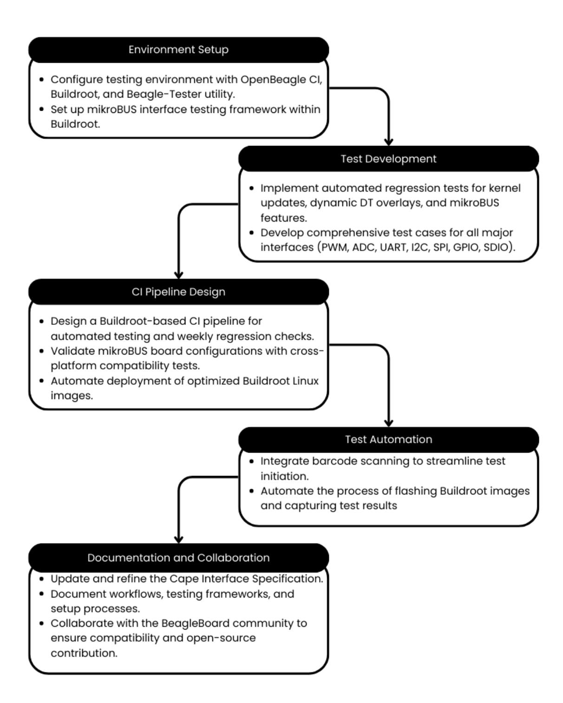
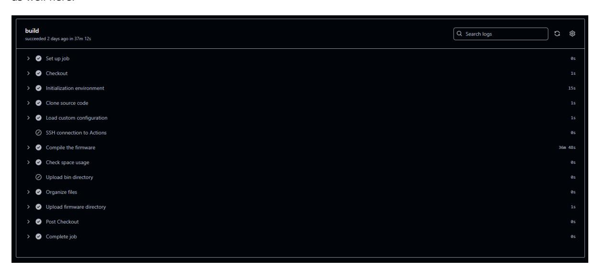
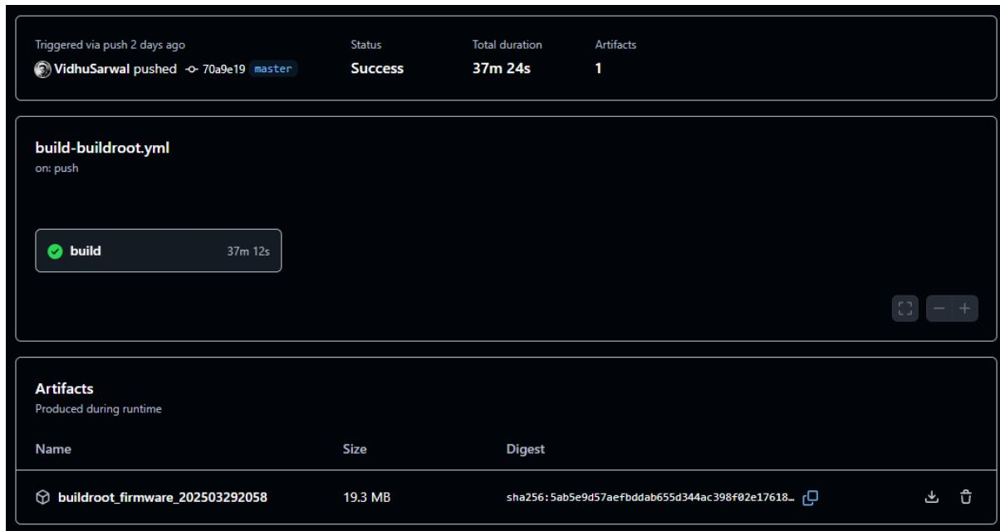
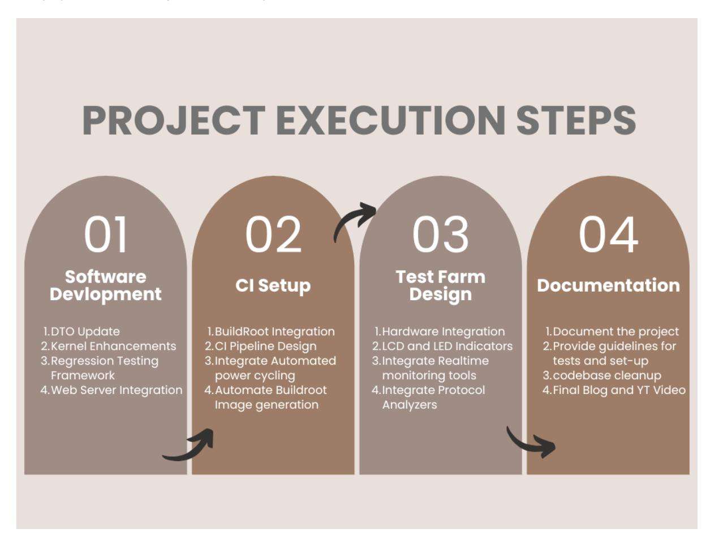

# **Table of contents**

| 1         |  | Introduction                                                          | 1  |
|-----------|--|-----------------------------------------------------------------------|----|
| 1.1       |  | Summary links                                                         | 1  |
| 1.2       |  | Status                                                                | 1  |
| 1.3       |  | Proposal                                                              | 1  |
| 1.4       |  | About                                                                 | 1  |
| 2 Project |  |                                                                       | 2  |
| 2.1       |  | Descripti on                                                          | 2  |
|           |  | 2.1.1 MikroBus and Click boards                                       | 2  |
|           |  | 2.1.2 Regression Testing                                              | 4  |
|           |  | 2.1 .3 Testing Protocols                                              | 6  |
|           |  | 2.1.4 Com puter Vision for Barcode Scanning                           | 8  |
|           |  | 2.1.5 Extra Features Which Can Be Added If Approved                   | 8  |
| 2.2       |  | Software                                                              | 8  |
| 2.3       |  | Hardware                                                              | 8  |
| 3 Tim     |  | eline                                                                 | 10 |
| 3.1       |  | Timeline summary                                                      | 11 |
| 3.2       |  | Timeline d etailed                                                    | 11 |
| 3.3       |  | Community Bonding Period (May 8 – June 1)                             | 11 |
|           |  | 3.3.1 Week 1 (May 8 – May 14): Finalize Execution Plan                | 11 |
|           |  | 3.3.2 Week 2 (Ma y 15 – May 21): Familiarization with Tools           | 12 |
|           |  | 3.3.3 Week 3 (M ay 22 – June 1): Initial Test Farm Design             | 12 |
| 3.4       |  | Step 1: Software Development (June 2 – July 13)                       | 12 |
|           |  | 3.4.1 Week 4 (June 2 – June 8): Device Tree Updates                   | 12 |
|           |  | 3.4.2 Week 5 (June 9 – June 16): Kernel Enhancements                  | 12 |
|           |  | 3.4.3 Week 6 (June 17 – June 23): Regression Testing Fra mework       | 12 |
|           |  | 3.4.4 Week 7 (June 24 – June 30): Lightweight W eb Server Integration | 13 |
|           |  | 3.4.5 Week 8 (July 1 – July 6): Finalize Software Featu res           | 13 |
|           |  | 3.4.6 Submit midterm evaluations (July 14th)                          | 13 |
| 3.5       |  | Step 2: Continuous Integration Setup (July 19 – August 8)             | 13 |
|           |  | 3.5.1 Week 9 & 10 (July 7 – July 20): Buildroot Integration           | 13 |
|           |  | 3.5.2 Week 11 (July 21 – July 27): CI Pipeline Design                 | 13 |
| 3.6       |  | Step 3: Test Farm Design (August 9 – August 25 )                      | 14 |
|           |  | 3.6.1 Week 12 (July 28 – August 4): Hardware Integration              | 14 |
|           |  | 3.6.2 Week 13 (August 4 – August 10): Advanced Monitor ing Tools      | 14 |
| 3.7       |  | Documentation & Final Deliverables (August 11 – Aug ust 25)           | 14 |
| 3.8       |  | Final Submission                                                      | 15 |
|           |  | 3.8.1 Initial results (September 9)                                   | 15 |
| 4         |  | Experience and approach                                               | 16 |
| 4.1       |  | Contingency                                                           | 16 |
| 4.2       |  | Benefit                                                               | 16 |
| 4.3       |  | Misc                                                                  | 17 |
| 4.4       |  | Suggestions                                                           | 17 |
| 4.5       |  | References                                                            | 17 |

# **Introduction**

#### **1.1 Summary links**

- • **Contributor:** Vidhu Sarwal
- **Mentors:** Jason Kridner, Deepak Khatri, Anuj Deshpande, Dhruva gole
- **Code:** *TBD*
- **Documentation:** *[TBD](https://forum.beagleboard.org/u/vidhu/)*
- **GSoC:** *TB[D](https://forum.beagleboard.org/u/jkridner/)*

#### **1.2 Status**

This project is currently just a proposal.

# **1.3 Proposal**

- • Created accounts accross OpenBeagle, Discord and Beagle Forum
- The PR Request for Cross Compilation: #197
- Created a project proposal using the proposed template.

#### **1.4 About**

- • **Forum:** u/vidhu (Vidhu Sarwal)
- **OpenBeagle:** vidhusarwal (Vidhu Sarwal)
- **Github:** vidhusarwal (Vidhu Sarwal)
- **School:** [Thapar](https://forum.beagleboard.org/u/vidhu/) [Institute](https://forum.beagleboard.org/u/vidhu/) [of](https://forum.beagleboard.org/u/vidhu/) [Eng](https://forum.beagleboard.org/u/vidhu/)ineering and Technology
- **Country:** Indi[a](https://openbeagle.org/vidhusarwal)
- **Primary la[nguage:](https://github.com/VidhuSarwal)** English
- **Typical work hours:** [8AM-5PM](https://www.thapar.edu) [Indian](https://www.thapar.edu) [Standard](https://www.thapar.edu) [Time](https://www.thapar.edu)
- **Previous GSoC participation:** N/A

# **Project**

**Project name:** Update beagle-tester for mainline testing

# **2.1 Description**

Beagle-Tester is a test automation framework designed for BeagleBoard devices, allowing hardware validation across multiple boards. This project aims to enhance Beagle-Tester by incorporating mikroBUS support and updating it for mainline kernel testing. The goal is to create an automated regression test suite for Linux kernel and device-tree overlays on BeagleBoard-based hardware, enabling continuous validation in the OpenBeagle CI server.

Key objectives include:

- Adding mikroBUS support to Beagle-Tester to validate peripherals like PWM, ADC, UART, I2C, SPI, GPIO, and interrupts.
- Integrating automated power cycling and remote control capabilities for test farms with multiple boards.
- Building a web interface for monitoring and managing test results efficiently.
- Optimizing Beagle-Tester for Buildroot to streamline deployment.

The project will benefit BeagleBoard developers, Linux kernel maintainers, and embedded engineers by providing a robust testing framework for validating hardware and software compatibility with weekly mainline Linux updates. The implementation will use Python, Bash scripting, Linux device-tree modifications, and udev rules to ensure automation and scalability

#### **2.1.1 MikroBus and Click boards**

I am going to provide some background on how MikroBus can be detected and tested.

#### **Detecting MikroBus:**

If the board inserted contains an EEPROM with relevant information, it can be detected using:

dmesg | grep mikrobus

Sample output:

[ 2.096254] mikrobus:mikrobus\_port\_register: registering port mikrobus-0 [ 2.663698] mikrobus\_manifest:mikrobus\_manifest\_attach\_device: parsed device 1,␣ *,→*driver=opt3001, protocol=3, reg=44 [ 2.663783] mikrobus mikrobus-0: registering device : opt3001

Fig. 1: **Figure 1:** Flowchart of objectives (The following does not represent the implementation steps of the project, for that refer milestones.)

iio:device0

In case of using, for example, an I2C device, its address can be verified using:

i2cdetect -y 2

#### **Testing MikroBus Device**

- a. Read sensor data from:

ls /sys/bus/iio/devices/

- b. Verify the value against some threshold/chart depending on the type of sensor.
- c. Send the sample output for logging.

#### **Automating MikroBus Device Testing**

We can automate this using a small script.

- a. For Ex. a temperature sensor, we can run:

RAW\_TEMP=**\$(**cat /sys/bus/iio/devices/iio**\:**device0/in\_temp\_raw**)** SCALE=**\$(**cat /sys/bus/iio/devices/iio**\:**device0/in\_temp\_scale**)** TEMP=**\$(**echo "\$RAW\_TEMP \* \$SCALE" | bc**)** echo "Temperature = *\${*TEMP*}*°C"

- b. Save this as a *.sh* file and run it:

chmod +x sensor\_test.sh ./sensor\_test.sh

#### **Important:**

If your Click board does not have ClickID, you must manually install its manifest file. To install manifests for supported boards, run:

sudo apt update sudo apt install bbb.io-clickid-manifest

**Important:** Dynamic Runtime Pinmuxing cannot be implemented for now. As per my discussion with members on Discord #linux, Global dynamic overlays will never be added upstream. Upstream wants local dynamic overlays Lore

#### **[2.1.](https://lore.kernel.org/all/9c326bb7-e09a-4c21-944f-006b3fad1870@beagleboard.org/)2 Regression Testing**

Here, I will provide information on how regression testing can be set up on a farm.

- 1. Install and set up **Beagle-tester** with its related dependencies beforehand.
- 2. The **Device Under Test (DUT)** is flashed with a production Debian image, and Beagle-tester is installed to execute interface-specific tests.

- Build and test stages for automating Beagle-tester workflows.
- Scripts to run tests, log results, and collect artifacts.

**As discussed during application period**, I have implemented a Github actions script demo which generates Buildroot image whenever a new push is made to .config file. This can also be edited to generate images every week for weekly regression test. The demo can be found here Link to Git I am attaching a screenshot of the pipeline as well here.

Fig. 2: **Figure:** Representation of Pipeline stages.

Fig. 3: **Figure:** Representation of Demo. The image is provided in artifact.

Weekly regression tests are scheduled in **GitLab CI** to ensure that kernel updates or software changes do not break **mikroBUS compatibility**.

#### **2.1.3 Testing Protocols**

I am going to provide an idea on how tests can be developed for protocols. Say, for example, I2C/SPI needs an approach that verifies both functional operation and error handling.

- **Using Logic Protocol Analyzers** *Functional Testing* We can implement a logic analyzer for protocol testing. An inexpensive FX2-based logic analyzer can be used to read signals from the DUT. After installing Sigrok and connecting the necessary probes to the peripherals of the DUT, it can be monitored using:

sigrok-cli --config samplerate=1M --driver=fx2lafw --continuous -P␣ *,→*spi:mosi=1:clk=3:cs=4

This can be automated as well to publish the results automatically to the web server or even GitLab's CI for weekly tests.

A basic communication test can be performed as follows:

*#!/bin/bash # I2C Basic Communication Test* DEVICE="fx2lafw" SAMPLERATE="1M" CHANNELS="0=SCL,1=SDA" echo "detecting I2C devices:" i2cdetect -y 2 *# capture I2C transaction* echo "capturing I2C txn" sigrok-cli --driver=\$DEVICE --config samplerate=\$SAMPLERATE --channels= *,→*\$CHANNELS **\** --time 3s -P i2c:scl=0:sda=1 > i2c\_capture.txt *# validate communication* echo "validating I2C communication..." **if** grep -q "Address write" i2c\_capture.txt && grep -q "ACK" i2c\_capture.txt; *,→* **then** echo "I2C communication successful" **else** echo "I2C communication error" **fi**

Additional tests for Address Recognition and Clock Stretching can also be added.

#### • **Test Case Design Methodology**

Here's an example implementation in C for I2C EEPROM testing:

*/\*\* \* I2C EEPROM Read/Write Test Case \* Purpose: Validates I2C communication and EEPROM functionality \* Success Criteria: Write/read verification with <5% bit error rate \*/* **int** test\_i2c\_eeprom(**uint8\_t** device\_address) { **int** fd; **uint8\_t** test\_data[] = "BeagleTester"; **uint8\_t** read\_data[**sizeof**(test\_data)]; **uint8\_t** reg\_addr = 0x00; **int** error\_count = 0; **float** error\_rate = 0.0; *// Open I2C bus* **if** ((fd = open("/dev/i2c-2", O\_RDWR)) < 0) { log\_error("Failed to open I2C bus"); **return** -1; }

*// Set slave address* **if** (ioctl(fd, I2C\_SLAVE, device\_address) < 0) { log\_error("Failed to acquire bus access"); close(fd); **return** -1; } *// write to EEPROM* **if** (i2c\_smbus\_write\_i2c\_block\_data(fd, reg\_addr, **sizeof**(test\_data), test\_ *,→*data) < 0) { log\_error("Failed to write to EEPROM"); close(fd); **return** -1; } usleep(100000); *// 100ms delay // read back data* **if** (i2c\_smbus\_read\_i2c\_block\_data(fd, reg\_addr, **sizeof**(test\_data), read\_ *,→*data) < 0) { log\_error("Failed to read from EEPROM"); close(fd); **return** -1; } *// error rate calc* **for** (**int** i = 0; i < **sizeof**(test\_data); i++) { **if** (test\_data[i] != read\_data[i]) error\_count++; } error\_rate = (**float**)error\_count / **sizeof**(test\_data) \* 100.0; *// logging* log\_info("I2C EEPROM Test: %s", (error\_rate < 5.0) ? "PASS" : "FAIL"); log\_info("Bit Error Rate: %.2f%%", error\_rate); *// Cleanup* memset(test\_data, 0xFF, **sizeof**(test\_data)); i2c\_smbus\_write\_i2c\_block\_data(fd, reg\_addr, **sizeof**(test\_data), test\_ *,→*data); close(fd); **return** (error\_rate < 5.0) ? 0 : -1; }

**Test Case Features** This test case implementation demonstrates:

- **Boundary Testing**: Uses specific payload size to test I2C block transfers.
- **Timing Validation**: Incorporates EEPROM write cycle timing requirements.
- **Metric Collection**: Quantifies bit error rates for performance regression tracking.
- **Cleanup Protocol**: Restores initial state to prevent test contamination.

**\*\***Integration with Regression Testing Framework \*\* The test integrates with the proposed regression testing framework by providing:

- Clear pass/fail criteria based on error rate thresholds.
- Detailed logging for troubleshooting and historical analysis.
- • Proper resource management with cleanup procedures.

In the current version of Beagle-tester, the barcode displayed on the boot needs to be manually scanned to continue with testing. This can be automated by using a HDMI to USB video card. This will also help with HDMI testing. We can use OpenCV and ZBar for this purpose. OpenCV will be used to capture frame from HDMi(from the video source).

Link to script

#### **HDMI Barcode Detection Process**

- 1. **Initialize Video Capture** Open HDMI input device.
- 2. **[Initiali](https://gist.github.com/VidhuSarwal/f72e5a83428cc6162f30425d592d4612)ze Barcode Scanner** Setup ZBar scanner.
- 3. **Start Capture Loop** Read frame from HDMI input. If frame capture fails, retry.
- 4. **Extract Region of Interest (ROI)** Crop frame to fixed coordinates (*ROI\_X*, *ROI\_Y*, *ROI\_WIDTH*, *ROI\_HEIGHT*).
- 5. **Detect Barcode** Convert ROI to grayscale. Scan for barcodes in the ROI.
- 6. **Validate 16-bit Barcode** If valid barcode found → Store result and exit. If no barcode found → Continue loop until timeout.
- 7. **Handle Timeout** If no barcode is detected in 30 seconds, exit with failure.

#### **2.1.5 Extra Features Which Can Be Added If Approved**

On the forum, I discussed adding some additional features.

- 1. **Computer Vision for Barcode Scanning** One proposed feature is using **computer vision** to automatically scan the barcode of the **Device Under Test (DUT)** using an **HDMI-to-USB Encoder**, commonly used in display capture. This would help eliminate manual labor. More details can be found in the forum discussion: Forum discussion on Barcode Scanning
- 2. **Web Server for Data Display** Another feature worth adding is a **web server**. A server can be used to send data and display it on a webpage once the network is available. This can be achieved using **Mongoose** as [the web server. More details can be fou](https://forum.beagleboard.org/t/update-beagle-tester-for-cape-mikrobus-new-board-and-upstream-testing/37279/37?u=Vidhu)nd in the forum discussion: Forum discussion on Web Server

These features have been added to the timeline below but can be removed as needed.

#### **2.2 Software**

- • Python (for test scripting and automation)
- Bash (for system-level automation)
- Linux kernel/device-tree (for hardware validation and overlay support)
- Buildroot (for firmware and testing framework optimization)
- Beagle-Tester (core test framework)
- Mongoose (for web-based test monitoring interface)

# **2.3 Hardware**

- • BeagleBone Black / BeagleBone AI-64 / PocketBeagle 2 (for portable testing)
- mikroBUS Cape (custom cape for interfacing mikroBUS modules)
- Multiple mikroBUS modules (PWM, ADC, UART, I2C, SPI, GPIO peripherals)
- 8-port USB hub with Ethernet and power control (for automated power cycling)

- External monitor (for HDMI signal validation)
- Power control module (for remote board reset)

# **Timeline**

The project will be broadly divided into 4 parts as mentioned below in the Flowchart.

Fig. 1: **Figure 2:** Representation of steps to complete project. Checkout the table below for exact timeline)

| Date     |         | Activity      |             |                |          |             |          |              |                     |              |                                    |
|----------|---------|---------------|-------------|----------------|----------|-------------|----------|--------------|---------------------|--------------|------------------------------------|
| February | 27      | Connect       |             | with           | possible |             |          | mentors      | and                 | request      | review on first draft              |
| March    | 4       | Complete      |             | prerequisites, |          |             |          | verify       | value               | to community | and request review on second draft |
| March    | 11      | Finalized     |             | timeline       |          | and         |          | request      | review              | on final     | draft                              |
| April    | 8       | Submit        | application |                |          |             |          |              |                     |              |                                    |
| May      | 8       | Community     |             |                | Bonding  |             | Period   |              | (May 8              | – June 1)    |                                    |
| June     | 2       | Week          | 4           | (June          | 2 –      | June        |          | 8): Device   | Tree                | Updates      |                                    |
| June     | 9       | Week          | 5           | (June          | 9 –      | June        |          | 16):         | Kernel Enhancements |              |                                    |
| June     | 17      | Week          | 6           | (June          | 17       | –           | June     | 23):         | Regression          | Testing      | Framework                          |
| June     | 24      | Week          | 7           | (June          | 24       | –           | June     | 30):         | Lightweight         | Web          | Server Integration                 |
| July     | 1       | Week          | 8           | (July          | 1 –      | July        | 6):      | Finalize     | Software            | Fe           | atures                             |
| July     | 7       | Week          | 9           | & 10           | (July    |             | 7 –      | July         | 20): Buildroot      | Integr       | ation                              |
| July     | 14      | Submit        | midterm     |                |          | evaluations |          |              | (July 14th)         |              |                                    |
| July     | 21      | Week          | 11          | (July          | 21       | –           | July     | 27):         | CI Pipeline         | Design       |                                    |
| July     | 28      | Week          | 12          | (July          | 28       | –           | August   |              | 4): Hardware        | Integration  |                                    |
| August   | 4       | Week          | 13          | (August        |          | 4           | – August |              | 10): Advanced       |              | Monito ring Tools                  |
| August   | 11      | Documentation |             |                |          | & Final     |          | Deliverables |                     | (August      | 11 – Au gust 25)                   |
| August   | 25 Sept | 1 Final       | Submission  |                |          |             |          |              |                     |              |                                    |

### **3.2 Timeline [detailed](#page-15-3)**

#### **Important:**

- I have my end-semester evaluation scheduled from **17th May 2025 till 1st June 2025**.
- Other than that, I will have my summer vacations in June and July, so I will be able to dedicate around 35-37 hours per week. This will total approximately **300-330 hours over the summer**.
- At the end of June, I may need to take **two days off (27-28 June)** for traveling back to campus.
- After my next academic session begins in August, I will be able to commit about 12 hours per week, adding another **48-50 hours** to the project. This is why I aim to complete major implementations before my session starts and leave primarily documentation for the last step in August. I have also included **buffer weeks in July and August** to accommodate any unexpected delays.

**Important:** Once the coding period starts, the documentation will be updated weekly, and progress will be reported weekly via a blog post.

### **3.3 Community Bonding Period (May 8 – June 1)**

### **3.3.1 Week 1 (May 8 – May 14): Finalize Execution Plan**

- • **What will be done:**
  - **–** Discuss project goals with mentors and finalize the enhanced execution plan.
  - **–** Review existing documentation for mikroBUS cape and Beagle Tester.
- **How it will be done:**
  - **–** Conduct meetings with mentors to refine objectives and milestones.
  - **–** Analyze *cape\_interface\_spec.md* and identify areas requiring updates.
  - **–** Set up the development environment.

#### **3.3.2 Week 2 (May 15 – May 21): Familiarization with Tools**

- **What will be done:**
  - **–** Setup and initialize with tools like OpenCV, Mongoose server, Buildroot configurations, and GitLab CI pipelines.
- **How it will be done:**
  - **–** Install and test OpenCV for video processing tasks.
  - **–** Set up a lightweight web server using Mongoose for hosting test results.
  - **–** Explore Buildroot configurations for BeagleBoard variants.

#### **3.3.3 Week 3 (May 22 – June 1): Initial Test Farm Design**

- **What will be done:**
  - **–** Begin discussions on modular test farm design to ensure scalability.
- **How it will be done:**
  - **–** Research hardware integration options, including PocketBeagle boards and USB hubs.
  - **–** Plan power cycling capabilities inspired by Balena AutoKit setups.

—

### **3.4 Step 1: Software Development (June 2 – July 13)**

#### **3.4.1 Week 4 (June 2 – June 8): Device Tree Updates**

- **What will be done:**
  - **–** Removed [Map mikroBUS socket pins to Device Tree overlays.]
  - **–** Add support for ClickID detection to automate driver loading and test selection.
- **How it will be done:**
  - **–** Update *cape\_interface\_spec.md* with pin mappings for all interfaces.
  - **–** Write scripts to detect ClickID and dynamically load drivers.

#### **3.4.2 Week 5 (June 9 – June 16): Kernel Enhancements**

- **What will be done:**
  - **–** Removed [Develop kernel patches to support mikroBUS drivers for all interfaces].
- **How it will be done:**
  - **–** Implement kernel patches for SPI, I2C, UART, ADC, PWM, GPIO, SDIO interfaces.
  - **–** Push updates to Linux mainline for long-term support.

#### **3.4.3 Week 6 (June 17 – June 23): Regression Testing Framework**

- **What will be done:**
  - **–** Extend Beagle Tester to include automated regression tests for mikroBUS-enabled interfaces.
- **How it will be done:**

- **–** Write modular regression test scripts covering SPI, I2C, UART, ADC, GPIO, PWM.
- **–** Use OpenCV-based video processing to analyze HDMI output during tests.

#### **3.4.4 Week 7 (June 24 – June 30): Lightweight Web Server Integration**

- **What will be done:**
  - **–** Integrate a lightweight web server to host real-time test results over the network.
- **How it will be done:**
  - **–** Use Mongoose server to serve test results from Beagle Tester in real-time.
  - **–** Provide options to display results on an attached screen or remotely via a browser.

#### **3.4.5 Week 8 (July 1 – July 6): Finalize Software Features**

- **What will be done:**
  - **–** Complete all pending software tasks and ensure compatibility with advanced features like HDMI video processing and parallel LCD testing.
- **How it will be done:**
  - **–** Refactor codebase for maintainability and readability.
  - **–** Conduct comprehensive regression testing using GitLab CI pipelines.

—

#### **3.4.6 Submit midterm evaluations (July 14th)**

### **3.5 Step 2: Continuous Integration Setup (July 19 – August 8)**

#### **3.5.1 Week 9 & 10 (July 7 – July 20): Buildroot Integration**

- **What will be done:**
  - **–** Update Buildroot configurations for each BeagleBoard variant (AI-64, Black, BeagleY, PocketBeagle).
  - **–** Automate Buildroot image generation with mikroBUS support and pre-installed Beagle Tester utilities.
- **How it will be done:**
  - **–** Configure Buildroot for supported boards and generate images automatically using scripts.
  - **–** Test generated images by booting them on supported hardware.

#### **3.5.2 Week 11 (July 21 – July 27): CI Pipeline Design**

- **What will be done:**
  - **–** Set up GitLab CI pipelines to automate regression testing weekly.
  - **–** Include power cycling capabilities using USB hubs with Ethernet and individual port power switching inspired by Balena AutoKit setups.
- **How it will be done:**
  - **–** Design modular CI workflows that include dynamic test selection based on ClickID detection.

- **–** Integrate automated power cycling into the pipeline.

—

## **3.6 Step 3: Test Farm Design (August 9 – August 25)**

#### **3.6.1 Week 12 (July 28 – August 4): Hardware Integration**

- **What will be done:**
  - **–** Use a PocketBeagle and an eight-board USB hub as building blocks for the test farm.
  - **–** Integrate power connectors and remote power cycling capabilities inspired by Balena AutoKit setups.
- **How it will be done:**
  - **–** Assemble the hardware setup with modular components like USB hubs and PocketBeagle boards.
  - **–** Add LCD displays and LEDs to indicate test status visually.

#### **3.6.2 Week 13 (August 4 – August 10): Advanced Monitoring Tools**

- **What will be done:**
  - **–** Integrate real-time monitoring tools (e.g., protocol analyzers) for debugging SPI/I2C/UART communication in real-time.
  - **–** Include logging mechanisms to capture test results and facilitate debugging.
  - **–** Add support for additional interfaces like HATs or PocketCape headers.
- **How it will be done:**
  - **–** Set up protocol analyzers for communication monitoring.
  - **–** Implement a logging system to track test status and results.
  - **–** Research and integrate support for additional interface components into the test farm.

—

## **3.7 Documentation & Final Deliverables (August 11 – August 25)**

- **What will be done:**
  - **–** Update *cape\_interface\_spec.md* with fixes based on hardware mapping feedback.
  - **–** Document the process for setting up the test farm using defined hardware/software tools.
  - **–** Provide guidelines for extending tests to new mikroBUS-enabled boards and integrating additional interfaces like Robotics Cape or HATs.
  - **–** Create user-friendly tutorials on how to use the Beagle Tester with mikroBUS cape.
  - **–** Prepare final deliverables, including codebase cleanup, detailed documentation, and packaging all materials for submission.
- **How it will be done:**
  - **–** Review hardware and software feedback for any necessary updates.
  - **–** Write thorough setup and usage documentation, including code examples.
  - **–** Prepare submission materials, ensuring everything is well-documented and ready for deployment.

### **3.8 Final Submission**

- Submit final work product by **September 1st** at the latest.

**Important: August 25 - September 1 - 18:00 UTC:** Final week: GSoC contributors submit their final work product and their final mentor evaluation (standard coding period)

**September 1 - September 8 - 18:00 UTC:** Mentors submit final GSoC contributor evaluations (standard coding period)

#### **3.8.1 Initial results (September 9)**

**Important: September 9 - November 9:** GSoC contributors with extended timelines continue coding

**November 10 - 18:00 UTC:** Final date for all GSoC contributors to submit their final work product and final evaluation

**November 17 - 18:00 UTC:** Final date for mentors to submit evaluations for GSoC contributor projects with extended deadlines

# **Experience and approach**

- Currently a Sophomore majoring in Computer Science and Engineering.
- Proficient in Python, C, Bash, Go, and JavaScript.
- Familiar with CI/CD workflows and automated hardware testing.
- Designed and developed Caffeen IoT Home Board, an ESP8266-based smart home automation system, and won the Digikey & EW Project Challenge 2024.
- Successfully implemented IoT systems using ESP microcontrollers and MQTT protocols at **Sentinal Innovations**, ensuring seamless device-cloud communication also worked on DevOps for testing.
- Engineered an AI-powered expert matching system (ExpeRelate), integrating NLP, Go, and FastAPI\*\*, and won Government of India's Smart India Hackathon 2024 under **Ministry of Education**.
- Developing a GenAI-Worklet Generator Agent at Samsung Research Institute, utilizing LLMs and agentic frameworks for automating R&D worklet generation. (Expected to finish by march end)

#### **4.1 Contingency**

If I encounter blockers when my mentor is unavailable, I will take the following steps:

- Research and Documentation: I will refer to BeagleBoard.org documentation, the Beagle-Tester source code, Linux kernel documentation, and relevant technical forums.
- Community Support: I will seek help from the BeagleBoard.org community on Discord and the BeagleBoard forum.
- Debugging and Alternative Approaches: I will systematically debug issues, analyze logs, and experiment with alternative solutions before escalating problems.

### **4.2 Benefit**

A community member on the BeagleBoard forum stated: "Having automated regression testing for mikroBUS capes will be a huge step forward for kernel and device-tree overlay maintainers."

The successful completion of this project will greatly enhance the BeagleBoard.org community's ability to test and verify mainline Linux kernel changes. By integrating mikroBUS support into Beagle-Tester, we will enable automated regression testing for a wide range of sensor and peripheral interfaces, reducing manual testing efforts and ensuring high hardware reliability.

This work will contribute to the OpenBeagle CI server, helping developers verify kernel patches more efficiently. The project also aligns with BeagleBoard.org's mission to provide open-source, community-driven hardware solutions.

I will ensure compliance with all GSoC general requirements and submit my merge request to the BeagleBoard GitHub repository. The link to the merge request will be provided once I finalize my initial implementation

#### **4.4 Suggestions**

Well, If you read this far, then please give me a review for this proposal as well. Thanks.

#### **4.5 References**

- 1. Using MikroBus
- 2. Exclave Repository
- 3. Beagle-Tester README
- 4. [Buildroot](https://docs.beagleboard.org/boards/beagleplay/demos-and-tutorials/using-mikrobus.html) [Manua](https://docs.beagleboard.org/boards/beagleplay/demos-and-tutorials/using-mikrobus.html)l
- 5. [Kernel](https://github.com/exclave/exclave) [Mailing](https://github.com/exclave/exclave) [List](https://github.com/exclave/exclave) [D](https://github.com/exclave/exclave)iscussion