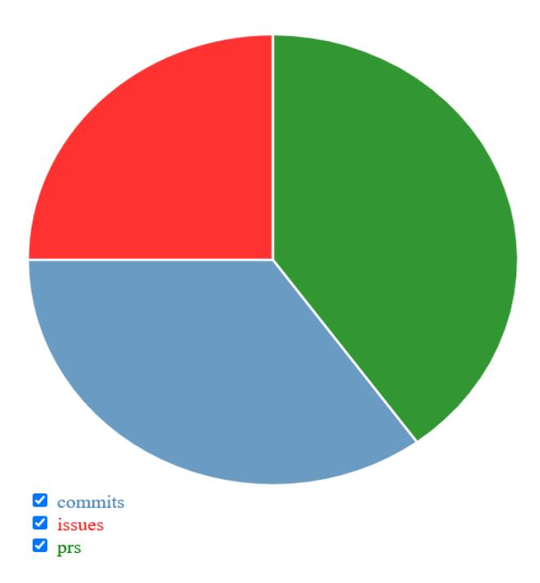
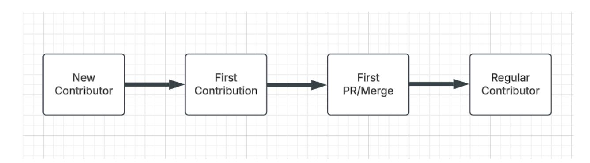
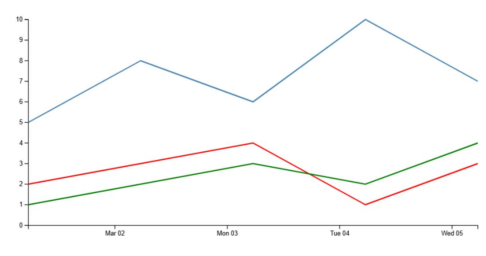
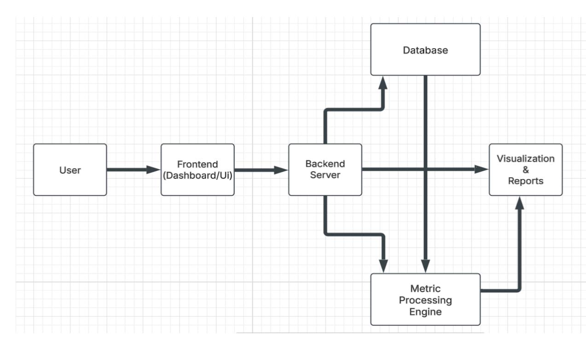
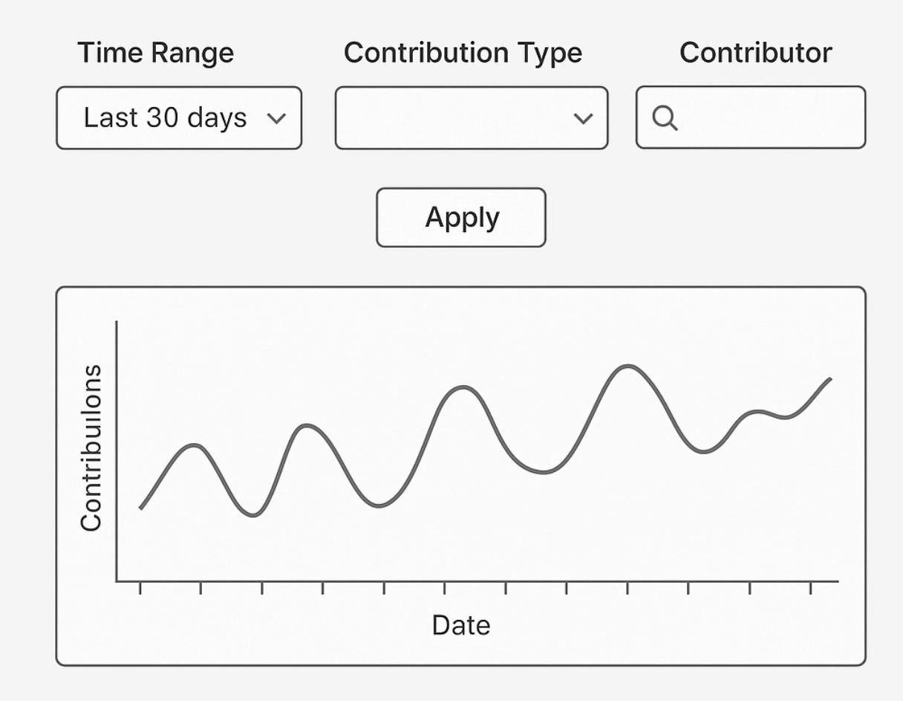

# **Google Summer Of Code**

# GSoC Proposal:

# Implement Conversion Rate Metric In Chaoss Software

## PERSONAL DETAILS AND CONTACT INFORMATION

- Name Akshat Baranwal
- Github [Akshatb2006](https://github.com/Akshatb2006)
- Email [kysuakshat23@gmail.com](mailto:kysuakshat23@gmail.com)
- Telephone +91 8240169929
- Time-zone: Indian Standard Time (IST)
- LinkedIn Akshat [Baranwal](https://www.linkedin.com/in/akshat-baranwal-936797313/)

- Working hours:
  - (IST) : 11:00 14:30 , 16:30 21:00 , 00:00 04:00
  - (GMT) : 05:30 09:00 , 11:00 15:30 , 18:30 22:30

### Synopsis

The Conversion Rate Metric project addresses the important problem of contributor retention in open-source projects. Quantifying the effectiveness with which newcomers become frequent participants, communities are better able to understand their onboarding process. Many open-source projects struggle with contributor retention. By tracking conversion rates, maintainers can identify friction points in onboarding and improve community engagement.

Including this metric in CHAOSS/Augur enables automated data collection and analysis. A data pipeline, implemented using Python and SQL, will collect data from Git repositories and issue trackers. Calculation of the metrics will be done within Augur, with customizable parameters. A simple dashboard will display these metrics, allowing maintainers to see trends, identify bottlenecks, and make informed decisions. Visualizations will include conversion rates over time, cohort analysis, and contributor activity trends.

### **Mentors:**

- Sean Goggins
- Andrew Brain
- John McGinness

### Benefits to the Community:

The project will have a direct positive impact on the CHAOSS community in the following ways:

➔ Delivering a new, useful metric to measure contributor engagement and community health. ➔ Allowing project maintainers to see bottlenecks in onboarding contributors and improve strategies accordingly. ➔ Enabling data-driven decisions for community outreach and engagement efforts. ➔ Building upon the efforts of the CHAOSS Metrics Models Working Group, this project aims to enhance metric tracking by designing a structured system architecture. The proposed system will streamline data collection, improve analysis, and ensure seamless integration with CHAOSS tools.

➔ Providing a publicly accessible utility for examining contributor conversion rates on a range of open-source projects. ➔ Let communities see the effect of different community activities, like meetups, on how many new contributors turn into core contributors.

### Current Status of the Project:

This project is in its initial phase, focusing on understanding and leveraging the existing infrastructure of Augur or GrimoireLab. The available data models and APIs provide a solid foundation for metric tracking, but require further refinement to enhance functionality and usability.

### **Next Steps:**

**Phase Zero (Community Bonding):** This phase will be dedicated to deepening familiarity with the data models and APIs of the chosen platform. Engagement with the community will help identify key areas of improvement.

**Implementation Phase:** Once the initial understanding is established, the next step will be implementing metric logic, ensuring accuracy and efficiency in data collection and analysis.

**Visualization Dashboard Design:** A user-friendly dashboard will be developed to display the metrics effectively, improving accessibility and decision-making for users. Sample visualization:

### Goals:

### **1. Develop and Implement the Conversion Rate Metric:**

- Establish precise and concise formulas and criteria for contributor levels (D0 → D1 → D2).
- Implement strong data extraction and processing pipelines within Augur's current infrastructure.
- Test the accuracy of the metric using extensive testing against actual open-source repositories.

### **2. Integrate the Metric into Augur's API and Dashboard:**

- Create well-documented API endpoints to serve conversion rate data efficiently.
- Create and deploy an easy-to-use and interactive user interface with dynamic visualizations for monitoring contributor engagement trends.
- Allow users to filter data effectively by project, time interval, and contributor type.

### **3. Testing, Deployment, and Documentation:**

- Perform thorough testing to confirm the reliability and correctness of metric computations.

- Deploy the feature on Augur's public dashboard for instant community use and access.
- Develop comprehensive documentation and easy-to-use tutorials to make the metric easily understandable and adoptable by contributors and maintainers.

### **Stretch Goals:**

#### **Increase CHAOSS Platform Integration:**

- Implement easy integration with GrimoireLab to make the metric usable in the wider CHAOSS ecosystem.

### **Enhance Multi-Platform Engagement Analysis:**

- Increase the tracking of the metric to also cover Slack, Discourse, and mailing list data, providing holistic multi-platform engagement analysis.

### **Deploy Predictive Contributor Retention:**

- Investigate and use predictive analytics to predict contributor retention patterns and deliver actionable insights for community management.

### Deliverables:

### **Deliverable 1 (Due by Evaluation 1 - July 15, 2025):**

### **Core Metric Implementation:**

- Implement data collection scripts to precisely capture contributor activity data according to the defined D0, D1, and D2 levels successfully.
- Create and calibrate the fundamentals of conversion rate calculation (D0 → D1, D1 → D2) with test repositories.

- Conduct a comprehensive progress report and integrate mentor feedback for continuous refinement.

### **Deliverable 2 (Due by Evaluation 2 - August 12, 2025):**

### **API and Visualization Integration:**

- Create high-quality and documented API endpoints to effectively provide conversion rate metrics.
- Create and integrate an easy-to-use frontend UI in Augur with dynamic visualizations to present contributor engagement trends effectively.
- Provide filtering features for time interval, contributor, and project to facilitate detailed analysis of data.
- Perform rigorous real-world testing with various open-source project data to verify functionality.

### **Deliverable 3 (Due by the End of the Coding Period - August 26, 2025):**

### **Deployment and Community Enablement:**

- Tune performance and optimize metric computation based on testing and feedback.
- Release the fully working feature in Augur's master repository, available publicly to the CHAOSS community.
- Develop extensive documentation and easy-to-follow tutorials to enable maintainers and contributors to successfully use the metric.
- Collect and integrate final community feedback from the CHAOSS community to ensure the feature satisfies their requirements.

### Expected Results:

At the completion of this project, the Conversion Rate Metric will be natively incorporated into Augur, giving open-source communities actionable feedback about contributor interaction and advancement.

### **The completed product will include the following important elements:**

### **Strong Contributor Engagement Metric Integration:**

- A clean data pipeline that is effectively able to pull and correctly classify contributors into D0, D1, and D2 engagement levels.
- Automatic, trustworthy calculations for significant conversion rates:
- D0 → D1 Conversion Rate: Quantifying the move from newcomers to active contributors.
- D1 → D2 Conversion Rate: Quantifying the move from active to core contributors.

- Use of optimization methods, such as data caching and batch processing, to guarantee responsiveness and efficiency.

### **Flexible and Accessible API Development:**

- REST API endpoints with good documentation to offer programmatic access to conversion rate data for various repositories.
- Advanced filtering features, enabling users to examine data across particular time frames, projects, and types of contributors.

### **Intuitive and Interactive Dashboard for Visualization:**

- Interactive graphical displays of conversion patterns, using libraries like Plotly or D3.js, for easy and informative visualization of data.
- Interactive filtering features within the dashboard, allowing users to dynamically examine data by project, time period, and type of contribution.
- Smooth integration into the Augur UI, giving maintainers an intuitive interface to easily analyze and interpret engagement metrics.

### **Stringent Testing and Public Deployment:**

- Extensive real-world validation across varied open-source project datasets to verify accuracy and reliability.
- Extensive performance testing to ensure scalability and stability of the metric.
- Successful integration and deployment into Augur's official repository, making the metric publicly accessible to the entire CHAOSS community.

### **Stretch Goals:**

#### **Increased Data Source Integration:**

- Expand metric collection from GitHub and GitLab to encompass data from other community sites, like Discourse and Slack, for a complete picture of contributor activity.

### **Predictive Engagement Analysis:**

- Use past trends and machine learning algorithms to forecast future engagement behavior, allowing for proactive community management.

### **Automated Engagement Alerts:**

- Use an automated alert system that informs maintainers of dramatic declines in contributor activity, enabling timely intervention and assistance.

### Approach:

To deliver the project objectives, I will utilize a structured and iterative development process with emphasis on data collection, conversion rate calculation, visualization, and deployment. This approach is segmented into clear phases, each corresponding to the project deliverables.

### **Existing Metric Implementation in Augur:**

- Augur offers formal data collection for open-source projects, using data models and APIs to retrieve and process repository activity. It now supports:
- Raw ingestion of data from GitHub, GitLab, and other repositories
- Computation pipelines for computation of different community health metrics
- GraphQL APIs for querying metrics
- Predefined visualization dashboards for viewing metrics

### **But existing limitations in Augur's system include:**

- **Limited flexibility of metrics –** Some definitions may be fixed, limiting deeper analysis.
- **Scalability issues –** Large repositories should be processed efficiently, which demands optimization.
- **Custom visualization deficiencies –** Users may require more interactive and customizable visualizations.

### **Phase 1: Data Collection & Classification (Expected by Evaluation 1)**

### **Objective:**

- To create a solid data pipeline for collecting and classifying contributor engagement data.

### **Steps:**

### **Tool Selection & Setup:**

- Perform a comparative study of Augur and GrimoireLab in order to choose the best platform for implementation.

- Set up a local development environment and initialize the required database.
- Work with mentors in finalizing tool selection and having a well-defined development plan.

#### **Data Collection:**

- Determine and define meaningful contributor activity metrics across varied sources, such as GitHub, GitLab, mailing lists, and forums.
- **● Establish clear and consistent levels of engagement:**
  - D0: Repository watching, starring, or forking.
  - D1: Issue creation, commenting, or code review.
  - D2: Merging of pull requests or major contributions.

#### **Data Storage:**

- Use effective data storage with PostgreSQL (for Augur) or Elasticsearch (for GrimoireLab), depending on platform choice.
- Introduce caching and filtering mechanisms to enhance data retrieval and processing. Efficient data retrieval and processing are critical for performance, especially when handling large datasets in Augur or GrimoireLab. To achieve this, we can integrate **caching** and **filtering mechanisms** that reduce redundant computations and optimize query performance.

### **Phase 2: Calculation of Conversion Rate & API Development (Expected by Evaluation 2)**

#### **Objective:**

- To calculate conversion rates accurately and make them available through well-documented API endpoints.

#### **Steps:**

### **Conversion Rate Computation:**

#### **Create stable Python scripts to compute conversion rates:**

**CR(D0→D1) = D0/D1**

**CR(D1→D2) = D1/D2**

- Use batch processing to effectively process API rate limits and big data. Batch processing is a technique that processes large volumes of data in groups (batches) rather than handling them one by one in real time. This method is particularly useful for:

- 1. **Managing API Rate Limits** Avoid hitting API request limits by making efficient bulk requests.
- 2. **Processing Big Data** Optimize data ingestion and transformation to handle large datasets efficiently.

#### **API Development:**

- Construct solid REST API endpoints via Flask or FastAPI to provide conversion rate information.
- Use end-to-end filtering capabilities for time period, project, and contributor type.
- Create effective unit tests to ensure API functionality and API dependability.

Sample endpoints that we can create (subject to change, based on discussions with the mentors):

|                           | Repository and Contributor |           | Metrics      |              |       |           |             |
|---------------------------|----------------------------|-----------|--------------|--------------|-------|-----------|-------------|
| Endpoint                  |                            |           |              | Description  |       |           |             |
| /repo-groups              | Fetches                    | all       | repository   | groups       | in    | the       | system.     |
| /contributors             | Fetches                    | a         | list of      | contributors |       | across    |             |
| /commits/<repo_id>        |                            | Retrieves | commit       | details      | for a | given     |             |
|                           | Issue and PR               | Metrics   |              |              |       |           |             |
| /pulls/<repo_id>          |                            | Retrieves | pull request | details      | for   | a         | repository. |
| /issue-comments/<repo_id> | Fetches                    |           | comments     | made         | on    | issues    | in a        |
| /pr-comments/<repo_id>    |                            | Retrieves | comments     | on           | pull  | requests. |             |

### **Phase 3: Visualization, Testing & Deployment (By the End of the Coding Period)**

### **Objective:**

- Develop an easy-to-use dashboard, thoroughly test, and make the metric publicly available.

### **Steps:**

#### **Dashboard Development:**

- To make **contributor activity insights more engaging and data-driven**, we can use **Plotly** (for Python-based visualization) and **D3.js** (for interactive JavaScript-based visualization). These libraries can help in representing **trends, comparisons, and patterns** in open-source project contributions. Sample snippet:

Object.keys(data).forEach(key => { const checkbox = legend.append("input") .attr("type", "checkbox") .attr("checked", true) .on("change", function () { updatePie(); }); legend.append("label") .style("color", color(key)) .text(` \${key}`) .append("br"); });

- Incorporate the UI directly into Augur's frontend using JavaScript and Bootstrap.
- Use interactive filters to enable maintainers to effectively analyze patterns of engagement. Maintainers need **dynamic filtering** options to quickly analyze **specific trends** in contributor activity. Filters allow them to **zoom into** specific time periods, types of contributions, and individual contributors.

#### **Testing & Optimization:**

- Ensure the conversion rate calculation is accurate by testing it with real-world contributor data, validating against historical trends, and cross-checking results with manual calculations to identify discrepancies and refine the formula.
- Optimize database queries and API responses to be scalable and performant.

### **Deployment & Documentation:**

- Deploy the metric in Augur's official environment with technologies such as Docker and Kubernetes.
- Develop detailed documentation to support maintainability and community adoption.
- Regularly interact with the CHAOSS community to receive feedback and make ongoing improvements.

### **Challenges & Solutions:**

**Challenge:** Huge datasets taking too long to process.

**Solution:** Apply caching and batch data retrieval techniques.

**Challenge:** API rate limits limiting data collection.

**Solution:** Retrieve data in batches and process it locally for effective processing.

**Challenge:** Unstandardized data formats.

**Solution:** Create data cleaning and normalization scripts to maintain data quality.

This method guarantees a systematic, scalable, and effective application of the Conversion Rate Metric, yielding valuable insights for open-source community growth analysis.

### Timeline:

| Community Bonding Period (April 10 May 20): | Engagement          | &             | Preparation |
|---------------------------------------------|---------------------|---------------|-------------|
| ●                                           | Thoroughly          | familiarize   | myself with |
| Augur's                                     | architecture,       | data          | models,     |
| and                                         | existing            | metrics.      |             |
| ●                                           | Collaborate closely | with          | mentors to  |
| refine                                      | project             | scope and     | finalize    |
| detailed                                    | implementation      |               | strategies. |
| ● Establish                                 | a local             | Augur         | development |
|                                             | environment,        | experiment    | with API    |
| structures,                                 | and                 | explore       | relevant    |
| database                                    | schemas.            |               |             |
| ● Conduct                                   | in-depth            | research      | on          |
| CHAOSS                                      |                     | documentation | related to  |
| contributor                                 | funnel              | models        | and         |
| conversion                                  | metrics.            |               |             |
| Buffer (May                                 | 18 May              | 20): Finalize |             |

|                                           | implementation | strategy         | and             | address any        |
|-------------------------------------------|----------------|------------------|-----------------|--------------------|
| remaining                                 | setup          |                  | challenges.     |                    |
| Phase 1: Initial Development (May 20 June | 17): Data      | Extraction       | &               | Conversion         |
| Rate Metric Implementation                |                |                  |                 |                    |
| Week 1 & 2 (May 20 June 3):               |                |                  |                 |                    |
| ●                                         | Define         | the              | Conversion      | Rate Metric        |
|                                           | and            | establish        | clear and       | consistent D0      |
|                                           | → D1           | → D2             | criteria.       |                    |
| ●                                         | Identify       | and              | extract         | relevant           |
|                                           | contributor    | activity         | data            | using              |
|                                           |                | GitHub/GitLab    | APIs.           |                    |
| ●                                         | Develop        | initial          | scripts         | for efficient      |
|                                           | contributor    | activity         | data            | collection.        |
| ●                                         | Store          | extracted        | data            | securely and       |
|                                           | efficiently    | within           | Augur's         | PostgreSQL         |
| ●                                         | Buffer         | (June 3          | June            | 7): Debug and      |
|                                           | resolve        | any data         | collection      | issues.            |
| Week 3 & 4 (June 7 June 17):              |                |                  |                 |                    |
| ●                                         | Implement      | robust           |                 | conversion rate    |
|                                           | formulas       | for              | accurate        | tracking of        |
|                                           | contributor    |                  | transitions.    |                    |
| ●                                         | Develop        | optimized        |                 | database queries   |
|                                           | for            | efficient metric |                 | calculations.      |
| ●                                         | Implement      |                  | well-documented | API                |
|                                           | endpoints      | using            | Flask           | to retrieve        |
|                                           | metric         | data.            |                 |                    |
| ●                                         | Validate       | API              | functionality   | and                |
|                                           | accuracy       | using            |                 | comprehensive test |
|                                           | data and       |                  | debugging.      |                    |
| Buffer                                    | (June          | 17 June          | 20):            | Thoroughly test    |
| API                                       | accuracy       | and              | incorporate     | mentor             |
| Evaluation 1 (June 20 June 24):           |                |                  |                 |                    |
| ●                                         | Deliverable:   |                  | Fully           | implemented        |
|                                           | Conversion     | Rate             | Metric          | and functional     |
| Phase 2: Visualization & UI Development   | (June          | 24 July          | 22):            | Frontend           |
| Dashboard & Visualization                 |                |                  |                 |                    |
| ●                                         | Design         | an intuitive     | and             | interactive UI     |
|                                           | for            | visualizing      | conversion      | trends using       |
|                                           | Plotly         | or D3.js.        |                 |                    |
| ●                                         | Integrate      | dynamic          | charts          | and                |
|                                           |                | comprehensive    | filtering       | options for        |

| Week 5 & 6 (June 24 July 8):               | in-depth      | contributor    |                | retention analysis.  |
|--------------------------------------------|---------------|----------------|----------------|----------------------|
| ●                                          | Connect       | the            | frontend       | seamlessly with      |
| API                                        |               | endpoints      | to display     | real-time            |
| Buffer                                     | (July 8       | July           | 12): Refine    | UI design            |
| and debug                                  | data          |                | visualization  | issues.              |
| Week 7 & 8 (July 12 July 22):              |               |                |                |                      |
| ●                                          | Optimize      | database       |                | queries and API      |
|                                            | calls for     | enhanced       |                | performance and      |
| ●                                          | Conduct       | thorough       |                | integration testing  |
|                                            | with          | real-world     | open-source    | project              |
| ●                                          | Refine        | UI             | responsiveness | and                  |
|                                            | usability     | based          | on             | valuable mentor      |
| Buffer                                     | (July 22      | July           | 24):           | Address any          |
| remaining                                  | bugs          | and            | optimize       | UI performance.      |
| Evaluation 2 (July 24 July 29):            |               |                |                |                      |
| ●                                          | Deliverable:  |                | Seamlessly     | integrated           |
|                                            | Conversion    | Rate           |                | visualization within |
| Phase 3: Refinements & Documentation (July | 29            | August         | 19):           | Final Testing,       |
| Deployment & Documentation                 |               |                |                |                      |
| Week 9 & 10 (July 29 August 12):           |               |                |                |                      |
| ●                                          | Implement     | final          | optimizations  | based                |
| on                                         | mentor        |                | feedback and   | testing              |
| ●                                          | Create        |                | comprehensive  | and                  |
|                                            | user-friendly |                | documentation  | for API              |
|                                            | usage         | and metric     |                | calculations.        |
| ●                                          | Develop       | clear          | onboarding     | guides for           |
|                                            | future        | contributors   | and            | maintainers.         |
| ●                                          | Buffer        | (August        | 12             | August 15):          |
|                                            | Address       | any            | last-minute    | bug fixes and        |
|                                            | conduct       | final          | deployment     | testing.             |
| Week 11 (August 15 August 19):             |               |                |                |                      |
| ●                                          | Submit        | a              | comprehensive  | final project        |
|                                            | report        | summarizing    | key            | results and          |
| ●                                          | Publish       | a blog         | post on        | the CHAOSS           |
|                                            | website       | about          | the metric     |                      |
|                                            |               | implementation | and its        | benefits.            |
| ●                                          | Assist        | in the         | successful     | merging of the       |
|                                            | feature       | into           | Augur's main   | codebase.            |

| Final Evaluation (Aug 19 | Aug 26): | ● | Deliverable: Fully integrated      |
|--------------------------|----------|---|------------------------------------|
|                          |          |   | Conversion Rate Metric with UI and |
|                          |          |   | comprehensive documentation.       |

### ABOUT ME

I am a first-year Computer Science student with a major in AI & ML, and I am eager to dive into open-source development through GSoC. Since I am new to open source, I believe this is the perfect moment to contribute heavily and engage with the community. My technical experience involves Java, JavaScript, Python, and Kotlin, with a good foundation in mobile app development.

Although I've spent most of my time working in the Windows ecosystem, I'm excited to gain more experience by working for CHAOSS Augur. I'm ready to explore software sustainability, open-source health metrics, and data-driven information along with getting hands-on exposure to live projects. GSoC is the ideal arena to better learn open-source governance, community engagement, and data analysis—essentials of Augur's goal.

### WHY ME

As a first-year student specializing in AI & ML, I am excited to venture into open-source development and contribute constructively. Although new here, my solid grounding in Java, JavaScript, Python, and Kotlin, coupled with mobile application development experience, allows me to learn new technologies and challenges rapidly.

I am enthusiastic about learning and problem-solving, and I perform best when working on actual-world projects that challenge my abilities ahead. My background in web and mobile development provides me with a solid technical foundation, and I am looking forward to the possibility of joining Chaoss while expanding my knowledge about open-source collaboration.

I am a quick learner, dedicated to enhancing my skills and being an effective contributor to society. My passion for knowing the aims of the project, coupled with my technical skills and interest in open-source, qualifies me as an ideal GSoC candidate. I believe this is an excellent opportunity not only to contribute to Chaoss but also to develop as a programmer, learn from veteran mentors, and contribute back to the open-source community.

### After GSoC

Having finished GSoC with an organization as esteemed as Chaoss would be a very enriching experience. I would treasure the skills and knowledge that I acquire along the way and continue to stay involved with the community even after the program.

To me, GSoC is not a contribution in isolation but a gateway into the open-source community. I look forward to ongoing contributions to [org name], whether it be project maintenance, website updates, or participation in working groups and metrics conversations.

Apart from my professional development, GSoC would be an eye-opening learning experience, where I would be able to hone my development skills and work under the guidance of seasoned mentors. It would give me the confidence and authority to pursue new avenues and disseminate my learnings among budding contributors. I hope to use this experience to develop my career and contribute substantively to the open-source community.

**Microtask repo: [Augur-Microtask](https://github.com/Akshatb2006/Augur-Microtask)**

### OTHER COMMITMENTS

- I have no other commitments for this summer. I will devote myself fully towards this project.