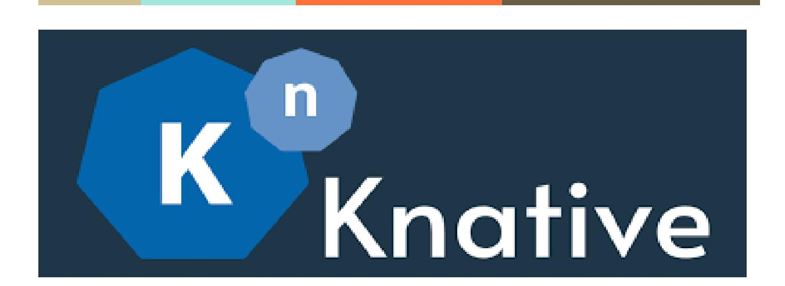

# **Functions AI Agent Callbacks Google Summer of Code 2025 ─**

# Kapil Sareen

Github (@[KapilSareen\)](https://github.com/KapilSareen/)

Linkedin (Kapil [Sareen\)](https://www.linkedin.com/in/kapil-sareen-193122298/)

Email : [kapilsareen584@gmail.com](mailto:kapilsareen584@gmail.com)

# **About me**

I am a 20-year-old undergraduate student at the Indian Institute of Technology, Roorkee, with a strong passion for open-source development and cloud-native technologies. My technical proficiency includes programming languages such as Python, JavaScript, and Golang, along with extensive experience in tools like Docker and Kubernetes. Over the past month, I have contributed to the Knative project, learning about Serving, Eventing, and Functions components, which has deepened my understanding of serverless architectures.

Additionally, I am currently an LFX [mentee](https://mentorship.lfx.linuxfoundation.org/project/a6d66c40-3d12-4fa4-88bf-18574f6b4ec0) with the Inspektor-Gadget community for Term 1 of 2025, a mentorship that concludes in May, just before the GSoC

coding period begins. This experience has enhanced my technical skills and emphasized the importance of collaboration within open-source communities.

# **Contributions to Knative**

| Repository       | PR Description                                        |
|------------------|-------------------------------------------------------|
| knative/serving  | #15643                                                |
|                  | Added support for configuring the Privileged field in |
| knative/func     | #2733                                                 |
|                  | Refactored data member of the InvokeMessage to be     |
| knative/func     | #2729                                                 |
|                  | Adds Inline JSON schema reference in func.yaml        |
| knative/func     | #2715                                                 |
|                  | Fixes Incorrect Implementation of --file Option       |
| knative/func     | #2713                                                 |
|                  | updated node template to ignore node_modules in       |
| knative/func     | #2746                                                 |
|                  | Removes redundant default labels and annotations      |
| knative/eventing | #8376                                                 |
|                  | Add ability to override jwks_url                      |

# **Projects**

## **RELICS.ai** [\[link\]](https://github.com/KapilSareen/RELICS.ai)

- Made a blockchain-based security game that challenges users to prompt-inject AI agents to solve on-chain challenges

## **memer.ai** [[link](https://github.com/KapilSareen/memer.ai)]

- Developed an AI-powered meme generator that connects to your Twitter account via OAuth. It uses natural language processing to generate creative memes and allows for one-click posting, streamlining content creation for social media.

#### **GopherLibrary** [\[link\]](https://github.com/KapilSareen/GopherLibrary)

- A library application built in Golang based on mvc architecture

#### **ShellFox** [[link\]](https://github.com/KapilSareen/ShellFox) (ongoing)

- A minimalist CLI browser that brings the web to your terminal.

# **Why me?**

I am qualified to contribute to the Functions AI Agent Callbacks project because my background and interests directly align with its core objectives. I've a solid experience with Golang and Cloud Native applications as I've been an open-source contributor in this space for the past few months (See my [contributions](https://github.com/pulls?q=is%3Apr+author%3AKapilSareen+archived%3Afalse+-org%3AKapilSareen+-org%3AZeroKnowledgeClub+-org%3Aayu-ch+-org%3AInfoSecIITR) here). My work in agentic AI is demonstrated by projects like [RELICS.ai](https://github.com/KapilSareen/RELICS.ai) and [memer.ai](https://github.com/KapilSareen/memer.ai).

In addition to my AI related work, I bring strong cybersecurity expertise to the table. Through active participation in CTF competitions with team [InfoSecIITR,](https://ctftime.org/team/16691) where I focus on both web and AI security, I have developed a solid foundation in identifying and mitigating security risks. This experience is crucial for ensuring that the interactions between AI agents and serverless functions are secure and reliable.

Overall, my experience with agentic AI, combined with my cybersecurity background, positions me well to tackle the real-world challenges of integrating AI decision-making with serverless architectures. I am excited to contribute my skills to this innovative project under the mentorship of the Knative and CNCF communities, driving forward advancements in secure, efficient AI-serverless integration.

# **Abstract**

## **Enhancing Knative Functions with AI Agent Integration via MCP**

The integration of AI agents with Knative Functions presents an opportunity to enhance the automation and efficiency of serverless computing. By developing a Model Context Protocol (MCP) server tailored for Knative Functions, we can enable AI agents to dynamically create and deploy functions using natural language prompts within MCP-compatible clients like Windsurf or Cursor. This project aims to deliver a seamless, end-to-end serverless application experience—allowing users to create and deploy apps directly from their prompt window.

This initiative involves creating multiple tools—such as 'create' and 'deploy'—that mirror the functionality of existing CLI commands. These tools would facilitate seamless interaction between AI agents and Knative Functions, streamlining the development and deployment process.

Additionally, we can also offer these tools as standalone Knative Functions, providing an alternative for users who prefer not to utilize MCP clients, thereby enhancing convenience and cost-efficiency. This way users who do not wish to use MCP clients like windsurf/cursor may benefit from serverless functionality and can use the functions in their classic agent tool workflow. This dual functionality offers users the ability to choose between utility and cost efficiency.

# **Approach**

# **Directory Structure**

I propose making the core logic of the function tools reusable by placing it in a dedicated pkg directory. This design ensures that both an MCP server and standalone tools can leverage the same underlying functionality. For example, the repository will have two main directories—mcp and tools—while pkg will include subdirectories such as domain, registry, and core.

- **registry** manages the logic for tool registration, making it possible to maintain a registry of available tools that make the code easier to scale.
- **domain** provides a base class and standardized interfaces for tools, facilitating consistent logic, easier testing, and smoother development.
- **core** contains the core functionality or shared logic used by both the MCP server and the standalone tools.

tools directory will contain standalone serverless tools as Knative functions. These tools will use the same core logic as defined in **core** directory maintaining consistency and easy maintainance.

mcp\_server.py is the MCP server that will connect to clients (eg. Cursor). Mcp tools will be derived from the same **core** directory.

By consolidating shared code in pkg, we maintain a modular architecture that supports both an MCP-based approach and traditional standalone tooling. This design promotes code reuse, simplifies future development, and ensures consistent standards across different deployment scenarios.

# **Implementation**

I have developed a Proof-of-Concept (PoC) for demonstration purposes [[link\]](https://github.com/KapilSareen/func-mcp), as described in the abstract. This section provides a detailed explanation of the implementation. The current PoC is written in Python due to the availability of the Python SDK and time constraints. However, I am prepared to replicate this functionality in Go, aligning with the GSOC timeline.

## *MCP server*

## [demo.mp4](https://drive.google.com/file/d/1oiROj2xvCF1zNQlgW26ixCqfPm3KgV16/view?usp=sharing)

The accompanying video demonstrates the intended interaction between Cursor and the Knative MCP server. The current implementation supports function

creation and direct deployment to the kubernetes cluster — all seamlessly managed through the prompt interface.

Now, let's dive into the code of the MCP server. The core MCP server logic is relatively straightforward, as most of the functionality is encapsulated within the pkg directory. Below is a snippet illustrating how the MCP server could be structured:

First, we import the necessary functions and register them in a central registry. I recommend maintaining this registry for cleaner and more modular management of the tools. It simplifies adding third-party tools in the future and keeps the codebase organized. However, the registry is optional—removing it won't affect the server's functionality.

Next, we create the MCP tools by retrieving them from the registry. Finally, we start the MCP server using the stdio transport. A comparison between sse and stdio is discussed in a later section.

#### *pkg*

The pkg directory contains the core logic of the tools. It is divided into three main subdirectories, each serving a specific purpose.

The **domain** directory includes base.py and models.py. The base.py file defines the base class for the core tools, ensuring that all tools remain consistent and standardized. On the other hand, models.py contains classes that represent the available flag values and configuration options for various tools. This modular design makes it easier to manage and extend the toolset as needed. The following snippet is from the models.py:

The **registry** directory maintains a central registry of tools. As mentioned earlier, this registry makes it easier to manage tools in a modular manner. Additionally, one key advantage of maintaining this registry is that it enables running multiple MCP servers using different subsets of the same toolset. This adds flexibility and scalability to the system.

The **core** directory houses the core logic for each tool. Each tool follows a fixed template derived from the base class in the domain directory. It defines a schema and an execute function, which handle the reception of information and the subsequent actions performed by the tool. This approach keeps the logic organized and predictable. Below is the snippet of execute function of the func\_deploy tool for reference:

#### *Stand-alone tools (optional)*

I also propose creating a tools directory that will contain individual tools wrapped as Knative functions. This will provide an option for users who prefer to use serverless agent tools in their applications instead of relying on MCP, offering greater flexibility and adaptability. Since this feature is optional, we can discuss whether including it would add meaningful value to the project.

### *SSE v/s STDIO*

The current implementation uses the STDIO transport because the focus is on running a self-hosted MCP server on the same machine, making STDIO faster and more convenient. SSE is not preferred in this case because opening a socket exposed to the internet could introduce unacceptable security risks. Therefore, STDIO remains the safer choice for our setup. However, I'm open to discussing the possibility of using SSE or exploring other custom transport options if needed.

## **Deliverables**

## **- Phase I**

- Discuss and finalize the project architecture and scope.
- Develop the MCP server and standalone tools for Knative functions.

#### **- Phase II**

- Extend the tools to support most required configurations and flags, similar to CLI commands.

## **- Phase III**

- Write extensive unit and integration tests for the tools.

## **- Phase IV (Optional)**

- If time permits, research the suitability of the MCP server for other Knative components and extend the tools to support Serving and Eventing.

# **Timeline**

| Timespan                   |             |            | Activity     |                 |                    |                      |
|----------------------------|-------------|------------|--------------|-----------------|--------------------|----------------------|
| May 8 June 1 Community     | Bonding     | Period:    |              |                 |                    |                      |
| Interact                   | with        | the        | people       |                 | in the             | community and get    |
| to know                    | the         | community  |              |                 | better             |                      |
| Discuss                    | the         | plan       | with         | the             | mentors            | and                  |
| community                  |             | to         | select       | the             | best               | possible strategy to |
| implement                  |             | the        | project.     |                 |                    |                      |
| Discuss                    | the         | need       | for          | the             | optionals          | part of the          |
| proposal                   |             | with       | the mentors. |                 |                    |                      |
| June 2 June 15 Implement   |             | basic      | MCP          | server.         |                    |                      |
| Implement                  |             | basic      | core         | tools           | , create           | and deploy,          |
| and                        | complete    |            | their        | integration     |                    | within the MCP       |
| June 16 June 22 Extend     | the         | core       | tools        | to              | use configurations | and                  |
| flags                      | as used     | by         | the          | CLI             | func commands.     |                      |
| June 23 July 6 Write       | integration |            | tests        | for             | the                | stand-alone tools    |
| Write                      | unit        | tests      | for          | other           | functionality      | such as the          |
| registering                |             | tools,     | executing    |                 | tools,             | etc.                 |
| June 7 July 18 Buffer      | period      | for        | finishing    |                 | pending            | work and             |
| addressing                 |             | changes    |              | by reviewers.   |                    |                      |
| Prepare                    | a           | report     | for          | Phase           | 1 Evaluation       |                      |
| Midterm                    | evaluation  |            |              |                 |                    |                      |
| July 18 August 5 Extend    | the         | tool       | range        | and             | include            | tools from           |
| other                      | Knative     | components |              |                 | like               | serving, eventing    |
| August 6 August 14 Write   | unit        | and        | integration  |                 | tests              | for the additional   |
| August 14 August 20 Clean  | up          | the code   | and          | document        |                    | the changes          |
| August 21 August 31 Buffer | period      | for        | finishing    |                 | pending            | work and             |
| addressing                 |             | changes    |              | by reviewers.   |                    |                      |
| Prepare                    | a           | report     | for          | FinalEvaluation |                    |                      |
| Final evaluation           |             |            |              |                 |                    |                      |

# **Commitments and Availability**

I plan to dedicate 4-5 hours per day, totaling around 35 hours per week. On weekends, I can extend this to 6-7 hours if needed. I'll be on summer break from the start of the coding period until July 15th (tentative), with no university commitments except toward the end of the break.

Additionally, I'm doing an LFX mentorship, which will conclude on May 30, before the coding period begins, ensuring no conflicts. After July 15th, I will resume college classes, but I can confidently commit 3-4 hours daily (~20-25 hours per week) during that period. I am also open to adjusting my schedule to accommodate important project deadlines or sync-up meetings, ensuring smooth progress and timely deliverables.

I'm highly motivated and excited to contribute to this project, and I'm confident that my availability and dedication will allow me to meet expectations effectively.

Thank you for going through my proposal :)