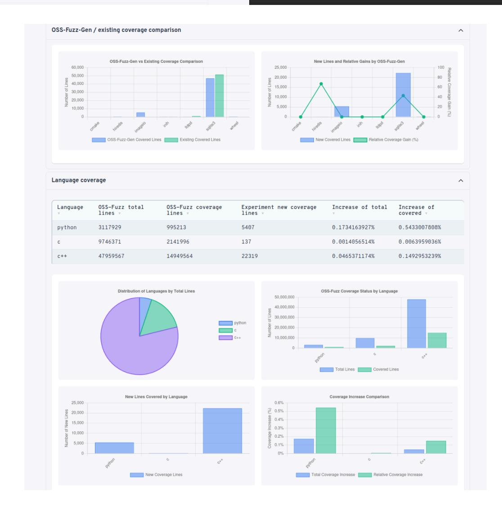
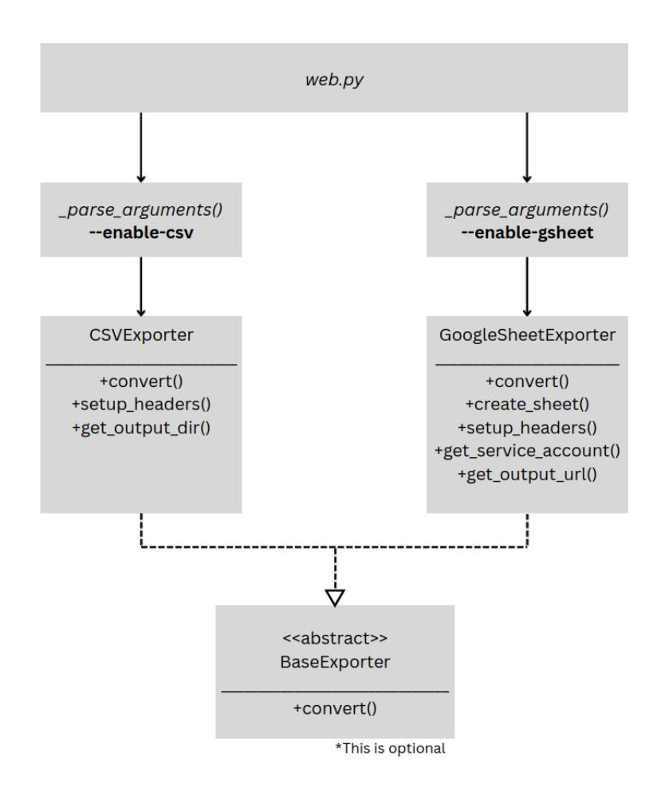
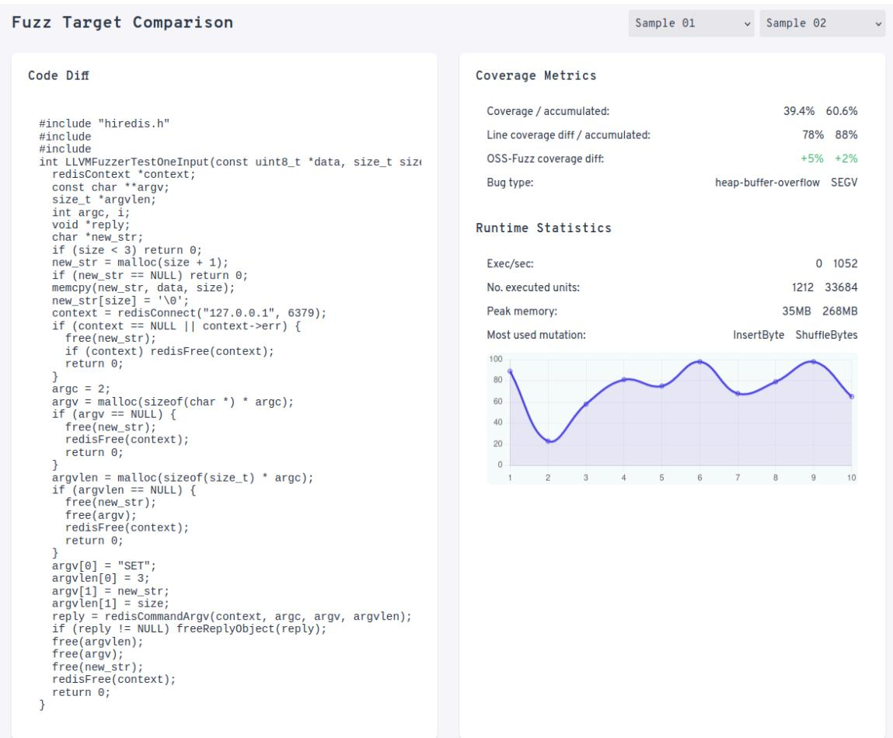
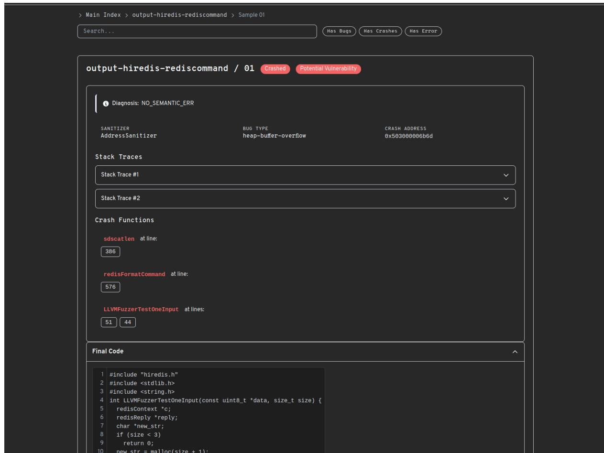

**───────────────────────────────────────────────────────**

# **Streamline experiment execution and improve report UI for OSS-Fuzz-Gen**

**Expected Size:** 350 hours

**Mentor**: Dongge Liu

**────**

# Myan Vu

The University of Auckland

Auckland, New Zealand (UTC+12:00)

Github: <https://github.com/myanvoos>

Email: [myanvoos@gmail.com](mailto:myanvoos@gmail.com) | [myan.vu@auckland.ac.nz](mailto:myan.vu@auckland.ac.nz)

Personal website: <https://myanv.dev>

LinkedIn: <https://www.linkedin.com/in/myanv/>

Preferred method of contact: Email, Slack, Google Chat/Meet

# **Table of Contents**

| Experiment | Workflows                  | (CI).................................................................................................................2                                    |
|------------|----------------------------|-----------------------------------------------------------------------------------------------------------------------------------------------------------|
| Report     |                            | UI...............................................................................................................................................3        |
| Setting    | The                        | Stage...........................................................................................................................3                         |
|            | Unified                    | JSON............................................................................................................................ 4                        |
| Main       | Index                      | Page............................................................................................................................6                         |
|            | Search/filter              | functionality...................................................................................................... 8                                     |
|            | Export to other file       | formats...................................................................................................9                                               |
|            | Table of                   | content....................................................................................................................10                             |
|            | Benchmark                  | Page......................................................................................................................... 12                          |
|            | Refine structured initial  | prompt viewer............................................................................ 13                                                              |
|            | Accumulated results header | for benchmarks..................................................................13                                                                        |
|            | Fuzz target comparison     | tool............................................................................................... 14                                                    |
|            | Trial/Sample               | Page....................................................................................................................... 16                            |
|            | Refine layout for the      | trial/sample page.............................................................................17                                                          |
|            | Link crash functions to    | coverage report........................................................................... 18                                                             |
|            | Run log                    | extraction.................................................................................................................19                             |
|            | Log events                 | visualisation.......................................................................................................19                                    |
| I.         | Milestone 1 (Core          | UI)...............................................................................................................20                                      |
| II.        | Milestone 2 (Log           | visualisation)..............................................................................................21                                            |
| III.       | Milestone 3 (Experiment    | workflow).................................................................................... 21                                                          |
| IV.        | Stretch                    | Tasks.......................................................................................................................... 22                        |
| Project    |                            | Timeline.................................................................................................................................22               |
| About      |                            | Me............................................................................................................................................24          |
| Prior      |                            | Contributions........................................................................................................................... 24               |
| Why        |                            | OSS-Fuzz-Gen?.......................................................................................................................... 25                |
|            |                            | Availability.......................................................................................................................................... 25 |

# **Abstract**

[OSS-Fuzz-Gen](https://github.com/google/oss-fuzz-gen) is a framework for fuzz target generation and evaluation by the Google Open-Source Security team. It generates fuzz targets for C/C+/Java/Python/Rust projects using LLMs and benchmarks them via the [OSS-Fuzz](https://github.com/google/oss-fuzz) platform. After running experiments in OSS-Fuzz-Gen, a report is generated and serves as the primary touchpoint for developers to understand their fuzzing results. As such, it's important that this interface is clear, intuitive, and provides meaningful insights into the fuzzing performance and coverage metrics.

This project proposes an updated UI to improve the results visualisation, report layout, and navigation, alongside feature additions such as a comprehensive search system, export, table of content, etc. It also proposes ways to streamline the CI pipeline which enables efficient experiment execution by introducing more automation processes.

# **Experiment Workflows (CI)**

Currently the workflow is as follows. First a maintainer comments

**/gcbrun exp -n <name> -m <model> -b <benchmark-set>** This triggers a Cloud Build trigger that runs ci/ci\_trial\_build.py:

**def get\_latest\_gcbrun\_command(comments): """Gets the last /gcbrun comment from comments.""" for comment in reversed(comments): if body.startswith('/gcbrun exp'): args = parse\_gcbrun\_args(body) return args**

The CI then uses these args to create a GKE job using ci/k8s/pr-exp.yaml:

containers: - name: experiment image: us-central1-docker.pkg.dev/oss-fuzz-base/testing/OSS-Fuzz-Gen-pull-request: pr-\${PR\_ID} command: ["/bin/bash", "report/docker\_run.sh", "\${GKE\_EXP\_BENCHMARK}", "\${GKE\_EXP\_NAME}", "\${GKE\_EXP\_FUZZING\_TIMEOUT}", "ofg-pr", "\${GKE\_EXP\_LLM}"]

The experiment runs and results are uploaded to the GCS bucket:

\$PYTHON -m report.trends\_report.upload\_summary \ --results-dir \${LOCAL\_RESULTS\_DIR:?} \ --output-path "gs://oss-fuzz-gcb-experiment-run-logs/trend-reports/\${GCS\_TREND\_REPORT\_PAT H:?}" \ --name \${EXPERIMENT\_NAME:?} \ --date \${DATE:?} \ --url "https://llm-exp.oss-fuzz.com/Result-reports/\${GCS\_REPORT\_DIR:?}"

The results are then accessible via URLs.

This can be streamlined by having a CI process that continuously checks the status of the Docker image build process via polling and reports back in the form of GitHub comments. Once the experiment starts, automatically print links similar to [here](https://github.com/google/oss-fuzz-gen/pull/118#issuecomment-1958555260) as a GitHub comment so that maintainers can monitor the ongoing experiment build process.

# **Report UI**

I've built a prototype of the proposed report UI on a fork of the [OSS-Fuzz-Gen](https://github.com/myanvoos/oss-fuzz-gen/tree/prototyping-ui) repository. Since this is quite a complex repository, my aim was to avoid spending time on idealised, standalone mockups using placeholder data and instead work within the actual environment of OSS-Fuzz-Gen (with all its existing structures and considerations i.e. three-pages hierarchy, Jinja templates) from the outset, understanding firsthand what's feasible for implementation and how to actually go about implementing them.

For ease of viewing, the proposed changes to the report UI are classified into categories:

- [NAV]: Navigation
- [UI]: Readability & visual appeal
- [AGG] Aggregated metrics
- [VIZ]: Plots and visualisation
- [FEAT] Features

# Setting The Stage

### Dependencies

The prototype makes use of [Alpine.js](https://alpinejs.dev/), [chart.js](https://www.chartjs.org/) , and [Tailwind](https://tailwindcss.com/) CSS. These lightweight dependencies can all be imported via CDN injection without requiring any complicated Node.js setup, fitting for both cloud-based and local environments. Since the trends report already uses d3.js, I will also migrate to using that instead of chart.js during the community bonding period to avoid bloating up the report's JavaScript.

### Unified JSON

Currently, experiment data is split between the project-level index.json and the benchmark-level crash.json. While this makes sense given the fact that OSS-Fuzz-Gen needs to be compatible with large experiments, cloud logs, and CI artifacts, entirely separate JSON files cannot fully capture the hierarchical structure and relationships between projects, benchmarks, and samples. For this, we would require a unified JSON.

I want to be cautious here because trying to load the JSON with a large number of projects might lead to out-of-memory errors. Some optimisation techniques might be needed, such as loading the JSON once then performing search/filter operations in memory.

### **Proposed JSON structure:**

{ "project": "string", "benchmarks": { "[benchmark\_name]": { "samples": [{ "sample": "string", "status": "string", }], "build\_success\_rate": "number", "crash\_rate": "number", "average\_coverage": "number", "average\_line\_coverage\_diff": "number", "total\_coverage": "number", "total\_line\_coverage\_diff": "number" } }, "average\_build\_success\_rate": "number", "average\_crash\_rate": "number", "average\_coverage": "number", "average\_line\_coverage\_diff": "number", "ofg\_total\_new\_covered\_lines": "number", "ofg\_total\_covered\_lines": "number", "existing\_total\_covered\_lines": "number", "existing\_total\_lines": "number",

**Proposed implementation:** We will need to modify the generate() method of the GenerateReport in report/web.py to add an additional JSON write step:

self.\_write\_index\_html(benchmarks, accumulated\_results, time\_results, projects, samples\_with\_bugs, coverage\_language\_gains) self.\_write\_index\_json(benchmarks) # ADD: An additional write step to write the unified JSON self.\_write\_unified\_json(benchmarks, projects)

def \_write\_unified\_json(self, benchmarks: List[Benchmark], projects: List[Project]): """Generate a unified JSON file with all benchmark and sample data.""" unified\_data = { project.name: { "project": project.name, "benchmarks": {}, } for project in projects } for benchmark in benchmarks: samples = self.\_results.get\_samples(\*self.\_results.get\_results(benchmark.id)) samples\_data = [] for sample in samples: sample\_data = { "sample": sample.id, "status": sample.result.finished, } samples\_data.append(sample\_data) # Calculate summary benchmark metrics unified\_data[benchmark.project]["benchmarks"][benchmark.id] = { "samples": samples\_data, } # Calculate summary project metrics self.\_write('unified\_data.json', json.dumps(unified\_data, indent=2))

# Main Index Page

### **Current index page UI layout:**

Implemented improvements for the prototype:

- [UI] Grouping of benchmarks to projects using a nested tables layout
- [UI] Dark mode for comfortable viewing at night
- [NAV] Navigable breadcrumbs to quickly move between pages
- [VIZ] Pie and bar graphs to visualise language coverage statistics
- [VIZ] Plots to compare the project line/function coverage between OSS-Fuzz-Gen and existing OSS-Fuzz coverage

### **P r o t o t y p e i n d e x p a g e U I l a y o u t :**

### [FEAT] Search/filter functionality

A **working search functionality** that allows searching for information in all pages of the 3 templates: main index, benchmark, and trial/sample. Some possible filters:

- ERR: Whether a specific error happened
- LANG: Whether a specific programming language was used
- CRASH: Whether a trial crashed
- COV: Whether the coverage is less than/greater than/equal to X, where X can be a numerical value or the corresponding OSS-Fuzz coverage

Filters should also be **combinable to form boolean expressions**. For example, it should be possible to search for trials that crashed AND had a coverage of less than X OR is a C++ project. This is potentially complex and can be a stretch task.

### **Proposed implementation:**

With the unified JSON, the search task boils down to traversing the nested JSON structure and returning relevant, criteria-matching sections. The most robust solution for this would be to use [JMESPath](https://jmespath.org/) where simple string inputs are string-matching queries on all three layers (projects, benchmarks, samples) and filters are more complex template queries.

An example JMESPath query to search for benchmarks containing at least one sample with total coverage greater than 0.05 (equivalent to applying the COV filter with the operator GREATER THAN and the value 0.05):

values(@)[?length(benchmarks.\*.samples[] | [?total\_coverage > `0.05`]) > `0`].benchmarks

function filterByCoverage() { const operator = document.getElementById('operator').value; const value = parseFloat(document.getElementById('covValue').value); return `values(@)[?length(benchmarks.\*.samples[] | [?total\_coverage \${operator} \${value}]) > 0].benchmarks`; } jmespath.search(unified\_json, filterByCoverage());

### [FEAT] Export to other file formats

In particular, exporting to Google Sheet and CSV take the highest priority as they are the most repeatedly used formats for OSS-Fuzz-Gen.

### **Proposed implementation (CSV):**

Add an optional **--enable-csv** flag to the argument parser in web.py to allow the user to opt into CSV export. Use a CSVExporter class during the report generation to generate an experiment.csv containing broadly the full experiment data. The user can then access it at /**<output-dir>**/experiment.csv by clicking on a download hyperlink in the report.

### **Proposed implementation (Google Sheet):**

Add an optional **--enable-gsheet** flag to the argument parser in web.py to allow the user to opt into Google Sheet export. Similar to CSV, there can be a GoogleSheetExporter class that programmatically creates a new Google Sheet with the full experiment data (accessing the existing service account configuration for authentication) and returns the sheet URL,

**https://docs.google.com/spreadsheets/d/{sheet.id}**. The URL can then be displayed on the report with a hyperlink, which opens the generated Google Sheet in a new browser tab.

### (Optional) [FEAT] Subsection exports

This task refers to the ability to export only what the user currently sees on the page instead of the entire experiment data. For example, the user might want to export only the benchmark and sample data for the redisCommand function in hiredis instead of the full experiment data (which might be very, very large and contain other projects the user is not as interested in). The unified JSON should make this task easier to implement.

Due to its potential complexity and low priority, however, this is going to be an optional **stretch task.**

# [NAV] Table of content

Display a dynamic **table of content** as a fixed-position side navigation drawer. The table of content should adapt accordingly to the page that's currently being viewed i.e. the index page should display sections, projects, and benchmarks while the benchmark page should display samples. As a stretch task, we can also use aggregated and average statistics to determine whether a specific sample is an outlier (so, interesting) on the table of content.

### **Proposed implementation:**

We can use a generic hierarchy of [BEM-inspired](https://getbem.com/naming/) HTML classes to tag a specific element, then have a single shared JavaScript function to handle the dynamic rendering.

Index page:

Table of Content ├──**Project Summary** (.toc-section) │ ├── hiredis (.toc-subsection) │ │ ├──redisasyncread (.toc-item) │ │ └──... │ └── ... ├── **OSS-Fuzz-Gen / existing coverage** (.toc-section) └── **Language coverage** (.toc-section)

Benchmark page:

Table of Content ├──**redisasyncread** (.toc-section) │ ├──01 (.toc-subsection) │ └──02 *[Outlier]* (.toc-subsection) │ └── ...

# Benchmark Page

### **Current benchmark page UI layout:**

### **Prototype benchmark page UI layout:**

Implemented improvements for the prototype:

- [UI] Refined the table design for the samples table
- [UI] Extracted specific sections (<system>, <instruction>, <task>, <solution>) from the initial LLM prompt and presented them as colour-coded, order-preserving collapsible accordions

### [UI] Refine structured initial prompt viewer

Additional tasks on the structured prompt viewer involve **adding more control buttons** to expand/collapse all accordions and adding language-specific **syntax highlighting** within <code> and <function signature> tags.

### [AGG] Accumulated results header for benchmarks

We can have a header layout in base.html that automatically adapts to display relevant accumulated results for the overall experiment or the specific benchmark being viewed.

<**div** class="space-y-2"> <**p**><**span** class="font-medium">Total Benchmarks:</**span**> {{accumulated\_results.total\_runs}}</**p**> <**p**><**span** class="font-medium">Successful Builds:</**span**> {{accumulated\_results.compiles}}</**p**> <**p**><**span** class="font-medium">Average Coverage:</**span**> {{accumulated\_results.average\_coverage |percent }}%</**p**> </**div**> <**div** class="space-y-2"> <**p**><**span** class="font-medium">Coverage Diff:</**span**> {{accumulated\_results.average\_line\_coverage\_diff |percent }}%</**p**> <**p**><**span** class="font-medium">Crashes:</**span**> {{accumulated\_results.crashes}}</**p**> <**p**><**span** class="font-medium">Total Runtime:</**span**> {{time\_results.total\_run\_time}}</**p**> </**div**>

Currently, due to the ways the Benchmark and AccumulatedResult data classes are defined, accumulated\_results.average\_coverage here will not accurately refer to the average of all sample coverages but simply the highest coverage.

From the generate() function in web.py:

accumulated\_results = self.\_results.get\_macro\_insights(benchmarks)

However, if we are on a specific benchmark's page, benchmarks only has one element (the benchmark itself), which leads to the aforementioned behaviour.

def get\_macro\_insights(self, benchmarks: list[Benchmark]) -> AccumulatedResult: """Returns macro insights from the aggregated benchmark results.""" accumulated\_results = AccumulatedResult() for benchmark in benchmarks: accumulated\_results.compiles += int( benchmark.result.build\_success\_rate > 0.0) accumulated\_results.crashes += int(benchmark.result.found\_bug > 0) accumulated\_results.total\_coverage += benchmark.result.max\_coverage accumulated\_results.total\_runs += 1 accumulated\_results.total\_line\_coverage\_diff += ( benchmark.result.max\_line\_coverage\_diff) return accumulated\_results

This is similar for other accumulated\_results metrics as well.

**Proposed implementation:** Modify get\_macro\_insights itself to include special handling for the case where there is only one benchmark.

### [FEAT] Fuzz target comparison tool

A feature to compare two or more different fuzz targets of the same function side-by-side. The comparison will include **highlighted final code differences** between the fuzz targets, their coverage / benchmark accumulated coverage ratios, as well as statistics extracted from their respective run logs (more [details](#page-19-0) below). It will also compare the coverage of the selected fuzz target(s) **against their existing OSS-Fuzz coverages,** if applicable**.**

For code differences highlighting specifically, we can use the lightweight [jsdiff](https://github.com/kpdecker/jsdiff) script (via CDN injection). Here's an example of it applied to compare two different LLM-generated fuzz targets:

### **Proposed layout design:**

# **Trial/Sample Page**

### **Current benchmark page UI layout:**

### **Prototype benchmark page UI layout (dark mode):**

Implemented improvements for the prototype:

- [UI] Structured layout into collapsible accordion sections
- [UI] Badges to highlight bug status and whether there are any potential vulnerability
- [FEAT] Extracted Semantic Analyser insights
- [VIZ] The coverage report, previously discoupled from the trial/sample page, is now embedded into this page via an iframe for more focused viewing

# [UI] Refine layout for the trial/sample page

We can add a **copy button** for the user to copy the final code output, as well as a button to **export a reproduction script** for reproducing the coverage results in OSS-Fuzz. The path to the sample's **target\_binary** can also be displayed with the Semantic Analyser insights.

**More plots** can be added to compare the coverage performance between the LLM-generated fuzz target and any existing OSS-Fuzz fuzz target.

SImilar to the benchmark page, the logs can **display accordions** showing extracted LLM chat history sections. There should also be **control buttons** to expand/collapse all sections. Additionally, the run logs can be **formatted** with important logs highlighted or color-coded:

- INFO (yellow)
- ERROR (red)
- STAT (chartreuse green)
- EVENT logs: Lines starting with "#" containing NEW or REDUCE (light grey)

### [FEAT] Link crash functions to coverage report

The aim of this task is to make it easier to navigate directly to the crashed lines in the coverage report. After the user clicks on a crash function's line number, for example redisvFormatCommand at line: 375, they should be shown the exact section in the coverage report.

One way to do this would be simply changing the URL of the coverage report iframe to the corresponding function/file path i.e.

sample/output-hiredis-rediscommand/coverage/02/linux/src/hiredis/hired is.c.html#L375, however only if we know the relevant file the function is located in (hiredis.c).

Fortunately, the stack traces contain this file path. Unfortunately, the current crash functions, which are determined through parsing stack traces in the \_parse\_func\_from\_stacks method in semantic\_analyzer.py, don't. It only has the function name and the line numbers in an array.

return { func\_name: list(line\_numbers) for func\_name, line\_numbers in func\_info.items() }

**Proposed implementation:** Modify the \_parse\_func\_from\_stacks method to record both the array of line numbers and the relevant file name/path for each crashed function.

# [AGG] Run log extraction

The following should be extracted for every sample, displayed on their summary alongside the Semantic Analyser insights, and aggregated in the parent benchmark page:

- Execution: stat::number\_of\_executed\_units,
- Performance: stat::average\_exec\_per\_sec
- Memory: stat::peak\_rss\_mb
- Edge coverage: Final cov: value
- Number of features discovered: Final ft: value
- Types of mutations, for example InsertRepeatedBytes
- The fuzzing engine, e.g. FUZZING\_ENGINE=libfuzzer
- Corpus statistics, e.g. INFO: seed corpus: files: 11 min: 11b max: 749b total: 1809b rss: 31Mb

**Proposed implementation:** Begin with simple string matching and RegEx, then iterate as needed.

# [VIZ] Log events visualisation

**Event types visualiser from the run logs**, of which there are two: NEW and REDUCE. Specifically, we can add a per-iteration trend graph showing how the coverage (cov:), feature count (ft:), number of mutation operations (MS), and specific mutations applied evolves at each iteration, as well as an event distribution graph showing the frequency of NEW and REDUCE events as well as mutation type frequencies.

### (Optional) [FEAT] LLM interaction explorer

The distinguishing feature of OSS-Fuzz-Gen is its use of LLMs to generate fuzz targets. As such, these interactions are interesting to researchers. It would make sense to have a dedicated explorer page for each fuzz target to investigate how the various LLM interactions led to the final code output.

Due to its potential complexity, this will be an **optional stretch task** to be explored after the main tasks have been completed.

### **Proposed layout design:**

# **Milestones**

I propose that the project should be considered successful if all of the below **three** main milestones are completed by November 10, 18:00 UTC.

# I. Milestone 1 (Core UI)

- A. Index Page Table of content for large experiment sizes

- Unified experiment JSON Working search functionality (JMESPath integration) Working basic search filters Working export to CSV Working export to Google Sheet
- B. Benchmark Page Accumulated results header correctly adapted for benchmarks Interactive tool for comparing fuzz targets of the same function Refined existing structured initial prompt viewer
- C. Trial/Sample Page Final code copy and extract oss-fuzz reproduction script buttons Plots for fuzz target coverage comparisons Crash functions are linked to sections in the coverage report Logs are properly colour-coded and formatted for display

# II. Milestone 2 (Log visualisation)

- A. Log extraction Basic log extractions (INFO, ERROR, STAT, EVENT) Comprehensive log extractions (execution, performance, memory, edge coverage, number of discovered features, types of mutation, etc) Comprehensive log extractions are displayed on the respective trial/sample page
- B. Log events visualisation Per-iteration plot showing how the coverage (cov:) and feature count (ft:) evolve at each iteration Per-iteration plot showing how the number of mutation operations (MS) and specific mutation applied evolves at each iteration Event distribution plot showing the frequency of NEW and REDUCE events for that particular trial/sample Event distribution plot showing the mutation type frequencies

# III. Milestone 3 (Experiment workflow)

The CI workflow checks the build status every polling interval The polling interval (default 10 minutes) is configurable using a GitHub comment by maintainers, similar to /gcbrun The CI workflow automatically prints relevant paths alongside relevant information as a GitHub comment and tags relevant maintainers

# IV. Stretch Tasks

These are optional tasks that I will look into implementing **only after the main milestones have been completed.**

Basic implementation of the LLM interaction explorer Combinable boolean expression filtering for the search functionality Subsection exports Table of content with outlier detection

# **Project Timeline**

| Present May 07 1 month  |                  |              |                    |                |                     |
|-------------------------|------------------|--------------|--------------------|----------------|---------------------|
| I will                  | be experimenting |              | more               | with           | the JMESPath        |
| search                  | functionality    |              | using              | this repo.     | There were also     |
| some                    | general          | quirks       | encountered        |                | during my           |
| prototyping             |                  | process      | that               | I’d like to    | raise issues for in |
| the                     | OSS-Fuzz-Gen     |              | repo and           | eventually     | resolve             |
| before                  | the              | official     | coding             | period.        |                     |
| May 08 June 01          |                  |              |                    |                |                     |
| 1 month                 |                  |              |                    |                |                     |
| Revamp                  | current          | prototype    |                    | according      | to my mentor’s      |
| feedback                | and              | refine       | existing           | prototyped     | features.           |
| I will                  | also refactor    |              | the template       | folder         | by putting          |
| each                    | of its           | three main   | templates          | into           | their own           |
| folder                  | with             | related      | CSS and            | JavaScript     | files and           |
| modify                  | the              | report       | generation         | pipeline       | accordingly.        |
| June 02 June 08         |                  |              |                    |                |                     |
| 1 week                  |                  |              |                    |                |                     |
| I’ll be                 | preparing        | for          | my end-of-semester |                | exams so I’ll       |
| have                    | reduced          | availability |                    | for this week. |                     |
| Index                   | page:            | Table        | of content         |                |                     |
| Index                   | page:            | JSON         | consolidation      | code           |                     |
| June 09 June 22 2 weeks |                  |              |                    |                |                     |
| Index                   | page             | : Search     | functionality      |                |                     |
| Index                   | page             | : Filter     | functionality      |                |                     |
| June 23 June 29 1 week  |                  |              |                    |                |                     |
| Working                 | export           | of           | the report         | to CSV         |                     |
| Working                 | export           | of           | the report         | to Google      | Sheet               |

| June 30 July 13           |                |               |                 |                 |                |
|---------------------------|----------------|---------------|-----------------|-----------------|----------------|
| 2 weeks                   |                |               |                 |                 |                |
| Benchmark                 | page           | : Accumulated |                 | results         | header         |
| Benchmark                 | page:          | Fuzz          | target          | comparison      | tool           |
| Benchmark                 | page:          | Refined       |                 | prompt          | viewer         |
| Trial/sample              | page           | :             | Refined         | layout          |                |
| Trial/sample              | page           | :             | More            | plots for a     | more           |
| comprehensive             |                | fuzz          | target          | coverage        | comparison     |
| Trial/sample              | page:          |               | Linking         | crash functions | to             |
| coverage                  | report         |               |                 |                 |                |
| Due to                    | the increased  |               | availability    | I have          | for these two  |
| weeks,                    | I will also    | work          | on these        | additional      | tasks:         |
| Logs: Log                 | extraction     |               | and aggregation |                 | code           |
| Logs : Basic              | log extraction |               |                 |                 |                |
| Milestone                 | 1: Core        | UI            | reached         |                 |                |
| Submit                    | mid term       | evaluation    |                 |                 |                |
| July 14 July 25           |                |               |                 |                 |                |
| 1.5 week                  |                |               |                 |                 |                |
| Trial/sample              | page           | :             | UI to display   | extracted       | log            |
| information               | for            | that          | particular      | fuzz target     |                |
| Logs: Comprehensive       |                |               | log             | extraction      |                |
| Logs : Log                | aggregation    |               | for             | the benchmark   | page           |
| Due to                    | the increased  |               | availability    | I have          | for this week, |
| I will also               | work on        | these         | additional      | tasks:          |                |
| Logs: Log                 | events         | extraction    |                 | code            |                |
| Logs : Per-iteration      |                | log           | events          | visualisation   | graphs         |
| Logs : Log                | event          | distribution  |                 | graphs          |                |
| Milestone                 | 2: Log         | Visualisation |                 | reached         |                |
| July 26 August 18 3 weeks |                |               |                 |                 |                |
| Since I’m                 | less familiar  |               | with            | CI workflows    | than with      |
| UI, I’ve                  | allocated      | extra         | time            | to work         | on these two   |
| Experiment                | workflow:      |               | Build           | status          | polling code   |
| Experiment                | workflow:      |               | Automatic       | link            | printing code  |

| August 19       | August                                                  |
|-----------------|---------------------------------------------------------|
|                 | 6 days                                                  |
|                 | Experiment workflow: Test all the CI workflow           |
|                 | improvements, ensuring that there are no errors         |
|                 | and unaccounted edge cases.                             |
|                 | Milestone 3: Experiment Workflow reached                |
| August 25       |                                                         |
| September 01    |                                                         |
|                 | 1 week                                                  |
|                 | This is a buffer week for general code polishing,       |
|                 | writing documentation, and addressing any gaps in       |
|                 | implementation that've been left so far.                |
|                 | Submit final evaluation                                 |
| After September | 01 If all milestones have been reached at this stage, I |
|                 | will use this time for the optional stretch tasks.      |
|                 | Afterwards, I’d like to continue contributing to        |
|                 | OSS-Fuzz-Gen by maintaining the report-related          |
|                 | features that were implemented during Google            |
|                 | Summer of Code and extending it with more               |

# **About Me**

I'm a third-year student majoring in Mathematics and Computer Science at the University of Auckland, NZ. I was introduced to Google Summer of Code and specifically to open-source security by someone who worked on the OSV.dev project in Sydney. I have strong interests across all areas of web development. Last year, I was an open-source contributor with [Tuono,](https://github.com/tuono-labs/tuono) made my [own](https://github.com/myanvoos/starship) experimental frontend framework building on React/JSX, and dabbled in Ell [Studio](https://github.com/MadcowD/ell) and [Neuronpedia](https://www.neuronpedia.org/) (which exposed me to the concept of LLM explorer UIs!). I've also previously used Python in a web development context while building a mapping visualisation tool (with Flask and JInja) for an Auckland-based non-profit client in community law last year.

# **Prior Contributions**

In setting up the background for this proposal, I [extended](https://github.com/google/oss-fuzz-gen/pull/884) the existing local report compilation process to allow [hot-reloading](https://github.com/google/oss-fuzz-gen/issues/862) using a similar watcher system as outlined in the proposed experiment workflows improvements - this has helped significantly in quickly developing the prototype. I also implemented a minor [colour](https://github.com/google/oss-fuzz-gen/pull/850) fix to improve readability for a regular contributor with red-green colour-blindness.

# **Why OSS-Fuzz-Gen?**

I didn't even know what code fuzzing was before OSS-Fuzz-Gen and that it's an active area of research, though the *idea* of it certainly occurred to me i.e. 'Why sit there and think up edge cases when you can just bombard the function with a bunch of random inputs and see how it goes?'. It's good to be able to put a name to the concept. This project specifically focuses on UI, which is my strongest point, but also involves something I'm less familiar with (experiment workflows) making it an interesting blend of familiar and novel topics. There's also a certain challenge even to the UI aspect: unlike most of my previous work, the OSS-Fuzz-Gen report shouldn't rely on heavy, complicated JavaScript dependencies like React because the reports are primarily uploaded to the cloud.

So, ideally, no node\_modules.

This has forced me to think 'beyond my box' for tools that don't require complicated setups as to not add more work for my mentor and other OSS-Fuzz-Gen maintainers in the future, yet also powerful enough to create efficient streamlined UIs. I eventually came around to Alpine.js and actually really enjoyed using it to build the prototype.

Finally, the most pragmatic factor in my decision to choose OSS-Fuzz-Gen is the close geographic/time zone difference between Australia and NZ making it easier to communicate with my mentor. I greatly appreciate his insights and our back-and-forth during the drafting of this proposal as well as during GitHub discussions!

# **Availability**

During most of the official coding phase, I will be able to spend roughly 20 hours per week working on the project. However, from July 01 to July 18, I will be available for 30-40 hours per week as I'll be having my inter-semester break then.