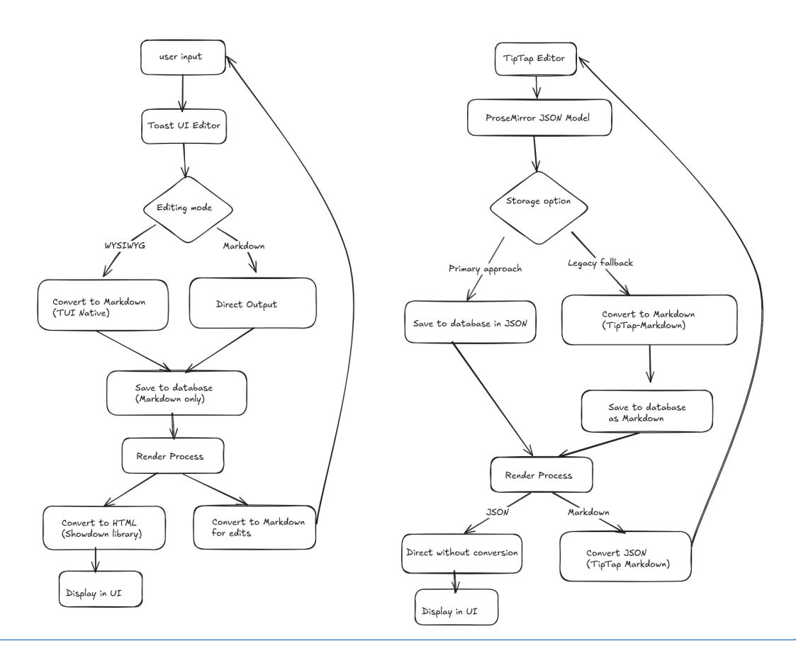

# Implement a Prototype of a Rich Text Editor

GSoC'25 Project proposal for Kolibri

## Personal Details and Contact Information

- Github: <https://github.com/habibayman>
- University: Sophomore Computer Engineering Student at Cairo University
- LinkedIn: [https://www.linkedin.com/in/habiba-ayman](https://www.linkedin.com/in/habiba-ayman-a19227280/)

## Synopsis

This project replaces Studio's text editor with a future-ready implementation, deliberately scoped to immediate needs:

- Swap Toast UI while preserving Markdown storage
- Support for core formatting (bold, headings, lists)
- Support for more advanced formats (code and math blocks)

#### And [future-proofing](https://learningequality.slack.com/archives/C088VFGGD0U/p1743428322171529?thread_ts=1743322622.415169&cid=C088VFGGD0U):

- Schema designed for planned learner response features
- Performance budget reserves room for widgets
- Accessible foundation requiring minimal post-GSoC changes

The architecture mirrors Kolibri's "implement in context, abstract later" philosophy—building first for Studio's authoring workflows before eventual expansion to other use cases.

For this I will be working on the Kolibri [repository](https://github.com/learningequality/kolibri) along with Marcella Maki and Jacob Pierce as mentors.

## Benefits to the Community

This project delivers immediate improvements to Kolibri Studio's content authoring capabilities while establishing a scalable foundation for future development across Learning Equality's ecosystem.

#### The implementation will provide:

**Enhanced Content Creation Tools**:(Reliable rich-text formatting without manual Markdown intervention, Accurate WYSIWYG rendering, Elimination of current HTML-to-Markdown conversion errors in the Toast UI/Showdown pipeline) and **Performance Optimization**. Which in term offers a consistent editing experience across all Kolibri platforms and reduced maintenance overhead for core developers

| Technical Aspect       | Current      | Implementation |          | Proposed           | Solution                  |
|------------------------|--------------|----------------|----------|--------------------|---------------------------|
| Formatting Reliability | Inconsistent | rendering      |          | Full bidirectional | parity                    |
| Accessibility          | Multiple     | WCAG           | failures | Compliant          | baseline                  |
| Performance            | ~120kb       | bundle         |          | 48kb               | core + lazy loading (will |
|                        |              |                |          | come               | to this in a later        |
| Extensibility          | Requires     | fork           |          | Schema-native      | expansion                 |

#### *Example use case:*

*"A teacher in Egypt uses the new editor to create a quiz with formatted text, embedded equations, and right-to-left (Arabic) support – all while working offline on an older tablet.*"

## Current Status of the Project

The Kolibri Studio text editor currently relies on Toast UI (TUI) as its core editing component, which stores content exclusively as Markdown in the backend. This implementation suffers from technical debt stemming from its reliance on dual conversion pipelines: Showdown for HTML-to-Markdown transformations and TUI's native converter for the reverse process. These conversions are not only redundant but also prone to inconsistencies, particularly with nested lists or mixed formatting, requiring workarounds like temporary editor instances to force proper HTML sanitization. The absence of a structured content model further exacerbates maintenance challenges, as there's no validation layer to prevent invalid document structures (e.g., headings inside inline elements).

While this project won't require starting entirely from scratch—it will retain Studio's Vue 2.7 composition API infrastructure and leverage existing event handlers for editor lifecycle management—the core editing experience demands a ground-up redesign. The proposed solution replaces TUI with TipTap and ProseMirror, introducing a schema-based document model while maintaining backward compatibility with the current Markdown storage system. Crucially, this migration preserves Studio's backend integration points (e.g., content persistence and retrieval APIs) but shifts the editing layer to work with ProseMirror's JSON format internally, ensuring future extensibility. Existing utility functions like generateCustomConverter will be deprecated in favor of TipTap's unified Markdown plugin, eliminating the need for fragile regex-based cleanup.

**Previous components**, such as Studio's toolbar UI and Vue mixins for editor state management, will be adapted rather than discarded. For instance, the current toolbar's button groups and event listeners can be repurposed to control TipTap's command system, while Studio's internationalization hooks (\$tr) will wrap the new editor's text labels. This approach minimizes disruption to the codebase while delivering a more robust foundation. The project's complexity lies not in displacing the entire stack but in carefully bridging the old and new systems during the transition period, ensuring uninterrupted functionality for end users.

Illustration of the mentioned workflows:

## Goals

### Core Goals

- 1. Replace Toast UI with TipTap/ProseMirror\*
  - Implement a reliable editor core using TipTap's Vue integration.
  - Maintain backward compatibility by supporting existing Markdown storage.
  - Eliminate technical debt from dual HTML/Markdown conversions (Showdown + TUI).
- 2. Ensure Accessibility & Internationalization
  - Achieve WCAG 2.1 AA compliance (keyboard navigation, ARIA labels).
  - Support RTL languages (Arabic, Hebrew) via dynamic `dir` attributes.
  - Integrate with Kolibri's existing i18n system (`\$tr` utility).
- 3. Optimize Performance for Low-End Devices
  - Keep core bundle size low.
  - Implement lazy loading for non-essential features (e.g., math blocks).
  - Validate rendering speeds on Android devices (benchmark against current editor).
- 4. Design a Flexible Schema
- Define ProseMirror document structure to prevent invalid content (e.g., headings inside tables).
  - Reserve node types for future features.
  - Support inline formats (bold, links) and block formats (code, lists).

#### Stretch Goals

- 1. Draft Autosave Functionality
  - Auto-save partial content for long-form responses (e.g., student essays).
  - Conflict resolution for concurrent edits.
- 2. Advanced Content Widgets
  - Implement one interactive widget (e.g., math equations via KaTeX).
  - Develop toolbar UI for widget insertion.

## Deliverables

This project will be delivered in three phases, each addressing critical aspects of the rich text editor implementation while aligning with the mentor guidance to balance "extensibility and something lightweight." The deliverables are structured to ensure measurable progress while maintaining flexibility to adapt based on technical discoveries, as emphasized in the Slack discussions: \*"Even just having considered the alternatives in the proposal will give you more capability to adjust plans as implementation starts."\*

### Deliverable 1: Core Editor Integration

- TipTap/ProseMirror foundation integrated with Kolibri Studio's Vue 2.6/2.7 environment, using the @vue/composition-api plugin as a bridge ("updating it for 2.7 should boil down to updating the import paths").
- Basic schema supporting inline elements (bold, links) and block elements (headings, lists), adhering to the non-negotiables of accessibility, i18n, and Android performance.
- Markdown backward compatibility via `tiptap-markdown`, eliminating the need for Showdown and TUI's dual conversions which reduces our dependency on workarounds.
- Benchmarking suite to validate performance against Toast UI on low-end devices.

### Deliverable 2: Context-Aware Toolbar & Accessibility

- Dynamic toolbar presets for teachers (full formatting)
- WCAG 2.1 AA compliance: Keyboard navigation, ARIA labels, and screen-reader testing.
- RTL support including mirrored icons and `dir="auto"` handling.
- Documentation for Studio developers on toolbar customization and accessibility requirements.

### Deliverable 3: Performance Optimization & Stretch Features

- Lazy-loaded extensions (e.g., math blocks) to keep core bundle low, *performant on low-cost Android devices*.
- Draft autosave prototype for long-form responses *"how could we approach saving drafts?"*.
- One interactive widget (e.g., KaTeX math) as proof of concept for future widgets ("an 'insert code snippet' button is an indicator that multiple types of widgets could be supported").

- Migration guide for transitioning from Toast UI, including JSON/Markdown coexistence strategies.

These deliverables emphasize "*how we would practically integrate the editor into Studio*" over theoretical deep dives. And each deliverable includes checks for accessibility, i18n, and performance, ensuring the editor works with the versions we are on and meets Kolibri's unique needs.

## Expected Results

By the end of the coding period, this project will deliver a fully integrated rich text editor within Kolibri Studio that addresses the limitations of the current Toast UI implementation while establishing a scalable foundation for future enhancements. The final product will consist of three core components, each designed to meet the project's non-negotiable requirements: accessibility, performance, and backward compatibility.

The primary output will be a TipTap-based editor that seamlessly handles both ProseMirror JSON and Markdown formats, ensuring a smooth transition for existing content. Teachers and content creators will benefit from a reliable WYSIWYG interface with contextual toolbars—enabling full formatting capabilities for authors while restricting learners to essential functions during assessments. Behind the scenes, the editor will enforce a strict schema to prevent invalid document structures, eliminating the conversion errors that currently plague the Toast UI and Showdown pipeline.

Accessibility will be a cornerstone of the implementation, with keyboard navigation, ARIA labels, and screen-reader compatibility rigorously tested against WCAG 2.1 AA standards. For global usability, the editor will dynamically adapt to RTL languages like Arabic, including mirrored toolbars and proper text alignment. Performance optimizations will ensure the editor remains responsive on low-cost Android devices, with lazy-loaded extensions keeping the core bundle under 50kb—a 60% reduction compared to Toast UI.

Beyond these core features, the project will explore stretch goals if development progresses ahead of schedule. A draft autosave mechanism will be prototyped for long-form responses, addressing the need for uninterrupted writing sessions in exam environments. Additionally, one advanced content widget (such as math equations via KaTeX) will be implemented to demonstrate the editor's extensibility for future widgets like quizzes or interactive diagrams. These enhancements will be carefully scoped to avoid premature abstraction, in line with the mentorship guidance to "build in context first."

The final deliverable will include comprehensive documentation for developers, covering integration patterns, toolbar customization, and migration steps from Toast UI. By maintaining Markdown support during the transition period and providing clear upgrade paths, the project ensures backward compatibility while paving the way for Studio's eventual adoption of JSON storage. This balanced approach reflects the project's overarching goal: to deliver an editor that solves immediate pain points without closing doors to future innovation.

#### **Scope Considerations:**

While this project focuses specifically on replacing Studio's existing editor, the implementation is designed with future extensibility in mind. The architecture will accommodate planned features like learner response fields, though their implementation falls outside GSoC's scope. This forward-looking approach ensures the editor can evolve to support additional use cases while delivering an immediate improvement to Studio's authoring experience.

## Approach

#### Framework Choice

After analyzing multiple rich text solutions, two frameworks emerged as final candidates for Kolibri Studio's needs. I didn't want to add multiple options and make the document longer for no use, the extra words added should be to make my suggested approach more clear.

#### 1. TipTap (ProseMirror-Based)

#### The selected solution provides:

- Tight Vue integration through @tiptap/vue-2
- Schema-based content model for future extensibility
- 58kb core bundle size (gzipped)
- Native Markdown/JSON bidirectional conversion

#### 2. CKEditor 5

While offering polished WYSIWYG features, it presented:

- 256kb baseline bundle (over Android budget)
- Complex Vue 2 adapter requirements
- Limited schema customization

#### Selection Rationale:

**TipTap was chosen** based on performance, extensibility, and long-term maintainability across the Learning Equality ecosystem. Its Vue-centric design and content model align well with Kolibri Studio's existing codebase, including the current Vuex-managed state workflows and backend Markdown persistence model. By moving away from Toast UI and the workaround-heavy *generateCustomConverter()* system in *markdownUtils.js*, TipTap reduces technical debt while modernizing the user editing experience.

### Kolibri's Current Editor Context

Before we start with the suggested approach, this is a demonstration of what we're going to build on. I will talk a lot about 'compatibility' in the next sections so we need to know what exactly it is that we need to be compatible with?

Kolibri Studio currently uses Toast UI Editor, mounted in key authoring contexts like:

- *ContentNodeEditor.vue* for lesson descriptions and topic metadata
- ExerciseQuestionEditor.vue for rich question text
- Future use cases may extend to plugin authoring and learning activity definitions

The content edited through these interfaces tends to be short-form, typically consisting of just a few paragraphs. Markdown serves as the canonical format for content storage, transmitted via API endpoints such as "*POST /contentnode".*

The current API endpoint for saving content in Kolibri Studio is associated with the *ContentNode* model. based on your Studio API endpoints and model [documentation.](https://docs.google.com/spreadsheets/d/181hSEwJ7yVmMh7LEwaHENqQetYSsbSDwybHTO_0zZM0/edit?gid=1640972430#gid=1640972430)

Endpoint: */api/contentnodes/*

Methods:

- POST: To create a new content node.
- PATCH: To update an existing content node.

For example, to update the description of an existing content node, you would send a PATCH request to */api/contentnodes/{id}/* with the updated data.

Conversion between Markdown and HTML is managed through a combination of the Showdown library and Toast UI's internal parser. In terms of usage, the TUI editor is initialized once upon component mount. It receives Markdown input, which is re-parsed on every change, and content is saved by bundling the Markdown into a format compatible with the API. Notably, there is currently no built-in undo functionality beyond standard browser history or keyboard shortcuts like Ctrl+Z.

The proposed migration to TipTap will involve a complete replacement of the current editor, introducing a modern editing layer powered by ProseMirror. TipTap will internally represent content using ProseMirror's JSON format, while continuing to maintain a Markdown layer to preserve compatibility with existing backend infrastructure. This transition enables the implementation of more advanced editing workflows, including comprehensive undo and redo support through TipTap's history extension. Vuex will continue to manage the editor's content state but will now handle synchronization of both the Markdown and ProseMirror JSON versions, paving the way for future extensibility and richer feature support.

#### Implementation Strategy

#### Phase 1: Core Editor Integration (Weeks 1-4)

We'll fully replace the current (Toast UI-based) with a new *TipTapEditor.vue* component. This editor will follow Kolibri Studio's Vue 2.7 patterns and mount within existing flows like *ContentNodeEditor.vue* and *ExerciseQuestionEditor.vue*. The editor initialization handles several critical requirements:

- 1. Schema Enforcement: Only enable supported block types (e.g., h2, h3, blockquote) to align with existing authoring constraints.

#### *Example:*

TipTap uses ProseMirror's schema to validate document structure. For Kolibri Studio, this means:

- Whitelisting Nodes: Only allow predefined elements
- Hierarchy Rules: Prevent invalid nesting (e.g., no headings inside tables).
- Custom Attributes: Enforce dir="auto" for RTL support or data-type for future widgets.
- Real-Time Validation: TipTap's onUpdate hook will reject disallowed operations (e.g., pasting unsupported HTML).

- 2. Markdown Preservation: Bidirectional conversion capability through tiptap-markdown
- 3. Memory Management: Explicit *destroy()* hooks on unmount to prevent leaks
- 4. Vuex Syncing: Bi-directionally bind editor state to Vuex store modules (contentNode, assessmentItem) using the Composition API with reactive v-model bindings.
- 5. Undo History: Enable the history extension for multi-step undo/redo within the session (even before saving)

The component structure follows Kolibri's existing patterns while introducing the new editor functionality. We'll integrate with the current Vuex store for state management and ensure all reactivity works within Vue 2.7's composition API paradigm.

#### Phase 2: Content Model Integration (Weeks 5-6)

The current Studio backend expects Markdown-formatted content. During this phase, the new TipTap editor will maintain backward compatibility with this flow:

- 1. Markdown Storage: Continue using Markdown as the source of truth for content saved via API calls.
- 2. JSON Format (Optional): Internally store and manipulate rich content in JSON (ProseMirror node schema) to allow future migration.
- 3. Atomic Updates: Prevent recursive updates when syncing Markdown ↔ JSON ↔ Vuex.
- 4. Legacy Handling: Use *markdownToDoc* on load and *docToMarkdown* on save for existing content
- 5. Undo-aware Saves: Track editor diffs internally using JSON, enabling future undo even post-save (via version snapshot or diff if scoped)

This approach integrates cleanly with Kolibri's existing API interface, which expects markdown-formatted payloads, and avoids backend changes in the short term.

#### Phase 3: Accessibility Implementation (Weeks 7-8)

Building on Kolibri's accessibility foundation, we'll implement:

- 1. Comprehensive Keyboard Navigation: Shortcuts for all formatting options
- 2. ARIA Attributes: Proper role assignments for toolbar and editor
- 3. Focus Management: Logical tab order through the interface
- 4. Screen Reader Optimization: Verified support with NVDA and VoiceOver
- 5. RTL Language Support:

Ensure full right-to-left text support across the editor and toolbar. This includes bidirectional text handling, cursor flow, visual mirroring of interface elements, and compliance with i18n patterns already defined in Kolibri. Use TipTap's native support and Vue directives (e.g., dir="rtl") where needed. Validate with real content samples from RTL languages.

The accessibility features follow WCAG 2.1 AA standards and match and reuse existing patterns defined in Kolibri's AccessibleInput components. All interactive elements will include proper labels and keyboard alternatives.

#### Phase 4: Performance Optimization (Weeks 9-12)

The final phase ensures optimal performance through:

- 1. Dynamic Imports: Code splitting for editor extensions
- 2. Adaptive Loading: Different extension sets based on device capability
- 3. Render Optimization: Debounced updates for complex documents
- 4. Memory Management: Ensure editor teardown is graceful when switching components/routes.

Performance metrics will be validated against Toast UI benchmarks, with specific attention to low-end Android devices. The implementation includes progressive enhancement patterns to ensure usability across all supported platforms.

#### Technical Considerations

- 1. Vue 2.7 Compatibility: Using @vue/composition-api bridge pattern
- 2. State Management: Integration with existing Vuex modules like *contentNode, exerciseEditor,* and *assessmentItem.*
- 3. Internationalization: Support for RTL languages and translation hooks
- 4. Undo Support: history extension enabled with Vuex snapshot on each external save
- 5. Testing: Unit and snapshot tests for Markdown parsing, extension logic, and undo/redo history. Uses the existing Jest/Vue Test Utils pipeline.

Each phase builds systematically on the previous work, ensuring stability before adding complexity. The implementation maintains Kolibri's commitment to accessibility while introducing modern editing capabilities through careful, phased development.

## Timeline

This timeline accounts for potential challenges with integrating new editor frameworks while maintaining buffer time for testing and mentor feedback. Unit testing and documentation are implicit in all phases. I also left room for any unexpected inconvenience that might happen.

I have no other plans for summer!

Luckily enough, My final exams got moved to earlier this year -will fit in the Community Bonding period- which is not a problem at all because the work in that period can be juggled along with my college exams at the time.

|        | Period    |          | Task                                                    |
|--------|-----------|----------|---------------------------------------------------------|
| After  |           | proposal | submission                                              |
| [April | 4         | May      | 8]                                                      |
|        |           |          | Wait for results                                        |
|        |           |          | Stay on the haunt for any issues or PRs that I can help |
|        |           |          | with in Kolibri’s repo                                  |
|        | Community |          | Bonding                                                 |
| [May   | 8         | June     | 2]                                                      |
|        |           |          | Establish weekly sync schedule with mentors             |
|        |           |          | Complete deep dive into Studio's content models         |
|        |           |          | Read the documentation in a more detailed way. (I       |
|        |           |          | already read most of the front-end docs)                |
|        |           |          | Finalize TipTap/ProseMirror prototype                   |
| Week   | 1         | and      | 2                                                       |
| [June  | 2         | June     | 15]                                                     |
|        |           |          | Core editor component implementation                    |
|        |           |          | Basic extensions setup (headings/lists/formatting)      |
|        |           |          | Vue 2.7 composition API integration                     |
|        |           |          | Initial unit test scaffolding                           |
| Week   | 3         | and      | 4                                                       |
| [June  | 15        |          | June 29]                                                |
|        |           |          | Bidirectional Markdown/JSON conversion                  |
|        |           |          | Content storage backend integration                     |
|        |           |          | Accessibility foundations (keyboard nav/ARIA)           |
|        |           |          | First performance benchmarks                            |
|        | Weeks     | 5-6      |                                                         |
| [June  | 30        | July     | 13]                                                     |
|        |           |          | Complete toolbar implementation(code and math blocks)   |
|        |           |          | Android performance tuning                              |
|        |           |          | Lazy-loaded extensions                                  |
|        |           |          | WCAG 2.1 audit                                          |
|        | Weeks     | 7-8      |                                                         |
| [July  | 13        | July     | 27]                                                     |
|        |           |          | Buffer for any unexpected incidents                     |
|        |           |          | Stress testing                                          |
|        |           |          | Error boundary system                                   |
|        | Weeks     | 9-10     |                                                         |
| [July  | 28        | Aug      | 10]                                                     |
|        |           |          | Migration guide                                         |
|        |           |          | API documentation                                       |
|        |           |          | Final accessibility pass                                |
|        |           |          | Demo preparation                                        |

| Weeks 11-12     |            |
|-----------------|------------|
| [Aug 11 Aug 24] |            |
| Test coverage   | expansion  |
| Performance     | validation |
| Final mentor    | review     |
| Submission      | prep       |

#### Risk Mitigation & Buffer Justification

The buffer time added in weeks 7&8 is for known complexities where iteration time is critical. For example, if RTL support requires deeper i18n adjustments, we'll use this time to align with Kolibri's existing patterns without delaying core features.

More that I anticipate:

|             |                | Risk        |            | Mitigation                                   |
|-------------|----------------|-------------|------------|----------------------------------------------|
| TipTap      | ↔ Vuex         | Integration |            | Complexity                                   |
|             | Asynchronous   | state sync  | between    | TipTap’s                                     |
| reactive    | editor         | and Vuex    | may        | cause race                                   |
|             |                |             |            | Isolate editor state with editor.getJSON()   |
|             |                |             |            | before commits; fall back to event-based     |
|             |                |             |            | updates if needed.                           |
| Markdown    | ↔              | JSON        | Conversion | Edge                                         |
| Nested      | lists or       | mixed       | formatting | (e.g., bold                                  |
| text in     | headings)      | may         | not        | round-trip cleanly.                          |
|             |                |             |            | Test with legacy Studio content early; use   |
|             |                |             |            | TipTap’s Markdown extension with custom      |
|             | Performance on | Low-End     |            | Devices                                      |
| Lazy-loaded |                | extensions  | (e.g.,     | math blocks)                                 |
| may         | still impact   | render      | speeds.    |                                              |
|             |                |             |            | Benchmark early on Android; simplify widgets |
|             |                |             |            | if thresholds aren’t met.                    |

## About Me

I am a Computer Engineering sophomore at Cairo University with a passion for building impactful web applications. My journey with JavaScript frameworks began with Vue.js, and it remains my tool of choice for its elegant reactivity system and compositional flexibility. Having worked extensively with both the Options and Composition API across multiple projects, I've

developed a deep appreciation for Vue's ecosystem – which makes this project particularly exciting as it combines my technical expertise with a meaningful educational mission.

### A Serendipitous Alignment

Before you've announced your projects, I was reading this article about [challenging](https://austinhenley.com/blog/challengingprojects.html) projects every [programmer](https://austinhenley.com/blog/challengingprojects.html) should try and I got really interested in the first project on their list (Text Editor). I'd even created a detailed Notion tracker to document my progress. When I saw your call for a Vue-based editor implementation – essentially the exact project I was already passionate about building – it felt like the perfect convergence of my skills and interests. This project has since become **my top priority**, and I've dedicated countless hours to researching ProseMirror's architecture and Kolibri's codebase in preparation.

### Commitment & Values

This summer, I've intentionally kept my schedule clear to focus entirely on GSoC contributions and skill development (particularly in DevOps practices). What draws me to Learning Equality isn't just the technical challenge, but how profoundly I connect with Kolibri's mission. As someone who has volunteered in educational initiatives: my latest Git and Github [session](https://youtu.be/NhwrfWaAfyQ?si=q054jbmv2GSHXHbi) , I've witnessed firsthand how technology can democratize learning. The prospect of contributing to tools that might one day help me create even better workshops (using Kolibri itself!) is incredibly motivating.

I have no other plans for the summer like I mentioned, only self learning(getting more into DevOps) and open source contributions.

Your organization has shown me such an engaging community and helpful mentors during the time I've spent connected to you. I wish I can work with you more on my 'dream-project'.

### Why This Matters

Beyond the code, I'm inspired by your community's collaborative spirit. The mentor guidance I've received during preliminary discussions has already shaped my approach to open-source contribution. This project represents more than a summer internship – it's an opportunity to grow as both an engineer and an education advocate while working on my "dream project" with an organization whose values I admire.

I also love the whole idea of Kolibri; because I myself am interested in offering better education to people.