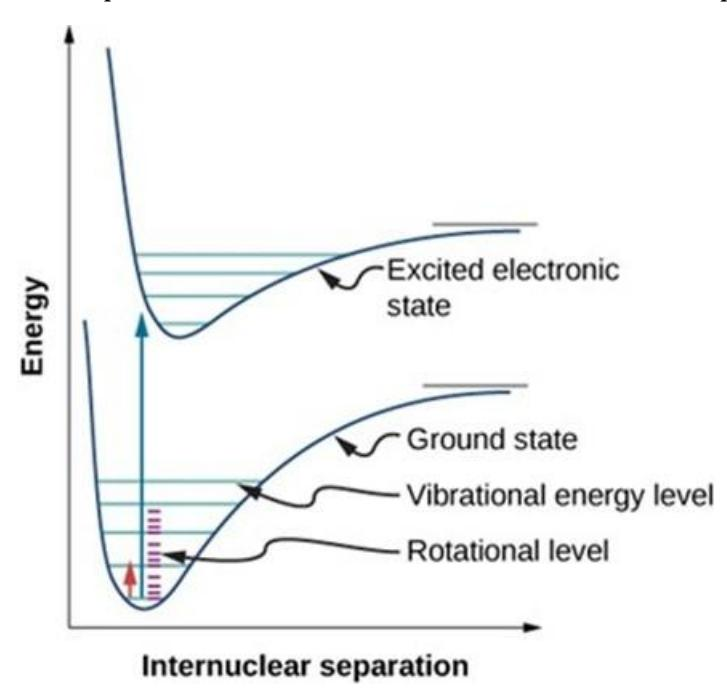
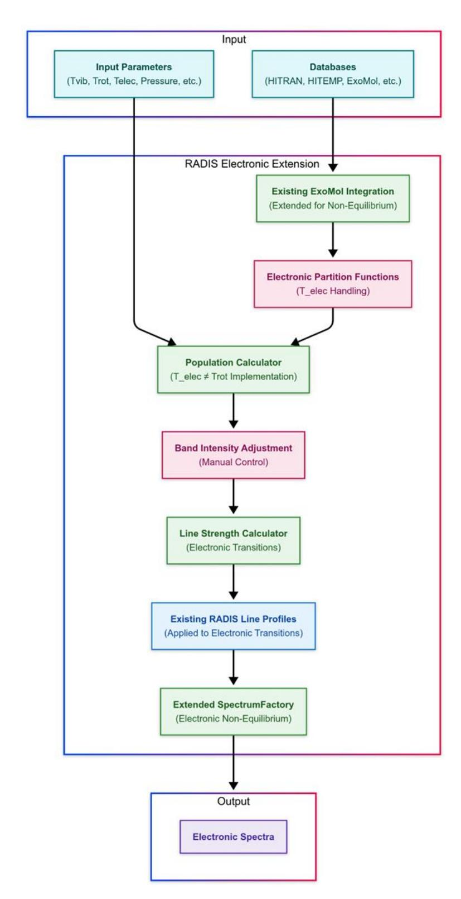

**GSOC 2025 Application RADIS Darshan Patil:** 

# **Electronic spectra for RADIS**

Mentors: Erwan Pannier *@erwanp*, Nicolas Minesi *@minouHub* 

**Google Summer of Code 2025 | OpenAstronomy**

**Personal Information**

Name: Darshan Patil

Time-zone: UTC + 05:30

GitHub ID: [darshvn](https://github.com/darshvn)

LinkedIn[: darshvn](https://www.linkedin.com/in/darshvn/)

Email: darshanpatil15105@gmail.com

Phone: +91 7249410680

# Index

| A. Electronic Spectroscopy Fundamentals                                                                                                                  | .............................................................................................5                                                              |
|----------------------------------------------------------------------------------------------------------------------------------------------------------|-------------------------------------------------------------------------------------------------------------------------------------------------------------|
| 1. Definition and Physical Basis                                                                                                                         | .............................................................................................................5                                              |
| 2. Current RADIS Capabilities and Limitations                                                                                                            | ................................................................................6                                                                           |
| 1. Moose                                                                                                                                                 | ..........................................................................................................................................................6 |
| 3. ExoMol                                                                                                                                                | ........................................................................................................................................................7   |
| C. Technical Requirements for Implementation                                                                                                             | ..................................................................................7                                                                         |
| 2. Calculation Framework                                                                                                                                 | ........................................................................................................................8                                   |
| A. [Core Work] Extending Electronic State Handling......................................................................                                 | 10                                                                                                                                                          |
| 1. Electronic Temperature Implementation                                                                                                                 | 10                                                                                                                                                          |
| 2. Electronic Band Intensity Adjustment.........................................................................................                         | 10                                                                                                                                                          |
| B. [Core Work] Non-Equilibrium Electronic Spectrum Calculator                                                                                            | 10                                                                                                                                                          |
| 1. Population Distribution Calculator...............................................................................................                     | 10                                                                                                                                                          |
| 2. Line Strength Calculator for Electronic Transitions...............................................................                                    | 10                                                                                                                                                          |
| 3. Leveraging Existing Line Profile Implementation                                                                                                       | 10                                                                                                                                                          |
| C. [Core Work] Integration with RADIS................................................................................................                    | 11                                                                                                                                                          |
| 1. Extending SpectrumFactory for Electronic Spectra...............................................................                                       | 11                                                                                                                                                          |
| 2. Validation and Optimization............................................................................................................               | 11                                                                                                                                                          |
| IV. About Google Summer of Code (GSOC) Application.......................................................................                                | 12                                                                                                                                                          |
| A. Milestones                                                                                                                                            | 12                                                                                                                                                          |
| B. Proposed timeline.................................................................................................................................... | 12                                                                                                                                                          |
| Pre-GSoC Period (April 8 -                                                                                                                               | May 8)..................................................................................................... 12                                              |
| Community Bonding Period (May 8 -                                                                                                                        | June 1)................................................................................ 12                                                                  |
| Coding Period - Phase 1                                                                                                                                  | 13                                                                                                                                                          |
| Midterm Evaluation (July 14-18).......................................................................................................                   | 13                                                                                                                                                          |
| Coding Period - Phase 2                                                                                                                                  | 13                                                                                                                                                          |

| Final Submission (August 26-September 1)..................................................................................                                | 14 |
|-----------------------------------------------------------------------------------------------------------------------------------------------------------|----|
| C. Contributions and involvements toward RADIS..........................................................................                                  | 14 |
| 1. Issues reported.....................................................................................................................................   | 14 |
| 2. Pull requests merged..........................................................................................................................         | 14 |
| 3. Pull requests under development.................................................................................................                       | 15 |
| D. Personal information..............................................................................................................................     | 16 |
| 1. Background............................................................................................................................................ | 16 |
| 2. Development platform.......................................................................................................................            | 16 |
| 3. Reasons to apply for OpenAstronomy.........................................................................................                            | 17 |
| 4. Reasons I am qualified to this project..........................................................................................                       | 17 |
| 5. Commitment..........................................................................................................................................   | 17 |
| References                                                                                                                                                | 18 |

# **I. Introduction**

Spectroscopy serves as a fundamental tool in understanding the interaction between matter and electromagnetic radiation, providing crucial insights into molecular and atomic behavior across various scientific discipline[s \[1\].](#page-17-1) RADIS has established itself as a powerful open-source spectroscopic code that excels in the fast line-by-line calculation of highresolution molecular spectra, particularly for absorption and emission processes under various thermal conditions [\[2\].](#page-17-2) Currently, RADIS supports rovibrational transitions and has become one of the fastest spectral calculation tools available, capable of processing millions of spectral lines efficiently.

However, there is a limitation in RADIS's capabilities: the absence of electronic spectral calculations for a wide range of molecules. While RADIS currently supports nonequilibrium calculations only for CO and CO2, and can perform equilibrium calculations using ExoMol data, it lacks the ability to perform electronic non-equilibrium calculations for other molecules. Electronic spectroscopy, which deals with transitions between different electronic states of molecules and atoms, is crucial for understanding hightemperature phenomena in plasmas, flames, atmospheric chemistry, and astrophysical observations [\[3\].](#page-17-3) These transitions typically occur at higher energies than rovibrational transitions (often in the visible and ultraviolet regions) and provide essential information about molecular electronic structure and energy transfer processes [\[4\].](#page-17-4)

This project aims to extend RADIS's capabilities by implementing electronic nonequilibrium spectra calculations, with a particular focus on leveraging the existing ExoMol database integration [\[5\].](#page-17-5) The implementation will support both equilibrium conditions (already available in RADIS) and non-equilibrium conditions where electronic, vibrational, and rotational temperatures may differ [\[6\]](#page-17-6). This addition will significantly enhance RADIS's utility in studying high-temperature environments, plasma diagnostics, and atmospheric characterization of exoplanets [\[7\].](#page-17-7)

This project will extend RADIS's existing architecture to handle electronic states with different temperatures and provide functions to manually adjust electronic band intensities, making it a comprehensive spectroscopic tool capable of handling the full range of molecular transitions within a single, unified framework.

# **II. Project Background**

# **A. Electronic Spectroscopy Fundamentals**

#### **1. Definition and Physical Basis**

Electronic spectroscopy involves transitions between different electronic energy levels of atoms and molecules [\[4\].](#page-17-4) Unlike rovibrational spectroscopy, which deals with transitions between rotational and vibrational states within a single electronic state, electronic spectroscopy involves changes in the electronic configuration of the molecule [\[8\].](#page-17-8)

The energy associated with electronic transitions is typically much larger than that of rovibrational transitions [\[4\].](#page-17-4) While rotational transitions occur at energies of approximately 1-10 cm⁻¹ and vibrational transitions at 100-3000 cm⁻¹, electronic transitions typically involve energies of 10,000-50,000 cm⁻¹. This places electronic transitions primarily in the visible and ultraviolet regions of the electromagnetic spectrum, compared to the infrared region where rovibrational transitions are observed.

These transitions follow selection rules governed by quantum mechanics [\[9\].](#page-17-9) For diatomic molecules, transitions typically follow ΔΛ = 0, ±1, where Λ represents the projection of orbital angular momentum along the internuclear axis. Additionally, the spin selection rule ΔS = 0 (where S is the total spin) applies for most allowed transitions. For vibronic transitions, the Franck-Condon principle determines transition intensities based on the overlap of vibrational wavefunctions between the upper and lower electronic states [\[10\].](#page-18-0)

*Fig. 1 – Schematic representation of electronic transitions in molecules showing electronic states with vibrational sublevels and rotational levels. The diagram illustrates how electronic transitions involve changes in electronic, vibrational, and rotational states. Reproduced from LibreTexts Physical Chemistry [\[15\].](#page-18-1)*

#### **2. Current RADIS Capabilities and Limitations**

RADIS currently excels at calculating rovibrational spectra using a line-by-line approach [\[2\].](#page-17-2) It efficiently integrates with multiple molecular databases including HITRAN, HITEMP, GEISA, and ExoMo[l \[3\]](#page-17-3)[\[5\],](#page-17-5) and can handle both equilibrium and non-equilibrium calculations for rovibrational states [\[2\].](#page-17-2) The code is optimized for performance, allowing it to process millions of spectral lines efficiently.

For ExoMol database integration, RADIS already has robust support for equilibrium calculations with a full range of ExoMol molecules. The OH .states file (as seen in the provided Table 11) already includes electronic state information, quantum numbers, and other necessary data for electronic transitions.

However, RADIS currently lacks the capability to calculate electronic non-equilibrium spectra for most molecules, with non-equilibrium calculations limited to CO and CO2. While the infrastructure for handling ExoMol data exists, the code cannot yet apply different temperatures to electronic states vs. rotational and vibrational states, manually adjust electronic band intensities, calculate spectra where T\_elec ≠ Trot, or apply these capabilities across the full range of ExoMol molecules.

These limitations restrict RADIS's applicability in high-temperature environments where electronic transitions become significant and where different energy modes may not be in thermal equilibrium.

# **B. Reference Implementations**

# **1. Moose**

Moose (Molecular Optical and Spectroscopic Software Environment) is a Python package developed for calculating diatomic molecular spectra. It provides valuable functionality for electronic transition calculations, including implementation of Hönl-London factors for rotational line strengths [\[16\]](#page-18-2) and handling of Franck-Condon factors for vibrational transitions [\[10\].](#page-18-0) Moose supports multiple electronic states and transitions, making it a useful reference for implementing electronic spectroscopy in RADIS.

The Moose architecture offers insights into quantum number management, selection rule implementation, and line strength calculations for electronic transitions. These aspects will be particularly valuable when designing the electronic spectroscopy components for RADIS.

# **2. MassiveOES**

MassiveOES is a specialized tool for Optical Emission Spectroscopy that provides advanced handling of molecular band systems such as N₂ and N₂⁺ [\[19\].](#page-18-3) It includes sophisticated spectrum fitting and analysis tools, along with a database of molecular constants for electronic states. MassiveOES's approach to handling electronic transitions and its population calculation methods will serve as important references for this project.

#### **3. ExoMol**

The ExoMol database provides comprehensive molecular line lists that include energy levels with quantum number assignments, Einstein coefficients for transitions [\[7\],](#page-17-7) partition functions, and line strengths [\[5\].](#page-17-5) RADIS already integrates with ExoMol for equilibrium calculations, providing a solid foundation for extending the functionality to nonequilibrium electronic spectra. The database provides the necessary data for calculating electronic transitions for a wide range of molecules relevant to high-temperature environments and exoplanet atmospheres.

# **C. Technical Requirements for Implementation**

# **1. Leveraging Existing ExoMol Integration**

RADIS already has a robust integration with the ExoMol database for equilibrium calculations. This project will extend the existing ExoMol integration to support nonequilibrium electronic spectra. This includes leveraging the current state file parsing and organization, which already captures electronic state information, quantum numbers, and transition data.

*Fig. 2 – Sample of the OH .states file format showing electronic state information and quantum numbers. Reproduced from Bowesman et al. (2021, 2024[\) \[21\],](#page-18-4) McKemmish et al. (2024[\) \[22\].](#page-18-5)*

The 'State' column identifies the electronic state (X(2Pi)), while other columns provide the energy levels, quantum numbers, and electronic angular momentum information necessary for calculating electronic transitions. RADIS already parses this data through its ExoMol integration, providing the foundation for implementing electronic non-equilibrium calculations.

#### **2. Calculation Framework**

The electronic spectra calculation framework will extend RADIS's existing population distribution calculations to handle different temperatures for electronic states. This includes:

- 1. Implementing Boltzmann statistics for electronic state populations with a separate electronic temperature
- 2. Extending line strength computations to account for electronic transitions
- 3. Using the existing line shape considerations (Doppler, pressure, and Voigt profiles) for electronic transitions

This framework will build on RADIS's current architecture while extending it to handle electronic transitions with different temperature regimes.

#### **3. Integration with Existing RADIS Architecture**

The new implementation will maintain compatibility with existing RADIS modules [\[2\],](#page-17-2) follow RADIS's object-oriented design patterns, preserve computational efficiency, and extend the current non-equilibrium calculations to include electronic states. This integration will be seamless, allowing users to calculate electronic spectra using the same interface they currently use for rovibrational spectra.

# **III. Technical Implementation Plan**

# **A. [Core Work] Extending Electronic State Handling**

#### **1. Electronic Temperature Implementation**

The first core task will be extending RADIS's non\_eq\_spectrum method to properly implement the existing but currently unused Telec parameter for molecules (currently it states "only implemented for atoms"). This will involve modifying the temperature handling in RADIS's factory.py to properly process and use the electronic temperature, implementing state population calculations that account for different electronic, vibrational, and rotational temperatures, and testing the implementation against reference data.

## **2. Electronic Band Intensity Adjustment**

Building on RADIS's existing spectrum manipulation capabilities, this component will implement functions to manually increase or decrease the intensity of electronic bands. This will enable adjusting the relative intensities of different electronic transitions, customizing spectral features to match experimental data, and studying the effect of selective enhancement or suppression of specific electronic transitions.

# **B. [Core Work] Non-Equilibrium Electronic Spectrum Calculator**

# **1. Population Distribution Calculator**

Extending RADIS's existing population calculation framework, this component will implement electronic state populations using Boltzmann statistics with different temperatures for electronic, vibrational, and rotational energy modes. The implementation will calculate partition functions for electronic states, implement population calculations where T\_elec ≠ Trot and Trot = Tvib = Ttranslational, properly handle quantum mechanical properties of electronic states, and support multiple electronic states with different configurations.

# **2. Line Strength Calculator for Electronic Transitions**

Building on RADIS's existing line strength calculation framework, this component will implement line strength calculations for electronic transitions. This includes accounting for electronic transition selection rules, implementing Hönl-London factors for rotational line strengths in electronic transitions, applying Franck-Condon factors for vibrational overlap in electronic transitions, and calculating electronic transition intensities under nonequilibrium conditions.

# **3. Leveraging Existing Line Profile Implementation**

This component will leverage RADIS's existing line profile implementation for electronic transitions. This includes using the existing Doppler, pressure, and Voigt profile implementations, ensuring proper handling of electronic transition line shapes, and optimizing performance for electronic transition calculations.

# **C. [Core Work] Integration with RADIS**

#### **1. Extending SpectrumFactory for Electronic Spectra**

RADIS's SpectrumFactory class will be extended to support electronic spectra calculations. This includes adding methods for electronic spectrum calculations, implementing proper temperature handling for electronic states, ensuring compatibility with existing equilibrium and non-equilibrium methods, and providing user-friendly interfaces for electronic spectrum calculations.

#### **2. Validation and Optimization**

The implementation will be validated against reference data and optimized for performance. This includes comparing calculated spectra against reference implementations and experimental data, identifying and addressing performance bottlenecks, ensuring proper handling of large line lists typical of electronic transitions, and testing with a range of molecules and conditions.

# **IV. About Google Summer of Code (GSOC) Application**

# **A. Milestones**

The project will be structured around four key milestones that represent a simplified and focused approach to implementing electronic spectroscopy in RADIS:

- 1. **OH Electronic Spectra Calculation**: Starting with OH as a test case, implement the capability to manually adjust electronic band intensities in an ExoMol spectrum calculated at equilibrium.
- 2. **Electronic Temperature Implementation**: Implement population calculations for electronic levels assuming equilibrium in rovibrational levels (i.e., T\_elec ≠ Trot and Trot = Tvib = Ttranslational).
- 3. **Non-Equilibrium OH Spectrum**: Based on the first two milestones, calculate an OH spectrum with T\_elec ≠ Trot and Trot = Tvib = Ttranslational, demonstrating the full electronic non-equilibrium implementation.
- 4. **Extension to ExoMol Molecules**: Adapt the implementation to work with any molecule in ExoMol, generalizing the electronic non-equilibrium capabilities across the full range of supported molecules.

These milestones represent a focused approach that leverages RADIS's existing capabilities while extending them to support electronic non-equilibrium calculations. This approach is achievable within the GSoC timeframe.

# **B. Proposed timeline**

# **Pre-GSoC Period (April 8 - May 8)**

During the waiting period from April 8 to May 8, I will continue familiarizing myself with the RADIS codebase, study electronic spectroscopy literature in more depth, and engage with the RADIS community on Slack. This preparation will ensure that I am ready to begin implementation as soon as the community bonding period starts.

# **Community Bonding Period (May 8 - June 1)**

The Community Bonding Period will be dedicated to setting up the development environment, studying the RADIS architecture in detail, reviewing the existing ExoMol integration, understanding the OH .states file format, creating a detailed implementation plan, and engaging with mentors to refine the approach.

Specific tasks will include studying RADIS's ExoMol integration in detail, understanding the structure and content of ExoMol state files (particularly for OH), examining RADIS's population calculation framework and identifying extension points, setting up the development environment, studying the RADIS architecture in detail, creating a detailed implementation plan, and engaging with mentors to refine the approach.

#### **Coding Period - Phase 1**

#### *Week 1 (June 2-8): Project Setup and Understanding OH States File*

I will set up the project structure and testing framework, examine the OH .states file in detail to understand the electronic state information already available, and begin implementing the function to manually adjust electronic band intensities.

# *Weeks 2-3 (June 9-22): Manual Band Intensity Adjustment*

This period will focus on implementing and testing the function to manually adjust electronic band intensities in an ExoMol OH spectrum calculated at equilibrium. This will complete the first milestone.

# *Weeks 4-5 (June 23-July 6): Electronic Temperature Implementation*

I will extend RADIS's existing population calculation framework to handle electronic state populations with different temperatures, implement the necessary changes to the non\_eq\_spectrum method to properly use the Telec parameter, and create validation tests against reference data. This will complete the second milestone.

# *Week 6 (July 7-13): Non-Equilibrium OH Spectrum*

This week will be dedicated to integrating the manual band intensity adjustment and electronic temperature implementation to calculate a complete non-equilibrium OH spectrum with T\_elec ≠ Trot and Trot = Tvib = Ttranslational. This will complete the third milestone.

# **Midterm Evaluation (July 14-18)**

For the midterm evaluation, I will prepare a comprehensive report on the progress made, including the completed milestones, challenges encountered, and plans for the second half of the project.

# **Coding Period - Phase 2**

# *Weeks 7-8 (July 19-August 1): Extension to ExoMol Molecules*

This period will focus on generalizing the OH implementation to work with other ExoMol molecules, testing with a range of molecules, and ensuring proper handling of different electronic state configurations. This will begin the fourth milestone.

# *Weeks 9-10 (August 2-15): Testing Framework and Optimization*

I will develop a comprehensive testing framework to validate the electronic spectra implementation, including tests against reference data for various molecules, validation of temperature dependence for electronic transitions, verification of non-equilibrium handling, and compatibility tests with existing RADIS functionality. Additionally, I'll optimize performance and benchmark against reference implementations. This will continue work on the fourth milestone.

#### *Weeks 11-12 (August 16-25): Documentation and Final Testing*

These weeks will be dedicated to documenting the architecture and creating developer guides for electronic spectroscopy implementation, which will help future contributors understand the codebase. I'll also create comprehensive example notebooks, finalize all implementations, and conduct thorough testing across multiple molecules. This will complete the fourth milestone.

#### **Final Submission (August 26-September 1)**

The Final Week will involve final code review and cleanup, completing all documentation, preparing the final submission, and creating a presentation of the results. This will ensure that the project is properly finalized and ready for integration into the main RADIS codebase.

# **C. Contributions and involvements toward RADIS**

#### **1. Issues reported**

- [#732](https://github.com/radis/radis/issues/732) Update visualization code for Plotly v6.0.0

The Plotly v6.0.0 release removed deprecated attributes, causing test failures in RADIS and breaking plotting functionality.

- [#748](https://github.com/radis/radis/issues/748) Docs: Inconsistent Parameter Alignment in Documentation

Parameter sections in the documentation had inconsistent text alignment.

## **2. Pull requests merged**

- [#722](https://github.com/radis/radis/pull/722) Adding Gitter & Documentation Links in Issue Creation

Fixes [#620:](https://github.com/radis/radis/issues/620) Added Gitter, Slack, and Documentation links to the issue creation template.

- [#723](https://github.com/radis/radis/pull/723) Implementing Plotly Backend in spectrum.py

Fixes [#179:](https://github.com/radis/radis/issues/179) Added Plotly backend support with separate methods for static and interactive plotting. Introduced a plotting\_library parameter for backend selection. During this PR, I learnt that linting can be easily fixed using a single command.

- [#726](https://github.com/radis/radis/pull/726) Login to HITRAN to Retrieve HITEMP Files

Fixes [#717:](https://github.com/radis/radis/issues/717) HITRAN January 2025 introduced updated the CO2 files to a single 6GB file and added encryption, breaking RADIS functionality. Implemented secure login, credential management, mask password input for security and progress tracking with progress bar.

- [#729](https://github.com/radis/radis/pull/729) hide is\_running\_in\_notebook() in docs

Removed helper function from docs and fixed parameter handling for consistent plotting.

- [#731](https://github.com/radis/radis/pull/731) Add HDF5 Serialization Example and Improve Documentation Fixes [#708:](https://github.com/radis/radis/issues/708) Enhanced to\_hdf5 documentation with examples and resolved a noncritical KeyError.
- [#733](https://github.com/radis/radis/pull/733) Update Deprecated Plotly Attributes with New Syntax Fixes [#732:](https://github.com/radis/radis/issues/732) Updated visualization code to comply with Plotly v6.0.0 changes causing test failures in RADIS and potential breakage of plotting functionality, restoring compatibility.
- [#734](https://github.com/radis/radis/pull/734) Switch to pyproject.toml for Installation via pip 25.0 + fewer dependencies + updates in developer guide Fixes [#728,](https://github.com/radis/radis/issues/728) [#463:](https://github.com/radis/radis/issues/463) Replaced setup.py with pyproject.toml, consolidated dependencies, and improved installation guidance. Updated developer documentation and excluded unnecessary files in production. Added tests to ensure both files remain consistent, with CI integration. Excluded tests and documentation from production deployments to reduce download time, while still including them for development and CI.
- [#738](https://github.com/radis/radis/pull/738) Add Encryption for HITRAN Credentials Fixes [#735:](https://github.com/radis/radis/issues/735) Enhanced security by encrypting HITRAN credentials using Fernet symmetric encryption key and restricted file permissions(0o600) which can only be accessed by the owner.
- [#739](https://github.com/radis/radis/pull/739) Add Test for HITEMP Download Fixes [#737:](https://github.com/radis/radis/issues/737) Test HITEMP download. Since January 2025, HITRAN login is required for downloading HITEMP files, preventing automated tests. Proposed tests cover login, small molecule (OH) download, parsing, and wavelength filtering.
- [#775](https://github.com/radis/radis/pull/775) Remove Unnecessary Mapping of X, Y for Plotly Fixes [#774:](https://github.com/radis/radis/issues/774) Resolved a ValueError caused by incorrect plot label implementation in the Plotly backend.
- [#769](https://github.com/radis/radis/pull/769) Transition from numpy.DataSource to requests Fixes [#768,](https://github.com/radis/radis/issues/768) [#781:](https://github.com/radis/radis/issues/781) This PR replaces numpy.DataSource with requests for file downloads, improving error handling and control. A RequestsFileOpener class mimics the old behavior. Also fixed H2O HITEMP download error in this PR.
- **3. Pull requests under development**
  - [#799](https://github.com/radis/radis/pull/799) Fix kwargs Handling Using Plotly's Validation Fixes [#760](https://github.com/radis/radis/issues/760): Improved kwargs handling by leveraging Plotly's built-in validation. This approach ensures compatibility with all Plotly parameters, eliminates manual parameter mapping, and maintains clear expectations for parameter usage.

# **D. Personal information**

#### **1. Background**

I've always been drawn to the practical side of science. Back in school, you'd find me in the lab, running experiments and helping classmates understand how chemistry and physics actually work in the real world. There was something about seeing science in action that just clicked for me in a way textbooks never could.

Now I'm in my second year studying AI and Data Science, where I've built up skills in Python, data analysis, and scientific computing. I've gotten comfortable with OOP concepts and work regularly with NumPy, Pandas, Vaex, and Matplotlib.

Outside of classes, I've found two roles that have really shaped me. For the past 8 months, I've been teaching 8th and 9th graders as a STEM Instructor at CircuitCrew. There's nothing quite like the moment when a student's eyes light up watching a plasma globe or building their first DC motor. It's taught me how to break down complex ideas into something anyone can understand.

I also serve as Technical Head of CIPHERS, where I've organized workshops and even ran a hackathon with over 100 participants. Managing these events has taught me a lot about leadership and creating spaces where people can collaborate effectively.

My technical toolbox includes Python, Pandas, Vaex, Git, Linux, BASH, and various data manipulation and visualization tools. I'm currently also working on JotBox, a web app for organizing thoughts and tasks with a clean, intuitive chat-like interface.

What draws me to RADIS is how perfectly it combines my interests in chemistry, physics, and programming. The computational challenges in molecular spectroscopy fascinate me, and after exploring the RADIS codebase, I see exciting opportunities to contribute especially in expanding its capabilities to include electronic transitions.

Through GSoC, I'm hoping to merge my technical background with my passion for applied science to enhance RADIS for the broader scientific community. It feels like the perfect next step in my journey of bringing practical solutions to complex scientific challenges.

# **2. Development platform**

- Laptop: ASUS TUF F15.
- Operating System: Windows 11 64-bit.
- Installed RAM: 16 GB.
- CPU: 11th Gen Intel(R) Core(TM) i5-11400H @ 2.70GHz.
- Preferred IDE: PyCharm, Visual Studio Code.

#### **3. Reasons to apply for OpenAstronomy**

I'm excited to apply to OpenAstronomy because it perfectly aligns with my technical skills and passion for the physical sciences. The chance to contribute to open-source astronomical software is incredibly appealing.

I'm especially drawn to OpenAstronomy's collaborative, community-driven approach, where researchers, developers, and students come together to build tools that advance our understanding of the universe. This environment offers invaluable mentorship and the opportunity to learn from experts in spectroscopy and scientific computing.

Open science is another value I deeply resonate with. Contributing to RADIS through GSoC means helping create accessible software that benefits researchers in plasma physics, atmospheric science, and astrophysics.

With GSoC's structured mentorship and clear milestones, I'm eager to grow as a developer while making meaningful contributions. Beyond the program, I'm excited to continue supporting OpenAstronomy projects, contributing to tools that drive scientific discovery.

## **4. Reasons I am qualified to this project**

I am well-suited for this project due to my academic background, technical experience, and passion for spectroscopy.

As a second-year AI and Data Science student, I have a solid foundation in Python, the primary language of RADIS. My coursework in Object-Oriented Programming and proficiency with data manipulation libraries like Pandas equip me to handle large datasets and contribute effectively to the RADIS codebase, especially when working with spectroscopic databases like EXOMOL.

My strong background in chemistry and physics, complemented by hands-on laboratory experience, gives me a clear understanding of the spectroscopic principles underlying RADIS. This aligns well with the project's focus on implementing electronic spectra calculations.

Ultimately, my enthusiasm for spectroscopy and computational physics, coupled with my programming expertise, makes me eager to enhance RADIS's capabilities. I am committed to delivering high-quality code and engaging actively with the RADIS community to implement electronic spectra calculations successfully.

# **5. Commitment**

I am fully committed to dedicating 30-40 hours per week to this project throughout the GSoC period. My academic schedule has been arranged to accommodate this time commitment, with no classes or major obligations during the summer months.

Before the official start, I'll finish working on the pull requests currently in development. I've already started reading papers on electronic spectroscopy in my spare time - I find the subject fascinating and want to hit the ground running when coding begins.

I plan to maintain a regular work schedule with dedicated hours each day for coding, testing, and documentation. I'm generally available during standard working hours in my time zone, but can adjust for meetings with mentors in different time zones when needed.

If anything unexpected affects my availability, I'll communicate proactively with my mentors to adjust the timeline. I've built buffer time into my project plan because I know complex implementations often present unforeseen challenges.

Beyond GSoC, I'm genuinely interested in continuing to contribute to RADIS as a long-term open-source contributor. I see this electronic spectroscopy implementation as just the beginning of my involvement with the project.

# **References**

- [1[\] Bernath, P. F. \(2020\). Spectra of atoms and molecules. Oxford University Press.](https://global.oup.com/academic/product/spectra-of-atoms-and-molecules-9780199382576) [2[\] Pannier, E., & Laux, C. O. \(2019\). RADIS: A nonequilibrium line-by-line radiative code for](https://doi.org/10.1016/j.jqsrt.2018.09.027)  [CO2 and HITRAN-like database species. Journal of Quantitative Spectroscopy and Radiative](https://doi.org/10.1016/j.jqsrt.2018.09.027)  [Transfer, 222, 12-25.](https://doi.org/10.1016/j.jqsrt.2018.09.027) [3] [Gordon, I. E., Rothman, L. S., Hill, C., Kochanov, R. V., Tan, Y., Bernath, P. F., … & Zak, E. J.](https://doi.org/10.1016/j.jqsrt.2017.06.038)  [\(2017\). The HITRAN2016 molecular spectroscopic database. Journal of Quantitative](https://doi.org/10.1016/j.jqsrt.2017.06.038)  [Spectroscopy and Radiative Transfer, 203, 3-69.](https://doi.org/10.1016/j.jqsrt.2017.06.038) [4[\] Herzberg, G. \(2013\). Molecular spectra and molecular structure. Vol. 1: Spectra of](https://www.springer.com/gp/book/9780442033859)  [diatomic molecules. Krieger Publishing Company.](https://www.springer.com/gp/book/9780442033859) [5] Tennyson, J., Yurchenko, S. N., Al-[Refaie, A. F., Barton, E. J., Chubb, K. L., Coles, P. A., … &](https://doi.org/10.1016/j.jms.2016.05.002)  [Zak, E. \(2016\). The ExoMol database: Molecular line lists for exoplanet and other hot](https://doi.org/10.1016/j.jms.2016.05.002)  [atmospheres. Journal of Molecular Spectroscopy, 327, 73-94.](https://doi.org/10.1016/j.jms.2016.05.002) [6[\] Klarenaar, B. L. M., Engeln, R., van den Bekerom, D. C. M., van de Sanden, M. C. M.,](https://doi.org/10.1088/1361-6595/aa902e)  [Morillo-Candas, A. S., & Guaitella, O. \(2017\). Time evolution of vibrational temperatures in a](https://doi.org/10.1088/1361-6595/aa902e)  [CO2 glow discharge measured with infrared absorption spectroscopy. Plasma Sources](https://doi.org/10.1088/1361-6595/aa902e)  [Science and Technology, 26\(11\), 115008.](https://doi.org/10.1088/1361-6595/aa902e) [7] [Šimečková, M., Jacquemart, D., Rothman, L. S., Gamache, R. R., & Goldman, A. \(2006\).](https://doi.org/10.1016/j.jqsrt.2005.07.021)  [Einstein A-coefficients and statistical weights for molecular absorption transitions in the](https://doi.org/10.1016/j.jqsrt.2005.07.021)  [HITRAN database. Journal of Quantitative Spectroscopy and Radiative Transfer, 98\(1\), 130-](https://doi.org/10.1016/j.jqsrt.2005.07.021)
- [155.](https://doi.org/10.1016/j.jqsrt.2005.07.021) [8[\] Patrascu, A. T., Hill, C., Tennyson, J., & Yurchenko, S. N. \(2015\). Study of the electronic](https://doi.org/10.1021/acs.jpca.5b03682)  [and rovibronic structure of the X 2Σ+, A 2Π, and B 2Σ+ states of AlO. The Journal of Physical](https://doi.org/10.1021/acs.jpca.5b03682)  [Chemistry A, 119\(23\), 5907-5917.](https://doi.org/10.1021/acs.jpca.5b03682) [9] [Brooke, J. S., Bernath, P. F., Western, C. M., Sneden, C., Afşar, M., Li, G., & Gordon, I. E.](https://doi.org/10.1016/j.jqsrt.2015.07.021)  [\(2016\). Line strengths of rovibrational and rotational transitions in the X 2Π ground state](https://doi.org/10.1016/j.jqsrt.2015.07.021)  [of OH. Journal of Quantitative Spectroscopy and Radiative Transfer, 168, 142-157.](https://doi.org/10.1016/j.jqsrt.2015.07.021)

- [10] [Kovács, I. \(1969\). Rotational structure in the spectra of diatomic molecules. Hilger.](https://ui.adsabs.harvard.edu/abs/1969rssd.book.....K/abstract) [11] [Voigt, W. \(1912\). Das Gesetz der Intensitätsverteilung innerhalb der Linien eines](https://en.wikipedia.org/wiki/Voigt_profile)  [Gasspektrums. Sitzungsberichte der Königlich Bayerischen Akademie der Wissenschaften,](https://en.wikipedia.org/wiki/Voigt_profile)  [25, 603-620.](https://en.wikipedia.org/wiki/Voigt_profile) [12] [Olivero, J. J., & Longbothum, R. L. \(1977\). Empirical fits to the Voigt line width: A brief](https://doi.org/10.1016/0022-4073(77)90161-3)  [review. Journal of Quantitative Spectroscopy and Radiative Transfer, 17\(2\), 233-236.](https://doi.org/10.1016/0022-4073(77)90161-3) [13] [Humlíček, J. \(1979\). An efficient method for evaluation of the complex probability](https://doi.org/10.1016/0022-4073(79)90062-1)  [function: the Voigt function and its derivatives. Journal of Quantitative Spectroscopy and](https://doi.org/10.1016/0022-4073(79)90062-1)  [Radiative Transfer, 21\(4\), 309-313.](https://doi.org/10.1016/0022-4073(79)90062-1) [14] [Yurchenko, S. N., Tennyson, J., Bailey, J., Hollis, M. D., & Tinetti, G. \(2014\). Spectrum of](https://doi.org/10.1073/pnas.1324219111)  [hot methane in astronomical objects using a comprehensive computed line list.](https://doi.org/10.1073/pnas.1324219111)  [Proceedings of the National Academy of Sciences, 111\(26\), 9379-9383.](https://doi.org/10.1073/pnas.1324219111) [15] [LibreTexts. \(2023\). Electronic Spectra Contain Electronic, Vibrational, and Rotational](https://chem.libretexts.org/Bookshelves/Physical_and_Theoretical_Chemistry_Textbook_Maps/Physical_Chemistry_%28LibreTexts%29/13%3A_Molecular_Spectroscopy/13.06%3A_Electronic_Spectra_Contain_Electronic_Vibrational_and_Rotational_Information)  [Information. In Physical Chemistry.](https://chem.libretexts.org/Bookshelves/Physical_and_Theoretical_Chemistry_Textbook_Maps/Physical_Chemistry_%28LibreTexts%29/13%3A_Molecular_Spectroscopy/13.06%3A_Electronic_Spectra_Contain_Electronic_Vibrational_and_Rotational_Information) [16] [Whiting, E. E. \(1968\). An empirical approximation to the Voigt profile. Journal of](https://doi.org/10.1016/0022-4073(68)90081-2)  [Quantitative Spectroscopy and Radiative Transfer, 8\(6\), 1379-1384.](https://doi.org/10.1016/0022-4073(68)90081-2) [17] [Luque, J., & Crosley, D. R. \(1999\). Transition probabilities and electronic transition](https://doi.org/10.1063/1.480064)  [moments of the A 2Σ+–X 2Π and D 2Σ+–X 2Π systems of nitric oxide. The Journal of](https://doi.org/10.1063/1.480064)  [Chemical Physics, 111\(16\), 7405-7415.](https://doi.org/10.1063/1.480064) [18] [Western, C. M. \(2017\). PGOPHER: A program for simulating rotational, vibrational and](https://doi.org/10.1016/j.jqsrt.2016.04.010)  [electronic spectra. Journal of Quantitative Spectroscopy and Radiative Transfer, 186, 221-](https://doi.org/10.1016/j.jqsrt.2016.04.010)
- [242.](https://doi.org/10.1016/j.jqsrt.2016.04.010) [19] Klarenaar, B. L. M., Morillo-[Candas, A. S., Grofulović, M., van de Sanden, M. C. M., Engeln,](https://doi.org/10.1088/1361-6595/ab0537)  [R., & Guaitella, O. \(2019\). MassiveOES: open-source code for optical emission spectroscopy](https://doi.org/10.1088/1361-6595/ab0537)  [diagnostics. Plasma Sources Science and Technology, 28\(3\), 035021.](https://doi.org/10.1088/1361-6595/ab0537) [20] [Luque, J., & Crosley, D. R. \(1999\). LIFBASE: Database and spectral simulation program](https://www.semanticscholar.org/paper/LIFBASE%3A-Database-and-spectral-simulation-program-Luque-Crosley/25e4ab6b0f6c9f7d0756f0f22fb36f8c6489f3eb)  [\(version 1.5\). SRI International Report MP, 99-009.](https://www.semanticscholar.org/paper/LIFBASE%3A-Database-and-spectral-simulation-program-Luque-Crosley/25e4ab6b0f6c9f7d0756f0f22fb36f8c6489f3eb) [21] [Bowman, C. M., McKemmish, L. K., Syme, A.-M., & Tennyson, J. \(2021\). ExoMolOP: A](https://doi.org/10.1093/mnras/stab985)  [Comprehensive Database of Opacities for Exoplanet Atmospheres. Monthly Notices of the](https://doi.org/10.1093/mnras/stab985)  [Royal Astronomical Society, 504\(2\), 2696-2711.](https://doi.org/10.1093/mnras/stab985) [22] [McKemmish, L. K., Chubb, K. L., Rivlin, T., Baker, J. S., Gorman, M. N., Heward, A., … &](https://doi.org/10.1016/j.jqsrt.2023.108622)  [Yurchenko, S. N. \(2024\). The 2023 ExoMol State of the Database: The Growth Continues.](https://doi.org/10.1016/j.jqsrt.2023.108622)  [Journal of Quantitative Spectroscopy and Radiative Transfer, 306, 108622.](https://doi.org/10.1016/j.jqsrt.2023.108622)