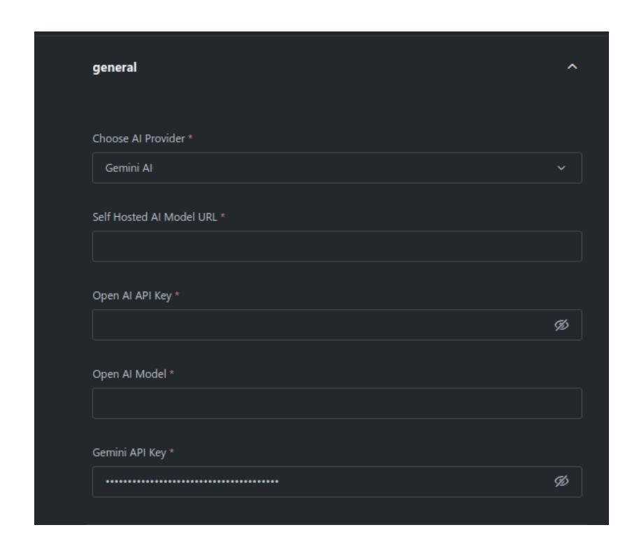
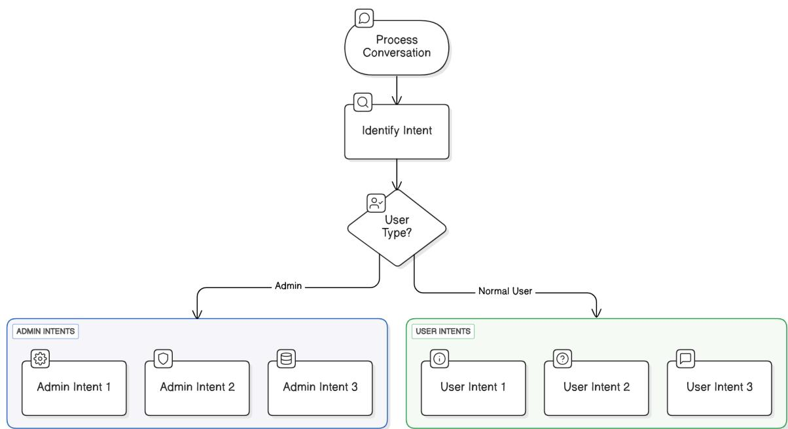

# **GSoC 2025 Proposal : Server Guide Agent**

# **General Details**

| Name             | Abir Chakraborty             |
|------------------|------------------------------|
| University       | Jadavpur University          |
| Degree           | Computer Science B.E.        |
| RocketChatId     | abir.chakraborty             |
| Github           | https://github.com/abirc8010 |
| Country          | India                        |
| Time Zone        | India (GMT+5:30)             |
| Project Duration | 175 hours                    |

# **Project Details**

| Project Name | Server Guide Agent          |
|--------------|-----------------------------|
| Mentors      | Jeffrey Yu , Gabriel Casals |
| Project Size | Medium ( 175hrs )           |

# **About Me**

I am a second-year Computer Science student at Jadavpur University, Kolkata, with a strong interest in open-source development. I'm an active contributor to Rocket.Chat, where I've worked on multiple features and improvements across the platform. I'm always excited to learn new technologies, contribute to real-world projects, and collaborate with the open-source community.

# **Benefits to the community**

This onboarding and guidance system aims to create a more structured, welcoming, and user-friendly environment within Rocket.Chat communities. One of the common challenges in large community platforms is that new users often feel lost or overwhelmed when joining a new server — they may not know the rules, the purpose of different channels, or how to effectively interact with the community. This system directly addresses that problem by providing personalized guidance and clear instructions from the moment a user joins.

For regular users, this system acts like a virtual assistant that helps them get familiar with the server effortlessly. It provides them with welcome messages, server guidelines, etiquette, recommendations for channels based on their interests and many more. It also assists them in discovering useful resources, understanding key features of the server, and encouraging meaningful participation in discussions. This not only enhances the user experience but also helps build a sense of belonging and engagement within the community.

For administrators, the system reduces the overhead of managing user onboarding manually. Admins can pre-configure rules, guides, welcome messages, default channels, and broadcast messages to large groups of users. This automation ensures consistency in communication and minimizes the chances of users missing out on important information. It also helps admins promote specific channels or features, highlight server updates, and maintain community standards more effectively.

# **Abstract**

This project focuses on building an intelligent onboarding and user guidance agent app within Rocket.Chat to enhance new user engagement. It introduces two main workflows — *Admin Workflow* and *User Workflow* — designed to simplify the onboarding process and provide personalized assistance to users.

In the *Admin Workflow*, server administrators can configure key onboarding elements such as welcome messages, server rules, suggested channels, default channels for auto-joining, and guides for important features. Admins can also broadcast messages to multiple users and channels.

In the *User Workflow*, regular users interact with the bot, which responds based on the admin-defined configurations. The bot assists users by answering questions about server rules, recommending useful channels, and guiding them through onboarding and many more.

# **Deliverables**

- 1. **Admin Config Modal:** Displays the current configuration including welcome message, server rules, channel suggestions, app features and messaging functionality by using a slash command
- 2. **Agent Memory System:** Stores previous agent interactions and configuration data persistently.
- 3. **New User Onboarding:** Automatically sends welcome message, server rules, and recommended channels to newly joined users.
- 4. **AI Suggestions Mode:** Offers AI-generated configuration suggestions
- 5. **Bulk Messaging Support:** Allows admins to compose and send a message to multiple users or channels
- 6. **Scheduled Messaging Feature:** Lets admins schedule messages to be delivered at a specified future time, either to individuals, channels, or groups.

# **Prompt Engineering**

The major part of this proposed solution will be identifying the correct prompts to ensure accurate and context-aware responses from the AI, the implementation will incorporate **conversation history** along with existing **admin configurations**. The AI will be instructed to respond strictly in a structured **JSON format**, making it easier to parse and process responses. A carefully designed **prompt injection-safe** approach will be used to prevent manipulation of the AI's behavior.

# **Handling Conversation History as Memory**

#### 1. **Summarization-Based Memory**

In this approach, a concise summary of past interactions is generated and fed into the AI as context. While this method reduces token usage, it introduces the risk of **losing some details**, leading to potential misinterpretations.

#### 2. **Raw Conversation History (Preferred Approach)**

This approach involves **feeding the last 20 messages** directly into the AI. By preserving the exact wording, it ensures that **no crucial details** are lost, reducing the likelihood of AI misinterpreting context. While this method increases token consumption, it significantly enhances accuracy and preserves the **intent** of the conversation.

Given the importance of preserving accuracy and minimizing hallucinations, the **raw conversation history approach** will be prioritized over summarization.

## **Ensuring Prompt Injection Safety**

To reduce **prompt injection risks**, the prompt will include:

**Explicit Instructions**: The AI will be instructed to ignore any input attempting to modify its behavior or override formatting constraints. **Strict JSON Schema Enforcement**: The AI will be directed to output responses strictly in a valid JSON format to prevent any normal text responses.

## **Handling Token Limits**

The prompt will be designed to be **concise yet informative**, ensuring essential context is included therefore a good range of conversation history is kept as memory. Even after that if it is seen that the token limit is getting exceeded then we can summarize the last 20 messages and feed it as a context to the user.

# **App Settings**

Th app setting will contain a configurable AI provider selection for generating responses within the App. Users will have the flexibility to choose between **Self-Hosted Models**, **OpenAI**, and **Gemini AI**.

A **select dropdown** ( SettingType.SELECT ) will be kept allowing users to specify their preferred AI provider. Depending on the selection, additional settings will be required. If a **self-hosted model** is chosen, a field for specifying the model's address will be provided. For **OpenAI** and **Gemini AI**, users will need to enter the respective API keys to authenticate requests.

# **App Implementation Details**

# **Overview:**

The AI agent will process user messages by first analyzing the conversation and identifying the user's intent. It will then determine whether the user is an Admin or a Normal User before deciding how to respond. Admin users will receive responses tailored to administrative tasks, while normal users will be guided based on general user intents.

**The below diagram illustrates the flow:**

# **1. Direct Message Processing**

To process direct messages (DMs) , the plan is to implement the *IPostMessageSent* interface. The *checkPostMessageSent* method will verify if the DM is between the agent and the user. If the message is sent by the user, it will be processed using *executePostMessageSent* , which will decide the correct workflow/intent based on whether the user is an admin or a regular user by inspecting the role of the message sender from the message object.

#### **Verifying if the DM is between user and the bot.**

As we know that even DMs are treated as rooms in Rocket Chat, where their RoomId is just a combination of the user ID and bot ID, making it unique to the user. We will extract the room from the message object provided by *checkPostMessageSent* and check is the Room type is a DM and if the room id contains the sender user's id.

# **2. Workflows**

The approach consists of two different workflows:

## **a) Admin Workflow:**

Admins will have access to a set of configurations and management options like:

Create a welcome message for new users to personalize the onboarding experience Set up server rules and etiquette to establish guidelines for user behavior Suggest relevant channels for new users to explore based on community interests Specify default channels that users will automatically join upon onboarding Provide a guide for key apps and features available Send Messages to multiple users and channels

## **b) User Workflow:**

Regular users will receive guidance based on the admin-configured onboarding process and server policies. The bot will interpret user messages and provide relevant responses, such as:

Answering questions about server rules and etiquette Recommending useful channels to join

Offering assistance with onboarding and community engagement

# **3) Admin Workflow Implementation**

The IAdminConfig interface will define the structure for storing admin configuration settings in a Rocket.Chat app. It will include three properties: welcomeMessage , which will store a custom welcome message for users; recommendedChannels , an array of suggested channels configured by the user and serverRules , an array of rules user must follow while communication , these are the rules that will be set by the admin which will be displayed to new users when they create an account and join the server . And other configurations depending on the intents.

The AdminPersistence class will be responsible for managing the storage and retrieval of admin configuration data in a Rocket.Chat app. It will define a private key, adminConfigKey , which will be used to associate the stored data from the Persistence and this storage place will be common to all the admin users. The class will be initialized with two dependencies: IPersistence , which will allow for storing and updating data, and IPersistenceRead , which will be used for reading stored data.

The getAdminConfig() method will retrieve the stored admin configuration by creating a RocketChatAssociationRecord with the adminConfigKey and using persistenceRead.readByAssociation() . The returned data will be cast as an array, and if any data exists, it will return the first element; otherwise, it will return null .

The storeAdminConfig(config) method will be responsible for saving or updating the admin configuration. It will create an association record using the same key and call persistence.updateByAssociation() , passing the new configuration and ensuring that any existing data is replaced.

# **a) Workflow Detection (Finding Admin's Intent):**

The plan is to feed the model with the recent conversations so that it get's a context to detect the current workflow which the user is talking about something similar to memory in chatgpt. A comparison of the sample conversations is given below to see how maintaining a memory helps the bot in detecting the workflow better

**The code snippet provided below demonstrates the older message fetching using the getMessages method:**

read.getRoomReader() will be used to instantiate an IRoomRead object, which provides an interface for accessing room messages. getMessages(message.room.id) retrieves historical messages in that room. The fetched messages are formatted using .map() and .join() to create a structured text representation of the conversation history with the username along with the chat conversation.

The LLM will process the conversation history to detect the user's intent, with a stronger emphasis on recent messages to ensure it accurately captures the context of the latest interaction.

And it will be told to output in a strict json format like:

And after this step we will send an intermediate message to the user i.e the acknowledging message which will be retrieved from the JSON structure, Based on the detected workflow we decide our next step using a switch case:

### **b) Workflow Processing:**

- 1. **Conversation History Storage under each intent of the admin or normal users :**

The IConversationHistory interface will define the structure for storing conversation history in the app. It will contain a single property, messages , which will be an array of strings representing the messages exchanged in a conversation under a specific intent i.e. the conversation history of the messages categorized under the same intent will be considered for the messages.

The ConversationHistoryPersistence class will be responsible for managing the storage and retrieval of conversation history in a Rocket.Chat app. It will define a private prefix, historyPrefix , which will serve as a base for uniquely identifying stored conversation records. The class will be initialized with two dependencies: IPersistence , which will allow for storing and updating conversation history, and IPersistenceRead , which will enable reading stored messages.

A private method, getStorageKey(category, userId) , will generate a unique key for storing and retrieving conversation history based on a specific category and user ID.

The getHistory(category, userId) method will retrieve the stored messages by creating a RocketChatAssociationRecord using the generated key and calling persistenceRead.readByAssociation() . The retrieved data will be returned as an array of messages, or an empty array if no history exists.

The updateHistory(category, userId, newMessage) method will be responsible for adding a new message to the conversation history. It will first retrieve the existing messages, append the new message, and ensure that the history does not exceed 20 messages by removing the oldest entry if necessary. The updated history will then be stored using

persistence.updateByAssociation() , ensuring that the latest messages are always available for retrieval.

#### **a) Onboarding Message Workflow**

The onboarding message will serve as a welcoming introduction for new users, ensuring they feel comfortable and informed as they begin using the platform. It will help users understand what they can do and how to navigate the system effectively. The admin will have a conversation with the agent to setup the welcome message , if the admin gives a clear welcome then it will be saved in the AdminPersistence else the agent will ask followup questions or the admin may ask for the agent to suggest some welcome messages. After the user finalizes the message it will get stored in the AdminPersistence in the adminConfig

We will feed the LLM with the past few conversation history and the current welcome message if exists any in the admin config.The LLM then generates a JSON response in the following format:

The JSON response will be designed to structure server rules effectively by utilizing three key attributes: "aihelp" , "aiMessage" , and "message" . The "aihelp" attribute will be a boolean variable that indicates whether AI assistance is required for the admin's query. If the admin message lacks clarity or explicitly requests AI assistance, this value is set to true . Conversely, if the welcome message is clearly

provided by the admin and the agent is asked to set that , "aihelp" is set to false , meaning no AI intervention is necessary.

the "message" attribute will contain the final set of structured welcome message. This is the actual response that will be displayed when a new user joins and it will be stored in AdminPersistence .

Below are two demo video to show how it works:

- 1. [https://drive.google.com/file/d/1ZaZZprXQue4HuUn1QROmtnfZi8-n39KK/view?](https://drive.google.com/file/d/1ZaZZprXQue4HuUn1QROmtnfZi8-n39KK/view?usp=sharing) [usp=sharing](https://drive.google.com/file/d/1ZaZZprXQue4HuUn1QROmtnfZi8-n39KK/view?usp=sharing)
- 2. [https://drive.google.com/file/d/1cYktdIr5l\\_rgjOeQWRkx0tdvbmMLlWpC/view?](https://drive.google.com/file/d/1cYktdIr5l_rgjOeQWRkx0tdvbmMLlWpC/view?usp=sharing) [usp=sharing](https://drive.google.com/file/d/1cYktdIr5l_rgjOeQWRkx0tdvbmMLlWpC/view?usp=sharing)

Whenever a new user joins, the executePostUserCreated function will be triggered to handle the onboarding process. It will start by introducing a **3-second delay** to ensure the user creation process is fully completed before proceeding. After the delay, it will retrieve the newly created user's details using read.getUserReader().getById(context.user.id) . If the user does not exist or does not have a username, the function will terminate immediately. It will then check for the app's bot user using read.getUserReader().getAppUser() . If the app user is unavailable or the newly created user has an admin role, the function will exit without taking any further action. The function will then retrieve the stored admin configuration using the AdminPersistence class. If no admin settings exist or if a welcome message is not defined, the function will stop execution. If all conditions are met, it will attempt to create a direct message room between the new user and the app bot. If the room cannot be created, the process will end there. Finally, if the room is successfully created, the function will send the **admin-configured welcome message** to the new user

#### **b) Server Rules Workflow**

The process will follow a similar structure to the onboarding message workflow.

The prompt will contain the conversation history that are categorized under "server\_rules" intent along with the current server rules. The AI model will generate a JSON response based on the server rules provided by the admin.

The JSON structure that will be generated will contain three attributes: **aihelp**,

#### **aiMessage**, and **message**.

The **aihelp** attribute will be a boolean value, indicating whether the agent will provide an AI-generated response or not. If the agent decides that the rules need clarification or maybe a followup to the admin's query, it will set this attribute to **true**; otherwise, it will set it to **false** when the rules are clear or directly extracted from the input. The **aiMessage** attribute will have the AI-generated explanation or any additional context, but this will only appear if **aihelp** is set to **true**. If the agent doesn't need to generate an explanation, this field will be left empty. The **message** attribute will include the final, structured server rules in JSON format. This part will consist of the final set of rules rules based on the conversation and admin's instructions, which the assistant will return in a valid JSON structure,.

Once the AI processes the server rules, it will be stored in **AdminPersistence** as part of the adminConfig . This ensures that whenever a user inquires about server rules, the system can retrieve the stored rules and provide an accurate response without needing to regenerate them.

Here is a demo link:

#### [https://drive.google.com/file/d/1OGeibfzDYLT\\_Y7bKxcLw0EdrmsJ\\_E43G/view?](https://drive.google.com/file/d/1OGeibfzDYLT_Y7bKxcLw0EdrmsJ_E43G/view?usp=sharing) [usp=sharing](https://drive.google.com/file/d/1OGeibfzDYLT_Y7bKxcLw0EdrmsJ_E43G/view?usp=sharing)

#### **c) if the workflow is "user\_channel\_setup"**

Below are some ways of doing this:

**i) using embedding based search for the channel using the channel metadata like topic of the channel and description.:**

Pros:

- Faster search for the relevant channel , scalable as the number of channel grows , LLM can hit the token limit for the large number of channel
- Minimum admin configuration needed as the embeddings auto update with

the channel along with its metadata

Cons:

 • Limitations of npm package support in [Rocket.Chat](http://rocket.chat/) Apps can cause the implementation to rely on externally deployed service everytime for this feature to

- operate.
- Since there can be cases where the channel metadata like the topic or discussion is not provided and the channel name does not convey any useful meaning about the channel making the search inconvenient for such cases , one way that comes to mind to solve this is to analyze the latest chats in the channel and extract what the channel is about but In cases where channel metadata, such as the topic or discussion, is not provided, and the channel name does not convey useful information, searching can become inconvenient. One potential solution is to analyze the latest chats in the channel to infer its content. However, there may be

off-topic messages occasionally, which could make this approach less reliable.

#### **ii) Feeding the channel along with its metadata in as a prompt to an LLM:**

Pros:

- LLM can be more efficient and smarter in detecting which channel will be suitable for the particular user based on the past conversations
- Minimum admin configuration needed as we can store the channel along with it;s metadata whenever a new channel is created.

Cons:

- If the channel number are high then the prompt can hit the maximum token limit.
- Similar to the previous approach some channel may lack discussions or topics that makes it difficult to infer what the channel is about.

#### **Proposed Solution:**

The proposed solution addresses the problems of ambiguous channel metadata and the ineffectiveness of channel search by allowing admins to set different channels along with description. This means that admin users would select key channels for purposes such as onboarding or for critical areas where project discussion occurs. On such channels, admin users would give a description of those channels, for example, their purpose, audience, and key topics. This would help easy understanding among users about the channel, especially against cases of vague channel names or existing metadata.

Here is the demo link: [https://drive.google.com/file/d/1XTlYmYhyBMAC1I2nXH0S-](https://drive.google.com/file/d/1XTlYmYhyBMAC1I2nXH0S-H5vsDsmvqkf/view?usp=sharing)[H5vsDsmvqkf/view?usp=sharing](https://drive.google.com/file/d/1XTlYmYhyBMAC1I2nXH0S-H5vsDsmvqkf/view?usp=sharing)

#### d) **if the workflow is "send\_message":**

There can be cases where the admin wants to send the same message to multiple person so instead of searching for the users/channels and sending the ame message again and again the admin can prompt the agent to send the message to different channels or users.

So if the intent of the user is sending messages then the json provided by the LLM for workflow detection will provide additional fields like

- channels : it will be a string array containing mentioned channel names which we can processing by iterating through each channel name and finding the IRoom object using read.getRoomReader().getByName(<channel name>) method using this we can send a message on behalf of the admin using the IModify object as shown by the below snippet:

- users : It will be a string array containing mentioned usernames which we can process through iterating through each username and finding the IRoom object containing the admin and the mentioned user through their username using the method read.getRoomReader().getDirectByUsernames([adminUsername,mentionedUsername) as we know that DMs are treated as rooms in [Rocket.Chat](http://rocket.chat/) then in a similar way we can send the direct message like we did for channels.

�� Note: Normal users will also have the access to this feature and the implementation follows a similar pattern

#### **Here is a demonstration of the functionality:**

[https://drive.google.com/file/d/1sxdXiaaktSjPn61bmCU6YhtA1UxUZoqu/view?](https://drive.google.com/file/d/1sxdXiaaktSjPn61bmCU6YhtA1UxUZoqu/view?usp=sharing) [usp=sharing](https://drive.google.com/file/d/1sxdXiaaktSjPn61bmCU6YhtA1UxUZoqu/view?usp=sharing)

# **4) User Workflow Implementation**

### **a) Workflow Detection**

The user workflow implementation will follow similar steps like the admin workflow like the Admin Workflow . It is a 2 step approach , first we detect the user's intent whether the person wants some suggestions on which channel to join or wants to know about apps and features or maybe a query about the server rules or just provide some feedbacks

We first get the admin configuration from the AdminPersistence as mentioned earlier this provides the adminConfig that contains various admin configuration like onboarding message to the user , server rules or guide to the agent while suggesting channel to the user.

## **b) Workflow Processing**

### **i) if the user intent is channel suggestion**

We retrieve the following information:

- Channel Suggestion Guide from the adminConfig as set by the admin
- Chat history for channel suggestion intent from the ConversationHistory Persistence which is unique storage for each user

Below is a snippet to demonstrate how the information can be retrieved:

We feed the LLM with the channel recommendation guide as provided by the admin , the conversation history and prompt the LLM to analyze and respond in a proper JSON format as shown below :

The join attribute will be of type boolean , if the user confirms about joining say channel1, channel2 then the join attribute will be set to true and channels attribute will have the channel list the user wants to join. If the agent wants to ask a follow up when the user's query is vague or the agent just wants to just give suggested channel to the user then join

After we get the required set of channels, we iterate through each channel name and fetch the corresponding room using the getRoomReader().getByName(channel) method. If the room is found, it creates a room updater ( roomUpdater ), which is an instance of IRoomBuilder , using the modify.getUpdater().room(room.id, user) method. This updater allows modifications to the room, such as adding a new member. Specifically, the code adds the user (identified by user.username ) to the room by calling roomUpdater.addMemberToBeAddedByUsername(user.username) . Finally, the code applies the changes by invoking modify.getUpdater().finish(roomUpdater) , which finalizes the update to the room. In this context, room is of type IRoom , representing a room object, while roomUpdater is of type IRoomBuilder , used to build and modify rooms before committing the changes.

#### **ii) if the user intent is apps\_feature**

If the detected intent of the user is app feature that is the person wants to know about different apps and features that we can use for the server , then The Admin provided context ( i.e the admin will provide context to what features exists in the app which will be stored in AdminPersistence as one of the attributes of IAdminConfig ) So if the user asks about the app feature it takes the context provided by the admin and processes it and gives a JSON response similar to the ones discussed above

### **What if the user/admin asks a query that does not match any existing workflow ?**

If the user query does not match any of the existing workflows then we display a fallback message that displays a guide , a sample message is shown that guides the user about the main functionality of the app. In addition to this we can also provide an ISlash command that triggers the agent to send a help message

# **5) Response Template Modal**

After we make the modal layout and structure, the executeBlock handler proceeds to **open the modal interface for the user** using the triggerId captured from the interaction through an ISlash command. This modal is designed to guide the user through composing a message effectively, by presenting **pre-built structured response suggestions**.

Each of these suggestions serves as a **template** that demonstrates how the user should organize their message, helping them communicate more clearly with the AI agent. These templates are meant to improve user input quality, which ensures smoother and more accurate processing by the agent.

Within the modal, each suggestion block will be followed by an **interactive component** (created via createTemplateOption(id) ) — which is expected to render action buttons like:

**Edit** – lets the user modify the template before sending. **Send** – allows the user to send it as-is directly to the agent.

These options will allow users to either:

**Use the templates directly** if one matches what they want to say, or **Customize them** to better fit their content.

Once the user chooses one of these actions (Edit or Send), the app will handle the response accordingly:

If **Edit** is chosen, the app can open another modal with an input block pre-filled with the selected template, allowing the user to modify and confirm.

If **Send** is clicked, the selected template is sent directly to the agent for processing (likely via a backend handler or another API call).

# **6) Admin Config Modal**

**This interactive modal** acts as a **visual configuration dashboard**. The admin can see how their AI agent is currently configured.

This modal will show the admin the **current AI Agent configuration**, like:

Welcome message App feature summaries Server rules Recommended channels Any other agent-related context

To implement the **Admin Configuration Modal** we define a modal surface using Rocket.Chat's IUIKitSurface interface. When an admin triggers the modal , through a slash command , the app builds a series of UI blocks that summarize key agent configuration data. Each section is visually separated using divider blocks and

structured using section blocks with mrkdwn formatting and each of them will have a save an edit feature so that the admin also get a GUI to edit the agent config To populate these sections, the modal pulls real-time configuration values from the app's persistent storage using read.getPersistenceReader() . For example, the current welcome message is fetched and displayed . Similarly, other values like server rules and feature summaries are retrieved and presented.

The edits, once submitted, are persisted back to storage using persistence.updateByAssociation().

# **Timeline**

# **Before May 8**

- 1. I will continue working on the existing/new issues and my open/draft PRs and do any necessary changes if required
- 2. I will keep interacting with the Rocket.Chat community to help each other if needed.
- 3. I will expand research and expand my ideas more about the implementation part of the deliverables.

# **Community Bonding Period Begins:**

## **May 8 - June 1**

- 1. I plan to actively engage with the community and, with guidance from my mentor, gain a deeper understanding of Rocket.Chat's coding practices
- 2. With the help of my mentors, I'll create a well-structured schedule that includes weekly check-ins to share progress updates and seek feedback or resources when needed.
- 3. I aim to identify and discuss possible edge cases with my mentor early in the development process so we can plan ahead for potential challenges.

# **Coding officially begins:**

# **Week 1 to Week 4 [June 02 to June 29]**

- 1. Setting up the Project and installing the necessary dependencies and Implementing the App settings
- 2. Work on to improve the Admin intent detection of the agent through Prompt engineering
- 3. Work on the Admin Side utilities and finalize the most suitable prompts for all the workflows
- 4. Create the Admin side Config Modal.

# **Week 5 and Week 6 [June 30 - July 13]**

- 1. Ensure that the admin side configurations work correctly
- 2. Fix any issues/bugs till the admin part
- 3. Test on various cases to make sure it works

# **Midterm Evaluation:**

## **July 14 - July 18**

- 1. Work on drafting a report for midterm evaluations.
- 2. Submit the midterm report.
- 3. Start working on the next features.

# **Coding continues:**

# **Week 7 to Week 9 [July 19 - August 08]**

- 1. Identifying and creating user workflows.
- 2. Figuring out the most suitable Prompts for user workflow detection.
- 3. Finding out the best prompts to carry out the tasks for each workflow

### **Week 10 [August 09 - August 15] and Week 11 [August 16 - August 22]**

- 1. Working on any bug fixes and testing out all the works done.

# **Final Evaluation:**

## **August 23 - September 01**

- 1. Summarize the work done during this GSoC period.
- 2. Prepare for the presentation on Demo Day
- 3. Utilize rest time as space for any delays or unforeseen events.

# **My Contributions**

Since joining the Rocket.Chat community, I have been actively involved in contributing to various projects. As of March 30, I have opened 22 issues and have 20 pull requests merged. Working on EmbeddedChat gave me firsthand experience with Rocket.Chat's APIs, real-time messaging, while my involvement in Rocket.Chat Apps deepened my understanding of app development using the Apps Engine.

## **EmbeddedChat:**

| Pull Request Link                                   | Status |
|-----------------------------------------------------|--------|
| https://github.com/RocketChat/EmbeddedChat/pull/980 | Merged |
| https://github.com/RocketChat/EmbeddedChat/pull/860 | Merged |
| https://github.com/RocketChat/EmbeddedChat/pull/820 | Merged |
| https://github.com/RocketChat/EmbeddedChat/pull/774 | Merged |
| https://github.com/RocketChat/EmbeddedChat/pull/759 | Merged |
| https://github.com/RocketChat/EmbeddedChat/pull/734 | Merged |

| #708: feat:                                                                                              |        |
|----------------------------------------------------------------------------------------------------------|--------|
| https://github.com/RocketChat/EmbeddedChat/pull/708 Implemented search member and more #667: Feat: Added | Merged |
| https://github.com/RocketChat/EmbeddedChat/pull/667 Scroll-to-Message Functionality #664: chore: Made    | Merged |
| https://github.com/RocketChat/EmbeddedChat/pull/664 message box responsive #634: Fixed UI                | Merged |
| https://github.com/RocketChat/EmbeddedChat/pull/634 issues for Sidebar #922: chore:                      | Merged |
| https://github.com/RocketChat/EmbeddedChat/pull/922 attachment and avatar size #851: chore:              | Merged |
| https://github.com/RocketChat/EmbeddedChat/pull/851 channel info issue after logout #800: chore:         | Merged |
| https://github.com/RocketChat/EmbeddedChat/pull/800 Prevent Quoting Same Message #764: feat: Add         | Merged |
| Syntax Highlighting https://github.com/RocketChat/EmbeddedChat/pull/764 #746: chore: user                | Merged |
| action messages https://github.com/RocketChat/EmbeddedChat/pull/746 #726: chore: video                   | Merged |
| https://github.com/RocketChat/EmbeddedChat/pull/726 modal responsiveness #693: fix: ChatInput            | Merged |
| Formatter Tool UI https://github.com/RocketChat/EmbeddedChat/pull/693 #666: chore: Fix                   | Merged |
| logout issue https://github.com/RocketChat/EmbeddedChat/pull/666 #659: chore:                            | Merged |
| https://github.com/RocketChat/EmbeddedChat/pull/659 Prevent Quote Message Overflow                       | Merged |

# **Rocket.Chat**

## **Apps.QuickReplies**

## **Apps.Github22**

## **How much time do you expect to dedicate to this project?**

I have my semester exams scheduled in the month of May, so my availability will be limited during that period. However, following my exams, I'll have a break of approximately 1.5 months, during which I can fully dedicate myself to the project. I expect to be able to contribute **at least 40 hours a week.** I will be available for calls from 11 am IST to 10 pm IST.