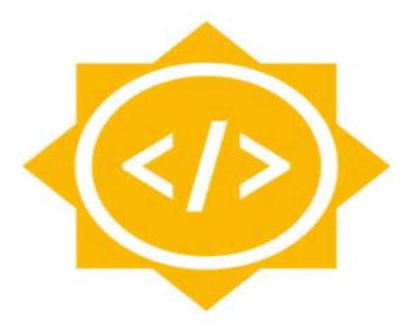
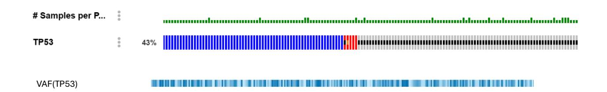
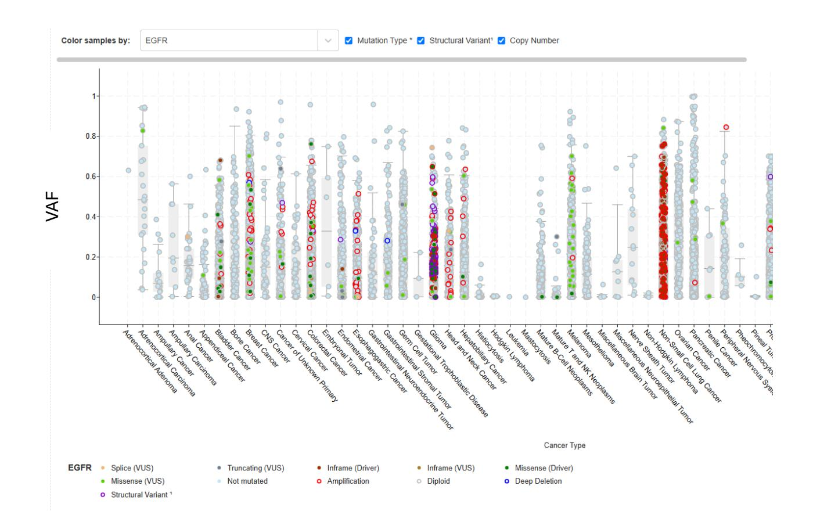

**Project: Show Variant Allele Frequency on the Plots Tab and OncoPrint**

**Name: Rishi Prasad Sulakhe**

**Mentors: Onur Sumer, Mary Chapman, Bryan Lai**

# **INDEX**

➢ [About Me](#page-2-0) ➢ [Problem Statement](#page-3-0) ➢ [Project Aim](#page-4-0) ➢ [Implementation Elicitation-Plots Tab](#page-5-0) ➢ [Implementation Elicitation-](#page-10-0) Oncoprint ➢ [Who am I?](#page-19-0) ➢ [Background for Google Summer of Code](#page-20-0) ➢ [cBioportal Experience](#page-21-0) ➢ [Open-Source Contributions](#page-22-0) ➢ [Timeline-GSoC](#page-23-0) ➢ [Availability and After GSoC](#page-26-0)

# **About Me**

| Name      | Rishi Prasad Sulakhe                           |
|-----------|------------------------------------------------|
| Email     | rishisulakhe42@gmail.com                       |
| GitHub    | rishisulakhe                                   |
| Education | Biotechnology Engineering student, National    |
|           | Institute of Technology, Prayagraj, India      |
| Project   | Show Variant Allele Frequency on the Plots Tab |

# **Project Proposal**

## **Problem Statement:**

The cBioPortal, a widely used resource for exploring cancer genomics data, effectively displays the qualitative nature of mutations (e.g., missense, truncating) within patient cohorts. However, it exhibits a significant limitation in its ability to visualize the quantitative aspect of mutations, specifically the Variant Allele Frequency (VAF), in how many reads of sequenced DNA a mutation occurs in all of the sequenced DNA at that position in the genome. While the cBioPortal allows for plotting categorical data in Plots tab (e.g., cancer type, Metastatic site) against mutation counts, it lacks the functionality to plot continuous variables like VAF. VAF is the attribute of mutation and is specific to particular gene. It is currently not possible to plot the distribution of VAF for a particular gene across varying tumor stages, different cancer types etc.

The OncoPrint tool is an essential component of cBioPortal. The OncoPrint tool displays genomic alterations across multiple samples and genes in a compact, intuitive format that allows users to quickly identify patterns and correlations in the data. However, the current implementation of OncoPrint lacks a crucial feature, such that researchers cannot visualize VAF values of each mutation simultaneously with the mutation type.

VAF helps determine whether a mutation is present in all cells (high VAF) or just a few cells (low VAF).

# **Project Aim:**

### **Extend the mutation data type to incorporate Variant Allele Frequency (VAF), facilitating the plotting of VAF as a continuous variable**

This entails expanding the cBioPortal's plotting capabilities to allow users to generate visualizations of VAF across various parameters, such as cancer type, tumor stage, or other relevant clinical or genomic variables.

This would facilitate the analysis of VAF distribution and its correlation with other factors, enabling researchers to gain deeper insights into tumor heterogeneity and evolution.

#### **Integrate VAF visualization into the OncoPrint feature:**

This involves adding a new tracks on the OncoPrint display that can represent the VAF heatmaps for each individual gene across different sample alongside the existing mutation type information. We can use a color gradient (e.g., from light to dark) to represent the VAF range, where darker colors indicate higher VAF. We want to create color gradient heatmaps, something like this for each queried gene

This would allow researchers to simultaneously observe both the qualitative (mutation type) and quantitative (VAF) aspects of mutations within a cohort.

#  **Implementation Elicitation – Plots Tab**

I have closely observed the implementation of the plots tab we have currently and designed the idea focusing on that. Different types of plots are being rendered using class component PlotsTab present in PlotsTab.tsx. We start by adding VAF as another option to enum MutationCountBy.By this, it updates the UI dropdown of Mutation data type (dataTypeToDataSourceOptions) with VAF option, ensuring it appears alongside existing options like Mutation Type, Mutated vs Wild-type, and Driver vs VUS.

In the Plots tab component, which type of plot to be rendered is determined based on the horizontal axis data and vertical axis data, and this data structural is send to different Plots components

➢ If both axes contain string data then plot type will DiscreteVsDiscrete triggers Stacked-bar, table, like plots ➢ If both axes contain numerical data the plot type will be ScatterPlot . ➢ If one axis contains numerical data and other contains string data then plot type is Box-Scatter plot.

Variant Allele frequency (VAF) is numerical value ranges from 0-1, so depending on the data type of the other axis, either a Box-Scatter Plot or a Scatter Plot can be rendered. The choice of plot determines the data structures required for plotting scatter points. To achieve this, we must calculate and process VAF within AxisDataPromises and generate dataset points accordingly for the respective scatter plots.

#### **Incorporating VAF into Axis data**

Currently we cannot receive Variant Allele frequency (VAF) data from horzAxisDataPromise (the function responsible for returning horizontal axis data) and vertAxisDataPromise. As a result, cannot be used for plotting. Further for visualization of variant Allele frequency across different attributes, we need to modify the logic responsible for generating axis data, the makeAxisDataPromise function is responsible for making axis data of all data types including mutation and the makeAxisDataPromise\_Molecular function especially responsible for making data for molecular profile data type like Mutation, Structural variant, copy number alteration but for particular gene id.

Further depending upon the data type for molecular profile such as Mutation, Structural Variant etc., various functions are called after getting cache data for particular gene based on particular data type, especially for mutation data type we load mutation data cache for particular gene id and send this data to makeAxisDataPromise\_Molecular\_MakeMutationData, this function create data based on mutationCountBy categories. We have to extend mutationCountBy to include VAF as an option. Upon

selection of this option, the

makeAxisDataPromise\_Molecular\_MakeMutationData function will filter mutations based on the chosen gene, calculate the VAF for each sample using tumorAltCount and tumorRefCount of mutation properties of each mutation and generate a data structure containing sample keys, calculated VAF values, and potential threshold information.

Variant Allele frequency (VAF) is specifically calculated for mutations particularly single nucleotide variants (SNVs) and small insertions/deletions.

#### VAF = Number of reads containing the variant

 Total number of reads at that genomic location Implementation of VAF for mutation is already present in MutationUtils.tsx file by getVariantAlleleFrequency(). It returns the VAF report containing VAF value, variantReadCount and totalReadCount. This function is also used in generating tooltip data for scatter point

export function getVariantAlleleFrequency(m: Mutation): VAFReport | null { if ( Number.isInteger(m.tumorRefCount) && Number.isInteger(m.tumorAltCount) ) { const vaf = m.tumorAltCount / (m.tumorAltCount + m.tumorRefCount); if (isNaN(vaf)) { return null; } else { return { vaf, variantReadCount: m.tumorAltCount, totalReadCount: m.tumorAltCount + m.tumorRefCount, }; } } else { return null; } }

➢ Now we have to modify the makeAxisDataPromise\_Molecular\_MakeMutationData to calculate and push variant allele frequency data also for all samples as IAxisData like other mutation attribute. ➢ The mutations parameter currently only expects Pick of certain AnnotatedMutation fields. For VAF calculation we must ensure that the data passes into this function include tumorAltCount and tumorRefCount ➢ This function should have return type of either IStringAxisData or INumberAxisData. For VAF mutation attribute it particularly returned INumberAxisData type of data

This is how plot (not exact, demo) of VAF for distinct samples across different cancer types looks like. Since in vertical axis we have numerical VAF values and in horizontal axis we have different cancer types string value, so Box-Scatter plot renders for particular gene we selected in vertical axis.

I appreciate any suggestions and ideas from the mentors on how to improve my solution, particularly in terms of optimizing the code and making execution easy.

#  **Implementation Elicitation – OncoPrint**

Integrating Variant Allele Frequency (VAF) heatmap visualization into current Result view Oncoprint tab presents several implementation considerations. Based on Oncoprint data architecture We can introduce a distinct "VAF heatmaps" track option within the main track selection interface. This will have an input box for query different genes and after validating gene it will triggers VAF heatmaps tracks below gene tracks one by one **OR** We can add a "Show VAF tracks" option to each gene's settings menu. This would display the VAF heatmaps only for the specific gene selected.

#### **UI Enhancement: Adding "VAF Tracks" in the Tracks Dropdown**

- ➢ **Tracks Menu Component** 
  - Manages track selection UI
  - Contains tabs for different track types

#### ➢ **OncoprintControls**

- Parent container for all controls, manages state through props

<MSKTabs> <MSKTab id={Tab.CLINICAL}>...</MSKTab> <MSKTab id={Tab.HEATMAP}>...</MSKTab> // Existing tabs

</MSKTabs>

We will start by adding "VAF Tracks" within the "Tracks" dropdown menu, rendered by the <TracksMenu /> component.

We will introduce a new tab labeled "VAF" within MSKTabs component in TracksMenu. This provides a dedicated space for VAF tracks controls.

Inside the new "VAF" tab we will implement the necessary UI elements

➢ We will use existing OQLTextArea component, where we can enter different genes and then it triggers gene validation alerts.

enum Tab { //other tabs 'VAF'="VAF Heatmaps" } //Addition within TracksMenu.tsx render method's MSKTabs *<MSKTab Key={'vaf\_tab'} Id={Tab.VAF'} linkText={'VAF'} > {this.vafTrackMenu} //Render the content of tab </MSKTabs>*

➢ A button ("Add VAF tracks") which becomes active when valid genes are entered. We will create a onclick handler (handleAddVAfTrackClick) that trigger the track addition process below gene tracks. ➢ The handleAddVAfTracksClick handler in TrackMenu will parse the validated genes through OQL query and invoke the onClickAddVafTracks handler which can be define in buildControlsHandler function in ResultViewOncoprint.tsx

Tracks dropdown would look similar to like this after this implementation

#### **Analysis of Patient View VAF heatmap (MutationOncoprint.tsx)**

➢ This component renders a heatmap specifically shows VAF in mutations across different samples taken from a single patient, using <Oncoprint /> component as rendering engine. ➢ The function getVariantAlleleFrequency calculates VAF report from tumor alt/ref counts ➢ makeMutationHeatmapData function is responsible for making each track oncoprint data, grouped by sample id or mutation id. It takes all mutations for patient, groups them by sample (or mutation Id if transposed), calculates VAF, assign a status (e.g. MUTATED\_WITH\_VAF, NOT\_PROFILED) and formats the data for the heatmapTracks prop. It fills the profile\_data field in its custom IMutationOncoprintTractDatum with the VAF value or null. It also handles cases where a mutation isn't found in a sample based on coverage data. ➢ In <Oncoprint /> component takes props heatmapTracks(contains tracks for mutation heatmaps) , heatmapTrackOrder (order of heatmap tracks) , columnLabels(labels for each mutation column) etc. ➢ Tooltips are generated dynamically using mutationTooltip component present in PatientViewMutationTabUtils.tsx

After analyzing how VAF heatmap are rendered in Patient View, we will use it in implementing VAF tracks in the Result view Oncoprint but for specific gene.

### **Implementing VAF tracks**

In interface IOncoprintControlsHandlers we will define another handler onClickAddVafTracks.

export interface IOncoprintControlsHandlers extends IDriverAnnotationControlsHandlers { // others handlers onClickAddVafTracks: () => void; }

On clicking "Add VAF tracks" in VAF tracks, onClickAddVafTracks will trigger, handler object passed to TrackMenu includes onClickAddVafTracks, we will handled these handlers in parent ResultViewOncoprint:

export default class ResultsViewOncoprint extends React.Component< IResultsViewOncoprintProps, {} > { public controlsHandlers: IOncoprintControlsHandlers; controlsHandlers = buildControlsHandlers(); private buildControlsHandlers() { return { //others handlers operations onClickAddVafTracks => { //get vaf\_track\_genes through OQL query //update browser URL }, } }

➢ onClickAddVafTracks function receives the list of validated gene symbols by parseOQLQuery. Also, we have to merged the newly requested genes with the existing one already present in URL parameter, then finally we update the browser URL, setting vaf\_track\_genes parameter to new comma-separated list of gene.

readonly sampleVafHeatmapTracks = makeVafHeatmapTracksMobxPromise(this, true); readonly patientVafHeatmapTracks makeVafHeatmapTracksMobxPromise(this, false); @computed get vafHeatmapTracks() { return this.oncoprintAnalysisCaseType === OncoprintAnalysisCaseType.SAMPLE ? this.sampleHeatmapTracks : this.patientHeatmapTracks; }

➢ We will create a makeVafHeatmapTracksMobxPromise in OncoprintUtils.tsx, this function surrounds the logic for awaiting dependencies (like gene data, filtered sample and patient data molecular profile data, requested VAF genes) and processing the response into the IHeatmapTrackSpec[] format ➢ The heatmapTracks prop, which expect an array of IHeatmapTrackSpec objects, concatenating the all heatmaps data sources, we also include the vafHeatmapTracks.

 <Oncoprint ref={this.oncoprintRef} heatmapTracks={([] as IHeatmapTrackSpec[]) .concat(this.genericAssayHeatmapTracks.result ) .concat(this.heatmapTracks.result)} .concat(this.vafHeatmapTracks.result)}

➢ We will create makeVafHeatmapTracksMobxPromise function in OncoprintUtils.ts which is responsible for preparing VAF data for the oncoprint tracks. ➢ makeVafHeatmapTracksMobxPromise needs to structure mutation specific VAF data. It need data structured one track per requested gene. We select the VAF corresponding to the primary alteration displayed in the main genetic track for that particular gene and sample combination, it then formats this selected VAF value for heatmap rendering ➢ We create makeVafHeatmapTracksMobxPromise such that it processes mutations for specific gene across many samples or patient in a cohort. Its output structure must be an array of IHeatmapTrackSpec where each track represents one gene and the data points within map the selected VAF to each sample.

const geneProfiles = \_.filter( \_.values(molecularProfileIdToAdditionalTracks), d => d.molecularAlterationType === AlterationTypeConstants.MUTATION\_EXTENDED );

➢ It keeps only specific gene-related molecular alteration, filters out get only molecular alteration type of MUTATION\_EXTENDED. Then we extract the necessary gene symbols mutation data for heatmap. ➢ We generate queries for fetching mutation data, mapping genes to their corresponding Entrez IDs and molecular profiles. ➢ For each mutation record, we extract VAF values using the getVariantAlleleFrequency function present in MutationUtils.tsx file.

const vafData = mutationData.map(m => ({ value: getVariantAlleleFrequency(m).vaf, uniquePatientKey: m.uniquePatientKey, uniqueSampleKey: m.uniqueSampleKey, }));

➢ At the end we return the heatmap track specifications using makeHeatmapTrackData function present in DataUtils.ts, structuring gene-wide VAF values into a visualization ready format.

return { key: `VAFHEATMAPTRACK\_\${molecularProfileId},\${gene}`, label: gene, molecularProfileId, data: makeHeatmapTrackData<IVafHeatmapTrackDatum, ('hugo\_gene\_symbol' Gene, Samples, vafData ), }

➢ The coloring of VAF track cells for the heatmap will be done by OncoprintJS library, configured by IHeatmapTrackSpec

Result View Oncoprint will look similar to this (not exact, demo) after all implementation

There can be more ways to implement this, and I appreciate any suggestions and ideas from the mentors on how to improve my solution, particularly in terms of optimizing the code and making execution easy

**VAF Heatmaps**

**VAF** 1

0

### **Who am I?**

My name is [Rishi Prasad Sulakhe,](https://linktr.ee/rishiprasadsulakhe) and I am Biotechnology Engineering (B. tech) student in National Institute of Technology, Allahabad, India. I got interest in programming since when I was in school. I got All India Rank (AIR) 7026 in JEE ADVANCED (entrance exam for engineering) from almost 14 lacs student and got admission in this college.

I started my development journey in my 1 st year of college and worked with range of technologies including HTML, CSS, JavaScript, TypeScript, Java, C++ and databases like MySQL and MongoDB. I am proficient in using React-JS and l just love how they make things simpler. In addition to my technical skills, my participation in impactful development projects showcases my ability to apply my knowledge to real-world scenarios. The combination of my academic foundation, hands-on experience, and active involvement in open-source development uniquely positions me as an ideal candidate for the proposed project. My passion for cBioportal, coupled with a proven track record of contributions, solidifies my candidacy as the best fit to undertake and successfully execute this project during the Google Summer of Code program

#### I also like to build side-projects. Some of them include

➢ [Payment-application\(](https://github.com/rishisulakhe/paytm)React-JS, Express-JS, Node-JS, MongoDB) ➢ [Chatting application like Whatsapp\(](https://github.com/rishisulakhe/chat-app)React-JS, Node-JS, Zustand, Socket-io, MongoDB) ➢ [Blogosphere](https://github.com/rishisulakhe/Blogosphere) (React-JS, Hono-JS for Cloudfare workers, npm published packages)

## Background for Google Summer of Code

- 1. Have you participated in Google Summer of Code before?
- No
- 2. Are you planning to be a Mentor for a Google Summer of Code project this year (2023) in any other organizations?
- No
- 3. Any prior experience in bioinformatics or cancer genomics
- As a Biotechnology Engineering student at the National Institute of Technology in India. I have a strong foundation in genetics and computational biology. Integrating biology with computer science is very interesting. I have explored related areas through coursework and projects. I have experience with data analysis, algorithm development and coding languages like Python, JavaScript and TypeScript. Additionally, I have contributing and understanding cBioPortal from last 5 months, I am learning it already. Learned many things from cBioportal, I know what mutations are, how gene alterations affect cancer, what are structural variants, and why every alteration does not cause cancer, and this becomes day by day interesting. I will definitely contribute more with help of cBioportal and other resources that can contribute much to this cause.

# **cBioportal Experience**

I am started contributing and understanding cBioportal from last 5 months and learned so many things about cancer genomics, bioinformatics and genomics data analysis.

cBioPortal is a powerful tool for cancer researchers and clinicians, providing a wealth of data and functionality to support research efforts. Access to large datasets, a User-friendly interface, and comprehensive data analysis tools, are so much helpful to cancer research, and contributing to that feels awesome itself!

The goal of cBioPortal is to significantly lower the barriers between complex genomic data and cancer researchers by providing rapid, intuitive, and high-quality access to molecular profiles and clinical attributes from large-scale cancer genomics projects, and therefore to empower researchers to translate these rich data sets into biologic insights and clinical applications.

I have spent time getting to know the structure of the cBioPortal repository, including the codebase, documentation, and issue tracker. This has allowed me to better understand the project and contribute more effectively to its development.

# **Open-Source Contributions**

### **cBioportal**

### ➢ Pull Requests

- 1. [Added boxplot stats as tooltip for axis label](https://github.com/cBioPortal/cbioportal-frontend/pull/5125) in plots tab (merged)
- 2. [fixes e2e tests to use CANCER\\_TYPE rather than tumor type](https://github.com/cBioPortal/cbioportal-frontend/pull/5077) (merged)
- 3. [Update legend with filtered categories in Plots tab](https://github.com/cBioPortal/cbioportal-frontend/pull/5130) (under review)
- 4. [Ordering some groups on comparison page](https://github.com/cBioPortal/cbioportal-frontend/pull/5099) (under review)
- 5. [Use of path URL for comparison subtabs](https://github.com/cBioPortal/cbioportal-frontend/pull/5147) (under review) ➢ Issues Reported
  - 1. [Genomic Alterations Tab Validation Message Obscured by](https://github.com/cBioPortal/cbioportal/issues/11484)  [Alteration Type Selector](https://github.com/cBioPortal/cbioportal/issues/11484)

#### **Other Contributions**

- 1. Add Heat Map [of Codeforces](https://github.com/dwargosama/CodeHub/pull/43) in Dashboard of Codehub (merged, Coding platform)
- 2. [Added documentation for missing providers in keephq](https://github.com/keephq/keep/pull/2167) (merged, Keephq-AlOps)
- 3. [Added Water Sound Alerts](https://github.com/zendalona/world-map-explorer-v2/pull/10) (under review, Zendalona)

# **Schedule of Deliverables [\(timeline\)](https://developers.google.com/open-source/gsoc/timeline)**

This is a rough estimate of the things I am planning to do. I want to make it more detailed in my Community Bonding Period, by discussing it with my project mentors*.*

#### **May 8-June 1 (Community Bonding Period)**

- Research and understand the required code for the implementation.
- Familiarizing myself with the data passing in Plots tab and oncoprint code and making a blueprint. This is important as the whole procedure needs to be set up first.
- Set up the necessary development environment and tools
- Explore potential challenges and discuss strategies with mentors.
- Address any outstanding questions or concerns through community discussions.

| Period Duration | Activity                               |                          |
|-----------------|----------------------------------------|--------------------------|
| June 2 –        |                                        |                          |
| 1 week          | Research and discussion of my approach |                          |
|                 | with the mentors                       | for implementing VAF in  |
| 2 weeks         | Start working on                       | VAF feature in plots tab |
|                 | Design and upgrade axis menu           | selection for            |

| June 25           | –  |         |                                                               |
|-------------------|----|---------|---------------------------------------------------------------|
| July 1            |    |         |                                                               |
|                   |    | 1 week  | Implementing and organizing VAF data                          |
|                   |    |         | particularly for Mutation data type, focusing functionalities |
| July 2 July 9     |    | 1 week  | Implementing and organizing VAF data                          |
|                   |    |         | scatter plot. Also work on scatter point                      |
| July 10 - July 17 |    | 1 week  | Mid-term Evaluation time– Final testing for arise.            |
| July 18           |    |         |                                                               |
| August            | 2  |         |                                                               |
|                   |    | 2 weeks | Start working on VAF tracks for various genes                 |
|                   |    |         | UI Enhancements: “VAF Tracks” in Track menu                   |
| August            | 3  |         |                                                               |
| August 10         |    | 1 week  | Implementing control handlers for VAF heatmap tracks          |
| August            | 10 |         |                                                               |
| – August 17       |    | 1 week  | Organizing data structure for VAF heatmap tracks              |

|                         | properly                                                                      |
|-------------------------|-------------------------------------------------------------------------------|
| 1 week August 18 August | Start working on implementing a tooltip.                                      |
|                         | improve Oncoprint VAF tracks on the advice of the mentor                      |
| 1 week August 25        | Final Evaluation                                                              |
| Sep 1                   | Final testing for both Plots tabs and Oncoprint. different genes. repository. |

The timeline may need to be adjusted based on the actual work required and any unexpected issues that arise or if the mentor asks to do so.

## **Availability**

I will be available until the end of August and since it is large project of 350 hours, I can easily devote 40 hours per week to the project during that time. Starting in August, I will have regular college classes, but my exams won't be starting till December. Therefore, there will be no pressure or conflicts that would prevent me from efficiently participating in Google Summer of Code.

# **After GSOC**

Being an open-source enthusiast, completion of GSoC is not going to stop me from contributing code to open source for the greater cause. In the span of three months, I will get to know the more about cBioportal-frontend project inside out and I would love to collaborate with others developers in ideating, and bringing new features in cBioportal. I would also love to guide newcomers in this field who might stumble upon this project to help them ease their journey of open source. My professional goal is to develop expertise in Bioinformatics and ultimately contribute to a pioneering research institution or platform, similar to cBioPortal, that facilitates advancements in cancer research through accessible genomic data

# *Thank You for reading my project proposal* **THE END**