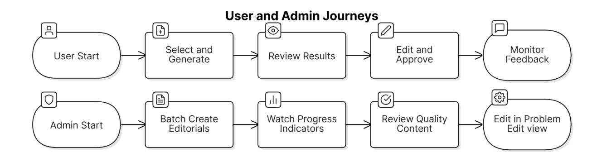
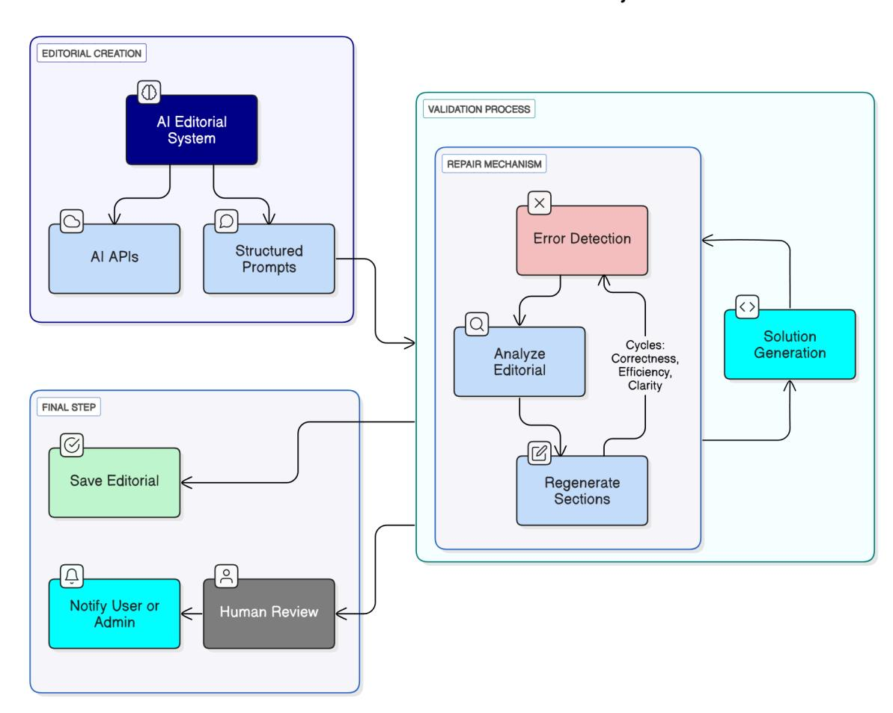
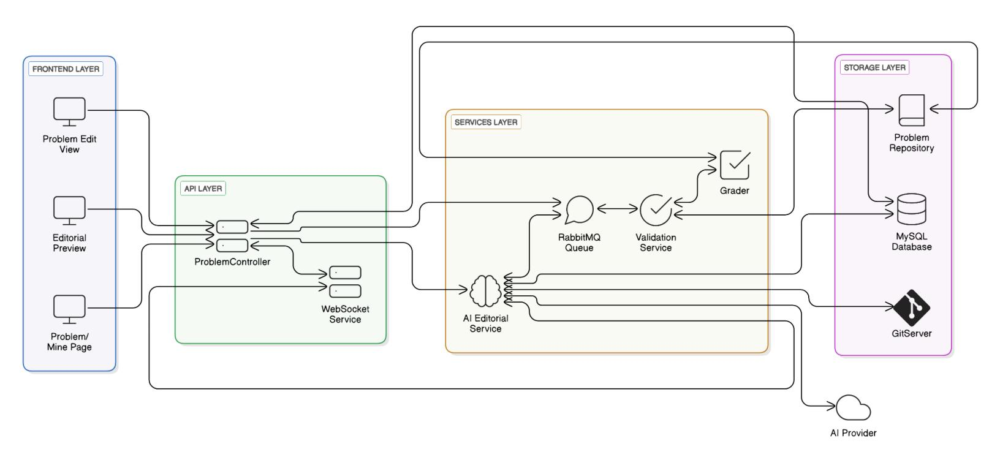
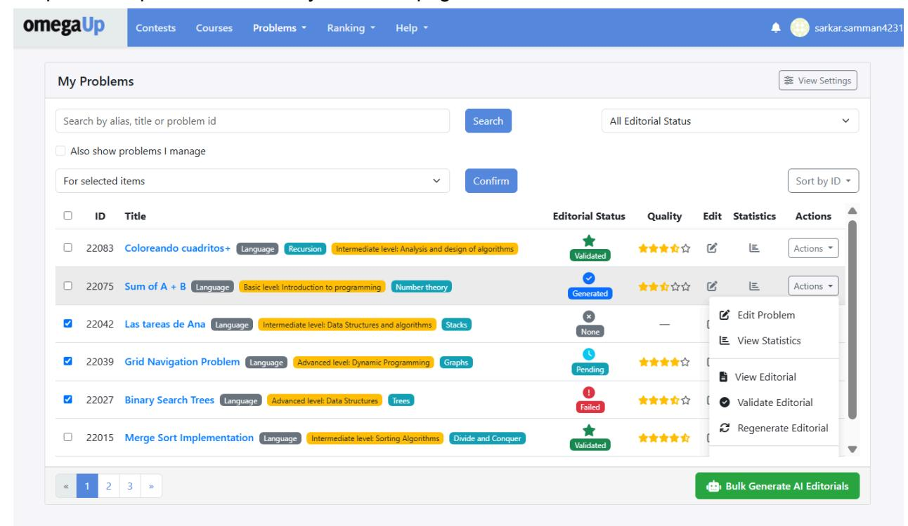

# Generate Problem Editorials Using AI

### **Samman Sarkar**

*<sarkar.samman4231@gmail.com>*

*<https://github.com/SammanSarkar>*

*< sarkar.samman4231>* (will be used to verify that you completed [phase](https://github.com/omegaup/omegaup/wiki/Google-Summer-of-Code-2023/#application-process) one)

# Technical skills

I'm currently in my final year pursuing a Bachelor's degree in Computer Science Engineering at Netaji Subhas University of Technology.

I'm passionate about teaching and coding initiatives. Last year, I was a Teaching Assistant at an education startup([Senior\)](https://drive.google.com/file/d/1dEvMgd8VrIoijYFA-8SE2VzZlQqhDzVC/view?usp=sharing), teaching DSA and CP(Competitive Programming) to students, where I also made a YouTube course that reached thousands of viewers. I co-founded a CP club at my university, organizing contests and guiding peers into CP. I was also part of Google DSC and CodeChef clubs to help new students start competitive coding.

I have a strong background in competitive programming and am an expert on [Codeforces](https://codeforces.com/profile/gam_bit) and 5-star rated on [CodeChef](https://www.codechef.com/users/gam_bit1). My passion for CP and teaching aligns with omegaUp's focus on coding education.

This is my first GSoC project, but I've contributed to open source before, successfully completing Hacktoberfest 2022 and making contributions to other open source projects as well.

I've worked with generative AI, LLMs and AI agents before as a Software Engineer Intern at [Microsoft](https://drive.google.com/file/d/1ffD0POdJ1m22iBLF_E7ZSZ28LazGrU3C/view?usp=sharing) last summer. I built a project using Azure OpenAI services and Azure AI Studio to create an infrastructure for automated unit testing, to help boost code coverage. It involved prompt engineering and embedding AI into developer workflows, which gave me practical, transferable experience that I believe is highly valuable here. The internship earned me a full-time offer at Microsoft after graduation.

My skills include C++, Java, C#, MongoDB, Express.js, React, Node.js, JavaScript, PHP, MySQL, generative AI (agents and LLM prompt engineering), Python, Vue.js, and TypeScript. I've completed several projects in these areas, plus additional work in machine learning and fine-tuning LLMs and BERT models.

## **Link to omegaUp merged PRs:** (at least one is [required\)](https://github.com/omegaup/omegaup/wiki/Google-Summer-of-Code-2022/#application-process)

<https://github.com/omegaup/omegaup/pull/8126>

<https://github.com/omegaup/omegaup/pull/8095>

<https://github.com/omegaup/omegaup/pull/8082>

<https://github.com/omegaup/omegaup/pull/8077>

<https://github.com/omegaup/omegaup/pull/8076>

<https://github.com/omegaup/omegaup/pull/8062>

An updated list of merged PRs will be available [here](https://github.com/omegaup/omegaup/pulls?q=is%3Apr+sort%3Aupdated-desc+is%3Amerged+author%3ASammanSarkar). I have several open PRs with some of them approved and ready to be merged and also working actively on a heatmap feature for user profile. I intend to keep contributing actively to the project.

# Education

- Netaji Subhas University of Technology
- Bachelor's in Computer Science
- August 2021
- July 2025

# Motivation

omegaUp's problem library is a powerful learning tool, but many problems lack editorials. This gap frustrates learners who need guidance post-attempt, weakening the platform's educational impact.

The current editorial system relies on manual creation by problem authors, with editorials stored as Markdown files in the problem's Git repository under the `solutions/` directory and

accessed through the `ProblemArtifacts` class. This approach, while maintaining quality control, results in inconsistent coverage due to the time investment required from authors.

Generative AI give us a chance to fill this content gap by automating editorial creation while keeping quality high with technical validation.

# Detailed project description

## **Main Plan**

My plan is to develop an AI-powered system that automatically creates and checks problem editorials across omegaUp. The system will generate high-quality explanations, test them by creating solutions from the editorial content, and fix any issues found during testing.

I'll upgrade the existing My Problems dashboard so administrators can trigger editorial generation for multiple/all problems at once without needing input from the original authors. This will help fill in editorials for thousands of existing problems while making editorial creation a part of the normal workflow for new problems.

## **Key Objectives:**

- Get more problems covered with editorials across the platform(70%-80% coverage).
- Enable administrators to trigger bulk editorial generation directly from the existing admin problem list interface for selected or all problems without requiring author involvement
- Cut down on the work problem creators and admins have to do manually.

## **Extended features :**

## Use AI to assign initial Quality and Difficulty

The AI Editorial System can be further extended to automatically assign problem quality and difficulty by analyzing problem characteristics, solution complexity, and test case coverage. By fine-tuning the AI model on problems with established ratings or using other supervised learning techniques, the system can generate initial quality and difficulty scores for newly created problems, providing immediate classification rather than leaving these fields blank. This initial AI assessment serves as a starting point that can later be refined through the existing user voting mechanism.

## Editorial User Feedback mechanism

The editorial page could also have a helpfulness/clarity rating mechanism where users can rate the editorial. Low rated editorials get automatically flagged for human review and AI regeneration. This rating will be visible in the My Problems page for each problem for authors/admins.

In omegaUp's current implementation, editorials exist as Markdown files in the solutions/ directory of each problem's storage structure. Problem authors create editorials through the problem edit interface, where content is submitted via the ProblemController to the ProblemDeployer. The frontend renders these using Vue.js components with Markdown parsing. Editorials are fetched via the getProblemSolution() method from ProblemArtifacts, which retrieves content based on specific version identifiers.

This proposal is based on the current setup, not if the Problem Creator gets integrated with Create/Edit Problem Workflows, but it can be modified to support that.

## **User Workflows**

Problem Author Experience(while writing new problem):

- Initiate Generation: Toggle "Generate AI Editorial" when creating/editing problems(in Problem Creator)
- Review Content: View generated editorial with validation results and solution correctness.
- Refine Editorial(not necessary in most cases): Edit directly, request regeneration, or approve for immediate publication.
- Monitor Feedback: Track user ratings and receive alerts for low-rated editorials in My Problems page.

Administrator Experience:

- Bulk Management: Generate editorials in batch for selected or all problems from the admin problem list view without requiring author input.
- Track Progress: Monitor real-time generation status.
- Quality Control(not necessary in most cases): Review and approve multiple editorials. Edit existing editorial or regenerate with custom parameters in Problem Edit view.

## **Phases**

I would like to divide the project into 2 parts:

### **Phase 1: Core Editorial Generation System**

This phase builds an AI Editorial Service microservice with a provider abstraction layer. I'll add database schema extensions for tracking editorials and validation, tweak GitServer for AI content, and connect it to the Grader for solution checks. Controller extensions will handle the editorial API, and enhance the existing problem/mine page with editorial status indicators and generation options, starting with admin-only access.

### **Phase 2: User Experience and Advanced Features**

Next, I'll add AI editorial options to the Problem Edit view, enhance the problem/mine interface for bulk processing and review, and set up a preview and approval process for authors. I'll implement real-time status updates via WebSockets, quality metrics, validation reports, editorial feedback mechanisms, and AI-driven quality and difficulty assignments based on early results.

## **AI Services and Integration**

## **System Overview**

The AI Editorial System consists of three integrated components working together:

- **AI Editorial Creation Service**: Generates high-quality problem editorials using structured prompts and multiple AI model options.
- **Agentic Validation System**: Tests editorial quality by generating and executing solution code against the OmegaUp grader. With this approach, we won't need manual intervention, at least in the batch generation use case.
- **Editorial Repair Mechanism**: Automatically improves editorials through targeted fixes based on validation results.

## **AI Editorial Creation**

The system will implement a multi-model approach using a primary AI service with fallback options. I'll be using Python for the AI Editorial Service.

## **Prompt Engineering & Data Flow**

Editorial generation requires collecting problem data through omegaUp's public API endpoints:

- **Problem Statement & Constraints**:
  - Problem description: Fetched via /api/problem/details/ → problem.statement.markdown
  - Constraints: Extracted from problem.settings.limits JSON object containing TimeLimit, MemoryLimit values
  - I/O specifications: Parsed from formatted sections in the markdown statement
- **Test Cases & Examples**:
  - Sample cases: Accessed through problem.statement.examples[] array in the details response
  - Public test cases: Retrieved from the problem settings via problem.settings.cases which contains the sample input/output pairs
- **Reference Solutions**:
  - Official solution: /api/problem/solution/{problem\_alias} returns markdown editorial if available
  - User solutions: /api/problem/runs/ with parameters problem\_alias, verdict=AC, order\_by=runtime, rowcount=2
  - Source code: /api/run/source/ with required parameter run\_alias (the GUID of the run)
- **Problem Metadata & Context**:
  - Topic tags: /api/problem/tags/{problem\_alias} returns array of relevant algorithmic categories
  - Difficulty: problem.difficulty numeric value (0-4) used to calibrate explanation depth

- Quality: problem.quality\_seal and problem.quality may be used if proven useful(unlikely)
- **AI Service Integration**: Using the collected data to construct a chain-of-thought structured prompt that will be sent to the selected AI service through their respective APIs, with proper authentication and error handling.

The prompt will have distinct sections: context injection (problem statement, constraints, examples), content structure requirements (approach, algorithm, implementation, complexity), and format specification (Markdown with code blocks, mathematical notation). The output will have a clear explanation of the algorithmic approach, a step-by-step walkthrough with examples, and a time and space complexity analysis.

The system uses chat completion APIs with structured prompts that follow a chain of thought reasoning approach. This would be the initial prompt:

"SYSTEM: You are an educational AI assistant creating competitive programming editorials… USER: Generate an editorial for this problem: [Problem Statement from Git repository] [Constraints from settings.json] [Examples from test cases] The editorial should include: - Problem analysis - Solution approach - Implementation details - Complexity analysis"

## **Agentic Validation System**

The validation system:

- Extracts algorithmic approaches from the generated editorial
- Translates these into executable code using language-specific templates
- Submits solutions to the OmegaUp Grader via existing submission APIs
- Analyzes results through the Runs table and grader response

The validation system tests the correctness of the produced editorial. The latest AI models have shown significant proficiency in competitive programming tasks. Given that the current problem set contains a limited number of hard questions, with most being of easy to medium difficulty,

the validation success rate on the first attempt is expected to be high.The ones that will fail will go to the Repair mechanism.

## **Editorial Repair Mechanism**

When validation fails, the repair system:

- Analyzes error types (compilation, runtime, logical) from the Grader
- Identifies problematic sections in the editorial using error patterns
- Issues targeted regeneration requests to fix specific sections
- Tracks editorial versions in the ai\_editorial\_versions table to monitor improvement

If multiple repair attempts fail, the system flags the editorial for human review via the admin interface.

I have previous experience working and building agents with all of the below mentioned AI services.

AI services available to use in the AI agent -

| Category Open AI Azure |                |
|------------------------|----------------|
| Open Ai                |                |
| AI/ML API Google       | Cloud          |
| o1-pro, o3-mini,       |                |
| All Open AI            |                |
| All Models             |                |
| Deepseek R1            |                |
| Gemini                 | 2.0            |
| Flash                  | and            |
|                        | Claude 3.7     |
|                        | Sonnet, Claude |
|                        | 3.5 Sonnet     |

All of these services provide finetuning capabilities for many of their models. Cost is based on input and output tokens and additional finetuning costs. For our use cases of editorial generation finetuning is not needed.

## Backend

## **AI Editorial Service Microservice**

I'll create a new microservice called AIEditorialService to handle editorial generation and validation. It will include these components:

- Editorial generation worker tied to RabbitMQ for asynchronous processing.
- AI provider abstraction layer supporting multiple APIs like Azure OpenAI and Anthropic Claude(one main and one fallback).
- Validation system using Grader to test solutions from editorials.

- API client for fetching problem data through omegaUp endpoints
- Job tracking system that interfaces with the new database tables and interacts indirectly with ProblemArtifacts class through API calls

## **Grader System Integration**

To validate AI-generated editorial solutions, I'll:

- Submit code to Grader via API with source\_type="ai\_validation" flag
- Set up priority rules to balance validation runs with user submissions
- Store validation metrics in the new ai\_solution\_validations table
- Get results using /api/run/details/ endpoint

## **GitServer Extension**

Next, I'll extend the GitServer to store and manage AI-generated editorials. This involves:

- Store AI solutions as {language}.ai.markdown files in existing solutions/ directory to differentiate from author solutions ({language}.markdown)
- Use /api/problem/updateSolution/ endpoint to save AI content with special flag to mark as AI-generated
- Track generation status in database with problem\_id and editorial status flags
- Access existing solutions through /api/problem/solution/ endpoint when needed

## **API Controller Extensions**

I'll add new endpoints to the existing ProblemController:

- apiCreateEditorial(\$problem\_alias): Starts a new AI editorial generation job and queues it via RabbitMQ, returning a job\_id.
- apiEditorialDetails(\$job\_id): Retrieves current status, validation results, and generated content for a specific job.
- Extend existing /api/problem/myList/ and /api/problem/adminList/ responses to include editorial generation status.
- For real-time updates, I'll use the existing EventsSocket infrastructure in frontend/www/js/omegaup/arena/events\_socket.ts, which already supports WebSocket connections and message handling for various system events.

## **Problem/Mine Page Integration**

I'll integrate AI editorial functionality into the existing problem/mine page by:

- Add editorial status (none/pending/generated/validated/failed) to problem lists.
- Extend bulk actions in problem/mine.ts to support "Generate Editorials" for multiple selected problems

- Create a simple modal dialog for editorial preview with approve/reject/regenerate options
- Add a toggle in the solution view to switch between author and AI editorials when both exist
- Implement a basic rating system for users to provide feedback on editorial quality

AI Editorial System Architecture

## Frontend

## **Database Schema Extensions**

- **New table ai\_editorial\_jobs:**
  - Columns: job\_id(PK), problem\_id(FK), status, created\_at, updated\_at, provider, options(JSON), error\_message
  - Indexes: problem\_id, status, created\_at
- **New table ai\_editorial\_versions:**
  - Columns: version\_id(PK), job\_id(FK), content\_markdown, language, generation\_timestamp, validation\_status, validation\_score, review\_status, reviewer\_id(FK)
  - Indexes: job\_id, validation\_status, review\_status
- **New table ai\_solution\_validations:**
  - Columns: validation\_id(PK), version\_id(FK), language, source\_code, cases\_passed, total\_cases, verdict, run\_id(FK)
  - Indexes: version\_id, verdict

## **Server-Side Controller Extensions**

I'll create a dedicated AIEditorialController with all editorial-related functions grouped together:

- generateEditorial(): Starts editorial generation for a specific problem
- getEditorialStatus(): Shows the current generation status
- reviewEditorial(): Handles approval or rejection of editorials
- listProblems(): Lists problems and their editorial status with filtering options
- bulkGenerate(): Starts batch editorial generation for multiple problems
- getBulkStatus(): Tracks progress of bulk jobs

## **Integration with Existing omegaUp Services**

I'll tie this into omegaUp's existing setup using RabbitMQ for async job management, existing GitServer auth, and the current controller design patterns.

## User experience

## **Problem Creation Enhancements**

- Add a "Generate AI Editorial" in Solution section with a toggle switch and a language selection dropdown for targeted generation.
- Include basic status indicators to show generation progress(queued/in-progress/ complete/failed)
- Implement editorial preview with options to approve, edit, or regenerate content

Simple mockup of the feature on the problem creator page

## **Enhanced My Problems Page for Editorial Management**

Extend the existing "My Problems" dashboard with AI editorial management capabilities:

- Author view: Show editorial status for their problems (none/pending/generated/ validated/failed)
- Admin view: Show overall editorial coverage, status and statistics across all problems
- Filtering: Allow quick filtering for problems missing editorials or with failed generations
- Bulk actions: Enable admin to select multiple problems and trigger editorial generation
- Toggle view: Add a simple switch to view author vs AI editorials when both are available

## **Editorial Review Interface**

Add preview panel, approve/reject/edit controls, validation results, regeneration options, and quality feedback to Problem Edit view.

Simple mockup of the admin's My Problems page

## **Frontend Implementation Details**

Use Vue.js components for all interactive elements and a WebSocket connection for real-time status updates. Implement responsive design supporting both mobile and desktop interfaces, with full accessibility compliance

# Alternatives considered

No need for model fine-tuning here - standard prompting works fine for programming editorials. Maybe try fine-tuning later for quality/difficulty scoring if needed.

RabbitMQ is already in codebase and works well for our async needs. Could use Redis Pub/Sub for real-time events as alternative. If we're only generating editorials occasionally, a simple DB queue table might be enough.

Using PHP for the AI Editorial Service instead of python would allow direct use of controller methods like Problem::getProblemStatement() and database access via DAO\Problems, without API calls. But PHP's AI libraries are weak compared to Python's ecosystem. Would need to build lots of custom code for prompts, tokens and response handling - harder to maintain long-term.

# Security impact

The AI editorial system introduces minimal security risks as editorials remain accessible only after problem completion, maintaining competitive integrity. The system collects problem solutions for AI training, but implements strong access controls to prevent exposure of privileged content.

AI provider credentials protection can be taken care of by:

- Storing API keys in secure environment variables
- Implementing key rotation policy
- No credentials exposed to client-side code

# Deployment plan

Need to deploy:

- New AIEditorialController and 3 database tables (jobs, versions, validations)
- Python microservice with AI API keys and RabbitMQ connection
- UI changes to My Problems dashboard

RabbitMQ handles async processing while GitServer stores editorials. Adding REST endpoints, Grader integration for validation, and status update mechanisms. Changes to both frontend and backend - needs careful deployment outside the normal weekly schedule.

# Testing plan

- Frontend: Cypress tests for editorial UI and creation flow
- Backend: PHPUnit tests for API endpoints and RabbitMQ
- Python Service: Unit tests for AI service, prompt handling, and response processing
- Manual: Problem authors review editorial quality

# Schedule

| Period Milestone                    |                     | Task                                               |
|-------------------------------------|---------------------|----------------------------------------------------|
| Weeks 1-2 Core Infrastructure Ready |                     |                                                    |
| Database                            | schema              | & AI service setup                                 |
| Editorial                           | generation          | core service                                       |
| Initial                             | testing             | framework                                          |
| Deliverable:                        | Working             | prototype generating a sample editorial            |
| Weeks 3-4                           |                     |                                                    |
| Backend Services                    |                     |                                                    |
| API                                 | development         | & RabbitMQ setup                                   |
| WebSocket                           | real-time           | updates                                            |
| Service                             | integration         | testing                                            |
| Deliverable:                        | Backend             | demo showing real-time editorial status            |
| Weeks 5-6 Admin System Working      |                     |                                                    |
| Dashboard                           | &                   | review workflow                                    |
| Quality                             | metrics             | system                                             |
| Component                           | &                   | workflow testing                                   |
| Deliverable:                        | Admin               | interface with bulk generation and metrics display |
| Phase 1 Evaluation — —              |                     |                                                    |
| Weeks 7-8 User Features Complete    |                     |                                                    |
| Problem                             | creation            | flow                                               |
| Editorial                           | preview             | system                                             |
| User                                | acceptance          | testing                                            |
| Deliverable:                        | Author              | workflow demo with preview and approval features   |
| Weeks 9-10 System Optimized         |                     |                                                    |
| Performance                         |                     | improvements                                       |
| Bug                                 | fixes & refinements |                                                    |
| Integration                         | testing             |                                                    |
| Deliverable:                        | Optimized           | system with validated performance improvements     |
| Weeks 11-12 Production Ready        |                     |                                                    |
| Documentation                       |                     | completion                                         |
| Deployment                          |                     | preparation                                        |
| Final                               | testing             | suite                                              |
| Deliverable:                        | Deployment-ready    | package with full docs and test results            |

This timeline is provisional and may be adjusted based on mentors' feedback and ongoing progress. I have no other commitments during the GSoC period, ensuring full availability.