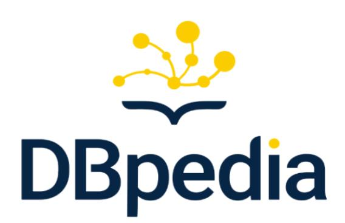
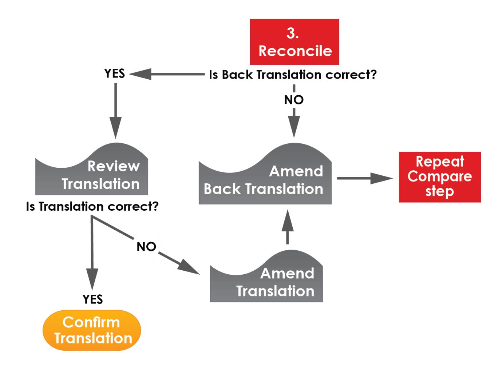
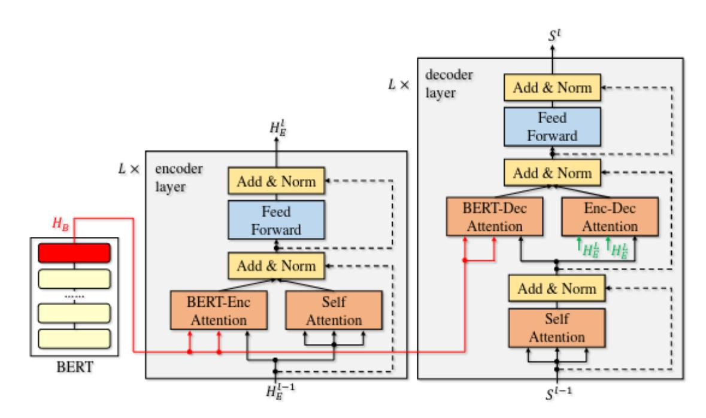
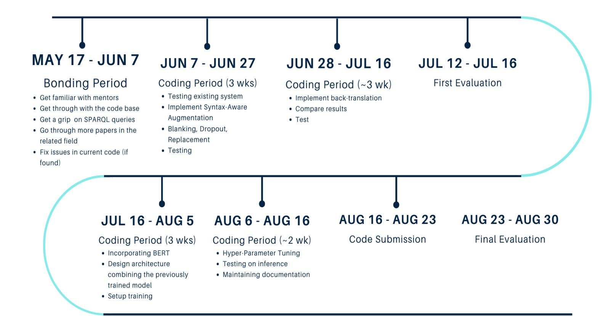

# **PERSONAL DETAILS**

- Hello I am **Siddhant Jain**, currently a **pre-final** year student pursuing my Bachelors' degree in **Electronics and Telecommunication**.
- Currently I am placed in **Nashik, Maharashtra, India (GMT+5:30)**
- GitHub :
- Resume :
- LinkedIn :
- Twitter :
- Email id :
- Contact :

# **ABSTRACT**

With a booming amount of information being continuously added to the internet, organising the facts becomes a very difficult task. Currently DBpedia hosts billions of such data points and corresponding relations in the RDF format.

Accessing such data requires the user to be well versed with writing SPARQL queries. So in order to help/assist a huge number of lay users access the humongous linked data in their natural language (currently restricted only to English), by building Neural SPARQL Machines as End-to-End Question-Answering systems.

The primary project objective is to be able to translate from natural language to SPARQL query.

# **TECHNICAL DETAILS**

The project broadly expects two main outcomes :

#### **1. How can we automatically build the right question from the property label only?**

- example a) from <s> dbo:birthPlace <o> infer where was <s> born?
- example b) from <s> dbo:timeZone <o> infer what time zone is <s> in?

### **2. How can we automatically build question-query templates that feature one or more of the following?**

- subordinate clauses or genitive: which / that / of / 's
- con-/disjunctions: and / or / as well as
- modifiers: which + mod / what + mod / demonyms
- comparative: more than /-er than
- superlative: most … /-est
- numeric / quantitative: how many / long / tall

#### **Template Generator + NSpM :**

We have a decent template generator as of now with two distinct approaches, thanks to the efforts of precedent contributors. Anand (GSoC '19) approached the problem with a rule-based technique and Zheyuan (GSoC '20) with Transformers. I feel I too will exploit the problem of **Template Generation** with neural networks. Additionally improving the existing **Translation model** also will be a priority. SO, Instead of looking at them as two different problems, I hereby propose an end-to-end solution.

#### **1. Augmenting existing Data:**

Data Augmentation has been helpful in Deep Learning to boost accuracy and has been widely used in CV ,NLP and other areas. Data augmentation creates additional data by producing variations of existing data through transformations such as mirroring, randomin CV. In NLP tasks like neural machine translation (NMT), data augmentation is used to improve the performance by generating additional training samples or enhance the model robustness by adding explicit noise. I intend to try two different techniques:

- Word Level
- Sentence Level

#### **Word Level :**

Basic word level augmentation techniques include:

- A. **Dropout**-Words in sentence will be randomly dropped by simply setting the respective word embedding as zero vector
- B. **Blanking**-Words in sentence will be randomly replaced with a special placeholder token <BLANK>
- C. **Replacement**-Words in sentence will be randomly selected and replaced with one word which has a similar unigram word frequency over the dataset.

These are simple, efficient and definitely a good starting point. But randomly sampling spaces/dropping might not be appropriate in some cases. Straightforward word selection in existing methods takes a completely sentence-independent (i.e., context-free) strategy for every word in every sentence, which is not efficient enough. Thus using syntactic clues to guide such a word selection, which will result in a sentence-specific (context-dependent) strategy : **Syntax Aware Augmentation** (source : ref 6) which revolves around the idea of dependency parsing and probability of selection of word.

Incorporating this technique for the source language (NL questions) should definitely increase the robustness of the model by making way for the compositional and complex questions which are more likely to be encountered during real time inference.

Image : Comparing Blanking (source : Ref 6)

Image : BLEU scores on Transformer model (source : Ref 6)

#### **Sentence Level** :

To perform unsupervised or semi-supervised NMT training with only monolingual data, **Back-Translation** (Ref : 5), which is one kind of data augmentation method at sentence level, has been widely used to generate bilingual data.

We focus on back-translation (BT) which operates in a semi-supervised setup where both bilingual and monolingual data in the target language are available. Back-translation first trains an intermediate system on the parallel data which is used to translate the target monolingual data into the source language. The result is a parallel corpus where the source side is synthetic machine translation output while the target is genuine text written by humans. The synthetic parallel corpus is then simply added to the real bitext in order to train a final system that will translate from the source to the target language.

#### Image : Back-Translation algorithm

Back-translation is not a simple method which requires a full NMT system to translate the target sentence into source. Collecting and cleaning huge amounts of monolingual data also require substantial efforts. Some sentences generated by back-translation are not native and can be harmful for training , especially for low-resource languages. However, the currently intended datasets (DBNQA & LC-QuAD 2.0) to be used, have a fairly large corpus altogether thus should be sufficient. The approach suggests ⅓ original+ ⅔ synthetic data for training but experimenting a little with fractions won't hurt. Back-Translation is one of the best approaches to sentence level augmentation and feels promising.

#### **2. Improving the NSpM :**

A good starting point would be to try to improve the Attention of the existing model. The existing seq2seq+Attention model works well, but is definitely far from perfect (current state-of-the-arts) and thus has a lot of scope in improvement.

- Word Embedding : Embedding like GloVe,BPE have already been tried by Zheyuan (GSoC '20). We plan to move a step further by using contextualized word embeddings from BERT
- Incorporating BERT

Now after giving out two different concepts let's combine them,

- 1. Design a multi-head attention model
  - It is already known that transformers and CNNs overperform the current architecture in NL to SPARQL translation (Ref : 12), thus experimenting with an architecture similar to mentioned would be appropriate.
- 2. Incorporate augmentation techniques to improve the existing dataset while training the above mentioned model from scratch.
- 3. Incorporate BERT into the previously trained model(from step 2)
- 4. Evaluate

Image : BERT-fused model (source : Ref 7)

Metrics for Evaluation as of now would stick with **BLEU** and **F1** scores, but might use other metrics and/or custom equations if required.

I personally feel DBpedia is a great knowledge base and should be exploited to the fullest in order to incorporate best user experience for Question Answering. Also the DBNQA dataset with 894,499 pairs (source : Ref 3.) along with LC-QuAD 2.0 should be sufficient for the proposed ideas to be implemented. I intended to shuffle the composition of these two sets to form the train/test/val split.

I would like to touch upon the concept of "Compositionality" mentioned by Zheyuan (GSoC'20) to use the existing datasets to their fullest thus making the model perform well on the compositional set(for testing).

References :

- 1. SPARQL as a Foreign [Language](https://arxiv.org/html/1708.07624)
- 2. Neural Machine Translation for Query [Construction](https://arxiv.org/pdf/1806.10478.pdf) and Composition
- 3. [Generating](https://www.researchgate.net/publication/324482598_Generating_a_Large_Dataset_for_Neural_Question_Answering_over_the_DBpedia_Knowledge_Base) a Large Dataset for Neural Question Answering over the DBpedia [Knowledge](https://www.researchgate.net/publication/324482598_Generating_a_Large_Dataset_for_Neural_Question_Answering_over_the_DBpedia_Knowledge_Base) Base
- 4. The Neural SPARQL Machine [Telegram](https://www.researchgate.net/publication/334561410_The_Neural_SPARQL_Machine_Telegram_Chatbot) Chatbot
- 5. Understanding [Back-Translation](https://arxiv.org/pdf/1808.09381v2.pdf) at Scale
- 6. Syntax-aware Data [Augmentation](https://arxiv.org/pdf/2004.14200.pdf) for Neural Machine Translation
- 7. [Incorporating](https://arxiv.org/pdf/2002.06823v1.pdf) BERT Into Neural Machine Translation
- 8. [Semi-Supervised](https://arxiv.org/pdf/1606.04596.pdf) Learning for Neural Machine Translation
- 9. Adversarial Learning for Supervised and [Semi-supervised](https://arxiv.org/pdf/2005.04277.pdf) Relation Extraction in [Biomedical](https://arxiv.org/pdf/2005.04277.pdf) Literature
- 10. [Bidirectional](https://www.aclweb.org/anthology/K18-1019.pdf) Generative Adversarial Networks for Neural Machine Translation
- 11. Improving Neural Machine Translation with [Conditional](https://arxiv.org/pdf/1703.04887.pdf) Sequence Generative [Adversarial](https://arxiv.org/pdf/1703.04887.pdf) Nets
- 12. Neural Machine [Translation](https://arxiv.org/pdf/1906.09302.pdf) from Natural Language to SPARQL

# **TIMELINE**

# **TECH STACK PROPOSED**

These are very tentative options (will definitely go as per requirements ):

- **Programming Language** : Python PEP-8
- **NLP Library** : SpaCy/Hugging Face
- **Framework** : TensorFlow/PyTorch
- **NoteBook** : Google Colab
- **Working Environment** : Ubuntu 20.04 LTS

# **HOW IS IT GOING TO BENEFIT THE ORGANISATION?**

DBpedia is a crowd-sourced community effort to extract structured content from the information created in various Wikimedia projects. This structured information resembles an open knowledge graph (OKG) which is available for everyone on the Web. DBpedia data is served as Linked Data, which is revolutionizing the way applications interact with the Web. One can navigate this Web of facts with standard Web browsers, automated crawlers or pose complex queries with SQL-like query languages (e.g. SPARQL). Here is where our project gets a chance to shine, users not versed with writing SPARQL queries get to access this vast knowledge graph via Natural Language.

A major breakthrough occurs in the NLP community after Google Open-Sourced it's BERT model which surpassed all other previous models. I'm pretty sure BERT embedding incorporated with the model will not disappoint us.

My overall goal is to accelerate the Neural QA model that it reaches from development to deployment mode. I'm pretty much determined to be an integral part of the project's development.

# **WHY AM I SUITABLE FOR THE PROJECT?**

I've already aligned myself with the vision with which the Neural QA model project was created and it's future scope.

Being a python developer and a Machine learning enthusiast I've gained experience over the past year reading papers and implementing them. I have the required skill set needed for the project and I'm looking forward to making myself equipped with few more while working with the experienced mentors during the GSoC period. Being a curious learner I believe in the practical implementation of concepts rather than just having theoretical knowledge.

I will be working with the community while sharing some problem-solving skills and the unorthodox approach to solve some real issues that brings some value to the DBPedia Organization.

# **PERSONAL INSPIRATION**

Google Summer of Code will give me the opportunity to work on the industry-level implementation of various Augmentation algorithms and Machine Translation approaches. I have been following this topic since a considerable amount of time, and first came to know about it from Zheyuan (via LinkedIn), which inspired me to read more about it.

Honestly speaking, **Neural QA Model** gives me the opportunity to work in the domain ranging from NLP to some extensive machine learning/deep learning concepts. Working on a collaborative project taught me the importance of time management as well as perfect deliverables. I'm very much fascinated with the work of **Neural QA Model** in researching and implementing various algorithms having inbuilt mathematical concepts. I'm looking forward to working with the team to sharpen my skill and learn more about DBPedia's real-World system workflow and Architecture.

I have a huge personal inspiration to work on this project, and you can be assured of my motivation to complete this project.

# **COMMITMENT**

This Summer I am not opting for an internship so I will be able to devote **18-20 hours/week**. Moreover, I will keep the mentors up to date with the fresh university timeline and will then re-plan my GSoC timeline accordingly after discussing it (just in case). There are no other prior commitments during this summer from my side. I will be available for all the regular weekly calls of the organization. I'll be providing a work progress report every week to my mentors to keep them updated with my work.

Looking forward to working with the awesome team :)

# **THANK YOU**