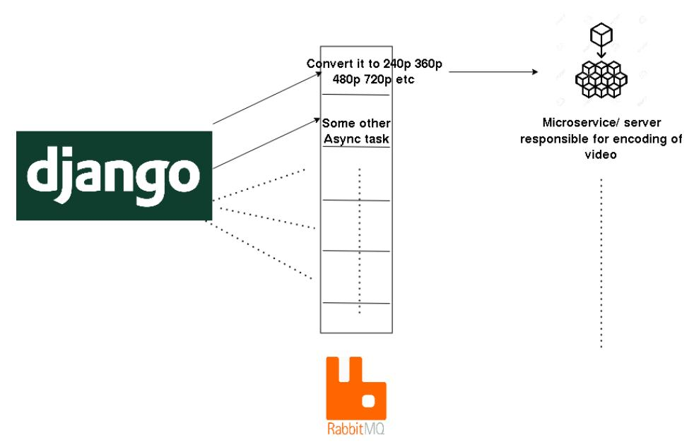

## **Google Summer of Code 2021 MediaCMS - modern, fully featured video and media CMS GFOSS - Open Technology Alliance April 2021**

| Applicant Name       | Shubhank Saxena              |
|----------------------|------------------------------|
| Email Address        | saxena.shubhank.19@gmail.com |
| Country of residence | India                        |
| Primary Language     | English                      |
| Timezone             | Asia/Kolkata (UTC +05:30)    |

# **About the project**

MediaCMS is a modern, fully featured open-source video and media CMS. It is developed to meet the needs of modern web platforms for viewing and sharing media. It can be used to build a small to medium video and media portal within minutes.

It is built mostly using the modern stack Django + React, Celery and includes a REST API. MediaCMS is a very useful project empowering communities around the globe to host their own media and content management system. It also helps educational institutes to manage their media and course curriculum by supporting various media formats like Video, Audio, PDF. Docs, etc.

I want to work on this project because I truly believe in this project and can see how something like this can be of huge impact in the coming future, for many different groups of institutions and communities. I believe that there is a need for quality open source web applications that can be used to build community portals and support collaboration.

Adding on to already existing features of MediaCMS, I would like to propose some of my ideas which in my humble opinion can help to revamp this project majorly. I am certain that my inputs will surely help us move forward in fulfilling the three major goals of the project, i.e.,

- Deliver all functionality one would expect from a modern content management system.
- Allow for easy installation and maintenance.
- Allow easy customization and addition of features.

List of my proposed features are described below in detail.

### **1. Revamping the uploader dashboard with analytics in focus**

Currently, the uploader dashboard is just holding all the uploaded media and nothing else. As someone who uploads content on any CMS platform, a report or feedback of engagement with the content is a desirable feature. This will help the uploader to improve on the quality of uploads. The current dashboard lacks a visualization rich interface. The scope of this proposed idea is to revamp the dashboard.To achieve it, we can create a full-page width card dashboard listing all the content ever uploaded by the uploader, having the following statics per media -

- Views
- Comments
- Likes/Dislikes
- Visibility of media (Public/Unlisted)

- Date of upload

All the current information is already being maintained by MediaCMS. All we have to do is show it to the uploader as well.

#### **2. Command Line Client for Rest API**

Currently, the REST API of the CMS platform is only utilised via the web framework. Whenever someone needs to test all the routes and check on the response, it's a very tedious task - running up the server, hitting all the routes, etc.

Also, the current UI based API model is not very helpful in terms of massive/bulk upload. Thus, having a CLI based tool directly communicating with the API will help us to overcome this issue. The CLI tool will help us to build further add-on tools which can assist with automation like changing multiple tags, controlling the private/public visibility of windows, all via small tools instead of the entire UI.

The approach for building this CLI based tool would be as follows -

- Create a python-argparse application that will handle the required routes request via the CLI tool.
- Use the requests library to parse the request and fetch the relevant data.
- Use the python-jc library to get a prettified-JSON response received in the previous step.

The prerequisite of this task would be to create a proper documentation of all the URLs and all the routes that MediaCMS contains, which is currently missing from this project. Thus this task will help to create API Documentation of the project using tools like [Swagger](https://django-rest-swagger.readthedocs.io/en/latest/). This in-turn will help further contributors to contribute in a better way to this project.

### **3. Improve on the software internalization (i18n)**

Currently, the only language supported on the MediaCMS platform is English. But as the CMS user base is growing wider, we should incorporate more language support for people around the globe. This can be achieved by using the react-i18next library. The library is a plugin for react based frontend code, which will help us to programmatically convert all the text on the website into the desired language, without the need of manual translation or documentation. There would be an option on the side navbar to select the appropriate language from a drop down menu and the entire website's text part would be translated to the language choice. We can start implementation of the following languages -

- Greek
- Spanish
- Chinese/Mandarin

Rest languages can be implemented by understanding the demographics and usage statistics by the people of various countries and backgrounds. This solution will thus help us as a community to be more inclusive towards everyone.

#### **4. Block Storage Support**

Currently, all the uploaded media and their transcoded versions (in case of videos) are directly uploaded to the server housing the CMS hosting.

This method works perfectly well for the following uses -

- You want to keep everything air gapped, ie, no internet usage and access of media is via local means only.
- This significantly reduces the cost as you are having everything on one server itself, and files need not to be handled by storage services.
- This method will give you total ownership of your media.

- Huge amount of media files and sizes (TBs).
- Concurrent streaming of media to huge amounts of people.
- Availability of a large spectrum of multiple encoded media for the uploaded files.

The method of having everything on the same server would not be very feasible and thus would slow down all the computing resources.

Thus it would be ideal to provide both hosting solutions for data management within the application, so that users can decide whether they wanna have their data on their server, or hosted on block storage services like Amazon S3, GCP Bucker, DO Spaces, etc.

This feature would be implemented in a settings toggle style, which will allow the admin of the CMS server to make the choice accordingly. This feature will be a massive upgrade to MediaCMS as this will help people to host more heavy data intensive CMS without thinking about the declining server performance.

#### **5. Implement remote encoding services**

Currently, all the video transcoding is handled by the server tasks (files.tasks). This method is in chronological order, meaning all the encoding services are to be handled first (in all the formats) by the server itself, and only then the video is available.

This particular encoding works fine when the server doesn't have many uploads per day. But would definitely need a lot of power as the CMS grows.

Thus we need to shift the encoding via microservices or external services so that -

- Server becomes scalable for concurrent uploads.
- Server migration would become an easier process. Let's say a CMS service of 1M videos needs to be migrated, it would take weeks and weeks for transcoding all the media via the same server. But if we attach cloud servers, it will be at much faster rate, probably completing in span of day or two

This remote encoding can be achieved via following-

- Create a queue method that will send publisher-subscriber based protocol messages in this queue.
- The servers responsible for encoding will subscribe to this message and will process and encode it eventually, independent of the current running server.
- This pub-sub architecture will also help us to offload this encoding to external servers or microservices which can then encode and return the published edition back to the required path.

This is a test driven feature and all the analytics of speed and uploads would be done and a comparison report would be generated on the following data -

- How many videos are being uploaded,
- How many servers are being added
- Comparing how much faster transcoding runs comparing to a single server
- A test to compare X videos being uploaded and encoded in Y time. And then adding some more server for handling encoding and then comparing the time. Top most priority would be to make sure that all the encodings are completed and are done in correct formats.

An overview of the pub-sub architecture for remote encoding support

### **6. Improvements to System Notifications**

As soon as the media is uploaded on the CMS platform, an email is sent containing a confirmation of adding the media along with a link. This is not super helpful as the user will have to click on the link to exactly understand to which media the current mail is associated (This would be an issue when a user uploads multiple media files).

Also, there is no implementation for notification with respect to status of video encoding. We can implement that as well and can send a notification for the encoding part too. A trailing mail, which can list all the encoded versions and status of rest of encodings. This feature will help to create more engagement with the uploader and the CMS hosting service, making sure the uploader is well aware of all his/her data processes and uploads.

Currently the email trigger is part of the codebase. Since every CMS instance admin would like to customize the message according to the needs of the organization it would be better to shift it to the templates system, so that the message and all the required information could be conveyed better, with customization. All the settings suggested should be converted to an admin dashboard driven service in which settings like when media becomes public, when the media is deleted, all the encodings become available etc, are displayed and admin can customize the message and theme of the email via the templates of mail.

**Design Concept -** [Figma Link](https://www.figma.com/file/lLIf3uiUm0LAguqQ66CkIZ/Figma-Admin-Dashboard-UI-Kit-Community-Copy?node-id=584%3A31)

## **7. Create an admin dashboard for handling all the custom settings for hosted CMS instance**

Currently there are a lot of settings in cms/settings.py and cms/local\_settings.py which can be toggled on and off for further customization for the hosted service. These settings should be available via a UI dashboard instead of always making changes in the code.

The following settings/data points can be seen via the dashboard -

- Logo edit and customization of general theme of CMS.
- Toggle signing/login permissions.
- Portal Engagement via cumulative likes, views.
- Creation and management of common topics/channels.
- Moderation of various users (access, ban).

This solution will give audiences with less/no knowledge of programming an ease in handling the settings of their hosted instances of MediaCMS.

# **Schedule of Deliverables**

**Community Bonding Period (May 17, 2021 - June 6, 2021) :** Discuss with the mentors the exact procedure and workflow. The timeline mentioned in the application is flexible and can change as per the common view with the mentor. Along with this, I will learn the necessary skills which will help me to make the solution easier and accurate. Also, setting up the local development environment for the internship period.

**(Week 1) June 7, 2021 - June 13, 2021 :** Improvement in system notifications.

**(Week 2) June 14, 2021 - June 20, 2021 :** Block Storage Support

**(Week 3-5) June 21, 2021 - July 11, 2021 :** Implement remote encoding services

**(Week 6-7) July 12, 2021 - July 25, 2021 :** Command Line Client for Rest API

**Midpoint evaluation (July 12, 2021 - July 16, 2021)**

**(Week 8) July 26, 2021 - August 1, 2021 :** Revamping the uploader dashboard with analytics in focus

**(Week 9 - 11) August 2, 2021 - August 16, 2021 :** Improve the software internalization (i18n) and create an admin dashboard for handling all the custom settings for hosted CMS instances.

**(Week 12) August 17, 2021 - August 23, 2021:** Wrap up the work. Extra safe time in case any task takes longer than expected, and the deadlines for each week get extended. Time for adding any extra functionalities if/when asked by a mentor.

**Final Evaluation ( August 23, 2021 - August 30, 2021)**

Along with this timeline, I will maintain weekly blogs describing my experience and work throughout the process.

## **Availability Schedule**

During the entire GSoC period, I am available to work for **35-40 hours per week**. I don't have any pre-planned vacations or plans during the break and will be available full time.

As I am in my final year of undergraduate, this counts as an experience semester, in which we are allowed to intern/participate with any organisation. So for me, time commitment won't be an issue as I would be able to dedicate all of my available time to the organisation.

I am a final year engineering undergraduate(Bachelor of Technology in Electronics and Communication Engineering) at Thapar Institute of Engineering and Technology, Patiala, India. I am an avid open source contributor and have contributed to a few organisations/projects like Mozilla, Julia Language,etc, on different

platforms like Github/Gitlab. Becoming a part of a program like this will really give me a push that I have been looking for always. I have experience of contributing to open source projects but never had a chance to be a part of a professional, well-structured program like this. The best part about this program that really attracts me is - the mentorship that I will be receiving throughout my tenure. That can be really beneficial for my career ahead. I have been an active hackathon participant as well in the past and few of my projects are listed below and as well as on my resume [here.](https://drive.google.com/file/d/1GwQs8EodvXYTJ_5lh8kflbJP4mK2C4sh/view?usp=sharing)

# **Personal/Open Source Projects**

I have been working for specially-abled people and empowering them with wearable devices to help them with their daily chores and constant struggles. I have worked on creating a kindle like device for visually impaired people, an all in one wearable device for visually imapired people and a google glass like wearable device for autstic people.

For open-source contributions, I have been an active contributor to the [Treeherder](https://github.com/mozilla/treeherder/commits?author=shubhank-saxena) project by Mozilla Incorporation. I am also the creator and maintainer of Julia's [WellIO](http://github.com/shubhank-saxena/wellIO.jl) package, which is responsible for data manipulation and parsing of Oil Well ASCII data. I also contributed to Open [Horizon,](https://github.com/open-horizon/anax/pull/2339) an edge computing project by IBM Corporation.

Participating and winning in a lot of national-level hackathons, I think I possess the skill of frugal thinking and have an aptitude for problem-solving, which focus on utilising the most of the available resources and to come up with an innovative solution.

# **Why Me**

I think this project is apt for me. I have a strong 2 years experience working with Django and React. I am consistent with my efforts and never leave any task in between, no matter how hard or new it is for me. I make sure that I keep researching the issue at hand and then work to make it happen. I think this skill of mine proves to be very helpful in order to achieve feature addition and bug solving for this particular project. I never hesitate to learn new technologies and skills whenever required. This project will help me to equip essential real-world software skills as well as soft skills which I believe, will help me a lot in the longer run. Having some experience of contributing to various open-source organizations even before GSoC, has instilled the skills of remote working and open source etiquettes.

# **Why GFOSS**

GFOSS is one of the most prominent advocates of open-source development. I really appreciate GFOSS's commitment to the community and the work it has been doing to empower the people worldwide. I truly align with GFOSS's belief in promoting acts of human collaboration across an open platform that contributes to individual growth and the collective future. With varying projects from Hardware Solutions to more inclusivity in terms of language, to self-hosted CMS systems, GFOSS provides so much for the open-source community and thus impacts a huge amount of people around in a positive manner. It would be my honour to be part of such an amazing community, and it will give me immense satisfaction to see thousands of people using the code I developed.

The MediaCMS in particular has intrigued me as this platform will empower a lot of communities and education houses, by helping them manage their media in a systematic way.

For me, the open-source contribution is not just restricted to Google Summer of Code. I would love to keep working on the developments and enhancements. I would like to take responsibility for the code base and features and would have an availability of 30-40 hours per week for the same. Here are some features that I would love to implement in coming times -

#### ❖ **Addition of testing modules**

Currently there is no testing mechanism for a codebase as well as various routes. I would like to start writing testing modules for the entire codebase.

This would be done using the unit-testing approach via the pytest library. After we write tests, a coverage report can be generated and pushed to a public dashboard service like codecov.

### ❖ **Automatic image releases to docker-hub**

We can automate the process of image building via a CI/CD pipeline which keeps track of releases and pushes the latest docker image to the docker hub.

The docker process can also be improved via the following some of the steps -

➢ SECRET\_KEY for every CMS deployment should be auto-generated. ➢ Improving documentation, specifically how to use docker-compose. ➢ improve how environment variables are retrieved when docker is used.

### ❖ **Improving the related media algorithm**

This improvement would be a significant one with respect to the media organization on the loading page.

We can feed data like type of videos liked, maximum attention span topics, etc, straight into a k-means learning algorithm. But, we'll be needing the ideal value of 'k' for our k-means algorithm. We'll try to observe top words from each cluster to see whether clusters formed are good qualitatively or they need improvement in some sense.

We always know that clusters derived from this approach can still be improved by further division into other clusters to derive out these smaller categories.These further divisions can be formulated as optimization problems with error minimization. We don't want to over-fit our model because of this, we'll use the 'elbow-test' method for finding the ideal value of k. The idea is whenever a sharp drop in error comes for a given value of 'k', that value is good enough for forming clusters.