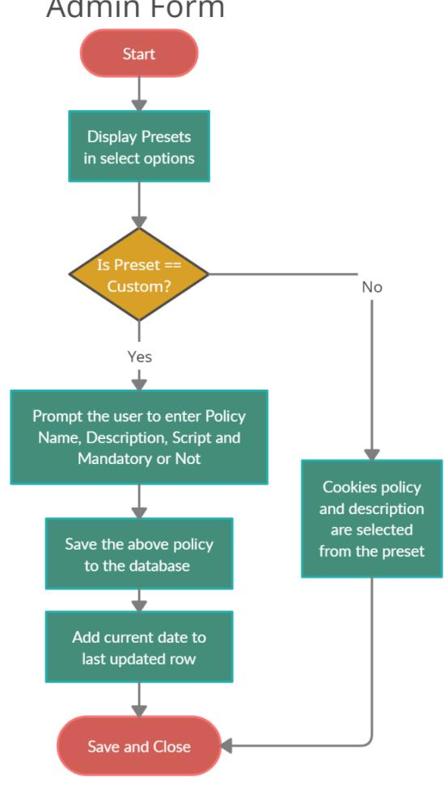
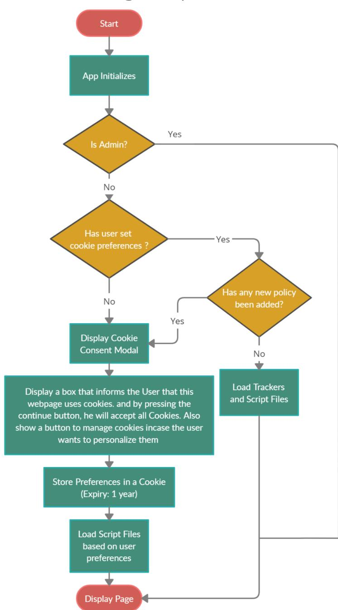
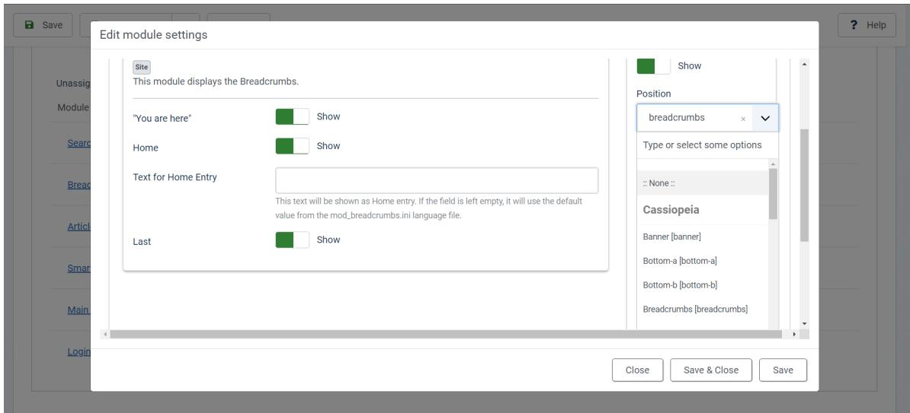
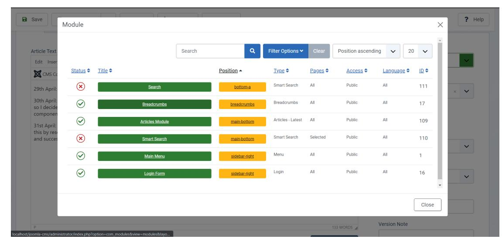
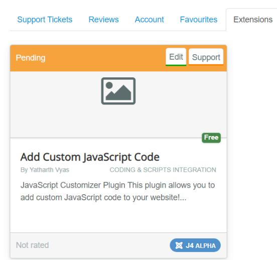

# Yatharth Vyas

**India**

[yatharth2000.vyas@gmail.com](mailto:yatharth2000.vyas@gmail.com)

Skype: live:4c6cd94595dcc710

D.J. Sanghvi College of Engineering, Mumbai.

(+91) 9869115844

[GitHub](https://github.com/YatharthVyas) | [LinkedIn](https://www.linkedin.com/in/yatharth-vyas-96018319a/) | [Resume](https://drive.google.com/file/d/1dipUWqkd6G9K7hJEvhrQRd2gFJZaLVx_/view?usp=sharing)

**April 07, 2021**

# **Proposal for Project Idea 3: Feature Enhancement**

# About me

I'm Yatharth Vyas, a third-year Computer Science student at D.J. Sanghvi College in Mumbai.

The story behind my computer science aptitude originated back in 2014 when a friend of mine introduced me to Rubik's Cube Puzzles. I was so fascinated by the fact that the moves you make and the algorithm you use to solve the cube may drastically affect the speed and efficiency with which you reach a result. To reach the best solution time, one has to apply any possible optimization and adapt to the best algorithm suited to the current state of the puzzle. This was the root of the tree that grew to be my aptitude for Programming and Problem Solving.

I have 2 months of experience in PHP development from one of my previous internships at N.K. Learnicare [\(LoR](https://drive.google.com/file/d/10wCu3UPpxrbaKd-v-b2Ij3JFnIhXKQSu/view?usp=sharing) and [Certificate](https://drive.google.com/file/d/1TYSyKeu37YYwSEqKfgIQsTcPonNUw4OI/view?usp=sharing)). I have been a frontend developer and then promoted to frontend mentor and deployment team leader for D.J. Sanghvi's Unicode Committee. I've also freelanced as a full-stack developer for [Carte](https://carte.co.in)

# My Strengths

I consider my strengths to be:

- **Working in a team**: I have been a part of many projects including internships, freelancing, and college committee's and they've always been an edifying experience when it comes to people management. To enumerate this in one line, I believe complimenting someone

when they excel and providing constructive criticism in a reverent tone when they fail is the key to building up a good and respectable relationship with your team.

- **Problem Solving**: I have worked on various projects from versatile domains which can be found on my [Github.](https://github.com/YatharthVyas) They've helped me develop techniques for problem breakdown and simplifications.
- **Time Management:** During my previous [freelancing](http://carte.co.in) project, My team and I (2 Backend + 1 Frontend + 1 UI/UX) were able to compile a 25 Screen website in a short span of one month during my college exams. The client was so impressed by my team's performance that we received more sum than the discussed upper limit along with a letter of [recommendation](https://drive.google.com/file/d/1a52cBf6XfslN4KWeMCn465axGtLipwW4/view?usp=sharing). We were also invited to work on version 2 of the application.
- **- Quick Learner:** I was able to figure out the Joomla file structure, its extensions and succeeded in understanding that as well as fixed a bug in Joomla's [repository](https://github.com/joomla/joomla-cms/pull/33041). To be honest, I admit that the mentors deserve credit for the valuable resources and help. I have documented my learning timeline [here](https://docs.google.com/document/d/1-LQoVVUMR-fQb0DT8S_kLuAbWLMjhPXMNN8cGMQzHQs/edit?usp=sharing).
- **Perceptive**: My previous work has always taught me that it's the intricacies of a task that make it more difficult than the outer structure. This is what motivates me to look after tiny details and exceptional use cases.

# My Skills

A detailed list of all my skills can be found in my [resume](https://drive.google.com/file/d/1dipUWqkd6G9K7hJEvhrQRd2gFJZaLVx_/view?usp=sharing). My skills associated with this project are enlisted below:

- Github: Git CLI and GitHub web
- Web Dev: PHP, HTML, CSS and Js
- Database: MySQL CLI, transactions, views, and concurrency
- Libraries: Bootstrap 3 & 4, jQuery (jQuery for understanding legacy Joomla Code)
- FTP: Filezilla
- OWASP testing
- Chrome Dev Tools for debugging and performance analysis
- Joomla: Plugins, Helpers, Modules, MVC, Extension Website
- PHPCS Sniffer for Joomla Coding Standards

# My Open Source History

- HacktoberFest 2020: Contributed to 5 open source projects
- 8086 [Emulator](https://yjdoc2.github.io/8086-emulator-web/): An open-source project by my college professor and associates to emulate a Web and CLI version of Intel's 8086 Microprocessor using Rust.
- Master's [Information](https://github.com/djunicode/masters-information-portal) Portal: An open-source portal by DJ's Unicode for information and resource exchange between students and alumni for foreign education.
- [Joomla:](https://github.com/joomla/joomla-cms/pull/33041) Contributed 2 PRs (one merged) and opened an Issue.

# My Motivation for Contributing to Joomla

I have always been intrigued by the idea of CMS, ie. making a website that allows anyone inclusive of individuals belonging to non-tech backgrounds; make their websites with the help of a simplified GUI.

Back in 2020, I was working on one such personal project where I aimed to make a CMS system that didn't rely on any external dependency so that I could learn how to code things from scratch. The Github link for the same can be found [here.](https://github.com/YatharthVyas/Website_Maker) It was during this time that I was first introduced to Joomla. I performed a case study to learn how a CMS works so I could incorporate some of the ideas in my project as well.

When GSoC released the list of organizations and Joomla applied to be a part of it (13th Time! Congrats Joomla Team), I felt ecstatic and I was determined to do my best to earn the position of a Joomla developer/contributor. I have successfully achieved the status of contributor after my first PR was merged on the 6th of April which left me enthralled and now I strive to do more under the guidance of mentors.

# My Reason for Selecting this Project Idea under Joomla

Joomla has proposed 4 project ideas for GSoC 2021 and I have been engaged in Project Idea 3: Feature Enhancements because:

- This project idea involves work that is associated with improving Joomla's existing features and adding a new Cookie manager system.
- I have done some research in Cookies and GDPR as it was required for one of my previous projects, Carte (Contactless Dining App for a SaaS startup). Although we eventually ended up discarding this feature because our project was geo-limited to access to India only which doesn't follow these stricter cookie policies, I still find it interesting and I would love to design my plugin for Joomla.
- Although Cookie Manager is the principal focus of this Project idea, there are other feature enhancements where I could improve the way articles and menus are displayed by providing a more 'linked' and 'connected' interface to the user. This is in correspondence to my previously mentioned statements on how I want to be a part of a CMS developer and work on improving the primary features which I had tried myself in the project mentioned earlier.

# Project Background

Joomla is a free open-source content management system that helps run thousands of businesses online and is backed by an awesome open source community striving to make the product better. Project Idea 3 works on enhancements of some pre-existing features of Joomla like Menu Items and Article Edit View along with adding a new Cookie Manager.

# Aim of the Project

- 1. Make a Cookie Manager System Compliant of GDPR and other privacy regulations
- 2. Display more information about the Menu Items
- 3. Ease the process of placing modules on menu pages
- 4. Integrate featured articles to article list
- 5. Make it easier to place and edit modules in Article-Edit-View

# Design and Description of Each Project Task

#### **1. Cookie Manager**

**.**

- The Cookie Manager's primary focus is to be compliant with GDPR laws, along with that, we have to consider the other privacy laws implemented by the various other governments. I was able to find two useful links:
  - [Link](https://insights.comforte.com/12-countries-with-gdpr-like-data-privacy-laws) 1: Enlists all countries with cookie privacy laws
  - [Link](https://www.airoboticslaw.com/blog/does-the-gdpr-satisfy-all-other-privacy-laws) 2: Compares differences between GDPR and other laws. Also states that GDPR is not sufficient to supplant all other laws.
- For the commonly existing policies, a few **presets** can be provided to the User whose information can be pre-filled. This pre-filled information can be taken from language files to support multiple languages.
- Selecting a preset would add multiple rows to the Cookie Policy table in our database where each row would correspond to one such policy.
- Each Cookie Policy will have the following attributes:
  - Mandatory: yes/no. Yes for session cookies
  - Policy Name
  - Preset / Category (eg: Custom, GDPR, etc)
  - Short Description to be shown to the user
  - Script associated with the tracking. Eg: Input box to add Google Analytics code (I have made an extension for this so I can re-use my code)
  - (Optional) Default Value. We can assume it as True
  - Time of Creation/Updation: Defaults to CURRENT\_TIMESTAMP
- Whenever a new cookie is added, we will set the database's latest updated time to the current DateTime. While displaying the component to the user, we will first check for 2 conditions:
  - Is the Preferences Cookie present in the user's browser
  - Is the max(Cookie's Creation/Updation Time) > Browser's Preferences Cookie Creation Time? If yes then display the modal

This way we can provide administrators a way to update their cookie policies and notify users about it by re-displaying the modal. This could be accompanied by a Policy Update message written by the administrator.

- These Cookies will be shown in the view policies page list as:

- When the Admin clicks on New cookie, this form would open:

The above form is designed via [Figma](https://www.figma.com/file/cHY5P6i8n0XfALln2oDJNg/Joomla?node-id=0%3A1) using Bootstrap UI tools. During implementation, it will be styled as per Joomla's template conventions.

- In the cookie manager view page, if the admin clicks on the "Options" button then this form will be displayed to configure global settings of the Cookie Manager Component:

### **For Third-Party Extensions:**

- The above form could be displayed in the form of a modal in other components that require this. This could be done using a helper function. For example, some components like contacts, images, etc are integrated into articles where they open in the form of a modal as shown below. Something similar could be implemented where we add a helper function that can be invoked in any component to open up this form OR the component itself can submit all the necessary information without having the user do it (automated approach is better but must accompany safety precautions). The component will however

have to keep a check for this and that must be well documented and verified at the time of extensions submissions to JED. Joomla's documentation will also have to be updated

- The extension must specify the requirement of a Cookie Policy in their manifest file AND There could be a checkbox that asks the developer to mention if their extension requires permission for any Cookie Policy when they submit their extensions to JED. If this checkbox is ticked then it will be verified in the manual review. If the extension requires a certain cookie policy, then it can be checked from the Manifest file that the Cookie policy is present in our database when the admin installs/updates it. If not, the policy should be automatically added. Example of what could be present in the XML file:

<cookiepolicy> <preset> GDPR </preset> <custompreset> <name>PolicyName </name> <description> Description </description> </custompreset> </cookiepolicy>

- The following will be stored in the Cookie's value field: scroll to **The [proposal](https://docs.google.com/document/d/1zLMsRf0gpQuh238hHPPXSvoCyGV1RpicJ7zg497XOI0/edit?ts=5c9669a6)**
- **- Difficulties/ Issues:**
  - A dynamic way to add more cookie input fields in the administrator's plugin management form for custom preset Possible Solution: This can be solved by using a modal/redirect form to add new Cookies. This involves the use of a component instead of a Plugin. Similar to the way articles are added using the NEW button in the administrator panel.
  - This Component will require access to user authentication events as we should have to clear out the Cookie storage when a user logs out. As we are no longer storing user cookie preferences in the database, this isn't a use case anymore.
  - Since cookies are stored in the browser, public computers like ones in Cafes, Universities, and Libraries will not be able to support unique preferences for each user unless the users opt for browsing in incognito mode.

- Current each cookie policy is mapped to only one script. This might not be sufficient if multiple extensions that use trackers require permissions to these Cookies. In this case, a check will have to be implemented in the Extension to ensure the cookie consent is given. Eg: Loading a JED script conditionally if consent is granted.

### **2. Optimizing Menu Items**

A possible way to display more information would be:

- A tree structure where the hierarchy of the selected item type will be displayed and hovering over each of the item types will show additional information like Number of Articles, Id, Type, etc. Additionally, these item names will be hyperlinks to their panels. **Pros**: Makes the UI less cluttered, Well linked with other pages, and shows the entire hierarchy tree, More data will be displayed only when the user clicks on the link. No performance issues since the link is already stored in #\_menu table. **Cons**: If the admin wants to search a menu item by its id then they will have to hover over every link to find it, space between columns could be utilized better.
- **- Idea 2: New Column**

All Details here will be taken from a single table: #\_menus. The Item ID and Item Type can be derived from the URL by string manipulation functions so we will only have to use data from a single table that is already being queried. Refer to the boxes highlighted below:

- File to be modified: **administrator\components\com\_menus\tmpl\menus**

### **3. Simplifying Module Placement on Menu pages**

The current Module edit page from the Menu Item form looks as follows:

**Improvement Idea 1:** Adding new modules directly from the client panel

When logged in as an administrator, A "New Module" Button could be displayed at the end of every page. This could be styled like the edit button span, which is present on every module's top right to match the theme.

### **Improvement Idea 2:** Drag-able List

This page could be sorted into sections:

- Side Bar (Left & Right)
- Main
- Breadcrumbs
- And other such sections

Drag and Drop could be enabled for this menu item page for reordering without having to open the edit modal every time. Drag and Drop should also be able to swap between elements of main and sidebar as well as internally for example:

- An item placed at main-bottom could be assigned to main-top by dragging it up - An item placed at main-bottom could also be assigned to sidebar-right by dragging it to that section.

Joomla Library has a **sortableList Helper Provider** which could be used to implement a **draggable List Helper** and hence it should be fairly easy to implement.

Note: For better **accessibility**, the position column could be converted to a select dropdown having all the possible placements as options. Selecting any of the options would submit a form moving that element into the respective category.

Minimum Files to be modified:

- **administrator\components\com\_menus\tmpl\item\edit\_modules.php**
- **- administrator\components\com\_menus\tmpl\item\edit.php**
- **- along with tmpl, Controllers for the above files might require modifications as well.**

### **4. Integrating Featured to Articles List**

Featured Articles and Articles are currently displayed separately:

**Admin Panel:**

i) There are 2 separate panels for articles and featured articles. These will have to be combined into one.

ii) The articles panel displays both featured and non-featured articles.

- An important thing to keep in mind is that the current administrator panel displays both featured and non-featured articles under the articles panel but they seemed to be ordered in chronological order (check the image below). We could sort this by ordering

all featured articles on top with a secondary filter of time. More on this is explained below in the *files to be modified* section: All articles can be split into 2 categories: Featured and non-featured which will be displayed in their respective tables. At a time only **5 such entries** will be displayed and a **pagination** will be provided to view more categories. Refer to the image below. searchtools.sort helper can be used here.

- Minimum Files to be modified are:
  - **- administrator\components\com\_content\src\View\Featured:** Remove this file after confirmation with Mentor. Also, run a self-check to ensure this file isn't a dependency for any other extension.
  - **- administrator\components\com\_content\src\View\Articles:** Ordering articles to be rearranged by ordering the featured articles on top of the list.
  - **administrator\components\com\_admin\tmpl\help\default.php**: (optional) Remove the featured tab from admin dashboard sidebar under content. I am unsure but I believe this involves modifying the sidebar contents in the database and navigation file in the template.

### **5. Placing and Editing Modules in Article-Edit-View**

- The current way to add modules to articles is by opening the CMS dropdown and selecting modules to reach this screen:

- -
- There is no option to add a new module. We could try:
  - Creating a button that would either link to a new page where the user could add the new module
  - Opening it in the modal (I believe the first option is more preferable since it would make a UI less congested and allow reusability of code)
- Previously added modules have no edit option. This could be incorporated in two ways:
  - Place an edit button in the text box next to {loadmoduleid 111} that would open modal. This modal that will reuse the edit.php view of that module.
  - Adding an 'edit' hyperlink in the textbox that would open that module's edit view. It will also have the module id in the URL to map to the specific instant.
- Files to be modified: **administrator\components\com\_content\tmpl\article**
- Example of edit hyperlink implementation: (Keeping textbox limitations in mind)

# Milestones:

| Cookie System                               | June 7 to June 29     | 22 days |
|---------------------------------------------|-----------------------|---------|
| Improve Menu List view                      | June 29 to July 9     | 10 days |
| Improve Menu-Module Assignment              | July 10 to July 20    | 10 days |
| Improve Content                             | July 21 to August 3   | 14 days |
| Improve the incorporation of modules in the |                       |         |
|                                             | August 4 to August 16 | 14 days |

After diligent assessment of the projected work and its timeline period. My honest opinion is that the project will be possible if we take a head start of a minimum of 10days, ie. spend the last 10 days of the community bonding period to start with the coding task. I also plan to prepare the boilerplate code of all fresh components like Cookie Manager during the bonding period to save up some time and pragmatically understand the documentation.

# Benefits of your work to the Joomla Project users & developers

- 1. I had a challenging time traversing through Joomla documentation while learning how to make a plugin for Joomla 4 and adding media files (js and CSS) to it so I decided to write a blog to help any future contributor looking to achieve a similar purpose.
- 2. Plugin for Users to add inline JavaScript code to their website using a simple textbox.
- 3. Fixed a bug in Joomla Language Component's Administrator form [32948](https://github.com/joomla/joomla-cms/issues/32948) by PR [33041](https://github.com/joomla/joomla-cms/pull/33041)
- 4. Debugged a visual bug in Grid.sort in HTML Helpers [33048](https://github.com/joomla/joomla-cms/issues/33048) by PR (open) [33107](https://github.com/joomla/joomla-cms/pull/33107)
- 5. Reported an issue [33101](https://github.com/joomla/joomla-cms/issues/33101)

All the above points are detailed in the next section.

# My Familiarity with Joomla

# 1. Developed a Joomla Plugin to set and display Cookies

<https://github.com/YatharthVyas/Joomla-Project3-Task>

As a part of the Joomla programming task 3, I developed a system plugin that displays a cookie in a popup modal or sets the cookie if it doesn't exist already.

# 2. Submitted a PR (merged) to fix an issue regarding Joomla's language module

<https://github.com/joomla/joomla-cms/pull/33041>

There was an issue reported where one of the spinners in Joomla's language module administrator view caused the loading spinner to go out of bounds. This issue seemed to be minor but there was a lot that went behind debugging the cause of this. Chrome's dev tools proved out to be handy and taught me a good lesson on resolving CSS-related bugs.

# 3. Submitted a plugin extension to Joomla Extensions Directory

[https://extensions.joomla.org/extension/core-enhancements/coding-a-scripts-integration/](https://extensions.joomla.org/extension/core-enhancements/coding-a-scripts-integration/add-custom-javascript-code/) [add-custom-javascript-code/](https://extensions.joomla.org/extension/core-enhancements/coding-a-scripts-integration/add-custom-javascript-code/) (Review is pending so it might not be published yet, please find the image of pending approval below)

Demo: [https://www.youtube.com/watch?v=U9S08CEdWxg&ab\\_channel=YatharthVyas](https://www.youtube.com/watch?v=U9S08CEdWxg&ab_channel=YatharthVyas)

This plugin extension provides the users an interface to add inline JavaScript code to their web pages. This is version 1 of this extension and I plan to improve it in the future by adding supports for

uploading multiple files and adding URL route-based restrictions on the pages where the script is loaded.

# 4. Documented a blog on writing Plugins for Joomla 4 and adding media files to it.

### Medium Template Draft:

[https://medium.com/@yatharthvyas/developing-custom-plugins-for-joomla-4-e4b92f4352](https://medium.com/@yatharthvyas/developing-custom-plugins-for-joomla-4-e4b92f435281) [81](https://medium.com/@yatharthvyas/developing-custom-plugins-for-joomla-4-e4b92f435281)

Google Doc Version: (Isn't integrated to display code snippets, same content as above) [https://docs.google.com/document/d/1a1Uq4Ha3Nbny1pW3rhSrR-txuoiGFsIxUtAELIpdg](https://docs.google.com/document/d/1a1Uq4Ha3Nbny1pW3rhSrR-txuoiGFsIxUtAELIpdgmE/edit?usp=sharing) [mE/edit?usp=sharing](https://docs.google.com/document/d/1a1Uq4Ha3Nbny1pW3rhSrR-txuoiGFsIxUtAELIpdgmE/edit?usp=sharing)

I had a tricky time navigating through various documentation pages while writing my plugin for the Programming task. To help other fellow open source contributors, I decided to write a blog on Joomla and then possibly Medium (provided posting on Medium is acceptable to Joomla's publishing guidelines) which simplifies the process of developing a plugin from a beginner's perspective and also includes links to all necessary documentation and a precise explanation of them in my own words. Note that this blog isn't submitted yet and is under review by mentors.

# 5. Working on an open PR to Fix Issue 33048:

### <https://github.com/joomla/joomla-cms/pull/33107>

Helped find the cause behind an unnecessary popover showing up when hovering over table headers. This taught me more about HTML helpers, their usage, and their file locations. I figured out that we could call the helper functions to substitute for long texts of making bootstrap tables or modals. A few changes have been requested to this PR which I am currently working on.

# 6. Reported an Issue in Article Edit View (Administrator):

<https://github.com/joomla/joomla-cms/issues/33101>

Reported an issue in Joomla 4 Admin Panel's Article editor. I came across this issue while experimenting with Chrome dev tools to study the way Joomla Components work.

# My Take on Development of a Feature

1.) Understanding the Problem Statement Thoroughly: I believe that it was very improbable for someone to understand a problem statement cogently and thoroughly in the first read. It is of most Importance to understand a given problem statement thoroughly. For this reason, I start by understanding the given problem to the depth of each word and each punctuation. 2.) Documenting the problem in the form of a flowchart: Flowcharts always help me understand the chronology of all events and they might also bring up some intricacies which might not be easy to figure out without a visual representation of the events. 3.) Breaking down the problem into components: We all have heard about the divide and conquer algorithm. If we implement this for dividing a complex problem into smaller parts, we can easily map out all components and start working on them in a chronological order which is determined using the flowchart. 4.) Code: Once we have everything ready, it's time to start coding! 5.) Test: When the code is ready, think from the point of view of a malicious user and try to think of ways to break the code. A perfect code is one in which there are no ways to disrupt its intended functioning.

I have documented how I followed this approach for solving the programming task [here](https://github.com/YatharthVyas/Joomla-Project3-Task/blob/main/README.md).

# Asking Doubts

I believe in researching before asking. If anything has already been solved and addressed on the internet then it has to be useful. Many times, small questions can be solved by the means of a simple google search whereas complex questions require the attention of Mentors.

I have followed this approach for Joomla as well wherein I could give an example of a question I asked a while earlier:

I searched for this question on google and found a helpful link but since it was outdated, I decided to raise a question on Glip and I was fortunate that Richard Fath addressed it immediately and provided me with a useful link.

# Qualities I look for in my mentor:

- They must make me look for a solution on my own before providing the answer to me. This way, I'll build up a better logical reasoning and problem-solving aptitude.
- Always be honest with me in terms of mistakes and inefficient coding implementations.
- Provide constructive criticism to me whenever necessary as I aim to improve by learning lots of new practices and coding customs while working with an experienced programmer.

# Community engagement

- Registered my account on the Joomla [Extensions](https://extensions.joomla.org/) Website and submitted an extension
- Applied to be a part of Joomla's Bug Squad / CMS Mailing List
- Read through the issues on Joomla's GitHub repository and helped to fix [#32948](https://github.com/joomla/joomla-cms/issues/32948) by submitting a PR and helped debug [#33048](https://github.com/joomla/joomla-cms/issues/33048)
- Reported a bug issue in Admin Panel's article edit view [#33101](https://github.com/joomla/joomla-cms/issues/33101)

- During the student applications phase, a couple of students contacted me over Glip chat to ask for help regarding bugs and installation queries. I was able to help Shivanshu and Tushar Khandelwal.
- I signed up and went through a couple of blogs on Joomla [Community](https://community.joomla.org/). I hope to post my blog there soon.
- Joined the GSoC google mailing list.
- Joined Potential Students and Bugs&Fun@Home Glip channels.

## Other commitments

I have read the GSoC [Timeline](https://developers.google.com/open-source/gsoc/timeline) and my college exams that take place between *17th to 27th May;* fall under the community bonding period. I believe I will be able to simultaneously manage both GSoC and my exams for the 10day period after which I will be able to fully focus on Joomla. I also plan to start the documentation study period 10days before the schedule to catch up on any delays which might've been caused due to this.

**Hence**, **I will give my full commitment to Joomla.**

# My Commitments to Joomla

I **agree** to all of the following:

- 1. Post a minimum of 3 blog articles on Joomla [Community](https://community.joomla.org/) Portal throughout my period
- 2. Be in contact with my mentor and report my progress to them at least once a week and post on the Joomla Volunteers Portal.
- 3. Attend meetings and as many webinars and online events as possible given my time zone.
- 4. Comply with the Joomla Code of [Conduct.](https://www.joomla.org/about-joomla/the-project/code-of-conduct.html)

Thank you for reading my proposal. I am grateful to receive such an opportunity! I've had an amazing experience exploring and contributing to Joomla.

Wishing Joomla Team the best!

I hope you have a Great Day!