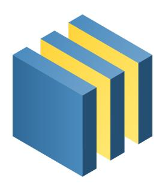
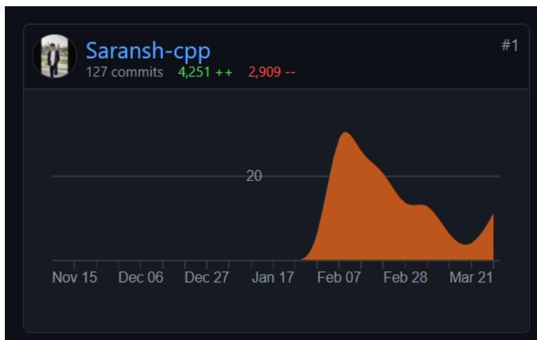
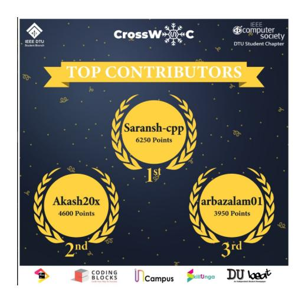
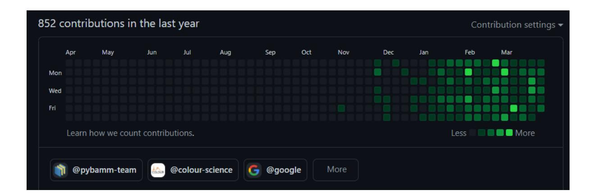

# **Automated Twitter bot to run PyBaMM Simulations**

- Saransh Chopra
- LinkedIn [Saransh Chopra](https://www.linkedin.com/in/saransh-chopra-3a6ab11bb/)
- GitHub [Saransh-cpp](https://github.com/Saransh-cpp)
- Gmail [saransh0701@gmail.com](mailto:saransh0701@gmail.com)
- Twitter [saranshchopra7](https://twitter.com/saranshchopra7) (The running bot)
- Medium [whiteviolin](https://whiteviolin.medium.com/) (Articles/Blogs)
- New Delhi, India (GMT + 5:30)

# **About me**

I am an undergraduate student at Cluster [Innovation](http://ducic.ac.in/) Centre, [University](http://www.du.ac.in/) of Delhi, India, a freshman, pursuing a major in Information Technology and Mathematical Innovations. I love contributing to open-source. I have been contributing to open-source projects since I joined university and I have some prior experience with participating in open source programs. I have been coding for the last 3 years now and I generally have fun while writing code and making PRs.

I have been exploring PyBaMM and contributing to the same for around 2 months and I want to take these contributions to the next level by working on one of the projects under Google Summer of Code 2021.

# **Abstract**

The main goal of the ["Twitter](https://github.com/pybamm-team/PyBaMM/wiki/GSoC-2021-Projects#twitter-bot-to-run-simulations) bot" project is to create a functional and completely automated bot which -

- 1. Generates random battery degradation models and various experiments using PyBaMM.

- 2. Saves the generated plot and tweets them at regular intervals of time with some description.
- 3. As a stretch goal, it should also be able to reply to any Twitter user's request with an appropriate answer/plot after generating it. And possibly even save the generated script somewhere and provide the user a link for the same.

This, in turn, will be beneficial for the ever-developing PyBaMM's codebase as the bot might encounter some bugs or some inefficiencies in the same, which will then be resolved, if possible, by me. It will also improve our understanding of the degradation mechanisms by generating random simulations and will increase the publicity and the overall visibility of PyBaMM.

# **Technical Details**

Technologies and libraries which will be used in the project are listed below

- a) [Tweepy](https://www.tweepy.org/) will be used to make use of the Twitter developer account's API and to carry out all the tweeting and replying business.
- b) [PyBaMM](https://pybamm.readthedocs.io/en/latest/) will be used to generate battery degradation models and different experiments.
- c) [Pandas](https://pandas.pydata.org/) will be used to read data from CSV files which then, using PyBaMM's Interpolant class can be used to initialize any parameter's value.
- d) [Random](https://docs.python.org/3/library/random.html) will be used to generate random numbers in a specific range which then will be used to generate the required plots (For example - Generating the value of time at which an image of the experiment is supposed to be captured).
- e) [Os](https://docs.python.org/3/library/os.html) will be used to hide all the Twitter API keys and secrets in one's environment variables.
- f) [Unittest](https://docs.python.org/3/library/unittest.html) will be used for writing tests for the script.
- g) [Heroku](https://www.heroku.com/) will be used to host and deploy the bot to keep it running forever (as discussed with the mentors).
- h) The code for the bot will be put up on [GitHub](https://github.com/) (as discussed with the mentors) and this repository will be connected directly to Heroku to enable automatic deployment.

# **Previous contributions to PyBaMM**

Though I don't have any big contributions to the PyBaMM project, I have some smaller contributions, so I am familiar with the workflow, parts of the codebase that will be used for this project, and the overall structure of the repository itself. My contributions -

- PR [#1352](https://github.com/pybamm-team/PyBaMM/pull/1352)

- Renamed 'Cell capacity [A.h]' to 'Nominal cell capacity [A.h]'
- Added ValueError and Deprecation warning
- Added tests for the code added
- PR [#1361](https://github.com/pybamm-team/PyBaMM/pull/1361)
  - Completely revamped and updated the 'Installation guide' in CONTRIBUTIONS.md
- PR [#1391](https://github.com/pybamm-team/PyBaMM/pull/1391)
  - Replaced all occurrences of 'Binder' with 'Google Colab'
- PR [#1404](https://github.com/pybamm-team/PyBaMM/pull/1404)
  - Added 'operating mode' to the docstring of BaseBatteryModel class
- PR [#1454](https://github.com/pybamm-team/PyBaMM/pull/1454)
  - Added warning for "casadi" format

### **My progress with the project**

- I have been working on this project for around 2 months and I will be improving and expanding the already written code to create the final bot.
- The tweeting and replying functionality with some basic and random PyBaMM simulations like 'Chen2020' parameters or 'CCCV' experiment in a simple 'DFN' model have already been added to the codebase which can also be easily expanded to account for more complex simulations with different parameter values, models and experiments.
- Till now I have added around 2-3 tests and I am working on adding more. The support for CI and automatic deployment has also been added but it needs to be improved.
- Though my code right now is not completely efficient and modularised, it has been written while having a good amount of discussion with my mentors.
- The bot has also been deployed and is currently running on Heroku (I do take it down sometimes when I am working on some new features but for the rest of the time, it performs very well there).
- The source code can be found in my [TwitterBot](https://github.com/Saransh-cpp/TwitterBot) repository.
- The running bot can be found [here](https://twitter.com/saranshchopra7) (I regularly delete the old simulation tweets)

# Screenshots

- I will be working on the already written code to make it more efficient, completely re-usable, and industry level.
- Adding more parameter sets, battery models, reply types, experiments, and randomizing them.
- Perfecting the tweeting and replying functionality and automating all the PyBaMM simulations.
- Moving ahead with test-driven deployment, writing tests, and GitHub actions for the new repository (as discussed with the mentors).
- Adding the automatic deployment method on Heroku.
- And documenting all of the new code with docstrings, blogs, markdowns, and maybe some with sphinx.

# **Schedule of Deliverables**

- The project will follow test-driven development with documentation for every part at all the stages of the coding period.

| ● Community Bonding Period       |                |          |                  |            |         |
|----------------------------------|----------------|----------|------------------|------------|---------|
| (17th May 7th June)              |                |          |                  |            |         |
| ● Finalizing                     |                | all      | the small        |            | details |
| about                            | the            | bot like | fixing           | the output |         |
| variables,                       |                | which    |                  | solvers    | and     |
| models                           | will           | be       | added            | to the     | bot,    |
| what                             | parameter      |          | sets             | would      | be      |
| added,                           | the            | time     | interval         | between    | 2       |
| tweets                           | or 2           | replies, | etc.             |            |         |
| ● Deciding                       |                | the      | final            | effective  |         |
| structure                        | of             | the      | new repository   |            | and     |
| Heroku                           | deployment     |          | methods.         |            |         |
| ● Adding                         | information    |          | about            | the        | bot’s   |
| tweet’s                          | text           | and      | the bot’s        | replies    | to      |
| different                        | circumstances. |          |                  |            |         |
| ● Discussing                     |                | the      | conditions       | that       | are     |
| possible                         | for            | the      | models           | and        | the     |
| solvers                          | or             | where    | the              | solvers    | will    |
| ● Discuss                        | the            | stretch  |                  | goals of   | the     |
| project,                         | whether        |          | we want          | to         | store   |
| the                              | generated      |          | script somewhere |            | or      |
| ● Getting                        | the            | final    | picture          | of         | the     |
| Twitter                          | bot.           |          |                  |            |         |
| ● 7th June 28th June ● Improving |                | the      | already          | existing   |         |
| codebase                         |                | and      | making           | it         | more    |

| (Week 1 to Week 4)       | modular       | and           | efficient.     |                  |
|--------------------------|---------------|---------------|----------------|------------------|
| ●                        | Adding        | all           | the            | battery models,  |
|                          | parameter     |               | sets,          | experimental     |
|                          | definitions   |               | (which,        | given the way I  |
|                          | have          | structured    | will           | be structuring   |
|                          | the code,     | will          | be easy        | to add).         |
| ●                        | Automating    |               | and            | randomizing the  |
|                          | written       | code          | completely.    |                  |
| ●                        | Expanding     |               | the code       | in such a        |
|                          | manner        | that          | adding         | the replying     |
|                          | functionality |               | becomes        | easier in the    |
|                          | upcoming      |               | weeks.         |                  |
| ● 29th June 13th July    |               |               |                |                  |
| (Week 5 to Week 6)       |               |               |                |                  |
| ●                        | Adding        | support       |                | for CI to make   |
|                          | sure          | that          | if something   | breaks           |
|                          | during        | the           | automatic      | Heroku           |
|                          | deployment,   |               |                | the process      |
|                          | completely    |               | stops.         |                  |
| ●                        | Adding        | GitHub        |                | actions to the   |
|                          | newly         | formed        |                | repository with  |
|                          | scheduled     |               | tests.         |                  |
| ●                        | Deploying     |               | the            | bot with fully   |
|                          | functioning   |               | tweeting       | abilities to     |
| ●                        | Adding        | the           | automatic      | deployment       |
|                          | feature       | of            | Heroku         | as now the tests |
|                          | and           | the CI        | will           | make sure that   |
|                          | nothing       | breaks.       |                |                  |
| Evaluations (12th July   |               | 16th July)    |                |                  |
| ● 14th June 28th July    |               |               |                |                  |
| (Week 7 to Week 8)       |               |               |                |                  |
| ●                        | Working       | on            | the            | already-existing |
|                          | reply         | functionality |                | and integrating  |
|                          | it with       | the           | then-developed | code.            |
| ●                        | Adding        | replies       | for            | every condition  |
|                          | and           | possible      | even           | a script for     |
|                          | generating    |               | the            | user-requested   |
| ●                        | Making        | sure          | that           | the bot can read |
|                          | “humanly”     |               | tweets         | and minimizing   |
|                          | instructions  |               | in the         | tweets.          |
| ●                        | Making        | the           | reply          | functionality of |
|                          | the           | bot           | completely     | ready and        |
|                          | pushing       | the           | new code       | to Heroku.       |
| ● 28th July- 16th August |               |               |                |                  |
| (Week 8 to Week 10)      |               |               |                |                  |
| ●                        | Making        |               | sure unit      | tests and        |
|                          | documentation |               | are            | up to date.      |
| ●                        | Completing    |               | any leftover   | code and         |

### **Why I chose this project and this sub-organization**

I graduated from high school about a year ago and half of my 12th-grade physics and chemistry courses were about the basics of electromagnetism and electrochemistry, so PyBaMM naturally caught my interest. As I started communicating with the mentors and with the community by making small contributions, I understood the basic flow of code in the repository and the organization.

After going through the GSoC projects, I familiarized myself with the Twitter bot project as this was something that I worked on when I started learning python in my high school. I started reading PyBaMM's notebooks and documentation and started developing the basic code for the final bot. This also started aligning with my future goals that are research and coding for science.

Given my experience with programming in general, my previous experiences with PyBaMM, and the work I have already done for this project, I am confident that I will be able to take up and complete this task.

#### 1. Previous open-source experience

#### 1. Mexili Winter of Code

I was a part of the Mexili Winter of Code, organized by the [Mexili](https://github.com/mexili) [organization](https://github.com/mexili) in February. I contributed to a flutter project called [DocLense](https://github.com/smaranjitghose/DocLense) and I am still contributing to the project. I have been regularly communicating with the project admins and now I am also an integral part of the discussions related to any new feature or any major modification in the codebase. Some statistics for the project and the program are mentioned below -

- After a month-long coding period, I achieved rank 2 on their leaderboard of contributions.
- Around 30 PRs merged with various new features and many bug fixes.
- Created and resolved more than 15 issues.
- Top contributor of the project.
- Still creating and reviewing PRs and issues.

#### 2. Cross Winter of Code

I was also a part of Cross Winter of Code, organized by the [Institute](https://github.com/IEEEDTUCS) of Electrical and Electronics Engineers, Delhi [Technological](https://github.com/IEEEDTUCS) University. The DocLense project was selected for this program too so I contributed to two projects simultaneously [\(DocLense](https://github.com/smaranjitghose/DocLense) and [Futter-Tutorial-App](https://github.com/infiniteoverflow/Flutter-Tutorial-App)). Some of the statistics related to the program and projects are mentioned below -

- After a coding period of around 30 days, I was placed as the top contributor on their leaderboard (the final results are not out yet).

- Adding to the previous merged PRs, around 14 new PRs were merged with various new features (Integrating database, updating the existing database, etc.) and bug fixes.
- Many new issues were created and resolved, and a lot of PRs were reviewed too.

### 2. Work experience

I have a previous work experience at a start-up called [MoneySeeds](https://www.moneyseeds.site/) where I used an open-source python library called [Manim](https://github.com/3b1b/manim) to create animated promotional and explainer videos for one of their courses. My work was to completely animate the content they provided me and deliver them the complete course at once. My work period was from the beginning of August 2020 till the beginning of September 2020. [Code](https://github.com/Saransh-cpp/Internship1) for the videos is available on my GitHub.

### 3. Consistent, experienced, a quick learner, and good with documentation

- 1. My general open-source contribution graph has been consistent with at least 1 contribution every day to the open-source world and as I have been involved with the open-source world for quite some time now, this valuable experience has taught me how to write clean and efficient code, ability to find and fix bugs, problem-solving abilities, how to review code, how to learn a new concept quickly communication and teamwork.
- 2. I am also good at writing technical articles [\(medium](https://whiteviolin.medium.com/) articles) and documentation which, including blog writing, is also a skill that is required for GSoC.
- 3. I have also been regularly communicating with my mentors and I have an overall picture of how the final bot should look.

### **After Google Summer of Code**

- Once the coding period for Google Summer of Code ends, I will be ready to take full responsibility for the created repository.
- I will be adding more features or will be fixing some bugs whenever it is necessary or required.
- To keep the spirit of open-source alive, I will also be guiding and helping other people who visit the repository for the first time and want to contribute in some way.
- I will be maintaining the bot and the repository for as long as the bot is active.
- With the creation of this bot, I will also look forward to making some good contributions to the actual PyBaMM repository.
- Moreover, I will stay as an active member of the PyBaMM community.

#### **1. Career Goals**

My career goals right now are inclined towards research in science using my coding abilities. Some of the fields that I was looking into were machine learning, computational physics, and computational biology but after looking into PyBaMM, battery mathematical modeling is something that I am definitely adding to my bucket list!

### **2. Commitments and Availability**

I started my open-source journey last year and I have been very consistent with my contributions, even during my classes. I have also participated in some open-source programs (as discussed above) and have managed everything very well.

I will be able to devote around 18-21 hours per week (meeting with the 175 hours for 10 weeks goal of Google Summer of Code) to this project easily. Though I don't have any summer breaks, I have been managing my open-source journey and my university schedule pretty well till now, and expect to do the same in the future. Moreover, my college is very supportive of programs like Google Summer of Code.

Apart from this, I will be having my end-semester exams from 29th July to 9th August and in this period, I will be relatively less active. I have made sure to assign less time-consuming tasks for this period in my timeline.

### **3. Am I applying to any other organizations?**

No, I won't be applying to any other organization for any other project in Google Summer of Code 2021.

### **4. Some final words**

I am looking forward to making some meaningful contributions to the PyBaMM organization and being an integral part of the same!