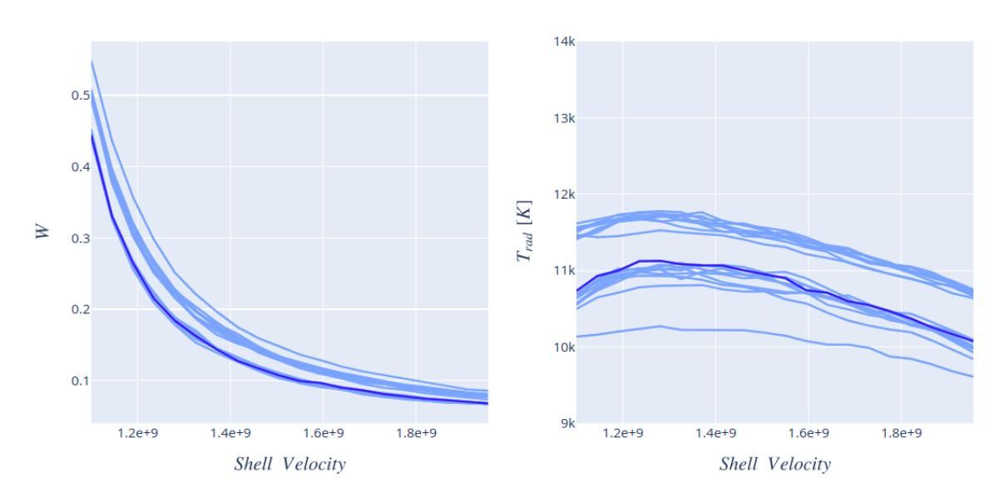
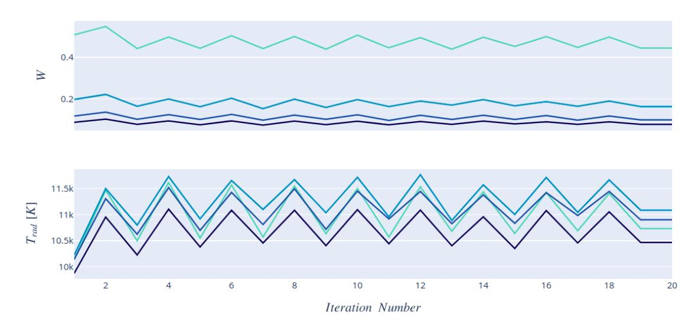
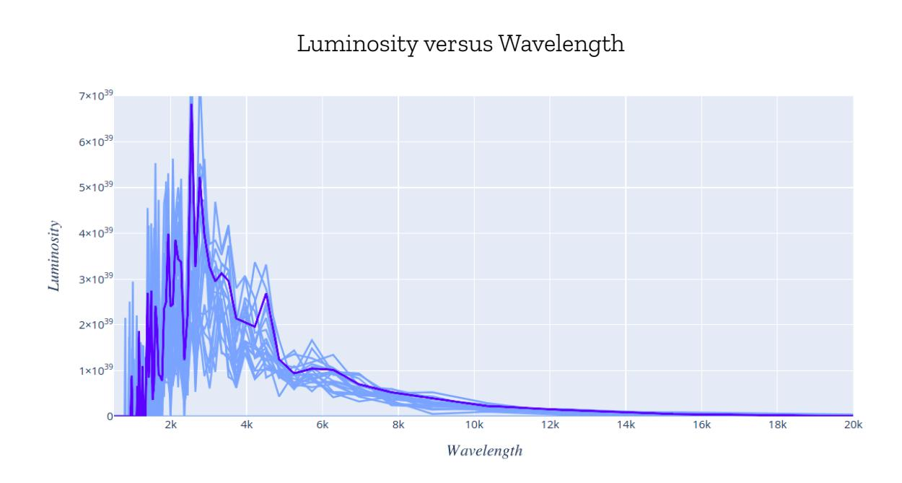
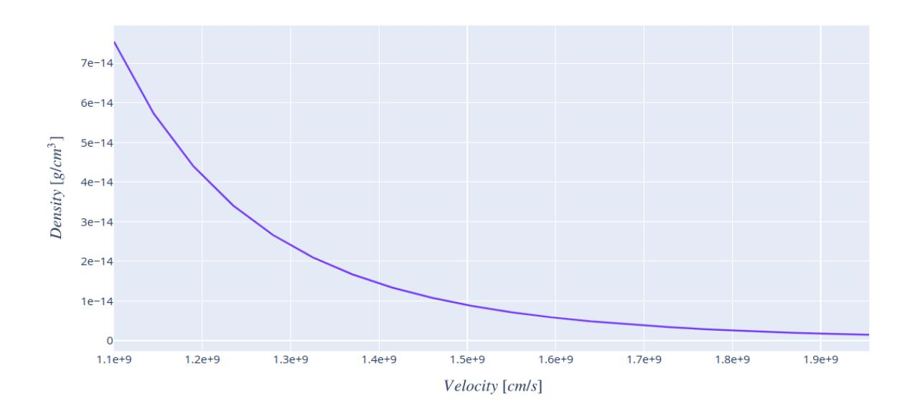
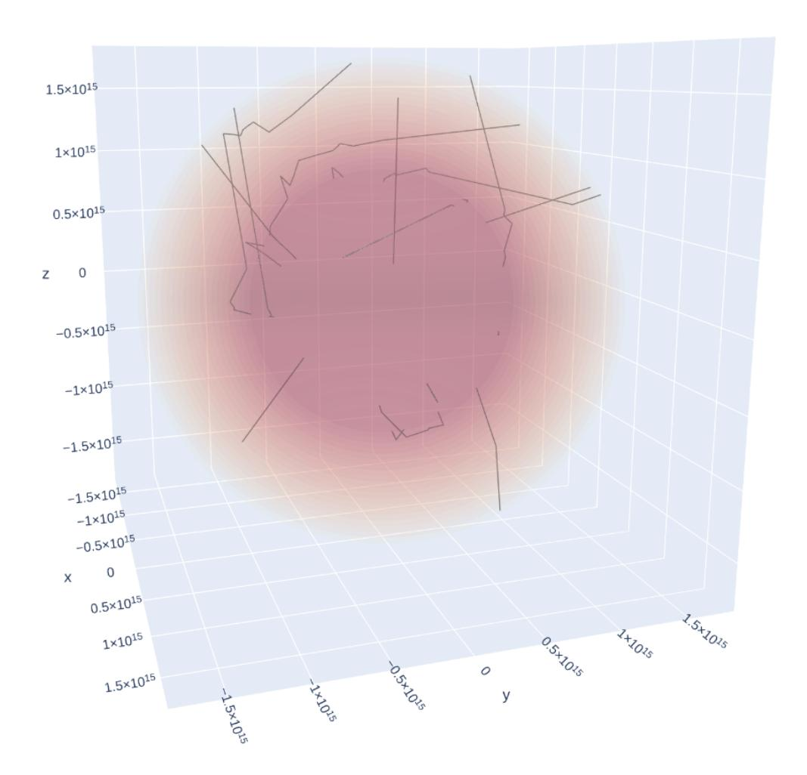
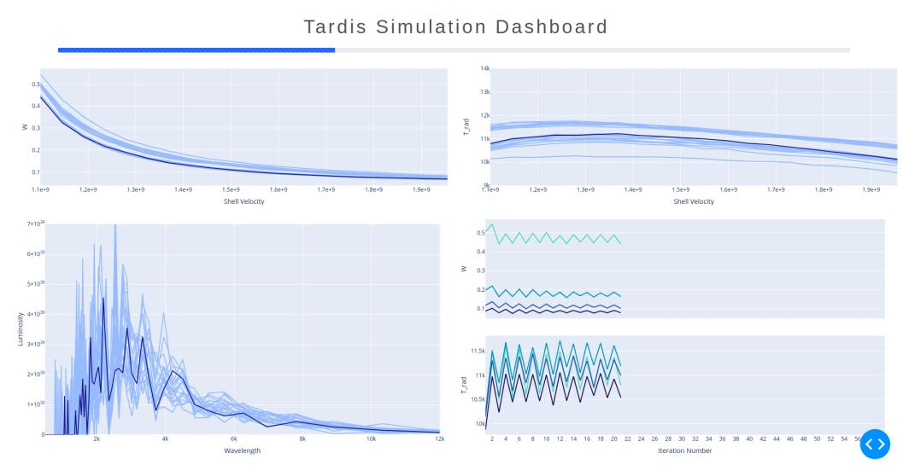
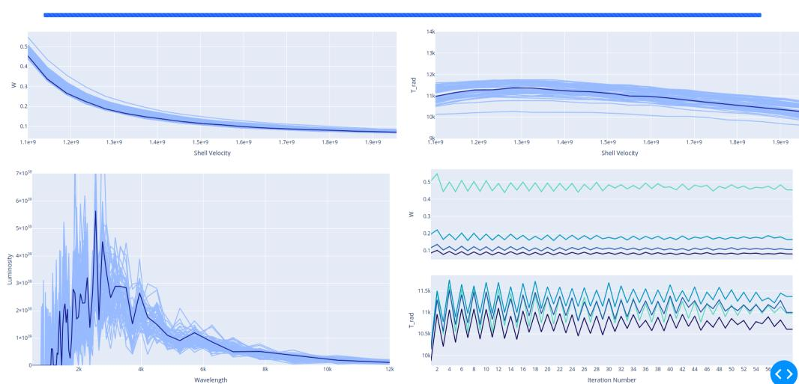

The project was later renamed to **Visualization Tools for TARDIS**. Check out the project on Google Summer of Code Website [here](https://summerofcode.withgoogle.com/projects/#4555893921808384).

# Real-Time Simulation Tracking and a Dedicated Logging Framework for TARDIS

## **Contents**

- 1 [About](#page-2-0) Me
  - 1.1 Personal [Information](#page-2-1)
  - 1.2 Past [contributions](#page-2-2)
  - 1.3 [Background](#page-2-3) Information
  - 1.4 Why [TARDIS](#page-2-4)
  - 1.5 [Why](#page-3-0) Me
- 2 [Introduction](#page-4-0)
- 3 Project [Objectives](#page-4-1)
  - 3.1 Primary [Objectives](#page-4-2)
  - 3.2 [Secondary](#page-4-3) Objectives
- 4 Detailed [Description](#page-5-0) of Project Objectives
  - 4.1 Primary [Objectives](#page-5-1)
    - 4.1.1 [Rebuilding](#page-5-2) the TARDIS Logger
    - 4.1.2 Simulation [Convergence](#page-5-3) Real-Time Tracking
    - 4.1.3 Density versus Velocity plot
  - 4.2 [Secondary](#page-8-0) Objectives
    - 4.2.1 Work on the Monte Carlo [Visualisation](#page-8-1) Project
    - 4.2.2 TARDIS [Dashboard](#page-9-0)
- 5 Project [Timeline](#page-10-0)
- 6 List of all [deliverables](#page-11-0)
- 7 Other [commitments](#page-11-1)

## 1 About Me

#### 1.1 Personal Information

- Name: Atharva Arya
- Email Address: [aryaatharva18@gmail.com](mailto:aryaatharva18@gmail.com)
- GitHub Username: [atharva-2001](https://github.com/atharva-2001)
- LinkedIn: <https://www.linkedin.com/in/atharva-arya/>
- Location: Nagpur, Maharashtra, India
- [Resume](https://docs.google.com/document/d/1uwY-HCNY7JtLy6hXGpRn_sSLitJznKk_kHIHROO3JXo/edit?usp=sharing)

#### 1.2 Past contributions

- opened PR [#1476](https://github.com/tardis-sn/tardis/pull/1476) in which I made a rough implementation of the logging framework, to solve the first objective of the Notebook Logging Framework Project
- opened PR [#1479](https://github.com/tardis-sn/tardis/pull/1479) (merged) for getting rid of: PerformanceWarning: indexing past lexsort depth may impact performance warning
- opened PR [#1527](https://github.com/tardis-sn/tardis/pull/1527) (merged) to solve issue [#1522](https://github.com/tardis-sn/tardis/issues/1522) and issue [#1523](https://github.com/tardis-sn/tardis/issues/1523)
- opened PR [#1531](https://github.com/tardis-sn/tardis/pull/1531) to solve issue [#1485](https://github.com/tardis-sn/tardis/issues/1485)

Apart from this, I also try to solve the problems of fellow GSoC students in the Gitter chat.

#### 1.3 Background Information

I am a second-year student at Shri Ramdeobaba College of Engineering and Management, Nagpur, Maharashtra, India, pursuing a B.E. in Electronics and Communications.

#### 1.4 Why TARDIS

At first, I decided to work with TARDIS because there were a lot of projects I could contribute to. I enjoyed trying to solve the Notebook Logging Framework problem and I wanted to do even more. After I was done building demos of the convergence plots, I wanted to see if I could help with the Monte Carlo [Visualization](https://github.com/tardis-sn/tardis/projects/14) project and made a demo of the same as well. As I delved deeper into the

codebase and started to understand the math and physics involved, I started to like it even more.

Visualising science into graphs is something I enjoy doing. I have enjoyed building the demos I have built yet, and I guess building the actual product will be even more fun!

#### 1.5 Why Me

I have around 2 years of python programming experience, around 1-year experience in Linux and I have also been using plotly and dash for quite a long time. Apart from that, I have built a few dash apps which are pinned on my GitHub [profile.](https://github.com/atharva-2001) I have had a tremendous interest in space and astronomy ever since I was a child and always wanted to do something in this field. I believe contributing to TARDIS will help me get closer to something I always wanted to do. Because I am already familiar with the visualization tools TARDIS uses and have done similar work in the past, paired with my interest in Space and Astronomy, I believe I make up a good candidate to work on this project.

## 2 Introduction

TARDIS displays logs during the simulation which consists of values of different mathematical variables and the state of the simulation. This is done so that the user can keep track of the convergence of the simulation.

However, the user experience can be enhanced by displaying more relevant log messages and displaying the convergence in plots in real-time. This project aims to provide a dedicated logging framework and plots to display the convergence of the simulation in real-time.

Apart from that, this project also aims to complete the Monte Carlo [Visualisation](https://github.com/tardis-sn/tardis/projects/14) [Project](https://github.com/tardis-sn/tardis/projects/14) that was put on hold and to add a Dash based dashboard containing all convergence plots for a better simulation tracking experience.

## 3 Project Objectives

Below is a list of objectives I wish to achieve during the project.

#### 3.1 Primary Objectives

- Rebuilding the TARDIS Logger Will introduce a new highly configurable logger.
- Simulation Convergence Real-Time Tracking This will allow the users to keep a track of the simulations using plots.
- Density versus velocity plot

#### 3.2 Secondary Objectives

- Work on the Monte Carlo [Visualisation](https://github.com/tardis-sn/tardis/projects/14) Project
- A Dash based dashboard that will display convergence plots and the progress of the simulation in real-time.

## 4 Detailed Description of Project Objectives

#### 4.1 Primary Objectives

#### 4.1.1 Rebuilding the TARDIS Logger

I wish to use Loguru to create the new logger as it's fairly simple to configure and add functionalities. However, this choice is subject to changes if Loguru is not supposed to be used.

So far, I have made a rough implementation of the logger and it's visible [here.](https://github.com/tardis-sn/tardis/pull/1476) I am afraid that this implementation, however, has a few issues and I plan to fix them in the coming months. (For example, using global variables to save the logger configuration. Also, I will be refactoring the code to make it more maintainable and will be adding more functionality as discussed below, aiming to make logging better and effective.)

These are the functionalities I plan to add as a part of the new logging framework:

- Configuring logger from the run\_tardis function. The added options will allow the user to change the level, colours or format and save the logs if they wish to, right from the function.
- Not showing warnings or debug messages by default. Just the relevant messages.
- The new logger will be highly customizable and will allow customization from anywhere in the program.
- The framework will also allow recording logs (writing them to a file) from numba based functions for debugging purposes.

#### 4.1.2 Simulation Convergence Real-Time Tracking

I plan to add widgets to aid in tracking the convergence of the simulation. I will be using plotly to do so and will incorporate the widgets with the current visualization module.

So far, I have built a few prototypes of the widgets and I am using simulation callbacks to update them with each iteration.

#### W and Trad versus shell velocity

State of *W* and *Trad* versus shell velocity live plot after the simulation had ended [\(notebook](https://nbviewer.jupyter.org/github/atharva-2001/tardis/blob/plasma_logging_dev/docs/using/interaction/live_updates_w_t_rad.ipynb) here, GIF [here](https://drive.google.com/file/d/10aylP4UjibI2RjYUTGCOm2rNj8SUCboS/view?usp=sharing))

W and Trad versus Iteration Number

State of *W* and *Trad* versus the iteration number live plot after the simulation had ended [\(notebook](https://nbviewer.jupyter.org/github/atharva-2001/tardis/blob/plasma_logging_dev/docs/using/interaction/live_updates_w_t_rad_with_iteration.ipynb) here, GIF [here](https://drive.google.com/file/d/1pfTdKNk3ELHz1lwmUhP48igXnbNrDsYS/view?usp=sharing) )

State of *Luminosity* versus *Wavelength* live plot after the simulation had ended [\(notebook](https://nbviewer.jupyter.org/github/atharva-2001/tardis/blob/plasma_logging_dev/docs/using/interaction/live_spectrum_update.ipynb) here, GIF [here](https://drive.google.com/file/d/13jNmZ8CAGtMT5gTG1vq6-AFszzLEgGBZ/view?usp=sharing) )

#### 4.1.3 Density versus Velocity plot

As mentioned [here,](https://github.com/tardis-sn/tardis/projects/5#card-54802135) we needed a density versus velocity plot. I wanted to take this up and made a demo for it. I would change the plot and display more variables if supposed to do so.

> Density versus Velocity plot [\(notebook](https://nbviewer.jupyter.org/github/atharva-2001/tardis/blob/plasma_logging_dev/docs/using/interaction/density_vs_velocity.ipynb) here)

### 4.2 Secondary Objectives

#### 4.2.1 Work on the Monte Carlo [Visualisation](https://github.com/tardis-sn/tardis/projects/14) Project

I also wish to work on the MC Visualization Project that has been put on hold. It is referenced on this [board](https://github.com/tardis-sn/tardis/projects/14) and in this [TEP](https://github.com/tardis-sn/tep/pull/28) PR.

demo of the plot showing packet propagation in 3D [\(notebook](https://nbviewer.jupyter.org/github/atharva-2001/tardis/blob/montecarlo_viz_dev/tardis/visualization/packet_movement_3d.ipynb) here, [video](https://drive.google.com/file/d/1JY-imTadPmcIEsjgPKRdaoriq2PiO_lG/view?usp=sharing) file here )

It aims to visualize packet propagation across shells. The module built for this could be incorporated with the TARDIS visualization module and will have *at least* the following features:

- Animating packets as they move across shells
- Allow users to choose packets and animate them
- Adding and removing packet traces (to speed up performance) from plots as they escape the photosphere

#### 4.2.2 TARDIS Dashboard

I wish to create a dashboard that will allow the user to run the simulation right from the dashboard. It will display convergence plots and the progress of the simulation in real-time. I will be using [Dash](https://plotly.com/dash/) for this.

Below is a demo I built of the same:

TARDIS Dashboard when the simulation is in progress[1] and when it has finished[2] (GIF [here\)](https://drive.google.com/file/d/1uHDlI3t5pZbkLcYgePOlnrzuVw6idqhn/view?usp=sharing)

The dashboard is a collection of plotly charts which can be updated using callbacks. Using Dash Bootstrap [Components](https://dash-bootstrap-components.opensource.faculty.ai/) I have added a progress bar at the top as well. In this demo, a simulation callback stores convergence information in global variables. Dash callbacks fetch data stored in these variables and update graphs in the dashboard.

Because this is not the best implementation out there, I will be making a bunch of prototypes to see which one works the best and will incorporate that in the module.

## 5 Project Timeline

- Week 1: Discuss and ask for suggestions to improve the logging framework
- Week 2: Build and ask for feedback
- Week 3: Finish building required logging framework and add required documentation *Deliverable produced: Logging framework*
- Week 4: Discuss module structure, build prototypes for Convergence plots and Density vs Velocity plot
- Week 5: Assemble the code in modules and incorporate them with the visualization module, add documentation regarding the same *Deliverable produced: Convergence Plots + Density vs Velocity plot*
- *●* Week 6: Develop a prototype for Monte Carlo Visualization and ask for feedback, discuss module structure
- Week 7: Improve the prototype accordingly and incorporate it with the visualization module
- Week 8: Finish building and add documentation *Deliverable produced: Monte Carlo Visualization*
- Week 9: Build a prototype for the TARDIS Dashboard, ask for feedback and discuss module structure
- Week 10: Incorporate the dashboard in the module, ask for feedback and improve accordingly. Add documentation. *Deliverable produced: TARDIS Dashboard*

## 6 List of all deliverables

- Logging Framework (by the end of week 3)
- Convergence Plots + Density vs Velocity plot (by the end of week 5)
- Monte Carlo Visualization (by the end of week 8)
- TARDIS Dashboard (by the end of week 10)

## 7 Other commitments

I would be having my final semester exams from mid-April to mid-May which would be over before the community bonding period. Other than that I don't have any commitments planned as of now. I would be working 30+ hours each week and will be available 24/7 via Gitter and mailing list.