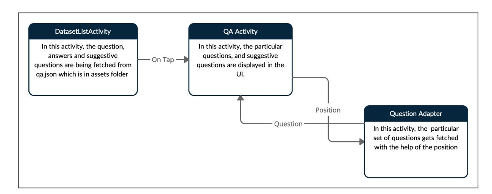
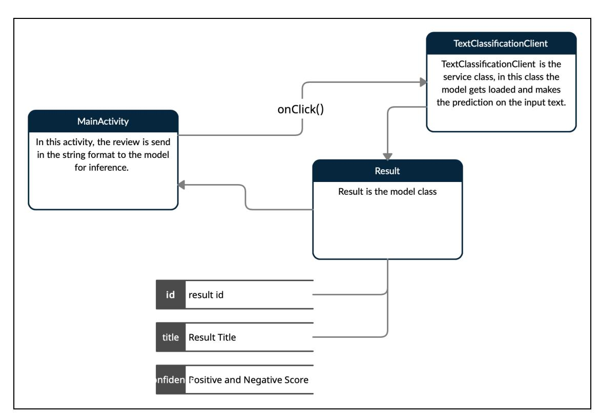
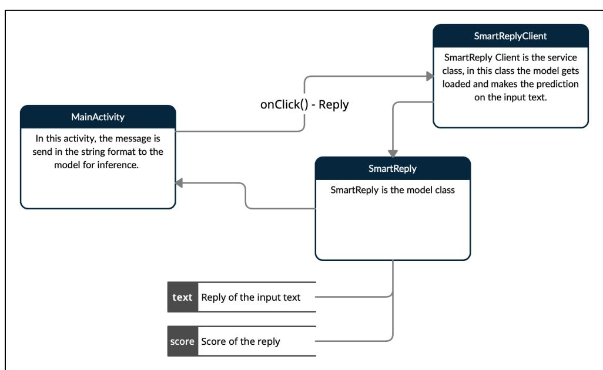

# **TensorFlow Lite**

Generate TensorFlow Lite examples for Natural Language Processing

Proposal - Google Summer of Code 2021

## **PERSONAL DETAILS**

- Name: Sayan Nath
- IRC nick: sayannath
- Telephone: +91 9874948947
- Email: [sayannath235@gmail.com](mailto:sayannath235@gmail.com)
- GitHub: <https://www.github.com/sayannath>
- Country of Residence: India
- Timezone: IST (India)
- Language: India

## **PROJECT PROPOSAL**

### **Project Title**

Generate TensorFlow Lite examples for Natural Language Processing

## **Abstract**

The idea behind the project is to change the existing TensorFlow Lite example with TensorFlow Lite Task Library. TensorFlow Lite Task Library is used to gain high-performance gain with easy data processing. After getting selected, I would be changing the existing TensorFlow example of BERT Question and Answering, BERT Text classification and Smart Reply using the TensorFlow Lite Task Library for Android and iOS mobile applications.

### **Background**

I am a second-year undergraduate student at [KIIT](https://kiit.ac.in) University. I am amongst the top contributors in [Github](https://commits.top/india.html) from India. I am really interested in Deep Learning and deploying deep learning solutions in the cloud or in edge devices.

I am a Junior Data Scientist at [Codebugged](http://codebugged.com) AI. My job in Codebugged AI is to build models, optimize them further and run them on edge devices. I am currently in two or more organisations i.e [Developer](http://dsckiit.tech) Student Club KIIT where I am the core-team member as well as leading the Flutter team and developing projects with the Machine Learning team as well. I am also the Machine Learning Lead of IoT Lab [KIIT](https://iotkiit.in/) where I mentor hundreds of students and build projects for the community.

In the meantime, I write blogs and give talks at various places about Deep Learning with [TensorFlow](https://tensorflow.org) and [Tensorflow](https://www.tensorflow.org/lite/) Lite. Apart from Machine Learning, I do app development, majorly with [Flutter](https://flutter.dev/) as well as Native [Android](https://developer.android.com/) (Java/Kotlin) and [Native](https://developer.apple.com/swift/) iOS (Swift). I am also interested in Backend Development as well, with [Spring](https://spring.io/) Boot (currently learning) and [NodeJS](https://nodejs.org/en/) as well.

### Blog Link

- a) [Introduction](https://medium.com/analytics-vidhya/introduction-to-tf-lite-3a02d753939) to TF-Lite
- b) [Quantisation](https://medium.com/analytics-vidhya/quantisation-of-models-8f609987a1f5) of Models
- c) Weight [Pruning](https://medium.com/analytics-vidhya/weight-pruning-with-keras-86f742dbdb58) with Keras
- d) Theme [Changer](https://medium.com/iot-lab-kiit/theme-changer-using-provider-in-flutter-b5c9efff7d0c) using Provider in Flutter

### **Task**

- My first task is to understand the current example of the BERT QnA [example](https://github.com/tensorflow/examples/tree/master/lite/examples/bert_qa/) which is written in Android(Java) and iOS(Swift) in the [TensorFlow](https://github.com/tensorflow/examples/tree/master/lite/examples) example repository. I have already built the Android App(Java) and iOS app(Swift) and also understood the workflow of the app.
- After building and testing the app thoroughly I will be implementing the TFLite Task Library in this BERT QnA [example.](https://github.com/tensorflow/examples/tree/master/lite/examples/bert_qa/) An example app Image [Classification](https://github.com/tensorflow/examples/blob/master/lite/examples/image_classification/android/README.md) is provided in the [TensorFlow](https://github.com/tensorflow/examples/tree/master/lite/examples) example repository.
- After completing the above tasks, I will implement the TFLite Task Library in the iOS app (Swift).
- After getting the grip on the Tensorflow Lite Task Library, I will implement the [Text](https://github.com/tensorflow/examples/tree/master/lite/examples/text_classification) [Classification](https://github.com/tensorflow/examples/tree/master/lite/examples/text_classification) and [Smart](https://github.com/tensorflow/examples/tree/master/lite/examples/smart_reply/android) Reply example projects which are there in the [TensorFlow](https://github.com/tensorflow/examples/tree/master/lite/examples) [example](https://github.com/tensorflow/examples/tree/master/lite/examples) repository.

## **Full Description**

- **● BERT QnA Example Flow Diagram of the App**

### **Screenshots**

1 2

**3 4**

### **● Text Classification Flow**

### **Screenshots**

3

4

### **● S m a r t R e p l y**

### **Flow**

### **Screenshots**

1 2

3

## **Timeline**

- ★ **Community Bonding Period (17th May - 7th June) :**
  - a. Make sample apps and implement functionalities that I will work on the main projects.

- b. Enhance my understanding more of Tensorflow Lite Task Library.
- c. Discuss with mentors and put together precisely components of my proposal, and include the necessary changes. ★ **Week 1 (7th June - 13th June)**
  - a. Study the design pattern of the BERT QnA [exampl](https://github.com/tensorflow/examples/tree/master/lite/examples/bert_qa/)e. in Android.
  - b. Implement the TF Task Library in the BERT QnA [exampl](https://github.com/tensorflow/examples/tree/master/lite/examples/bert_qa/android)e in Android.
  - c. Build and Test the [Android](https://github.com/tensorflow/examples/tree/master/lite/examples/bert_qa/android) App.
- d. Clean up the code and write documentation. ★ **Week 2 (14th June - 20th June)**
  - a. Assimilate the changes and improvements suggested by mentors.
- b. Study the design pattern of the BERT QnA [exampl](https://github.com/tensorflow/examples/tree/master/lite/examples/bert_qa/ios)e in iOS. ★ **Week 3 (21st June - 27th June)**
  - a. Implement the TF Task Library in the BERT QnA [exampl](https://github.com/tensorflow/examples/tree/master/lite/examples/bert_qa/ios)e in iOS App
  - b. Build and Test the iOS [App](https://github.com/tensorflow/examples/tree/master/lite/examples/bert_qa/ios).
  - c. Clean up the code and write documentation.
- d. Assimilate the changes and improvements suggested by mentors. ★ **Week 4 (28th June - 4th July)**
  - a. Study the design pattern of the Text [Classification](https://github.com/tensorflow/examples/tree/master/lite/examples/text_classification/android) in Android.
  - b. Implement the TF Task Library in [the](https://github.com/tensorflow/examples/tree/master/lite/examples/bert_qa/) Text [Classification](https://github.com/tensorflow/examples/tree/master/lite/examples/text_classification/android) in Android.
  - c. Build and Test the [Android](https://github.com/tensorflow/examples/tree/master/lite/examples/text_classification/android) App.
- d. Clean up the code and write documentation. ★ **Week 5 (5th July - 11th July)**
  - a. Assimilate the changes and improvements suggested by mentors.
- b. Study the design pattern of the Text [Classification](https://github.com/tensorflow/examples/tree/master/lite/examples/text_classification) in iOS. ★ **Week 6 (12th July - 18th July)**
  - a. Implement the TF Task Library in [the](https://github.com/tensorflow/examples/tree/master/lite/examples/bert_qa/) Text [Classification](https://github.com/tensorflow/examples/tree/master/lite/examples/text_classification) in iOS.
  - b. Build and Test the iOS [App](https://github.com/tensorflow/examples/tree/master/lite/examples/text_classification).
  - c. Clean up the code and write documentation.
- d. Assimilate the changes and improvements suggested by mentors. ★ **Week 7 (19th July - 25th July)**
  - a. Study the design pattern of the [Smart](https://github.com/tensorflow/examples/tree/master/lite/examples/smart_reply/android) Reply in Android.
  - b. Implement the TF Task Library in [the](https://github.com/tensorflow/examples/tree/master/lite/examples/bert_qa/) [Smart](https://github.com/tensorflow/examples/tree/master/lite/examples/smart_reply/android) Reply in Android.
  - c. Build and test the [Android](https://github.com/tensorflow/examples/tree/master/lite/examples/smart_reply/android) app.

- d. Clean up the code and write documentation. ★ **Week 8 (26th July - 1st August)**
  - a. Assimilate the changes and improvements suggested by mentors.
- b. Finalise the UI of the [Smart](https://github.com/tensorflow/examples/tree/master/lite/examples/smart_reply/android) Reply iOS app. ★ **Week 9 (2nd August - 8th August)**
  - a. Implement the [Smart](https://github.com/tensorflow/examples/tree/master/lite/examples/smart_reply/android) Reply iOS App.
  - b. Build and test the iOS app.
- c. Assimilate the changes and improvements suggested by mentors. ★ **Week 10 (9th August - 16th August)**
  - a. Implement the TF Task Library in [the](https://github.com/tensorflow/examples/tree/master/lite/examples/bert_qa/) [Smart](https://github.com/tensorflow/examples/tree/master/lite/examples/smart_reply/android) Reply in iOS.
  - b. Build and test the iOS app.
  - c. Clean up the code and write documentation.
  - d. Assimilate the changes and improvements suggested by mentors.

### ★ **Final Evaluation (16th August - 23rd August)**

## **Testing and Verification**

During the Coding Period, I will push daily commits and send weekly pull requests. I will test thoroughly on physical Android and iOS devices and make sure the outcome is as it was planned to be. I will share screenshots and GIFs to show the actual working of the app.

In the Community Bonding Period, I will learn how to structure the code properly for both Android and iOS and actively talk to the community.

## **Previous Contributions to Open Source**

- [MIRNet-Flutter](https://github.com/sayannath/MIRNet-Flutter) A Flutter app that enhances low-light images. Used [MIRNet](https://tfhub.dev/sayakpaul/lite-model/mirnet-fixed/dr/1) Model from [TF-Hub](https://tfhub.dev/sayakpaul/lite-model/mirnet-fixed/dr/1) to make this app. Original Paper [Link.](https://arxiv.org/pdf/2003.06792v2.pdf) MIR-Net Repository [Link](https://github.com/soumik12345/MIRNet/). MIR-Net TF-Lite Repository [Link](https://github.com/sayakpaul/MIRNet-TFLite-TRT/).
- CutMix [Augmentation](https://github.com/sayannath/CutMix-Augmentation-Keras) on Image Classification Implementation of CutMix [Augmentation](https://arxiv.org/abs/1905.04899) with Keras. Original Paper [Link](https://arxiv.org/pdf/1905.04899.pdf). Created a Pull Request in the repository of Keras as a code example. Pull Request [#425](https://github.com/keras-team/keras-io/pull/425) (**Under Review**)
- American Sign [Language](https://github.com/sayannath/American-Sign-Language-Detection) Detection American Sign Language Detection is a deep learning Android(**Java**) App where we can detect American Sign Language. It handles up

to 29 classes. Used [MobileNetv2](https://arxiv.org/pdf/1801.04381.pdf) to train the images. Used tf.data to boost the input pipeline. Notebook Link [here.](https://github.com/sayannath/American-Sign-Language-Detection/blob/master/notebook/ASL_MobileNetV2.ipynb) Dataset Link is [here](https://www.kaggle.com/grassknoted/asl-alphabet). It is deployed on a smartphone using TF-Lite.

- ([master](https://github.com/sayannath/American-Sign-Language-Detection)) Normal Implementation of TF-Lite
- ([feature/tf-task-library](https://github.com/sayannath/American-Sign-Language-Detection/tree/feature/tf-task-library)) Implemented [Tensorflow](https://www.tensorflow.org/lite/inference_with_metadata/task_library/overview) Lite Task Library
- [Sanus](https://github.com/SANUS-ML) SANUS is a Computer-Aided Diagnostic System where people can diagnose their diseases with one click. We use Deep Learning and Machine Learning techniques to detect the pattern of various diseases with the patient electronic healthcare records and provide information on various anomalies. In this project, my role was to make lightweight **Machine Learning** and **Deep Learning** models and deploy the models in **Flask Server**. I also focussed on **model optimization** to decrease the latency as well and storage space.
- Face [Authentication](https://github.com/sayannath/Face-Authentication-App) App Used Facenet [Architecture](https://arxiv.org/pdf/1503.03832.pdf) to build the model. Used this [dataset](https://www.kaggle.com/dansbecker/5-celebrity-faces-dataset) to train the **FaceNet** model. I have used **Triplet loss** as a loss function. Exported the model into TF-Lite. Made the app in a Flutter. The app is acquainted with the features like sign-up for the new users, sign-in of the old users in the app. Used firebase MLKit to detect the face and to make the inference successfully.
- [TensorFlow](https://github.com/sayannath/Tensorflow-Notebooks) Notebooks In this repository, I demonstrated Model [Optimisation](https://www.tensorflow.org/model_optimization/guide/get_started) [Techniques](https://www.tensorflow.org/model_optimization/guide/get_started) like Weight [Pruning,](https://www.tensorflow.org/model_optimization/guide/pruning) [Quantization](https://www.tensorflow.org/model_optimization/guide/quantization/training) Aware Training and many other quantisation techniques using tensorflow. I have used other datasets like Rock Paper Scissor Dataset, Fashion MNIST dataset and made a comparison between the simple model and the quantised model. Used [tf.data](https://www.tensorflow.org/guide/data) to boost the input pipeline.
- [DSC](https://github.com/DSC-KIIT/DSCKIIT-APP) KIIT App An app, made by DSCKIIT Members, for [DSC](https://dsckiit.tech) KIIT. Keeping track of upcoming events, ongoing projects, urgent meetings, points discussed during those meetings. A lot of information but no united platform to stay on track.
- Spyd Signal [Strength](https://github.com/DSC-KIIT/Signal-Strength) Detecting Poor Telecom Connectivity (Cellular) regions using under device signal strength. An App-based solution may be developed for Detecting Poor Telecom Connectivity(Cellular) regions using user device signal strength along with geo-coordinates of the user to a central server. This app is made in Native Android (Java) to detect poor signals.

## **Prior Experience with Machine Learning**

I have been doing Machine Learning when I was just in my first year of graduation. At that time, I started learning about mathematical intuition behind Linear Regression, K Nearest Neighbor, Logistic Regression etc. After learning and practising algorithms, I got hands-on with sklearn. After that, I did my first ever internship in Machine Learning from Kyrion [Technology](https://kyrion.in) as a Machine Learning Intern on a classification problem.

The previous year, I started deep learning. First I started learning the mathematical part of the activation functions, forward propagation, backward propagation etc. At first, I started with Artificial Neural Network then I moved to Computer Vision. My main interest was in computer vision more than in other fields. I have been doing an open-source contribution to Developer Student Club KIIT as a core team member and a Flutter Lead. I have also been a Machine Learning Trainer at my college in the Explore ML program. I am a Junior Data [Scientist](https://codebugged.com) at [Codebugged](https://codebugged.com) AI, where I do tasks related to Computer Vision, Model Optimisation and deploying models in edge devices or servers.

### Courses I have taken

- 1. Machine Learning by Stanford University [Link](https://www.coursera.org/learn/machine-learning)
- 2. Deep Learning by deeplearning.ai (Specialisation Course) [Link](https://www.coursera.org/specializations/deep-learning)
- 3. Tensorflow in Practise by deeplearning.ai [Link](https://www.coursera.org/professional-certificates/tensorflow-in-practice)
- 4. TensorFlow: Data and Deployment Specialization by deeplearning.ai [Link](https://www.coursera.org/specializations/tensorflow-data-and-deployment)
- 5. Deploy Models with TensorFlow Serving and Flask [Link](https://www.coursera.org/projects/deploy-models-tensorflow-serving-flask)

## **Most exciting TensorFlow Product**

The TensorFlow product I like the most is TensorFlow Lite. The support of edge devices makes this product amazing because, in 2021, everyone has a mobile phone which can act as an edge device. TF-lite files are so lightweight that they can make an inference in edge devices like smartphones.

## **About Open-Source Technology**

Open Source Technologies let people collaborate. Every developer learns how to write code in real-world projects. The proper cycle i.e from creating the issue then getting assigned and then solving the bug and making a pull request is a journey itself. It lets people add value to the company and even developers also get the taste of writing clean and good code. It also gives motivation and happiness to fellow developers when pull requests get merged. The concept of collaborative learning leads the community to grow beautifully. These are my thoughts on open-source technology.

Since my childhood, I have been quite fascinated by programming and to what extent was a few lines of code capable of. From predicting your music taste to deciding your feed recommendations, back when I didn't even know the proper terms, to me they were just algorithms. Just a few years ago, the field was still in its infancy. But today, it has grown into something massive. You can find machine learning everywhere. In social media, music streaming services, autonomous vehicles… even in your cell phone camera! Even though this is exciting, many of us are still confused with all the terminologies and the new terms that we hear in everyday life. So you can say that I have been excited about machine learning before even developers coined the term "Machine Learning"!

### **Area of Focus**

My major in my college is Information Technology (IT). With computer programming from primary school, I found it interesting and meaningful for my life. I found a purpose for myself. I started learning a lot of new things at an early phase. The most I found was Machine learning. So yes I started learning in-depth. It has a lot of scopes, almost its application is everywhere from automobiles to smartphones. I would love to grow here and do a lot of research on this.

## **Social Link**

**Portfolio Website**: Click [Here](https://sayannath.biz/)

**LinkedIn**: Click [Here](https://www.linkedin.com/in/sayannath235/)

**GitHub**: [Click](https://github.com/sayannath) Here

**Twitter**: [Click](https://twitter.com/SayanNa20204009) Here

**Medium**: Click [Here](https://sayannath235.medium.com/)