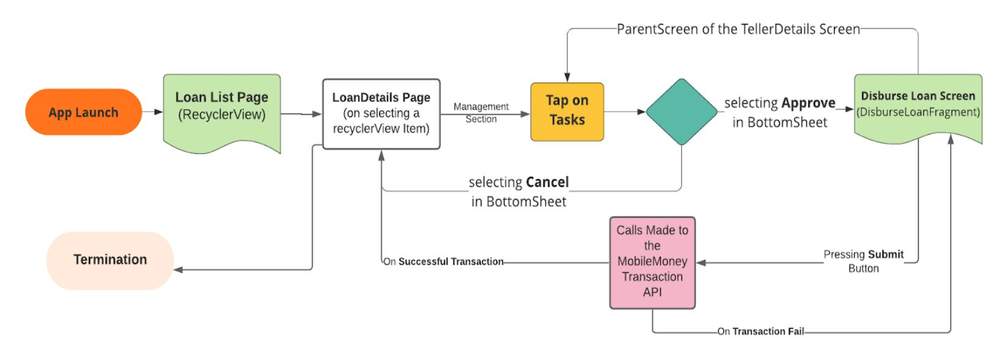
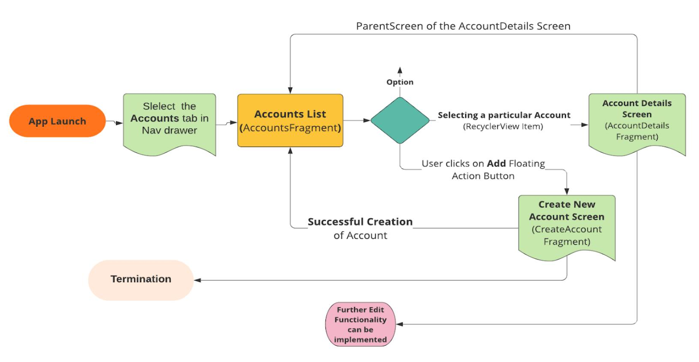
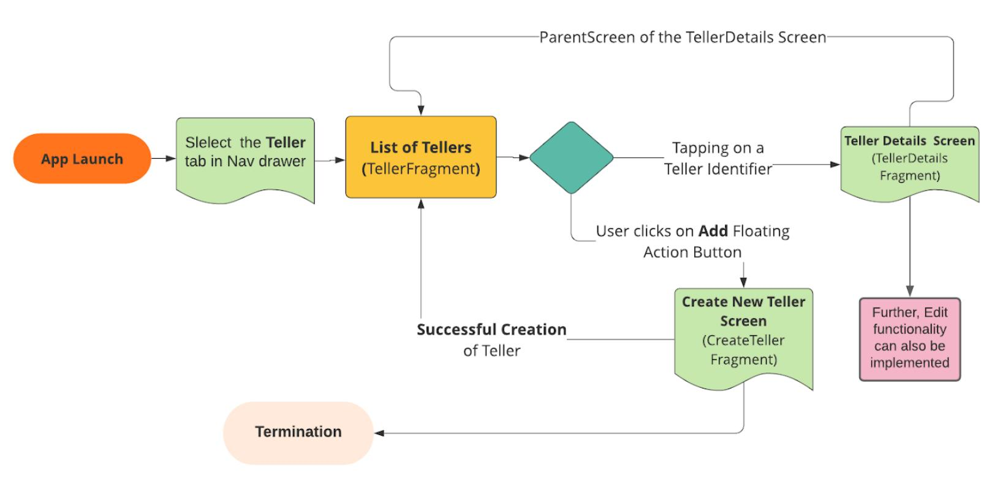
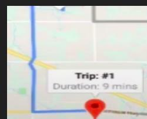

# GSoC' 2021: FUNCTIONAL ENHANCEMENTS TO **Fineract CN Mobile App**

This Document is the Project Proposal for the Project: Functional Enhancements to the Fineract-cn-mobile Application for GSoC 2021

## ABOUT THE PROJECT?

The Fineract-cn-mobile application is the Android client of Apache Fineract CN, built on top of the FIneract CN Platform. It provides banking solutions for people around the world who are unbacked. This app is for field officers who go to their customers and provide them with financial services.

In the previous versions of App, the support for adding functionalities to create Ledger was implemented, Kotlin support was extended in the app, the Couchbase database was integrated into the app to implement offline mode in the app and the UI was improved for Groups and other related functionalities were added.

This year, the main focus would be to

- Integrate the Payment Hub to enable the disbursement making use of Mobile Money API
- Add Task management features into the App
- Implement UI for creating new Account and displaying account details and also for creating tellers and displaying teller details. Also, will be implementing support for the creation of the latter two features, if time permits
- Improving the offline functionality of the application via Couchbase database support.
- Targeting to also improve the GIS features in the app such as location tracking. , refer [here](#page-10-0)

## ABOUT ME?

I am Varun Jain, a second-year undergraduate in the Dept. Of Electronics and Instrumentation Engineering at Birla Institute of [Technology](https://www.bits-pilani.ac.in/) and Science, Pilani, India. I am a self-taught and passionate Developer always ready to learn. I have corporate experience in the field of Mobile Application development for almost 2 years, with experience in Native App development(Android with Java/Kotlin as well as iOS with Swift), Cross-platform Development using Flutter, Front-end technologies including HTML, CSS, JavaScript and basic-level knowledge of Backend Development using NodeJS and MongoDB.

## Tech Skills and Work Experience?

I have been working as a Core App Developer at Student's Union [Technical](https://bits-sutechteam.org/) Team, BITS Pilani, a student body that finds technical solutions for Student problems and their welfare, for more than a year. The team is responsible for all the development work in college software or fests. The source code to these apps resides in Private Repositories, but if the mentors are interested, I might provide them access to view my contributions to these apps. Some information about the work I did here is given below:

| App Name      |              | BITS SU APP    |              | StudyDeck                           |
|---------------|--------------|----------------|--------------|-------------------------------------|
| SU            | APP was      | built          | with a       | vision to                           |
| make          | campus       | life           | easy,        | efficient                           |
| and           | smart.       | whenever       | you          | spend                               |
| money         | on           | any of         | the          | eateries on                         |
|               | campus,      | you            | instantly    | get a                               |
|               | notification | in your        | App.         | The Ap                              |
| also          | has a        | QR system      |              |                                     |
|               | implemented  | in it          | which        | is used                             |
| as            | an           | authentication |              | measure                             |
| while         | taking       | delivery       | of           | the                                 |
|               | merchandise  | or             | attending    | events.                             |
| The           | app          | has a study    | portal       | where                               |
| all           | the college  |                | students     | can                                 |
| upload        | and          | share          | their        | study                               |
|               | resources    | with           | their peers. |                                     |
|               |              |                |              | StudyDeck is an App that eases      |
|               |              |                |              | the procedure to build a Timetable  |
|               |              |                |              | at the campus. With this app, one   |
|               |              |                |              | can easily make a timetable right   |
|               |              |                |              | from the app, all the logic for     |
|               |              |                |              | detecting clashes in classes has    |
|               |              |                |              | been implemented. The app also      |
|               |              |                |              | offers the functionality to         |
|               |              |                |              | automatically add the alarm for all |
|               |              |                |              | the classes. You can also take      |
|               |              |                |              | notes in the app, which are synced  |
|               |              |                |              | with the real-time database and     |
|               |              |                |              | can be viewed on the StudyDeck      |
|               |              |                |              | website also.                       |
| Time required |              |                |              |                                     |
| to build      |              |                |              |                                     |
|               | Oct          | 2019 ~         | Dec          | 2019 Apr 2020 ~ Jun 2020            |
| No. of Users  | more than    | 5000           | are          | using this                          |
|               |              | app, at        | Present.     |                                     |
|               |              |                |              | more than 5000 are using this       |
|               |              |                |              | app, at Present.                    |
|               |              |                | Flutter,     | Dart, GitHub, Android, iOS.         |
| Platforms     |              |                |              | Both Android as well as iOS         |
| Store links   | Google       | Play           | Store        | Link                                |
|               |              | iOS Store      | Link         |                                     |
|               |              |                |              | Google Play Store Link              |
|               |              |                |              | iOS Store link                      |

I am also working at BInary [Numbers](https://binarynumbers.io/) IT Zone LLP as a Software Developer Intern. I have been working as an App developer here. I worked on:

- The Cinepolis Gulf [Android](https://play.google.com/store/apps/details?id=nz.co.vista.android.movie.cinepolisbahrain&hl=en_IN&gl=US) and [iOS](https://apps.apple.com/us/app/cin%C3%A9polis-gulf/id1449779192) app, which is the official app of [Cinepolis](https://cinepolis.com/) for gulf countries. It is a movie ticket booking app.
- I have also been working on enhancing and improving the state management and architecture of the Empire [Cinemas](https://play.google.com/store/apps/details?id=com.binary.empirecinema&hl=en_IN&gl=US) App with the use of Provider and MVVM architecture.

I like to learn things, does not matter what it is as long as I am learning something, may it even be cooking.

All my projects are available on my GitHub profile: <https://github.com/varsvat>

- A fully functional WhatsApp Clone Android App with firebase: <https://github.com/varsvat/EdunomicsTaskChatApp>
- A Twitter UI Clone App: [https://github.com/varsvat/clone\\_Twitter\\_UI](https://github.com/varsvat/clone_Twitter_UI)
- An App that shows 360 Degree view of a car with Hand-gestures: <https://github.com/varsvat/ImageView360degree>

## Contact Me

➢ **Full Name:** VARUN JAIN ➢ **GitHub:** <https://github.com/varsvat> ➢ **LinkedIn:** <https://www.linkedin.com/in/the-varun-jain/> ➢ **Personal Email ID:** [varunsanjeevjain@gmail.com](mailto:varunsanjeevjain@gmail.com) ➢ **University Email ID:** [f20190348@pilani.bits-pilani.ac.in](mailto:f20190348@pilani.bits-pilani.ac.in) ➢ **Skype ID:** live:.cid.4f7c98ee192fab2b ➢ **Mobile no.:** +91 9926829362 ➢ **Gitter ID:** @varsvat ➢ **Time Zone:** IST (UTC +5:30)

## Design / Description Of Work:

## **Integrate with Payment Hub to enable disbursement via Mobile Money API**

#### **Description**:

Payment Hub is the component, which connects DFSPs to switches. The Payment Hub communicates with the Fineract versions via REST API. The GSMA mobile has been integrated with the Mifos Payment Hub by Sidhant Gupta in GSoC'2019, here is his [final](https://gist.github.com/sidhant-gupta-004/090a9e95b3066e5dd0f8f6005ea60d04) [report](https://gist.github.com/sidhant-gupta-004/090a9e95b3066e5dd0f8f6005ea60d04).

#### I have **already successfully deployed PaymentHub Project at my local ubuntu machine**

using these [steps](https://gist.github.com/sidhant-gupta-004/090a9e95b3066e5dd0f8f6005ea60d04#deployment-steps--for-ubuntu). In the fineract-cn-mobile, field officers should be able to disburse the loan for the customers.

The GSMA Mobile Money API is an initiative that provides an easy and secure API for mobile money transactions and management. The API has been structured and configured based on the RESTful Principles.

#### **Implementation:**

I am looking forward to integrating the mobile Money API to enable the feature of disbursing loans from the app itself, by the field officers.

Currently, the APIs of the GSMA in Mifos Payment Hub are not ready, Once they are ready and I will integrate the APIs in the App. The two APIs of GSMA mobile money API that I will be using to integrate will be the **Accounts API** and the **Transaction API**. For some more information about the API can be found [here](https://developer.mobilemoneyapi.io/api/v1.0#/default).

I will be creating Kotlin models for the above mentioned two APIs. We can create the Bottom sheet created by Ahmad for the disbursal of the Loan. You can find the UI for the disbursal

[here.](https://www.figma.com/file/KHXtZPdIpC3TqvdIVZu8CW/fineract-cn-mobile?node-id=65%3A1561)

## **Mockup Screens:**

## **Workflow/flowchart:**

## **Improve Task Management features into the app**

#### **Description:**

Many tasks are needed to be taken care of in a Banking Institution like the approval of Field Officers is required before the disbursement of Loan. There might also be a need to modify some details or update the status of a process. For eg: There might be a need to update the status of the Loan Account from 'Verification Pending' to 'Loan Approved' or 'Declined'.

## **Implementation:**

The support for loan account-related tasks like approving. closing, deleting or rejecting has already been implemented by Ahmad, refer to this, but the implementation is done with mock data as there is no API for implementing this functionality. Therefore, we would first have to make FINERACT CN API ready and once it's done, I will be integrating the API Endpoints with the UI. After this, these features will be successfully implemented:

- Disburse a Loan
- Approve a Loan
- Delete a loan account
- Reject a Loan

Currently, the App does not have an option to open or close a Teller. I will be implementing this. The Fineract API documentation already has an [endpoint](https://izakey.github.io/fineract-cn-api-docs-site/teller/) implemented for this functionality. I am trying to keep the UX similar to the one implemented by Ahmad [here](https://gist.github.com/jawidMuhammadi/9fa91d37b1cbe43d9cdfe165ad8f2102#5-added-task-management-feature-for-the-loan-account) to maintain a uniform UI in the App. So basically, a user would be able to create or edit a teller as proposed [here](#page-9-0), On this screen, there will also be an option to open or close a teller, Once the

user clicks on this, a bottom sheet would appear, where the concerned person can select the appropriate option and close/open the Teller.

#### **Mockup Screens:**

#### **Tasks in TellerDetailsFragment**

#### **Endpoint Description**

Content-Type: application/json Accept: application/json "assignedEmployeeIdentifier" : "Ashu"

#### **Create UI for Creating a new Account and displaying Account details**

#### **Description**:

Whenever a Field officer would disburse a Loan or approve a Loan to a Customer, an option to create a Loan account should be present, but at present, there is just mock Data present in the Account Screen and option to create a new Loan account or any account is not present. Also, nothing happens on tapping the Account card. I will implement the feature to **create a new Loan Account** and to **display Account details** in the new screen that will launch upon clicking the Account Card.

### **Implementation**:

On navigating to the Account Details Page, We can also provide an **option to open the linked Ledger right from the AccountDetails screen** just like it is currently implemented to open the LoanAccounts fragment right from the Customer Details page.

## **Flowchart/Workflow** :

## **MockupScreens:**

| Feature CreateLoanAccount        | LoanAccountDetails        |
|----------------------------------|---------------------------|
| One activity named               |                           |
| CreateLoanActivity, that extends |                           |
| FineractBaseActivity and         |                           |
| No                               | new activity to be        |
| created                          | for this feature          |
| Total three fragments will be    |                           |
| made under the stepper layout    |                           |
| for the creation of LoanAccount, |                           |
| ● FormAccountDetails.kt          |                           |
| ● CreateAccountReview.kt         |                           |
| One                              | fragment will be          |
| created                          | that would replace        |
| the                              | current                   |
| AccountsFragment                 | when                      |
| the                              | user taps on a particular |
| account                          | card.                     |
|                                  | ● AccountDetails.kt       |

| ● The        | LoanAccount |          | no.                            |
|--------------|-------------|----------|--------------------------------|
| should       |             | not be   | empty                          |
| ● A          | Password    |          | has to be set                  |
| for          | the         | same.    |                                |
| ● There      |             | would    | be a field for                 |
| entering     |             | Assigned |                                |
| Employee,    |             | which    | must                           |
| not          | be          | empty    |                                |
| ● The        | cheque      |          | receivable                     |
| field        | must        | comprise | of                             |
| alphanumeric |             |          | characters                     |
| between      |             | 10-28    |                                |
|              |             |          | This is a view-only screen. So |
|              |             |          | no check at this screen. If    |
|              |             |          | the user clicks on the edit    |
|              |             |          | button, the user will be       |
|              |             |          | directed to the                |
|              |             |          | CreateLoanAccount screen.      |

## Create UI for the creation of Tellers and displaying details of Tellers

## **Description**:

A teller services indoor and drive-through windows and helps customers with transactions. Bank Tellers assist customers by answering questions, processing transactions, and assisting them with other bank business and therefore, are a vital part of Banking service. Right now, in the App, we don't have an option to create new Tellers or edit or display the Teller Details. I will be Creating The XML files and data models for the UI and also the proper implementation adhering to the practices and architectures used in the Project now. Such as: Inheriting the BaseActivity Class in the newly created Kotlin classes.

## **Implementation**:

For the CreateTeller Screen, I will be using the already used [StepperLayout](https://github.com/stepstone-tech/android-material-stepper) with three levels, where the last level/step of the stepper will be to review the details of the loan account. The workflow for the various screens has been described below with the help of a [Flowchart](#page-9-1).

| Feature CreateTeller               |                | TellerDetails          |
|------------------------------------|----------------|------------------------|
| One activity named                 |                |                        |
| CreateTellerActivity, that extends |                |                        |
| FineractBaseActivity and           |                |                        |
|                                    | No             | new activity to be     |
|                                    | created        | for this feature       |
| Total three fragments will         | be made        |                        |
| under the stepper layout for       | the            |                        |
| creation of a Teller, namely       |                |                        |
| ● FormTellerDetailsFragment.       |                |                        |
| ● Form                             |                |                        |
| ● TellerReview.kt                  |                |                        |
|                                    | One            | fragment will be       |
|                                    | created        | that would             |
|                                    | replace        | the current            |
|                                    | TellerFragment | when the               |
|                                    | user           | taps on a Teller card. |
|                                    |                | ● TellerDetails.kt     |

| ● The teller code/no. |            | should      |         |                             |
|-----------------------|------------|-------------|---------|-----------------------------|
| not be empty          |            |             |         |                             |
| ● A Password has      | to         | be          | set for |                             |
| the same.             |            |             |         |                             |
| ● There would be      | a          | field       | for     |                             |
| entering Assigned     |            |             |         |                             |
| Employee, which       |            | must        | not     |                             |
| be empty              |            |             |         |                             |
| ● The cheque          | receivable |             | field   |                             |
| must comprise         | of         |             |         |                             |
| alphanumeric          |            | characters  |         |                             |
| between 10-28         |            | characters. |         |                             |
|                       |            |             |         | This is a view-only screen. |
|                       |            |             |         | So no check at this screen. |
|                       |            |             |         | If the user clicks on the   |
|                       |            |             |         | edit button, the user will  |
|                       |            |             |         | be directed to the          |

## **Flowchart/Workflow** :

#### **MockupScreens**:

Based on the information that I could gather from this [Website](https://cwiki.apache.org/confluence/display/FINERACT/Teller) and the data [model](https://github.com/apache/fineract-cn-mobile/blob/development/app/src/main/java/org/apache/fineract/data/models/teller/Teller.kt) for the teller, present in the Project source Code, I have tried to make some Mockup Screens:

## Improve GIS features like location tracking, dropping of a pin into the app

## **Description:**

On a daily basis, field officers have to navigate to the customers/clients for repayment or collection/verification of documents. Some GIS features like adding a pin to the customer location, show nearby customers, navigate to a customer, Path tracking has already been implemented by Ahmad in GSoC 2020, as stated [here](https://gist.github.com/jawidMuhammadi/9fa91d37b1cbe43d9cdfe165ad8f2102#11-added-gis-feature-like-location-tracking-and-dropping-of-the-pin-into-the-app). So, before I work on other functionalities, **this [PR](https://github.com/apache/fineract-cn-mobile/pull/110) needs to be merged first**. Currently, there is no support for saving user's tracked path coordinates. For more information, refer to [this](https://issues.apache.org/jira/browse/FINCN-237). So I will integrate the Endpoints in the App once they are ready. I will discuss with the mentors and other community members what new features need to be implemented and then work on them accordingly.

## **Implementation:**

Acc. to the [PR](https://github.com/apache/fineract-cn-mobile/pull/110) made by Ahmad, one Activity has to be created which would be for PathTracking functionalities(PathTracking.java). There will be two screens, one for seeing the history of the visited Customer's address and another one where all the Maps integration will be done.

- The setup part would have been already done by Ahmad.

- We can also show the **real-time distance** from the destination and also retrieve the **travel time information by** overriding the [onPolylineClick\(\)](https://developers.google.com/android/reference/com/google/android/gms/maps/GoogleMap.OnPolylineClickListener) method and show it to the user. This would be a nice feature for the app to support and very beneficial for the field officials.

LatLng location1 = *new* LatLng(-34, 151); LatLng location2 = *new* LatLng(-27.470125, 153.021072); *public void* onMapReady(GoogleMap googleMap) { mMap = googleMap; distance = SphericalUtil.computeDistanceBetween(sydney, Brisbane);

- I will be using Polylines to display the routes while navigating if there are some problems in the already implemented code upon discussion with the mentor.
- We can also make **use of Polygons to show the area where officials' all customers and clients reside**.

*public void* onMapReady(GoogleMap googleMap) { Polyline polyline1 = googleMap.addPolyline(*new* PolylineOptions() .clickable(*true*) .add( *new* LatLng(-35.016, 143.321), *new* LatLng(-34.747, 145.592), *new* LatLng(-32.491, 147.309))); googleMap.setOnPolylineClickListener(*this*); googleMap.setOnPolygonClickListener(*this*); Polygon polygon1 = googleMap.addPolygon(*new* PolygonOptions() .clickable(*true*) *new* LatLng(-27.457, 153.040), *new* LatLng(-33.852, 151.211), *new* LatLng(-37.813, 144.962), *new* LatLng(-34.928, 138.599))); polygon1.setTag("alpha");

## Improve offline mode via Couchbase support

#### **Description:**

Couchbase Mobile is the complete NoSQL database solution for all data storage, access, sync and security across the entire application stack. It includes an Embedded database, Rest API and Synchronization. After the implementation of this feature, the field officers will be able to use the application and work with data no matter if internet connectivity is present or not. Any application is linked to the backend for dynamic data loading but some caching to local storage is required to keep the app usable even when there is no internet connection.

## **Implementation:**

Broadly, Couchbase comprises three major components, namely **Couchbase Lite**(which is a NoSQL JSON database for mobile apps), **Couchbase server**(highly scalable and distributed NoSQL database platform) and **SyncGateway**(which will be used as a synchronization mechanism. While there is no Internet connection, It will cache the modified data in the local storage and sync the data whenever an Internet connection is available ). As is described in this [Issue](https://issues.apache.org/jira/browse/FINCN-238), developers need to add a variable named document type in all data classes when integrating SyncGateway.

Currently, the app does not have support for offline devices. So, if the field officer has some bandwidth issues, he could not update any data in the app. As is mentioned [here,](https://gist.github.com/jawidMuhammadi/9fa91d37b1cbe43d9cdfe165ad8f2102#12-integrated-the-app-with-couchbase-database) Ahmad has already implemented this offline support for Customer and group-related activities(like creating or viewing customers or groups) and task management features like activating or closing a group. **So first we will have to merge this [PR](https://github.com/apache/fineract-cn-mobile/pull/111).**

Once it is merged, I will be integrating the Couchbase database for adding support for offline functionalities for some of the features like Viewing Ledgers, creating Ledgers, Editing Ledgers, create accounts, View accounts, create Tellers, view tellers. For integrating this for Ledger, this [PR](https://github.com/apache/fineract-cn-mobile/pull/99) by Ahmad must be merged first as it implements the create Ledger, edit Ledger and related tasks.

#### **Changes that are to be made in the AndroidManifest.xml file**

*android:networkSecurityConfig*="@xml/network\_security\_config"

#### **Changes that are to be made in the app/build.gradle file to set up CouchBase:**

dependencies {

implementation 'com.couchbase.lite:couchbase-lite-android-ee:2.6.0'

#### **Gaining familiarity with CouchBase database and this is how to use it:**

CouchbaseLite.init(context); // this will be done in a OnCreate method mp final DatabaseConfiguration config = new DatabaseConfiguration(); config.setDirectory(context.getFilesDir().getAbsolutePath()); Database database = new Database("my-database", config); database.close() // You must configure and initialize a replicator for each Couchbase Lite Database instance you want to sync // initialize the replicator configuration *final* ReplicatorConfiguration thisConfig = *new* ReplicatorConfiguration( thisDB, URLEndpoint(URI("wss://listener.com:8954"))); *// Create replicator // Consider holding a reference somewhere // to prevent the Replicator from being GCed final* Replicator thisReplicator = *new* Replicator(thisConfig); // Start replicator thisReplicator.start(*false*);

## Write Unit tests, Integration tests and UI tests

#### **Description:**

Currently, in the App, MVP architecture has been implemented but only a few of the presenters have their test cases written. Clean architecture always invites testing and so we should work on writing Unit integration tests. I will be writing the Integration tests as well as some UI tests using libraries like [Junit](https://junit.org/junit4/), [Mockito](https://site.mockito.org/) and [Espresso.](https://developer.android.com/training/testing/espresso) I have already worked with the espresso and Mockito library but I am new to Junit library. So, I will be approaching mentors and discuss with them which library is to be used. I also look forward to seeking guidance from mentors if I get stuck somewhere.

## **Implementation:**

- For writing tests for Presenter classes, I will use the Mockito framework with which I can test presenters with the help of mock views and seeing the result of presenters in the success and failure cases.

- For testing models, I will check the behaviour of the getters and setters of various models and examine their outputs in each case.

#### **Testing library needs to be set up in the build.gradle file:**

dependencies { androidTestImplementation 'androidx.test:runner:1.1.0' androidTestImplementation'androidx.test.espresso:espresso-core:3.1.0' }

- I look forward to implementing UI tests with the use of the Espresso library. I will be using Espresso along with ActivityScenarioRule in the JUnit4 style which would reduce the boilerplate code. I will use ActivityScenarioRule as it launches the activity under test before each test method annotated with @Test. Many more customizations can be achieved by making use of other annotations like @Before, @After, etc.

#### **Defining custom View Actions for UI test integrations of RecyclerViews:**

fun clickItemWithId(id: Int): ViewAction { *return* object : ViewAction { override fun getConstraints(): Matcher<View>? { *return* null override fun getDescription(): String { *return* "Click on a child view with specified id." override fun perform(uiController: UiController, view: View){ Val v = view.findViewById<view> as view v.performClick()

## Scheduling

According to the GSoC Website, this time the Google summer of code is going to be around 10 weeks long. Below, I have tried to estimate and showcase how I am going to deliver and cover by goals and by what time.

Please find below the expected timeline

| May 17, 2021 May 23,    |            |               |                  |                       |                |           |              |
|-------------------------|------------|---------------|------------------|-----------------------|----------------|-----------|--------------|
| 7 ●                     | I will     | be            | Interacting      | with                  | the other      |           |              |
|                         |            | community     |                  | members and           | mentors.       |           |              |
| ●                       | Try to     | know          | the              | application’s         |                | Goals     | better       |
|                         | which      | will lay      | the              | foundation            | rock           | for       | the          |
|                         | journey    | ahead         |                  |                       |                |           |              |
| ●                       | Go         | through       | the              | codebase              | more           | deeply    | and          |
|                         | read       | the           | required         |                       | documentation. |           |              |
| May 24, 2021 1 I        | Will be    | occupied      |                  | with Practice         |                | School-I  |              |
|                         |            | Registration  | wor,             | so won’t              | be able        | to        | devote       |
|                         | much       | time          | as               | already               | mentioned      |           | here but I   |
|                         | will       | surely        | compensate       |                       | for this       |           | afterwards.  |
| May 25, 2021 June 6,    |            |               |                  |                       |                |           |              |
| 13 ●                    | Resume     | the           |                  | Interaction           | with my        |           | mentors      |
|                         | and        | other         | community        |                       | members        |           |              |
| ●                       |            | Discussing    | with             | mentors               | about          | the       | right way    |
|                         | I can      | implement     |                  | the                   | features.      |           |              |
| ●                       | Asking     | for           | feedback         | from                  | other          |           | community    |
|                         | members    |               | and              | mentors               | for the        | features  | that I       |
|                         | am         | thinking      | of               | implementing.         |                |           |              |
| ●                       | Going      | more          | deeply           | through               | the            |           | Codebase     |
|                         | and        | asking        | the              | doubts to             | mentors        |           | and          |
|                         | reasons    | for           | following        | a                     | particular     |           | approach     |
|                         | and        | not the       | other.           | I will                | also spend     |           | time         |
|                         | getting    | familiar      |                  | with the              | Mifos          | Platform  | APIs         |
| Coding                  | Period     | Begins        |                  |                       |                |           |              |
| June 7, 2021 June 13,   |            |               |                  |                       |                |           |              |
| 7 Creating screen       | UI         | for           | creating         | Tellers               | and            | Teller    | details      |
| ●                       | Prepare    | the           | layout           | files                 | for the        |           | Fragments to |
|                         | be         | used in       | the              | stepperLayout,        |                | namely,   | Teller       |
|                         | details,   |               |                  | TellerAccountdetails, |                | review    | teller       |
|                         | details    | and           |                  | TellerDetails         | screens        | and       |              |
|                         | finalizing |               | them             | with                  | mentors.       |           |              |
| ●                       | Add        | necessary     |                  | Validations           | and            | complete  | the          |
|                         | layout     | files         |                  |                       |                |           |              |
| ●                       | Discuss    | with          | the              | mentor                | if to          | integrate | the          |
|                         | required   | APIs          | and              | go                    | through        | the       | required     |
|                         | API        | documentation |                  | if req.               |                |           |              |
| ●                       |            | Implement     | APIs             | if any                |                |           |              |
| ●                       | Write      | relevant      |                  | Unit/Integrations     |                | tests     | and          |
|                         | testing    | UI            |                  |                       |                |           |              |
| June 14, 2021- June 18, |            |               |                  |                       |                |           |              |
| 2021 5                  |            |               |                  |                       |                |           |              |
| Improve                 | Task       |               | management       |                       | features       | into      | the app      |
| ●                       | Design     | and           | discuss          | the                   | layout         | for the   |              |
|                         |            | BottomSheet   | with             | mentors               |                |           |              |
| ●                       | Create     | required      |                  | data                  | classes and    |           | integrate    |
|                         | the        | APIs via      | the              | Presenter             | class          |           |              |
| ●                       | Check      | for           | bugs             | and make              | sure           | that      | nothing      |
|                         | has        | been          | broken           |                       |                |           |              |
| ●                       | Write      |               | Unit/Integration |                       | tests          |           |              |

|                        | Evaluations  |                 |                  |                |                      |                 |
|------------------------|--------------|-----------------|------------------|----------------|----------------------|-----------------|
| June 18, 2021 June 22, |              |                 |                  |                |                      |                 |
| 5 ●                    | Testing      | all             | the              | Implemented    |                      | features and    |
|                        |              | complete        | writing          | tests for      | them.                |                 |
| ●                      |              | Incorporate     | any              | changes        | requested            | by the          |
|                        | mentors      | and             | implement        |                | them                 |                 |
| ●                      |              | Documenting     | the              | work           | done so              | far             |
| ●                      | Write        | Blog            | describing       | the            | Journey              | till now        |
|                        | and          | changes         |                  | implemented    | till                 | now( If time    |
|                        | permits      | )               |                  |                |                      |                 |
| June 23, 2021 July 8,  |              |                 |                  |                |                      |                 |
| 16 Improve             | GIS          | features        | in               | the App        |                      |                 |
| ●                      | Request      |                 | mentors          | and repo       |                      | maintainers to  |
|                        | merge        | this            | PR               |                |                      |                 |
| ●                      | Get          | the right       | API key          | and            | register             | the App on      |
|                        | Google       | cloud           |                  |                |                      |                 |
| ●                      |              | Integrate the   |                  | unimplemented  |                      | APIs and        |
|                        | create       | the             | necessary        | Retrofit       |                      | models and link |
|                        | the          | presenter(which |                  | will           | call APIs)           | to the UI.      |
| ●                      |              | Implement       | the Logic        | for            | real-time            | updating        |
|                        | of the       | GPS of          | the              | user and       | customer             |                 |
| ●                      | Check        | for bug         | fixes            | and            | test the             | integration     |
| ●                      |              | Implement       | the logic        | for            | showing              | a polygon       |
|                        | that         | comprises       | an               | officer’s      | clients’             | location        |
| ●                      | Design       | and             | implement        | UI             | for the              | dialog that     |
|                        | will         | show the        | real-time        |                | travel               | duration.       |
| ●                      | Write        |                 | Unit/Integration | tests          | and                  | UI tests        |
| July 9, 2021 July 23,  |              |                 |                  |                |                      |                 |
| 15 Integrate           |              | with            | Payment          | Hub to         | enable               |                 |
|                        | disbursement | via             | Mobile           | Money          | API                  |                 |
| ●                      |              | Implement       | the UI           | as             | described            | in the          |
|                        | Mockup       | screens         | and              |                | incorporate          | any             |
|                        |              | suggestions     | from             | mentors        |                      |                 |
| ●                      | Go           | through         | the              | documentation  |                      | of GSMA,        |
|                        | APIs         | especially the  | Accounts         |                | and                  | Transactions    |
| ●                      | Create       | the             | required         | kotlin         | data                 | models          |
| ●                      | Create       | the             | Presenter        | classes        | and                  | make calls      |
|                        | to the       | APIs            | and link         | the UI         | data                 | to this class.  |
| ●                      | Test         | the             | implemented      |                | features             | and             |
|                        | mentors      | incorporate     | any              | changes        | suggested            | by the          |
| ●                      | Also,        | check           | for any          | bugs           | while                | transactions    |
|                        | and          | handle          | end cases        |                |                      |                 |
| ●                      | Write        |                 | Unit/Integration | tests          |                      |                 |
| July 24, 2021 July 30, |              |                 |                  |                |                      |                 |
| 7 Creating             | UI           | for             | creating         | new            | Account              | and             |
| Account                |              | details         | screen           |                |                      |                 |
| ●                      | Prepare      | the             | layout           | files for      | the                  | Fragments to    |
|                        | be           | used in         | the              | stepperLayout, |                      | namely,         |
|                        |              | AccountDetails, |                  |                | CreateAccountReview, |                 |
|                        |              | AccountDetails  | and              | finalizing     |                      | them with       |

| ● ● ● ● July 31, 2021 July Aug 16 Improve | Add layout API Write testing | mentors. files Discuss required Implement UI offline | necessary with the APIs and documentation APIs relevant mode | Validations mentor if go through if req. if any via Couchbase | and to         | complete the integrate the the required tests and support |
|-------------------------------------------|------------------------------|------------------------------------------------------|--------------------------------------------------------------|---------------------------------------------------------------|----------------|-----------------------------------------------------------|
| 15, 2021                                  |                              |                                                      |                                                              |                                                               |                |                                                           |
| ●                                         |                              | Discuss                                              | with the                                                     | mentors                                                       | once           | before                                                    |
|                                           |                              | finalising                                           | the                                                          | workflow and                                                  |                | implementation                                            |
| ●                                         | Revise                       | the                                                  |                                                              | documentation                                                 | of the         | Couchbase                                                 |
|                                           | once                         | if                                                   | required.                                                    |                                                               |                |                                                           |
| ●                                         | Create                       | the                                                  | required                                                     | classes                                                       | for            | the                                                       |
|                                           |                              | integration SyncGateway                              | of                                                           | Couchbase                                                     | Lite           | and                                                       |
| ●                                         | Create                       |                                                      | some                                                         | additional                                                    | classes        | or presenters                                             |
|                                           | for                          |                                                      | implementation                                               | of offline                                                    |                | functionality in                                          |
|                                           |                              | Ledgers,                                             | Accounts,                                                    | Teller                                                        | related        | tasks like                                                |
|                                           |                              | displaying                                           | entities,                                                    | or create                                                     | some           | new entity                                                |
|                                           | which                        | will                                                 | then                                                         | be synced                                                     | once           | the internet                                              |
|                                           | is                           | available.                                           |                                                              |                                                               |                |                                                           |
| ●                                         |                              | Configure                                            | and                                                          | initialize the                                                |                | Replicators                                               |
|                                           |                              | wherever                                             | required,                                                    | to sync                                                       | the            | data                                                      |
| ●                                         | Check                        | for                                                  | bugs                                                         | and enquire                                                   | if             | anything has                                              |
|                                           |                              | broken                                               | because                                                      | this                                                          | implementation |                                                           |
| ●                                         | Write                        |                                                      | Unit/Integration                                             | tests                                                         |                |                                                           |
| Aug 16, 2021 Aug 23,                      |                              |                                                      |                                                              |                                                               |                |                                                           |
| 8 ●                                       | Finish                       | all                                                  | the                                                          | Implementation                                                |                | and handling                                              |
|                                           | all                          | the end                                              | cases                                                        |                                                               |                |                                                           |
| ●                                         | Check                        | all                                                  | the                                                          | Implementation                                                |                | for potential                                             |
|                                           | errors                       | or                                                   | bugs and                                                     | do fixes                                                      | where          | required                                                  |
| ●                                         | Finish                       | the                                                  |                                                              | Documentation                                                 | for all        | the work                                                  |
|                                           | done                         | so                                                   | far.                                                         |                                                               |                |                                                           |
| After GSoC 2021 ●                         |                              | Continue Apache/Mifos                                | Open                                                         | Source                                                        | Contribution   | in                                                        |
| ●                                         | Help                         | new                                                  | contributors                                                 | get                                                           | started        | if they are                                               |
|                                           | facing                       |                                                      | problem                                                      | anywhere                                                      |                |                                                           |
| ●                                         | Keep                         |                                                      | reviewing                                                    | the new                                                       | PRs            |                                                           |

## Results For Apache/Mifos Community:

✓ I will be Implementing all the above-mentioned features into the App, following all the previous practices and **architecture** patterns used in the code. For ex: Extending new Activities with FineractBaseActivity. This way the code quality will remain preserved and new features will also be implemented , giving us a better version of the application.

✓ I will also be **documenting** the current Workflows and the upcoming changes to be done so that it is **easy for new contributors to start** and have a proper understanding of the goal and use of the Application. Like, I as a new contributor to this project could not find documentation where all the workflows are clearly mentioned, such as, What does a teller do? What is the ledger meant for? Is the App meant for the common people or the field Officers? I will try to answer all these questions in a well documented file(Readme) / Gist file. ✓ I am also looking forward to maintaining a **BLOG** where I would update my progress regularly to let mentors and fellow contributors know about the progress. These BLOGS will also be helpful for new contributors, to refer to. ✓ I will be Implementing these features, which would lift the level of the application right now. We will be having a **better version of the Application**.

## Other Commitments:

My University provides a Practice School (PS) internship training programme, compulsory for sophomores during the summer (June-July). It is a two-month internship where the students are placed in an organisation of their preference (research institutes, start-ups, NGOs). The duration for this, as proposed by my university is 24th May 2021 - 16th July 2021. Other than this, I don't have any other commitments during this project. However, I can assure you that it won't be having any adverse effect on my contributions and also due to the pandemic, it will most probably be conducted online which means I will be available full-time for this project. I already have the experience to manage my college studies and other stuff, along with an Internship so it won't be hard for me. I will try to contribute more than 36 hours per week during this project. I also pledge my full commitment and dedication to complete this project duly and within the stipulated [timeline](#page-14-0) proposed above.

## Have you deployed and run the Apache fineract and Reference UI?

As I am working on the fineract-cn-mobile project and I am an android developer, I have successfully set up the development environment for:

- [Fineract-cn-mobile](https://github.com/apache/fineract-cn-mobile)
- Mifos [mobile](https://github.com/openMF/mobile-wallet) wallet
- Mifos [Mobile](https://github.com/openMF/mifos-mobile)

I have also successfully set up the Apache Fineract Platform on my local ubuntu machine. I faced some issues regarding the tomcat server but referring to this [link](https://cwiki.apache.org/confluence/display/FINERACT/Fineract+Installation+on+Ubuntu+Server), solved my issue. I was also able to successfully deploy the [reference](https://github.com/openMF/community-app) User Interface.

## Community Engagement:

- **1.** I have joined and been quite active on these IRC channels: **1.1.** [openMF/mifos](https://github.com/openMF) **1.2.** [apache/fineract-cn-mobile](https://github.com/apache/fineract-cn-mobile) **1.3.** [openMF/mobile-wallet](https://github.com/openMF/mobile-wallet)

- **2.** I have been quite active on the JIRA Issue [Tracker](https://issues.apache.org/jira/projects/FINCN/summary) in discussing the correct approach to solve a particular issue and reviewing the issues raised by other contributors also. Some of the Issues opened and solved by me are listed below: **2.1.** <https://issues.apache.org/jira/browse/FINCN-243> **2.2.** <https://issues.apache.org/jira/browse/FINCN-244> **2.3.** <https://issues.apache.org/jira/browse/FINCN-305> **2.4.** <https://issues.apache.org/jira/browse/FINCN-274> **2.5.** <https://issues.apache.org/jira/browse/FINCN-269> **2.6.** <https://issues.apache.org/jira/browse/FINCN-268> **2.7.** <https://issues.apache.org/jira/browse/FINCN-247>
- **3.** Reviewed, requested changes and approved many PRS.

## My Contributions:

Some of the contributions that I have made have been shown below in a tabular format:

| Issue Links Issue |          |               |                |                |              |                       |
|-------------------|----------|---------------|----------------|----------------|--------------|-----------------------|
|                   |          |               |                | Description    |              | PR                    |
| In                | new      | mobiles       |                | with           | complete     | display,              |
| the               |          | Navbar        | is covered     | by             | the          | status                |
| bar               |          | causing       | the            | profile        | icon to      | cut in                |
|                   | some     | screens.      |                |                |              |                       |
| FINCN-244 Bug Fix |          |               |                |                |              |                       |
| At                |          | present,      | Fabric         | SDK is         | integrated   |                       |
|                   | into     | the           | project for    |                | Crashlytics  | which is              |
|                   | now      | deprecated    |                | and was        | reporting    |                       |
| the               |          | app's         | crash          | reports        | only until   | the                   |
|                   | 15th of  |               | November,      | 2020.          | This         | results in            |
| an                | error    | in            | the            | build.gradle   | file         |                       |
|                   |          |               |                |                |              | I require the         |
|                   |          |               |                |                |              | son file to fix this. |
|                   |          |               |                |                |              | I have tackled        |
|                   |          |               |                |                |              | the mentors to        |
|                   |          |               |                |                |              | provide me with       |
|                   |          |               |                |                |              | the same              |
|                   | Checkbox |               | temps          | the user       | to           | click on it           |
| in                | the      | Edit          | payroll        | screen,        | rather       | a tick                |
| or                | cross    | icon          | would          | provide        | a            | better                |
| UX,               | has      | been          |                | implemented    |              |                       |
| The               |          |               | CreateCustomer |                | Activity is  | exiting               |
|                   | directly | when          | the            | back           | button       | is                    |
|                   | pressed  | in            | the            | stepperLayout, |              | which is              |
| not               | a        | good          | pattern        | for a          | data         | updating              |
| Improvement       |          | Functionality | to             | navigate       | to other     |                       |
|                   |          | StepperLayout |                | Fragments      | by           | clicking              |
| on                | the      | tabs          | has            | been           | implemented. | #137                  |
| On                |          | clicking      | on the         | Complete       | button       | of                    |
| the               | edit     |               | customer       | screen,        | There        | is a                  |
|                   | black    | screen        | visible        | for a          | few          | seconds. I            |

## What motivates you the most about working with Mifos Initiative?

As of today 3 billion out of total 7.5 billion people around the world live in poverty. We know how important digital banking is in our lives but the poor people do not get access to all these.

Mifos is currently serving 150 million people and this is exactly what my dream was ever since I started coding. I wanted to build an app that is not just another app rather something really big which would bring change in people's life. The fact that my contributions can help Mifos reach those 3 billion people is what motivates me to work with Mifos. Also, while contributing to Mifos, I'll be mentored by some of the best developers of the world. Getting to work and contributing in such an organization is like a dream come true for me.

## Have you previously participated in the Google summer of code?

No, this is the first time I am applying to Google Summer of Code.

## Are you applying to multiple organizations this year?

No, Mifos/Apache is the only organization I'm applying to.

## If you answered "yes" to the previous question, which is your first choice?

Not Applicable.

## Conclusion:

I am very much excited to work with mentors and other contributors on this Project. I am applying only in Apache/Mifos and therefore, I am really looking forward to working on this. From the very beginning of my coding journey, I have always dreamt to be part of the development team of a Big and Impactful project. I see Apache and Mifos are full of highly skilled developers and I look forward to learning a lot from them. The thought that my code would be used by millions across the globe enthrals every single time and so, I will try to give my 100 percent to this project and ultimately to this organization.