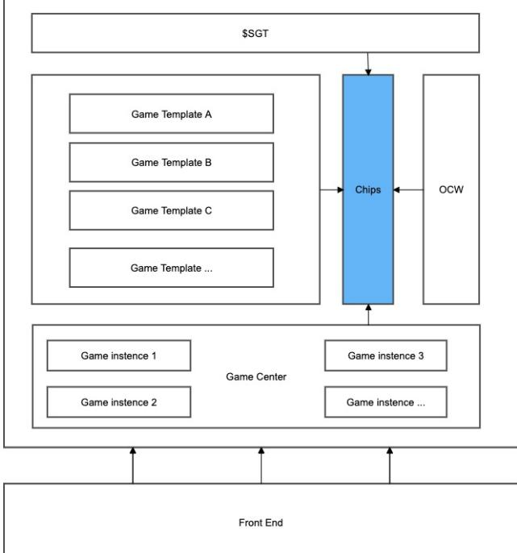
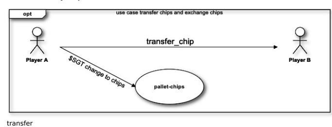
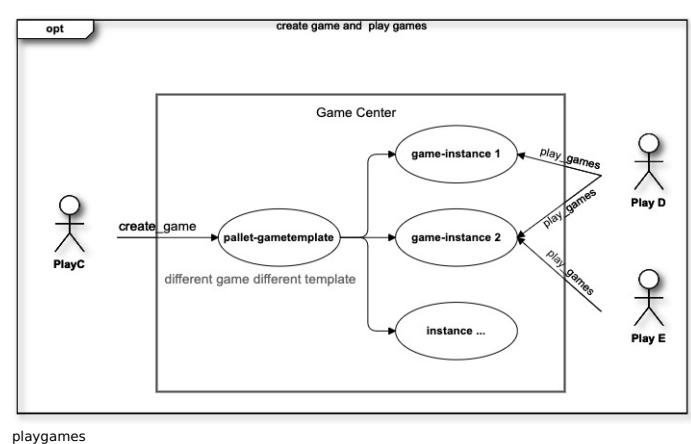

**Team Name:** [SubGame-Network](https://github.com/SubGame-Network) **Payment Address:** 3CK6HN4y2ZEKX7JMfdegds7B7GrUSmv65c

# **Project Overview :page\_facing\_up:**

#### **Overview**

#### **Introduction**

SubGame is a decentralized game platform. There are a large number of game templates running on the platform, so that participants can quickly start the game. The NPOS consensus mechanism is adopted to ensure the fairness of the entire platform. After the mainnet is launched, community autonomy allows the entire ecosystem Cycle forward. SubGame will also provide a friendly game front end, allowing players to enjoy the joy of the game.

The early stage will be based on quiz and probability game templates. For example, you can choose a random factor to create a guessing game and play with your friends. You can also play World Cup quiz with your own friends, and of course you can also buy lottery tickets on it. The above games all exist as templates, you can start the game or participate in other people's games #### Integration SubGame is based on the Substrate 2.0 Framework. Substrate's powerful non-fork upgrade solution will provide more help to the changing game platform. We will also use OCW to introduce more game random factors. SubGame will serve as a parachain , To provide more possibilities for the entire Polkadot ecology #### Team Interest All members of the team are convinced that blockchain will change the world, and have been working hard to create more transparent rules of the game. We have been observing and learning Substrate technology for more than a year. From the current point of view, substrate is our best choice. ### Project Details #### Components The SubGame project

contains SubName Node, Game Template Library, Gamee Chips, Game Center and Front End. \* **SubGame Node** is the customized chain node for SubGame network build by Substrate 2.0 ,it contains the basic functionalities as a normal chain node but also provides the ability to fetch external data needed for games with the OCW (Off-chain Worker) from Substrate 2.0 Framework. \* **SubGame Token SGB \* \* isthenativetokenoftheSubGameNetwork,anditwillplaytheroleofgovernanceandotherutilities. \* \*SGB** like **\$DOT** \* **Game Chips:** is one of the core modules of SubGame, mainly including chips purchase, redemption and income distribution. \* **Game Template Library** is an ever-increasing library of game templates, and new game additions continue to increase through public chain upgrades. for \* **Game Center** stores all game instances and player data. It is the data center of the entire platform \* **Front End** will adapt to the basic game front end to ensure a friendly user experience

#### **Scenarios**

## **Scenario to buy chips and transfer**

As shown above, we will realize the chip exchange of \$SGB in the first stage, and the ETH exchange in the later stage, and the chips of each address can also be freely transferred \* **Scenario to create new game and play games**

Players can build their own games or participate in other people's games. Each game has a gameplay designed in the pallet-gametemplates. The first pallet-gametemplates will be continuously designed and adjusted during the first development stage.

- **Random factor:** the hash string of the future block **Gameplay:**
  - 1. Players create a new game instance and set parameters
    - 1. Block number used for guessing
    - 2. The smallest and largest bet amount
    - 3. Game odds
    - 4. Chips amount
  - 2. All players can participate in the game and bet before the guessed block appears
  - 3. When the target block is generated, the game chips are settled according to the game rules on the chain (this logic can be written in decl\_module -> on\_finalize)

#### **UI mock-ups**

#### <https://www.figma.com/file/8bSq6NEYOKfbcdFXLtsmFR/SubGame>

mock-ups

**The hash string of the future block:** This random factor can actually be modified a lot to make more interesting games, such as lottery games.

In addition to the above-mentioned future block hash as a random factor, we can still introduce off-chain data through OCW from the game design, for example, we want to guess the World Cup or NBA The imagination of the game is endless, but the core of our first phase is to create a fair and reasonable distribution of benefits, and we will continue to increase game templates.

### **Ecosystem Fit**

At present, there is no real decentralized game platform, but more decentralized games. Unlike the past, this time we are going to build a truly decentralized game ecological platform.

## **Team :busts\_in\_silhouette:**

### **Team members**

Shanfeng xie - Project Lead/Management & Research QiangKai - Full-stack Developer ZheSheng Zhang - Front End Developer

#### **Contact**

**Contact Name:** shanfeng **Contact Email:** shanfenggood@gmail.com

### **Legal Structure**

- No Legal Entity ### Team's experience **Shanfeng Xie** Full-stack Developer
- Over 15 years of experiences in Development and Management
- Has plenty of experience in Software Development and Blockchain Development
- Currently, focus on Cross-chain technologies

#### **QiangKai**

- Full-stack Developer
- Over 8 years of experiences in Product Development
- Has plenty of experience in Software Development
- Currently focused on Blockchain Development and Cross-chain Technologies

**ZheSheng** -Front-end Developer - Over 6 years of experiences in Product Development - Has plenty of experience in React - Currently focused on Blockchain Development ### Team Code Repos \* https://github.com/SubGame-Network/

#### **Team LinkedIn Profiles**

https://www.linkedin.com/in/shanfengxie/

## **Development Roadmap :nut\_and\_bolt:**

## **Overview**

**Total Estimated Duration:** 12 weeks **Full-time equivalent (FTE):** 3 FTE **Total Costs:** 0.4 BTC

## **Milestone 1 : The testnet is completed and the first playable game template is built**

**Total Estimated Duration:** 12 weeks **Full-time equivalent (FTE):** 3 FTE **Total Costs:** 0.4 BTC

| Number | Deliverable   | Specification                                                                          |
|--------|---------------|----------------------------------------------------------------------------------------|
| 0a.    | License       | Apache 2.0 / MIT / Unlicense                                                           |
| 0b.    | Documentation | Documents containing the description of whole architecture design for SubGame Network. |
| 0c.    | Testing Guide | We will provide a full test suite and guide for SubGame node manage and                |
|        |               | game template library api.                                                             |
| 1a.    | SubGame Node  | Provide node compilation and installation instructions, start the test network         |
| 2a.    | pallet-chips  | The Chips module has been developed and you can use Chips to participate in            |
|        |               | the game                                                                               |
|        | Storage:      | Chips get(fn get_chips): map hasher(blake2_128_concat)                                 |
|        |               | T::AccountId => u32;                                                                   |
|        |               | 1) pub fn transfer_chips(origin,chips:u32)-                                            |

| 2) pub                                                                           | fn sgt_to_chips(origin,pay:T::Balance)- |                          |                                                    |
|----------------------------------------------------------------------------------|-----------------------------------------|--------------------------|----------------------------------------------------|
| 2b. pallet-gametemplates Complete                                                | the basic                               | module design            | and development of the template library,           |
| and complete                                                                     | the                                     | first game               | template                                           |
| Templates                                                                        | get(fn                                  | get_templates):          | Vec<Template>;                                     |
| TemplateMap                                                                      | get(fn                                  | get_templatemap):map     | hasher(blake2_128_concat)                          |
| u32 =>                                                                           | Template;                               |                          |                                                    |
| Functions: No public                                                             | function                                |                          |                                                    |
| 2c. pallet-gamecenter Management                                                 | of                                      | Game Template            | instances                                          |
| CurrentGameinstances                                                             |                                         | get(fn                   | get_gameinstances): map                            |
| hasher(blake2_128_concat)                                                        |                                         |                          | u32=> Vec<GameInstance>;                           |
| HistoryGameinstances                                                             |                                         | get(fn                   | get_gameinstances): map                            |
| hasher(blake2_128_concat)                                                        |                                         |                          | u32=> Vec<GameInstance>;                           |
| PlayMap                                                                          | get(fn                                  | get_playmap):            | map hasher(blake2_128_concat)                      |
| AccountId=>                                                                      | u32;                                    |                          |                                                    |
| 1) pub                                                                           | fn play_game(origin,                    |                          | instance_id:u32, chip:u32,data:u32)-               |
| 2) pub                                                                           | fn create_game(origin,                  |                          | template_id:u32)-                                  |
| 2d. pallet-gametemplates-guess-hash complete                                     | the first                               | game guess               | hash template                                      |
| Games                                                                            | get(fn game_list):                      |                          | map hasher(blake2_128_concat)                      |
| T::GameIndex                                                                     | =>                                      | <GameInfo>;              |                                                    |
| BetList                                                                          | get(fn                                  | bet_list):               | map hasher(blake2_128_concat)                      |
| T::GameIndex                                                                     | =>                                      | Vec<BetInfo>;            |                                                    |
| GameCount                                                                        | get(fn                                  | game_count):             | T::GameIndex;                                      |
| DrawMap                                                                          | get(fn                                  | draw_map):               | map hasher(blake2_128_concat)                      |
| T::BlockNumber                                                                   |                                         | => Option<T::GameIndex>; |                                                    |
| GameInfo                                                                         | <Owner,                                 | BlockNumber,             | DrawBlockNumber, Amount>                           |
| BetInfo                                                                          | <Account,                               | GameIndex,               | Amount, GameMode>                                  |
| Functions: No public                                                             | function                                |                          |                                                    |
| 3a. Front End                                                                    |                                         |                          |                                                    |
| In the                                                                           | first stage,                            | the basic development    | of the game center will be                         |
| completed,                                                                       | and                                     | the first core           | game interaction process will be completed         |
| 3b. UI mock-ups https://www.figma.com/file/hbwDsOVkP5tJqCnl7v0Smr/Subgame-center |                                         |                          |                                                    |
| 3c. Article/Tutorial We will grant.                                              | write an                                | article or tutorial      | that explains the work done as part of the         |
| 3d. Docker We will                                                               | provide a                               | dockerfile               | to demonstrate the full functionality of our chain |
| and front                                                                        | end                                     |                          |                                                    |

# **Future Plans**

## **Marketing and Community Plans**

Hire 2-3 more developers in the next two months, and set up our core dev team. Hire 1 marketing adviser to set up our marketing team.

## **Development Plans**

In phase 0, Complete the test network, and complete 1 game template, test template games in a small range In phase 1, Develop more game templates, improve user experience, and launch the mainnet In phase 2, Provide platform OpenSDK to facilitate third-party business development based on the public chain Finally, Remove Sudo permissions and start community operation

# **Additional Information :heavy\_plus\_sign:**

https://github.com/SubGame-Network/