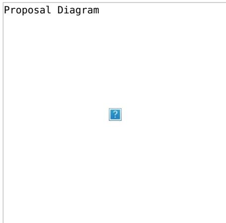

# **NFT AS AN ACCOUNT (NFTAA)**

**Team Name:** Decenzio **Payment Details:** 50% in DOT and 50% in USDC for every milestone **DOT**: 14uSonkTVjMGkJwhqD4oTaDgfGe2LpPgPyS8obomuuNAWfFt **Payment**: 14uSonkTVjMGkJwhqD4oTaDgfGe2LpPgPyS8obomuuNAWfFt (DOT, USDC) **[Level:](https://github.com/w3f/Grants-Program/tree/master#level_slider-levels)** 2

#### **OVERVIEW**

NFT as an Account (NFTAA) is an innovative project aimed at revolutionizing the use of NFTs within the blockchain ecosystem, particularly in the Substrate based networks like Polkadot and Kusama. The project seeks to leverage the unique properties of NFTs to function as proxy accounts, enhancing interoperability, security, and flexibility across various blockchain networks. By enabling NFTs to hold assets, stake, and interact with other blockchain components similarly to standard accounts, NFTAA introduces a novel approach to blockchain interactions.

The core of NFTAA's integration with the Polkadot ecosystem lies in utilizing the Substrate framework to develop custom blockchain logic that supports NFT-based accounts. These NFT accounts can seamlessly interact with other pallets within the Substrate framework, allowing them to own assets, stake, and act as proxies for other accounts. This integration takes full advantage of Polkadot's interoperability features, facilitating seamless communication and data sharing across multiple independent blockchains (parachains) within the Polkadot network.

Our motivation for creating this project stems from the desire to address the inherent limitations and inefficiencies associated with traditional staking methods. Issues such as the illiquidity of staked assets and the complexities involved in transferring ownership pose significant challenges. By utilizing NFTs as accounts, we aim to provide a more secure and flexible staking solution, enhancing user control and ownership. This innovative approach opens new avenues for business opportunities and applications in DeFi and enterprise blockchain solutions, underscoring our commitment to advancing blockchain technology and its applications.

### **PROJECT DETAILS**

#### **Business Overview**

NFTs are unique digital assets that can represent a wide range of physical and digital items with varying values. Traditionally, NFTs operate on the asset side of the owner-asset relationship, lacking the capability to own other assets. Conversely, accounts represent ownership of assets within the blockchain ecosystem. By combining these two concepts, we propose a unique entity that can both be uniquely identifiable and capable of owning other assets, leading to the concept of NFTAA.

One of the significant strengths of the Substrate framework is its ability to facilitate the creation of custom blockchain logic. Through forkless runtime upgrades, it is possible to enhance the functionality of individual modules. This flexibility is critical as runtime pallets operate close to the system's core, offering virtually limitless modification options. Although the transaction weight is a limiting factor in terms of computing resources available for each transaction, it does not detract from the Substrate framework's overall power and adaptability.

Most Substrate pallets are designed based on a single account architecture, aligning with the NFTAA philosophy and facilitating smooth integration with existing infrastructure. By treating NFTAAs as conventional accounts, we can easily leverage the existing infrastructure for seamless communication. Additionally, NFTAAs can function as asset owners or participate in multi-signature schemes, further enhancing their utility and security.

A significant feature of NFTAA is the ability to transfer ownership of such an account/asset to another owner with the real change of the private keys serving the NFTAA. For example, if Alice has an NFTAA in her wallet through which she stakes 100 DOT, Alice can sell the NFTAA to Bob, which causes Alice's wallet to no longer be able to manipulate the NFTAA, meaning, that Bob will have full access using his own private keys that only he knows. This gives NFTAA the unique ability to assess many complex use cases.

The implementation of the NFTAA concept within the Polkadot ecosystem can be approached in two primary ways. The first approach involves creating custom blockchain logic in the form of a pallet, written in Rust as a Substrate module. The second approach involves using smart contracts. For this proposal, we prefer the pallet approach due to its integration capabilities and performance benefits.

The proposed state-of-the-art pallet is based on the nfts and utility pallets. The first step involves implementing and wrapping the NFT logic from the nfts pallet into the nftaa pallet. A collection in the nfts runtime pallet is created to represent an equivalent of a smart contract instance. The nftaa pallet marks a collection so that any token from this collection is treated as an account. After creating a mintable collection, the nftaa special function must be called with the appropriate parameters, including collection\_id and attributes. Attributes are crucial for enterprise use cases, allowing NFTAAs to be marked as entities such as companies or departments within a corporate structure.

Proposal Diagram

Reimplementing the utility.as\_derivate function is the second crucial step. Constructing a keyless address in the runtime pallet from accountId and index is challenging. The index must represent a concatenation of the collection and token ID, but since the index is a u16 type, it cannot accommodate two u32 types. To overcome this, we will use the blake2 hash function to encode the following properties: a binary prefix "modlpy/nftproxy", followed by parachain, collection, and token ID. Both collection and token ID are u32 types, and padding them with zeros to length 32 prevents overlap. The AccountId32 type is then used to construct the address, ensuring a unique address for each NFTAA.

Implementing the nftaa act as a proxy function is the third critical step. This function requires verifying that the caller is the owner of the token, constructing a custom derivative function, setting the derived account as the caller, and executing the original call. This mechanism ensures secure and efficient operations, allowing NFTAAs to function effectively within the blockchain ecosystem.

Ultimately, the proposed pallet will enable the creation of NFTAAs, setting attributes, and staking on the relay chain via the NFTAA. This innovative approach not only enhances the functionality and security of NFTs within the blockchain ecosystem but also opens new possibilities for their application in various business and financial contexts. By combining the strengths of NFTs and blockchain technology, NFTAA represents a significant step forward in the evolution of digital assets and their management.

## **ECOSYSTEM FIT**

The NFTAA project aims to modernize staking and account management within the Polkadot and Substrate ecosystems through the innovative use of NFTs by leveraging the flexibility of the Substrate framework and Polkadot's interoperability features. These NFT-based accounts can own assets, participate in staking, and serve as proxies for other accounts, significantly enhancing security, transparency, and liquidity within blockchain networks.

NFTAA targets a diverse audience, including parachain developers, dApp developers, wallet developers, end users, and researchers. Parachain developers building custom blockchain networks on Polkadot can benefit from enhanced staking and account management features offered by NFTAA. dApp developers will find NFTAA particularly useful for secure and flexible account management and staking solutions. Developers of cryptocurrency wallets can integrate NFTAA to provide users with advanced functionalities, thereby improving the user experience. Both individuals and enterprises looking for improved liquidity in their blockchain assets can leverage NFTAA for better asset management. Additionally, researchers and academics interested in exploring new blockchain innovations can study and expand upon the unique concepts introduced by NFTAA.

The NFTAA project addresses several critical needs within the blockchain ecosystem. Utilizing NFTAA provides more methods for managing and delegating staking rights without exposing private keys. This approach significantly reduces the risk of unauthorized access and enhances overall security. Furthermore, NFTAA allows staked assets to remain liquid, enabling users to trade, lend, or use them as collateral even while they are staked. This flexibility is crucial for users who need access to their assets without compromising their staking benefits. The project also potentially leverages Polkadot's ability to connect multiple blockchains, ensuring seamless asset transfers and interactions across different networks. This interoperability is essential for creating a cohesive and efficient blockchain ecosystem. Moreover, NFTAA empowers users by allowing them to delegate staking rights, transfer ownership of staked assets, and interact with multiple blockchain networks through a single NFTAA, thereby enhancing user control and simplifying asset management.

The needs addressed by the NFTAA project were identified through a comprehensive approach. A literature review of existing research on staking mechanisms, blockchain security, and asset management highlighted the limitations and potential improvements in current systems. Case studies examining current issues faced by stakers and asset managers in blockchain networks like Ethereum and Polkadot provided practical insights into the challenges and opportunities for innovation. Additionally, research on the drawbacks of existing staking mechanisms and the potential benefits of using NFTs for account management provided a solid foundation for the project's conceptual framework.

amount. Bifrost: Provides liquidity for staked assets through a voucher system and supports cross-chain staking. Acala: Offers a similar staking mechanism with its LDOT token, providing immediate liquidity and flexibility in staking.

NFTAA vs. Lido/Bifrost/Acala: Unlike these projects, NFTAA focuses on using NFTs as proxy accounts for staking, which allows for a more flexible and secure delegation of staking rights and ownership. NFTAA also leverages the composability of NFTs, enabling them to hold other assets and act as accounts within the blockchain ecosystem.

Similar concepts exist in other ecosystems:

Rocket Pool: An Ethereum-based protocol for decentralized staking that allows users to earn rewards without running a full node. EIP-6551 (TBA - token bound accounts): A proposed Ethereum standard to enhance NFTs by equipping them with smart contract capabilities, allowing them to own assets and interact with other contracts.

Differences and Distinctions (NFTAA vs. EIP-6551):

NFTAA is designed specifically for the Polkadot and Substrate ecosystems, utilizing their unique features, such as interoperability and cross-chain communication. Additionally, NFTAA's focus on using NFTs as proxy accounts for staking and asset management offers a novel approach compared to the more traditional liquid staking and smart contract enhancements in the Ethereum ecosystem.

EIP 6551 presents certain limitations. Our solution, e.g., does not prioritize connecting existing NFTs but enables bidirectional binding of the NFT and proxy. Consequently, upon ownership of an NFT, we can discern from the NFT metadata indicating its status as an NFTAA. Furthermore, we enhance transparency by ensuring the atomic creation of the NFT and proxy within a single transaction, thereby promoting seamless integration. Likewise, our design does not need the registrar service to create the TBA address as opposed to TBA. In our case, the pallet creates the NFTAA with functionality that also works as the NFTAA address (TBA uses one more address than NFTAA). Another difference is that in TBA, you could have more accounts on one NFT, which, in our case, is not possible due to the atomic creation of exactly one NFT at the time of creating the NFTAA. Regarding security, there are at least two differences between NFTAA and TBA. The first is the possibility of generating the address of TBA sooner without having the deployed contract (as the create2 function for creating contracts is deterministic, i.e., you can calculate the future contract address). In this case, if the upcoming smart contract is badly developed (does not contain an execute function for byte calls to other contracts) or is not upgradeable, it can happen that assets or liquidity sent to the TBA will not be withdrawable and become locked forever (even the NFT bounded in TBA can be sent by a mistake (if not safeguarded) to the address of TBA. Therefore you lock yourself from it). The problem is that TBA uses only the address of any contract you want in the registry contract and does not look for any details on how the contract looks or if it is already deployed. In our case, the account form is pre-defined in the factory pallet, and even after deployment, we guarantee [upgradeability](https://eips.ethereum.org/EIPS/eip-6551#fraud-prevention) as it is a proxy account. The second security issue is potential fraud, which is described in the EIP 6551 specification that you withdraw assets from the TBA and at the same time sell the NFT to someone who thought that they would also have the assets in the TBA. In our case, we provide the security measures for not withdrawing the assets from the NFTAA while also selling the NFT, which is bound to the NFTAA.

In summary, the NFTAA project provides a unique solution to enhance staking and account management in the Polkadot ecosystem by leveraging NFTs' flexibility, security, and interoperability. It addresses key needs identified through comprehensive research and differentiates itself from similar projects in both Polkadot and related ecosystems.

# **TEAM**

Our team comprises seasoned blockchain experts, architects, and developers, each bringing extensive experience in blockchain technology and other technical knowledge. Our blockchain experts have a deep understanding of decentralized systems, consensus mechanisms, and smart contract development. Our architects are adept at designing scalable, secure, and efficient blockchain architectures, ensuring seamless integration and interoperability within the ecosystem. Our developers are proficient in Rust, leveraging its safety and performance features to build robust blockchain applications. Together, we are committed to pushing the boundaries of blockchain innovation and delivering cutting-edge solutions.

## **TEAM MEMBERS**

Name of team leader: Roman Bitarovsky Names of team members: Kristian Kostal Branislav Hozza

## **CONTACT**

**Contact Name:** Roman Bitarovsky **Contact Email:** decenzio@protonmail.com **Website:** decenzio.com

# **LEGAL STRUCTURE**

Roman has 2 years of experience as a Java backend developer in the banking domain. He participated in the development of a mobile banking wallet app and an app for managing loan applications used by bank back-office workers. Additionally, Roman was involved in the development of a DeFi aggregator, an app focused on integrating multiple DeFi functionalities, such as swap, portfolio tracking, loan usage, etc., on the Ethereum network. Roman studies Blockchain technology and completed a bachelor's

thesis on NFTAA, with an article about this published by IEEE (check the Development status section). Currently, Roman is pursuing a Master's degree at FIIT STU and working on ZKP research. His further learning activities include a three-year program focusing on leadership. Recently, Roman co-founded Decenzio, a blockchain and Web3-oriented IT company.

Branislav is a fullstack developer with nearly five years of experience, specializing in technologies such as Vue.js, TypeScript, JavaScript, .NET, and AdonisJS. He has made contributions to the blockchain space, working on the Kodadot NFT gallery platform. Additionally, Branislav played a key role in the development of Tokengram, a DeFi social platform, where he combined his development skills with a passion for decentralized finance. Branislav's academic work further highlights his commitment to blockchain innovation. His bachelor's thesis explored the on-chain representation of gaming assets, utilizing a Substrate pallet to code and research the integration of gaming assets on blockchain networks.

Kristian is an experienced blockchain architect with a lot of projects behind him, e.g., gold-backed cryptocurrency, crosschain interoperability API protocol, an EU-wide blockchain platform for debt financing of SMEs by issuing bonds, a web3 social network, etc. He holds PhD in Computer Science from the Slovak University of Technology, with his dissertation thesis focused on interoperability between heterogeneous blockchain networks. One of the partial challenges in the dissertation thesis was on scalability issues, where he studied Layer-2 techniques, especially with the use of Zero-knowledge proofs. In the last 3 years, he has been working on practical use cases of blockchain networks in different domains of computer science research. Mentionable are smart grids, e-voting platforms, and asset-sharing platforms with privacy preservation. He serves as a Slovak Representative for European blockchain services infrastructure within the European Blockchain Partnership (European Commission) and is also active in cooperating on policy-making documents regarding blockchain technologies. Besides that, he serves as leader of the Blockchain & FinTech research group and has authored 25 academic publications.

## **TEAM CODE REPOS**

A [pool-based](https://github.com/fiit-ba/pool-based-liquidity-protocol) liquidity protocol based on Polkadot An oracle network for Solana [blockchain](https://github.com/fiit-ba/omniscient-blockchain-oracle) [Tokengram](https://github.com/fiit-tp7-2023) social network for NFT holders On-chain [representation](https://github.com/brano-hozza/meta-assets) of gaming assets

#### **TEAM GITHUB PROFILES**

https://github.com/Roman-24 https://github.com/xkostal https://github.com/brano-hozza

### **TEAM LINKEDIN PROFILES**

https://www.linkedin.com/in/romanbitarovsky/ https://www.linkedin.com/in/kristi%C3%A1n-ko%C5%A1%C5%A5%C3%A1l-9599a82b5/ https://www.linkedin.com/in/branislav-hozza-3b7234173/

## **ADVISORS**

Ecosystem developers who agreed to provide advisory help during the project implementation phase: - [Dudo50](https://github.com/dudo50), founder of ParaSpell (Interoperability solutions)

# **DEVELOPMENT STATUS :OPEN\_BOOK:**

This concept has already been implemented as a prototype dApp on an Ethereum-like chain, with its details discussed in two academic publications. The first is a [conference](https://arxiv.org/pdf/2404.14074) full paper presented at the 2024 IEEE International Conference on Blockchain and [Cryptocurrency](https://icbc2024.ieee-icbc.org/) in Dublin. The second is a [Bachelor's](https://opac.crzp.sk/?fn=detailBiblioForm&sid=2D2C61E4341E5366536A1A3BFA9A) thesis where this concept was originally developed and first implemented using Solidity smart contracts on Moonriver.

# **DEVELOPMENT ROADMAP :NUT\_AND\_BOLT:**

## **OVERVIEW**

**Total Estimated Duration:** 6 months **Full-Time Equivalent (FTE):** 2 FTE **Total Costs:** 30,000 USD

## **MILESTONE 1 — BASIC FUNCTIONALITY**

**Estimated duration:** 2.5 months **FTE:** 2 **Costs:** 15,000 USD

At first, we need to take pallet\_nfts, take most core functions of NFS, and wrap these functionalities in our pallet. The reason to add pallet\_nfts as a dependency and wrap the functions is to make usage of our pallet\_nftaa easier and have all functionalities in one package for developers.

Functionalities from pallet\_nfts: - pallet::dispatchables::burn - pallet::dispatchables::buy\_item pallet::dispatchables::clear\_attribute - pallet::dispatchables::clear\_collection\_metadata pallet::dispatchables::clear\_metadata - pallet::dispatchables::create - pallet::dispatchables::destroy pallet::dispatchables::lock\_collection - pallet::dispatchables::lock\_item\_properties pallet::dispatchables::lock\_item\_transfer - pallet::dispatchables::mint - pallet::dispatchables::redeposit pallet::dispatchables::set\_attribute - pallet::dispatchables::set\_collection\_max\_supply pallet::dispatchables::set\_collection\_metadata - pallet::dispatchables::set\_metadata - pallet::dispatchables::set\_price pallet::dispatchables::set\_team - pallet::dispatchables::transfer - pallet::dispatchables::transfer\_ownership pallet::dispatchables::unlock\_item\_transfer - pallet::dispatchables::update\_mint\_settings

| Number |                 | Deliverable Specification                                                                     |
|--------|-----------------|-----------------------------------------------------------------------------------------------|
| 0a.    | License         | MIT                                                                                           |
| 0b.    | Documentation   |                                                                                               |
|        |                 | Inline documentation of code, as well as startup configuration with all necessary commands,   |
|        |                 | included in repository                                                                        |
|        | Testing         | and Testing                                                                                   |
|        |                 | Core functions will be fully covered by comprehensive unit tests to ensure functionality and  |
|        |                 | robustness. In the guide, we will describe how to run these tests.                            |
| 0d.    | Docker          |                                                                                               |
|        |                 | We will provide a Dockerfile(s) that can be used to test all the functionality delivered with |
|        |                 | this milestone.                                                                               |
| 1.     | nftaa_pallet    | We will create the initial version of the nftaa_pallet which includes:                        |
|        | functionalities | from                                                                                          |
|        |                 | Integration with the Substrate nfts pallet                                                    |
| 1b.    | nftaa           | address                                                                                       |
|        |                 | NFTAA creation and ownership management (implement functionality to transfer ownership of     |
|        |                 | NFTAA), construct keyless address for given NFT, create NFTAA address (index) as future input |
|        |                 | to act as proxy                                                                               |
| 1c.    | nftaa           | attributes                                                                                    |
|        |                 | Basic NFT attributes handling, bind NFT and its new keyless address to one entity consists of |
|        |                 | filling in the attributes contained in the NFTAA item                                         |
| 1d.    | nftaa act       | as proxy                                                                                      |
|        |                 | Implement the proxy functionality to allow NFTs to act as proxy accounts, the owner of NFTAA  |
|        |                 | can do a call via it; for this, we will use pallet_utility special function as_derivate. We   |
|        |                 | will ensure that when an NFTAA is listed for sale, assets owned by the NFTAA cannot be        |
|        |                 | withdrawn, effectively preventing fraudulent transfers. Therefore, if the NFTAA is listed,    |
|        |                 | proxy calls will not be possible.                                                             |
| 1e.    | find owned      | assets Functionality needed to find all assets owned by given NFTAA                           |
|        | find NFTAAs     | for                                                                                           |
|        | account         | and owner                                                                                     |
|        |                 | Functions to find owner of given NFTAA                                                        |

# **MILESTONE 2 — ADDITIONAL FEATURES**

**Estimated Duration:** 2 month **FTE:** 1.5 **Costs:** 9,000 USD

Functionalities from pallet\_nfts: - pallet::dispatchables::approve\_item\_attributes - pallet::dispatchables::approve\_transfer - pallet::dispatchables::cancel\_approval - pallet::dispatchables::cancel\_item\_attributes\_approval -

pallet::dispatchables::cancel\_swap - pallet::dispatchables::claim\_swap - pallet::dispatchables::clear\_all\_transfer\_approvals - pallet::dispatchables::create\_swap - pallet::dispatchables::force\_collection\_config -

pallet::dispatchables::force\_collection\_owner - pallet::dispatchables::force\_create - pallet::dispatchables::force\_mint pallet::dispatchables::force\_set\_attribute - pallet::dispatchables::mint\_pre\_signed - pallet::dispatchables::pay\_tips pallet::dispatchables::set\_accept\_ownership

After these, we will add our own functions related to NFTAA staking functionality.

| Number | Deliverable       | Specification                                                                                      |
|--------|-------------------|----------------------------------------------------------------------------------------------------|
| 0a.    | License           | MIT                                                                                                |
| 0b.    | Documentation     |                                                                                                    |
|        |                   | Inline documentation of code, as well as startup configuration with all necessary commands,        |
|        |                   | included in repository                                                                             |
|        | Testing and       |                                                                                                    |
|        | Testing Guide     |                                                                                                    |
|        |                   | Core functions will be fully covered by comprehensive unit tests to ensure functionality and       |
|        |                   | robustness. In the guide, we will describe how to run these tests.                                 |
| 0d.    | Docker            |                                                                                                    |
|        |                   | We will provide a Dockerfile(s) that can be used to test all the functionality delivered with this |
| 2a.    | nftaa check       | We will add functionalities to read and check if NFTAA exists for a given account                  |
| 2b.    | nftaa collections |                                                                                                    |
|        |                   | We will add functionalities to read existing collections and manage NFTAAs if they are in a        |

# **MILESTONE 3 — WEB APPS INTEGRATIONS + ARTICLE**

**Estimated Duration:** 1.5 month **FTE:** 1.5 **Costs:** 7,000 USD

| Number | Deliverable   | Specification                                                                                          |
|--------|---------------|--------------------------------------------------------------------------------------------------------|
| 0a.    | License       | MIT                                                                                                    |
| 0b.    | Documentation |                                                                                                        |
|        |               | Inline documentation of code, as well as startup configuration with all necessary commands, included   |
|        |               | in repository                                                                                          |
|        | Testing and   |                                                                                                        |
|        | Testing Guide |                                                                                                        |
|        |               | Core functions will be fully covered by comprehensive unit tests to ensure functionality and           |
|        |               | robustness. In the guide, we will describe how to run these tests.                                     |
| 0d.    | Docker        |                                                                                                        |
|        |               | We will provide a Dockerfile(s) that can be used to test all the functionality delivered with this     |
| 0e.    | Article       |                                                                                                        |
|        |               | We will publish an article that explains NFTAA (what was done/achieved as part of the grant). The      |
|        |               | article will be published through an online media service, e.g., medium.com or Linkedin, and           |
|        |               | advertised through social networks. Our ambition, as we are from academic environment, is to have also |
|        |               | an academic paper about the idea of NFTAA in Polkadot published in a conference venue                  |

| Web app      |             |             |               |            |                 |          |             |                |              |               |       |            |            |
|--------------|-------------|-------------|---------------|------------|-----------------|----------|-------------|----------------|--------------|---------------|-------|------------|------------|
| Develop      | a webapp    | integration |               | to         | interact        | with     | the         | nftaa_pallet   | (integration | will          | be    | for        | popular    |
| existing     | Polkadot    |             | app for       | example    | like            | Polkadot | Staking     | Dashboard),    |              | allowing      | users | to create, | manage,    |
| and          | transfer    | NFTAAs,     | provide       | a          | web application |          | to          | interact       | with the     | nftaa_pallet: |       | allowing   | users to   |
| create       | collections |             | and single    | item;      | manage          |          | of metadata | and            | attributes;  | operate       | with  | NFTAA      | ownership  |
| (transfers); |             | play        | with staking, |            | increase        | stake    | and         | unstake        | handled by   | NFTAA;        | read  | operations | as get     |
| for          | an account, | get         | assets        | of NFTAA,  |                 | get the  | owner       | of NFTAA       |              |               |       |            |            |
| We will      | also        | prepare     | integration   |            | for             | existing | NFT         | marketplace    | app (e.g.    | Kodadot)      | for   | easily     | buying and |
| selling      | the         | NFTAAs      | with          | an overall | list            | in       | a form      | of a bulleting | board.       |               |       |            |            |

# **FUTURE PLANS**

Once everything is implemented according to the proposed plan, the application will still be under constant improvement as technology progresses.

In the long run, we also want to improve the design and add new features that can be useful for developers and Polkadot users.

# **REFERRAL PROGRAM :MONEYBAG:**

**Referrer:** [VikiiVal](https://github.com/vikiival) **Payment Address:** 15BZFbMsCR1ki59mJHo8iAjgAozGJaYHR3oVRPQWNnoEZiL9 (USDC)

# **ADDITIONAL INFORMATION :HEAVY\_PLUS\_SIGN:**

**How did you hear about the Grants Program?** personal recommendation

The progress we've made so far is detailed in the Development Status section. Here's a summary of the key achievements:

Prototype dApp on Ethereum-like Chain: We have successfully implemented a prototype dApp on an Ethereum-like blockchain. This prototype demonstrates the core concepts and functionality of NFTAA. Academic Publications: Our work on NFTAA has been documented in two academic publications. The first is a conference full paper presented at the 2024 IEEE International Conference on Blockchain and Cryptocurrency in Dublin. The second is a Bachelor's thesis where the concept was originally developed and first implemented using Solidity smart contracts on Moonriver.

This foundational work has provided valuable insights and a solid basis for the development of NFTAA on the Polkadot ecosystem.